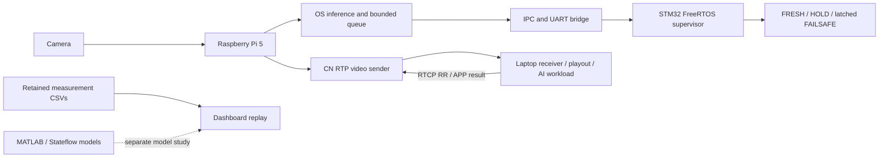

# Edge AI Video Runtime

A course project on keeping edge-AI video results timely across networks and
operating systems. Raspberry Pi 5 workloads expose the effects of scheduling,
contention and queue policy; RTP/RTCP connects video to a laptop receiver, and
an STM32 FreeRTOS supervisor tracks result freshness over UART. A Python
dashboard replays retained CN evidence without hardware. AI inference is the
workload; this project does not introduce a new neural network or prove safety.

This repository extends [heterogeneous-edge-ai-os](https://github.com/KaiserRichard/heterogeneous-edge-ai-os),
where the original OS pipeline, supervisor and OS experiments were developed.
CN is a separate local course project, not previously published, imported from
`work/RTP0` (`66e48bd51e28b353aeb8780e676b36a0235a4b4e`) with identical-tree
ancestor `work/HWAN2` (`c0210d2618d2936ad38ee2f2d960d2b93ff73bea`).
The dashboard, telemetry patch, Stateflow supervisor, shared MATLAB models and
Vietnamese lessons are later additions. Claude/Codex assistance was used.
See [NOTICE](NOTICE.md) for OS code/report commits and
[AI assistance](docs/AI_ASSISTANCE.md) for limits.



The OS and CN experiments are separate teaching pipelines. This diagram does
not claim a validated end-to-end CN-to-physical-supervisor hardware run.

## Replay quick start — no Pi

Requires Python 3.11+, a browser and permission to bind a localhost TCP socket.
The runtime uses the standard library; it needs no package download.
Run these commands from the repository root:

```sh
python3 --version
python3 -m venv .venv
. .venv/bin/activate
cd dashboard
python -m dashboard --mode replay --replay samples/cn-loss5 --loop
```

Open <http://127.0.0.1:8080/>; `/lessons` opens the Vietnamese lessons and
`/demo` the teaching sequence. Stop with Ctrl+C. A sandbox that denies local
sockets cannot host the browser demo. The included offline renderers support
the teaching pages; optional external browser assets can be unavailable.

The [bundled CN excerpt](dashboard/samples/cn-loss5/provenance.json) is the
first eight seconds on each file's local clock from T3/loss5/run1.
`dashboard/samples/os-demo.csv` is explicitly **SYNTHETIC**, not MCU evidence.
Missing optional evidence stays unavailable. See [dashboard commands](dashboard/README.md).

## Retained measurements

These were measured before staging. No hardware measurement was made here.

| Evidence | Observation | Measurement source and limit |
|---|---|---|
| MEASURED CN T3, configured 5% loss | Sequence loss 5.2%; frame loss 24.0%; on-time 76.0% | [Hardware table, CN-T3](cn/rtp/report/hw_tables.md), [five raw runs](cn/rtp/results/T3/loss5/). Packet/frame denominators differ. |
| MEASURED OS idle/P1 | Time-average AoI: FIFO 191.984 ms, latest 92.760 ms | [E3B CSV](os/results/2026-10-30_os_t4_policy/summary/E3B_per_condition.csv), [validity rules](os/results/2026-10-30_os_t4_policy/summary/README.md). Three valid repeats; bridge latest in both. |
| MEASURED OS memory stress/P1 | Time-average AoI: FIFO 334.733 ms, latest 223.517 ms | [Same CSV, B2_memrate_c23](os/results/2026-10-30_os_t4_policy/summary/E3B_per_condition.csv). Software timestamps and PTY, no physical UART/MCU. |

Retain invalid/failed runs and their exclusions. CN T7 uses synthetic service
on hardware; CN T8 hardware adaptation is pending. Larger playout buffers trade
late loss against latency. None of these observations establishes a universal
deadline or physical safety guarantee.

## Hardware — not run during staging

See [OS setup](os/README.md), [firmware instructions](os/stm32/firmware/README.md),
[CN runtime](cn/rtp/README.md) and [dependency pins](third_party/README.md).
Hardware experiments require the Pi/camera, laptop, board/wiring, compatible
toolchains and any requested scheduling/netem privileges. Model weights are
separate inputs. Keep the custom RTP payload identified; it is not RFC 2435.
No firmware compilation, flashing, UART electrical test or hardware run is claimed.

## MATLAB / Simulink / Stateflow — not yet run in MATLAB

Shared models and 30 MATLAB test methods are source awaiting execution.
From the repository's `sim` folder in a licensed MATLAB installation:

```matlab
setup_coursework
run_tests(false)
build_models
run_tests(true)
```

See [model scope and assumptions](sim/README.md). The separate
[supervisor status](sim/os_supervisor/EXECUTION_STATUS.json) records eight
earlier scenarios; those saved simulations were not rerun during staging.
They are not physical measurements.

## Repository map

| Folder | Contents |
|---|---|
| `os/` | Linux camera/inference/bridge, protocol, supervisor/firmware, retained results |
| `cn/` | RTP/RTCP runtime, integrated telemetry, tests, hardware evidence, optional ns-3 model |
| `dashboard/` | Python replay/live observer, tests and bundled excerpt |
| `sim/` | Shared MATLAB sources and separate saved Stateflow supervisor |
| `docs/lessons-vi/` | Canonical Vietnamese lessons and figures |
| `docs/os-report/` | Separately imported, sanitized OS report and drawing sources |
| `docs/provenance/` | Public source and derivative hashes |
| `third_party/` | Licence texts and pinned installation instructions |

For Python and host checks see [CONTRIBUTING](CONTRIBUTING.md).

## Credits and licences

OS team **3 Stars**: Nguyễn Quốc Khánh, Nguyễn Trung Hiếu and Nguyễn Quang Vinh;
lecturer TS. Nguyễn Quang Minh. CN leader Nguyễn Quốc Khánh; four teammate names
and lecturer remain `TODO(owner): name`. Full roles and pending consent are in
[CREDITS](CREDITS.md).

[MIT](LICENSE) covers independent team-owned code, subject to existing component
terms. ns-3/firmware reference GPL terms and CC-BY-SA-3.0 wiring drawings retain
their own scope. See [NOTICE](NOTICE.md). This local review tree is not yet a
published release.
