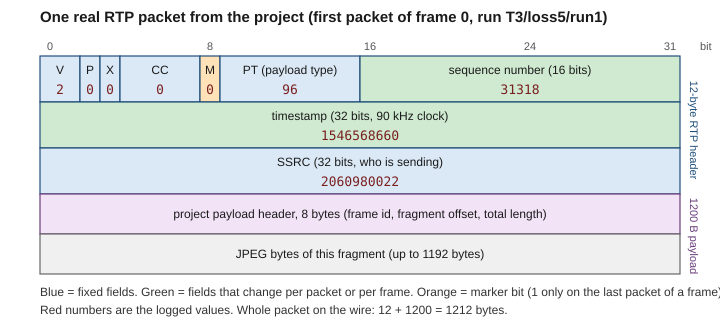
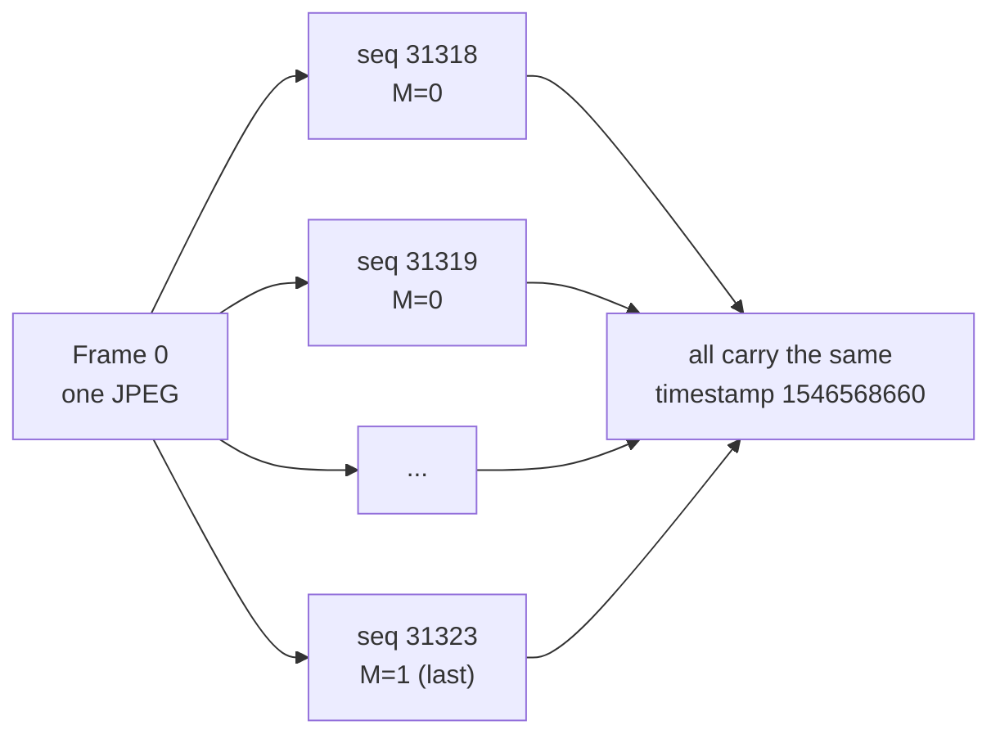
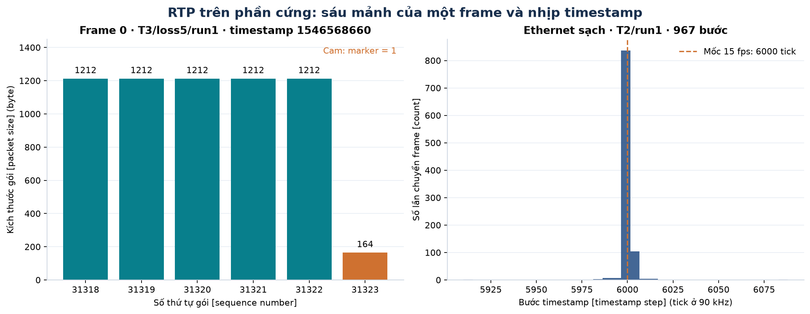

# Bài 01 (CN) — RTP và phần header của nó

> Nhãn: **SOURCE** = đọc trực tiếp từ file, **INFERRED** = người viết tự tính hoặc tự suy luận, **UNKNOWN** = chưa có bằng chứng.
> Đường dẫn: `CN\` = `cn\rtp\`, `SIM\` = `sim\`.

## 1. Hình dung

Một khung hình video quá lớn, không nhét vừa một gói tin. Vì vậy Raspberry Pi cắt mỗi frame (khung hình) JPEG thành nhiều mảnh, mỗi mảnh bỏ vào một "phong bì" riêng rồi gửi đi. UDP (giao thức gửi nhanh, không bảo đảm) chuyển phong bì rất nhanh nhưng không hứa gì cả: có cái bị mất, có cái đến sai thứ tự, và khoảng cách giữa các lần đến không đều.

RTP (Real-time Transport Protocol — giao thức truyền dữ liệu thời gian thực) là **cái nhãn dán trên phong bì**. RTP không sửa mạng. Nó chỉ cho bên nhận biết ba điều, để bên nhận tự xử lý:

| Nhãn | Câu hỏi mà nó trả lời |
|---|---|
| sequence number (số thứ tự gói) | "Đây là phong bì số mấy? Mình có bị thiếu cái nào không?" |
| timestamp (dấu thời gian) | "Frame này được chụp lúc nào, tính theo đồng hồ media?" |
| marker bit (bit đánh dấu) | "Đây có phải mảnh cuối của frame không?" |

Header (phần đầu gói) chính là nơi chứa ba nhãn này.

## 2. Sơ đồ



Một frame được cắt thành các gói như sau:



## 3. Công thức chính

Timestamp đếm số tick (nhịp) của một đồng hồ 90 kHz. Sang frame kế tiếp, timestamp phải tăng thêm:

```
step = clock rate / fps = 90000 / 15 = 6000 ticks     (INFERRED from SOURCE settings: 90 kHz, 15 fps)
```

Số thật lấy từ log (SOURCE: `CN\results\T3\loss5\run1\sender.csv`, frame 0 và frame 1):

```
step = 1546574658 − 1546568660 = 5998 ticks  →  5998 / 90 = 66.64 ms   (ideal: 6000 ticks = 66.67 ms)
```

Bước nhảy thiếu 2 tick so với 6000. Đây là phát hiện đã biết của CN-T1: bên gửi lấy timestamp vào lúc nó đọc dữ liệu từ pipe của camera, nên bước nhảy dao động (5860–6171 tick) chứ không đúng 6000 (SOURCE: `private-plan-not-shipped/CN_PLAN.md` §1.2).

Kiểm tra kích thước gói của frame 0 (6 gói): `5 × 1212 + 164 = 6224 bytes`, đúng bằng cột `bytes` trong `sender.csv` (INFERRED: khớp với các dòng SOURCE).

## 4. Bằng chứng mô phỏng (Simulation evidence)

- Hàm: `SIM\+course\Packetizer.m` (`course.Packetizer`). Hàm này tạo một dòng metadata cho mỗi gói: seq, timestamp, frame, fragment, count, bytes, marker, thời điểm chụp. Sequence number quay vòng ở 2^16 (SOURCE).
- Test: `packetWrapAndReassembly` trong `SIM\tests\TestLibrary.m` kiểm tra việc quay vòng 65535 → 0 → 1 và kiểm tra rằng chỉ dòng cuối có marker = 1 (SOURCE).
- Chạy: `run_monte_carlo` (cấu hình `eth_q75_640x480_15fps`).
- Hình: `SIM\output\cn_payload_bitrate_mbps.png` (số byte mà packetizer tạo ra mỗi giây), và panel "Sequence gaps and reorder" của `CourseworkReplayApp` khi nạp file `SIM\output\eth_q75_640x480_15fps_seed1.mat`.
- **FIGURE PENDING** — MATLAB chưa được chạy.
- Lưu ý: trong mô phỏng, bước timestamp đúng 6000 tick (SOURCE: `SIM\README.md`); trên phần cứng thì không. Sự khác nhau này là điều đã lường trước.

## 5. Bằng chứng đo thực tế

<!-- codex-e:figures-measured-start -->



*SOURCE: Sáu gói đầu có chung timestamp; bước timestamp của lần chạy Ethernet sạch dao động quanh 6000 tick. Nguồn: `cn\rtp\results\T3\loss5\run1\receiver.csv`; `cn\rtp\results\T2\eth_q75_640x480_15fps\run1\sender.csv`*

<!-- codex-e:figures-measured-end -->

| Mục | Giá trị | Nguồn |
|---|---|---|
| Gói đầu của frame 0 | seq 31318, ts 1546568660, marker 0, 1212 bytes | `CN\results\T3\loss5\run1\receiver.csv` dòng 1 |
| Gói cuối của frame 0 | seq 31323, marker 1, 164 bytes | cùng file, dòng 6 |
| SSRC của bên gửi | 2060980022 | `CN\results\T3\loss5\run1\sender_rtcp.csv` |
| Số gói mỗi frame, Ethernet sạch | 6.08 (trung bình 5 lần chạy) | `CN\report\hw_tables.md`, CN-T2 |
| Kiểm tra trên dây của CN-T1 | 5 trên 6 mục đạt; bước timestamp không đạt | `CN_PLAN.md` §1.2. Thư mục T1 gốc và file pcap: UNKNOWN (chưa biết ở đâu) |
| Định dạng payload | PT 96, header riêng 8 byte, **không** theo RFC 2435 | `CN_PLAN.md` §2 |

## 6. Demo cho thấy

- **Chế độ:** replay dữ liệu phần cứng thật `samples\cn-loss5` (hoặc synthetic), profile Computer Networks.
- **Panel:** **2. Sequence strip**.
- **Chỉ vào đâu, nói gì:** Chỉ vào dải vạch: mỗi vạch là một gói RTP đã nhận, vạch khác màu là gói thiếu hoặc đến sai thứ tự. Nói: "Bên nhận biết thiếu gói chỉ nhờ sequence number trong RTP header — đúng như Bài 01. Một khoảng trống mới chỉ là tạm thời; nếu gói đến muộn thì vạch được tô lại, nên khoảng trống chưa chắc là mất gói thật."

## 7. Câu hỏi kiểm tra

1. Bên nhận thấy các sequence number 31318, 31319, 31321. Chuyện gì đã xảy ra, và trường nào trong header cho biết điều đó?
2. Vì sao cả sáu gói của frame 0 đều mang cùng một timestamp?
3. Ở 30 fps, mỗi frame timestamp phải tăng bao nhiêu tick?

<details><summary>Đáp án</summary>

1. Thiếu gói 31320 (bị mất hoặc đến muộn). Sequence number cho thấy khoảng trống.
2. Timestamp ghi thời điểm chụp frame, không phải thời điểm gửi từng gói.
3. 90000 / 30 = 3000 tick.
</details>
