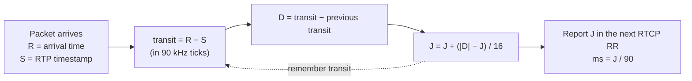
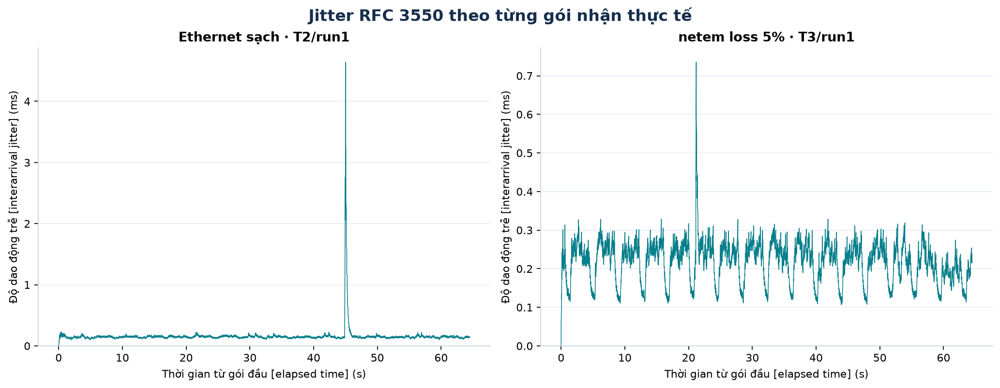

# Bài 02 (CN) — Interarrival jitter theo RFC 3550

> Nhãn: **SOURCE**, **INFERRED**, **UNKNOWN** (xem `INDEX.md`).
> Đường dẫn: `CN\` = `cn\rtp\`, `SIM\` = `sim\`.

## 1. Hình dung

Hãy nghĩ đến các chuyến xe buýt rời bến đúng 10 phút một chuyến. Đường lúc đông lúc vắng, nên xe đến trạm của bạn cách nhau 9, 12, 10, 14 phút. **Jitter** (độ dao động trễ giữa các gói) là mức chênh lệch giữa khoảng cách lúc đến và khoảng cách lúc xuất phát.

Bên nhận không thể biết thời gian đi đường thật (đồng hồ của nó không phải đồng hồ của bên gửi). Nhưng nó cũng không cần biết: nó chỉ so sánh các **hiệu số**. Nếu hai gói được gửi cách nhau 0 tick mà đến cách nhau 36 tick, thì mạng đã thêm vào 36 tick "không đều".

RFC 3550 (tài liệu chuẩn của RTP) chỉ giữ một con số J: giá trị trung bình đã được làm mượt của độ không đều đó. Mỗi gói mới chỉ kéo J đi 1/16 quãng đường về phía giá trị mới nhất, nên một gói bất thường không làm J nhảy vọt.

Vài thuật ngữ dùng trong bài: transit (thời gian "đi đường" tương đối = thời điểm đến trừ timestamp), tick (một nhịp của đồng hồ 90 kHz), RTCP RR (Receiver Report — báo cáo của bên nhận, học ở Bài 04).

## 2. Sơ đồ



## 3. Công thức chính

```
D(i−1, i) = (R_i − S_i) − (R_{i−1} − S_{i−1})
J_i       = J_{i−1} + ( |D(i−1, i)| − J_{i−1} ) / 16
```

(SOURCE: RFC 3550 §6.4.1 và Appendix A.8, được trích trong `CN_PLAN.md` §4.2.)

Thay số thật, các gói đầu tiên của lần chạy (SOURCE: `CN\results\T3\loss5\run1\receiver.csv`, cột `transit_ts_units`, `jitter_ts_units`):

| Gói | transit (tick) | D | J sau gói này | J trong log |
|---|---|---|---|---|
| 31318 | 107510179862 | — | 0 | 0.0 |
| 31319 | 107510179898 | +36 | 0 + (36 − 0)/16 = **2.25** | 2.25 |
| 31320 | 107510179917 | +19 | 2.25 + (19 − 2.25)/16 = **3.297** | 3.296875 |
| 31324 (gói đầu của frame 1) | 107510179880 | −79 so với 31323 | 5.150 + (79 − 5.150)/16 = **9.766** | 9.76598 |

Kết quả tính tay bằng đúng giá trị trong log (INFERRED: phép kiểm tra). Đổi sang mili giây: `9.766 / 90 = 0.11 ms`.

Hãy để ý dòng cuối. Các gói của cùng một frame có chung timestamp nhưng được gửi lần lượt, gói sau gói trước, nên J không bằng 0 ngay cả trên một sợi cáp hoàn hảo. Vì thế Ethernet sạch cho 0.14 ms chứ không phải 0 (SOURCE: các quy tắc trong `CN\TEST_SCENARIOS.md`; `hw_tables.md` CN-T2).

## 4. Bằng chứng mô phỏng (Simulation evidence)

- Hàm: `SIM\+course\RFCJitter.m` (`course.RFCJitter`), cùng công thức truy hồi tính theo tick, có xử lý quay vòng timestamp 32 bit.
- Test: `jitterAndRollover` trong `SIM\tests\TestLibrary.m`.
- Chạy: `run_monte_carlo`, sau đó `compare_cn` vẽ hình.
- Hình: `SIM\output\cn_jitter_ms.png` — J mô phỏng (5 seed, thanh min–max) đặt cạnh giá trị trung bình đo được, cho mọi cấu hình.
- **FIGURE PENDING** — MATLAB chưa được chạy.

## 5. Bằng chứng đo thực tế

<!-- codex-e:figures-measured-start -->



*SOURCE: Jitter ghi theo từng gói, đổi từ tick sang ms bằng cách chia 90; hai ô dùng thang tung độ riêng. Nguồn: `cn\rtp\results\T2\eth_q75_640x480_15fps\run1\receiver.csv`; `cn\rtp\results\T3\loss5\run1\receiver.csv`*

<!-- codex-e:figures-measured-end -->

| Thiết lập netem | J đo được (ms), 5 lần chạy | Nguồn |
|---|---|---|
| không có (Ethernet sạch) | 0.14 | `CN\report\hw_tables.md`, CN-T2 |
| `delay 20ms 5ms` | 2.33 – 2.69 (bốn cấu hình) | cùng file, CN-T4 |
| `delay 20ms 20ms distribution normal` | 15.31 – 16.89 (bốn cấu hình) | cùng file, CN-T4 |
| Wi-Fi, không netem | 0.29 | cùng file, CN-T6 |

(netem là công cụ của Linux để cố ý làm xấu mạng; học ở Bài 05.)

J đi theo mức jitter đã cấu hình nhưng không bằng nó. Vì sao tỉ lệ khoảng 0.8 (16 ms khi đặt 20 ms): **UNKNOWN**. Kế hoạch gợi ý một nguyên nhân có thể là netem làm đảo thứ tự gói; việc này sẽ được thử trong MATLAB với `preserveOrder` bật và tắt (SOURCE: `CN_PLAN.md` §6.4; tuỳ chọn này có trong `SIM\+course\defaults.m`).

## 6. Demo cho thấy

- **Chế độ:** synthetic (đến pha jitter) hoặc replay `samples\cn-loss5`, profile Computer Networks.
- **Panel:** **4. Jitter**.
- **Chỉ vào đâu, nói gì:** Chỉ vào đường J theo từng gói và đường nét đứt "configured netem jitter". Nói: "J là giá trị làm mượt theo RFC 3550, mỗi gói chỉ kéo J đi 1/16. Đường nét đứt là tham số của phân phối netem, không phải đích mà J phải bằng — đo thật cho khoảng 16 ms khi đặt 20 ms, lý do còn UNKNOWN." Nếu được hỏi về đơn vị: jitter trong CSV tính bằng tick, chia cho **90** (không phải 90 000) để ra ms.

## 7. Câu hỏi kiểm tra

1. Vì sao bên nhận dùng hiệu của các transit chứ không dùng chính transit?
2. J đang là 4.0 tick và |D| kế tiếp là 20 tick. J mới bằng bao nhiêu?
3. Vì sao trong đề tài này J không bằng 0 trên cáp sạch?

<details><summary>Đáp án</summary>

1. Hai đồng hồ không được đồng bộ; độ lệch cố định (chưa biết) sẽ tự triệt tiêu khi lấy hiệu.
2. 4 + (20 − 4)/16 = 5.0 tick.
3. Các gói của một frame có cùng timestamp nhưng được gửi lần lượt, nên mỗi lần bắt đầu frame mới đều cho D khác 0.
</details>
