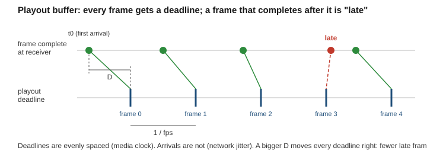
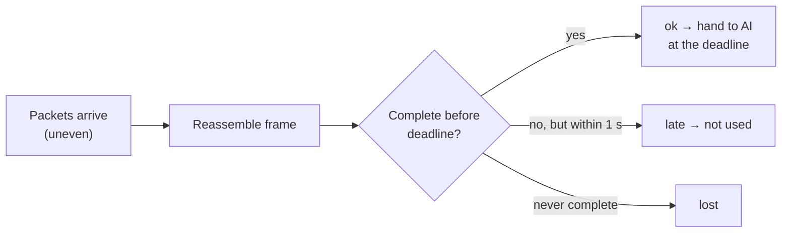
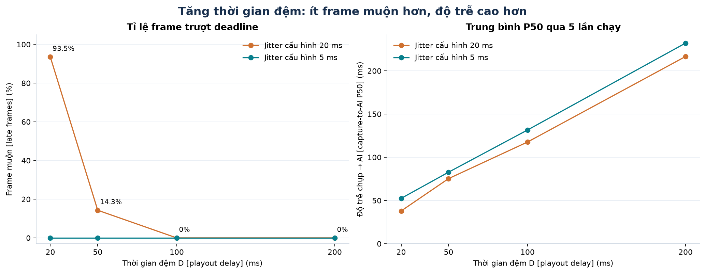

# Bài 03 (CN) — Playout buffer

> Nhãn: **SOURCE**, **INFERRED**, **UNKNOWN** (xem `INDEX.md`).
> Đường dẫn: `CN\` = `cn\rtp\`, `SIM\` = `sim\`.

## 1. Hình dung

Người phục vụ nhận đĩa từ bếp vào những lúc không đều, nhưng khách cần được phục vụ đều đặn mỗi phút một đĩa. Vì vậy người phục vụ để tạm mỗi đĩa lên một chiếc bàn phụ một lúc, rồi mang ra theo lịch cố định. Nếu đĩa ra khỏi bếp sau giờ phải mang ra thì đĩa đó vô dụng.

Playout buffer (bộ đệm phát lại) chính là chiếc bàn phụ đó. Nó gán cho mỗi frame (khung hình) một **deadline** (hạn chót). Thời gian chờ D là một sự đánh đổi:

- D nhỏ → độ trễ thấp, nhưng frame đến hơi muộn sẽ trượt deadline;
- D lớn → gần như không có frame muộn, nhưng frame nào cũng "già" thêm D trước khi AI nhìn thấy.

Jitter (độ dao động trễ giữa các gói, Bài 02) càng lớn thì càng cần D lớn.

## 2. Sơ đồ





(Ba kết quả ok / late / lost và cửa sổ "late" dài 1 s là SOURCE: `CN\rtp\playout.py`.)

## 3. Công thức chính

Gói đầu tiên đến sẽ cố định điểm mốc (t0, ts0). Sau đó:

```
deadline_k = t0 + (ts_k − ts0) / 90000 + D
```

(SOURCE: `CN\rtp\playout.py`; cùng quy tắc trong `SIM\+course\PlayoutBuffer.m`.)

Thay số thật (SOURCE: `CN\results\T3\loss5\run1\frames_rx.csv` và `receiver.csv`; lần chạy này dùng D = 100 ms):

```
frame 2:  ts_2 − ts0 = 1546580648 − 1546568660 = 11988 ticks  →  11988 / 90000 = 133.2 ms
deadline_2 = t0 + 133.2 ms + 100 ms = t0 + 233.2 ms
logged:      t_playout − t0 = 1211741883452307 − 1211741650252307 ns = 233.2 ms   ✔
frame 2 was complete at t0 + 134.6 ms  →  98.6 ms before its deadline  →  status "ok"
```

(Việc khớp số và khoảng dư 98.6 ms là INFERRED từ các dòng SOURCE.)

## 4. Bằng chứng mô phỏng (Simulation evidence)

- Hàm: `SIM\+course\PlayoutBuffer.m` (`course.PlayoutBuffer`), cũng lấy mốc từ gói đến đầu tiên.
- Test: `playoutAnchor` trong `SIM\tests\TestLibrary.m`.
- Chạy: `run_monte_carlo` (các cấu hình `d20j20n_D20/D50/D100/D200` và `d20j5_D20/…/D200`).
- Hình: `SIM\output\cn_late.png` (tỉ lệ frame muộn theo D) và `SIM\output\cn_latency_p50_ms.png` (cái giá phải trả bằng độ trễ).
- **FIGURE PENDING** — MATLAB chưa được chạy.
- Cảnh báo cho sau này: lần quét ns-3 cũ cho 52 % frame muộn ở D = 50 ms, trong khi phần cứng cho 14.3 % (SOURCE: `CN\report\sim_tables.md` CN-T4). Lý do là UNKNOWN; không được chỉnh tham số cho "khớp" để che nó đi.

## 5. Bằng chứng đo thực tế

<!-- figures-measured-start -->



*SOURCE: CN-T4, trung bình của 5 lần chạy mỗi điểm; chỉ có bảng tổng hợp, chưa có CSV gốc T4. Nguồn: `cn\rtp\report\hw_tables.md`*

<!-- figures-measured-end -->

netem `delay 20ms 20ms distribution normal`, 5 lần chạy mỗi dòng (SOURCE: `CN\report\hw_tables.md`, CN-T4):

| D (ms) | Frame muộn | Frame đúng hạn | Capture→AI P50 (ms) |
|---|---|---|---|
| 20 | 93.5 % | 6.5 % | 37.9 |
| 50 | 14.3 % | 85.7 % | 75.3 |
| 100 | 0 % | 100 % | 117.7 |
| 200 | 0 % | 100 % | 216.6 |

(P50 là trung vị: một nửa số mẫu nhỏ hơn giá trị này.)

Với jitter nhỏ hơn (`delay 20ms 5ms`), không frame nào muộn ở bất kỳ D nào (SOURCE: cùng bảng).

Cách đọc bảng: tăng D từ 100 lên 200 không được thêm gì (tỉ lệ muộn đã là 0) mà tốn thêm 98.9 ms độ trễ (INFERRED: 216.6 − 117.7). Vậy D = 100 ms là lựa chọn hợp lý cho mức jitter này (INFERRED).

Ngoài ra, trên Ethernet sạch với D = 50 ms, thời gian chờ playout là 50.26 ms trong tổng 67.91 ms: buffer là phần lớn nhất của độ trễ (SOURCE: `hw_tables.md`, CN-T9).

## 6. Demo cho thấy

- **Chế độ:** synthetic, profile Computer Networks. Chờ hai pha liền nhau: "jitter with 20 ms playout" rồi "jitter with 100 ms playout".
- **Panel:** **5. Playout** và **6. Deadline hits**.
- **Chỉ vào đâu, nói gì:** Ở panel 5, chỉ vào đường số 0 (deadline): điểm nằm trên đường này là frame đến muộn. Nói: "Cùng một mức jitter, khi D = 20 ms nhiều điểm vượt lên trên deadline; khi D = 100 ms các điểm tụt xuống dưới, và tỉ lệ đúng hạn ở panel 6 tăng lên — đổi lại mỗi frame già thêm 80 ms." Nhớ nói thêm: số trong synthetic chỉ để minh hoạ; số thật là bảng CN-T4 ở mục 5 (93.5 % muộn ở D = 20, 0 % ở D = 100).

## 7. Câu hỏi kiểm tra

1. Vì sao buffer dùng RTP timestamp, chứ không dùng thời điểm đến, để đặt khoảng cách giữa các deadline?
2. Với jitter 20 ms ± 20 ms, vì sao D = 20 ms là lựa chọn tồi? Hãy dùng bảng.
3. Gói cuối của một frame đến sau deadline 5 ms. Trong đề tài này frame đó là "late" hay "lost"?

<details><summary>Đáp án</summary>

1. Timestamp là đồng hồ media đều đặn của bên gửi; thời điểm đến thì chứa sự không đều của mạng.
2. 93.5 % số frame bị muộn, nên AI nhận được chưa tới một kết quả mỗi giây.
3. Late: frame đủ gói, nhưng sau deadline và vẫn nằm trong cửa sổ late 1 s.
</details>
