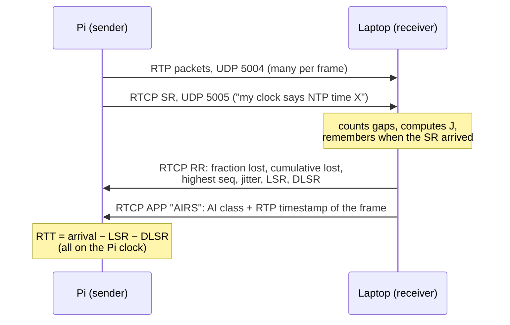
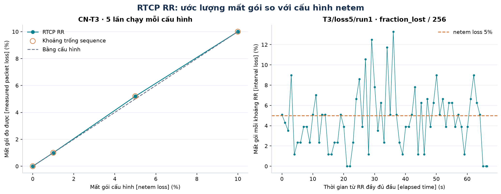

# Bài 04 (CN) — RTCP receiver report (RR)

> Nhãn: **SOURCE**, **INFERRED**, **UNKNOWN** (xem `INDEX.md`).
> Đường dẫn: `CN\` = `cn\rtp\`, `SIM\` = `sim\`.

## 1. Hình dung

RTP chỉ chạy một chiều: Pi → laptop. Bên gửi bị "mù": nó không thấy được gói của mình có đến nơi hay không.

RTCP (RTP Control Protocol — giao thức điều khiển đi kèm RTP) là **tấm bưu thiếp gửi ngược lại**. Khoảng mỗi giây một lần, bên nhận viết một bản báo cáo nhỏ gọi là RR (Receiver Report — báo cáo của bên nhận): "từ tấm bưu thiếp trước đến giờ tôi thiếu chừng này phần gói của bạn, khoảng cách giữa các gói không đều chừng này, và đây là lúc tôi nghe được báo cáo gần nhất của chính bạn." Nhờ tấm bưu thiếp đó, bên gửi đo được loss (mất gói), jitter (độ dao động trễ giữa các gói) và RTT (round-trip time — thời gian đi một vòng) mà không cần đồng bộ đồng hồ.

Chiều ngược lại, bên gửi cũng gửi SR (Sender Report — báo cáo của bên gửi) để bên nhận có mốc thời gian.

## 2. Sơ đồ



(Cổng và loại gói là SOURCE: `CN_PLAN.md` §2 và §4.3.)

Giải thích ngắn: LSR (Last SR — dấu thời gian của SR gần nhất mà bên nhận đã thấy), DLSR (Delay since Last SR — bên nhận đã giữ bao lâu kể từ SR đó), APP "AIRS" (gói RTCP do đề tài tự định nghĩa để gửi kết quả AI về Pi).

## 3. Công thức chính

```
fraction lost = floor( 256 × lost_in_interval / expected_in_interval )      (8-bit field)
RTT           = A − LSR − DLSR                                             (A = RR arrival time at the sender)
```

(SOURCE: RFC 3550 §6.4.1 và Appendix A.3, được trích trong `CN_PLAN.md` §4.3.)

Thay số thật — RR đầy đủ đầu tiên của một lần chạy với 5 % loss (SOURCE: `CN\results\T3\loss5\run1\receiver_rtcp.csv` dòng 13, và `sender_rtcp.csv` dòng 13):

| Trường | Giá trị trong log | Ý nghĩa |
|---|---|---|
| fraction_lost | 13 | 13 / 256 = 5.1 % |
| cum_lost | 3 | đến lúc này thiếu 3 gói |
| ext_high_seq | 31376 | sequence number cao nhất đã thấy |
| jitter | 18 ticks | 18 / 90 = 0.20 ms |
| dlsr | 57156 | 57156 / 65536 = 0.872 s kể từ SR gần nhất |
| rtt_ms (tại bên gửi) | 1.75 | thời gian đi một vòng trên cáp Ethernet |

Kiểm tra bằng tay (INFERRED): gói đầu tiên là seq 31318, nên `expected = 31376 − 31318 + 1 = 59`; `lost = 3`; `floor(256 × 3 / 59) = floor(13.02) = 13` ✔.
RR kế tiếp (dòng 53): mất thêm 4 gói trên 90 gói mong đợi → `floor(256 × 4 / 90) = 11` ✔ (log ghi 11).

Chu kỳ báo cáo: trong log, các RR cách nhau khoảng 1.00 s (SOURCE). RFC 3550 cho phép tối thiểu `360 / 700 kb/s ≈ 0.51 s` ở bitrate này, nên 1 s là hợp lệ (INFERRED trong `CN_PLAN.md` §4.4).

## 4. Bằng chứng mô phỏng (Simulation evidence)

- Hàm: `SIM\+course\ReceiverReport.m` (`course.ReceiverReport`): sequence number mở rộng, fraction lost theo từng khoảng (đơn vị 1/256), cumulative loss, jitter.
- Test: `rrSequenceReorderAndIntervals` trong `SIM\tests\TestLibrary.m`.
- Chạy: `run_monte_carlo`.
- Hình: `SIM\output\cn_sequence_loss.png`, và panel "RTCP SR RR APP timeline" của `CourseworkReplayApp`.
- **FIGURE PENDING** — MATLAB chưa được chạy.
- Giới hạn: mô phỏng đặt LSR và DLSR bằng 0, nên **không cho RTT** (SOURCE: `SIM\README.md`). RTT chỉ có từ đo thực tế.

## 5. Bằng chứng đo thực tế

<!-- codex-e:figures-measured-start -->



*SOURCE: Loss tổng hợp RR và sequence gần cấu hình netem; loss từng khoảng RR trong run1 vẫn dao động và khác mẫu số với loss toàn lần chạy. Nguồn: `cn\rtp\report\hw_tables.md`; `cn\rtp\results\T3\loss5\run1\receiver_rtcp.csv`*

<!-- codex-e:figures-measured-end -->

Hai cách đếm loss độc lập cho kết quả trùng nhau ở mọi kịch bản (SOURCE: `CN\report\hw_tables.md`, CN-T3, mỗi kịch bản 5 lần chạy):

| netem | Loss theo RR | Loss theo khoảng trống sequence |
|---|---|---|
| không có | 0.000 | 0.000 |
| `loss 1%` | 0.010 | 0.010 |
| `loss 5%` | 0.052 | 0.052 |
| `loss 10%` | 0.100 | 0.100 |
| Gilbert-Elliott, trung bình 5 % | 0.053 | 0.053 |

Cách đếm thứ ba — số gói kernel bỏ, lấy từ `tc -s qdisc` — đã được lên kế hoạch cho dashboard nhưng chưa có trong các bảng (SOURCE: `CN_PLAN.md` §5.2; giá trị UNKNOWN).

## 6. Demo cho thấy

- **Chế độ:** replay dữ liệu phần cứng thật `samples\cn-loss5`, profile Computer Networks.
- **Panel:** **8. RTCP timeline** và **3. Three loss views**.
- **Chỉ vào đâu, nói gì:** Ở panel 8, rê chuột lên một dấu RR để hiện loss, jitter và RTT. Nói: "Mỗi dấu là một tấm bưu thiếp, khoảng 1 giây một cái. Dashboard đổi fraction lost thành phần trăm bằng `100 × fraction_lost / 256` — đúng công thức Bài 04, ví dụ 13/256 = 5.1 %." Ở panel 3, nói rõ ba con số (qdisc drops, khoảng trống sequence, RR) có mẫu số và khoảng thời gian khác nhau, nên chỉ so sánh xu hướng trên cùng khoảng thời gian, đừng đòi chúng bằng nhau; khi replay log cũ, ô qdisc drops để trống.

## 7. Câu hỏi kiểm tra

1. Một RR ghi fraction_lost = 26. Trong khoảng đó đã mất bao nhiêu phần trăm gói?
2. Vì sao bên gửi tính được RTT dù hai máy không dùng chung đồng hồ?
3. Gói đến muộn có bị tính là mất trong "cumulative number of packets lost" không?

<details><summary>Đáp án</summary>

1. 26 / 256 = 10.2 %.
2. A và LSR đều là thời gian trên đồng hồ của bên gửi; DLSR là một khoảng thời gian do bên nhận đo. Không cần trừ hai đồng hồ khác nhau cho nhau.
3. Không. Gói đến muộn vẫn là gói đã nhận (SOURCE: `CN_PLAN.md` §4.3). Chuyện muộn là việc của playout buffer.
</details>
