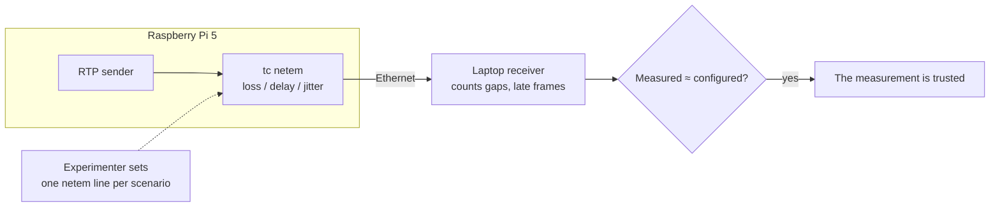
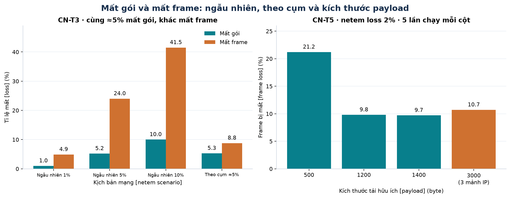

# Bài 05 (CN) — Thí nghiệm với netem: cố ý tạo ra một mạng xấu

> Nhãn: **SOURCE**, **INFERRED**, **UNKNOWN** (xem `INDEX.md`).
> Đường dẫn: `CN\` = `cn\rtp\`, `SIM\` = `sim\`.

## 1. Hình dung

Một sợi cáp Ethernet dài một mét thì quá tốt: không mất gì, không muộn gì. Muốn nghiên cứu loss (mất gói) và jitter (độ dao động trễ giữa các gói), bạn cần một mạng xấu mà bạn điều khiển được.

`tc netem` (bộ giả lập mạng của Linux) là một **trạm thu phí** nằm trong kernel Linux của Pi, đặt ở đường ra (egress) của card mạng. Mọi gói đi ra đều phải qua nó. Bạn ra lệnh cho trạm: "vứt đi 5 % số gói" hoặc "giữ mỗi gói 20 ms, xê dịch khoảng 20 ms". Vì lỗi do chính bạn đặt, bạn biết nguyên nhân thật, và bạn kiểm tra được bên nhận có đo đúng hay không.

Một frame (khung hình) cần **tất cả** các gói của nó. Vì vậy một tỉ lệ mất gói nhỏ biến thành tỉ lệ mất frame lớn hơn nhiều.

## 2. Sơ đồ



Các thiết lập netem đã dùng (SOURCE: `CN\report\hw_tables.md`, cột "Configured netem"):

| Kịch bản | Dòng lệnh netem |
|---|---|
| CN-T3 mất gói ngẫu nhiên | `loss 1%`, `loss 5%`, `loss 10%` |
| CN-T3 mất gói theo cụm (burst loss) | `loss gemodel 1.316% 25% 100% 0%` (Gilbert-Elliott) |
| CN-T4 jitter | `delay 20ms 5ms`, `delay 20ms 20ms distribution normal` |
| CN-T5 kích thước gói | `loss 2%` với payload 500 / 1200 / 1400 / 3000 byte |

## 3. Công thức chính

Nếu mỗi gói bị mất độc lập với xác suất p, và một frame có n gói:

```
P(frame lost) = 1 − (1 − p)^n
```

Thay số thật, `loss 5%` (SOURCE: `hw_tables.md`, CN-T3: n̄ = 5.106, tỉ lệ mất gói đo được 0.052):

```
configured p = 0.050:  1 − 0.950^5.106 = 0.230
measured   p = 0.052:  1 − 0.948^5.106 = 0.239     measured frame loss = 0.240  ✔
```

(Dòng thứ nhất có trong bảng SOURCE; dòng thứ hai là INFERRED và giải thích vì sao 0.240 hơi cao hơn 0.230.)

Burst loss (mất gói theo cụm). Trong mô hình Gilbert-Elliott (mô hình hai trạng thái), đường truyền hoặc ở trạng thái Good (không mất) hoặc Bad (mất hết):

```
mean loss  = p / (p + r) = 0.01316 / (0.01316 + 0.25) = 0.050
mean burst = 1 / r       = 1 / 0.25                  = 4 packets
```

(INFERRED từ dòng lệnh netem SOURCE.) Trung bình vẫn 5 %, nhưng các gói mất đi thành từng cụm, nên chúng rơi vào ít frame hơn.

## 4. Bằng chứng mô phỏng (Simulation evidence)

- Hàm: `SIM\+course\Loss.m` (`course.Loss`, hai chế độ `bernoulli` và `ge`), với các điều kiện liệt kê trong `SIM\+course\cnConfigs.m`.
- Test: `losses` trong `SIM\tests\TestLibrary.m` (loss GE trung bình gần 5 %, cụm trung bình gần 4).
- Chạy: `run_monte_carlo` (5 seed mỗi cấu hình), hàm này gọi `compare_cn`.
- Hình: `SIM\output\cn_frame_loss.png` — tỉ lệ mất frame mô phỏng (5 seed, min–max) đặt cạnh trung bình đo được; kèm bảng `SIM\output\cn_formula.csv`.
- **FIGURE PENDING** — MATLAB chưa được chạy.
- Lưu ý: seed của mô phỏng là seed ngẫu nhiên thật. Trên phần cứng, "5 runs" là 5 lần lặp lại; netem trên Pi có nhận seed hay không là UNKNOWN (SOURCE: `CN_PLAN.md` §1.3).

## 5. Bằng chứng đo thực tế

<!-- codex-e:figures-measured-start -->



*SOURCE: CN-T3/T5, 5 lần chạy mỗi cấu hình; các cột đều là số đo tổng hợp, payload 3000 byte bị IP chia thành ba mảnh. Nguồn: `cn\rtp\report\hw_tables.md`*

<!-- codex-e:figures-measured-end -->

Loss (SOURCE: `CN\report\hw_tables.md`, CN-T3, mỗi dòng 5 lần chạy; dữ liệu gốc trong `CN\results\T3\`):

| netem | Mất gói | Gói/frame | Mất frame | Công thức |
|---|---|---|---|---|
| `loss 1%` | 0.010 | 5.096 | 0.049 | 0.050 |
| `loss 5%` | 0.052 | 5.106 | 0.240 | 0.230 |
| `loss 10%` | 0.100 | 5.107 | 0.415 | 0.416 |
| GE, trung bình 5 %, cụm 4 | 0.053 | 5.121 | **0.088** | — (không độc lập) |

Kích thước gói ở `loss 2%` (SOURCE: cùng file, CN-T5; dữ liệu gốc trong `CN\results\T5\`):

| Payload (byte) | Gói/frame | Mất frame | Công thức |
|---|---|---|---|
| 500 | 12.307 | 0.212 | 0.220 |
| 1200 | 5.232 | 0.098 | 0.100 |
| 1400 | 5.002 | 0.097 | 0.096 |
| 3000 (IP cắt thành 3 mảnh) | 2.318 | 0.107 | 0.046 |

Hai điều rút ra từ các bảng (INFERRED):
- Gói càng nhỏ thì mỗi frame càng nhiều gói, nên càng nhiều frame "chết".
- Payload 3000 byte trông như "ít gói", nhưng IP cắt mỗi gói thành 3 fragment (mảnh) và netem bỏ theo từng fragment. Khi đó công thức tính theo gói quá lạc quan (0.046 so với 0.107 đo được).

Thư mục dữ liệu gốc của T4, T6, T7, T9 và mọi file pcap: **UNKNOWN (chưa biết ở đâu)** (chỉ có `T2`, `T3`, `T5` trong `CN\results\`).

## 6. Demo cho thấy

- **Chế độ:** synthetic, profile Computer Networks — hai pha liền nhau "random 5% loss" và "four-packet bursts ≈ 5%". Muốn có số thật thì dùng replay `samples\cn-loss5`.
- **Panel:** **2. Sequence strip** và **3. Three loss views** (kèm dòng mô tả netem ở **11. Hardware**).
- **Chỉ vào đâu, nói gì:** Ở panel 2, so sánh hai pha: mất ngẫu nhiên thì các vạch thiếu rải rác, mất theo cụm thì các vạch thiếu dính liền nhau khoảng 4 gói. Nói: "Trung bình đều khoảng 5 %, nhưng mất theo cụm rơi vào ít frame hơn — đo thật là 8.8 % frame mất so với 24 % (Bài 05, bảng CN-T3)." Nhớ nói: pha synthetic chỉ minh hoạ hình dạng; con số 24 % và 8.8 % là từ phần cứng.

## 7. Câu hỏi kiểm tra

1. Với p = 1 % và n = 5 gói mỗi frame, bạn dự đoán tỉ lệ mất frame là bao nhiêu?
2. Mất ngẫu nhiên và mất kiểu Gilbert-Elliott đều có khoảng 5 % mất gói. Vì sao tỉ lệ mất frame là 24 % ở trường hợp này và 8.8 % ở trường hợp kia?
3. Vì sao netem được đặt trên Pi (bên gửi) chứ không đặt trên laptop?

<details><summary>Đáp án</summary>

1. 1 − 0.99^5 = 4.9 %.
2. Các gói mất theo cụm rơi cùng vào một frame, nên số frame bị ảnh hưởng ít hơn.
3. Khi đó việc làm xấu mạng không phụ thuộc vào hệ điều hành của laptop (SOURCE: `CN_PLAN.md` §2).
</details>
