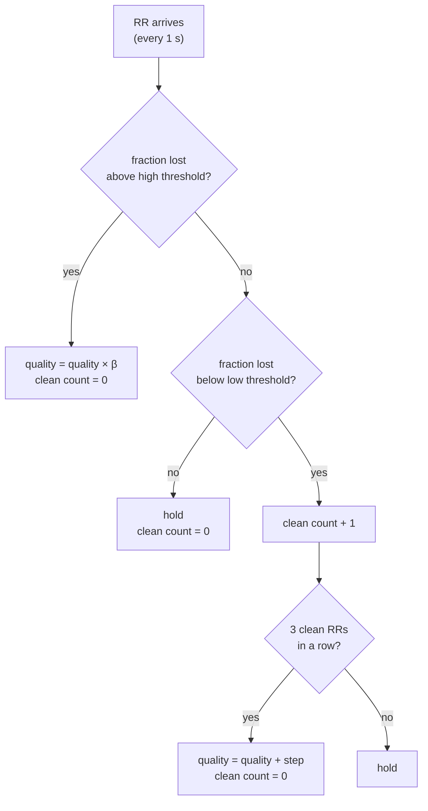
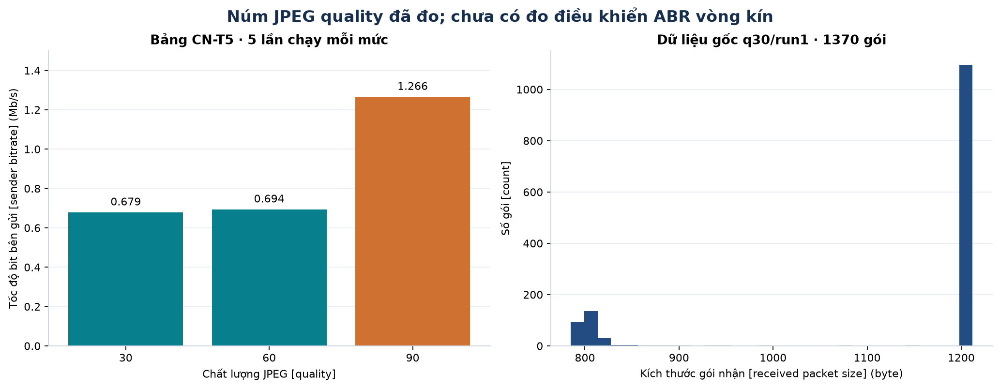

# Bài 06 (CN) — Bitrate adaptation (AIMD điều khiển bằng RTCP)

> Nhãn: **SOURCE**, **INFERRED**, **UNKNOWN** (xem `INDEX.md`).
> Đường dẫn: `CN\` = `cn\rtp\`, `SIM\` = `sim\`.

## 1. Hình dung

Bạn đang lái xe trong sương mù. Khi không nhìn thấy đường, bạn phanh **gấp**. Khi đường quang trở lại, bạn tăng tốc **từ từ**, mỗi lần một chút, vì bạn chưa chắc đã an toàn.

Bên gửi làm đúng như vậy với chất lượng video. Việc này gọi là bitrate adaptation (tự điều chỉnh tốc độ bit), hay ABR. Mỗi tấm bưu thiếp RR (Receiver Report — báo cáo của bên nhận, Bài 04) là một lần nhìn đường:

- loss (mất gói) cao → cắt mạnh chất lượng (nhân với một số nhỏ hơn 1);
- loss thấp trong vài tấm bưu thiếp liên tiếp → tăng chất lượng thêm một bước nhỏ (cộng).

Quy tắc này tên là **AIMD**: additive increase, multiplicative decrease (tăng bằng phép cộng, giảm bằng phép nhân).

Vì sao giảm chất lượng lại có ích khi mất gói? JPEG nhỏ hơn thì cần ít gói hơn, và Bài 05 đã cho thấy: ít gói mỗi frame hơn thì ít frame chết hơn.

## 2. Sơ đồ



Có hai bản cài đặt. Các con số của chúng khác nhau; đừng trộn lẫn.

| | Ngưỡng cao | β (giảm) | Ngưỡng thấp | Bước (tăng) | Nguồn |
|---|---|---|---|---|---|
| Bên gửi Python | 5 % | × 0.7 | 1 % | +5 quality | `CN\rtp\abr.py` |
| Mô hình MATLAB | 2 % | × 0.8 | 0.5 % | +0.05 scale | `SIM\+course\aimd.m` |

## 3. Công thức chính

```
on each RR:   if f/256 > θ_high:   q ← max(q_min, β · q)
              if f/256 < θ_low for 3 RRs in a row:   q ← min(q_max, q + a)
```

Thay số thật với RR ở Bài 04 (SOURCE: `CN\results\T3\loss5\run1\receiver_rtcp.csv` dòng 13, `fraction_lost = 13`):

```
f/256 = 13/256 = 5.08 %
Python rule:  5.08 % > 5 %  →  q = int(75 × 0.7) = 52       (75 is an example start value; the T8 start value is UNKNOWN)
MATLAB rule:  5.08 % > 2 %  →  scale = 0.8 × 1.0 = 0.8
```

(INFERRED: người viết áp dụng quy tắc SOURCE lên một báo cáo SOURCE. Bản thân lần chạy đó dùng bitrate cố định. Giá trị 75 chỉ là ví dụ; giá trị khởi đầu của T8 là UNKNOWN.)

Vì sao hồi phục chậm (INFERRED từ quy tắc Python): tăng một bước cần 3 RR sạch = 3 s và chỉ cộng thêm 5. Từ q = 20 quay lại q = 75 cần 11 bước = 33 s. Tiêu chí đạt yêu cầu hồi phục trong 5 s, nên không đạt.

## 4. Bằng chứng mô phỏng (Simulation evidence)

- Hàm: `SIM\+course\aimd.m` (`course.aimd`); trong mô hình Simulink `CN_shared`, cùng quy tắc này là một Stateflow chart (tạo bởi `SIM\models\build_models.m`).
- Test: `aimdThresholds` trong `SIM\tests\TestLibrary.m`.
- Chạy: `run_monte_carlo` với cấu hình `T8_fixed` và `T8_AIMD` (loss đổi bậc 0 → 15 % → 0 tại 0 / 15 / 35 s, SOURCE: `SIM\+course\cnConfigs.m`).
- Hình: panel "Bitrate decisions" của `CourseworkReplayApp` nạp `SIM\output\T8_AIMD_seed1.mat` đặt cạnh `T8_fixed_seed1.mat`; số liệu ghi vào `SIM\output\cn_runs.csv`. Không có `cn_*.png` cho T8 vì không có giá trị đo để so sánh.
- **FIGURE PENDING** — MATLAB chưa được chạy.
- Giới hạn (SOURCE: `SIM\README.md`): scale không phải là JPEG quality đã hiệu chuẩn, và lần chạy chỉ mang tính thăm dò, không phải kiểm chứng trên phần cứng.

## 5. Bằng chứng đo thực tế

<!-- codex-e:figures-measured-start -->



*SOURCE: Đã đo bitrate theo quality và phân bố kích thước gói nhận ở q30/run1; chưa có bằng chứng phần cứng cho đáp ứng ABR CN-T8. Nguồn: `cn\rtp\report\hw_tables.md`; `cn\rtp\results\T5\q30\run1\receiver.csv`*

<!-- codex-e:figures-measured-end -->

**CN-T8 chưa được chạy trên phần cứng.** Các con số về adaptive bitrate duy nhất hiện có đến từ mô phỏng trước đây của nhóm, nên bảng đầu tiên dưới đây là mô phỏng, không phải đo (SOURCE: `CN\report\sim_tables.md`, CN-T8, 5 seed; `CN_PLAN.md` §1.2 xác nhận "simulation only"):

| Bậc loss | Chế độ | Byte trung bình mỗi frame | Frame đúng hạn |
|---|---|---|---|
| 5 % | fixed | 12000 | 55.2 % |
| 5 % | ABR | 5009 | 77.7 % |
| 15 % | fixed | 12000 | 17.8 % |
| 15 % | ABR | 2666 | 61.4 % |
| trở về 0 % | ABR | 4400 (vẫn thấp sau 20 s) | 100 % |

Công thức ở Bài 05 giải thích dòng 15 % (INFERRED): 12000 byte là 11 gói, `1 − 0.85^11 = 83 %` mất; 2666 byte là 3 gói, `1 − 0.85^3 = 39 %` mất.

Thứ **đã** đo được: chính cái "núm" quality (SOURCE: `CN\report\hw_tables.md`, CN-T5, mỗi dòng 5 lần chạy):

| JPEG quality | Bitrate bên gửi (Mb/s) | Gói/frame |
|---|---|---|
| 30 | 0.679 | 5.003 |
| 60 | 0.694 | 5.024 |
| 90 | 1.266 | 9.211 |

Quality 30 và 60 cho bitrate gần như nhau. Vậy trên camera này, một bộ điều khiển chỉ hạ "quality" xuống dưới 60 sẽ gần như không có tác dụng. Cờ quality có được áp dụng đúng hay không: UNKNOWN (SOURCE: `CN_PLAN.md` §11 liệt kê đây là một rủi ro).

## 6. Demo cho thấy

- **Chế độ:** synthetic, profile Computer Networks — hai pha cuối của vòng lặp: "15% ABR loss step" rồi "recovery".
- **Panel:** **9. Bitrate decisions**.
- **Chỉ vào đâu, nói gì:** Chỉ vào đường bitrate và các mũi tên xuất hiện mỗi khi bước (step) thay đổi. Nói: "Khi loss nhảy lên 15 %, mũi tên xuống xuất hiện ngay và bitrate tụt nhanh; khi loss hết, bitrate chỉ bò lên từng bậc — đó là AIMD: phanh gấp, tăng tốc chậm." Bắt buộc nói thêm: đây là dữ liệu synthetic minh hoạ; CN-T8 chưa chạy trên phần cứng, và log ABR cũ không ghi quality/step đã chọn, nên khi replay panel này chỉ có đường bitrate, không có mũi tên quyết định.

## 7. Câu hỏi kiểm tra

1. Vì sao giảm bằng phép nhân mà tăng bằng phép cộng?
2. Một RR báo fraction_lost = 2. Bộ điều khiển Python đi theo nhánh nào?
3. Vì sao frame nhỏ hơn lại sống sót qua 15 % mất gói thường xuyên hơn?

<details><summary>Đáp án</summary>

1. Có loss nghĩa là frame đang chết ngay lúc này, nên phải phản ứng nhanh; một báo cáo sạch chỉ là bằng chứng yếu, nên thăm dò đi lên một cách thận trọng.
2. 2/256 = 0.8 %, dưới 1 %: bộ đếm "sạch" tăng thêm một (và quality tăng ở RR sạch thứ ba).
3. Ít gói mỗi frame hơn, nên xác suất tất cả các gói cùng đến nơi cao hơn.
</details>
