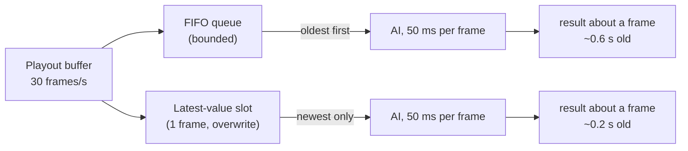
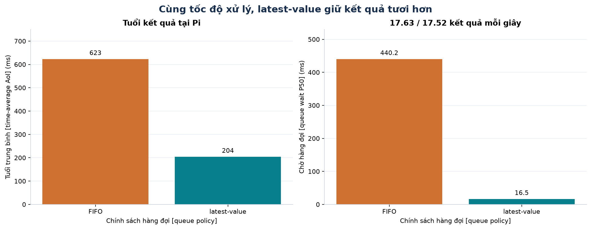

# Bài 07 (CN) — FIFO so với latest-value

> Nhãn: **SOURCE**, **INFERRED**, **UNKNOWN** (xem `INDEX.md`).
> Đường dẫn: `CN\` = `cn\rtp\`, `SIM\` = `sim\`.

## 1. Hình dung

Frame (khung hình) đến với tốc độ 30 cái mỗi giây. AI chỉ xử lý xong khoảng 17 cái mỗi giây. Phải có thứ gì đó nhường. Có hai cách đưa frame cho AI.

**FIFO** (first in, first out — vào trước ra trước) là hàng người xếp ở quầy vé. Ai cũng được phục vụ theo thứ tự. Khi quầy chậm, hàng dài ra, và người tới được quầy đã phải chờ rất lâu. Khi đó AI trả lời một câu hỏi về quá khứ.

**Latest-value** (chỉ giữ giá trị mới nhất) là một tấm bảng trắng chỉ đủ chỗ cho một tin. Frame mới xoá frame cũ. AI luôn lấy thứ đang có trên bảng lúc này. Có những frame không bao giờ được nhìn tới, nhưng câu trả lời luôn nói về hiện tại.

Với robot hoặc hệ thống báo động, một câu trả lời "tươi" có giá trị hơn một lịch sử đầy đủ.

## 2. Sơ đồ



(Playout buffer — bộ đệm phát lại — là nội dung Bài 03.) Hình răng cưa của "tuổi" nằm ở Bài 09 (`img/aoi_sawtooth.svg`).

## 3. Công thức chính

Nếu kết quả ra đều đặn, cứ Y giây một cái, và mỗi kết quả đã "già" L giây vào lúc nó ra, thì tuổi mà người dùng thấy sẽ leo từ L lên L + Y, và trung bình theo thời gian là

```
mean age ≈ L + Y / 2
```

Thay số thật (SOURCE: `CN\report\hw_tables.md`, CN-T7: latency P50 và số kết quả/giây; công thức và phép tính là INFERRED):

```
latest:  Y = 1/17.52 = 57.1 ms   L = 175.5 ms   →  175.5 + 28.5 = 204 ms    measured 204 ms ✔
FIFO:    Y = 1/17.63 = 56.7 ms   L = 599.9 ms   →  599.9 + 28.4 = 628 ms    measured 623 ms ✔
```

Hai chính sách cho ra cùng số kết quả mỗi giây. Toàn bộ sự khác biệt nằm ở L: frame đã già bao nhiêu vào lúc AI bắt đầu xử lý nó.

## 4. Bằng chứng mô phỏng (Simulation evidence)

- Hàm: `SIM\+course\FrameQueue.m` (`course.FrameQueue`, `Policy` = `'fifo'` hoặc `'latest'`). FIFO bỏ frame mới nhất khi đầy; latest chỉ ghi đè lên frame đang chờ (SOURCE).
- Test: `queuePolicies` và `noLossAndPolicyFreshness` trong `SIM\tests\TestLibrary.m`.
- Chạy: `run_monte_carlo` với cấu hình `T7_fifo` và `T7_latest` (30 fps, thời gian phục vụ 50 ms).
- Hình: `SIM\output\cn_aoi_ms.png` và `SIM\output\cn_queue_wait_p50_ms.png`; panel "FIFO or latest age and queue" của `CourseworkReplayApp` với hai file seed-1 đặt cạnh nhau.
- **FIGURE PENDING** — MATLAB chưa được chạy.
- Giới hạn (SOURCE: `SIM\README.md`): sức chứa hàng đợi bằng 8 là giả định, và thời gian phục vụ cố định 50 ms cho 20 kết quả/giây chứ không phải ~17.5 như đo được. Hãy chờ đợi một độ lệch nhìn thấy được; giải thích nó, đừng che giấu.

## 5. Bằng chứng đo thực tế

<!-- figures-measured-start -->



*SOURCE: CN-T7, 5 lần chạy mỗi chính sách; dữ liệu gốc T7 chưa tìm thấy, hình chỉ dùng trung bình trong hw_tables.md. Nguồn: `cn\rtp\report\hw_tables.md`*

<!-- figures-measured-end -->

Camera 30 fps, 5 lần chạy mỗi chính sách (SOURCE: `CN\report\hw_tables.md`, CN-T7). Khâu AI là một độ trễ giả lập 50 ms (SOURCE: `CN_PLAN.md` §1.2):

| Chính sách | Tuổi trung bình của kết quả AI (s) | Kết quả/giây | Frame bị bỏ qua | Chờ trong hàng P50 / P95 (ms) | Capture→AI P50 (ms) |
|---|---|---|---|---|---|
| FIFO | 0.623 | 17.63 | 802 | 440 / 462 | 600 |
| latest-value | 0.204 | 17.52 | 809 | 16 / 32 | 175 |

Các giới hạn cần nói thật:
- Hàng đợi FIFO **có giới hạn** (bounded). Thời gian chờ của nó chững lại gần 440 ms; nó không tăng mãi. Có khoảng 440 / 56.7 ≈ 8 frame đang chờ (INFERRED). Tiêu chí "FIFO queue grows" của kịch bản đã không được chứng minh (SOURCE: `CN_PLAN.md` §1.2).
- FIFO cũng bỏ qua frame (802) vì hàng đầy thì bỏ frame mới đến. Vậy ở đây FIFO **không** xử lý mọi frame (SOURCE: `CN_PLAN.md` §7).
- Thư mục dữ liệu gốc của T7: UNKNOWN (chưa biết ở đâu).

## 6. Demo cho thấy

- **Chế độ:** synthetic, profile Computer Networks (phần này của synthetic là mô hình sự kiện rời rạc thật: 30 fps đến, phục vụ 50 ms, FIFO chứa 8, latest chứa 1).
- **Panel:** **10. FIFO / latest**.
- **Chỉ vào đâu, nói gì:** Chỉ vào hai đường răng cưa "tuổi của kết quả AI" và hai đường độ dài hàng đợi. Nói: "Hai bộ tiêu thụ nhận cùng các frame, cùng thời gian phục vụ, ra cùng số kết quả mỗi giây; nhưng răng cưa FIFO nằm cao hơn hẳn vì frame đã già đi trong hàng — đo thật là 0.623 s so với 0.204 s (Bài 07, CN-T7)." Chỉ thêm: hàng FIFO dừng ở khoảng 8 chứ không tăng mãi, vì hàng có giới hạn.

## 7. Câu hỏi kiểm tra

1. Cả hai chính sách đều cho khoảng 17.5 kết quả mỗi giây. Vì sao kết quả của FIFO già gấp ba?
2. Khi nào bạn vẫn chọn FIFO?
3. Ước lượng tuổi trung bình nếu L = 100 ms và cứ 40 ms có một kết quả.

<details><summary>Đáp án</summary>

1. Với FIFO, mỗi frame chờ khoảng 440 ms trong hàng trước khi AI bắt đầu; với latest-value chỉ chờ khoảng 16 ms.
2. Khi mọi frame đều phải được phân tích, ví dụ ghi log hoặc đếm (SOURCE: `CN_PLAN.md` §7) — và khi đó hàng đợi phải đủ lớn để không bỏ frame.
3. 100 + 40/2 = 120 ms.
</details>
