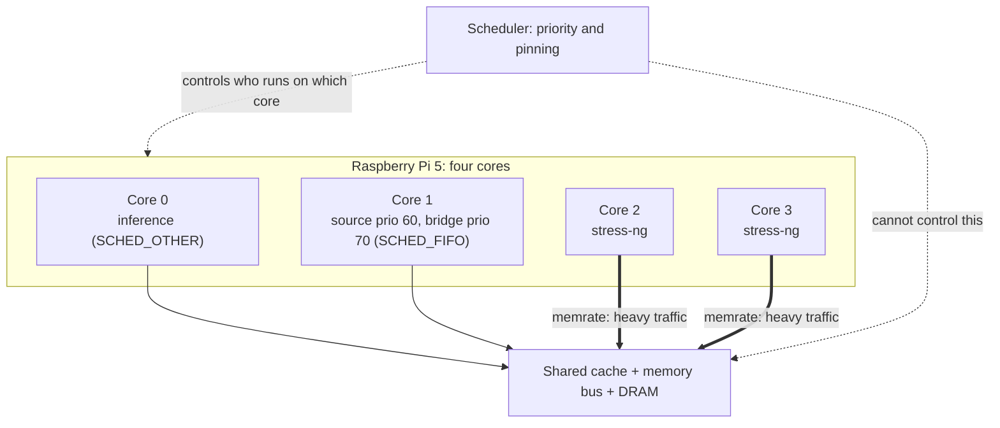
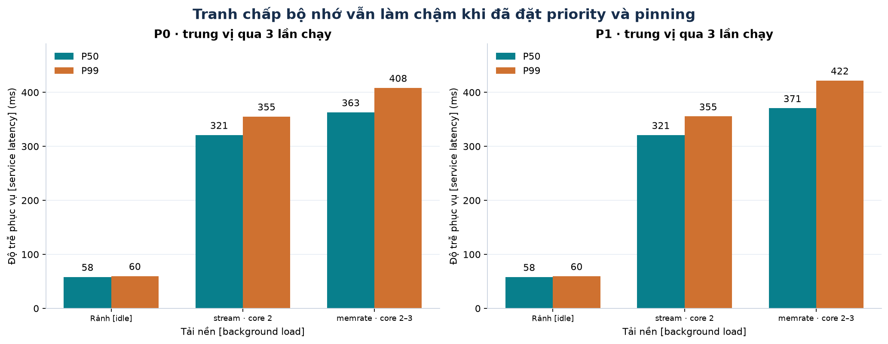
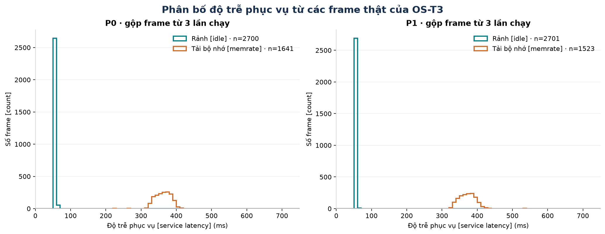

# Bài 08 (OS) — Scheduling và contention

> Nhãn: **SOURCE**, **INFERRED**, **UNKNOWN** (xem `INDEX.md`).
> Đường dẫn: `OS\` = `docs/os-report\`, `SIM\` = `sim\`.

## 1. Hình dung

Pi có bốn đầu bếp (bốn CPU core — nhân xử lý) trong cùng một nhà bếp. **Scheduler** (bộ lập lịch của hệ điều hành) quyết định mỗi đầu bếp làm việc nào. Việc quyết định đó gọi là scheduling (lập lịch).

- Chính sách Linux thông thường (`SCHED_OTHER`): chia đầu bếp công bằng cho mọi công việc.
- Chính sách real-time (thời gian thực, `SCHED_FIFO`): công việc có số priority (độ ưu tiên) được làm trước và giữ đầu bếp của mình cho đến khi xong hoặc phải chờ.
- **Pinning** (ghim tiến trình vào một core): buộc một công việc vào một đầu bếp đã chọn, để việc của người khác không rơi vào đó.

Như vậy là giải quyết xong chuyện tranh đầu bếp. Nhưng cả bốn đầu bếp dùng chung **một cửa kho** — memory bus (đường truyền bộ nhớ) và cache (bộ nhớ đệm của CPU). Nếu một công việc khác cứ liên tục bê những khay khổng lồ qua cửa đó (một stressor — chương trình tạo tải — ngốn bộ nhớ), thì đầu bếp của bạn phải đứng chờ ở cửa, dù đầu bếp đó là của riêng bạn. Priority không đặt chỗ trước được cho cái cửa.

**Contention** (tranh chấp tài nguyên) nghĩa là: hai công việc cùng muốn một thứ dùng chung vào cùng một lúc. Bài này cho thấy hai loại, tranh chấp CPU và tranh chấp bộ nhớ, và cho thấy scheduler chỉ giải quyết được loại thứ nhất.

## 2. Sơ đồ



(Cách gán core của profile P1 là SOURCE: `OS\report_vi\pi_results\2026-10-30_os_t3_contention\E2_P1_B2_memrate_c23_latest_r1\settings.json`.)

Trong sơ đồ: inference (suy luận — bước chạy mô hình AI), bridge (tiến trình cầu nối, chuyển kết quả từ Pi sang vi điều khiển), P0 = profile mặc định, P1 = profile có priority và pinning.

## 3. Công thức chính

Hai tỉ số đơn giản.

```
slowdown    S = T_loaded / T_idle
utilisation ρ = work arriving per second / work the stage can finish per second      (ρ > 1 means a queue must form)
```

(slowdown = hệ số chậm đi; utilisation ρ = mức tải: việc đến mỗi giây chia cho việc làm xong mỗi giây. ρ > 1 nghĩa là chắc chắn phải có hàng chờ.)

Thay số thật (SOURCE: `OS\report_vi\pi_results\2026-10-30_os_t3_contention\summary\E1_table.csv`, `E2_table.csv`, `per_condition.csv`; service P50, camera 15 fps; các tỉ số là INFERRED):

```
CPU stress on cores 2-3:     S = 56.4 / 59.5  = 0.95   → no slowdown
memory stress, profile P0:   S = 363  / 58.2  = 6.2
memory stress, profile P1:   S = 370.6 / 58.1 = 6.4    → priority did not help

memory stress, P0:  902 frames generated, 555 finished in 60 s  →  ρ = 902 / 555 = 1.6  > 1
```

Với ρ = 1.6, khâu inference không theo kịp, nên frame phải chờ hoặc bị bỏ. Chuyện gì xảy ra với những frame đang chờ là nội dung Bài 09.

## 4. Bằng chứng mô phỏng (Simulation evidence)

**Không có** mô phỏng nào cho Linux scheduler hay cho tranh chấp bộ nhớ, và đây là chủ ý: một mô hình như vậy chỉ chứa những gì ta tự giả định (SOURCE: `OS_PLAN.md` §5; `SIM\README.md` ghi rằng `OS_shared` "does not predict Linux scheduling or DRAM contention").

Thư viện làm việc khác: nó phát lại các thời gian inference **đã đo**, dùng làm thời gian phục vụ của mô hình hàng đợi.

- Dữ liệu: `SIM\data\os_idle_samples.csv`, `os_cpu23_samples.csv`, `os_memory_samples.csv` (nguồn gốc ghi trong `SIM\data\provenance.json`).
- Hàm: `SIM\+course\Inference.m` (`course.Inference`) rút mỗi thời gian phục vụ từ các mẫu đó.
- Chạy: `run_os_study` (3 mức tải × 2 chính sách đầu vào × 5 seed).
- Đầu ra: `SIM\output\os_aoi_runs.csv`, và panel "Inference latency distribution" của `CourseworkReplayApp` nạp `SIM\output\OS_idle_fifo.mat` và `SIM\output\OS_memory_fifo.mat`.
- **FIGURE PENDING** — MATLAB chưa được chạy.

## 5. Bằng chứng đo thực tế

<!-- figures-measured-start -->



*SOURCE: E2, trung vị P50/P99 qua 3 lần chạy hợp lệ; service gồm chờ đầu vào và xử lý, liên kết pty, không phải UART/MCU. Nguồn: `docs/os-report\report_vi\pi_results\2026-10-30_os_t3_contention\summary\E2_per_condition.csv`*



*SOURCE: CSV infer của E2 P0/P1, r1–r3 hợp lệ; lấy t_done − t_input trên cùng đồng hồ, gộp frame để vẽ histogram; đây là service, gồm cả chờ đầu vào. Nguồn: `docs/os-report\report_vi\pi_results\2026-10-30_os_t3_contention\E2_P0_B0_idle_latest_r1\pipeline\infer.csv` (các lần lặp cùng cấu hình; danh sách đầy đủ: `img/evidence_manifest.json`).*

<!-- figures-measured-end -->

Độ trễ đánh thức của timer, `cyclictest`, đơn vị µs, mỗi ô 3 lần chạy 120 s (SOURCE: `OS\docs\STAGE_REPORT.md`, "Timer wake-up diagnostic"; dữ liệu gốc: `OS\results\2026-10-11_cyclictest\`):

| Tải | P0 (thường) P99 / max | P1 (SCHED_FIFO 50) P99 / max |
|---|---|---|
| Idle (rảnh) | 57 / 2659 | 9 / 92 |
| CPU stress, core 2–3 | 68 / 2636 | 11 / 73 |
| Memory stress (memrate), core 2–3 | 613 / 5170 | 239 / 1094 |

Priority real-time làm việc đánh thức chính xác hơn nhiều. Nhưng dưới memory stress, ngay cả thread FIFO cũng tệ hơn 26 lần so với lúc idle (239 so với 9, tỉ số INFERRED).

Pipeline camera, độ trễ phục vụ P50 / P99 tính bằng ms, mỗi dòng 3 lần chạy (SOURCE: các file tổng hợp OS-T3 nêu ở §3):

| Tải | P0 | P1 |
|---|---|---|
| Idle (rảnh) | 58.2 / 59.9 | 58.1 / 59.6 |
| CPU stress, core 2–3 | 56.4 / 58.6 | chưa chạy (đã lên kế hoạch là block B3, `OS_PLAN.md` §6) |
| Memory stress (memrate), core 2–3 | 363 / 408 | 371 / 422 |

Các giới hạn cần nói thật (SOURCE: `OS\README.md`, `STAGE_REPORT.md`, `README.md` của phần tổng hợp):
- Mỗi ô 3 lần chạy, ít hơn con số 5 theo kế hoạch.
- Các lần chạy OS-T3 dùng liên kết pty (cổng nối tiếp giả bằng phần mềm), không phải UART thật, và trong P1 chính tiến trình inference vẫn ở priority thường.
- Nguyên nhân "memory bus" là INFERRED từ kiểu hình của số liệu; không có hardware counter nào chứng minh.

## 6. Demo cho thấy

- **Chế độ:** synthetic, chuyển **Project** sang Operating Systems.
- **Panel:** **Latency histogram** và **Per-core CPU** (liếc thêm **Thermal / throttle**).
- **Chỉ vào đâu, nói gì:** Ở histogram, chỉ vào bốn nhóm idle-P0, stress-P0, idle-P1, stress-P1. Nói: "Nếu priority giải quyết được mọi thứ thì cột stress-P1 phải quay về gần idle; đo thật thì không — dưới memory stress, P0 là 363 ms và P1 là 371 ms (Bài 08). Priority cho bạn một core, không cho bạn memory bus." Ở Per-core CPU, chỉ ra rằng core của inference và core của stressor là khác nhau. Nhớ nói: histogram trong synthetic chỉ minh hoạ; phải so sánh số đo phần cứng thật trước khi kết luận về scheduling.

## 7. Câu hỏi kiểm tra

1. Stressor chạy trên core 2 và 3. Inference được ghim vào core 0. Vì sao inference vẫn chậm đi dưới `memrate`?
2. Phép đo nào cho thấy `SCHED_FIFO` có giúp được một việc gì đó?
3. Một khâu nhận 15 frame mỗi giây và làm xong được 9 frame mỗi giây. ρ bằng bao nhiêu, và điều gì buộc phải xảy ra?

<details><summary>Đáp án</summary>

1. Mọi core dùng chung cache và memory bus; stressor chiếm đầy con đường dùng chung đó.
2. Bảng cyclictest: P99 lúc idle giảm từ 57 µs xuống 9 µs.
3. ρ = 15/9 = 1.67 > 1: frame xếp hàng chờ hoặc bị bỏ.
</details>
