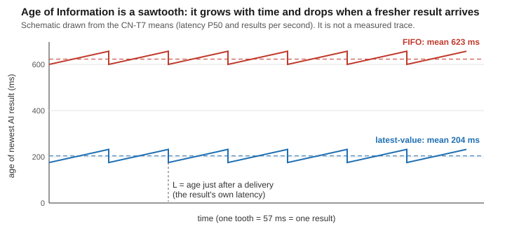
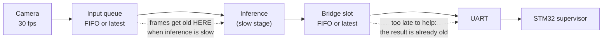
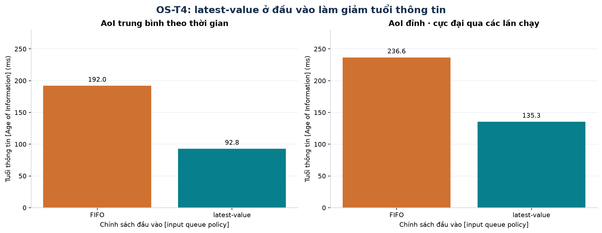
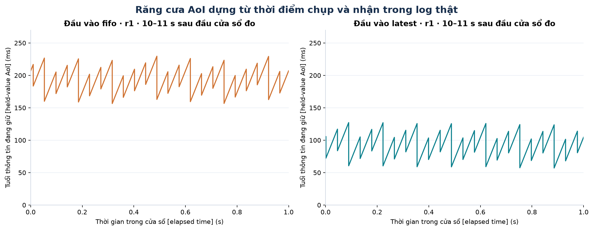

# Bài 09 (OS) — Age of Information (AoI)

> Nhãn: **SOURCE**, **INFERRED**, **UNKNOWN** (xem `INDEX.md`).
> Đường dẫn: `OS\` = `docs/os-report\`, `SIM\` = `sim\`.

## 1. Hình dung

Bạn nhìn một chiếc đồng hồ treo tường do người khác chỉnh bằng tay. Câu hỏi không phải là "chỉnh đồng hồ mất bao lâu?" mà là "**thứ mình đang nhìn lúc này đã cũ bao nhiêu rồi?**"

Đó chính là Age of Information — AoI (độ "cũ" của thông tin). Tại mọi thời điểm:

```
age now = time now − capture time of the newest result I hold
```

(tuổi lúc này = thời điểm hiện tại − thời điểm chụp của kết quả mới nhất mà mình đang giữ)

Tuổi tăng thêm một giây sau mỗi giây. Khi có kết quả tươi hơn đến, tuổi tụt xuống, nhưng chỉ tụt tới đúng latency (độ trễ) của chính kết quả đó. Vì vậy AoI có hình răng cưa.

Latency và AoI là hai thứ khác nhau. Latency thuộc về một kết quả. AoI thuộc về **bên nhận**, tại mọi thời điểm, kể cả những khoảng dài không có gì đến. Một hệ thống có thể có latency từng kết quả rất ổn mà AoI rất tệ, nếu kết quả đến thưa.

## 2. Sơ đồ



Vị trí đặt hàng đợi rất quan trọng:



Trong sơ đồ: FIFO (vào trước ra trước) và latest-value (chỉ giữ giá trị mới nhất) là hai chính sách hàng đợi ở Bài 07; inference (suy luận — bước chạy mô hình AI); bridge (tiến trình cầu nối gửi kết quả sang vi điều khiển); UART (cổng nối tiếp); MCU (vi điều khiển).

## 3. Công thức chính

```
time-average AoI = (1 / T) × ∫ age(t) dt          (area under the sawtooth, divided by the window)
one tooth:  area = (age at start) × dt + dt² / 2
regular deliveries every Y, each with latency L:   mean AoI ≈ L + Y / 2
```

(AoI trung bình theo thời gian = diện tích dưới đường răng cưa chia cho độ dài cửa sổ. Diện tích một răng đúng là thứ mà `SIM\+course\aoi.m` cộng dồn, SOURCE. Công thức tắt `L + Y/2` là INFERRED.)

Ví dụ nhỏ, tính tay được (SOURCE: test `samplerAndAge` trong `SIM\tests\TestLibrary.m`): kết quả đến lúc t = 0 (chụp lúc 0) và t = 1 (chụp lúc 0.5); cửa sổ từ 0 đến 2.

```
tooth 1: age 0 → 1     area = 0×1 + 1²/2   = 0.5
tooth 2: age 0.5 → 1.5 area = 0.5×1 + 1²/2 = 1.0
AoI = (0.5 + 1.0) / 2 = 0.75 s
```

Thay số thật, OS-T4 lúc idle (rảnh), camera 30 fps (SOURCE: `OS\report_vi\pi_results\2026-10-30_os_t4_policy\summary\E3B_per_condition.csv`; phép tính là INFERRED):

```
input latest:  L = 71.1 ms,  Y = 59.90 s / 1401 = 42.8 ms  →  71.1 + 21.4 = 92.5 ms    measured 92.8 ms ✔
input FIFO:    L = 170.2 ms, Y = 59.96 s / 1385 = 43.3 ms  →  170.2 + 21.6 = 191.8 ms  measured 192.0 ms ✔
```

Hai chính sách làm xong cùng số kết quả (khoảng 23 mỗi giây). FIFO chỉ đơn giản là làm việc trên những frame cũ hơn.

## 4. Bằng chứng mô phỏng (Simulation evidence)

- Hàm: `SIM\+course\aoi.m` (`course.aoi`), tích phân chính xác của tuổi kết quả tươi nhất đã giao; được gọi từ `SIM\+course\metrics.m`.
- Hàng đợi: `SIM\+course\FrameQueue.m`, dùng ở đầu vào (`policy`) và ở bridge (`bridgePolicy`).
- Chạy: `run_os_study`.
- Hình: `SIM\output\os_t4_aoi.png` — AoI mô phỏng cho input FIFO và input latest (5 seed, min–max) đặt cạnh giá trị đo 192 / 93 ms; bảng `SIM\output\os_aoi_error_table.csv`. Demo chỉ riêng bridge được lưu thành `SIM\output\OS_bridge_fifo.mat` và `OS_bridge_latest.mat`.
- **FIGURE PENDING** — MATLAB chưa được chạy.
- Giới hạn (SOURCE: `SIM\README.md`): các mẫu thời gian phục vụ đến từ một đợt đo khác với đợt cho ra con số 93 / 192 ms, và sức chứa hàng đợi là giả định. Khoảng lệch giữa mô phỏng và đo là điều đã lường trước; phải báo cáo nó, không được chỉnh tham số để che đi.

## 5. Bằng chứng đo thực tế

<!-- codex-e:figures-measured-start -->



*SOURCE: E3B idle, bridge=latest, 3 lần chạy hợp lệ mỗi chính sách; AoI trung bình là trung vị qua lần chạy, AoI đỉnh là cực đại; pty, không phải MCU. Nguồn: `docs/os-report\report_vi\pi_results\2026-10-30_os_t4_policy\summary\E3B_per_condition.csv`*



*SOURCE: E3B idle r1, chỉ bản tin CRC hợp lệ; tuổi tăng giữa hai lần nhận và giảm theo capture mới nhất, cửa sổ 1 s được nêu rõ; dữ liệu pty. Nguồn: `docs/os-report\report_vi\pi_results\2026-10-30_os_t4_policy\E3B_P1_B0_idle_fifo_r1\pipeline\rx.csv` (các lần lặp cùng cấu hình; danh sách đầy đủ: `img/evidence_manifest.json`).*

<!-- codex-e:figures-measured-end -->

Chính sách phía đầu vào, idle, bridge = latest, mỗi loại 3 lần chạy hợp lệ (SOURCE: file tổng hợp OS-T4 nêu ở §3):

| Chính sách đầu vào | AoI trung bình theo thời gian (ms) | AoI đỉnh (ms) | Delivery P50 (ms) | Frame bị bỏ vì đã cũ |
|---|---|---|---|---|
| FIFO | 192.0 | 236.6 | 170.2 | 0 |
| latest-value | 92.8 | 135.3 | 71.1 | 399 |

Chính sách phía bridge dưới memory stress (tải ngốn bộ nhớ), mỗi loại 3 lần chạy hợp lệ (SOURCE: `OS\docs\STAGE_REPORT.md`, "E3 bridge FIFO versus latest-value"):

| Chính sách bridge | AoI trung bình (ms) | Tạo ra / giao được / thiếu | Kết quả bị thay thế tại bridge |
|---|---|---|---|
| FIFO | 6660 | 605 / 480 / 125 | 0 |
| latest-value | 6958 | 605 / 472 / 132 | 0 |

Chính sách ở bridge không thay đổi được gì: không có lần thay thế nào, AoI gần 7 **giây** ở cả hai trường hợp. Chỗ ùn nằm ở thượng nguồn, tại đầu vào của inference (INFERRED trong báo cáo SOURCE).

Vì sao lại tính bằng giây? Một phép tính hàng đợi (INFERRED từ số SOURCE: chu kỳ nguồn 100 ms, khoảng 125 ms cho mỗi lần hoàn thành): mỗi giây có 10 frame đến và 8 frame được làm xong, nên hàng ùn thêm 2 frame mỗi giây. Sau 60 s là khoảng 120 frame (đo được số thiếu: 125), và frame mới nhất phải chờ sau chúng khoảng 120 × 0.125 s = 15 s (AoI đỉnh đo được: 13.7 s).

Các giới hạn cần nói thật:
- Cách sửa sạch sẽ khi có tải (input latest-value dưới memory stress) giữ tuổi lúc nhận ở gần 190 ms, nhưng mọi lần chạy đó đều bị **FLAGGED** vì under-voltage (sụt áp nguồn) (SOURCE: `STAGE_REPORT.md`, E3b). Một xác nhận sạch là UNKNOWN cho tới khi chạy lại với nguồn điện tử tế.
- Các lần chạy E3 dùng liên kết pty bằng phần mềm, không phải UART thật. AoI tại MCU thật với nguồn sạch là UNKNOWN: cả 18 lần chạy với UART thật đều bị FLAGGED (SOURCE: `STAGE_REPORT.md`).

## 6. Demo cho thấy

- **Chế độ:** synthetic, **Project** = Operating Systems.
- **Panel:** **AoI sawtooth**.
- **Chỉ vào đâu, nói gì:** Chỉ vào một răng: đoạn dốc lên là lúc thông tin đang cũ dần (mỗi giây cũ thêm một giây), cú tụt xuống là lúc có kết quả mới, và đáy răng chính là latency của kết quả đó. Nói: "Răng cưa FIFO phía đầu vào nằm cao hơn latest dù cả hai ra cùng số kết quả mỗi giây — đo thật lúc idle là 192 ms so với 93 ms (Bài 09). Hàng đợi phải đặt chính sách latest ở trước khâu chậm; đổi chính sách ở bridge thì đã quá muộn." Nhớ nói: đường vẽ trong synthetic là minh hoạ, và `samples\os-demo.csv` cũng là dữ liệu minh hoạ, không phải bằng chứng từ MCU.

## 7. Câu hỏi kiểm tra

1. Cứ 100 ms có một kết quả đến, và mỗi kết quả đã cũ 40 ms lúc đến. Ước lượng AoI trung bình theo thời gian.
2. Vì sao việc đổi **bridge** sang latest-value không làm giảm AoI 7 giây?
3. Nêu một tình huống mà latency từng kết quả nhỏ nhưng AoI lớn.

<details><summary>Đáp án</summary>

1. 40 + 100/2 = 90 ms.
2. Frame đã già đi trong lúc chờ trước inference; bridge chỉ thấy những kết quả vốn đã cũ, và nó chưa bao giờ có hai kết quả cùng chờ để mà chọn.
3. Một pipeline nhanh nhưng vài giây mới giao một kết quả (ví dụ vì phần lớn frame bị mất).
</details>
