# Bài 10 (OS) — FreeRTOS supervisor và các trạng thái của nó

> Nhãn: **SOURCE**, **INFERRED**, **UNKNOWN** (xem `INDEX.md`).
> Đường dẫn: `OS\` = `docs/os-report\`, `SIM\` = `sim\`.

## 1. Hình dung

Pi thông minh nhưng không đáng tin cậy tuyệt đối: Linux có thể khựng lại, một tiến trình có thể chết, AI có thể bị chậm. Vì vậy có một máy tính thứ hai, đơn giản hơn nhiều, đứng canh nó — một vi điều khiển STM32 chạy FreeRTOS (hệ điều hành thời gian thực nhỏ gọn cho vi điều khiển). Chương trình canh gác đó gọi là supervisor (bộ giám sát). Hãy nghĩ đến một **nhân viên cứu hộ** ở hồ bơi: không bơi, chỉ quan sát, và thổi còi.

Người cứu hộ hỏi hai câu riêng biệt, 1000 lần mỗi giây:

1. **Pi còn sống không?** Pi gửi một bản tin nhỏ gọi là heartbeat (nhịp tim — tín hiệu báo "tôi còn sống") mỗi 20 ms. Nếu 100 ms không có cái nào đến, thì đường truyền hoặc bridge (tiến trình cầu nối trên Pi) đã chết.
2. **Câu trả lời có còn tươi không?** Mỗi kết quả AI ghi rõ nó đã cũ bao nhiêu vào lúc được gửi. Nếu kết quả mới nhất cũ hơn 200 ms, hãy thận trọng (HOLD). Cũ hơn 500 ms, ngừng tin nó (FAILSAFE — trạng thái an toàn khi có lỗi).

Đây là hai kiểu hỏng khác nhau. Pi có thể còn sống mà vẫn gửi câu trả lời cũ. Riêng heartbeat không bao giờ được phép làm cho một kết quả cũ trông như mới.

FAILSAFE là **latched** (bị chốt): một khi còi đã thổi, trạng thái vẫn là FAILSAFE dù bản tin có quay lại, cho đến khi có một thao tác "rearm" (kích hoạt lại) có chủ ý.

## 2. Sơ đồ

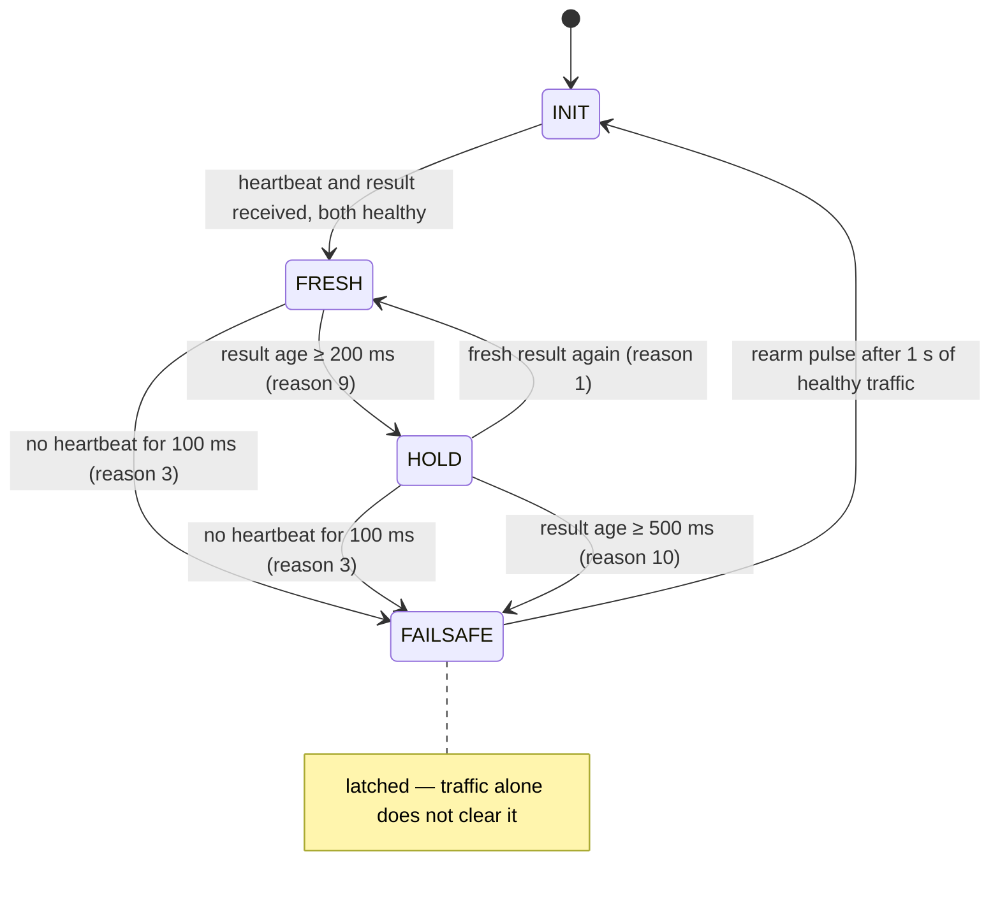

(Các chuyển trạng thái và mã lý do là SOURCE: `SIM\+course\supervisor.m`, file này phản chiếu `OS\stm32\src\supervisor.c`; các ngưỡng là SOURCE: `OS\docs\STAGE_REPORT.md`, "Applied settings".)

Trên bo mạch: LED D4 xanh lá = FRESH, D5 vàng = HOLD, D6 đỏ = FAILSAFE, D9 xanh dương = có hoạt động trên đường truyền (SOURCE: `OS_PLAN.md` §4).

Các task (tác vụ) FreeRTOS xung quanh nó (SOURCE: `OS_PLAN.md` §1; `STAGE_REPORT.md`, "What was built"):

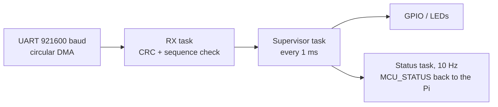

(UART = cổng nối tiếp; CRC = mã kiểm tra lỗi của bản tin; MCU_STATUS = bản tin trạng thái mà vi điều khiển gửi ngược về Pi.)

## 3. Công thức chính

```
result age = (time since the result was received) + (age at send) + (transit allowance)
HOLD when result age ≥ 200 ms;   FAILSAFE when result age ≥ 500 ms;   FAILSAFE when heartbeat silence ≥ 100 ms
```

(tuổi kết quả = thời gian kể từ lúc nhận + tuổi lúc gửi + phần dự trù cho đường truyền)

Thay số thật (SOURCE: các ngưỡng 200 / 500 / 100 ms và phần dự trù đường truyền 5 ms lấy từ `STAGE_REPORT.md`; tuổi lúc gửi ≈ 20 ms là INFERRED từ các số đo bên dưới):

```
HOLD:      time since last result = 200 − 5 − 20 = 175 ms      measured 174.95 – 175.92 ms ✔
FAILSAFE:  time since last result = 500 − 5 − 20 = 475 ms      measured 474.95 – 475.92 ms ✔
heartbeat: 100 ms + up to one 1 ms tick                         measured 100.13 – 100.64 ms ✔
```

Thêm một con số: một frame kết quả dài 35 byte. Với 10 bit cho mỗi byte trên dây, `350 / 921600 = 0.380 ms` mỗi frame (SOURCE: `STAGE_REPORT.md`, ở đó ghi là CALCULATED).

## 4. Bằng chứng mô phỏng (Simulation evidence)

<!-- figures-simulation-start -->

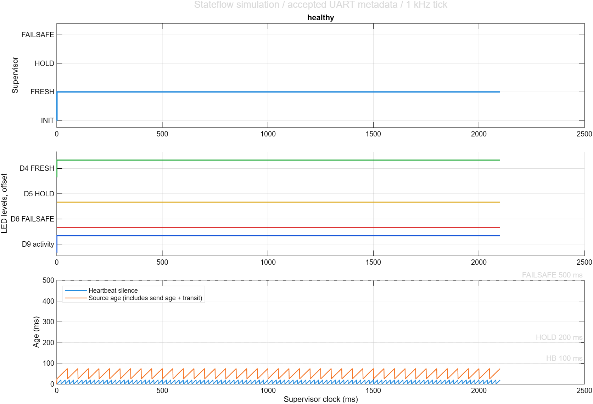

*MÔ PHỎNG: Bản tin đều đặn giữ supervisor ở trạng thái FRESH. Nguồn: `sim\os_supervisor\output\healthy_timeline.png`*

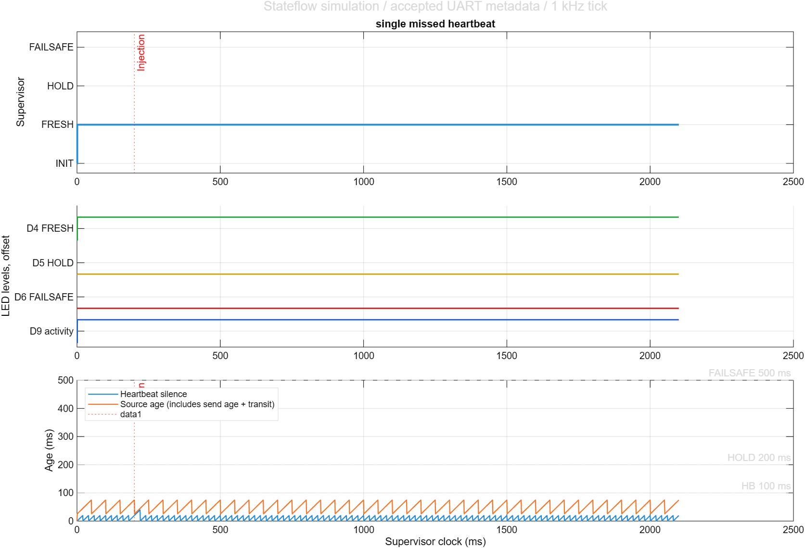

*MÔ PHỎNG: Bỏ một heartbeat vẫn chưa vượt ngưỡng timeout. Nguồn: `sim\os_supervisor\output\single_missed_heartbeat_timeline.png`*

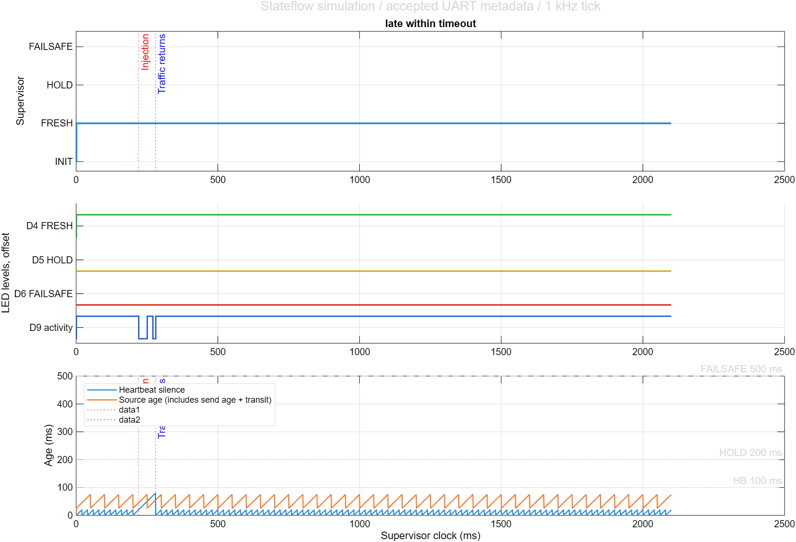

*MÔ PHỎNG: Heartbeat đến muộn trong giới hạn vẫn giữ trạng thái FRESH. Nguồn: `sim\os_supervisor\output\late_within_timeout_timeline.png`*

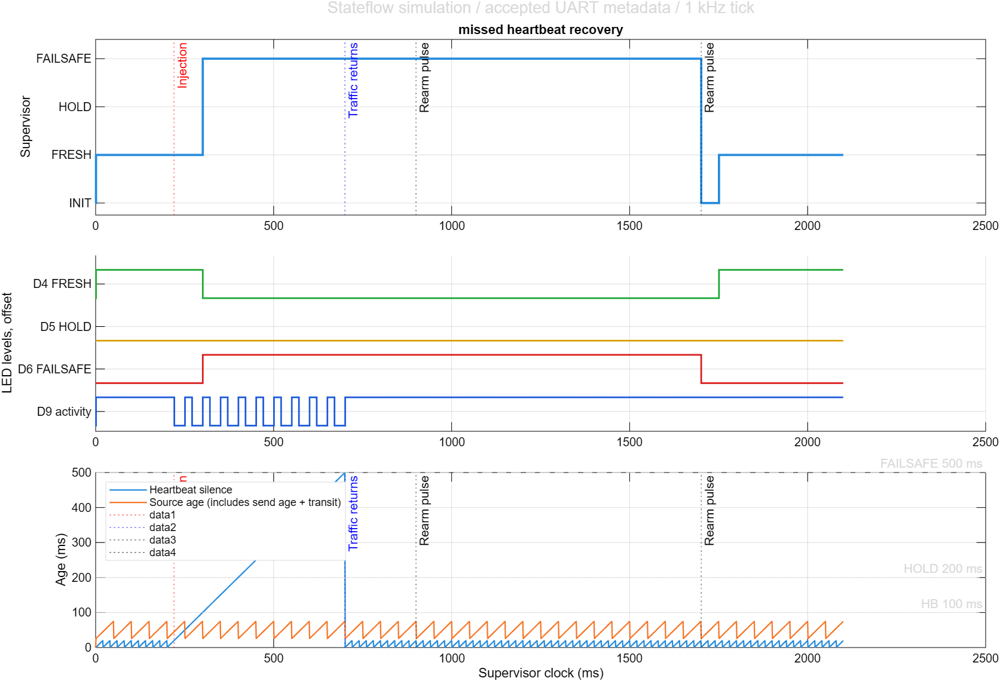

*MÔ PHỎNG: Mất heartbeat gây FAILSAFE; phục hồi cần thao tác rearm. Nguồn: `sim\os_supervisor\output\missed_heartbeat_recovery_timeline.png`*

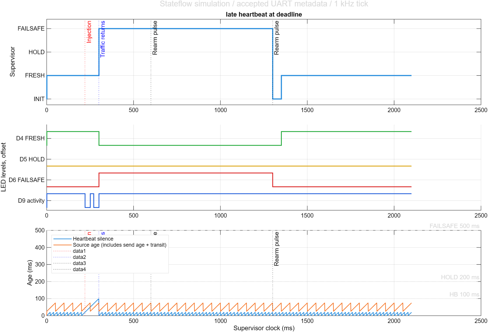

*MÔ PHỎNG: Heartbeat đến sát deadline kiểm tra đúng biên timeout. Nguồn: `sim\os_supervisor\output\late_heartbeat_at_deadline_timeline.png`*

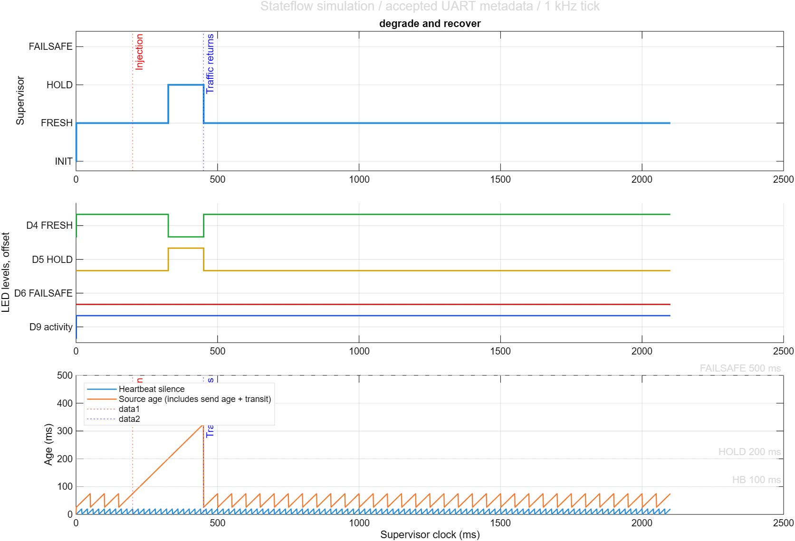

*MÔ PHỎNG: Kết quả cũ đưa hệ thống vào HOLD rồi phục hồi khi có kết quả tươi. Nguồn: `sim\os_supervisor\output\degrade_and_recover_timeline.png`*

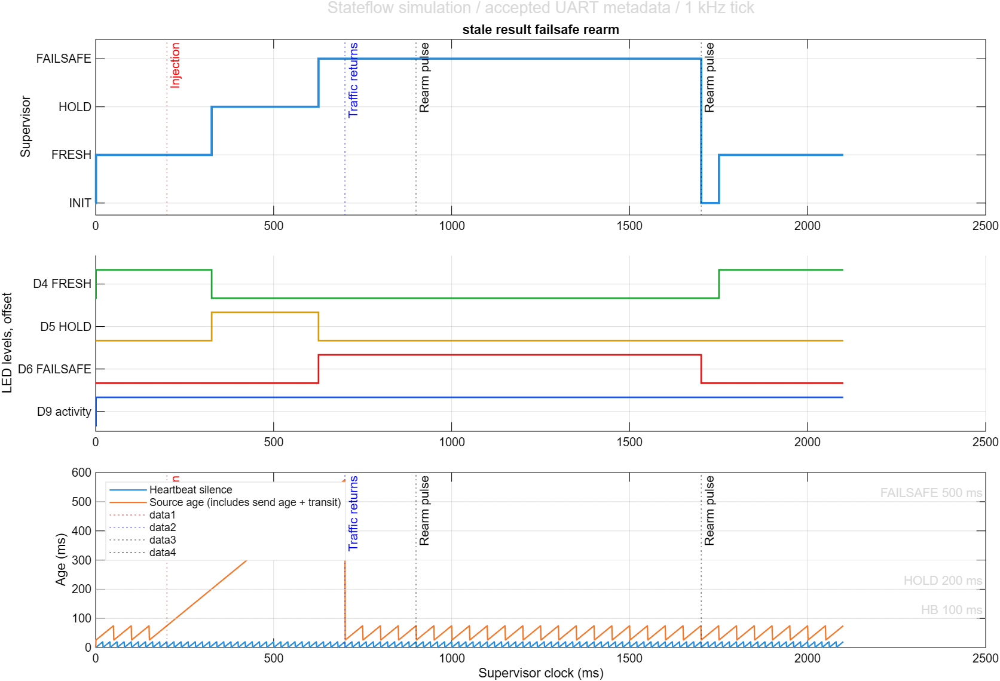

*MÔ PHỎNG: Heartbeat còn sống nhưng kết quả cũ vẫn gây FAILSAFE, sau đó rearm. Nguồn: `sim\os_supervisor\output\stale_result_failsafe_rearm_timeline.png`*

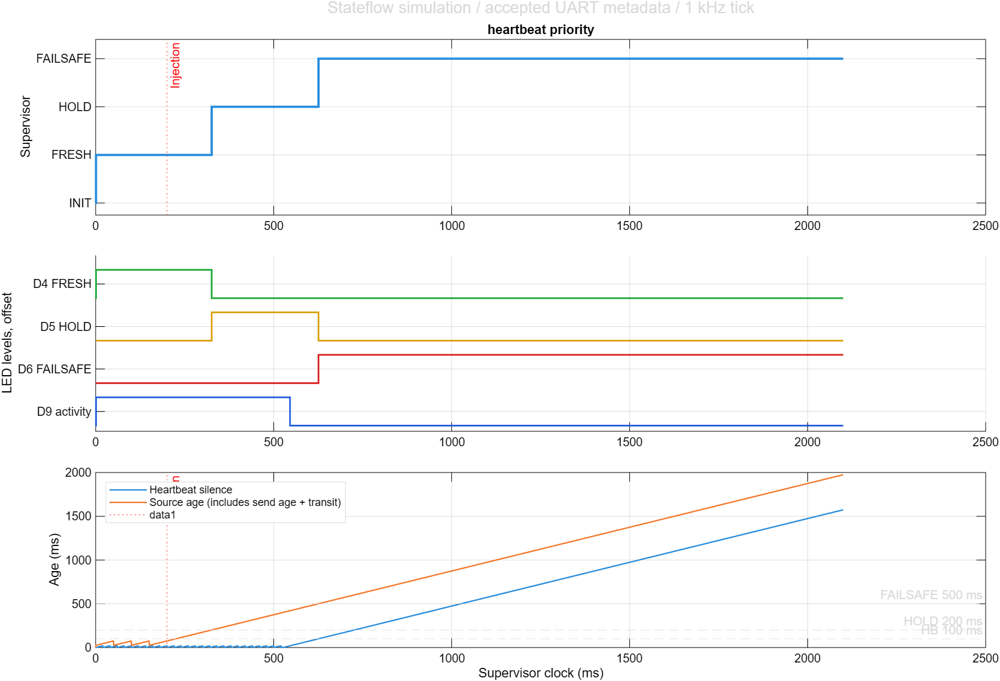

*MÔ PHỎNG: Khi hai điều kiện lỗi cùng xuất hiện, timeout heartbeat được ưu tiên. Nguồn: `sim\os_supervisor\output\heartbeat_priority_timeline.png`*

<!-- figures-simulation-end -->

- Hàm: `SIM\+course\supervisor.m` (`course.supervisor`), bản tham chiếu chạy từng tick của máy trạng thái. Trong mô hình Simulink `OS_shared`, cùng logic đó là một Stateflow chart chạy ở 1 kHz, do `SIM\models\build_models.m` sinh ra thành `SIM\generated\OS_shared.slx`.
- Test: `supervisorBoundariesAndLatch` trong `SIM\tests\TestLibrary.m` (biên tại đúng 200 ms, chốt latch, heartbeat được ưu tiên).
- Chạy: `run_fault_study` (các lỗi F1–F5, mỗi lỗi 5 seed).
- Hình: `SIM\output\os_t6_reaction.png` — các cột so sánh thời gian tới FAILSAFE giữa mô phỏng và đo, cho F1–F5; bảng `SIM\output\os_t6_error_table.csv`. Panel "Supervisor state" của `CourseworkReplayApp` hiển thị trạng thái theo thời gian.
- **FIGURE PENDING** — MATLAB chưa được chạy.
- Giới hạn (SOURCE: `SIM\README.md`): mô hình chỉ là một sự trừu tượng hoá về thời gian. Nó không có CRC, không kiểm tra session, và không phải là một chứng minh về an toàn.

## 5. Bằng chứng đo thực tế

<!-- figures-measured-start -->

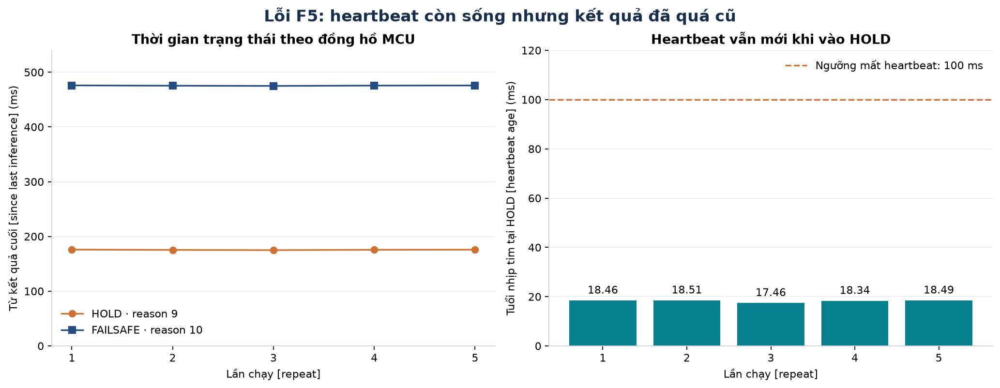

*SOURCE: 5 log F5; HOLD khoảng 175 ms và FAILSAFE khoảng 475 ms sau kết quả cuối, heartbeat tại HOLD chỉ khoảng 18 ms tuổi; thời gian trạng thái MCU, chưa đo chân LED. Nguồn: `docs/os-report\results\2026-10-12_f5_stale\20261012T101949Z_f5\r1\F5-r01\pipeline\state_events.csv` (các lần lặp cùng cấu hình; danh sách đầy đủ: `img/evidence_manifest.json`).*

<!-- figures-measured-end -->

Thời gian từ bản tin cuối cùng được chấp nhận đến lúc đổi trạng thái, đo bằng timer của chính MCU; P50 tính bằng ms (SOURCE: `OS\docs\STAGE_REPORT.md`, "Physical faults"; dữ liệu gốc: `OS\results\2026-10-12_e4_faults\`, `2026-10-12_f5_stale\`, `2026-10-12_f4_extra\`):

| Lỗi được tạo trên Pi | Lần chạy hợp lệ | Thay đổi đầu tiên | Sau đó FAILSAFE |
|---|---|---|---|
| F1 kill bridge | 5/5 | HOLD tại 175.3 sau kết quả cuối | reason 3, 100.5 sau heartbeat cuối |
| F2 đóng băng bridge (SIGSTOP) | 5/5 | HOLD tại 175.2 | reason 3, 100.6 |
| F3 đóng băng inference (SIGSTOP) | 5/5 | HOLD tại 175.8 | reason 10, 475.8 sau kết quả cuối |
| F4 tiến trình priority cao chiếm CPU | 7/14 lần thử | 6 lần đi thẳng tới FAILSAFE, 1 lần qua HOLD | reason 3, 100.6 |
| F5 kết quả dừng, heartbeat vẫn sống | 5/5 | HOLD tại 175.6 | reason 10, 475.6 |

- F5 là trường hợp then chốt: heartbeat chỉ mới 17–19 ms tuổi (còn sống), vậy mà supervisor vẫn chuyển sang HOLD rồi FAILSAFE vì kết quả đã cũ (SOURCE).
- Mọi lần chạy được chấp nhận đều có 0 lần chuyển trạng thái sai trước khi tạo lỗi (SOURCE).

Các giới hạn cần nói thật (SOURCE: `STAGE_REPORT.md`, "Limits"):
- Đây là thời gian của **trạng thái bên trong**, không phải của chân LED. Độ trễ ở chân, đo bằng thiết bị bên ngoài, là UNKNOWN (chưa có kết quả logic analyzer nào được chấp nhận).
- Không có cơ cấu chấp hành (actuator) thật và không có hardware watchdog độc lập.
- Các bài test lỗi cùng với pipeline camera (OS-T5, OS-T6) chưa được chạy (SOURCE: `OS_PLAN.md` §2.2).

## 6. Demo cho thấy

- **Chế độ:** synthetic, **Project** = Operating Systems (supervisor có một chu kỳ lỗi/rearm giả lập dài 30 giây).
- **Panel:** **Supervisor LEDs and timeline**.
- **Chỉ vào đâu, nói gì:** Chỉ vào bốn đèn D4 FRESH, D5 HOLD, D6 FAILSAFE, D9 activity và các dấu fault/rearm trên trục thời gian. Nói: "Sau dấu fault, đèn chuyển FRESH → HOLD → FAILSAFE; FAILSAFE bị chốt, chỉ dấu rearm mới đưa nó về lại. Trên phần cứng, HOLD xảy ra khoảng 175 ms sau kết quả cuối, và ở lỗi F5 supervisor vẫn vào FAILSAFE dù heartbeat còn sống (Bài 10)." Nhớ nói: đây là telemetry phần mềm từ MCU_STATUS, không thay thế được phép đo bằng logic analyzer bên ngoài; trang dashboard không kill tiến trình nào cả.

## 7. Câu hỏi kiểm tra

1. Ở lỗi F5, heartbeat vẫn tiếp tục đến. Vì sao supervisor vẫn tới FAILSAFE?
2. Sau một lần FAILSAFE, kết quả quay trở lại. Supervisor đang ở trạng thái nào, và cần gì để thoát khỏi trạng thái đó?
3. Vì sao HOLD được đo tại 175 ms sau kết quả cuối chứ không phải 200 ms?

<details><summary>Đáp án</summary>

1. "Còn sống" và "còn tươi" được kiểm tra riêng; tuổi kết quả đã vượt 500 ms.
2. Vẫn là FAILSAFE (bị chốt). Cần một xung rearm sau 1 s có bản tin khoẻ mạnh liên tục, rồi nó đi qua INIT.
3. Tuổi còn tính cả việc kết quả đã cũ bao nhiêu lúc gửi (khoảng 20 ms) và 5 ms dự trù cho đường truyền: 175 + 20 + 5 = 200.
</details>
