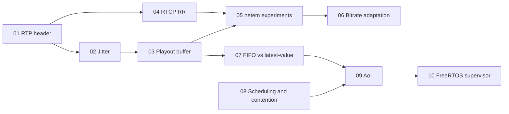

# Bộ bài học — CN đề tài 11 và đồ án môn OS (bản tiếng Việt)

Bản tiếng Việt viết ngày 2026-11-16 bởi claude-b, dựa trên bản tiếng Anh ở thư mục cha (`..\INDEX.md`, `..\01_…10_*.md`). Bản tiếng Anh được giữ nguyên. Nếu hai bản khác nhau về con số, bản tiếng Anh là bản gốc.

Mười bài ngắn cho người mới bắt đầu với hai đồ án môn học:

- **CN**: Computer Networks (Mạng máy tính) đề tài 11 — truyền video thời gian thực bằng RTP/RTCP cho một hệ thống Edge AI (camera trên Pi → laptop).
- **OS**: Operating Systems (Hệ điều hành) — Heterogeneous Edge-AI Runtime (Pi 5 chạy Linux + STM32 chạy FreeRTOS).

Mỗi bài có cùng bảy phần: hình dung, sơ đồ, một công thức chính với số thật, bằng chứng mô phỏng, bằng chứng đo thực tế, **"Demo cho thấy"** (panel nào của dashboard minh hoạ bài đó), và ba câu hỏi kiểm tra.

Quy ước: thuật ngữ kỹ thuật giữ nguyên tiếng Anh; lần đầu xuất hiện trong mỗi bài có giải thích ngắn bằng tiếng Việt trong ngoặc. Ví dụ: jitter (độ dao động trễ giữa các gói), playout buffer (bộ đệm phát lại), Age of Information — AoI (độ "cũ" của thông tin).

## Thứ tự học

Đọc theo số thứ tự. Bài 01–07 đi theo một frame video từ camera đến kết quả AI. Bài 08–10 đi vào bên trong Pi rồi sang vi điều khiển. Bài 07 là cầu nối giữa hai đồ án: cùng một câu hỏi về hàng đợi xuất hiện ở cả hai.



| # | File | Đồ án | Ý chính trong một dòng | Cần học trước |
|---|---|---|---|---|
| 01 | [01_CN_rtp_header.md](01_CN_rtp_header.md) | CN | RTP là cái nhãn trên mỗi gói: thứ tự, thời gian, hết frame | — |
| 02 | [02_CN_rfc3550_jitter.md](02_CN_rfc3550_jitter.md) | CN | Jitter = độ không đều (đã làm mượt) của khoảng cách giữa các gói đến | 01 |
| 03 | [03_CN_playout_buffer.md](03_CN_playout_buffer.md) | CN | Chờ D ms để gói đến muộn vẫn kịp deadline | 02 |
| 04 | [04_CN_rtcp_receiver_report.md](04_CN_rtcp_receiver_report.md) | CN | Tấm bưu thiếp của bên nhận: loss, jitter, round-trip time | 01, 02 |
| 05 | [05_CN_netem_experiments.md](05_CN_netem_experiments.md) | CN | Cố ý làm hỏng mạng; mất gói biến thành mất frame | 03, 04 |
| 06 | [06_CN_bitrate_adaptation.md](06_CN_bitrate_adaptation.md) | CN | Phanh gấp khi có loss, tăng tốc từ từ (AIMD) | 04, 05 |
| 07 | [07_CN_fifo_vs_latest_value.md](07_CN_fifo_vs_latest_value.md) | CN → OS | Hàng đợi giữ mọi thứ; tấm bảng một ô giữ cho thông tin tươi | 03 |
| 08 | [08_OS_scheduling_and_contention.md](08_OS_scheduling_and_contention.md) | OS | Priority cho bạn một core, không cho bạn memory bus | — |
| 09 | [09_OS_age_of_information.md](09_OS_age_of_information.md) | OS | "Thứ mình đang giữ đã cũ bao nhiêu?" và nên đặt hàng đợi ở đâu | 07, 08 |
| 10 | [10_OS_freertos_supervisor.md](10_OS_freertos_supervisor.md) | OS | Một MCU nhỏ kiểm tra riêng "còn sống?" và "còn tươi?" | 09 |

Gợi ý chia buổi cho nhóm: buổi 1 học 01–04 (gói tin và báo cáo), buổi 2 học 05–07 (thí nghiệm và hàng đợi), buổi 3 học 08–10 (phần OS). Sau mỗi bài, mở dashboard và làm theo mục "Demo cho thấy" của bài đó.

Hình vẽ: `..\img\rtp_header.svg`, `..\img\playout_timeline.svg`, `..\img\aoi_sawtooth.svg` (dùng chung với bản tiếng Anh, nhãn trong hình bằng tiếng Anh). Mọi sơ đồ khác là Mermaid (hiển thị được trong Obsidian, VS Code có extension Mermaid, và GitHub).

## Các nhãn mức độ tin cậy

| Nhãn | Ý nghĩa |
|---|---|
| **SOURCE** | Đọc trực tiếp từ một file; có ghi đường dẫn. |
| **INFERRED** | Người viết tự tính hoặc tự suy luận từ các số SOURCE. Hãy kiểm tra lại trước khi đưa vào báo cáo. |
| **UNKNOWN** | Không tìm thấy bằng chứng. Đừng đoán. |

Lưu ý: báo cáo giai đoạn của OS dùng bộ nhãn riêng, chi tiết hơn (MEASURED, FLAGGED, CALCULATED, ASSUMED). Khi một bài trích báo cáo đó, kết quả "FLAGGED" nghĩa là lần chạy được giữ lại nhưng bị loại khỏi các kết luận "sạch".

## Đường dẫn viết tắt dùng trong các bài

| Viết tắt | Đường dẫn đầy đủ |
|---|---|
| `CN\` | `cn\rtp\` |
| `OS\` | `docs/os-report\` |
| `SIM\` | `sim\` (thư viện MATLAB, đang làm; bộ bài học này chỉ đọc, không sửa) |
| `CN_PLAN.md`, `OS_PLAN.md` | `private-plan-not-shipped/` |
| Dashboard | `dashboard\` (danh sách panel: `README.md`, mục "What the panels demonstrate") |

## Kịch bản demo 10 phút cho giảng viên

### Chuẩn bị (trước giờ trình bày)

Mở hai cửa sổ PowerShell và chạy sẵn hai hub trên hai cổng khác nhau, để không phải khởi động lại giữa chừng (SOURCE cho các lệnh và tuỳ chọn `--port`: `dashboard\README.md`):

```powershell
Set-Location dashboard
# Cửa sổ 1 — dữ liệu phần cứng thật, loss 5 % (tab trình duyệt A)
.\.venv\Scripts\python.exe -m dashboard --mode replay --replay samples\cn-loss5 --loop --port 8081
# Cửa sổ 2 — dữ liệu synthetic minh hoạ (tab trình duyệt B)
.\.venv\Scripts\python.exe -m dashboard --mode synthetic
```

Mở tab A tại `http://127.0.0.1:8081` và tab B tại `http://127.0.0.1:8080`. Hai chế độ này không mở socket UDP nên không đụng nhau (SOURCE: README). Chạy hai hub cùng lúc là cách dùng suy ra từ README (INFERRED) — hãy thử trước một lần.

Ba điều cần nhớ khi nói:

- **Replay `samples\cn-loss5` là dữ liệu phần cứng thật.** Log cũ không có video, không có số liệu hardware, không có so sánh FIFO/latest, và không ghi quyết định ABR — nên panel 1, 10, 11 không có dữ liệu, còn panel 9 chỉ có đường bitrate, không có mũi tên quyết định (SOURCE: README của dashboard, mục "Replay adapters and limits"). Đó là đúng, không phải lỗi.
- **Synthetic là dữ liệu minh hoạ** (seed 11), không phải kết quả kiểm chứng. Nó lặp 7 pha, mỗi pha 12 giây (một vòng 84 giây): Ethernet sạch → loss ngẫu nhiên 5 % → loss theo cụm 4 gói ≈ 5 % → jitter với playout 20 ms → jitter với playout 100 ms → bậc loss 15 % có ABR → hồi phục.
- Dùng nút **Pause view** để dừng hình khi cần chỉ vào một chi tiết; hub vẫn tiếp tục thu dữ liệu.

Mỗi khẳng định dưới đây đi kèm bài học chứa số đo thật. Khi dashboard hiển thị dữ liệu synthetic, hãy đọc con số từ bài học, không đọc con số trên màn hình.

### Kịch bản theo phút

| Thời gian | Tab / chế độ | Panel | Nói gì (khẳng định) | Bài chứng minh |
|---|---|---|---|---|
| 0:00–0:45 | A — replay thật | toàn trang | "Pi gửi video bằng RTP qua UDP sang laptop; laptop chạy AI và gửi kết quả về bằng RTCP. Tab này phát lại log phần cứng thật với loss 5 %; tab kia là dữ liệu minh hoạ." | INDEX, 01 |
| 0:45–1:45 | A — replay thật | 2. Sequence strip | "Mỗi vạch là một gói. Bên nhận biết thiếu gói chỉ nhờ sequence number trong RTP header. Timestamp tăng khoảng 6000 tick mỗi frame ở 15 fps." | 01 |
| 1:45–2:45 | A — replay thật | 8. RTCP timeline, 3. Three loss views | "Mỗi giây bên nhận gửi một RR. RR đầu tiên ghi fraction_lost = 13, tức 13/256 = 5.1 % — khớp với netem `loss 5%`. Loss đếm theo RR và theo khoảng trống sequence trùng nhau: 0.052." Rê chuột lên một dấu RR để hiện RTT. | 04, 05 |
| 2:45–3:30 | A — replay thật | 4. Jitter | "J tính theo RFC 3550, mỗi gói chỉ kéo J đi 1/16. Trên cáp sạch J vẫn khoảng 0.14 ms vì các gói của một frame được gửi lần lượt." | 02 |
| 3:30–4:45 | B — synthetic, CN | 5. Playout, 6. Deadline hits | Chờ hai pha jitter. "Cùng mức jitter: D = 20 ms thì đa số frame trượt deadline, D = 100 ms thì kịp hết. Đo thật: 93.5 % muộn ở D = 20, 0 % ở D = 100, đổi lại độ trễ tăng từ 37.9 lên 117.7 ms." | 03 |
| 4:45–5:45 | B — synthetic, CN | 9. Bitrate decisions | Chờ pha 15 % và pha hồi phục. "AIMD: loss cao thì cắt mạnh, loss hết thì tăng từng bước nhỏ." Nói rõ: "**CN-T8 chưa chạy trên phần cứng**; đây là minh hoạ và số mô phỏng." | 06 |
| 5:45–6:45 | B — synthetic, CN | 10. FIFO / latest | "Hai hàng đợi nhận cùng frame, cùng thời gian phục vụ 50 ms, ra cùng số kết quả mỗi giây. Nhưng kết quả của FIFO cũ gấp ba: đo thật 0.623 s so với 0.204 s." | 07 |
| 6:45–7:30 | B — synthetic, đổi **Project** sang Operating Systems | AoI sawtooth | "Đây là cùng câu hỏi, nhìn từ phía OS: thông tin đang giữ đã cũ bao nhiêu. Đo thật lúc idle: input FIFO 192 ms, input latest 93 ms. Đổi chính sách ở bridge không giúp gì — AoI vẫn gần 7 giây — vì chỗ ùn nằm trước inference." | 09 |
| 7:30–8:15 | B — synthetic, OS | Latency histogram, Per-core CPU | "Priority và pinning cho bạn một core, không cho bạn memory bus. Dưới memory stress, inference chậm 6 lần ở cả P0 (363 ms) và P1 (371 ms), dù stressor chạy trên core khác." | 08 |
| 8:15–9:15 | B — synthetic, OS | Supervisor LEDs and timeline | Chờ một dấu fault. "STM32 kiểm tra riêng 'còn sống' (heartbeat, 100 ms) và 'còn tươi' (tuổi kết quả, 200 / 500 ms). FAILSAFE bị chốt cho đến khi rearm. Đo thật: HOLD ở 175 ms sau kết quả cuối; lỗi F5 vẫn vào FAILSAFE dù heartbeat còn sống." | 10 |
| 9:15–10:00 | — | (Thermal / throttle nếu còn thời gian) | Nói thật về giới hạn, xem danh sách bên dưới. | INDEX, mục cuối |

### Câu kết về giới hạn (phút 9:15–10:00)

Nói ngắn gọn bốn điều, vì giảng viên sẽ hỏi:

1. Adaptive bitrate (CN-T8) mới chỉ có mô phỏng (Bài 06).
2. Các lần chạy OS ít lần lặp (đa số 3 lần mỗi ô), và nguồn 5 V / 3 A gây cờ under-voltage; một số kết quả là FLAGGED (Bài 09, 10).
3. Thời gian của supervisor là thời gian trạng thái bên trong MCU; độ trễ ở chân LED đo bằng logic analyzer là UNKNOWN (Bài 10).
4. Mọi hình mô phỏng MATLAB vẫn là FIGURE PENDING (mục dưới).

### Nếu chỉ có một hub

Chạy `--mode synthetic` và bỏ tab A. Khi đó các khẳng định ở phút 0:45–3:30 vẫn dùng panel 2, 3, 8, 4 trong các pha loss của synthetic, nhưng phải nói rõ con số trên màn hình là minh hoạ và đọc số thật từ Bài 01, 02, 04, 05.

## Hình mô phỏng: tất cả đều FIGURE PENDING

Chưa có hình nào. MATLAB chưa được chạy trên `coursework_sim` (SOURCE: `SIM\README.md`; `SIM\output\` chỉ có `static_audit.txt`). Mỗi mục "Bằng chứng mô phỏng (Simulation evidence)" nêu tên hàm và file mà nó **sẽ** tạo ra. Để tạo hình (SOURCE: `SIM\README.md`, "Run later"):

```matlab
cd('sim')
setup_coursework
run_tests(false)      % library tests first
build_models          % generated/CN_shared.slx and OS_shared.slx
run_monte_carlo       % CN: writes output/cn_*.png, cn_runs.csv, cn_error_table.csv, cn_formula.csv
run_os_study          % OS: writes output/os_t4_aoi.png, os_t6_reaction.png and tables
```

| Bài | Hàm | Hình đang chờ |
|---|---|---|
| 01 | `course.Packetizer` | `output\cn_payload_bitrate_mbps.png`; panel replay "Sequence gaps and reorder" |
| 02 | `course.RFCJitter` | `output\cn_jitter_ms.png` |
| 03 | `course.PlayoutBuffer` | `output\cn_late.png`, `output\cn_latency_p50_ms.png` |
| 04 | `course.ReceiverReport` | `output\cn_sequence_loss.png`; panel replay "RTCP SR RR APP timeline" |
| 05 | `course.Loss` | `output\cn_frame_loss.png` |
| 06 | `course.aimd` | panel replay "Bitrate decisions" từ `output\T8_AIMD_seed1.mat` |
| 07 | `course.FrameQueue` | `output\cn_aoi_ms.png`, `output\cn_queue_wait_p50_ms.png` |
| 08 | `course.Inference` + mẫu đo thật | panel replay "Inference latency distribution" |
| 09 | `course.aoi` | `output\os_t4_aoi.png` |
| 10 | `course.supervisor` | `output\os_t6_reaction.png` |

(Các "panel replay" trong bảng này là panel của ứng dụng MATLAB `CourseworkReplayApp`, không phải panel của dashboard web.)

Khi một hình đã có, hãy thay dòng "FIGURE PENDING" trong bài bằng hình đó và một câu nói rõ mô phỏng và đo có khớp nhau không. Nếu không khớp, hãy nói thẳng và giữ cả hai con số. Nhớ sửa cả bản tiếng Anh và bản tiếng Việt.

## Những điều cần biết trước khi tin các con số

1. **CN-T8 (adaptive bitrate) chưa từng chạy trên phần cứng.** Bài 06 dùng số mô phỏng và có nói rõ.
2. **Dữ liệu gốc của CN thiếu một phần.** Thư mục dữ liệu gốc có cho T2, T3 và T5 trong `CN\results\`. Thư mục gốc của T1, T4, T6, T7, T9 và mọi file pcap: UNKNOWN (chưa biết ở đâu). Số của chúng chỉ lấy từ bảng tổng hợp `CN\report\hw_tables.md`.
3. **Các lần chạy OS có ít lần lặp** (đa số 3 lần mỗi ô), và bộ nguồn 5 V / 3 A gây ra cờ under-voltage (sụt áp). Một số kết quả trích trong Bài 09 và 10 là FLAGGED hoặc có phạm vi hẹp; mỗi bài ghi rõ điều này ngay cạnh bảng.
4. **Các phép tính tay gắn nhãn INFERRED là của người viết bài.** Chúng khớp với log ở những chỗ kiểm tra được (jitter, RR fraction lost, deadline của playout, công thức tắt AoI, thời gian của supervisor), nhưng chưa được ai khác rà soát.
5. Jitter khoảng 16 ms khi netem đặt 20 ms (Bài 02) và khoảng lệch giữa mô phỏng và phần cứng ở D = 50 ms (Bài 03) là các câu hỏi còn mở, gắn nhãn UNKNOWN.
6. **Dữ liệu synthetic của dashboard và file `samples\os-demo.csv` chỉ là minh hoạ**, không phải bằng chứng đo (SOURCE: README của dashboard). Chỉ `samples\cn-loss5` là trích từ phần cứng thật.
