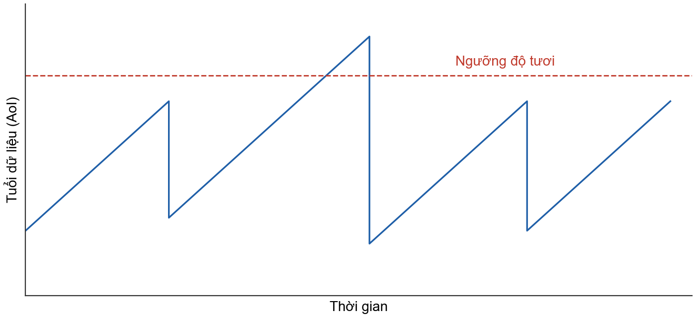
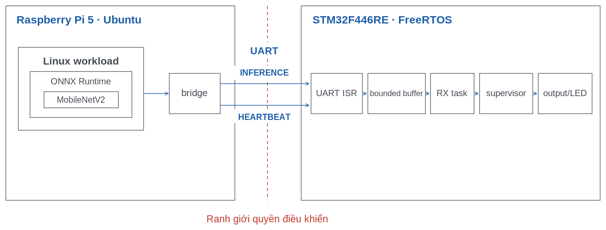
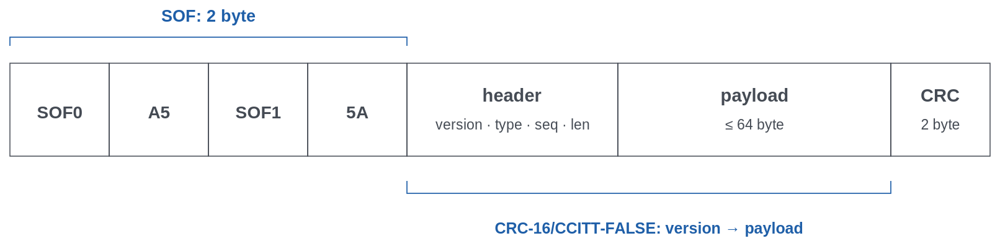
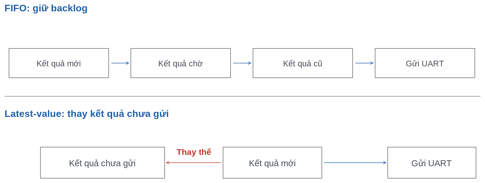
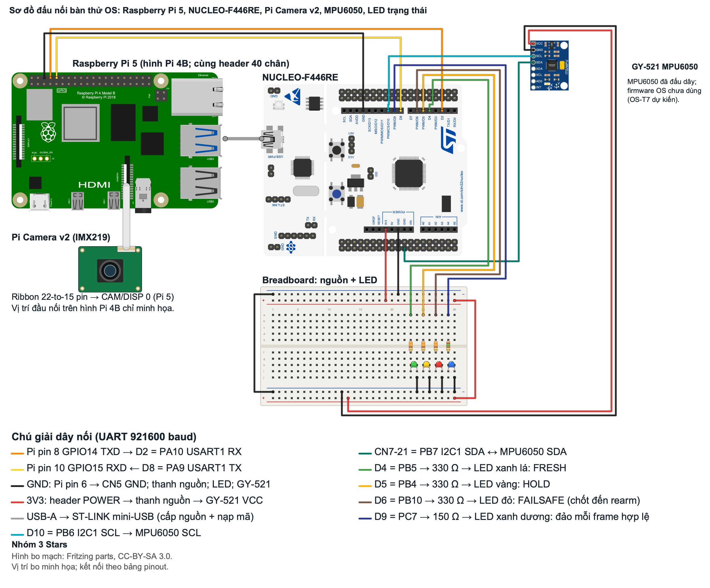
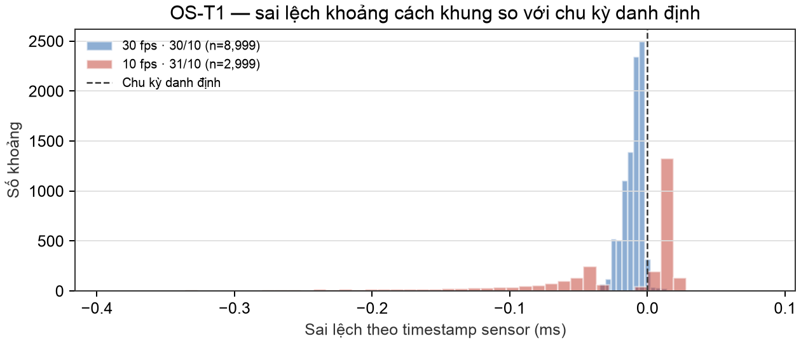
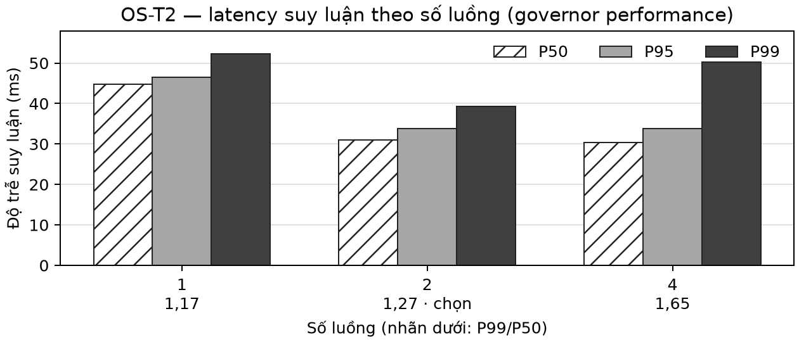
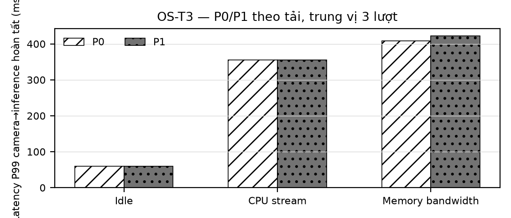
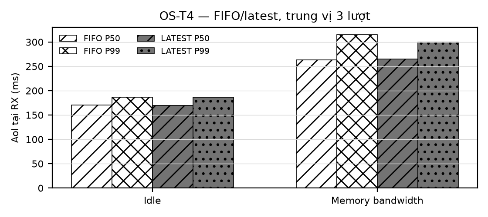

# Báo cáo Hệ điều hành — bản công khai

Nhóm 3 Stars; xem [CREDITS](../../../CREDITS.md) để biết tên và vai trò.

## 1.1 Động lực và bài toán

Khi CPU bận hoặc hàng đợi dài, kết quả ảnh có thể đã cũ khi tới bên nhận. Hệ thống cần theo dõi tuổi kết quả và phát hiện mất cập nhật.

Nhóm dùng Raspberry Pi 5 chạy Ubuntu Server 24.04 ARM64 để xử lý ảnh và STM32F446RE chạy FreeRTOS để giám sát qua UART. Suy luận tạo tải để khảo sát hệ điều hành; STM32 giám sát hoạt động và tuổi kết quả. Đề tài không đánh giá độ chính xác mô hình.

## 1.2 Câu hỏi nghiên cứu

Tải cạnh tranh ảnh hưởng thế nào đến thời gian xử lý và chuyển giao kết quả? Việc ưu tiên, gắn lõi CPU và giữ trang nhớ trong RAM có giảm trễ không? Khi xử lý chậm hơn nguồn ảnh, hệ thống nên giữ FIFO hay bỏ dữ liệu cũ ở khâu nào để bên nhận có thông tin mới? Khi Pi ngừng cập nhật, STM32 mất bao lâu để phát hiện và chuyển đầu ra sang trạng thái an toàn mô phỏng?

# PHẦN 2. CƠ SỞ LÝ THUYẾT VÀ CÁC CÔNG TRÌNH LIÊN QUAN

## 2.1 Lập lịch và tranh chấp tài nguyên

Bộ lập lịch, tức scheduler, chọn công việc được dùng CPU khi nhiều công việc cùng sẵn sàng. Chính sách mặc định SCHED_OTHER chia sẻ thời gian CPU giữa các công việc thông thường. SCHED_FIFO ưu tiên luồng thời gian thực đang sẵn sàng hơn các luồng thông thường [1]. Nó giúp công việc cần đáp ứng sớm được chạy trước, nhưng luồng ưu tiên cao chạy quá lâu có thể khiến công việc khác không được chạy.

Trong P1, nguồn ảnh và bridge dùng SCHED_FIFO, còn suy luận giữ SCHED_OTHER. Bridge nối suy luận với UART và cần tiếp tục gửi dữ liệu dù suy luận bận. SCHED_FIFO là chính sách lập lịch, khác hàng đợi FIFO giữ thứ tự dữ liệu ở mục 3.4.

CPU pinning là gắn công việc vào lõi CPU được chọn, giúp hạn chế việc chuyển lõi và cạnh tranh với công việc trên lõi khác. Giữ trang nhớ trong RAM giúp tránh phải chờ đưa trang nhớ trở lại khi cần dùng. P1 kết hợp các biện pháp này để nguồn ảnh và bridge bớt chờ, nên chưa tách được đóng góp của từng biện pháp.

Tranh chấp tài nguyên xảy ra khi các công việc cùng cần một tài nguyên có khả năng phục vụ hữu hạn. Các lõi vẫn chia sẻ băng thông bộ nhớ và bộ nhớ đệm, tức cache. Vì thế, ưu tiên CPU không dành riêng các tài nguyên này. OS-T3 tạo tải nhớ để kiểm tra giới hạn đó; Bảng 3 cho thấy P1 vẫn lỡ hạn dưới tải nhớ. MemGuard nghiên cứu việc dành riêng băng thông nhớ [2]. Nhóm chỉ dùng công trình này để giải thích giới hạn của ưu tiên CPU, chưa triển khai MemGuard.

Độ trễ đuôi, tức tail latency, mô tả những lần xử lý chậm ở cuối phân bố. P99 là giá trị mà gần như mọi số đo đều không vượt quá, nên nó cho thấy những lần chậm mà trung bình dễ che khuất. Chẳng hạn, ảnh hoàn tất sau chu kỳ nguồn sẽ chậm so với nhịp cập nhật, nên nhóm theo dõi cả phần đuôi và tỷ lệ lỡ hạn.

## 2.2 PREEMPT_RT

Chiếm quyền, tức preemption, là việc hệ điều hành tạm dừng công việc đang chạy để công việc khác được chạy. Khi bridge cần gửi dữ liệu nhưng CPU đang bận, khả năng chiếm quyền ảnh hưởng đến thời gian bridge phải chờ. Độ ưu tiên cao chỉ có tác dụng khi hệ thống có thể chuyển sang công việc đó.

PREEMPT_RT làm nhiều đoạn xử lý trong nhân Linux có thể bị chiếm quyền hơn, qua đó giảm các khoảng chờ do nhân giữ CPU. Thay đổi này có thể giúp bridge đáp ứng sớm hơn khi cần chạy, nhưng chưa đủ để kết luận suy luận sẽ hoàn tất đúng hạn. P3 dự kiến dùng nhân Real-time Ubuntu đóng gói sẵn. Các kết quả hiện có dùng nhân tiêu chuẩn, nên nhóm chưa kết luận về tác dụng của P3.

## 2.3 Tuổi dữ liệu

Khác độ trễ của từng kết quả, AoI đo tuổi dữ liệu hữu ích mới nhất bên nhận đang giữ [3], [4], giúp phát hiện kết quả ngừng cập nhật dù bridge còn hoạt động.

Chẳng hạn, camera chụp ảnh rồi Pi suy luận và gửi kết quả tới STM32. Khi nhận kết quả, tuổi của nó được tính từ thời điểm chụp ảnh. Tuổi giảm khi kết quả mới tới nhưng không về 0, vì ảnh đã mất thời gian chờ, xử lý và truyền. Sau đó tuổi tiếp tục tăng cho tới lần cập nhật kế tiếp, như Hình 2.1.

AoI trung bình theo thời gian là diện tích dưới đường tuổi chia cho thời gian quan sát. Cách tính này bao gồm cả khoảng không nhận được gói nào. Nếu suy luận dừng nhưng bridge vẫn báo hoạt động, tuổi kết quả tiếp tục tăng trong khoảng trống đó. Trung bình độ trễ của các gói đã nhận bỏ qua khoảng trống, nên không thay thế được AoI trung bình.

## 2.4 Simplex và FreeRTOS

Ý tưởng Simplex là tách khối tính toán phức tạp khỏi khối giám sát có quyền quyết định đầu ra [5], [6]. Thiết kế của nhóm lấy cảm hứng từ Simplex: Pi đề xuất kết quả, còn STM32 quyết định trạng thái LED dựa trên hoạt động và độ mới. Đây chưa phải triển khai hay kiểm chứng Simplex, không phải bằng chứng an toàn và chưa có cơ cấu chấp hành.

FreeRTOS là RTOS lập lịch chiếm quyền theo độ ưu tiên cố định. Tác vụ có ưu tiên cao hơn được chạy khi sẵn sàng và có thể thay tác vụ ưu tiên thấp hơn. Nhóm đặt khối giám sát trên MCU riêng để việc theo dõi không phụ thuộc vào CPU Linux đang bận suy luận. Dù vậy, tác vụ giám sát vẫn có thể trễ khi ngắt bị che hoặc công việc trước kéo dài. Dùng RTOS vì thế không tự chứng minh được thời gian phản ứng lớn nhất.

# PHẦN 3. THIẾT KẾ HỆ THỐNG

## 3.1 Kiến trúc và quyền điều khiển

Pi xử lý ảnh rồi gửi kết quả qua bridge và UART tới STM32 để kiểm tra tính hợp lệ trước khi khối giám sát quyết định LED.

Bridge báo còn hoạt động riêng với bản tin kết quả, vì tiến trình vẫn có thể chạy trong khi suy luận đã ngừng cập nhật. Bàn thử chưa có cơ cấu chấp hành hoặc watchdog phần cứng độc lập.

## 3.2 Khung UART

UART truyền từng byte nên bên nhận cần nhận ra ranh giới bản tin và phát hiện dữ liệu hỏng. Bộ phân tích tìm dấu bắt đầu khung, kiểm độ dài và CRC trước khi chuyển dữ liệu cho khối giám sát. Số thứ tự giúp phát hiện bản tin cũ, trùng hoặc mất; một khung đúng CRC vẫn chưa bảo đảm kết quả đủ mới hay suy luận đúng.

Bảng 1. Thành phần và vai trò của khung UART.
| Thành phần | Vai trò |
|---|---|
| SOF | Dấu bắt đầu để bên nhận tìm ranh giới khung. |
| Phiên bản và loại bản tin | Phân biệt cách giải mã và mục đích bản tin. |
| Số thứ tự và độ dài | Phát hiện gián đoạn, xác định phần dữ liệu cần đọc. |
| Dữ liệu | Mang kết quả hoặc thông tin giám sát; tối đa 64 byte. |
| CRC | Kiểm tra toàn vẹn nội dung khung. |

STM32 báo trạng thái và thời điểm chuyển để đánh giá; cách đối chiếu đồng hồ nằm ở mục 4.4.

## 3.3 Trạng thái và phiên

INIT giữ đầu ra an toàn mô phỏng khi chưa đủ điều kiện chạy; RUN, còn gọi là FRESH, cho phép dùng kết quả khi bridge hoạt động và dữ liệu còn mới. HOLD ngừng cập nhật đầu ra khi kết quả quá cũ, còn FAILSAFE chốt trạng thái để dữ liệu trở lại không tự khôi phục hoạt động.

Mỗi lần bridge khởi động có một phiên mới để dữ liệu chờ của phiên cũ không được dùng lại; việc tái kích hoạt trên bo chưa hoàn tất.

## 3.4 FIFO và latest-value

FIFO giữ thứ tự đến, phù hợp khi cần xử lý đủ dữ liệu. Nếu nguồn nhanh hơn khả năng phục vụ, dữ liệu có thể phải chờ ngày càng lâu. Latest-value chỉ giữ dữ liệu chờ mới nhất, còn suy luận đang chạy vẫn hoàn tất [4].

Latest-value tại bridge chỉ bỏ kết quả chờ gửi, nên muốn giảm thời gian ảnh chờ suy luận phải áp dụng sớm hơn.

# PHẦN 4. HIỆN THỰC

## 4.1 Pipeline Linux

Nguồn ảnh, suy luận, bridge và bên nhận là các tiến trình riêng trao đổi qua IPC Unix datagram để quan sát thời gian chờ từng khâu. Suy luận tiền xử lý ảnh rồi gọi MobileNetV2 bằng ONNX Runtime [7]; bridge đóng khung và chuyển kết quả sang UART.

Bridge gửi không chặn để việc truyền kết quả không cản tín hiệu báo còn hoạt động.

## 4.2 Cấu hình thực thi

P0 giữ cách lập lịch mặc định. P1 ưu tiên nguồn ảnh và bridge trên CPU 1, với độ ưu tiên lần lượt 60 và 70; suy luận giữ SCHED_OTHER trên CPU 0. P2 khảo sát giới hạn CPU; P3 chưa có kết quả được chấp nhận.

## 4.3 Firmware

ISR là trình xử lý ngắt, được giữ ngắn để đưa dữ liệu vào bộ đệm hữu hạn mà không chiếm CPU lâu. Mặc định firmware nhận bằng DMA vòng, đồng thời giữ tùy chọn IRQ để so sánh cách nhận. Tác vụ nhận dựng khung và kiểm CRC trước khi chuyển cho khối giám sát quyết định LED; dữ liệu mất hoặc gián đoạn không được coi là bằng chứng Pi còn hoạt động. Tác vụ gửi trạng thái dùng bản sao đã chụp để truyền UART không chặn khối giám sát. Bộ nhớ được cấp phát tĩnh để giới hạn tài nguyên STM32 sử dụng.

## 4.4 Công cụ và đồng hồ

Cyclictest đo độ trễ đánh thức; stress-ng tạo tải cạnh tranh. Máy phân tích logic đối chiếu UART và GPIO. Pi gửi bản tin và nhận phản hồi echo từ STM32 để đối chiếu thời gian khứ hồi với bộ định thời STM32, qua đó quy đổi hai miền đồng hồ [8].

Tuổi nguồn được ước lượng từ tuổi lúc gửi, thời gian sau nhận và dự phòng truyền, nên chưa chứng minh được giới hạn lớn nhất.

## 4.5 Bố trí bàn thử và pinout

Hai bo ở Hình 4.1 nối UART với TX/RX chéo và mass chung ở mức logic 3,3 V. Camera nối tới CAM/DISP 0 qua cáp 22-to-15 chân; IMU MPU6050 đã nối I2C1 nhưng firmware OS chưa dùng vì lấy mẫu thuộc OS-T7.

Bảng 2. Pinout kết nối bàn thử OS.
| Phía Pi / ngoại vi | Tín hiệu và vai trò | Chân Nucleo |
|---|---|---|
| Pi 8 / GPIO14 | TXD → USART1 RX, 921600 baud | PA10 / D2 |
| Pi 10 / GPIO15 | RXD ← USART1 TX, 921600 baud | PA9 / D8 |
| 6 | GND chung | GND |
| CAM/DISP 0 | Camera v2 IMX219 qua ribbon 22-to-15 pin | — |
| LED xanh lá | FRESH | D4 / PB5 |
| LED vàng | HOLD | D5 / PB4 |
| LED đỏ | FAILSAFE, chốt đến khi rearm | D6 / PB10 |
| LED xanh dương | Đảo mức mỗi frame được chấp nhận | D9 / PC7 |
| LD2 trên bo | FRESH | PA5 |
| MPU6050 SCL | I2C1, đã nối; OS-T7 dự kiến | PB6 / D10 |
| MPU6050 SDA | I2C1, đã nối; firmware OS chưa dùng | PB7 / CN7 chân 21 |
| MPU6050 VCC/GND | VCC/GND; chưa ghi vị trí chân header nguồn | VCC/GND |

*Hình không kèm trong bản công khai; xem mô tả bằng chữ.* {width=16cm}

*Hình không kèm trong bản công khai; xem mô tả bằng chữ.* {width=7.5cm}

# PHẦN 5. NGUỒN CAMERA VÀ PIPELINE ƯU TIÊN ĐỘ MỚI

## 5.1 Nguồn ảnh và thời điểm chụp

Pi Camera v2 qua CSI cung cấp ảnh thật thay nguồn tổng hợp để khảo sát lập lịch, IPC và hàng đợi. Thời điểm cảm biến bắt đầu chụp giúp tính tuổi dữ liệu tại bên nhận.

Hệ thống ghi thêm thời điểm phần mềm nhận ảnh trong cùng miền đồng hồ để phân biệt chậm ở nguồn với chậm phía sau.

## 5.2 Lưu ảnh và chọn đầu vào

Ảnh nằm trong vùng nhớ dùng chung gồm 4 ô để giới hạn bộ nhớ sử dụng. Suy luận nhận thông báo rồi đọc ảnh còn hợp lệ, tránh đưa toàn bộ ảnh vào hàng đợi IPC.

FIFO xử lý theo thứ tự thông báo, còn latest-value chọn ảnh hợp lệ mới nhất để giảm chờ; suy luận vẫn có thể lỡ hạn vì xử lý không nhanh hơn.

## 5.3 Tính tuổi dữ liệu

Camera bổ sung mốc chụp thật, giúp phép tính tuổi ở Phần 2 bao gồm cả thời gian ảnh chờ trước suy luận.

# PHẦN 6. ĐÁNH GIÁ SƠ BỘ

## 6.1 Kiểm thử camera

OS-T1 kiểm tra nhịp chụp và mốc thời gian để phân biệt trễ do camera với trễ do xử lý.

OS-T2 đo thời gian suy luận theo số luồng để chọn cấu hình 2 luồng trước khi thêm tải cạnh tranh.

OS-T3 so sánh P0/P1 dưới tải nhớ để kiểm tra ưu tiên CPU có giữ thời gian xử lý dưới chu kỳ nguồn không.

OS-T4 so sánh FIFO/latest-value ở đầu vào để xem dữ liệu nhận có mới hơn không, trong khi bridge luôn giữ kết quả mới nhất nhằm cố định chính sách phía sau.

Bảng 3. Kết quả chính và đối chiếu tiêu chí OS-T1–OS-T4 trên Raspberry Pi 5.
| Kiểm thử | Kết quả | Số đo chính |
|---|---|---|
| OS-T1 — Nhịp chụp và thời gian nguồn | PASS | 30 fps: chu kỳ trung bình 33,3229 ms, biến thiên P99 0,0303 ms, không rơi khung trong 9.000 mẫu. 10 fps: 99,957 ms, P99 0,359 ms, không rơi khung trong 3.000 mẫu. |
| OS-T2 — Suy luận trên ảnh camera | PASS | P50/P99 với 2 luồng: 31,05/39,31 ms; tỷ số 1,27 < 1,5. Mỗi cấu hình có 1.000 lần làm nóng và 5.000 mẫu; chế độ tần số performance. |
| OS-T3 — Tranh chấp bộ nhớ | FAIL — P99 của P1 còn cao hơn P0 ở một số tải; tỷ lệ lỡ hạn vượt 1%. | Trung vị 3 lượt: P99 P0→P1 khi nhàn 59,89→59,61 ms; tải đọc ghi liên tục 355,27→355,42 ms; tải băng thông nhớ 408,25→421,86 ms. Với hạn 100 ms, cả hai cấu hình lỡ hạn 100% ở hai tải nhớ. |
| OS-T4 — Chọn ảnh FIFO/latest-value | FAIL — chưa chứng minh FIFO tồn đọng tăng không giới hạn; còn thiếu tải hỗn hợp và UART có MCU. | AoI trung bình FIFO/latest-value: nhàn 191,8–192,1/92,6–93,4 ms; tải băng thông nhớ 321,3–336,7/223,4–234,6 ms. Tỷ lệ vượt 100 ms: nhàn khoảng 99,8%/0%; tải nhớ 100%/100%. |

OS-T3 mới có 3/5 lượt dự kiến; OS-T4 có 3 lượt mỗi chính sách qua PTY nhưng chưa đo độ dài hàng đợi. AoI FIFO khi nhàn ổn định khoảng 192 ms, nên chưa đủ bằng chứng về tồn đọng tăng không giới hạn.

Các lượt OS-T2 dùng chế độ ondemand ngày 29/10 không hợp lệ cho đối chiếu này. Hình 6.1–6.4 trình bày chi tiết Bảng 3.

## 6.2 Phạm vi dữ liệu trước camera

Trước camera, nhóm dùng nguồn tổng hợp, ảnh cố định hoặc PTY để kiểm tra từng cơ chế.

Bảng 4. Vai trò và giới hạn của các phép đo trước camera.
| Nhóm phép đo | Kết luận sử dụng được |
|---|---|
| Đánh thức tác vụ | Giảm trễ đánh thức chưa bảo đảm suy luận đúng hạn. |
| Suy luận độc lập | Thêm luồng chưa bảo đảm ổn định dưới tải CPU. |
| Truyền qua PTY | Bỏ kết quả chờ gửi chưa loại ảnh chờ suy luận. |
| UART và giám sát lỗi | Chuyển trạng thái chưa đủ xác nhận độ trễ đầu-cuối. |

## 6.3 Đánh thức và suy luận

Bảng 5 dùng Cyclictest để kiểm tra trễ đánh thức, cho thấy ưu tiên thời gian thực giảm P99 nhưng chưa loại ảnh hưởng tải nhớ.

Bảng 5. Độ trễ đánh thức P99 trước camera, đơn vị µs.
| Tải | P0 | P1 |
|---|---|---|
| Nhàn rỗi | 57 | 9 |
| Tải băng thông nhớ | 613 | 239 |

Bảng 6 so sánh P99 của lời gọi suy luận, nhưng số lượt hợp lệ khác nhau giữa các cấu hình hạn chế độ tin cậy của đối chiếu.

Bảng 6. Thời gian gọi MobileNetV2 P99 trước camera, đơn vị ms.
| Điều kiện | 1 luồng | 4 luồng |
|---|---|---|
| Nhàn rỗi | 48.0 | 70.7 |
| Tải CPU | 53.7 | 100.5 |

## 6.4 Vị trí loại dữ liệu cũ

Bảng 7 đo qua PTY, lặp 3 lần mỗi điều kiện, cho thấy latest-value ở bridge vẫn để tuổi lớn dưới tải nhớ, nên OS-T4 thử bỏ ảnh cũ trước suy luận.

Bảng 7. AoI trung bình trước camera khi đổi chính sách tại bridge, đơn vị ms.
| Tải | FIFO | Latest-value |
|---|---|---|
| Nhàn rỗi | 94.69 | 94.59 |
| Tải băng thông nhớ | 6660 | 6958 |

## 6.5 UART và phản ứng khi lỗi

Các lượt UART cũ chỉ dùng chẩn đoán vì sụt áp, lệch đồng hồ hoặc thiếu bản ghi. Bảng 8 kiểm tra hai đường giám sát khi dừng bridge hoặc suy luận, mỗi tình huống có 5/5 lượt được chấp nhận trong cửa sổ ngắn.

Bảng 8. Thời gian MCU chuyển FAILSAFE, đơn vị ms.
| Tình huống | Tính từ | P50 | Lớn nhất |
|---|---|---|---|
| Kết thúc bridge | Tín hiệu còn hoạt động cuối | 100.456 | 100.641 |
| Tạm dừng bridge | Tín hiệu còn hoạt động cuối | 100.577 | 100.596 |
| Tạm dừng suy luận | Kết quả cuối | 475.754 | 475.815 |
| Ngừng suy luận, bridge vẫn báo hoạt động | Kết quả cuối | 475.596 | 475.917 |

Khi bridge dừng, thời gian tính từ tín hiệu hoạt động cuối với ngưỡng 100 ms; khi suy luận dừng, mốc là kết quả cuối với ngưỡng HOLD/FAILSAFE 200/500 ms. Vì kết quả đã có một phần tuổi khi gửi, lại cộng thêm 5 ms dự phòng truyền, STM32 có thể chuyển trạng thái chưa tới 500 ms sau kết quả cuối. Hai trường hợp khác mốc tính nên không gộp được, và các phép đo chưa xác lập thời gian phản ứng lớn nhất.

# PHẦN 7. THẢO LUẬN VÀ HẠN CHẾ

## 7.1 Diễn giải theo câu hỏi

Tải nhớ làm xử lý chậm vì ưu tiên CPU chưa cô lập được tài nguyên chung, nên cần thử riêng độ ưu tiên, gắn lõi và giữ trang nhớ để tách tác dụng.

Bỏ ảnh cũ trước suy luận làm giảm tuổi dữ liệu ở bên nhận; bỏ kết quả tại bridge chỉ tác động tới phần chờ truyền. Tuy nhiên, khi bản thân suy luận quá chậm, latest-value vẫn không giữ được dữ liệu dưới ngưỡng tuổi.

Các phản ứng đã đo cho thấy cần giám sát cả hoạt động của bridge lẫn độ mới của kết quả để phát hiện suy luận dừng riêng.

## 7.2 Độ tin cậy

Sụt áp và khác biệt chế độ tần số hạn chế việc so sánh các lượt cũ. Số lượt còn ít nên cần thêm lần chạy độc lập thay vì chỉ tăng mẫu trong một lượt.

Quy đổi đồng hồ phụ thuộc trao đổi phản hồi và độ mới của phép khớp. Vì vậy, phép đo phần mềm chưa đủ để kết luận tuổi dữ liệu từ camera tới MCU trên UART vật lý, càng chưa chứng minh an toàn cho hệ thống thực.

# PHẦN 8. KẾ HOẠCH TIẾP THEO

## 8.1 Lịch dự kiến đến hết tháng 11/2026

Nhóm lưu cấu hình, dữ liệu gốc và giữ nguyên ngưỡng để lặp lại phép đo, dự kiến hoàn tất ngày 30/11/2026.

Bảng 9. Kế hoạch kiểm thử và hoàn thiện cuối kỳ.
| Thời gian năm 2026 | Công việc và điều kiện hoàn thành |
|---|---|
| 01–07/11 | Củng cố OS-T1/T2; bổ sung lượt và độ trễ đánh thức lớn nhất cho OS-T3; đo độ dài hàng đợi, thêm tải hỗn hợp cho OS-T4. |
| 08–12/11 | OS-T5: UART 921600 baud; 10.000 khung hợp lệ, chèn khung lỗi; không nhận khung lỗi, RTT P99 < 5 ms. |
| 13–18/11 | OS-T6: dừng bridge, suy luận hoặc gây chiếm CPU; 10 lần mỗi lỗi; kiểm LED, chốt lỗi và tái kích hoạt; chạy bình thường 30 phút. |
| 19–23/11 | OS-T7 sau OS-T5/T6: lấy mẫu MPU6050 200 Hz khi UART rảnh và dồn khung; biến thiên P99 < 100 µs, không lỡ mẫu. |
| 24–26/11 | OS-T8: rà soát kịch bản mở rộng trong phạm vi UART. |
| 27–30/11 | Bổ sung phép đo thiếu; tổng hợp kết quả và bất định; hoàn thiện báo cáo, slide, trình diễn camera → suy luận → UART → LED. |

## 8.2 Điều kiện phép đo và bàn thử

Nhóm cần giữ chế độ performance, kiểm tra nguồn, nhiệt và tải, đồng thời phân biệt Pi 4 GB hiện tại với Pi 8 GB trước đây.

# PHẦN 9. KẾT LUẬN

Nền tảng dùng tải suy luận trên Linux và giám sát FreeRTOS qua UART để khảo sát độ trễ và tuổi dữ liệu. OS-T1/OS-T2 PASS; OS-T3/OS-T4 còn FAIL theo Bảng 3. Kết quả cho thấy giới hạn của ưu tiên CPU và vai trò của việc bỏ ảnh cũ trước suy luận. Khối giám sát cần kiểm cả tình trạng hoạt động lẫn độ mới. Nhóm sẽ bổ sung số lượt, độ dài hàng đợi và phép đo UART có MCU trước khi mở rộng kết luận.

# TÀI LIỆU THAM KHẢO
[1] Linux kernel documentation, “Real-Time group scheduling.” Truy cập ngày 10/10/2026.
[2] H. Yun, G. Yao, R. Pellizzoni, M. Caccamo, and L. Sha, “MemGuard: Memory bandwidth reservation system for efficient performance isolation in multi-core platforms,” in *IEEE RTAS*, 2013, pp. 55–64.
[3] S. K. Kaul, R. D. Yates, and M. Gruteser, “Real-time status: How often should one update?” in *IEEE INFOCOM*, 2012, pp. 2731–2735.
[4] S. K. Kaul, R. D. Yates, and M. Gruteser, “Status updates through queues,” in *CISS*, 2012, pp. 1–6.
[5] S. Bak, D. K. Chivukula, O. Adekunle, M. Sun, M. Caccamo, and L. Sha, “The System-Level Simplex Architecture for Improved Real-Time Embedded System Safety,” in *IEEE RTAS*, 2009, pp. 99–107.
[6] S. Bak, T. T. Johnson, M. Caccamo, and L. Sha, “Real-Time Reachability for Verified Simplex Design,” in *RTSS*, 2014, pp. 138–148.
[7] ONNX Runtime documentation, “Thread management.”
[8] D. Mills, “Simple Network Time Protocol (SNTP) Version 4,” RFC 4330, Jan. 2006, sec. 5.

