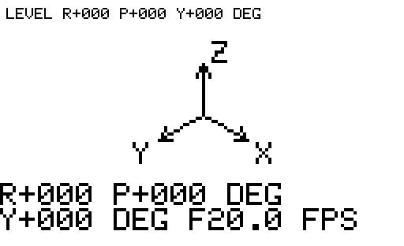
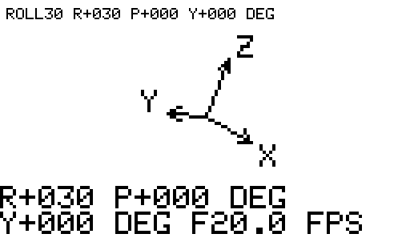
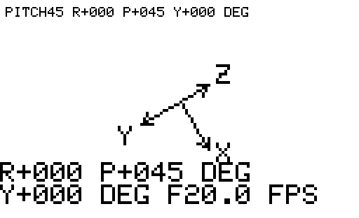
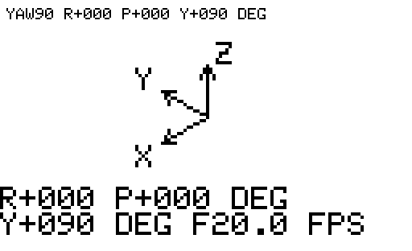
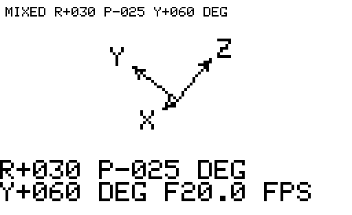
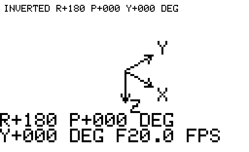

# IMU extension (optional, off by default)

STATUS: tested on a host with a fake I2C backend only. Everything that depends
on the sensor, the display, the Pi 5 I2C controller or real-time behaviour is
**UNVERIFIED ON HARDWARE** (see the UNKNOWN list at the end).

**FROM FILE — inherited implementation:** this extension adds an IMU sensor producer and an optional status display; the attitude mode below extends it. Both
are separate processes on the Pi. No existing program, runner, campaign, CPU
pin, priority, threshold or protocol changes. `run_pipeline.sh`,
`camera_pipeline.sh` and the experiment scripts never start these processes, so
the demo commands and earlier results stay as they were. Start the extension by
hand, in a second terminal, after the core pipeline works.

| Piece | Path | What it does |
|---|---|---|
| `hea_imu` | `linux/imu/hea_imu.c` | Probes and configures the IMU sensor on `/dev/i2c-1`. Samples it at a fixed rate on absolute deadlines and publishes each sample to shared memory (`hea_imu`). Also writes a CSV and a JSON timing summary, and computes complementary-filter tilt. |
| `hea_oled` | `linux/imu/hea_oled.c` | Optional 128x64 I2C display: status at 2 Hz by default; attitude at 20 fps requested. Shows pipeline state, camera fps, inference latency and IMU tilt, all read without writing anything. |
| `run_imu.sh` | `scripts/pi/run_imu.sh` | Opt-in runner. Sets the scheduling choice below and puts the files and system snapshots for each run in a new run directory. |
| tests | `linux/imu/tests/` | Fake-bus unit tests (C, ASan/UBSan) and process tests (Python). |

## Wiring (Pi 5 40-pin header, 3.3 V logic)

| Signal | Pi header pin | IMU module | Display |
|---|---|---|---|
| 3.3 V | 1 (or 17) | VCC | VCC |
| GND | 6 (or 9, 14, 20) | GND | GND |
| SDA (GPIO2, I2C1) | 3 | SDA | SDA |
| SCL (GPIO3, I2C1) | 5 | SCL | SCL |
| Mode select | — | PS to 3.3 V (high = I2C) | — |
| Address select | — | Accelerometer SDO: GND gives 0x18, 3.3 V gives 0x19. Gyroscope SDO: GND gives 0x68, 3.3 V gives 0x69. | Board jumper: 0x3C or 0x3D |

Both devices share the one bus. The UART (pins 8/10), the optional GPIO sync
line and the logic-analyser line (GPIO27, pin 13) are not used here. Power the
module from 3.3 V. GPIO2/3 already have pull-ups on the Pi, and modules often
add their own.

### Enabling the bus is a system change that must be recorded

`/dev/i2c-1` needs the `i2c_arm` interface and the `i2c-dev` module. First check
`ls /dev/i2c-1`, because many Pi images already enable it. If it is missing,
adding `dtparam=i2c_arm=on` to `/boot/firmware/config.txt` (and running
`sudo modprobe i2c-dev`) is a change beyond `dtparam=uart0=on`. Under
PI_NEEDS section 6 it must be written down in the run notes.
`run_imu.sh` also copies the `dtparam` lines of `config.txt` into
`system_before.txt`, so the change shows up in the evidence. The same applies
to any
`dtparam=i2c_arm_baudrate=` change; the default bus speed is 100 kHz. Do not
make that change unless a measurement shows it is needed.
`i2cdetect -y 1` (package `i2c-tools`, not in `bootstrap.sh`) should then
show `18`/`19`, `68`/`69` and, with the display, `3c`/`3d`.

## Register maps

**Primary: the two-die IMU sensor** (the course board build). The accelerometer and gyroscope are separate I2C
devices and are configured one after the other:

| Step | Accelerometer (0x18/0x19) | Gyroscope (0x68/0x69) |
|---|---|---|
| Probe | reg 0x00 = 0x1E | reg 0x00 = 0x0F |
| Soft reset | 0xB6 to 0x7E, wait 1 ms | 0xB6 to 0x14, wait 30 ms |
| Power-on | ACC_PWR_CONF 0x7C = 0x00 (active), wait 450 µs; ACC_PWR_CTRL 0x7D = 0x04 (on), wait 50 ms. After reset or power-on the die is in suspend. | LPM1 0x11 = 0x00 (normal) |
| Range | ACC_RANGE 0x41: 0..3 = ±3/6/12/24 g, scale 32768 / (1.5 g · 2^(r+1)) LSB/g | GYRO_RANGE 0x0F: 0..4 = ±2000..125 °/s, 16.384 · 2^r LSB/(°/s) |
| ODR / filter | ACC_CONF 0x40 = bwp<<4 \| odr (odr 0x05..0x0C = 12.5..1600 Hz; bwp 0x08 OSR4, 0x09 OSR2, 0x0A normal) | GYRO_BANDWIDTH 0x10, codes 0..7 (bit 7 reads back as 1) |
| Verify | Read back every written register; ACC_ERR_REG 0x02 must show no fatal or config error | Read back range, bandwidth and LPM1 |
| Data-ready | ACC_STATUS 0x03 bit 7 | GYRO_INT_STAT_1 0x0A bit 7 |
| Data | 6 bytes from 0x12, little-endian X/Y/Z | 6 bytes from 0x02, little-endian X/Y/Z |

Defaults: ±6 g, accelerometer ODR 400 Hz with normal bandwidth, ±500 °/s,
gyroscope ODR 400 Hz with 47 Hz filter. Both ODRs are twice the 200 Hz
sampling rate, so every sample normally has fresh data. The data-ready bits are
logged in `flags` and are not waited on: the release time, not the sensor,
paces the loop.

**Fallback: InvenSense-style map** (`--map invensense`, or `auto` when the
two-die probe fails). WHO_AM_I is 0x75 at 0x68/0x69. Setup is a reset through
PWR_MGMT_1 (wait 100 ms), then PLL clock, SMPLRT_DIV, DLPF, gyro/accel full
scale, and the same read-back check. Data is 14 big-endian bytes from 0x3B.

When nothing answers, `hea_imu` exits with code 3. It lists every address it
tried, with NACK or the wrong ID value it read, and names the checks (3.3 V,
GND, pins 3/5, PS high, `i2cdetect -y 1`). If only one die of the two-die
sensor answers, it says so. A missing `/dev/i2c-1` exits with code 1 and
explains which interface is needed. After 1 s of consecutive read failures the
run stops with status `SENSOR_LOST` (exit 4).

## Scheduling choice

Existing pinning, which must not change: in P1, source runs on CPU1 at FIFO 60,
bridge on CPU1 at FIFO 70, and inference on CPU0 under SCHED_OTHER. The
real-UART demo command puts the bridge on CPU2. Campaign stressors run on
CPU2/3.

| Process | CPU | Policy / priority | Why |
|---|---|---|---|
| `hea_imu` | 3 | SCHED_FIFO 40, `mlockall` | CPU3 is the only core that no pipeline process is pinned to in either P1 or the real-UART demo, so the measured tasks never share a run queue with it. Priority 40 is below source (60) and bridge (70): even if someone pins it to CPU1 by mistake, it still cannot preempt them. It is above every SCHED_OTHER task, so its jitter shows RT wake-up latency on a quiet core, not CFS sharing. The runner refuses `--priority` ≥ 60. |
| `hea_oled` | 3 | SCHED_OTHER nice 19 (`--idle` gives SCHED_IDLE) | Never real-time. On CPU3, `hea_imu` always preempts it, and it stays off the pipeline CPUs. 2 Hz by default. |

The extension is for the demo, not for the campaigns. CPU3 is a stressor core in
the E-campaign cells, so do not run it during campaign measurements.

Two side effects cannot be removed by affinity, so measure them instead of
assuming them away. (1) The I2C controller's interrupt runs on whichever CPU
the kernel routes it to, possibly CPU0 (the inference core). The runner saves
`/proc/interrupts` before and after for that reason. Moving the IRQ with
`/proc/irq/N/smp_affinity` would be another system change, and the script does
not do it. (2) The display and the IMU share the bus. Display writes go only
for pages that changed, in data transactions of at most 33 bytes
(`--chunk 32`), so IMU transfers can interleave between them. The cost then
shows up in the IMU's `i2c_read` distribution.

## How to run

Host (no hardware, synthetic data):

```sh
make -C os/linux/imu test
os/linux/imu/build/hea_imu --backend fake --duration 5 --shm hea_imu --csv /tmp/imu.csv
```

Pi, from `os/`, with the same privileges as the pipeline runs (SCHED_FIFO and
`mlockall` need root or RLIMIT_RTPRIO/MEMLOCK):

```sh
bash scripts/pi/run_imu.sh --probe-only                     # wiring check: prints the probe report
sudo bash scripts/pi/run_imu.sh --duration 60                # IMU alone (A)
# terminal 1, unchanged demo command:
bash scripts/pi/run_pipeline.sh --serial /dev/ttyAMA0 --baud 921600 --duration 60 --bridge-cpu 2
# terminal 2, after FRESH:
sudo bash scripts/pi/run_imu.sh --duration 60 --oled --pipeline-run latest   # (B/C)
```

`--pipeline-run DIR|latest` tells the display where the pipeline writes its
CSVs. The display reads them and nothing else. Without it, the display shows
`STATE: NO DATA` for the pipeline and still shows IMU tilt. Each run writes to a
new directory, `results/YYYY-MM-DD/imu-HHMMSS-PID/`; existing directories are
refused. Contents: `imu.csv`, `imu_summary.json`, `oled.csv`,
`oled_last.pbm`, `command.txt`, `process_commands.txt`, `config.json`,
`interrupts_{before,after}.txt`, `system_{before,after}.txt`,
`meta_{before,after}.json`, logs, `exit_code`, `DONE`/`FAILED`.

### Outputs

**FROM FILE — current source:** the legacy columns below keep their meaning; attitude fields are appended as described in “Attitude display”.

- `imu.csv`: `index,t_release_ns,t_wake_ns,t_sample_raw_ns,lateness_ns,period_ns,i2c_ns,missed_before,flags,ax_g,ay_g,az_g,gx_dps,gy_dps,gz_dps,roll_deg,pitch_deg`.
  Release and wake times use CLOCK_MONOTONIC, the clock of the absolute sleep.
  `t_sample_raw_ns` uses CLOCK_MONOTONIC_RAW, the clock of the pipeline CSVs.
  Flags: 1 accel new, 2 gyro new, 4 read error (values repeat the last good
  sample), 8 releases skipped before this one. The CSV is fully buffered
  (64 KiB), so logging costs one `write(2)` per ~400 samples instead of one per
  period.
- `imu_summary.json`: chip IDs, configuration, filter, requested and **actual**
  policy/priority/CPUs, and timing. Timing gives `release_lateness`
  (wake − deadline), `abs_period_jitter` and signed `period_jitter`
  (observed − planned activation interval, correct across skips), `i2c_read`,
  `missed_releases` and `read_errors`. Each distribution has count, min, mean,
  nearest-rank P50/P95/P99 (1 µs bins up to 20 ms) and max.
- Shared memory `hea_imu` follows the camera ring's conventions: native little
  endian, a 64-byte header (`magic "HEAI"`, version 2, slots, stride 128,
  rate, map, `ready` published with release, `head` = samples published). Each
  128-byte slot has a sequence counter that is odd while it is being written, so
  readers detect torn or overwritten reads; the slot for sample i is
  i mod slots. The ring holds 1024 slots by default (~5 s at 200 Hz). See
  `linux/imu/imu_ring.h`.
- Tilt comes from a complementary filter with tau = 0.5 s by default:
  roll = atan2(ay, az), pitch = atan2(−ax, √(ay²+az²)). The gyro integrates;
  the accelerometer correction is a first-order low-pass with time constant
  tau. While |a| is outside 0.7–1.3 g, only the gyro is used.
- `oled.csv`: displayed values per refresh, plus pages, bytes and time spent on
  the bus.

## Evidence to collect (the OS course cares about scheduling)

1. **Probe**: `imu.stderr.log`, with addresses and chip IDs.
2. **A, IMU alone, 60 s**: `release_lateness` and `abs_period_jitter`
   P50/P99/max, `missed_releases` (expected 0), and `i2c_read` P50/P99/max.
   Confirm that `scheduling.actual` shows SCHED_FIFO 40 on CPU3.
3. **B, IMU next to the unchanged pipeline demo**: the same numbers, plus the
   pipeline's `summary.json` compared with a pipeline run under the same
   configuration without the IMU. The claim that the IMU does not disturb the
   pipeline holds only if those pipeline numbers match.
4. **C, B plus `--oled`**: the change in `i2c_read` P99/max (bus contention)
   and `oled.csv` `update_ns`.
5. **Static checks**: board flat gives az ≈ +1 g and roll/pitch ≈ 0. Tilted
   90° gives ±90°. Gyro bias at rest should be a few °/s at most.
6. **`interrupts_before/after.txt`**: which CPU's count grows for the I2C
   controller IRQ.
7. The usual validity rule applies: `vcgencmd get_throttled` must be 0x0 before
   and after (`system_*.txt`), or the run is excluded.

## UNKNOWN until hardware

- Whether `/dev/i2c-1` and `i2c-dev` are present on the owner's image, and the
  bus speed (100 kHz assumed).
- The module's strapping: SDO levels (addresses), the PS pull-up, its regulator
  and its pull-ups.
- Real I2C transaction time and its tail on the Pi 5 controller. The host test
  measures only the fake backend.
- The CPU that services the I2C interrupt.
- Whether 200 Hz runs without missed releases, including stalls when the CSV
  buffer flushes to the SD card.
- The accelerometer power-on sequence and data-ready behaviour on the real die.
  The fake model only enforces the datasheet waits.
- Display: whether the controller accepts the common 128x64 init sequence
  (`oled_init` in `linux/imu/oled.c`) as written (charge pump, COM pins), and its orientation (segment/COM remap
  `A1`/`C8` may need `A0`/`C0` for the mounting).
- The MCU status rate against the display's 3 s staleness window, and the camera
  fps estimate taken from `source.csv`.
- Axis signs against the physical mounting.
- Any effect on the pipeline's numbers, which only evidence item 3 can show.

## Host test coverage (synthetic data, not measurements)

`make -C linux/imu test` builds with
`-std=c99 -Wall -Wextra -Wpedantic -Wshadow -Wconversion -Werror` and runs
the following:

- `test_imu` (ASan/UBSan) covers:
  - probing at both address pairs, an empty bus, a missing gyroscope die, a
    wrong chip ID, the fallback map and an unsupported WHO_AM_I
  - power-on order and the datasheet waits, measured on the fake's virtual
    clock
  - a driver without waits being rejected by read-back
  - refusal of invalid codes, and bus errors
  - scaling for every range, little- and big-endian decoding of synthetic
    "recorded" register frames
  - ring wrap, overwrite, unpublished, torn and busy reads, and unlink
  - filter step response (exact discrete response, 63 % at tau, > 99 % at
    5·tau, no overshoot), gyro integration, linear-acceleration rejection,
    ±180° wrap, and re-initialisation after a stall
  - jitter accounting (signed jitter, RMS, skipped releases, nearest-rank
    percentiles, overflow, JSON)
  - display probing, init, glyphs, dirty-page and chunked flush, and PBM
    output
  - CSV tail parsing and status derivation
- `test_imu_procs.py`:
  - a fake 100-sample run (CSV, summary, ring unlink)
  - the fallback map
  - the error paths and exit codes
  - the display reading a run directory and the live ring together

## Attitude display

**FROM FILE — source implementation (`linux/imu/imu_filter.*`,
`oled_attitude.*`, `hea_imu.c`, `hea_oled.c`):** mode `status` remains the
default (2 Hz). `--mode attitude` requests 20 fps by default; `--fps 1..25`
caps the refresh rate (`--rate-hz` remains an alias). The framebuffer is
1024 bytes; a second 1024-byte buffer remembers what was sent. The attitude
view draws three arrows and 5x7 X/Y/Z labels, with roll/pitch/yaw in degrees
and achieved fps below. Missing, invalid or stale data shows a wait message.
The optional split mode is not implemented.

### Math and conventions

**STANDARD PRACTICE — implemented in `imu_filter.c`:** the Hamilton quaternion
`q = [w,x,y,z]` maps right-handed sensor/body coordinates into a world frame
with +Z up. Positive gyro rates follow the right-hand rule. The accelerometer
at rest measures +gravity support, so a level board has `a = [0,0,+1] g`.
Euler angles use `R = Rz(yaw) Ry(pitch) Rx(roll)`.

```text
R = [1-2(y²+z²)   2(xy-wz)       2(xz+wy)
     2(xy+wz)     1-2(x²+z²)     2(yz-wx)
     2(xz-wy)     2(yz+wx)       1-2(x²+y²)]

p_i = R e_i                         (columns of R, i = X,Y,Z)
u_i = 64 + 20 (p_ix - p_iy)/sqrt(2)       pixels
v_i = 26 + 20 (p_ix + p_iy - 2p_iz)/sqrt(6) pixels
```

**FROM FILE — `oled_attitude.c`:** this fixed orthographic view gives a
level sensor a tripod: X down/right, Y down/left, Z up. Bresenham lines and
two line segments per arrowhead draw the arrows. Coordinates are rounded to
pixels; labels stay inside the graphic region above the two text rows.
An axis pointing along the viewing direction can foreshorten to a point,
and labels may overlap at some orientations. Euler text is singular at
pitch ±90°, while the quaternion arrows remain continuous.

**STANDARD PRACTICE — Mahony gravity correction:**
`v = Rᵀ [0,0,1]`, `a_hat = a/|a|`, `e = a_hat × v`,
`I += Ki e dt`, `omega = gyro_rad_s - bias_rad_s + Kp e + I`,
`q_dot = 0.5 q ⊗ [0,omega]`.
The implementation uses the exponential quaternion increment for the
corrected rate and normalizes every step. The integral is a gyro bias
correction with the opposite sign to the inferred bias. The filter family
and bias observer are described in the
[Mahony, Hamel and Pflimlin author manuscript](https://www.mikrocontroller.net/attachment/197058/2007_Mahony.etal_TAC-06-396_v3.pdf)
(FROM WEB, accessed 2026-11-25).

**FROM FILE — gain choices:** defaults are `--mahony-kp 2` s⁻¹ and
`--mahony-ki 0.05` s⁻²; both can be zero. The integral is bounded at ±0.35
rad/s per component and freezes outside the accepted gravity range
0.7–1.3 g. `Ki=0` clears the integral. Initial roll/pitch come from a valid
gravity sample and initial yaw is zero. Invalid time steps (≤0 or >0.5 s)
hold the quaternion; failed reads never advance it. The original
complementary tilt filter algorithm and its CSV/ring tilt fields remain
unchanged. Gains are development defaults, not hardware-tuned values.

### Startup bias, relative yaw and re-zero

**FROM FILE — `hea_imu.c`:** hold the IMU sensor still during
`--bias-seconds N` (default 2 s, maximum 30 s). Calibration precedes the
timed sample run, so total process time includes this interval.
The mean gyro rate on each axis becomes a constant bias subtraction.
Calibration rejects read errors, |a| outside 0.95–1.05 g, any gyro component
above 5°/s, or per-axis gyro variance above 0.04 (°/s)². A failed or
interrupted calibration exits 5 with a retry message. `--bias-seconds 0`
explicitly disables startup calibration. These gates catch obvious motion;
steady slow rotation can still corrupt calibration. Stillness is an
operator requirement.

**STANDARD PRACTICE:** a six-axis gravity reference cannot observe absolute
yaw, or a gyro bias parallel to gravity at rest. Startup calibration
reduces the initial bias while the operator guarantees stillness; warm-up
and later bias changes still accumulate yaw error. The display reports yaw
relative to startup, not compass heading. This display is diagnostic and
does not feed a robot controller.

**FROM FILE — re-zero:** send SIGUSR1 to the producer PID, not the runner.
`run_imu.sh` saves it as `imu.pid` in the run directory:

```sh
kill -USR1 "$(cat results/YYYY-MM-DD/imu-HHMMSS-PID/imu.pid)"
```

**FROM FILE — `imu_mahony_rezero`:** the next valid initialized attitude is
left-multiplied by a world-Z rotation of minus its current yaw. Roll, pitch,
startup bias and the integral remain; only the heading reference changes.
The CSV and JSON count processed re-zero requests. Closely spaced standard
signals may coalesce.

**FROM FILE — drift reporting:** JSON `attitude.drift_deg_per_min` is the
signed, unwrapped yaw change divided by accumulated apparently stationary
time, multiplied by 60. It is `null` if less than one second qualifies.
The gate requires a valid interval ≤0.5 s, |a| in 0.95–1.05 g, every
bias-corrected gyro component ≤0.5°/s, and each accel component changing by
≤0.002 g per sample. Only adjacent qualifying samples count; re-zero
transitions are excluded. `drift_stationary_seconds`, `drift_basis`,
`bias_dps`, `bias_samples`, gains and `rezero_count` accompany the rate.
Slow deliberate rotation can pass the gate: the operator must confirm that
the board was resting. This is an apparent stationary drift measurement,
not a ground-truth heading error or a drift prediction.

### Ring and CSV migration

**FROM FILE — `imu_ring.h`:** ABI v2 uses a 64-byte header and 128-byte slots.
The version is 2 and stride is 128; v1 readers reject v2 cleanly through
their existing version/stride check. Rebuild all readers together. The
first 14 payload words keep their v1 meanings, including complementary
roll/pitch. Added payload words: 14..17 quaternion w/x/y/z, 18..20 Mahony
roll/pitch/yaw in degrees; 21..29 zero-reserved. Flag bit 16 means initialized
attitude from a successful read. Sequence counters still guard the whole
slot. `ready`, `head`, overwrite and torn-read semantics are unchanged.

**FROM FILE — CSV:** `imu.csv` appends
`qw,qx,qy,qz,att_roll_deg,att_pitch_deg,yaw_deg,rezero_count`.
`oled.csv` appends `yaw_deg,achieved_fps,mode`; its original roll/pitch
columns still refer to complementary tilt. The display summary also logs
requested and achieved fps. Achieved fps counts successful completed
refreshes, including refreshes needing no bus write, over monotonic elapsed
time between first and last completion; it is zero for fewer than two
completions. The screen uses the preceding completion estimate.

### Shared-bus budget and owner decision

**COMPUTED — wire arithmetic:** a 1024-byte payload alone needs
`1024 × 9 / baud` seconds including ACK bits: 23.04 ms at 400 kHz, 92.16 ms
at 100 kHz. With 32-byte chunks a forced frame sends 1112 control/data bytes
in 40 transactions; including the address byte of each transaction gives
`(1112+40) × 9 / baud`, or 25.92 ms / 103.68 ms respectively, before
start/stop gaps, kernel overhead and IMU traffic. At 100 kHz even ten full
frames per second exceed the bus budget. A 20 fps request is a cap, not a
guarantee.

**FROM FILE — `oled_flush`, `hea_oled`:** after the initial frame, each dirty
page sends only the column span from its first changed byte to its last
(unchanged bytes inside the span may travel too). No clean page travels.
Each data write has ≤32 payload bytes plus one control byte (≤33 total);
window commands are 7 bytes and initialization is 27 bytes. The driver
clamps oversized chunk requests to 32 and the CLI refuses them. A failed
flush forces a complete redraw next time. The low-priority display skips
expired refresh deadlines rather than catching up. It never runs FIFO.
IMU scheduling has priority; each short kernel I2C transaction can still
delay a sensor transfer. Chunking bounds one transfer, not the kernel's
arbitration or a complete IMU deadline. Hardware timing must establish a
usable fps.

**FROM WEB — Raspberry Pi firmware
[parameter reference](https://github.com/raspberrypi/firmware/blob/master/boot/overlays/README)
(accessed 2026-11-25):** `i2c_arm_baudrate` defaults to 100000. **FROM FILE:**
the inherited setup assumed 100 kHz; there is no target configuration
snapshot in this clone. **UNKNOWN:** whether the owner's Pi actually runs
at 100 or 400 kHz. Read the configuration without changing it:

```sh
grep -n 'i2c_arm\|i2c_baudrate\|include' /boot/firmware/config.txt
# Inspect referenced include files and active model sections too.
```

**STANDARD PRACTICE:** a logic-analyser SCL measurement confirms the actual
clock when configuration alone is ambiguous. **OWNER DECISION:** whether
to set `dtparam=i2c_arm_baudrate=400000`, after shared-bus measurements.
This extension does not edit the Pi configuration.

### Run and preview

**FROM FILE — supported commands, from `os/`:**

```sh
make -C linux/imu all
# Pi: first collect display-off evidence, then repeat with attitude.
sudo bash scripts/pi/run_imu.sh --duration 60 --bias-seconds 3
sudo bash scripts/pi/run_imu.sh --duration 60 --bias-seconds 3 \
  --oled-mode attitude --oled-rate 20 --mahony-kp 2 --mahony-ki 0.05
# Add --pipeline-run latest only when intentionally observing the running demo.

# Laptop: exact production C rendering; no new packages.
linux/imu/build/attitude_preview 30 -25 60 /tmp/attitude.pbm
python3 linux/imu/tests/attitude_evidence.py
```

**FROM FILE — preview/evidence script:** the last command regenerates six
PBMs and opaque PNGs under `docs/img/attitude_*`, plus four-second fake
display-off/on host runs under `docs/attitude_host/`. PNGs enlarge the
original 128x64 C output and add a title; black marks on white represent
illuminated OLED pixels for print readability. `attitude_previews.json`
records angles, pixel counts and bounds. The A/B fake backends do not share
a physical bus, so their timing difference measures host activity only.

**FROM FILE — previews (synthetic poses, not sensor captures):**








### What this teaches

**STANDARD PRACTICE:** quaternion integration composes three-dimensional
rotations without Euler singularities. Gravity corrects two attitude
directions; it supplies no heading reference. An integral can learn
observable bias, but cannot create missing information. The synthetic
Z-bias test deliberately retains yaw drift before explicit stillness
calibration. For this robot, pitch/roll and mounting signs matter for
balance; a rotating arrow is useful for diagnosis but is not evidence of
accurate global heading.

**STANDARD PRACTICE:** sharing a bus couples a cosmetic display to a sensor
deadline even when the processes have different CPU priorities. Dirty
regions, short transactions and refresh caps reduce traffic. Timing tails
and missed releases, measured in otherwise matched runs, decide whether
the display can run alongside the robot's pipeline.

### What the real robot must confirm

**UNKNOWN — hardware evidence required:**

1. Repeat stationary runs for ≥60 s with display off/on, same sensor rate,
   gains, CPU policy and pipeline load. Compare JSON lateness P50/P99/max,
   I2C read P99/max, missed releases, errors, and `scheduling.actual`.
   Retain `oled.csv` bytes/update time/achieved fps and both summaries.
2. Confirm actual SCL speed, target controller init, mounting orientation,
   three signed axes, and response to a positive roll/pitch/yaw rotation.
   Test re-zero at a tilted pose and confirm tilt is preserved.
3. Confirm rest during calibration, measured bias stability after warm-up,
   and actual stationary yaw drift (deg/min), with qualifying time recorded.
   Deliberate motion must not be mistaken for drift.
4. At 100 kHz and, only if separately chosen by the owner, 400 kHz, lower
   `--oled-rate` until IMU deadlines remain acceptable. This extension supplies
   no measured Pi fps, lateness increase or guaranteed deadline bound.
5. Check sensitivity to startup duration and Kp/Ki, especially acceleration,
   vibration and temperature. An acceleration norm near 1 g can still give
   a wrong gravity direction; the magnitude gate cannot eliminate that case.

**FROM FILE — host checks:** `test_attitude` simulates static tilt
convergence, constant-rate rotation on all three axes, horizontal gyro bias
learning, unobservable yaw bias, startup bias subtraction, re-zero and
normalization. It checks projections at identity and 90° rotations, golden
pixel counts/bounds for six poses, and clipped line drawing. Extended ring
tests cover v1 rejection/v2 field transport; page tests cover unchanged
frames, single-column edits and erasure. Process tests exercise live ring
attitude, SIGUSR1, JSON drift and a 20 fps fake display.
