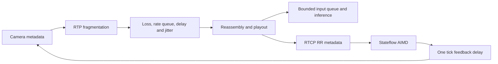
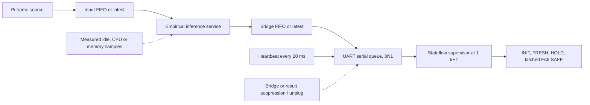

# Shared CN / OS simulation coursework

Source implementation for MATLAB, Simulink and Stateflow. The shared models in the "Run later" section were prepared without starting MATLAB: their model generation, MATLAB tests, simulation results and app rendering remain to be verified when the memory-heavy job has finished. No simulated results are presented as measured or as already executed.

This folder contained a partial `+course` library and measurement snapshots. They were retained and extended. Existing `run.log` / `run1.log` are pre-existing files, not validation of this implementation.


## CN SimEvents models (added 20 November 2026, run in MATLAB R2026b)

- **v2, [CN_simevents_v2.slx](generated/CN_simevents_v2.slx):** the whole RTP/RTCP path is built from native SimEvents blocks you can open and follow: frame source, sender queue (FIFO or latest-value), RTP packetizer (an Entity Replicator makes one copy per fragment), link serializer, seeded loss and delay channel, receiver (RFC 3550 jitter, playout-deadline gate, per-frame reassembly, 1 s RTCP report), inference queue, RTCP return path and the Stateflow AIMD rate controller. See the [v2 report](study_simevents_v2/SIMEVENTS_V2_REPORT.md) and its [figures](study_simevents_v2/figures).
- **v1, [CN_simevents.slx](generated/CN_simevents.slx):** the first connected SimEvents model, where the packetizer, channel and receiver were MATLAB discrete-event code blocks. See the [v1 report](study_simevents/SIMEVENTS_REPORT.md).
- **v1 vs v2 on the same seeds:** Stage A 100/100 values identical; Stage B 194/200 and Stage C 555/560 identical or within tolerance. The remaining 11 values (inference-queue runs) differ by one frame interval because two events fall at the same instant; with the service time moved by ±1 ns both models agree exactly (32/32). Regression suite: 31/31 tests pass.
- Simulation only. Stage C compares against measured summary values from the Pi/netem experiments in [data](data).

## Run later

See the root README MATLAB section for the staged command sequence, expected artifacts and mappings to the Vietnamese lessons. The resumed edit was reviewed statically; MATLAB, Simulink and app execution are still pending.

In MATLAB, after the other job is finished:

```matlab
% Start from this repository's sim folder
setup_coursework
run_tests(false)            % Shared library + short MATLAB reference runs
build_models               % Creates generated/CN_shared.slx and OS_shared.slx
run_tests(true)             % Also compiles/runs both models and checks charts
run_tests(false,true)       % Optional desktop replay smoke test; closes its app
open_system('generated/CN_shared.slx')

c = course.defaults('CN'); c.duration = 10; c.warmup = 1;
result = run_coursework(c); % Default: real Simulink graph, Stateflow controller
save('output/demo.mat','result')
CourseworkReplayApp('output/demo.mat','data/source/os_measured_bridge.csv')

run_monte_carlo             % Every CN config, 5 seeds, sequential Simulink runs
run_os_study               % 3 loads x 2 input policies x 5 seeds + bridge/fault demos
```

The last two commands are a substantial interpreted simulation campaign; begin with tests and one short run. There is no `parpool`, background worker, hardware access or shell launch of MATLAB. Use `run_coursework(c,'matlab')`, `run_monte_carlo('matlab')` or `run_os_study('matlab')` for the shared MATLAB stage implementation and controller oracles. That backend does **not** execute Stateflow and is labelled accordingly in saved results. Five random seeds are repeatability experiments, not hardware replications.

`run_tests(true)` regenerates the two named models, so save personal model edits under a different name. Builders close only their own model names. Generated SLX files and Simulink caches go under `generated/`; CSVs, MAT recordings and PNG figures go under `output/`. Paths are anchored to this folder. No binary `.slx` or `.mlapp` is fabricated without the relevant MATLAB tools.

Products observed on disk under `source-not-shipped/Engineering\toolbox`: `simulink`, `stateflow`, `control`, `ident`. This is a folder check, not a runtime licence check. Only MATLAB, Simulink and Stateflow are required. SimEvents, Communications Toolbox and Statistics and Machine Learning Toolbox are not used; Control System and System Identification are available for later learning but are not dependencies. Percentiles and empirical sampling use base MATLAB code.

## What the models demonstrate



`CN_shared` has separate connected stages. Every block calls the same MATLAB stage implementation used by the reference runner. The feedback path actually changes generated frame bytes. AIMD starts at scale 1, multiplies by 0.8 above 2% RR interval loss, adds 0.05 after three RRs at or below 0.5%, and clamps to [0.15, 1.5]. Jitter alone does not reset the clean counter. This is a bitrate/size controller; the scale is **not a calibrated JPEG quality setting**.

The model tests packet loss versus frame loss, burst correlation, IP-fragment exposure, receiver jitter, playout deadlines, bounded queue saturation, AoI and feedback. It does not encode JPEG, execute ONNX, send UDP, implement security, or certify RTP wire compliance. PT 96 represents the project's custom payload, not RFC 2435. Metadata packets carry sequence, timestamp, frame, fragment index/count, payload bytes, marker and capture time. Sequence wraps at 2^16; the 90 kHz timestamp wraps at 2^32 and is generated from frame capture time (6000 ticks at 15 fps).

RR implements interval fraction lost in 1/256 units, cumulative loss and extended highest sequence, plus RFC jitter. Late/reordered packets can correct the cumulative loss. Duplicate arrivals count in the RFC received counter; reassembly suppresses duplicate fragments. The single-SSRC session is assumed already validated; probation, SSRC restart/collision and extreme reorder beyond half the sequence space are outside scope. LSR/DLSR are zero because SR exchange/clock synchronization is not modelled, so RTT is unavailable. The dashboard can import measured SR/RR/APP events. The simulation does not synthesize a complete RTCP wire implementation.



`OS_shared` tests placement of latest-value replacement, UART serialization, source-age expiry, heartbeat expiry and explicit rearm. It **does not predict Linux scheduling or DRAM contention**. Those effects enter through measured latency samples. FIFO drops newest on overflow; latest replaces only waiting work, never an inference already running. Bridge-only replacement cannot undo old work at the inference input.

Supervisor defaults come from the retained firmware/configuration: heartbeat timeout 100 ms, source-age HOLD 200 ms, FAILSAFE 500 ms, healthy rearm 1 s, transit allowance 5 ms. Age is `now - last_result_receive + age_at_send + transit_bound`; it is not time since last result alone. Heartbeat failure has priority over age failure. INIT waits for heartbeat and result; FAILSAFE stays latched when traffic returns. A rearm pulse after a continuous healthy interval returns to INIT and requires both new receptions after the rearm epoch. State numbers: 0 INIT, 1 FRESH, 2 HOLD, 3 FAILSAFE; reasons: 1 ready, 3 heartbeat, 9 source-age HOLD, 10 source-age FAILSAFE. This is a timing abstraction, not the firmware's CRC/session/generation validator or an actuator safety proof.

## Calibration and assumptions

`data/provenance.json` retains source paths and SHA-256 hashes from the partial project; `data/source/` contains source snapshots. `data/cn_targets.csv` transcribes comparison targets from `cn_hw_tables.md`. Additional sources and checks are recorded by `tools/static_audit.ps1` in `output/static_audit.txt`. The plans were read from `private-plan-not-shipped/CN_PLAN.md` §§6–7 and `OS_PLAN.md` §§1,4,5.

| Item | Evidence / use | Limitation or ASSUMED choice |
|---|---|---|
| CN Bernoulli loss 0/1/5/10%, GE pGB=.01316, pBG=.25 | Configured netem conditions; GE stationary loss ~5%, burst 4 | GE emits in current state, then transitions; starts in stationarity |
| CN packets/frame and T5 JPEG mean sizes | Measured table inputs | Only means available. Adjacent-integer packet-count mixture and fixed last-packet size are synthetic, not an empirical JPEG distribution |
| CN 20 ms delay, 5/20 ms jitter, D=20/50/100/200 ms | Configured measured conditions | Clipped independent Gaussian for 20 ms normal; uniform +/-5 ms approximation for unspecified netem distribution; optional order preservation |
| CN inference 12.5 ms; T7 synthetic 50 ms | Measured median / experiment setting | Fixed point distributions. No fabricated CN empirical samples or invented P95 fit |
| CN-T7 input 30 fps | Retained scenario YAML | Queue capacity 8 is ASSUMED; 1 ms scheduling and fixed service do not recreate the measured ~17.5 results/s |
| Link capacity/rate | No measured bottleneck campaign provided | ASSUMED 100 Mb/s, 256000-byte tail-drop queue including packet in service; change for sensitivity studies |
| Wi-Fi | Only aggregate latency/jitter/ontime targets available | ASSUMED 35 ms +/-20 ms Gaussian link law; exploratory only, never a fitted Wi-Fi channel |
| CN-T8 | No hardware run in supplied table | Exploratory 0 -> 15% -> 0 loss at 0/15/35 s; result is not hardware validation. Random loss independent of bitrate may show little adaptation benefit |
| OS idle / CPU service | `(pre_ns + infer_ns)/1e9`, all three accepted 1-thread repeats, October 11 collection | IID resampling loses temporal correlation, thermal evolution and run-to-run grouping |
| OS memory service | October 30 P0 memory-stress completion intervals: filter `status=sent` and positive completion time, then difference the 491 accepted completions to obtain 490 samples | **INFERRED effective saturated service**, includes scheduling/IPC effects, not isolated ONNX latency; different campaign/profile from idle/CPU |
| OS-T4 92.760 vs 191.984 ms | October 30 `OS-wt-cam34` summary, input latest vs FIFO, bridge latest; 3 valid repeats each stated by summary | The older October 12 E3b in report-v2 has exclusions and different observations. Do not replace its validity labels. Our service samples are from a different campaign; errors quantify that limitation |
| OS input and bridge queues | 30 fps comparison source; selectable queue policies | Input FIFO capacity 3, bridge capacity 8 and 1 ms bridge dispatch are ASSUMED, not fitted to 93/192 ms |
| UART | Configured 921600 baud; 35-byte result = 350 bits / baud = 0.380 ms | Heartbeat frame size 20 bytes and 4096-byte TX capacity are ASSUMED; no electrical/CRC-error simulation |
| Fault comparison | Corrected reason-specific table in `os_stage_report.md` | 20 ms result age-at-send, 10 fps fault-study source and injected fault phase are ASSUMED; no claim that fault onset is aligned with the hardware campaign |

Nothing is optimized to make comparison errors vanish. Raw CN runs are bundled separately under ../cn/rtp/results; the model still uses aggregate inputs, so five-run **ranges cannot be reconstructed** from aggregate means. Plots show simulation mean/min–max and measured means, with no invented measurement error bars. Relative error for a zero target is NaN; absolute error remains meaningful. Fraction errors are fractions (multiply by 100 for percentage points).

Each stage is scheduled every 1 ms; serialization/delay event times retain floating-point sub-tick precision and are processed at the next tick. Inference completion and reception logs retain those event times. Arrival events at a tick are processed before deadline checks; `completion <= deadline` is on time. The first received packet anchors the receiver media clock, matching the existing playout code. All generated frames, including wholly lost frames, are included in denominator accounting through a simulation-only sender side channel. That side channel does not reconstruct missing packets. Late completions are accepted for classification for one second; a two-second CN drain prevents right-edge misclassification. The frame/packet table retains history for analysis; it is not an embedded memory-budget model. Batches above 64 packets/tick fail loudly; increase `maxBatch` for larger traffic experiments.

AoI integrates the age of the **freshest delivered capture** exactly between deliveries. It is not mean capture-to-result latency. Warm-up defaults to 5 s (CN) and 1 s (OS); if no result has initialized the observer, AoI is NaN. Freshness is evaluated over the configured observation window, with no hidden first-sample replacement.

## Fault comparison and outputs

`run_fault_study` injects F1 bridge loss, F2 bridge pause, F3 stopped result delivery, F4 bridge starvation, F5 result suppression with heartbeat alive; `unplug` is an additional selectable link fault. F1/F2/F4 have identical communication failure semantics here. F3/F5 suppress completed results; they do not simulate process signals or the Linux scheduler. Recovery and rearm are separate configurable events.

The correct timing expectation is the remaining timeout at injection, plus sampling quantization: from last heartbeat roughly 100–101 ms; from the last inference about 175–176 ms to HOLD and 475–476 ms to FAILSAFE when age-at-send is 20 ms and transit allowance 5 ms. Fault-to-state time can be smaller because the last healthy event predates the fault. Do not compare 100 ms from heartbeat with ~85 ms from fault onset as if they were the same metric.

The corrected OS report supersedes old `e4_faults.csv` first-transition references. F1/F2 HOLD uses last inference (reason 9), not last heartbeat; heartbeat FAILSAFE uses reason 3. `os_fault_runs.csv` retains state, reason, local reference, local delay and fault-to-state delay. The F4 measured aggregate includes extra accepted attempts with shorter-window qualification; F5 is the separate five-run stale-result campaign. These are MCU state times, not independently verified GPIO/actuator reaction times.

Outputs after execution:

- `cn_runs.csv`, `cn_error_table.csv`, `cn_formula.csv`, and one PNG per metric. The formula uses the integer packet-count mixture, not a fractional exponent approximation.
- `os_aoi_runs.csv`, `os_aoi_error_table.csv`, `os_t4_aoi.png`.
- `os_fault_runs.csv`, `os_t6_error_table.csv`, `os_t6_reaction.png`.
- Seed-1 MAT recordings per configuration for replay; other seeds retain summary rows to limit disk use.

## Replay dashboard

`app/CourseworkReplayApp.m` is an editable, programmatic App Designer app using `matlab.apps.AppBase`, `uifigure`, UI axes and a replay timer. It is delivered as `.m` source; it is not a drag-and-drop `.mlapp` design. Load simulation MAT files containing `result` and measured CSV logs independently. Play/pause, speed, slider and restart share a relative replay clock. This is replay, not a live network connection.

The tabs mirror the planned CN web panels: video/class label, sequence strip, loss counters, jitter, playout, deadline hit ratio, capture-result/breakdown, RTCP timeline, bitrate, queue/AoI, hardware; additional OS tabs show supervisor state, inference histogram, CPU/memory, UART and faults. Unavailable panels say so. The simulation has no video classifier, temperature, throttle bits or real per-core CPU; those panels require a measured log. Never display synthetic green hardware-health indicators. A replay has no effect on hardware.

Native `bridge.csv` columns (`t_input_ns,t_done_ns,t_send_ns`) are accepted directly and normalized to a Pi-clock origin. Its latency includes input wait and is not labelled isolated inference. Its endpoint is bridge send, not MCU receipt. Other logs use the canonical wide CSV schema in `docs/replay_schema.md`. Aggregate CN tables cannot create packet-level replay; import original packet/event logs when recovered. Side-by-side recordings share relative elapsed time, not a cross-machine clock synchronization claim. To compare FIFO/latest on identical simulated input, load their seed-1 files on the two sides.

## Learn MATLAB and Simulink through this project

1. **Arrays, tables and units:** read `defaults.m`, inspect `cn_targets.csv`, and calculate `350/921600`. Convert seconds to milliseconds only at the display boundary. Predict the baseline `D + service` before running anything.
2. **Classes and state:** trace one `Packetizer` call, then inspect a second call to see sequence persistence. Run the wrap/reassembly test and explain why the marker packet arriving first cannot complete a frame.
3. **Randomness:** inspect `Loss`, `Delay` and `Inference`. Each stage owns a seeded `RandStream`, so changing one stage does not consume another stage's random numbers. Compare GE burst lengths against Bernoulli at equal average loss.
4. **Queues:** hand-calculate three arrivals with 50 ms service. Run FIFO/latest with the same seed; identify drops, replacements and waiting time. Explain why bounded FIFO saturates and why latest must be before slow work.
5. **Metrics:** derive the triangular area in `aoi.m`; compare time-average AoI with mean latency. Inspect the jitter recurrence in timestamp units and explain intra-frame packet spread. Read RFC 3550 §§6.4.1, A.3 and A.8.
6. **Simulink execution:** build/open CN, trace ports, inspect the unit delay breaking feedback, and compare the MATLAB and Simulink short runs. Open `course_sfun.m` to learn how a normal-mode Level-2 block adapts a MATLAB object. These blocks are intentionally not code-generation targets.
7. **Stateflow:** open AIMD and inspect `clean`; open Supervisor and highlight FRESH/HOLD/FAILSAFE. Change fault phase by 0.2 ms and predict the first tick satisfying the guard. Test the boundary `age == threshold` and healthy traffic without rearm.
8. **Calibration discipline:** run five seeds, inspect errors, then change only one documented assumption (first-arrival anchor, queue capacity, service distribution or reorder policy). Keep the original output and write why a mismatch changed; do not fit unknowns silently.
9. **Apps and extensions:** add a canonical CSV field and its dashboard mapping. Later explore measured service autocorrelation or fit a small response model with System Identification; do not use it as a Linux scheduler model. Control System Toolbox can help study a linearized rate-feedback approximation after the event model is understood.

Primary implementation references: [RFC 3550](https://www.rfc-editor.org/rfc/rfc3550), [MathWorks Level-2 MATLAB S-functions](https://www.mathworks.com/help/simulink/sfg/writing-level-2-matlab-s-functions.html). Local firmware and experiment sources take precedence for this project's thresholds and validity qualifications.
