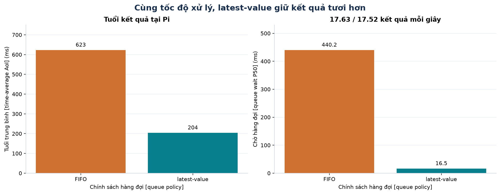
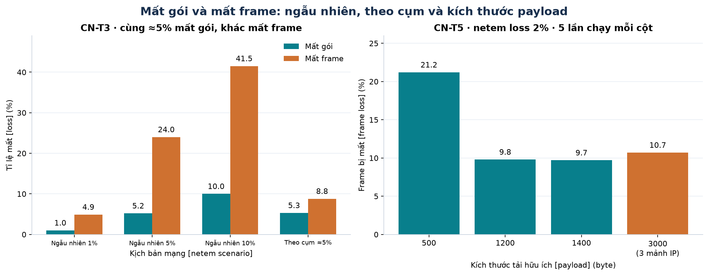
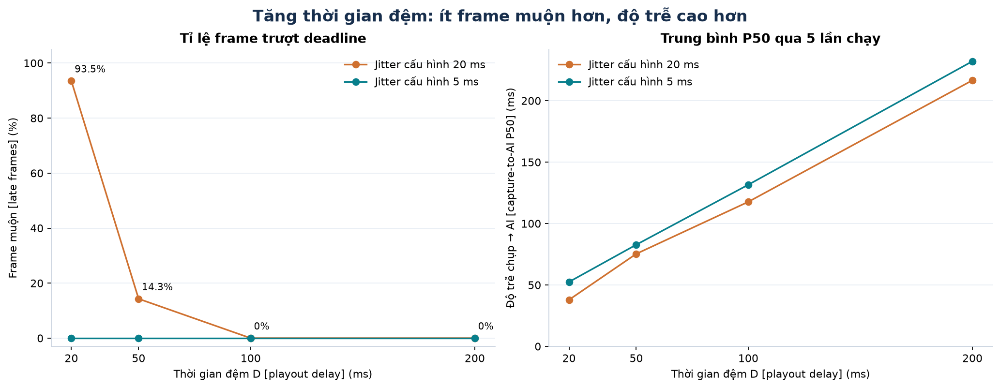
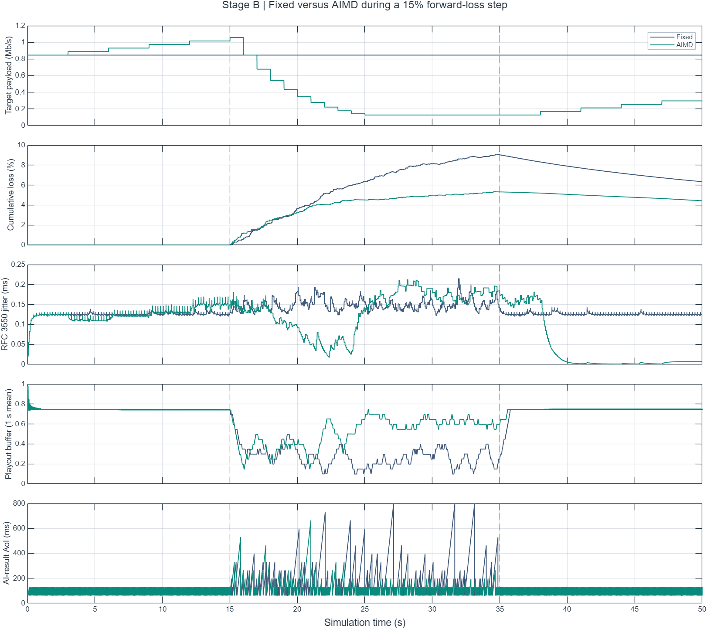

# Trình bày với thầy — Mạng máy tính (CN)

Sau trang này bạn trình bày được phần mình, bàn giao đúng người và nêu đúng giới hạn bằng chứng. Trang này chỉ dùng kiến thức của CN Session 1–2.

!!! tip "Nói đơn giản"
    Một bài bảo vệ giống chạy tiếp sức. Mỗi người nhận đúng đầu vào từ người trước rồi bàn giao đúng đầu ra cho người sau, theo đường đi của gói tin.

## 1. Thứ tự và bàn giao

Tập mỗi phần 3–5 phút riêng, sau đó ghép lại. Thời lượng dưới đây là **đề xuất**, không phải thời lượng thầy đã xác nhận.

| Thứ tự | Người | Phần phụ trách | Phút |
|---:|---|---|---:|
| 1 | Trường | Nguồn ảnh, đóng gói RTP, serialization, kênh, T3/T5 | 3 |
| 2 | Mạnh | Receiver, jitter, playout deadline, ghép ảnh, tạo RR, T4 | 3 |
| 3 | Hiếu | Tiêu thụ RR, AIMD, dashboard, Stage B | 3 |
| 4 | Vinh | Hàng đợi inference, AoI, T7 và kết luận | 3 |

### Câu chuyển phần

- **Trường → Mạnh:** “Các mảnh RTP đã qua kênh có thể mất hoặc đến trễ; Mạnh sẽ giải thích cách nhận, ghép ảnh và phát đúng hạn.”
- **Mạnh → Hiếu:** “Receiver đã tạo RR chứa tỉ lệ mất gói và jitter; Hiếu sẽ chỉ cách sender dùng RR để đổi kích thước ảnh.”
- **Hiếu → Vinh:** “Ảnh tới đúng hạn chưa chắc cho kết quả mới; Vinh sẽ giải thích hàng đợi AI và tuổi thông tin.”

## 2. Biên giao diện — ai giải thích phía nào?

| Giao diện | Người tạo | Người tiêu thụ |
|---|---|---|
| Gói RTP | Trường: header, mảnh, kênh | Mạnh: parse, thống kê, ghép ảnh |
| RTCP RR | Mạnh: tạo các trường | Hiếu: cập nhật AIMD |
| Ảnh JPEG đúng hạn | Mạnh: callback khi ảnh hoàn chỉnh | Vinh: đưa vào hàng đợi inference |
| Thí nghiệm mạng | Trường: T3/T5 | Mạnh: T4; Hiếu: Stage B; Vinh: T7 |

## 3. Hình cần thuộc

{ loading=lazy }

!!! note "Cách đọc hình — sơ đồ mô hình (SOURCE)"
    Hàng trên đi từ Frames đến Inference theo đường của ảnh và gói. Hàng giữa đưa RR ngược về sender. Dây dưới nối AIMD với Frames: AIMD đổi kích thước các ảnh **sau này**, không sửa ảnh đã gửi. Sơ đồ không có trục thời gian.

{ loading=lazy }

!!! note "Cách đọc hình — MEASURED, CN-T7"
    Trái: mean AoI tại Pi (ms); phải: P50 thời gian chờ trong hàng đợi (ms). Số kết quả mỗi giây của hai chính sách gần bằng nhau, nên latest-value cải thiện độ mới chứ không tăng tốc AI.

## 4. Khi thầy hỏi ngoài phần mình

Trả lời theo năm bước: (a) chỉ vị trí khối trên sơ đồ, (b) nêu đầu vào và đầu ra, (c) giải thích một cơ chế, (d) nói rõ số liệu là SOURCE / SIMULATED / MEASURED / CALCULATED, (e) chuyển cho người phụ trách nếu câu hỏi đi sâu.

Ví dụ: RTP đi từ sender tới receiver; RR đi ngược lại và không chứa ảnh. Trường tạo RTP, Mạnh tạo RR, Hiếu dùng RR, Vinh xử lý ảnh đã hoàn chỉnh. Nếu không nhớ số chính xác, nêu cơ chế và xin đối chiếu đúng bảng nguồn — không đoán số.

## Trắc nghiệm

Trường — Hai kịch bản khoảng 5% mất gói có frame loss giống nhau không?

- [ ] Mất cụm luôn tốt hơn ở mọi hệ thống
- [ ] Frame loss luôn bằng packet loss
- [x] Không, trong mẫu này mất cụm cho frame loss thấp hơn
- [ ] Có, luôn bằng nhau

MEASURED: mất độc lập 5.2% cho frame loss 24%, mất cụm Gilbert–Elliott 5.3% cho 8.8%. Khi mất dồn thành cụm, nhiều gói mất rơi vào cùng một ảnh nên ít ảnh bị hỏng hơn. Sai lầm hay gặp là nghĩ frame loss bằng packet loss: một ảnh hỏng khi chỉ cần một mảnh mất. Kết quả này không chứng minh mất cụm luôn tốt hơn.

Mạnh — Ở cấu hình jitter cao, tăng đệm từ 100 lên 200 ms đem lại gì?

- [ ] Giảm mất gói về 0
- [ ] Giảm trễ một nửa
- [ ] Tăng tốc xử lý AI
- [x] Không giảm thêm frame muộn quan sát được nhưng tăng trễ

MEASURED (T4): cả hai mức đều 0% frame muộn, còn P50 trễ tăng. Khi đệm đã đủ lớn, thêm đệm chỉ làm chậm hiển thị. Đệm không sửa mất gói và không làm AI nhanh hơn.

Hiếu — Đường AIMD ở ô bitrate trên cùng làm gì trong khoảng mất gói?

- [x] Giảm từng bậc
- [ ] Giữ nguyên như Fixed
- [ ] Tăng liên tục
- [ ] Biểu diễn trực tiếp độ chính xác của AI

Mỗi RR báo loss lớn hơn 2% làm hệ số kích thước nhân 0.8, nên đường đi xuống thành bậc. Trục này là kích thước ảnh mục tiêu, không phải độ chính xác AI.

Dây từ AIMD quay lại khối nào?

- [x] Frames
- [ ] Inference
- [ ] Channel
- [ ] Receiver

Frames nhận hệ số kích thước cho các ảnh tạo sau đó. AIMD không thay đổi dữ liệu đã đi tới receiver.

## Câu thầy có thể hỏi

??? question "Trường — RTP timestamp và sequence khác nhau thế nào?"
    Các mảnh của cùng một ảnh có chung timestamp media 90 kHz (SOURCE); sequence tăng 1 cho mỗi gói, modulo 65536. Timestamp nói “thuộc ảnh nào, lúc nào”, sequence nói “gói thứ mấy”.

??? question "Trường — Tại sao 1200 B mà không 3000 B?"
    Gói 3000 B vượt MTU nên bị phân mảnh IP; mất một mảnh IP là mất cả gói. Giới hạn trong Python tính cả header riêng, còn trong SimEvents là phần dữ liệu ảnh. MEASURED T5: frame loss 9.8% ở 1200 B so với 10.7% ở 3000 B.

??? question "Mạnh — Jitter có phải độ trễ một chiều không?"
    Không. Jitter RFC 3550 là ước lượng độ biến thiên của transit tương đối, cập nhật với hệ số 1/16; nó không cần đồng hồ hai máy đồng bộ.

??? question "Mạnh — Bit marker có đủ để ghép ảnh không?"
    Không. Python còn cần tổng kích thước và cờ kết thúc khớp, các khoảng byte phải liền nhau.

??? question "Hiếu — AIMD trong Python khác SimEvents ra sao?"
    SOURCE: Python đổi chất lượng JPEG và độ phân giải, ngưỡng loss > 5% và < 1%, thêm điều kiện jitter. SimEvents đổi hệ số kích thước byte, ngưỡng > 2% và ≤ 0.5%.

??? question "Vinh — Latest-value có làm AI nhanh hơn không?"
    Không. Nó chọn ảnh chờ mới nhất và bỏ ảnh cũ. MEASURED T7: mean AoI 623 → 204 ms, thông lượng 17.63 → 17.52 kết quả/s, với tải inference synthetic.

??? question "Vinh — AoI khác latency và P95 thế nào?"
    Latency đo cho từng kết quả. AoI là tuổi của thông tin mới nhất đang giữ, thay đổi liên tục theo thời gian. P95 là phân vị 95%, không phải giá trị lớn nhất.

Nguồn: [`hw_tables.md`](https://github.com/KaiserRichard/edge-ai-video-runtime/blob/main/cn/rtp/report/hw_tables.md), `stage_B_results.csv`. Tiếp theo: [Demo CN](../demo/cn.md).
