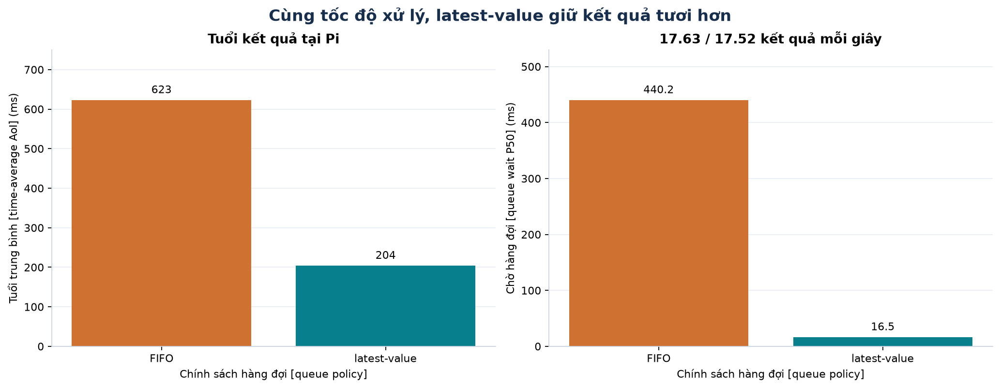
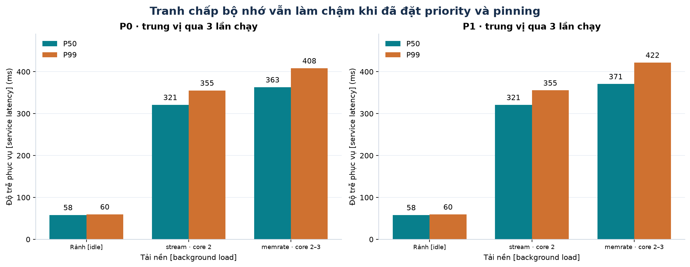
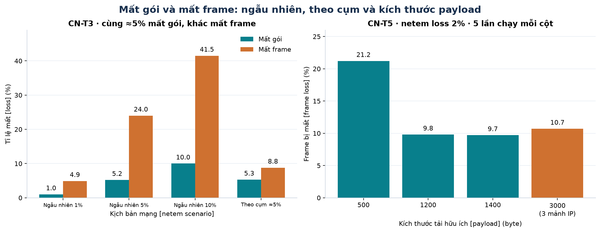
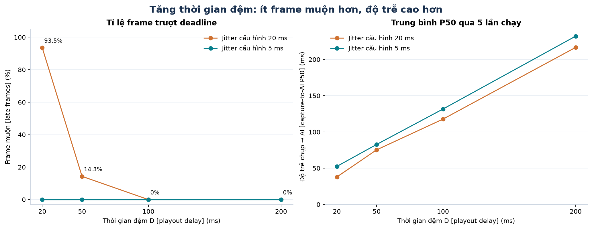
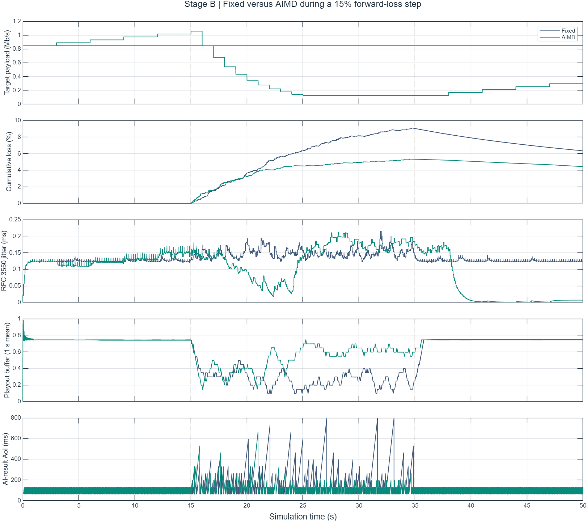

# Trình bày với thầy

Sau bài này bạn giải thích được phần mình, bàn giao đúng người và nêu giới hạn bằng chứng.

{ .figure-right loading=lazy }

!!! tip "Nói đơn giản"
    Một bài bảo vệ giống chuyến tiếp sức. Mỗi người nhận đúng đầu vào rồi bàn giao đúng đầu ra.

## Thứ tự và bàn giao

Tập mỗi người 5–7 phút riêng. Khi ghép bài 12 phút/môn, phải rút gọn. Phân bổ dưới đây là **đề xuất**, không phải thời lượng do thầy xác nhận.

| Môn | Thứ tự | Phần phụ trách | Phút trong talk nhóm |
|---|---|---|---:|
| OS | Vinh | MCU, FreeRTOS, supervisor, F2/F5 | 5 |
| OS | Hiếu | Pi, IPC, bridge, scheduling, kết quả và giới hạn | 6 |
| OS | Chung | Kết luận và chuyển sang demo nếu được phép | 1 |
| CN | Trường | Nguồn, RTP, kênh, T3/T5 | 3 |
| CN | Mạnh | Receiver, jitter, deadline, tạo RR, T4 | 3 |
| CN | Hiếu | Tiêu thụ RR, AIMD, dashboard, Stage B | 3 |
| CN | Vinh | Queue, AoI, T7 và kết luận | 3 |

### Câu chuyển phần

- **Vinh → Hiếu (OS):** “MCU chỉ dùng bản tin hợp lệ và tuổi dữ liệu để quyết định trạng thái; Hiếu sẽ giải thích cách Pi tạo bản tin đó và vì sao tải Linux ảnh hưởng đến độ mới.”
- **Trường → Mạnh (CN):** “Các mảnh RTP đã qua kênh có thể mất hoặc đảo thứ tự; Mạnh sẽ giải thích cách nhận, ghép ảnh và phát đúng hạn.”
- **Mạnh → Hiếu (CN):** “Receiver đã tạo RR chứa mất gói và jitter; Hiếu sẽ chỉ cách sender dùng RR để thay đổi chất lượng truyền.”
- **Hiếu → Vinh (CN):** “Ảnh đã tới đúng hạn chưa chắc cho kết quả mới; Vinh sẽ giải thích hàng đợi AI và tuổi thông tin.”

## Biên giao diện — ai giải thích phía nào?

| Giao diện | Người tạo | Người tiêu thụ |
|---|---|---|
| UART HB/INFERENCE | Hiếu: tuổi lúc gửi và session | Vinh: xác thực, timer, state |
| MCU log | Vinh: lý do, time local | Hiếu: đọc log và gate |
| RTP | Trường: header/mảnh và kênh | Mạnh: parse, stats, ghép |
| RTCP RR | Mạnh: tạo field | Hiếu: cập nhật AIMD |
| On-time JPEG | Mạnh: callback | Vinh: submit/worker |
| AIRS | Vinh: kết quả và ghép latency | Hiếu: quan sát dashboard; không lặp chính sách queue |
| Thử nghiệm mạng | Trường: cấu hình T3/T5 | Mạnh: T4; Hiếu: Stage B/T8; Vinh: T7 |

## Mô phỏng và đo đạc

!!! note "Cách đọc hình — SOURCE — sơ đồ báo cáo"
    Đọc từ Pi workload/bridge qua UART INFERENCE và HEARTBEAT đến RX, supervisor, output/LED. Đường đứt đỏ là biên quyền điều khiển.

!!! note "Cách đọc hình — SOURCE — sơ đồ mô hình"
    Hàng trên đi từ Frames đến Inference. Hàng giữa trả RR về sender. Dây dưới nối AIMD với Frames. Không có trục thời gian trong sơ đồ.

!!! note "Cách đọc hình — MEASURED"
    Trái: mean AoI tại Pi (ms); phải: P50 queue wait (ms). Trên hình ghi số kết quả mỗi giây gần bằng nhau.

## Trắc nghiệm — câu thầy có thể hỏi (5 câu)

Vinh · OS — Hình phải cho biết nguyên nhân HOLD là gì?

- [x] Dữ liệu cũ dù heartbeat còn mới
- [ ] Heartbeat đã vượt 100 ms
- [ ] UART chắc chắn đứt dây
- [ ] CPU chắc chắn ngừng hoàn toàn

Tuổi HB vẫn dưới ngưỡng; HOLD do tuổi nguồn, không do mất HB.

Hiếu · OS — Đặt ưu tiên và pin CPU có xóa hết ảnh hưởng tải bộ nhớ không?

- [ ] Có, vì P99 là trung bình
- [x] Không
- [ ] Có, P1 luôn như idle
- [ ] Có, nếu tăng FPS

Cả P0 và P1 còn trễ lớn khi tranh bộ nhớ. CPU affinity không cô lập bộ nhớ.

Trường · CN — Hai kịch bản khoảng 5% mất gói có frame loss giống nhau không?

- [ ] Mất cụm luôn tốt ở mọi hệ thống
- [ ] Frame loss luôn bằng packet loss
- [x] Không, mất cụm thấp hơn trong mẫu này
- [ ] Có, luôn bằng nhau

MEASURED: độc lập 24% và cụm 8.8%. Vị trí mất giữa các frame quan trọng; không tổng quát thành burst luôn tốt.

Mạnh · CN — Ở cấu hình jitter cao, tăng đệm từ 100 lên 200 ms đem lại gì?

- [ ] Giảm mất gói về âm
- [ ] Giảm trễ một nửa
- [ ] Tăng tốc xử lý AI
- [x] Không giảm thêm frame muộn quan sát được nhưng tăng trễ

MEASURED: cả hai mức có 0% late; P50 tăng. Đệm không làm AI nhanh hơn.

Hiếu · CN — Đường AIMD ở ô bitrate trên cùng làm gì trong khoảng mất?

- [x] Giảm từng bậc
- [ ] Giữ nguyên như Fixed
- [ ] Tăng liên tục
- [ ] Biểu diễn trực tiếp chất lượng AI

AIMD giảm kích thước mục tiêu. Trục không đo accuracy của AI.

## Câu thầy có thể hỏi — 15 câu mở

??? question "01 · Vinh · OS — Tại sao cần STM32 ngoài Linux?"
    MCU giám sát độc lập, vẫn kiểm tra timeout khi Pi hoặc bridge không còn chạy. Đây là mô hình an toàn, không phải chứng nhận.

??? question "02 · Vinh · OS — Ba task chạy theo thứ tự ưu tiên nào?"
    SOURCE: Supervisor 3, RX 2, status TX 1. Task supervisor release 1 ms; không khẳng định WCET đã chứng minh.

??? question "03 · Hiếu · OS — Camera và inference trao đổi gì?"
    Pixel ở vùng nhớ chung; IPC mang thông báo ID và thời điểm. Source giả chỉ tạo thông báo.

??? question "04 · Hiếu · OS — Tại sao age-at-send có ích?"
    Pi tính hiệu cùng clock từ input đến lúc gửi. MCU cộng thời gian từ lúc nhận và allowance, không cần trừ clock khác trực tiếp.

??? question "06 · Vinh · OS — HOLD 175 ms có phải ngưỡng 175 ms?"
    Không. SOURCE: ngưỡng tuổi nguồn 200 ms; dữ liệu đã có tuổi khi nhận. SOURCE: historical allowance 5 ms, snapshot hiện tại 5.793 ms ở baud mặc định.

??? question "07 · Vinh · OS — Traffic quay lại có tự FRESH?"
    FAILSAFE chốt. Portable/Stateflow có qualified re-arm; hardware campaign dùng reset mặc định. Không tuyên bố qualified re-arm đã đo thật.

??? question "08 · Hiếu · OS — Tại sao E3 bridge latest không cải thiện?"
    Ùn trước inference. MEASURED: mean AoI memrate 6660→6958 ms, bridge 0 replacement; E3b đổi input policy nhưng loaded bị flag nguồn.

??? question "10 · Hiếu · OS — E3 real 0/18 có phủ định E4?"
    Không. MEASURED: E3 real bị loại do nguồn/clock/event; E4/F5 có campaign và gate riêng.

??? question "11 · Trường · CN — RTP timestamp và sequence khác nhau?"
    Các mảnh cùng ảnh chung timestamp media 90 kHz (SOURCE); sequence tăng từng packet modulo 65536.

??? question "12 · Trường · CN — Tại sao 1200 B và không 3000 B?"
    Ít fragment IP hơn. Python cap gồm header riêng; SimEvents cap là dữ liệu ảnh. MEASURED T5 mất frame 9.8% so với 10.7% ở 3000.

??? question "14 · Mạnh · CN — Jitter có phải độ trễ một chiều?"
    Không. Là ước lượng biến thiên transit tương đối, cập nhật 1/16.

??? question "16 · Mạnh · CN — Marker đủ để ghép ảnh?"
    Không. Python cần total/marker_end khớp và các khoảng byte liền nhau.

??? question "17 · Hiếu · CN — Python AIMD khác SimEvents?"
    SOURCE: Python chỉnh quality/size, ngưỡng >5%, <1%, thêm điều kiện jitter. Model chỉnh byte scale, >2%, ≤0.5%.

??? question "19 · Vinh · CN — Latest-value làm AI nhanh hơn?"
    Không. Chọn ảnh chờ mới hơn. MEASURED T7 mean AoI 623→204 ms, throughput 17.63→17.52 result/s.

??? question "20 · Vinh · CN — AoI khác latency và P95 thế nào?"
    Latency là một kết quả, AoI là tuổi thông tin đang giữ theo thời gian, P95 là phân vị, không phải max. T7 synthetic workload.

Đọc [`hw_tables.md`](https://github.com/KaiserRichard/edge-ai-video-runtime/blob/main/cn/rtp/report/hw_tables.md), [`os/docs/STAGE_REPORT.md`](https://github.com/KaiserRichard/edge-ai-video-runtime/blob/main/os/docs/STAGE_REPORT.md), `stage_B_results.csv`. [Khi hỏi ngoài phần mình](outside.md) · [Demo phần cứng](../demo/index.md).
