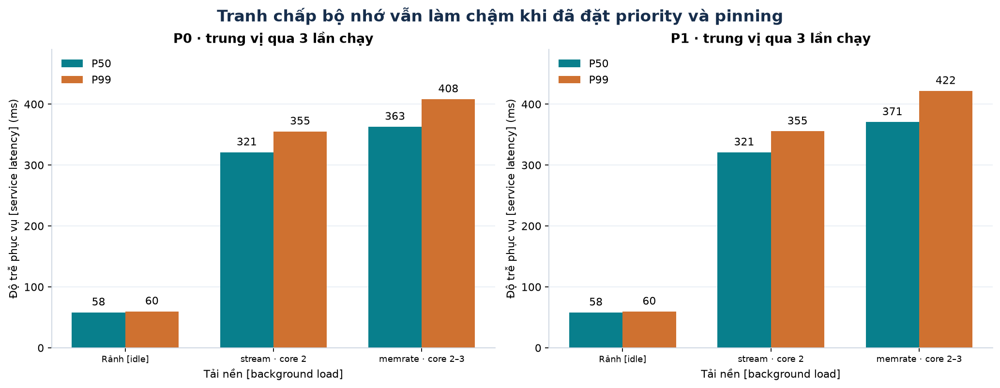

# Trình bày với thầy — Hệ điều hành (OS)

Sau trang này bạn trình bày được phần mình, bàn giao đúng người và nêu đúng giới hạn bằng chứng. Trang này chỉ dùng kiến thức của OS Session 3–4.

!!! tip "Nói đơn giản"
    Một bài bảo vệ giống chạy tiếp sức: Vinh nói phía MCU nhận và quyết định, Hiếu nói phía Linux tạo dữ liệu và chịu ảnh hưởng của tải.

## 1. Thứ tự và bàn giao

Thời lượng là **đề xuất**, không phải thời lượng thầy đã xác nhận.

| Thứ tự | Người | Phần phụ trách | Phút |
|---:|---|---|---:|
| 1 | Vinh | MCU, FreeRTOS, supervisor, F2/F5 | 5 |
| 2 | Hiếu | Pi, IPC, bridge, scheduling, kết quả và giới hạn | 6 |
| 3 | Chung | Kết luận, chuyển sang demo nếu được phép | 1 |

**Vinh → Hiếu:** “MCU chỉ dùng bản tin hợp lệ và tuổi dữ liệu để quyết định trạng thái; Hiếu sẽ giải thích cách Pi tạo bản tin đó và vì sao tải Linux ảnh hưởng đến độ mới.”

## 2. Biên giao diện

| Giao diện | Người tạo | Người tiêu thụ |
|---|---|---|
| UART HEARTBEAT / INFERENCE | Hiếu: age-at-send và session | Vinh: kiểm tra frame, timer, state |
| Log MCU | Vinh: reason, thời gian cục bộ | Hiếu: đọc log và gate của lượt đo |

## 3. Hình cần thuộc

{ loading=lazy }

!!! note "Cách đọc hình — sơ đồ báo cáo (SOURCE)"
    Đọc từ workload và bridge trên Pi, qua UART (INFERENCE và HEARTBEAT), tới RX, supervisor và output/LED trên STM32. Đường đứt đỏ là biên quyền điều khiển: chỉ MCU quyết định trạng thái output.

{ loading=lazy }

!!! note "Cách đọc hình — MEASURED"
    Trái: từng lượt F5, trục y là thời gian từ inference được chấp nhận cuối cùng đến HOLD/FAILSAFE (ms). Phải: tuổi heartbeat lúc vào HOLD, nằm dưới vạch ngưỡng heartbeat — HOLD do kết quả cũ, không do mất heartbeat.

## 4. Khi thầy hỏi ngoài phần mình

Trả lời theo năm bước: chỉ vị trí khối, nêu đầu vào/đầu ra, giải thích một cơ chế, nói rõ loại bằng chứng, rồi chuyển người phụ trách. Ví dụ: “E3 real” — Hiếu nói gate và phía Linux, Vinh nói trạng thái MCU.

## Trắc nghiệm

Vinh — Hình phải cho biết nguyên nhân HOLD là gì?

- [x] Kết quả inference cũ dù heartbeat còn mới
- [ ] Heartbeat đã vượt 100 ms
- [ ] UART chắc chắn đứt dây
- [ ] CPU chắc chắn ngừng hoàn toàn

Tuổi heartbeat vẫn dưới ngưỡng, nên HOLD đến từ tuổi nguồn của kết quả. Nhầm lẫn hay gặp: coi mọi HOLD là mất heartbeat — đó là kịch bản F2, không phải F5.

Hiếu — Đặt ưu tiên và pin CPU có xóa hết ảnh hưởng của tải bộ nhớ không?

- [ ] Có, vì P99 là trung bình
- [x] Không
- [ ] Có, P1 luôn như idle
- [ ] Có, nếu tăng FPS

Cả P0 và P1 vẫn trễ lớn khi tranh băng thông bộ nhớ. CPU affinity tách lõi CPU nhưng không tách bus và cache dùng chung.

Ai có quyền quyết định trạng thái output?

- [ ] Bridge Linux
- [x] Supervisor trên STM32
- [ ] ONNX Runtime
- [ ] Camera

Pi tạo thông tin; MCU đánh giá độc lập. Sơ đồ không phải chứng nhận an toàn.

## Câu thầy có thể hỏi

??? question "Vinh — Tại sao cần STM32 ngoài Linux?"
    MCU giám sát độc lập, vẫn kiểm tra timeout khi Pi hoặc bridge ngừng chạy. Đây là mô hình an toàn, không phải chứng nhận.

??? question "Vinh — Ba task chạy theo thứ tự ưu tiên nào?"
    SOURCE: supervisor ưu tiên 3, RX 2, status TX 1. Task supervisor chạy mỗi 1 ms; WCET chưa được chứng minh.

??? question "Vinh — HOLD ở 175 ms có phải ngưỡng là 175 ms?"
    Không. SOURCE: ngưỡng tuổi nguồn là 200 ms; dữ liệu đã có tuổi lúc được gửi. Allowance lịch sử trong Stateflow là 5 ms, snapshot firmware hiện tại là 5.793 ms ở baud mặc định — hai giá trị khác nhau.

??? question "Vinh — Traffic quay lại có tự về FRESH không?"
    Không. FAILSAFE được chốt (latch). Mô hình Stateflow có qualified re-arm; chiến dịch phần cứng dùng reset MCU. Không tuyên bố qualified re-arm đã đo trên phần cứng.

??? question "Hiếu — Camera và inference trao đổi gì?"
    Pixel nằm ở vùng nhớ chung; IPC chỉ mang thông báo ID và thời điểm. Source giả chỉ tạo thông báo.

??? question "Hiếu — Tại sao age-at-send có ích?"
    Pi tính khoảng thời gian trên cùng một đồng hồ, từ lúc có input đến lúc gửi. MCU cộng thêm thời gian từ lúc nhận và allowance, không cần trừ hai đồng hồ khác nhau.

??? question "Hiếu — Tại sao bridge latest trong E3 không cải thiện?"
    Hàng ùn nằm trước inference. MEASURED: mean AoI memrate 6660 → 6958 ms, bridge không thay thế lần nào; E3b đổi chính sách input nhưng lượt có tải bị flag nguồn.

??? question "Hiếu — E3 real 0/18 có phủ định E4 không?"
    Không. E3 real bị loại do nguồn, đồng hồ và sự kiện; E4/F5 có chiến dịch và gate riêng.

Nguồn: [`os/docs/STAGE_REPORT.md`](https://github.com/KaiserRichard/edge-ai-video-runtime/blob/main/os/docs/STAGE_REPORT.md). Tiếp theo: [Demo OS](../demo/os.md).
