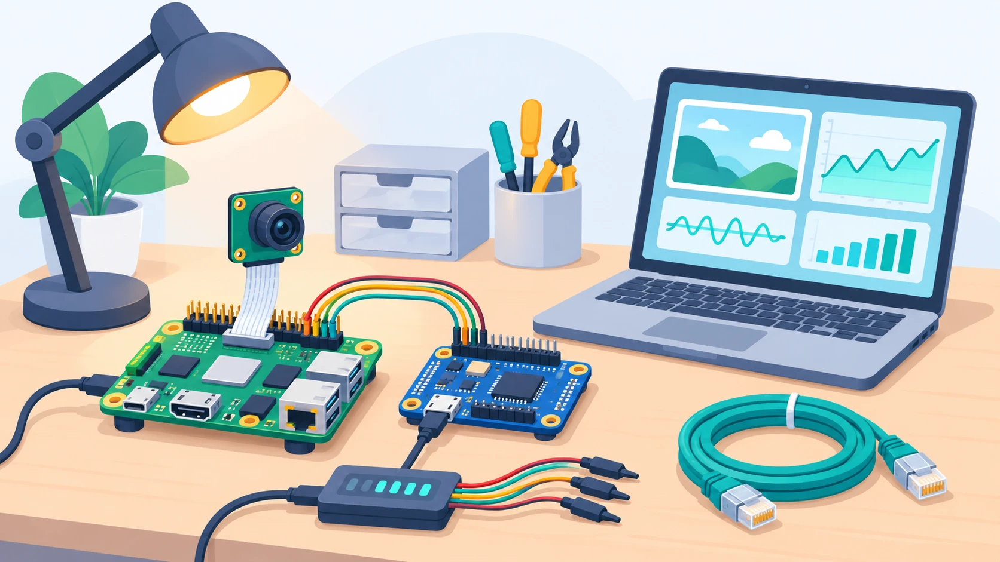
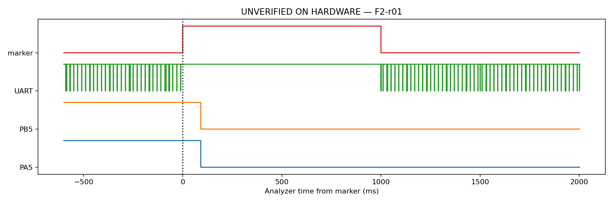

# Demo phần cứng — bước cuối

Sau bài này bạn giải thích được demo chứng minh gì, và cách chuyển sang replay nếu phần cứng lỗi.

{ .figure-right loading=lazy }

!!! tip "Nói đơn giản"
    Demo giống chuyến chạy thử. Nếu chuyến hiện tại lỗi, dùng bản ghi cũ nhưng phải nói rõ đó là bản ghi.

!!! warning "Chỉ làm trên bàn thử đã được phép"
    Demo đi sau học lý thuyết; không khóa truy cập. Không nối motor thật, không dùng LED làm chứng nhận an toàn. Kiểm tra nguồn, phiên bản firmware và cổng thật trước khi chạy. Không flash hoặc reset robot đang hoạt động. Không chạy hog FIFO-99 trong demo nhanh.

## Demo chứng minh gì?

OS: bridge gửi heartbeat và kết quả; MCU chuyển trạng thái khi thiếu HB hoặc dữ liệu cũ. CN: JPEG truyền qua RTP, ghép đúng hạn và gửi RR; dashboard hiển thị quan sát. Demo ngắn chỉ chứng minh chức năng hiện tại, không thay chiến dịch đo đủ lượt.

## 1. Chuẩn bị chung

- Pi 5, nguồn 5 V/5 A và tản nhiệt; `vcgencmd get_throttled` phải là `0x0` trước demo sạch.
- Ghi commit đang dùng, thời gian và phiên bản firmware. Xác nhận có bản firmware OS đã kiểm tra. Không tự flash chỉ vì thiếu dữ liệu.
- Laptop và Pi trên mạng bàn thử riêng; xác định IP và interface thực tế, không sửa mạng đang dùng chung.
- Mỗi lượt có thư mục mới. Kiểm tra log, cổng UART và UDP, không xóa log cũ.
- Chuẩn bị trước replay CN và hình Stateflow OS; kiểm tra file thực sự có ở máy demo.

## 2. OS — Vinh và Hiếu

Tắt nguồn trước khi nối dây. **SOURCE:** logic 3.3 V; nối chung GND. Dùng sơ đồ [`os/stm32/firmware/README.md`](https://github.com/KaiserRichard/edge-ai-video-runtime/blob/main/os/stm32/firmware/README.md) và `HARDWARE_DAY_CHECKLIST.md`.

| Pi | Nucleo-F446RE | Ý nghĩa |
|---|---|---|
| Pin 8 GPIO14 TX | PA10 D2 USART1 RX | Pi→MCU |
| Pin 10 GPIO15 RX | PA9 D8 USART1 TX | MCU→Pi |
| Pin 6 GND | GND | Chung tham chiếu |
| USB host | ST-LINK CN1 | Nguồn/SWD và MCO cho HSE |
| (tùy chọn) pin 11 GPIO17 | PA0 TIM2_CH1 | Sync; không cần demo nhanh |

**SOURCE (firmware hiện tại):** PA5/PB5: FRESH 1/1, HOLD 0/1, INIT/FAILSAFE 0/0. Kiểm tra binary đúng vì board có thể được dùng cho WBR. Nếu chưa có OS firmware, dừng và dùng fallback, không flash tự động.

- Kiểm tra `ls -l /dev/ttyAMA0`, quyền dialout/plugdev và baud 921600 8N1.
- Đã build Linux theo repo, xác nhận `bash scripts/pi/run_pipeline.sh --help`. Từ `R/os` (R là checkout thực tế), chỉ trên bench OS được phép:

```bash
bash scripts/pi/run_pipeline.sh --serial /dev/ttyAMA0 --baud 921600 --duration 120 --bridge-cpu 2 --fresh-timeout 30
```

Cấu hình mặc định stub; đây là demo UART và supervisor, không phải camera/ONNX. Cần board đã reset an toàn đúng phiên nếu còn latch; không bỏ startup gate. Script có tùy chọn reset được tài liệu nêu; chỉ dùng với phép của người quản lý bench.

- Đợi FRESH, mở `mcu_status.csv`, `state_events.csv`, `inf_rx.csv`. Vinh giải thích PA5/PB5 và reason; Hiếu giải thích heartbeat/input age.
- F2: trên terminal thứ hai, chỉ sau khi kiểm tra `bridge.pid` thuộc đúng lượt và đúng executable, dùng `fault_inject.sh stop` theo [`scripts/pi/UART.md`](https://github.com/KaiserRichard/edge-ai-video-runtime/blob/main/os/scripts/pi/UART.md). Ví dụ runbook: `bash scripts/pi/fault_inject.sh stop <BRIDGE_PID> 500 <BRIDGE_CORE> faults.csv` (thay placeholder sau kiểm tra). Chờ SIGCONT; xác minh reason 3, không lấy thời điểm signal làm HB cuối.
- F5 làm trên lượt mới sau reset được phép, đợi FRESH. Dùng `kill -USR1 <BRIDGE_PID>` đúng tiến trình; xem `bridge_control.csv` xác nhận suppressed=1; chờ HOLD và FAILSAFE rồi gửi SIGUSR1 lần hai, xác nhận suppressed=0. Không tuyên bố tự re-arm. Nếu không có ACK, không toggle liên tiếp. Dừng lượt, lưu log.
- Kết thúc: dừng pipeline theo Ctrl+C/runner, kiểm tra tiến trình đúng lượt đã dừng. Không xóa dữ liệu. Xác minh output safe.

**MEASURED lịch sử / CALCULATED từ timestamp:** F2-r01 HOLD 98.596 ms và FAILSAFE 100.596 ms từ last accepted HB; F5 P50 175.596 / 475.596 ms từ last accepted inference. Không hứa demo mới lặp chính xác các giá trị này. Snapshot hiện tại allowance khác lịch sử.

## 3. CN — Trường, Mạnh, Hiếu, Vinh

### A. Kiểm thử chức năng nội bộ laptop

Trong môi trường Linux tương thích đã cài Python và deps, từ `R/cn`, chạy `bash rtp/scripts/loopback_demo.sh` với Python venv đúng (script có biến `PYTHON`). Script kiểm tra 150 frame và RR có RTT; không chứng minh mạng vật lý. Windows dùng hướng dẫn 3 terminal PowerShell trong [`dashboard/README.md`](https://github.com/KaiserRichard/edge-ai-video-runtime/blob/main/dashboard/README.md) nếu đã cài venv phù hợp.

### B. Demo camera Pi → laptop (nếu bench đã sẵn sàng)

- Tắt nguồn trước khi nối camera. Kiểm tra camera v2 và thư viện libcamera trong checkout đầy đủ; source ZIP học không có C++ camera.
- Từ `R/os`, theo [`linux/camera/README.md`](https://github.com/KaiserRichard/edge-ai-video-runtime/blob/main/os/linux/camera/README.md), build và chạy `hea_cam` với `--backend libcamera --width 640 --height 480 --fps 15 --shm hea_camera --output /tmp/hea_cam.sock --csv /tmp/hea_cam.csv`. Dùng socket/ring tên riêng, không xóa ring đang dùng. Xác nhận có `/dev/shm/hea_camera`.
- Laptop: chạy dashboard live (từ `R/dashboard`, `python -m dashboard --mode live`), mở http://127.0.0.1:8080/. Cho phép UDP RTP/RTCP và telemetry cần thiết trên mạng bench.
- Laptop: receiver trước, sender sau. Lệnh POSIX minh họa dựa trên CLI đã đọc; thay `RX_DIR`, `TX_DIR` và `LAPTOP_IP` bằng đường dẫn/IP thật, chưa tồn tại. Không gõ placeholder nguyên văn. Python env phải có dependencies.

Laptop (`R/cn/rtp`):

```bash
PYTHONPATH=rtp python3 -m rtp receiver --bind 0.0.0.0 --port 5004 --duration 85 --playout-ms 50 --rtcp-interval 1 --ai off --out-dir RX_DIR --rtcp-csv receiver_rtcp.csv --telemetry 127.0.0.1 --telemetry-session demo
```

Pi (`R/cn/rtp`):

```bash
PYTHONPATH=rtp python3 -m rtp sender --host LAPTOP_IP --port 5004 --source shm:hea_camera --shm-library ../../os/linux/camera/build/libhea_camera.so --width 640 --height 480 --fps 15 --quality 75 --duration 80 --rtcp-interval 1 --abr fixed --out-dir TX_DIR --rtcp-csv sender_rtcp.csv --telemetry LAPTOP_IP --telemetry-session demo
```

- Xem READY, sender/receiver CSV, frame status, RR và preview (default ≤5 FPS, độc lập FPS truyền). AI off cho smoke. Vinh trình bày T7 từ số liệu lịch sử; nếu bật AI synthetic/ONNX cần lượt riêng đã thử trước.
- Chỉ nếu mạng bench riêng và người quản lý cho phép: kiểm tra qdisc gốc, tạo loss 5% trên interface đã xác nhận theo runbook. Ghi trước/sau, phục hồi cấu hình gốc ngay cả khi lỗi. Không chạy lệnh xóa root qdisc tùy tiện trên mạng chung.
- Dừng sender/receiver, dashboard và camera đúng tiến trình; kiểm tra qdisc và log. Không gọi smoke test là T8 đủ gate. Runner snapshot mới có metadata và scp nhưng template CLI cần xác nhận.

## 4. Khi phần cứng lỗi — nói thật, chuyển nhanh

| Tình huống | Fallback | Câu nói với thầy |
|---|---|---|
| Pi/UART không FRESH | Stateflow timeline gốc và bảng F2/F5 | “Phần cứng hiện tại chưa đạt startup. Đây là mô phỏng và số đo lịch sử đã gắn nhãn.” |
| Camera không mở | Synthetic source loopback | “Đường truyền phần mềm vẫn kiểm thử được; đây không phải camera thật.” |
| Mạng LAN không hoạt động | Replay CN recorded sample nếu tồn tại | “Đây là dữ liệu đã ghi trước, không phải live.” |
| Dashboard không mở | CSV, hình Stage B và bảng T7/T4 | “Đây là số liệu nguồn; UI hiện tại chưa chạy.” |

Từ `R/dashboard`, kiểm tra mẫu tồn tại rồi chạy:

```bash
python -m dashboard --mode replay --replay samples/cn-loss5 --loop
```

Mở http://127.0.0.1:8080/, Ctrl+C để dừng. [`samples/os-demo.csv`](https://github.com/KaiserRichard/edge-ai-video-runtime/blob/main/dashboard/samples/os-demo.csv) là minh họa synthetic, không phải log MCU thật. Nếu không có mẫu, dùng hình/tables được đóng gói. Không tạo dữ liệu giả để gọi live.

## Nguồn

[`os/docs/RUNBOOK_BENCH.md`](https://github.com/KaiserRichard/edge-ai-video-runtime/blob/main/os/docs/RUNBOOK_BENCH.md), [`os/scripts/pi/run_pipeline.sh`](https://github.com/KaiserRichard/edge-ai-video-runtime/blob/main/os/scripts/pi/run_pipeline.sh), [`os/scripts/pi/UART.md`](https://github.com/KaiserRichard/edge-ai-video-runtime/blob/main/os/scripts/pi/UART.md), [`os/stm32/firmware/README.md`](https://github.com/KaiserRichard/edge-ai-video-runtime/blob/main/os/stm32/firmware/README.md), [`os/tools/experiments/e4_campaign.py`](https://github.com/KaiserRichard/edge-ai-video-runtime/blob/main/os/tools/experiments/e4_campaign.py), `cn/rtp/rtp/{sender,receiver}.py`, [`dashboard/README.md`](https://github.com/KaiserRichard/edge-ai-video-runtime/blob/main/dashboard/README.md), [`cn/rtp/scripts/loopback_demo.sh`](https://github.com/KaiserRichard/edge-ai-video-runtime/blob/main/cn/rtp/scripts/loopback_demo.sh), `HARDWARE_DAY_CHECKLIST.md`. Các lệnh đã đọc, chưa thực thi trên bench trong lần soạn này. Full repo/build/dependencies và thiết bị vật lý cần xác minh.

## Mô phỏng và đo đạc


!!! note "Cách đọc hình — SOURCE — sơ đồ báo cáo"
    Đọc từ Pi workload/bridge qua UART INFERENCE và HEARTBEAT đến RX, supervisor, output/LED. Đường đứt đỏ là biên quyền điều khiển.


!!! note "Cách đọc hình — SOURCE — sơ đồ mô hình"
    Hàng trên đi từ Frames đến Inference. Hàng giữa trả RR về sender. Dây dưới nối AIMD với Frames. Không có trục thời gian trong sơ đồ.


!!! note "Cách đọc hình — MEASURED"
    Trái: từng lượt F5, y thời gian từ inference cuối đến HOLD/FAILSAFE (ms). Phải: tuổi HB lúc HOLD, thấp hơn vạch ngưỡng HB.

!!! warning "Sơ đồ nối dây cũ"
    Hình os_bench_wiring trong archive có IMU và bố trí LED cũ. Không dùng làm chỉ dẫn chân hiện tại. Dùng firmware README và runbook. Hình logic analyzer ghi UNVERIFIED ON HARDWARE; không nói đó là capture điện thật.

## Trắc nghiệm

<div class="quiz" markdown>
<p class="quiz-q">Có thể lấy hình này làm chứng cứ chân GPIO thật không?</p>



- [x] Không, hình ghi UNVERIFIED ON HARDWARE
- [ ] Có, mọi tên kênh đều là log thật
- [ ] Có, vì có trục ms
- [ ] Có, vì có marker

<div class="quiz-why" markdown>
Nhãn nguồn phủ định xác nhận phần cứng. Số F2 lịch sử lấy từ timestamp MCU trong report.
</div>
</div>

<div class="quiz" markdown>
<p class="quiz-q">Dây từ AIMD quay lại khối nào?</p>


- [ ] Receiver
- [x] Frames
- [ ] Inference
- [ ] Channel

<div class="quiz-why" markdown>
Frames nhận hệ số kích thước. AIMD không thay trực tiếp dữ liệu đã đến receiver.
</div>
</div>

<div class="quiz" markdown>
<p class="quiz-q">Camera lỗi, replay chạy được. Nói gì?</p>

- [ ] Replay là phép đo mới
- [ ] T8 hardware đã pass
- [x] Đây là dữ liệu ghi trước, không phải live
- [ ] Camera chắc chắn đã chạy

<div class="quiz-why" markdown>
Replay minh họa chức năng và dữ liệu đã ghi. Không thay cho test phần cứng.
</div>
</div>

## Câu thầy có thể hỏi

??? question "Nếu không có đủ thiết bị thì demo có giá trị gì?"
    Loopback chứng minh đường phần mềm, replay minh họa dữ liệu đã ghi; không chứng minh bench thật.

??? question "Demo ngắn có thay chiến dịch đo không?"
    Không. Campaign cần cấu hình, lượt lặp và gate.
