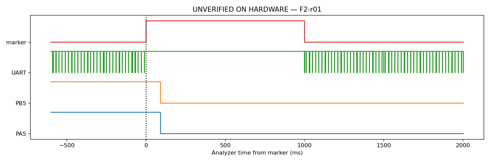

# Demo phần cứng — OS

Sau trang này bạn giải thích được demo OS chứng minh gì, và cách chuyển sang bằng chứng đã ghi nếu phần cứng lỗi.

!!! tip "Nói đơn giản"
    Demo giống chuyến chạy thử. Nếu chuyến hiện tại lỗi, dùng bản ghi cũ nhưng phải nói rõ đó là bản ghi.

!!! warning "Chỉ làm trên bàn thử đã được phép"
    Demo đi sau học lý thuyết; không khóa truy cập. Không nối motor thật, không dùng LED làm chứng nhận an toàn. Kiểm tra nguồn, phiên bản firmware và cổng thật trước khi chạy. Không chạy hog FIFO-99 trong demo nhanh.

## Demo chứng minh gì?

Bridge gửi heartbeat và kết quả; MCU chuyển trạng thái khi thiếu heartbeat hoặc khi dữ liệu cũ. Demo ngắn chỉ chứng minh chức năng hiện tại, không thay chiến dịch đo đủ lượt.

## 1. Chuẩn bị chung

- Pi 5, nguồn 5 V/5 A và tản nhiệt; `vcgencmd get_throttled` phải là `0x0` trước demo sạch.
- Ghi commit đang dùng, thời gian và phiên bản firmware. Xác nhận có bản firmware OS đã kiểm tra. Không tự flash chỉ vì thiếu dữ liệu.
- Laptop và Pi trên mạng bàn thử riêng; xác định IP và interface thực tế, không sửa mạng đang dùng chung.
- Mỗi lượt có thư mục mới. Kiểm tra log, cổng UART và UDP, không xóa log cũ.
- Chuẩn bị trước hình Stateflow; kiểm tra file thực sự có ở máy demo.

## 2. Nối dây và chạy — Vinh và Hiếu

Tắt nguồn trước khi nối dây. **SOURCE:** logic 3.3 V; nối chung GND. Dùng sơ đồ [`os/stm32/firmware/README.md`](https://github.com/KaiserRichard/edge-ai-video-runtime/blob/main/os/stm32/firmware/README.md) và `HARDWARE_DAY_CHECKLIST.md`.

| Pi | Nucleo-F446RE | Ý nghĩa |
|---|---|---|
| Pin 8 GPIO14 TX | PA10 D2 USART1 RX | Pi→MCU |
| Pin 10 GPIO15 RX | PA9 D8 USART1 TX | MCU→Pi |
| Pin 6 GND | GND | Chung tham chiếu |
| USB host | ST-LINK CN1 | Nguồn/SWD và MCO cho HSE |
| (tùy chọn) pin 11 GPIO17 | PA0 TIM2_CH1 | Sync; không cần demo nhanh |

**SOURCE (firmware hiện tại):** PA5/PB5: FRESH 1/1, HOLD 0/1, INIT/FAILSAFE 0/0. Kiểm tra đúng binary OS trước khi chạy. Nếu chưa có OS firmware, dừng và dùng fallback, không flash tự động.

- Kiểm tra `ls -l /dev/ttyAMA0`, quyền dialout/plugdev và baud 921600 8N1.
- Đã build Linux theo repo, xác nhận `bash scripts/pi/run_pipeline.sh --help`. Từ `R/os` (R là checkout thực tế), chỉ trên bench OS được phép:

```bash
bash scripts/pi/run_pipeline.sh --serial /dev/ttyAMA0 --baud 921600 --duration 120 --bridge-cpu 2 --fresh-timeout 30
```

Cấu hình mặc định stub; đây là demo UART và supervisor, không phải camera/ONNX. Cần board đã reset an toàn đúng phiên nếu còn latch; không bỏ startup gate. Script có tùy chọn reset được tài liệu nêu; chỉ dùng với phép của người quản lý bench.

- Đợi FRESH, mở `mcu_status.csv`, `state_events.csv`, `inf_rx.csv`. Vinh giải thích PA5/PB5 và reason; Hiếu giải thích heartbeat/input age.
- F2: trên terminal thứ hai, chỉ sau khi kiểm tra `bridge.pid` thuộc đúng lượt và đúng executable, dùng `fault_inject.sh stop` theo [`scripts/pi/UART.md`](https://github.com/KaiserRichard/edge-ai-video-runtime/blob/main/os/scripts/pi/UART.md). Ví dụ runbook: `bash scripts/pi/fault_inject.sh stop <BRIDGE_PID> 500 <BRIDGE_CORE> faults.csv` (thay placeholder sau kiểm tra). Chờ SIGCONT; xác minh reason 3, không lấy thời điểm signal làm HB cuối.
- F5 làm trên lượt mới sau reset được phép, đợi FRESH. Dùng `kill -USR1 <BRIDGE_PID>` đúng tiến trình; xem `bridge_control.csv` xác nhận suppressed=1; chờ HOLD và FAILSAFE rồi gửi SIGUSR1 lần hai, xác nhận suppressed=0. Không tuyên bố tự re-arm. Nếu không có ACK, không toggle liên tiếp. Dừng lượt, lưu log.
- Kết thúc: dừng pipeline theo Ctrl+C/runner, kiểm tra tiến trình đúng lượt đã dừng. Không xóa dữ liệu. Xác minh output safe.

**MEASURED lịch sử / CALCULATED từ timestamp:** F2-r01 HOLD 98.596 ms và FAILSAFE 100.596 ms từ last accepted HB; F5 P50 175.596 / 475.596 ms từ last accepted inference. Không hứa demo mới lặp chính xác các giá trị này. Snapshot hiện tại allowance khác lịch sử.

## 3. Khi phần cứng lỗi — nói thật, chuyển nhanh

| Tình huống | Fallback | Câu nói với thầy |
|---|---|---|
| Pi/UART không FRESH | Stateflow timeline gốc và bảng F2/F5 | “Phần cứng hiện tại chưa đạt startup. Đây là mô phỏng và số đo lịch sử đã gắn nhãn.” |

[`samples/os-demo.csv`](https://github.com/KaiserRichard/edge-ai-video-runtime/blob/main/dashboard/samples/os-demo.csv) là minh họa synthetic, không phải log MCU thật.

## Nguồn

[`os/docs/RUNBOOK_BENCH.md`](https://github.com/KaiserRichard/edge-ai-video-runtime/blob/main/os/docs/RUNBOOK_BENCH.md), [`os/scripts/pi/run_pipeline.sh`](https://github.com/KaiserRichard/edge-ai-video-runtime/blob/main/os/scripts/pi/run_pipeline.sh), [`os/scripts/pi/UART.md`](https://github.com/KaiserRichard/edge-ai-video-runtime/blob/main/os/scripts/pi/UART.md), [`os/stm32/firmware/README.md`](https://github.com/KaiserRichard/edge-ai-video-runtime/blob/main/os/stm32/firmware/README.md), [`os/tools/experiments/e4_campaign.py`](https://github.com/KaiserRichard/edge-ai-video-runtime/blob/main/os/tools/experiments/e4_campaign.py), `HARDWARE_DAY_CHECKLIST.md`. Các lệnh đã đọc, chưa thực thi trên bench trong lần soạn này.


!!! note "Cách đọc hình — SOURCE — sơ đồ báo cáo"
    Đọc từ Pi workload/bridge qua UART INFERENCE và HEARTBEAT đến RX, supervisor, output/LED. Đường đứt đỏ là biên quyền điều khiển.


!!! note "Cách đọc hình — MEASURED"
    Trái: từng lượt F5, y thời gian từ inference cuối đến HOLD/FAILSAFE (ms). Phải: tuổi HB lúc HOLD, thấp hơn vạch ngưỡng HB.

!!! warning "Sơ đồ nối dây cũ"
    Hình os_bench_wiring trong archive có IMU và bố trí LED cũ. Không dùng làm chỉ dẫn chân hiện tại. Dùng firmware README và runbook. Hình logic analyzer ghi UNVERIFIED ON HARDWARE; không nói đó là capture điện thật.

## Trắc nghiệm

<div class="quiz" markdown>
<p class="quiz-q">Có thể lấy hình này làm chứng cứ chân GPIO thật không?</p>



- [x] Không, hình ghi UNVERIFIED ON HARDWARE
- [ ] Có, mọi tên kênh đều là log thật
- [ ] Có, vì có trục ms
- [ ] Có, vì có marker

<div class="quiz-why" markdown>
Nhãn nguồn phủ định xác nhận phần cứng. Số F2 lịch sử lấy từ timestamp MCU trong report.
</div>
</div>

## Câu thầy có thể hỏi

??? question "Nếu không có đủ thiết bị thì demo có giá trị gì?"
    Loopback chứng minh đường phần mềm, replay minh họa dữ liệu đã ghi; không chứng minh bench thật.

??? question "Demo ngắn có thay chiến dịch đo không?"
    Không. Campaign cần cấu hình, lượt lặp và gate.
