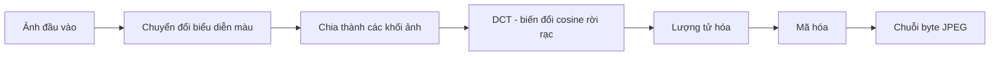
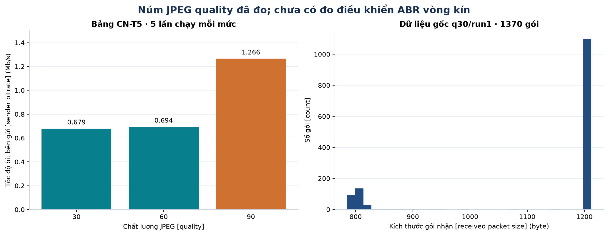
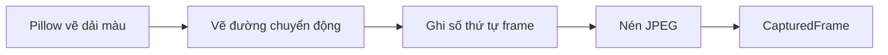
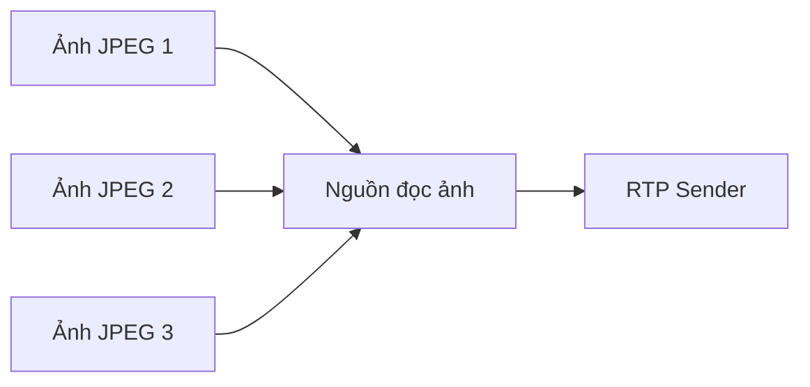
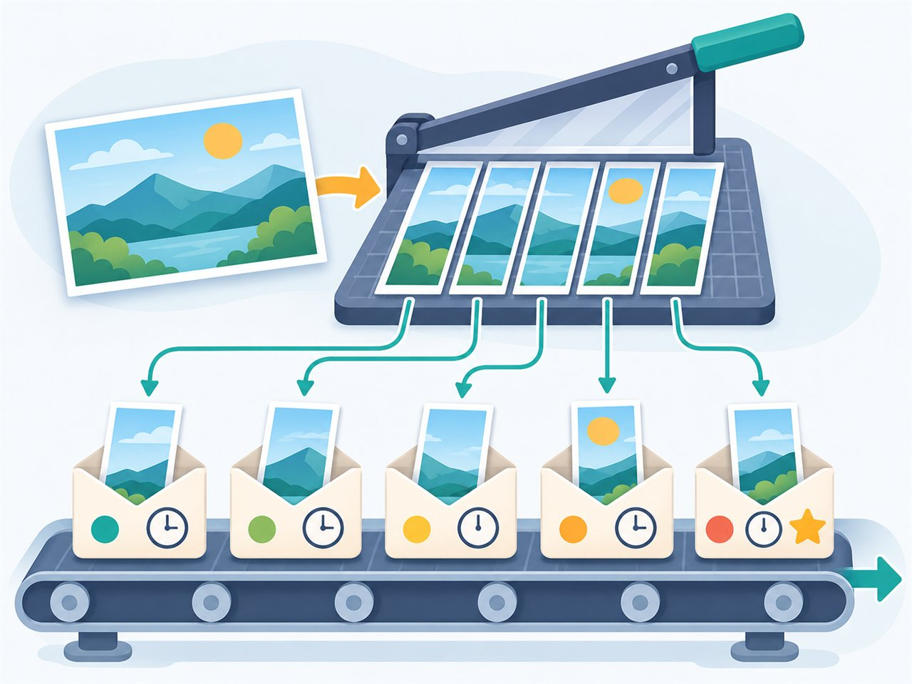

# Session 1 — Phần A. Kiến trúc hệ thống, camera và nguồn dữ liệu

**Thời gian học dự kiến:** 35–45 phút.

Sau phần này, bạn có thể giải thích hệ thống đang giải quyết bài toán gì, ảnh được tạo ra như thế nào, tại sao cần nén JPEG và dữ liệu đi từ Raspberry Pi đến laptop ra sao.

Chúng ta chưa cần đọc code phức tạp hay hiểu toàn bộ giao thức mạng. Trước tiên, hãy hiểu thứ mà hệ thống đang truyền đi.

## A1. Sản phẩm của chúng ta làm gì?

Giả sử bạn muốn dùng camera để quan sát một vật thể. Bạn không muốn thực hiện toàn bộ quá trình nhận dạng ngay tại thiết bị gắn camera. Thay vào đó, bạn gửi ảnh đến một máy tính khác có khả năng xử lý.

Bài toán đặt ra là: **làm thế nào để truyền liên tục các ảnh qua mạng, nhận đủ dữ liệu và đưa những ảnh còn hữu ích vào mô hình AI?**


*Sơ đồ nguyên lý của sản phẩm truyền video qua mạng.*

Hệ thống có bốn thành phần chính.

| Thành phần   | Nhiệm vụ                                      |
| ------------ | --------------------------------------------- |
| Camera       | Tạo ra các ảnh liên tiếp                      |
| Raspberry Pi | Chuẩn bị ảnh và gửi dữ liệu qua mạng          |
| Laptop       | Nhận dữ liệu, ghép ảnh và có thể thực hiện AI |
| Dashboard    | Hiển thị hình ảnh và các thông số hoạt động   |

Trong thực tế, đường truyền Ethernet hoặc Wi-Fi có thể gặp mất gói, chậm trễ hoặc biến động thời gian đến.

Vì vậy, sản phẩm không chỉ đơn giản là gửi được ảnh từ máy này sang máy khác. Nó còn phải trả lời các câu hỏi:

- Nếu một phần dữ liệu ảnh bị mất thì sao?
- Nếu ảnh đến quá muộn thì có nên tiếp tục xử lý không?
- Nếu máy tính xử lý chậm hơn tốc độ tạo ảnh thì sao?
- Nếu chất lượng mạng giảm thì bên gửi có nên thay đổi lượng dữ liệu truyền đi không?

Đó là các vấn đề kỹ thuật chính mà chúng ta sẽ nghiên cứu trong Sessions 1 và 2.

### A1.1. Sản phẩm thật khác mô hình mô phỏng như thế nào?

Trong Session 1, chúng ta học sản phẩm thật: chương trình Python, ảnh JPEG, socket mạng, dữ liệu nhận và các kết quả đo.

Trong Session 2, chúng ta học mô hình SimEvents đại diện cho sản phẩm đó.

| Sản phẩm thật                  | Mô hình SimEvents                     |
| ------------------------------ | ------------------------------------- |
| Ảnh JPEG chứa dữ liệu thật     | Thực thể chứa kích thước ảnh          |
| Gửi packet qua mạng            | Di chuyển packet entity giữa các khối |
| Máy tính thực sự xử lý dữ liệu | Khối mô phỏng thời gian xử lý         |
| Có log từ chương trình         | Có kết quả từ mô hình                 |

Một mô hình có thể giúp chúng ta giải thích ảnh hưởng của kích thước ảnh, mất gói hoặc băng thông mà không cần xử lý từng pixel.

Tuy nhiên, mô hình đó không tự chứng minh chất lượng hình ảnh hay độ chính xác nhận dạng của AI.

## A2. Camera tạo ra dữ liệu gì?

### A2.1. Frame — một ảnh tại một thời điểm

Video có thể được xem là một chuỗi các ảnh xuất hiện liên tục. Mỗi ảnh riêng lẻ được gọi là **frame (khung hình)**.

<svg viewBox="0 0 600 120" role="img" aria-label="Chuỗi frame ở 15 FPS" style="width:100%;max-width:600px;height:auto;color:inherit">
<g fill="none" stroke="currentColor"><rect x="20" y="15" width="110" height="70" rx="6"/><rect x="165" y="15" width="110" height="70" rx="6"/><rect x="310" y="15" width="110" height="70" rx="6"/><rect x="455" y="15" width="110" height="70" rx="6"/></g>
<g fill="#14b8a6"><circle cx="45" cy="55" r="9"/><circle cx="210" cy="50" r="9"/><circle cx="375" cy="45" r="9"/><circle cx="540" cy="40" r="9"/></g>
<g fill="currentColor" font-size="13" text-anchor="middle"><text x="75" y="108">0 ms</text><text x="220" y="108">66.67 ms</text><text x="365" y="108">133.33 ms</text><text x="510" y="108">200 ms</text></g>
</svg>

*CALCULATED — Ví dụ chuỗi ảnh danh định ở 15 FPS.*

Nếu vật thể di chuyển, vị trí của nó trong mỗi frame sẽ thay đổi. Khi hiển thị liên tục những frame này, mắt người cảm nhận được chuyển động.

### A2.2. FPS và chu kỳ tạo ảnh

**Frame rate (tốc độ khung hình)** cho biết camera tạo ra bao nhiêu ảnh trong một giây. Đơn vị thường dùng là FPS — Frames Per Second.

Trong cấu hình CN-T2 của dự án:

\[ f_{\mathrm{frame}}=15\text{ FPS} \]

**SOURCE — cấu hình baseline CN-T2.**

Điều đó có nghĩa là hệ thống được cấu hình tạo hoặc gửi khoảng 15 frame mỗi giây.

Khoảng thời gian danh định giữa hai frame liên tiếp là:

\[ \boxed{T_f=\frac{1}{f_{\mathrm{frame}}}} \]

Thay số:

\[ T_f=\frac{1}{15}\text{ s} \qquad \boxed{T_f=66.67\text{ ms}} \]

**CALCULATED.**

Nghĩa là cứ khoảng 66.67 ms, một frame mới xuất hiện theo lịch danh định.

Đây không phải cam kết rằng mọi khoảng thời gian thực tế đều chính xác bằng 66.67 ms. Việc đọc nguồn ảnh, xử lý ảnh và các điều kiện vận hành có thể làm thay đổi thời điểm thực tế.

### A2.3. FPS ảnh hưởng đến hệ thống ra sao?

FPS cao hơn giúp biểu diễn chuyển động bằng nhiều ảnh hơn. Nhưng nếu kích thước trung bình của mỗi frame không đổi, việc tăng FPS cũng làm tăng lượng dữ liệu cần truyền trong mỗi giây.

#### Interactive frame-generation clock

<div id="s1a-frame-clock">
  <style>
    #s1a-frame-clock { border: 1px solid currentColor; border-radius: 12px; padding: 18px; margin: 20px 0; color: inherit; }
    #s1a-frame-clock input { width: 100%; accent-color: #14b8a6; }
    #s1a-frame-clock .s1af-metrics { display: flex; flex-wrap: wrap; gap: 24px; margin: 16px 0; }
    #s1a-frame-clock .s1af-value { font-size: 1.6em; font-weight: 700; }
    #s1a-frame-clock svg { width: 100%; height: auto; }
  </style>
  <h3>Thử thay đổi FPS</h3>
  <label>
    Tốc độ camera:
    <strong class="s1af-fps">15</strong> FPS
    <input class="s1af-slider" type="range" min="5" max="30" step="5" value="15">
  </label>
  <div class="s1af-metrics">
    <div>
      Chu kỳ khung hình
      <div class="s1af-value s1af-period"></div>
    </div>
    <div>
      Số ảnh trong 1 giây
      <div class="s1af-value s1af-count"></div>
    </div>
  </div>
  <svg class="s1af-timeline" viewBox="0 0 600 125" role="img" aria-label="Timeline các khung hình"></svg>
  <small>CALCULATED — Lịch tạo ảnh lý tưởng.</small>
  <script>
    (() => {
      const root = document.getElementById("s1a-frame-clock");
      const slider = root.querySelector(".s1af-slider");
      const svg = root.querySelector(".s1af-timeline");
      function render() {
        const fps = Number(slider.value);
        root.querySelector(".s1af-fps").textContent = fps;
        root.querySelector(".s1af-period").textContent = (1000 / fps).toFixed(2) + " ms";
        root.querySelector(".s1af-count").textContent = fps;
        let html = '<path d="M25 75 H575" stroke="currentColor" fill="none"/>';
        for (let i = 0; i < fps; i++) {
          const x = 25 + i * 550 / fps;
          const w = Math.min(35, 500 / fps);
          html += `<rect x="${x}" y="20" width="${w}" height="42" rx="3" fill="#14b8a6" fill-opacity=".28" stroke="#14b8a6"/>`;
          html += `<path d="M${x} 62 V75" stroke="#14b8a6"/>`;
        }
        for (const t of [0, 250, 500, 750, 1000]) {
          const x = 25 + t * .55;
          html += `<text x="${x}" y="98" text-anchor="middle" font-size="12" fill="currentColor">${t}</text>`;
        }
        html += '<text x="300" y="120" text-anchor="middle" font-size="13" fill="currentColor">Thời gian (ms)</text>';
        svg.innerHTML = html;
      }
      slider.addEventListener("input", render);
      render();
    })();
  </script>
</div>

Hãy thử tăng từ 15 lên 30 FPS.

Bạn sẽ thấy chu kỳ giảm từ 66.67 xuống 33.33 ms. Trong cùng một giây, hệ thống phải chuẩn bị và truyền số ảnh gấp đôi.

## A3. Resolution — độ phân giải ảnh

FPS cho biết số ảnh trong một giây. **Resolution (độ phân giải)** cho biết số pixel của mỗi ảnh. Đây là hai đại lượng hoàn toàn khác nhau.

<svg viewBox="0 0 600 195" role="img" aria-label="So sánh hai độ phân giải" style="width:100%;max-width:600px;height:auto;color:inherit">
<defs><pattern id="s1a-grid" width="16" height="16" patternUnits="userSpaceOnUse"><path d="M16 0 H0 V16" fill="none" stroke="currentColor" stroke-opacity=".25"/></pattern></defs>
<rect x="20" y="10" width="213" height="160" fill="url(#s1a-grid)" stroke="currentColor"/>
<rect x="330" y="50" width="107" height="80" fill="url(#s1a-grid)" stroke="currentColor"/>
<g fill="currentColor" font-size="13" text-anchor="middle"><text x="126" y="188">640 × 480 = 307 200 pixel</text><text x="383" y="150">320 × 240 = 76 800 pixel</text></g>
</svg>

*CALCULATED — Hình lưới giản lược để so sánh hai độ phân giải.*

Nếu một ảnh có chiều rộng \(W\) và chiều cao \(H\):

\[ N_{\mathrm{pixel}}=W\times H \]

Với độ phân giải 640 × 480:

\[ N_{\mathrm{pixel}}=640\times480 =307200 \]

Điều đó có nghĩa là ảnh chứa 307200 điểm ảnh.

### A3.1. Một pixel chứa bao nhiêu dữ liệu?

Xét ảnh RGB thông thường. RGB là viết tắt của Red, Green và Blue — ba thành phần màu đỏ, xanh lá và xanh dương.

<svg viewBox="0 0 600 90" role="img" aria-label="Một pixel RGB gồm ba kênh 8 bit" style="width:100%;max-width:600px;height:auto;color:inherit">
<rect x="20" y="15" width="170" height="45" rx="6" fill="#ef4444" fill-opacity=".25" stroke="#ef4444"/>
<rect x="215" y="15" width="170" height="45" rx="6" fill="#22c55e" fill-opacity=".25" stroke="#22c55e"/>
<rect x="410" y="15" width="170" height="45" rx="6" fill="#3b82f6" fill-opacity=".25" stroke="#3b82f6"/>
<g fill="currentColor" font-size="14" text-anchor="middle"><text x="105" y="43">R — 8 bit</text><text x="300" y="43">G — 8 bit</text><text x="495" y="43">B — 8 bit</text><text x="300" y="82">1 pixel = 24 bit = 3 byte</text></g>
</svg>

*Ví dụ minh họa một pixel RGB với ba kênh màu 8 bit.*

Nếu mỗi thành phần màu dùng 8 bit:

\[ b_{\mathrm{pixel}}=3\times8=24\text{ bit} \]

Vì một byte bằng 8 bit:

\[ b_{\mathrm{pixel}}=3\text{ byte} \]

Vậy một ảnh RGB chưa nén, độ phân giải 640 × 480, cần:

\[ S_{\mathrm{raw}}=640\times480\times3 \qquad \boxed{S_{\mathrm{raw}}=921600\text{ byte}} \]

Tức là 921.6 kB nếu sử dụng đơn vị thập phân.

**CALCULATED — chưa tính metadata và overhead truyền thông.**

Đây là dữ liệu của chỉ một frame.

## A4. Tại sao phải nén JPEG?

### A4.1. Nếu truyền toàn bộ ảnh RGB chưa nén

Chúng ta vừa tính được kích thước một ảnh RGB:

\[ S_{\mathrm{raw}}=921600\text{ byte} \]

Camera được cấu hình 15 FPS. Vậy lượng dữ liệu ảnh tạo ra trong một giây là:

\[ 921600\times15 =13824000\text{ byte/s} \]

Đổi sang bit/s:

\[ R_{\mathrm{raw}} =13824000\times8 \qquad \boxed{R_{\mathrm{raw}}=110.592\text{ Mb/s}} \]

**CALCULATED — ảnh RGB888 chưa nén, 640 × 480, 15 FPS.**

Chú ý:

- MB/s là megabyte mỗi giây.
- Mb/s là megabit mỗi giây.
- Hai đơn vị khác nhau một hệ số 8.

Ngay cả khi giả sử đường truyền có tốc độ 100 Mb/s, lượng dữ liệu ảnh chưa nén trong ví dụ này đã vượt quá khả năng truyền tải, chưa kể các thông tin bổ sung của giao thức.

Do đó, giảm kích thước dữ liệu ảnh là một lựa chọn rất có ích.

### A4.2. JPEG làm gì với ảnh?

**JPEG compression (nén ảnh JPEG)** chuyển dữ liệu ảnh thành một biểu diễn cần ít byte hơn.

JPEG khai thác việc nhiều vùng ảnh chứa thông tin tương tự nhau. Nó cũng có thể giảm độ chính xác của một số thành phần hình ảnh ít quan trọng đối với cảm nhận thị giác.

Về nguyên lý, JPEG thông thường sử dụng một chuỗi xử lý gồm:



DCT giúp biểu diễn các thành phần không gian của ảnh dưới dạng các hệ số biến đổi.

**Quantization (lượng tử hóa)** làm giảm độ chính xác của các hệ số. Đây là bước quan trọng gây mất thông tin trong JPEG thông thường.

Sau đó, dữ liệu được mã hóa để tạo thành tệp hoặc chuỗi byte JPEG.

Chúng ta không cần tự lập trình JPEG encoder trong môn học này. Sản phẩm sử dụng thư viện có sẵn.

### A4.3. JPEG quality là gì?

Trong sản phẩm, sender có tham số `quality` để điều chỉnh mức chất lượng JPEG.

Một hiểu lầm thường gặp là:

> Quality bằng 75 nghĩa là giữ lại 75% thông tin của ảnh.

Cách hiểu này không đúng.

| Thông số     | Ý nghĩa                                |
| ------------ | -------------------------------------- |
| Resolution   | Số pixel trong ảnh                     |
| FPS          | Số frame trong mỗi giây                |
| JPEG quality | Tham số điều chỉnh quá trình nén       |
| JPEG size    | Số byte thực tế sau nén                |
| AI accuracy  | Mức độ chính xác của kết quả nhận dạng |

Các thông số này có thể ảnh hưởng lẫn nhau, nhưng không đồng nghĩa với nhau.

Hai ảnh có cùng độ phân giải và cùng JPEG quality vẫn có thể có kích thước rất khác nhau.

- **Ảnh có ít chi tiết:** nhiều vùng giống nhau, thường dễ nén hơn.
- **Ảnh có nhiều chi tiết:** nhiều biến đổi màu và kết cấu, thường cần nhiều byte hơn.

Vì vậy, chúng ta phải đo kích thước JPEG thực tế, thay vì suy ra trực tiếp từ quality.

## A5. Bitrate — tốc độ dữ liệu cần truyền

Sau khi nén ảnh, camera tiếp tục tạo ra các frame. Mỗi frame có một số byte nhất định.

**Bitrate (tốc độ bit)** là lượng bit cần truyền trong mỗi giây.

Nếu kích thước trung bình của một JPEG frame là \(\overline S\) byte và tốc độ tạo ảnh là \(f\) FPS:

\[ \boxed{R_{\mathrm{image}}=8\overline S f} \]

Trong đó:

| Ký hiệu                 | Đại lượng                  | Đơn vị     |
| ----------------------- | -------------------------- | ---------- |
| \(\overline S\)         | Kích thước JPEG trung bình | byte/frame |
| \(f\)                   | Tốc độ tạo ảnh             | frame/s    |
| \(R_{\mathrm{image}}\)  | Tốc độ dữ liệu ảnh         | bit/s      |

Đây là công thức tính lượng dữ liệu ảnh. Khi tính lưu lượng thật trên đường truyền, chúng ta còn cần tính thêm overhead của các giao thức.

### A5.1. Ví dụ từ kết quả CN-T5

Bảng `hw_tables.md` báo cáo rằng ở cấu hình q30, cột "Mean JPEG bytes/frame" bằng 5650.4 byte.

!!! note "Lưu ý về cột này"
    Cột này được tính từ cột `bytes` của `sender.csv`, tức tổng byte các RTP packet của frame (gồm 12 B RTP header và header mảnh của mỗi packet). Byte JPEG thuần nhỏ hơn khoảng 100 B. Xem thêm Phần C, mục C8.2.

Với 15 FPS:

\[ R=5650.4\times15\times8 =678048\text{ bit/s} \qquad \boxed{R\approx0.678\text{ Mb/s}} \]

**CALCULATED.**

Bitrate được báo cáo trong thí nghiệm là 0.679 Mb/s, gần với kết quả tính từ kích thước trung bình và FPS danh định.

**MEASURED — CN-T5, q30.**

So sánh với ảnh RGB chưa nén 640 × 480, 15 FPS đã tính ở A4:

\[ R_{\mathrm{raw}}=110.592\text{ Mb/s} \]

Ví dụ này giúp chúng ta hiểu vì sao nén ảnh có thể giảm đáng kể lượng dữ liệu cần truyền.

### A5.2. Interactive image bitrate calculator

<div id="s1a-bitrate">
  <style>
    #s1a-bitrate { border: 1px solid currentColor; border-radius: 12px; padding: 18px; margin: 20px 0; color: inherit; }
    #s1a-bitrate input { width: 100%; accent-color: #14b8a6; }
    #s1a-bitrate .s1ab-row { margin: 15px 0; }
    #s1a-bitrate .s1ab-track { height: 25px; border: 1px solid currentColor; border-radius: 5px; overflow: hidden; }
    #s1a-bitrate .s1ab-fill { height: 100%; transition: width .15s; }
    #s1a-bitrate .s1ab-result { font-size: 1.6em; font-weight: bold; }
  </style>
  <h3>Tính bitrate của dữ liệu ảnh</h3>
  <label>
    FPS: <strong class="s1ab-fps-label">15</strong>
    <input class="s1ab-fps" type="range" min="5" max="30" step="1" value="15">
  </label>
  <label>
    Kích thước JPEG trung bình:
    <strong class="s1ab-size-label">5650</strong> byte
    <input class="s1ab-size" type="range" min="1000" max="20000" step="50" value="5650">
  </label>
  <div class="s1ab-row">
    JPEG bitrate
    <div class="s1ab-result s1ab-jpeg-value"></div>
  </div>
  <div class="s1ab-row">
    RGB chưa nén, 640 × 480:
    <strong class="s1ab-raw-value"></strong>
    <div class="s1ab-track">
      <div class="s1ab-fill" style="width:100%;background:#64748b"></div>
    </div>
  </div>
  <div class="s1ab-row">
    JPEG:
    <strong class="s1ab-small-value"></strong>
    <div class="s1ab-track">
      <div class="s1ab-fill s1ab-jpeg-bar" style="background:#14b8a6"></div>
    </div>
  </div>
  <small>CALCULATED — Không bao gồm overhead giao thức. RGB dùng 3 byte/pixel.</small>
  <script>
    (() => {
      const root = document.getElementById("s1a-bitrate");
      const fpsInput = root.querySelector(".s1ab-fps");
      const sizeInput = root.querySelector(".s1ab-size");
      function render() {
        const fps = Number(fpsInput.value);
        const size = Number(sizeInput.value);
        const jpeg = size * fps * 8 / 1e6;
        const raw = 640 * 480 * 3 * fps * 8 / 1e6;
        root.querySelector(".s1ab-fps-label").textContent = fps;
        root.querySelector(".s1ab-size-label").textContent = size;
        root.querySelector(".s1ab-jpeg-value").textContent = jpeg.toFixed(3) + " Mb/s";
        root.querySelector(".s1ab-small-value").textContent = jpeg.toFixed(3) + " Mb/s";
        root.querySelector(".s1ab-raw-value").textContent = raw.toFixed(3) + " Mb/s";
        root.querySelector(".s1ab-jpeg-bar").style.width = (100 * jpeg / raw) + "%";
      }
      fpsInput.addEventListener("input", render);
      sizeInput.addEventListener("input", render);
      render();
    })();
  </script>
</div>

Hãy giữ nguyên kích thước JPEG rồi tăng FPS từ 15 lên 30. Sau đó, đưa FPS về 15 và tăng kích thước JPEG lên gấp đôi.

Trong cả hai trường hợp, bitrate ảnh đều tăng gấp đôi. Đây là hai cách khác nhau để làm tăng lượng dữ liệu mà đường truyền phải phục vụ.

## A6. Đọc kết quả JPEG quality trong sản phẩm thật

Bây giờ chúng ta đã có đủ kiến thức để đọc một kết quả thực nghiệm.

Trong CN-T5, nhóm thay đổi tham số JPEG quality và đo kích thước ảnh cũng như bitrate.



**Nguồn:** `fig/plots/06_quality_bitrate.png`.

Hình bên trái là biểu đồ cột của ba cấu hình quality.

- Trục ngang: giá trị JPEG quality.
- Trục đứng: bitrate bên gửi, đơn vị Mb/s.

Hình bên phải là histogram (biểu đồ phân bố tần suất) của kích thước các gói nhận được trong một lần chạy q30. Nó không phải biểu đồ kích thước của toàn bộ ảnh JPEG.

### A6.1. Các số liệu thực tế

| Quality | Byte RTP trung bình/frame | Bitrate    |
| ------- | ------------------------- | ---------- |
| 30      | 5650.4 B                  | 0.679 Mb/s |
| 60      | 5777.2 B                  | 0.694 Mb/s |
| 90      | 10537.4 B                 | 1.266 Mb/s |

**MEASURED — CN-T5, 5 lần chạy trên mỗi cấu hình.**

Hãy quan sát hai trường hợp quality 30 và quality 60.

Quality tăng gấp đôi, nhưng bitrate chỉ tăng từ 0.679 lên 0.694 Mb/s. Trong khi đó, khi tăng quality từ 60 lên 90, bitrate tăng mạnh hơn nhiều.

Điều này chứng minh rằng trong tập thí nghiệm này, **quan hệ giữa JPEG quality và bitrate không tuyến tính**.

Chúng ta không thể giả sử tăng quality thêm 10 đơn vị luôn làm kích thước ảnh tăng một lượng cố định.

### A6.2. Interactive measured quality comparison

<div id="s1a-quality">
  <style>
    #s1a-quality { border: 1px solid currentColor; border-radius: 12px; padding: 18px; margin: 20px 0; color: inherit; }
    #s1a-quality .s1aq-buttons { display: flex; flex-wrap: wrap; gap: 8px; margin: 12px 0; }
    #s1a-quality button { border: 1px solid currentColor; border-radius: 7px; padding: 8px 12px; color: inherit; background: transparent; cursor: pointer; }
    #s1a-quality button[aria-pressed="true"] { border: 2px solid #14b8a6; font-weight: bold; }
    #s1a-quality .s1aq-track { height: 24px; border: 1px solid currentColor; border-radius: 4px; overflow: hidden; }
    #s1a-quality .s1aq-bar { height: 100%; background: #64748b; }
    #s1a-quality .s1aq-row { margin: 12px 0; }
  </style>
  <h3>JPEG quality — kết quả đo CN-T5</h3>
  <div class="s1aq-buttons">
    <button type="button" data-q="30">Quality 30</button>
    <button type="button" data-q="60">Quality 60</button>
    <button type="button" data-q="90">Quality 90</button>
  </div>
  <p>Byte RTP trung bình/frame: <strong class="s1aq-bytes"></strong></p>
  <p>Số packet/frame trung bình: <strong class="s1aq-packets"></strong></p>
  <div class="s1aq-chart"></div>
  <small>MEASURED — 5 lần chạy mỗi cấu hình. Chỉ hiển thị các điểm đã đo.</small>
  <script>
    (() => {
      const root = document.getElementById("s1a-quality");
      const data = {
        30: { bytes: 5650.4, bitrate: .679, packets: 5.003 },
        60: { bytes: 5777.2, bitrate: .694, packets: 5.024 },
        90: { bytes: 10537.4, bitrate: 1.266, packets: 9.211 }
      };
      const buttons = root.querySelectorAll("[data-q]");
      function render(q) {
        const d = data[q];
        root.querySelector(".s1aq-bytes").textContent = d.bytes.toFixed(1) + " byte";
        root.querySelector(".s1aq-packets").textContent = d.packets.toFixed(3);
        buttons.forEach(b => b.setAttribute("aria-pressed", String(Number(b.dataset.q) === q)));
        root.querySelector(".s1aq-chart").innerHTML = [30, 60, 90].map(k => {
          const v = data[k].bitrate;
          const color = k === q ? "#14b8a6" : "#64748b";
          return `<div class="s1aq-row">Q${k} — ${v.toFixed(3)} Mb/s
            <div class="s1aq-track"><div class="s1aq-bar" style="width:${100*v/1.4}%;background:${color}"></div></div>
          </div>`;
        }).join("");
      }
      buttons.forEach(b => b.addEventListener("click", () => render(Number(b.dataset.q))));
      render(30);
    })();
  </script>
</div>

Hãy chuyển từ Q30 sang Q90.

Bạn sẽ thấy không chỉ bitrate tăng, mà số packet cần thiết cho mỗi ảnh cũng tăng. Đây là tiền đề cho phần mất gói và điều khiển bitrate ở Session 2.

### A6.3. Điều gì chưa được chứng minh?

Thí nghiệm trên đo sự thay đổi kích thước JPEG và bitrate. Nó không đo trực tiếp:

- Mức suy giảm chất lượng hình ảnh đối với người quan sát.
- Độ chính xác phân loại của mô hình AI.
- Mức quality tối ưu cho mọi cảnh quay.
- Hiệu quả của điều khiển bitrate vòng kín trên phần cứng.

Vì vậy, không thể kết luận rằng giảm quality luôn tốt hơn. Chúng ta đang đánh đổi lượng dữ liệu cần truyền với lượng thông tin hình ảnh được giữ lại.

## A7. Nguồn ảnh trong sản phẩm thật

### A7.1. Có bắt buộc phải sử dụng camera thật không?

Không.

Mục tiêu của sender là nhận được một ảnh JPEG và truyền nó qua mạng. Nếu chúng ta chưa có camera, vẫn có thể tạo ảnh bằng một chương trình hoặc đọc ảnh từ thư mục. Điều quan trọng là sender nhận được dữ liệu có định dạng phù hợp.

Cách thiết kế này được gọi là **source abstraction (trừu tượng hóa nguồn dữ liệu)**. Nó giúp phần truyền thông không phải thay đổi toàn bộ logic mỗi khi chúng ta thay nguồn ảnh.

### A7.2. Synthetic source

`synthetic` là nguồn tạo ảnh kiểm thử bằng chương trình.

Trong mã thực tế, thư viện Pillow tạo các dải màu, một đường chuyển động và số thứ tự frame. Sau đó, chương trình nén ảnh thành JPEG.



*Sơ đồ minh họa theo thuật toán trong sources.py, không phải ảnh chụp từ lần chạy thật.*

Đường chuyển động và số frame giúp chúng ta quan sát sự thay đổi giữa các ảnh liên tiếp.

Synthetic source không phải là ảnh được tạo bởi AI. Nó cũng không phải mô phỏng toàn bộ hệ thống mạng.

Các ảnh được tạo vẫn là chuỗi byte JPEG thật. Sender vẫn chia dữ liệu và gửi packet thật thông qua socket. Do đó, nguồn synthetic rất hữu ích khi kiểm thử phần truyền thông mà chưa cần camera.

### A7.3. JPEG directory

`jpegdir:` đọc các ảnh `.jpg` hoặc `.jpeg` có sẵn trong thư mục. Chương trình lần lượt đọc các file theo thứ tự đã sắp xếp và quay vòng khi hết danh sách.



Ưu điểm của phương pháp này là có thể chuẩn bị trước một tập dữ liệu ảnh. Khi kiểm thử nhiều cấu hình mạng, chúng ta có thể sử dụng lại cùng tập ảnh để giảm sự khác biệt do nội dung hình ảnh.

Một chi tiết trong implementation: nguồn này giữ nguyên các byte JPEG trong file, không tự động nén lại ảnh theo quality.

### A7.4. MJPEG pipe

**MJPEG (Motion JPEG)** trong trường hợp này là một luồng chứa nhiều ảnh JPEG nối tiếp nhau. Mỗi ảnh có phần đánh dấu bắt đầu và kết thúc.

<svg viewBox="0 0 600 80" role="img" aria-label="Luồng MJPEG gồm các ảnh nối tiếp giữa marker SOI và EOI" style="width:100%;max-width:600px;height:auto;color:inherit">
<g stroke="currentColor" fill="none"><rect x="10" y="15" width="285" height="40" rx="5"/><rect x="305" y="15" width="285" height="40" rx="5"/></g>
<g fill="#14b8a6" fill-opacity=".3" stroke="#14b8a6"><rect x="10" y="15" width="60" height="40"/><rect x="235" y="15" width="60" height="40"/><rect x="305" y="15" width="60" height="40"/><rect x="530" y="15" width="60" height="40"/></g>
<g fill="currentColor" font-size="12" text-anchor="middle"><text x="40" y="39">SOI</text><text x="152" y="39">Ảnh JPEG 1</text><text x="265" y="39">EOI</text><text x="335" y="39">SOI</text><text x="447" y="39">Ảnh JPEG 2</text><text x="560" y="39">EOI</text><text x="300" y="74">SOI = FF D8 · EOI = FF D9</text></g>
</svg>

**SOURCE — `MjpegPipeSource.read()` trong `sources.py`:**

- SOI — Start of Image: đánh dấu bắt đầu ảnh.
- EOI — End of Image: đánh dấu kết thúc ảnh.

Nguồn `mjpeg-pipe` trong sản phẩm tích lũy byte và tìm các marker để tách từng ảnh JPEG khỏi luồng đầu vào.

Cần hiểu đây là cơ chế đơn giản của nguồn ảnh trong dự án, không phải bài giảng đầy đủ về mọi trường hợp phân tích định dạng JPEG.

### A7.5. Camera thật — `shm:`

Khi sử dụng camera gắn trên Raspberry Pi, chương trình có thể đọc dữ liệu ảnh RGB từ giao diện camera đã cung cấp.

Mã nguồn `ShmSource.read()` thực hiện các bước:

1. Tìm frame mới chưa đọc.
2. Sao chép dữ liệu ảnh hợp lệ.
3. Ghi nhận thời điểm lấy được dữ liệu.
4. Chuyển dữ liệu RGB thành JPEG.
5. Trả kết quả dưới dạng `CapturedFrame`.

Khác với nguồn synthetic, nguồn này phụ thuộc vào camera và thư viện đọc ảnh thật.

### A7.6. So sánh bốn nguồn

| Nguồn        | Cần camera                      | Ảnh đầu vào             | Nén JPEG tại nguồn này |
| ------------ | ------------------------------- | ----------------------- | ---------------------- |
| `synthetic`  | Không                           | Ảnh do chương trình tạo | Có                     |
| `jpegdir:`   | Không                           | File JPEG               | Không                  |
| `mjpeg-pipe` | Tùy thiết bị tạo luồng          | Luồng JPEG              | Không                  |
| `shm:`       | Có camera đang cung cấp dữ liệu | RGB                     | Có                     |

**SOURCE — `cn/rtp/rtp/sources.py`.**

Dù nguồn ảnh khác nhau, dữ liệu sau khi được chuẩn bị đều có thể chuyển cho sender.

## A8. CapturedFrame — dữ liệu thực tế mà sender nhận

Chúng ta vừa thấy bốn nguồn ảnh khác nhau. Bây giờ hãy tìm hiểu định dạng chung mà chúng trả về.

Đây là đoạn code thật trong `cn/rtp/rtp/sources.py`:

```python
@dataclass(frozen=True)
class CapturedFrame:
    frame_id: int
    jpeg: bytes
    t_capture_mono_ns: int
    quality: int | None = None
```

Không cần học cú pháp Python của `dataclass`. Hãy xem `CapturedFrame` như một hộp chứa bốn thông tin.

| Trường              | Ví dụ minh họa         |
| ------------------- | ---------------------- |
| `frame_id`          | 17                     |
| `jpeg`              | 6000 byte dữ liệu JPEG |
| `t_capture_mono_ns` | 1000000000             |
| `quality`           | 75                     |

*Ví dụ minh họa các giá trị trong một đối tượng CapturedFrame.*

### A8.1. Frame ID

`frame_id` là số nhận dạng của ảnh. Ví dụ: Frame 15, Frame 16, Frame 17.

Nó giúp bên gửi và bên nhận theo dõi ảnh đang được xử lý.

Frame ID không phải số thứ tự của từng packet. Một frame có thể được chia thành nhiều packet. Vì vậy, trong Phần B chúng ta sẽ học thêm RTP sequence number.

### A8.2. JPEG bytes

`jpeg` chứa toàn bộ chuỗi byte của ảnh JPEG.

Sender không cần hiểu vật thể trong ảnh là gì. Nó chỉ cần biết dữ liệu ảnh, kích thước dữ liệu và cách chia dữ liệu thành các packet phù hợp.

Đây là sự tách biệt giữa nhiệm vụ truyền thông và nhiệm vụ nhận dạng ảnh.

### A8.3. Capture timestamp

`t_capture_mono_ns` là thời điểm lấy ảnh, được biểu diễn bằng nanosecond theo monotonic clock (đồng hồ đơn điệu).

Một đồng hồ như vậy thích hợp để đo khoảng thời gian vì không phụ thuộc vào việc người dùng chỉnh giờ hiển thị trên máy tính.

Ví dụ minh họa:

\[ t_{\mathrm{capture}}=1.000\text{ s} \qquad t_{\mathrm{result}}=1.150\text{ s} \]

Nếu hai giá trị được ghi trên cùng đồng hồ:

\[ T_{\mathrm{latency}} =t_{\mathrm{result}}-t_{\mathrm{capture}} =0.150\text{ s}=150\text{ ms} \]

**CALCULATED — ví dụ minh họa.**

Chú ý quan trọng: trong nguồn `shm:`, capture timestamp là thời điểm chương trình lấy được bản sao ảnh đã kiểm tra hợp lệ, không phải timestamp phần cứng chính xác tại thời điểm cảm biến bắt đầu phơi sáng.

Do đó, phải hiểu điểm bắt đầu của phép đo trước khi diễn giải latency.

### A8.4. Quality

`quality` lưu tham số chất lượng JPEG nếu nguồn có thông tin này.

Đối với một ảnh đã tồn tại sẵn trong thư mục, chương trình có thể không biết tham số quality ban đầu. Vì vậy, trường này có thể không có giá trị.

## A9. Đường đi của một frame từ đầu đến cuối

Bây giờ hãy kết nối toàn bộ các kiến thức đã học. Giả sử Raspberry Pi đã lấy được một frame JPEG. Điều gì xảy ra tiếp theo?

### A9.1. Sender nhận ảnh

Sender nhận `CapturedFrame` từ nguồn ảnh. Nó biết:

- Ảnh nào đang được truyền.
- Ảnh chứa bao nhiêu byte.
- Thời điểm lấy ảnh.
- Tham số quality nếu có.

Ảnh vẫn còn nguyên vẹn tại bước này.

### A9.2. Chia ảnh thành packet

Một ảnh JPEG có thể lớn hơn kích thước dữ liệu phù hợp cho một packet. Sender phải chia ảnh thành nhiều phần nhỏ.



*Sơ đồ khái niệm về packetization (chia dữ liệu thành gói).*

Sender bổ sung thông tin nhận dạng để receiver biết mỗi packet thuộc ảnh nào. Chúng ta sẽ phân tích các trường header và cách tính chính xác số packet trong Phần B.

### A9.3. Gửi dữ liệu qua mạng

Sản phẩm sử dụng UDP để gửi dữ liệu.

**UDP (User Datagram Protocol)** là giao thức vận chuyển các datagram — đơn vị dữ liệu được gửi riêng biệt giữa hai đầu.

UDP không tự đảm bảo tất cả packet sẽ đến đích, đến đúng thứ tự hay được truyền lại khi mất. Bởi vậy, receiver cần có cơ chế nhận dạng và theo dõi các phần của ảnh.

### A9.4. Receiver nhận và ghép ảnh

Receiver nhận từng packet qua mạng. Nếu đã nhận đủ các phần cần thiết và dữ liệu hợp lệ, nó có thể tái tạo chuỗi byte JPEG.

Nếu mất một phần bắt buộc, việc nhận được những phần còn lại không đủ để khẳng định ảnh đã hoàn chỉnh.

Hình thành một ảnh hoàn chỉnh từ các phần dữ liệu được gọi là **reassembly (ghép lại dữ liệu)**.

### A9.5. Đưa ảnh vào AI

Khi ảnh đủ điều kiện sử dụng, hệ thống có thể chuyển nó vào mô hình AI. AI nhận ảnh làm đầu vào và trả về một kết quả, chẳng hạn mã lớp nhận dạng và độ tin cậy.

Thời điểm nhận được kết quả có thể muộn hơn thời điểm camera lấy ảnh. Đây là nguyên nhân khiến latency và freshness trở thành các thông số quan trọng.

### A9.6. Phản hồi và giám sát

Receiver có thể gửi một báo cáo ngược về sender. Báo cáo giúp bên gửi biết tình trạng tiếp nhận dữ liệu. Giao thức được sử dụng cho mục đích này là RTCP — RTP Control Protocol.

Ngoài ra, hai đầu có thể gửi **telemetry (dữ liệu giám sát)** cho dashboard để hiển thị trạng thái, thông số mạng và kết quả xử lý.

Dashboard không phải thành phần bắt buộc quyết định dữ liệu ảnh nào được nhận hay loại bỏ.

## A10. Ba chế độ AI trong sản phẩm

Một hệ thống truyền ảnh không nhất thiết luôn chạy mô hình AI thật. Mục tiêu kiểm thử có thể khác nhau giữa các lần chạy.

| Chế độ           | Ý nghĩa |
| ---------------- | ------- |
| **AI off**       | Receiver thực hiện nhiệm vụ nhận ảnh và các cơ chế truyền thông, không chạy suy luận AI. |
| **AI synthetic** | Tạo tải xử lý kiểm thử với thời gian phục vụ được cấu hình, không thực hiện nhận dạng bằng mạng neural thật. |
| **AI ONNX**      | Chạy mô hình MobileNetV2 thật bằng ONNX Runtime để phân loại ảnh. |

### A10.1. Tại sao phải có synthetic inference?

Giả sử mục tiêu của chúng ta là nghiên cứu việc máy tính xử lý ảnh chậm hơn tốc độ ảnh đến. Chúng ta muốn kiểm soát thời gian xử lý của mỗi ảnh.

Nếu chạy một mô hình AI thật, thời gian xử lý có thể biến động theo tài nguyên máy tính và các điều kiện khác. Synthetic inference giúp tạo một workload (tải công việc) dễ kiểm soát hơn.

Trong mã nguồn thực tế, `_SyntheticModel` sử dụng `time.sleep()` với thời gian phục vụ được cấu hình.

```python
time.sleep(self.service_ms / 1000)
```

Điều đó có nghĩa là chế độ này tạo ra thời gian chờ để đại diện cho quá trình phục vụ ảnh. Nó không tái tạo đầy đủ mức sử dụng CPU hay bộ nhớ của mô hình neural thật.

### A10.2. Synthetic source và synthetic inference khác nhau thế nào?

Đây là hai khái niệm rất dễ nhầm.

| Khái niệm           | Thay thế thành phần nào? |
| ------------------- | ------------------------ |
| Synthetic source    | Nguồn tạo ảnh            |
| Synthetic inference | Quá trình nhận dạng ảnh  |

Chúng có thể được lựa chọn độc lập.

| Nguồn ảnh        | AI           | Dùng để                                    |
| ---------------- | ------------ | ------------------------------------------ |
| Camera thật      | AI thật      | Đường truyền và quá trình nhận dạng thật   |
| Camera thật      | AI synthetic | Kiểm thử ảnh thật và tải phục vụ giả lập   |
| Synthetic source | AI thật      | Truyền ảnh kiểm thử vào mô hình thật       |
| Synthetic source | AI synthetic | Kiểm thử truyền thông và thời gian phục vụ |

Cả bốn cấu hình đều có thể sử dụng chương trình truyền thông thật. Chúng chỉ khác nhau ở cách tạo ảnh và cách xử lý ảnh.

Điều này rất quan trọng khi chúng ta đọc các kết quả thực nghiệm sau này. Một phép đo sử dụng synthetic inference không thể tự chứng minh rằng mô hình AI thật chạy nhanh hơn hay chính xác hơn.

## A11. Cấu trúc mã nguồn của sản phẩm

Sau khi đã hiểu đường đi của dữ liệu, chúng ta mới cần nhìn vào các file.

| File trong repository     | Nhiệm vụ                      |
| ------------------------- | ----------------------------- |
| `cn/rtp/rtp/sources.py`   | Tạo hoặc đọc ảnh              |
| `cn/rtp/rtp/sender.py`    | Điều khiển quá trình gửi      |
| `cn/rtp/rtp/packet.py`    | Biểu diễn RTP packet          |
| `cn/rtp/rtp/payload.py`   | Chia và ghép dữ liệu ảnh      |
| `cn/rtp/rtp/receiver.py`  | Điều khiển quá trình nhận     |
| `cn/rtp/rtp/rxstats.py`   | Thống kê packet nhận          |
| `cn/rtp/rtp/playout.py`   | Quản lý thời điểm sử dụng ảnh |
| `cn/rtp/rtp/rtcp.py`      | Tạo và đọc báo cáo RTCP       |
| `cn/rtp/rtp/edge_ai.py`   | Xử lý AI                      |
| `cn/rtp/rtp/abr.py`       | Điều chỉnh bitrate            |
| `cn/rtp/rtp/telemetry.py` | Gửi dữ liệu giám sát          |
| `dashboard/`              | Hiển thị và phát lại dữ liệu  |

**SOURCE — [repo edge-ai-video-runtime](https://github.com/KaiserRichard/edge-ai-video-runtime).**

Không cần mở tất cả các file cùng lúc. Trong Phần A, chỉ cần hiểu `sources.py`, `sender.py`, `receiver.py` và vai trò của `edge_ai.py`. Khi học từng cơ chế trong Phần B, chúng ta sẽ quay lại đúng file tương ứng.

## A12. Bằng chứng đầu tiên — CN-T2

Trước khi đánh giá các cải tiến, nhóm cần biết hệ thống hoạt động như thế nào trong một điều kiện mạng cơ sở. Điều kiện này được gọi là **baseline (cấu hình tham chiếu)**.

CN-T2 là thí nghiệm baseline sử dụng Ethernet.

### A12.1. Cấu hình

| Thông số                       | Giá trị   |
| ------------------------------ | --------- |
| Kết nối                        | Ethernet  |
| Độ phân giải                   | 640 × 480 |
| JPEG quality                   | 75        |
| Frame rate                     | 15 FPS    |
| Số lần chạy                    | 5         |
| Mất gói chủ động được cấu hình | Không     |

**SOURCE — cấu hình CN-T2 trong bảng kết quả phần cứng.**

### A12.2. Kết quả thực tế

| Chỉ số              | Kết quả  | Ý nghĩa                         |
| ------------------- | -------- | ------------------------------- |
| Packet loss         | 0%       | Không ghi nhận mất packet       |
| On-time frame ratio | 100%     | Tỷ lệ frame đúng hạn            |
| Mean packet count   | 6.080    | Packet trên mỗi frame           |
| Jitter              | 0.14 ms  | Chỉ số biến thiên thời gian đến |
| Capture-to-AI P50   | 66.62 ms |                                 |
| Capture-to-AI P95   | 72.20 ms |                                 |
| AI results/s        | 15.01    |                                 |

**MEASURED — CN-T2, kết quả tổng hợp từ năm lần chạy.**

P50 là trung vị của các mẫu thời gian. P95 cho biết ngưỡng thời gian mà khoảng 95% mẫu không vượt quá.

Chúng ta sẽ học chi tiết ý nghĩa và giới hạn của các phép đo thời gian trong những phần tiếp theo.

### A12.3. Số packet/frame bằng 6.080 nghĩa là gì?

Không thể chia một frame cụ thể thành 6.08 packet. Packet count của từng frame phải là số nguyên. Tuy nhiên, giá trị trung bình trên nhiều frame hoàn toàn có thể là số thập phân.

\[ \overline N =\frac{\text{Tổng số packet}}{\text{Tổng số frame}} \]

Ví dụ minh họa:

| Frame   | Số packet |
| ------- | --------- |
| Frame A | 5         |
| Frame B | 6         |
| Frame C | 7         |
| Frame D | 7         |

\[ \overline N=\frac{5+6+7+7}{4}=6.25 \]

Trong CN-T2, giá trị trung bình được đo là 6.080.

Session 2 sẽ sử dụng số liệu này để xây dựng nguồn frame thống kê cho mô hình SimEvents. Điều đó không có nghĩa camera thật chỉ tạo ra hai loại ảnh. Chúng ta sẽ phân biệt rõ kết quả đo và giả thiết mô hình hóa.

### A12.4. CN-T2 chứng minh được điều gì?

CN-T2 cung cấp bằng chứng rằng hệ thống truyền và nhận ảnh hoạt động tốt trong điều kiện Ethernet baseline đã khảo sát.

Nó không chứng minh rằng hệ thống sẽ tiếp tục có tỷ lệ frame đúng hạn 100% trong mọi điều kiện mạng.

Để tìm hiểu khả năng chịu mất gói, biến động trễ và tình trạng quá tải, nhóm thực hiện các thí nghiệm tiếp theo.

## A13. Tổng kết kiến thức Phần A

Ba công thức cần hiểu trong phần này là:

\[ \boxed{T_f=\frac{1}{f}} \qquad \boxed{S_{\mathrm{RGB888}}=WH\times3} \qquad \boxed{R_{\mathrm{image}}=8\overline S f} \]

Hãy nhớ mối quan hệ sau:

Camera tạo ra frame. JPEG làm giảm lượng dữ liệu của frame. Sender chia dữ liệu thành các packet để truyền qua mạng. Receiver nhận và ghép lại ảnh. Sau đó ảnh mới được đưa vào quá trình xử lý.

Trong Phần B, chúng ta sẽ tập trung vào những gì xảy ra giữa sender và receiver.

## A14. Kiểm tra hiểu bài

<div class="quiz" markdown>
<p class="quiz-q">Camera được cấu hình 15 FPS. Chu kỳ danh định giữa hai frame là bao nhiêu?</p>

- [ ] 15 ms
- [x] 66.67 ms
- [ ] 150 ms
- [ ] 1000 ms

<div class="quiz-why" markdown>
Một giây có 1000 ms. Lấy 1000 chia cho 15 được khoảng 66.67 ms.
</div>
</div>

<div class="quiz" markdown>
<p class="quiz-q">Ảnh RGB888 chưa nén, độ phân giải 640 × 480, chứa bao nhiêu byte dữ liệu pixel?</p>

- [ ] 307200 B
- [ ] 614400 B
- [x] 921600 B
- [ ] 640 B

<div class="quiz-why" markdown>
Mỗi pixel RGB888 cần ba byte. Kích thước bằng 640 × 480 × 3 = 921600 byte.
</div>
</div>

<div class="quiz" markdown>
<p class="quiz-q">Nếu tăng FPS từ 15 lên 30 nhưng giữ nguyên kích thước JPEG trung bình, bitrate ảnh thay đổi thế nào?</p>

- [ ] Giảm một nửa
- [ ] Không thay đổi
- [ ] Tăng gấp bốn
- [x] Tăng gấp đôi

<div class="quiz-why" markdown>
Bitrate ảnh tỷ lệ thuận với FPS khi kích thước trung bình của frame không đổi.
</div>
</div>

<div class="quiz" markdown>
<p class="quiz-q">JPEG quality bằng 75 có ý nghĩa gì?</p>

- [x] Tham số điều chỉnh mức nén của encoder
- [ ] Giữ đúng 75% số pixel
- [ ] AI nhận dạng đúng 75%
- [ ] JPEG chiếm đúng 75% kích thước RGB

<div class="quiz-why" markdown>
Quality là tham số điều khiển quá trình nén. Nó không trực tiếp biểu diễn tỷ lệ kích thước, số pixel hay độ chính xác AI.
</div>
</div>

<div class="quiz" markdown>
<p class="quiz-q">Synthetic source gửi ảnh qua mạng. Điều nào sau đây đúng?</p>

- [ ] Không có dữ liệu JPEG thật
- [ ] Toàn bộ mạng chỉ là mô phỏng
- [x] Ảnh kiểm thử có thể được truyền bằng giao thức thật
- [ ] Chắc chắn chứng minh camera thật hoạt động

<div class="quiz-why" markdown>
Synthetic source thay thế cách tạo ảnh. Chương trình vẫn có thể nén JPEG, tạo packet và truyền qua socket thật.
</div>
</div>

<div class="quiz" markdown>
<p class="quiz-q">Kết quả CN-T2 có trung bình 6.080 packet/frame. Điều này có nghĩa gì?</p>

- [ ] Mỗi frame chứa đúng 6.08 packet
- [x] Số packet trung bình được tính trên nhiều frame
- [ ] Mỗi frame luôn có 6 packet
- [ ] Có 8% packet bị mất

<div class="quiz-why" markdown>
Packet count của từng frame là số nguyên. Giá trị trung bình của nhiều frame có thể là số thập phân.
</div>
</div>

## A15. Câu thầy có thể hỏi

??? question "Tại sao nhóm sử dụng JPEG thay vì truyền ảnh RGB chưa nén?"

    Ảnh RGB chưa nén có kích thước rất lớn. Với 640 × 480, ba byte mỗi pixel và 15 FPS, bitrate ảnh chưa nén khoảng 110.6 Mb/s. JPEG giúp giảm lượng dữ liệu cần truyền, nhưng có sự đánh đổi về chất lượng hình ảnh.

??? question "Không có camera thật thì nhóm có kiểm thử được sản phẩm không?"

    Dạ có. Nhóm có thể dùng synthetic source hoặc đọc các ảnh JPEG đã có. Sender vẫn chia packet và truyền qua mạng bằng giao thức thật. Tuy nhiên, phép thử không xác nhận hoạt động hay timing của camera vật lý.

??? question "Tăng JPEG quality từ 30 lên 60 có làm bitrate tăng gấp đôi không?"

    Dạ không. Trong CN-T5, bitrate đo được chỉ tăng từ 0.679 lên 0.694 Mb/s. Quan hệ giữa quality và kích thước JPEG không tuyến tính, đồng thời phụ thuộc nội dung ảnh.
