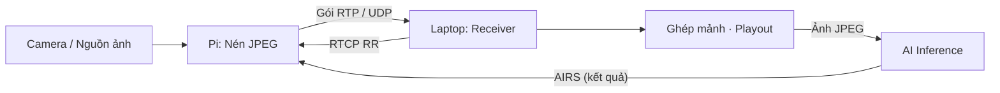
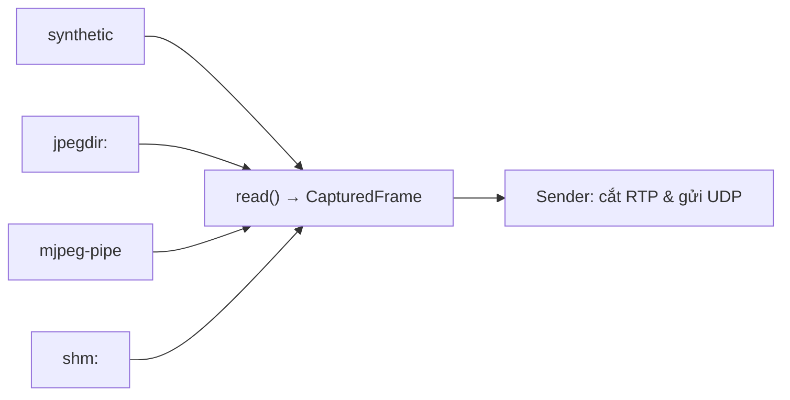
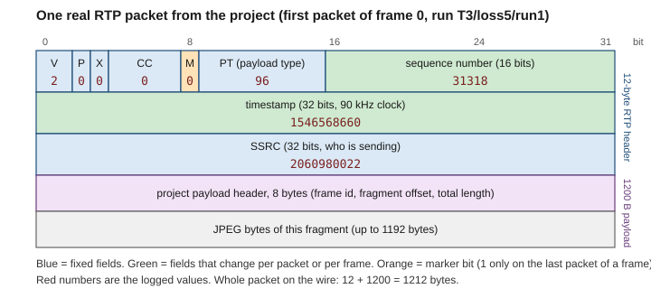

# Session 1 — A. Sản phẩm CN và đường đi của dữ liệu

Bài này trả lời một câu hỏi duy nhất: **dữ liệu đi từ camera tới AI và quay về như thế nào?** Bạn sẽ nắm kiến trúc sản phẩm CN, vai trò của JPEG, bốn kiểu nguồn ảnh dùng chung một giao diện, và ý nghĩa của kết quả nền CN-T2.


Hình minh họa toàn bộ đường đi: camera → nén JPEG → cắt gói → kênh mạng có thể mất gói → ghép ảnh → AI.

---

## A1. Kiến trúc sản phẩm — hai máy, hai chiều dữ liệu

Sản phẩm CN gồm hai máy nối mạng:

- **Raspberry Pi 5** (phía gửi): chụp ảnh, nén JPEG, cắt thành gói RTP, gửi qua UDP.
- **Laptop** (phía nhận): nhận gói, ghép ảnh, chạy AI (MobileNetV2), trả kết quả về Pi.



**Chiều đi (trái → phải):** Camera → JPEG → gói RTP/UDP qua Ethernet hoặc Wi-Fi → Receiver → ghép mảnh và chờ hạn phát (playout) → AI inference.

**Chiều về:** hai loại bản tin RTCP quay về Pi:

1. **RTCP RR (Receiver Report):** laptop định kỳ (mặc định 1 s, SOURCE: `sender.py`, `rtcp_interval=1.0`) báo lại tỉ lệ mất gói và jitter.
2. **AIRS (AI Result):** mỗi khi AI xong một frame, laptop gửi `(frame_id, class_id, confidence)` về Pi.

Dashboard chỉ nhận telemetry JSON để quan sát — tắt Dashboard, hệ thống vẫn chạy bình thường.

<p class="key">Sản phẩm CN = Pi gửi mảnh ảnh JPEG bằng RTP/UDP, laptop ghép lại rồi chạy AI, kết quả và báo cáo mạng quay về Pi qua RTCP.</p>

---

## A2. Camera và JPEG — tại sao phải nén?

### A2.1. Ảnh thô quá lớn

Cấu hình nền CN-T2 (SOURCE: `meta.json`): `640 × 480`, `15 FPS`, `quality 75`.

Một frame RGB thô:

\[
640 \times 480 \times 3 = 921\,600 \text{ byte}
\]

Ở 15 FPS, luồng thô tốn:

\[
921\,600 \times 8 \times 15 = 110{,}59 \text{ Mb/s} \quad\text{(CALCULATED)}
\]

Con số này vượt cả cổng Fast Ethernet 100 Mb/s.

### A2.2. JPEG nén gọn hơn 140 lần

Sau khi nén JPEG ở `quality 75`, frame 0 trong `CN-T2/run1/sender.csv` chỉ còn khoảng 6 439 byte JPEG (MEASURED). Toàn bộ luồng chỉ dưới 1 Mb/s — đi lọt dễ dàng qua Ethernet lẫn Wi-Fi.

<div class="metric-row">
<div class="metric"><div class="m-label">Bitrate thô (CALCULATED)</div><div class="m-value">110,59 Mb/s</div><div class="m-sub">640×480 · RGB · 15 FPS</div></div>
<div class="metric"><div class="m-label">Bitrate JPEG (CALCULATED từ ~6 500 B/frame)</div><div class="m-value">≈ 0,78 Mb/s</div><div class="m-sub">quality 75 · ~6 500 B/frame</div></div>
</div>

### A2.3. Quality ≠ phần trăm pixel, ≠ độ chính xác AI

Tham số `quality` (1..95, mặc định 75, SOURCE: `sources.py` hàm `_quality`) chỉ điều chỉnh mức lượng tử hóa của bộ mã hóa JPEG. Quan hệ giữa `quality` và kích thước byte là **phi tuyến** (MEASURED, CN-T5):


| Quality | Mean JPEG size | Bitrate (MEASURED) |
|---------|---------------|--------------------|
| 30      | 5 650 B       | 0,679 Mb/s         |
| 60      | 5 777 B       | 0,694 Mb/s         |
| 90      | 10 537 B      | 1,266 Mb/s         |

Từ q30 → q60: bitrate chỉ tăng 2,2%. Từ q60 → q90: nhảy vọt 82,4%.

Độ chính xác AI ở các mức quality khác nhau là **UNKNOWN** — nhóm chưa đo.

<p class="key">JPEG giảm luồng 640×480 @ 15 FPS từ 110 Mb/s xuống dưới 1 Mb/s. Tham số quality điều chỉnh mức nén phi tuyến, không mang nghĩa "phần trăm pixel".</p>

---

## A3. Source abstraction — bốn nguồn ảnh, một giao diện

Không phải lúc nào cũng có camera Pi trên bàn. Nhóm cần chạy được với ảnh vẽ kiểm thử trên laptop, với thư mục JPEG có sẵn, hoặc với camera thật.



Mọi nguồn đều trả về cùng một đối tượng `CapturedFrame` (SOURCE: `sources.py` dòng 26–31):

```python
@dataclass(frozen=True)
class CapturedFrame:
    frame_id: int
    jpeg: bytes
    t_capture_mono_ns: int
    quality: int | None = None
```

### A3.1. Bốn kiểu nguồn

| Nguồn (`--source`) | Cách tạo JPEG | Ghi chú |
|---|---|---|
| `synthetic` | Pillow vẽ 8 dải màu + chữ FRAME, nén JPEG thật | Mặc định 320×240, q75 |
| `jpegdir:` | Đọc tuần tự .jpg/.jpeg, quay vòng | Giữ nguyên byte JPEG gốc |
| `mjpeg-pipe` | Cắt khung SOI/EOI từ luồng `rpicam-vid` | **Dùng trong CN-T2, CN-T3** |
| `shm:` | Đọc RGB từ shared memory, nén JPEG | Dùng cấu hình camera Pi vòng bộ nhớ |

### A3.2. Synthetic chứng minh được gì?

**Chứng minh được:** toàn bộ phần mềm phía sau — socket UDP thật, cắt mảnh RTP, ghép ảnh, playout, RTCP — đều chạy với byte JPEG thật.

**KHÔNG chứng minh được:** thời gian chụp thực của cảm biến camera Pi, phân bố kích thước JPEG của cảnh thật, tải CPU thật, hay độ chính xác AI trên cảnh thật.

<p class="key">Source abstraction cho phép cùng một sender chạy với ảnh vẽ, thư mục JPEG, hoặc camera thật qua giao diện CapturedFrame thống nhất.</p>

---

## A4. Đường đi từ Pi đến laptop — RTP trên UDP

### A4.1. Tại sao UDP, không phải TCP?

Video thời gian thực cần **tốc độ hơn tin cậy**. TCP dừng lại chờ gửi lại gói cũ bị mất — trong lúc chờ, camera đã chụp frame mới. UDP gửi nhanh không chờ xác nhận.

**RTP (Real-time Transport Protocol)** gắn thêm nhãn lên mỗi gói UDP: số thứ tự (`sequence number`), mốc thời gian media 90 kHz (`timestamp`), mã nguồn phát (`SSRC`), cờ mảnh cuối (`marker`).

RTP **không** biến UDP thành kênh truyền tin cậy. Mất gói vẫn là mất.

### A4.2. Cấu trúc gói RTP thật


Một ảnh khoảng 6 nghìn byte lớn hơn giới hạn khoảng 1 500 byte của một khung Ethernet, nên phải cắt thành nhiều gói.



Mỗi gói RTP trên dây gồm:

- **12 byte header RTP** (SOURCE: `packet.py`): version, payload type 96, sequence number 16-bit, timestamp 32-bit, SSRC 32-bit.
- **8 byte project payload header** (SOURCE: `payload.py`): frame_id, fragment offset, total length ở mảnh đầu.
- **Phần ảnh JPEG:** payload RTP tối đa 1 200 byte (`mtu_payload`, SOURCE: `payload.py`), trừ 8 byte header mảnh → 1 192 byte ảnh; mảnh đầu còn 4 byte `total_length` → 1 188 byte ảnh.

Tổng mỗi gói trên dây: 12 + 1 200 = **1 212 byte** cho gói đầy.

### A4.3. Năm trạm của một frame

1. **Đóng gói và gửi** (`sender.py`): mỗi chu kỳ `1/fps`, lấy CapturedFrame, gọi `fragment_jpeg()` cắt thành nhiều gói, ném qua socket UDP tới cổng 5004.
2. **Nhận gói** (`receiver.py`): laptop lắng nghe, giải mã header RTP + header phân mảnh, cập nhật thống kê mất gói và jitter.
3. **Ghép ảnh và playout** (`playout.py`): gom mảnh cùng timestamp, dùng mốc neo (anchor) + playout depth để đặt deadline.
4. **AI inference** (`edge_ai.py`): đưa ảnh vào hàng đợi (fifo hoặc latest), chạy MobileNetV2 hoặc ngủ giả lập.
5. **Trả kết quả** qua RTCP: AIRS về Pi, RR định kỳ.

### A4.4. Ba chế độ AI

| `--ai` | Hoạt động | Mục đích |
|--------|-----------|----------|
| `off` | Bỏ qua ảnh, chỉ ghi log | Kiểm thử mạng thuần |
| `synthetic` | Ngủ `service_ms`, trả kết quả cố định | Kiểm tra hàng đợi (CN-T7) |
| `onnx` | MobileNetV2 thật, 224×224, ImageNet 1 000 lớp | Suy luận thật (CN-T2, CN-T3) |

!!! warning "Không nhầm synthetic source với synthetic AI"
    `--source synthetic` ở **Pi**: vẽ ảnh kiểm thử thay camera. `--ai synthetic` ở **laptop**: ngủ thay chạy neural network. Hai tùy chọn hoàn toàn độc lập.

---

## A5. Kết quả nền CN-T2 — Ethernet sạch

Trước khi đưa lỗi mất gói hay jitter vào, nhóm đo nền ở điều kiện lý tưởng (MEASURED, CN-T2, `eth_q75_640x480_15fps`): 5 lần chạy, Ethernet sạch, `rpicam-vid` MJPEG 640×480 15 FPS q75, playout 50 ms, AI MobileNetV2 ONNX (latest, 2 threads).

<div class="metric-row">
<div class="metric"><div class="m-label">Packet / frame (MEASURED, CN-T2)</div><div class="m-value">6,080</div><div class="m-sub">0% mất gói · 100% đúng hạn</div></div>
<div class="metric"><div class="m-label">Jitter (MEASURED, CN-T2)</div><div class="m-value">0,14 ms</div><div class="m-sub">rất thấp trên Ethernet sạch</div></div>
<div class="metric"><div class="m-label">Capture → AI P50 / P95 (MEASURED, CN-T2)</div><div class="m-value">66,62 / 72,20 ms</div><div class="m-sub">đo trên đồng hồ Pi · playout 50 ms</div></div>
<div class="metric"><div class="m-label">Thông lượng AI (MEASURED, CN-T2)</div><div class="m-value">15,01 kết quả/s</div><div class="m-sub">khớp nhịp nguồn 15 FPS</div></div>
</div>

Thời gian 66,62 ms chủ yếu do **chủ ý chờ 50 ms trong playout** cộng thời gian truyền gói và suy luận AI — không phải mạng bị nghẽn.

CN-T2 là mốc tham chiếu ở điều kiện lý tưởng. Nó **không** chứng minh hệ thống sẽ giữ 100% frame khi có mất gói (CN-T3), Wi-Fi (CN-T6), hoặc quá tải AI (CN-T7).

<p class="key">Baseline CN-T2 (MEASURED): 100% frame đúng hạn, 0,14 ms jitter, 15,01 kết quả/s trên Ethernet sạch — điểm tựa so sánh cho các kịch bản mạng lỗi.</p>

---

## Trắc nghiệm

<div class="quiz" markdown>
<p class="quiz-q">1. Synthetic source có nghĩa gì?</p>

- [ ] AI tạo ảnh để huấn luyện
- [x] Chương trình sinh JPEG kiểm thử theo cùng giao diện nguồn
- [ ] Mô phỏng toàn bộ giao thức RTP
- [ ] Bỏ qua encoder JPEG

<div class="quiz-why" markdown>
`SyntheticSource` dùng Pillow vẽ dải màu, nén thành byte JPEG thật, trả về `CapturedFrame` giống hệt nguồn camera. Phần gửi/nhận RTP/UDP vẫn chạy mã mạng thật.
</div>
</div>

<div class="quiz" markdown>
<p class="quiz-q">2. Quality 75 có ý nghĩa gì?</p>

- [ ] Giữ đúng 75% pixel
- [ ] Độ chính xác AI là 75%
- [x] Tham số chất lượng của encoder JPEG
- [ ] Bitrate cố định 75%

<div class="quiz-why" markdown>
`quality` điều chỉnh mức lượng tử hóa của JPEG encoder. Kích thước byte sinh ra còn phụ thuộc độ phân giải và nội dung ảnh — quan hệ phi tuyến (MEASURED, CN-T5).
</div>
</div>

<div class="quiz" markdown>
<p class="quiz-q">3. Trong sơ đồ kiến trúc ở A1, cái gì đi ngược từ laptop về Pi?</p>

- [ ] Ảnh JPEG đã ghép
- [ ] Lệnh điều khiển từ Dashboard
- [x] RTCP RR (báo cáo mất gói, jitter) và AIRS (kết quả AI)
- [ ] Các gói RTP bị mất được gửi lại

<div class="quiz-why" markdown>
Chiều về chỉ mang báo cáo và kết quả, không mang ảnh. UDP/RTP không gửi lại gói mất, và Dashboard chỉ quan sát.
</div>
</div>

<div class="quiz" markdown>
<p class="quiz-q">4. Chạy loopback trên localhost với `--source synthetic` và `--ai synthetic` chứng minh được gì?</p>

- [ ] Camera Pi đã hoạt động
- [ ] Ethernet thật đạt baseline T2
- [x] Pipeline socket RTP/RTCP cục bộ có thể hoạt động
- [ ] ONNX nhanh hơn synthetic

<div class="quiz-why" markdown>
Trên localhost không có camera Pi, không có đường truyền vật lý, và `--ai synthetic` chỉ ngủ chứ không chạy MobileNetV2. Chỉ kiểm tra được logic phần mềm socket, cắt mảnh, ghép ảnh và phản hồi RTCP.
</div>
</div>

---

## Câu thầy có thể hỏi

??? question "Sản phẩm CN gồm những máy nào, dữ liệu đi theo những chiều nào?"
    Thưa thầy, sản phẩm gồm Raspberry Pi 5 (bên gửi) và laptop (bên nhận) qua Ethernet hoặc Wi-Fi. Chiều đi: Pi chụp ảnh, nén JPEG, cắt gói RTP, gửi UDP sang laptop; laptop ghép mảnh, giữ tới hạn phát rồi đưa AI. Chiều về: laptop gửi RTCP RR (báo cáo mất gói, jitter) định kỳ 1 s, và mỗi khi AI xong thì gửi AIRS về Pi. Dashboard chỉ nhận telemetry quan sát, tách rời đường truyền chính.

??? question "Tại sao phải nén JPEG rồi truyền RTP trên UDP?"
    Thưa thầy, hai lý do tách biệt. Thứ nhất, ảnh RGB thô 640×480 nặng 921 600 byte; ở 15 FPS tốn 110,59 Mb/s, vượt cả Fast Ethernet. Sau khi nén JPEG q75, mỗi frame chỉ còn ~6 500 byte, dưới 1 Mb/s. Thứ hai, dùng UDP thay TCP vì video thời gian thực không muốn dừng chờ gửi lại gói cũ. RTP gắn số thứ tự và mốc thời gian để máy nhận tự ghép ảnh, nhưng không biến UDP thành kênh tin cậy.

??? question "Chạy synthetic trên máy mượt, kết luận được toàn hệ thống phần cứng đạt chuẩn không?"
    Thưa thầy, không thể. `--source synthetic` dùng Pillow vẽ ảnh, không đụng camera Pi, nên không chứng minh thời gian chụp thực hay kích thước JPEG cảnh thật. `--ai synthetic` chỉ ngủ cố định, không chạy MobileNetV2 thật. Muốn kết luận về phần cứng, phải dùng các phép đo CN-T2 đến CN-T7 trên thiết bị thật.
