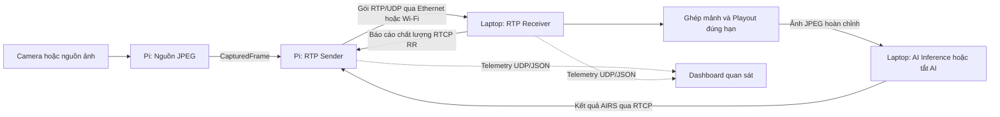
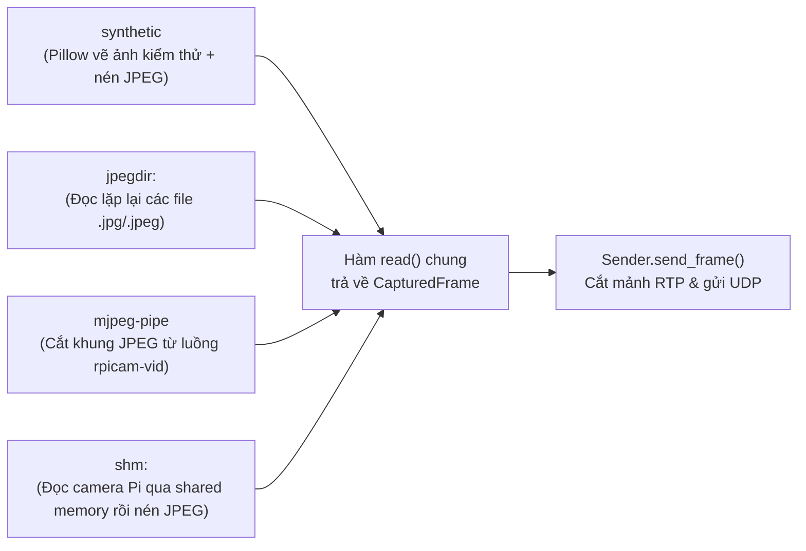

# Session 1 — A. Sản phẩm CN và đường đi của dữ liệu

Sau bài này, bạn sẽ hiểu toàn bộ sản phẩm của môn Mạng máy tính (CN) từ góc nhìn một người chưa từng làm ứng dụng mạng hay xử lý ảnh: camera tạo ra dữ liệu gì, vì sao phải nén **JPEG**, bốn kiểu nguồn ảnh dùng chung giao diện ra sao, dữ liệu đi từ Raspberry Pi 5 sang laptop rồi quay kết quả về như thế nào, và kết quả đo nền **CN-T2** thực sự chứng minh được điều gì. Bạn sẽ dựa vào bài này để bảo vệ bức tranh tổng thể của hệ thống trước khi đi sâu vào từng cơ chế gói tin ở Session 1B và mô phỏng ở Session 2.

!!! info "Cách đọc số liệu và cấu trúc ba tầng trong bài"
    Mọi con số trong bài được gắn nhãn rõ ràng ngay trong câu giải thích: **SOURCE** là tham số hoặc logic đọc trực tiếp từ mã nguồn và file cấu hình; **MEASURED** là kết quả đo phần cứng đã lưu; **SIMULATED** là kết quả từ mô hình mô phỏng; **CALCULATED** là phép tính suy ra từ các số đã nêu; **UNKNOWN** là điều nhóm chưa đo nên không được suy đoán. Ký hiệu **P50** là trung vị (một nửa số lần đo nhanh hơn mốc này, một nửa chậm hơn), còn **P95** là phân vị 95% (95% số lần đo nhanh hơn mốc này).

    Mỗi phần đều đi từ **Hiểu bản chất** (ngôn ngữ đời thường, hình dung trực quan), sang **Hiểu dự án** (công thức, ví dụ tính tay, sơ đồ và số đo thật của nhóm), còn phần **Đào sâu để bảo vệ** (trích đoạn mã nguồn và câu hỏi vặn của giảng viên) được đặt gọn trong các hộp mở rộng để bạn tự kiểm tra khi ôn thi.

---

## A0. Chuẩn bị nền tảng: Bit, Byte, Ảnh số, Frame và Packet

Trước khi nói đến camera, JPEG hay giao thức mạng, ta cần thống nhất bốn khái niệm cơ bản nhất. Nếu bạn đã quen chúng từ môn Tin học đại cương hoặc Truyền số liệu, hãy coi đây là bước chốt lại đơn vị để lát nữa tính toán không bị nhầm.

- **Bit và Byte:** Mọi dữ liệu trong máy tính đều lưu bằng dãy các số `0` và `1`, mỗi chữ số là **1 bit**. Cứ **8 bit** ghép thành **1 byte (B)**. Khi đo kích thước tệp hoặc bộ nhớ, người ta hay dùng **byte**; nhưng khi đo tốc độ đường truyền mạng, người ta lại dùng **bit mỗi giây (bit/s hoặc Mb/s)**. Vì vậy, mỗi lần đổi từ kích thước ảnh (byte) sang tốc độ mạng (bit/s), ta luôn phải **nhân 8**.
- **Ảnh số (digital image) và Điểm ảnh (pixel):** Một bức ảnh màu trên máy tính thực chất là một bảng lưới hình chữ nhật gồm các ô vuông nhỏ gọi là **pixel (điểm ảnh)**. Trong hệ màu **RGB (Red–Green–Blue)** thông dụng, mỗi điểm ảnh cần **3 byte** (1 byte cho mức độ Đỏ, 1 byte cho Xanh lá, 1 byte cho Xanh dương).
- **Frame (khung hình):** Là **một bức ảnh hoàn chỉnh** được chụp tại một thời điểm duy nhất. Video không phải một dòng chảy liên tục bí ẩn nào cả; nó chỉ là một chuỗi các bức ảnh chụp liên tiếp rồi phát lại thật nhanh (ví dụ 15 bức ảnh mỗi giây).
- **Packet (gói tin), Header (phần đầu / nhãn gói) và Payload (tải hữu ích / ruột dữ liệu):** Đường truyền mạng không ném cả một bức ảnh lớn hàng chục nghìn byte đi trong một khối khổng lồ duy nhất, vì thiết bị mạng giới hạn kích thước mỗi lượt gửi và một lỗi nhỏ trên đường dây sẽ làm hỏng cả khối lớn. Thay vào đó, dữ liệu được cắt thành nhiều **packet** nhỏ. Mỗi packet gồm hai phần: **payload** là phần ruột chứa dữ liệu ảnh thực sự, còn **header** là vài chục byte nhãn thông tin đi kèm (số thứ tự, mốc thời gian, mã nguồn gửi) để máy nhận biết cách xử lý.

<svg viewBox="0 0 760 155" width="100%" style="max-width:760px;display:block;margin:1rem auto;" role="img" aria-label="Minh họa từ một bức ảnh thô thành JPEG và các packet mạng">
  <rect x="8" y="20" width="150" height="108" rx="10" fill="rgba(20,184,166,0.10)" stroke="#14B8A6" stroke-width="2"/>
  <text x="83" y="46" text-anchor="middle" fill="currentColor" font-size="13" font-weight="700">1 Frame thô (RGB)</text>
  <text x="83" y="68" text-anchor="middle" fill="currentColor" font-size="12">640 × 480 pixel</text>
  <text x="83" y="88" text-anchor="middle" fill="currentColor" font-size="12">× 3 byte/pixel</text>
  <text x="83" y="112" text-anchor="middle" fill="#14B8A6" font-size="13" font-weight="700">= 921.600 byte</text>
  <line x1="164" y1="74" x2="206" y2="74" stroke="currentColor" stroke-width="2"/>
  <polygon points="206,69 216,74 206,79" fill="currentColor"/>
  <text x="190" y="62" text-anchor="middle" fill="currentColor" font-size="11">Nén</text>
  <rect x="220" y="34" width="142" height="80" rx="10" fill="rgba(245,158,11,0.12)" stroke="#F59E0B" stroke-width="2"/>
  <text x="291" y="58" text-anchor="middle" fill="currentColor" font-size="13" font-weight="700">1 Ảnh JPEG</text>
  <text x="291" y="79" text-anchor="middle" fill="currentColor" font-size="12">Ví dụ CN-T2 (q75)</text>
  <text x="291" y="99" text-anchor="middle" fill="#F59E0B" font-size="13" font-weight="700">~6.400 – 7.000 byte</text>
  <line x1="368" y1="74" x2="412" y2="74" stroke="currentColor" stroke-width="2"/>
  <polygon points="412,69 422,74 412,79" fill="currentColor"/>
  <text x="395" y="62" text-anchor="middle" fill="currentColor" font-size="11">Cắt gói</text>
  <rect x="428" y="18" width="322" height="32" rx="6" fill="rgba(20,184,166,0.08)" stroke="currentColor" stroke-opacity="0.45"/>
  <rect x="428" y="18" width="76" height="32" rx="6" fill="rgba(245,158,11,0.28)" stroke="#F59E0B"/>
  <text x="466" y="39" text-anchor="middle" fill="currentColor" font-size="11" font-weight="700">Header</text>
  <text x="626" y="39" text-anchor="middle" fill="currentColor" font-size="11">Packet 1: Payload (mảnh JPEG 1)</text>
  <rect x="428" y="58" width="322" height="32" rx="6" fill="rgba(20,184,166,0.08)" stroke="currentColor" stroke-opacity="0.45"/>
  <rect x="428" y="58" width="76" height="32" rx="6" fill="rgba(245,158,11,0.28)" stroke="#F59E0B"/>
  <text x="466" y="79" text-anchor="middle" fill="currentColor" font-size="11" font-weight="700">Header</text>
  <text x="626" y="79" text-anchor="middle" fill="currentColor" font-size="11">Packet 2: Payload (mảnh JPEG 2)</text>
  <rect x="428" y="98" width="212" height="32" rx="6" fill="rgba(20,184,166,0.08)" stroke="currentColor" stroke-opacity="0.45"/>
  <rect x="428" y="98" width="76" height="32" rx="6" fill="rgba(245,158,11,0.28)" stroke="#F59E0B"/>
  <text x="466" y="119" text-anchor="middle" fill="currentColor" font-size="11" font-weight="700">Header</text>
  <text x="572" y="119" text-anchor="middle" fill="currentColor" font-size="11">Packet N (mảnh cuối)</text>
</svg>

<p class="key">Một video là chuỗi các frame; mỗi frame phải nén thành ảnh JPEG rồi mới cắt thành nhiều packet gồm header (nhãn) và payload (ruột ảnh) để gửi qua mạng.</p>

---

## A1. Bài toán sản phẩm: đưa video từ camera tới AI qua mạng và trả kết quả về

### A1.1. Tại sao cần hệ thống này? (Góc nhìn người dùng)

Hãy hình dung ứng dụng của nhóm từ góc nhìn một người sử dụng bình thường. Chúng ta có hai máy đặt ở hai chỗ khác nhau:

1. **Phía phát (Sender — máy gửi):** một chiếc **Raspberry Pi 5** nhỏ gọn gắn camera (hoặc nguồn ảnh kiểm thử). Pi không tự chạy mô hình nhận diện AI nặng nề mà làm nhiệm vụ chụp từng bức ảnh, nén gọn thành JPEG và gửi qua mạng.
2. **Phía nhận (Receiver — máy nhận):** một chiếc **laptop** có sức mạnh tính toán lớn hơn, nối với Pi qua mạng **Ethernet** (dây LAN) hoặc **Wi-Fi**. Laptop nhận các gói dữ liệu từ mạng, ghép lại thành bức ảnh hoàn chỉnh, chạy mô hình AI để nhận diện xem trong ảnh là lớp đối tượng nào, rồi gửi **kết quả nhận diện** quay ngược về cho Pi biết.

Ngoài ra, người vận hành còn có thể mở một **Dashboard (bảng điều khiển trên trình duyệt web)** để nhìn thấy ảnh đang truyền tới, tỉ lệ mất gói và độ trễ theo thời gian thực hoặc xem lại bản ghi cũ.

Vấn đề cốt lõi của môn **Mạng máy tính** nằm ở khoảng cách giữa hai máy. Mạng không phải sợi cáp camera lý tưởng: trên đường đi, mạng có thể **làm mất một vài packet**, có thể **làm packet đến trễ**, hoặc **làm các packet đến lúc nhanh lúc chậm không đều nhau**. Nếu một bức ảnh đến quá trễ hoặc mất một mảnh giữa chừng, hoặc nếu AI mải xử lý ảnh cũ xếp hàng từ nửa giây trước, kết quả trả về cho Pi sẽ bị **hỏng hoặc lỗi thời** dù chương trình không hề báo lỗi cú pháp.

### A1.2. Hình dung bằng ví dụ đơn giản và sơ đồ kiến trúc sản phẩm

!!! tip "Hình dung"
    Hãy coi Raspberry Pi như một **phóng viên hiện trường**, còn laptop là **tòa soạn có chuyên gia phân tích ảnh**. Phóng viên chụp từng bức ảnh, ép gọn lại cho nhẹ, rồi cắt bức ảnh thành vài phong bì nhỏ (gọi là **packet**), trên mỗi phong bì ghi rõ "đây là ảnh số mấy, mảnh thứ mấy" (**header**), sau đó thả vào hệ thống bưu điện (**UDP**).

    Ở đầu bên kia, thư ký tòa soạn (**Receiver**) đứng đón phong bì. Thư ký phải xếp đúng mảnh của cùng một bức ảnh vào một tập, chờ đúng giờ chốt để đảm bảo nhịp đều đặn (**playout**), rồi mới đưa bức ảnh nguyên vẹn cho chuyên gia **AI** đọc. Đọc xong, chuyên gia gửi một bức thư ngắn báo kết quả phân loại ngược về cho phóng viên, còn thư ký định kỳ gửi một **bảng điểm bưu điện** báo lại xem vừa rồi bưu điện làm thất lạc bao nhiêu phần trăm phong bì. Trong suốt quá trình đó, **Dashboard** chỉ là màn hình treo tường ghi nhận thống kê; nó không cầm phong bì và cũng không ra lệnh cho chuyên gia AI.

Sơ đồ dưới đây mô tả đúng đường đi của dữ liệu trong sản phẩm CN của nhóm (`SOURCE`: `cn/rtp/rtp/`):



Hãy đọc sơ đồ từ trái sang phải theo luồng chính, rồi đọc hai mũi tên quay ngược về:

- **Đường đi thuận (mũi tên liền từ trái sang phải):** `Camera / Nguồn ảnh` → `Nguồn JPEG` → `RTP Sender` → mạng `UDP` → `RTP Receiver` → `Ghép mảnh và Playout` → `AI Inference`. Đây là đường dữ liệu hình ảnh.
- **Đường phản hồi ngược từ Laptop về Pi:** có hai loại bản tin đi ngược chiều qua kênh **RTCP (RTP Control Protocol — giao thức điều khiển RTP)**:
  1. **RTCP RR (Receiver Report — báo cáo tiếp nhận):** laptop định kỳ báo lại cho Pi biết vừa rồi nhận thiếu bao nhiêu gói và gói đến có bị giật cục (**jitter**) không. Nếu Pi bật chế độ thích nghi (**AIMD**), Pi sẽ dựa vào báo cáo này để tự giảm hoặc tăng kích thước ảnh gửi ở các frame sau.
  2. **Kết quả AI (`AIRS`):** ngay khi AI xử lý xong một frame, laptop gửi gói thông báo kết quả (`frame_id`, `class_id`, độ tin cậy) quay về Pi để Pi ghi nhận kết quả và tính xem từ lúc chụp đến lúc nhận kết quả mất bao lâu.
- **Đường nét đứt tới Dashboard (Telemetry — dữ liệu giám sát):** cả Pi và laptop đều có thể gửi bản tin JSON thống kê (và tối đa 5 ảnh xem trước mỗi giây từ laptop) sang Dashboard. Đây là nhánh **chỉ quan sát**: tắt Dashboard thì hệ thống vẫn truyền ảnh và chạy AI bình thường.

### A1.3. Thuật ngữ cần nắm ở lần gặp đầu tiên

- **RTP (Real-time Transport Protocol — giao thức truyền dữ liệu thời gian thực):** giao thức chạy bên trên UDP để gắn thêm số thứ tự gói (`sequence number`), mốc thời gian lấy mẫu media (`timestamp`), mã nguồn phát (`SSRC`) và cờ báo mảnh cuối (`marker`). RTP giúp máy nhận *nhận biết và sắp xếp* dữ liệu thời gian thực, chứ **không** biến UDP thành kênh truyền tin cậy.
- **UDP (User Datagram Protocol — giao thức gói dữ liệu người dùng):** giao thức vận chuyển gửi từng gói tin độc lập. UDP nhanh và không giữ hàng đợi chờ xác nhận từ đầu kia, nhưng đổi lại mạng làm mất hay tráo thứ tự gói thì UDP mặc kệ.
- **RTCP (RTP Control Protocol — giao thức điều khiển RTP):** giao thức đi cặp với RTP (chạy ở cổng kế tiếp, cổng lẻ ngay sau cổng RTP chẵn) để gửi thông tin điều khiển và báo cáo chất lượng tiếp nhận.
- **Playout buffer (bộ đệm phát đúng hạn):** vùng chờ ngắn ở máy nhận để gom đủ các mảnh của một bức ảnh và giữ lại đúng tới thời điểm phát theo lịch, giúp làm dịu bớt sự đến không đều của mạng.
- **Inference (suy luận AI):** bước chạy mô hình mạng neural (ở đây là **MobileNetV2**) để phân loại xem bức ảnh vừa nhận thuộc lớp nào.

### A1.4. Đường đi này nằm ở đâu trong mô hình mô phỏng CN?

Ở Session 2, nhóm còn xây dựng một mô hình toán học bằng MATLAB SimEvents để thử nghiệm các kịch bản mạng khắc nghiệt một cách lặp lại được. Dù đó là mô phỏng (`SIMULATED`), bức tranh tổng thể của nó phản chiếu trực tiếp đường đi sản phẩm mà bạn vừa xem ở trên:


!!! note "Cách đọc hình"
    **Các vùng màu trong mô hình:** Đây là sơ đồ mô phỏng `CN_simevents_v2.slx` (**SIMULATED**), không phải ảnh chụp phần cứng thật. Vùng **xanh dương** ở hàng trên đi từ trái sang phải là đường ảnh và gói tin RTP (`Frames` → `Sender Queue` → `RTP Packetizer` → `Serialization` → `Channel` → `Receiver` → `Inference`). Vùng **vàng** ở giữa là đường ngược đưa báo cáo `RTCP RR` từ `Receiver` quay lại phía phát. Vùng **tím** ở dưới chứa khối quan sát `Observations`, bộ điều khiển `AIMD` nối dây quay lại `Frames` (để chỉnh kích thước các ảnh *sau này*), và đường `Scope signals` ra `Dashboard`.

    **Một câu rút gọn:** Ở Session 1A, bạn chỉ cần nhớ hàng trên là đường truyền ảnh tới AI, hàng giữa là đường báo cáo quay về, và vùng dưới là nơi quan sát cũng như điều chỉnh tốc độ phát dựa trên báo cáo đó.

??? note "Đào sâu để bảo vệ: Sản phẩm CN thật gồm những file mã nguồn nào?"
    Mỗi khối trong sơ đồ trên tương ứng với một module Python cụ thể trong thư mục `cn/rtp/rtp/` (**SOURCE** đã đọc trực tiếp):

    | Giai đoạn trong đường đi | File nguồn (`cn/rtp/rtp/`) | Vai trò chính |
    |---|---|---|
    | Nguồn ảnh trên Pi | `sources.py` | Tạo hoặc đọc ảnh JPEG qua giao diện thống nhất `read()`, trả về `CapturedFrame`. |
    | Chia mảnh và đóng gói | `payload.py`, `packet.py` | `fragment_jpeg()` cắt JPEG theo giới hạn `--mtu-payload` với header phân mảnh riêng 8 byte + header RTP 12 byte. |
    | Máy phát trên Pi | `sender.py`, `abr.py` | Lấy frame theo nhịp `fps`, gửi UDP, gửi/nhận RTCP (`SR`, `RR`, `AIRS`), ghi `sender.csv` và `results_tx.csv`, chạy AIMD nếu bật. |
    | Máy nhận trên laptop | `receiver.py`, `rxstats.py`, `playout.py` | Đọc socket UDP, tính mất gói và jitter RFC 3550, ghép mảnh và kiểm tra hạn phát trong `PlayoutBuffer`. |
    | Xử lý AI trên laptop | `edge_ai.py` | Hàng đợi `fifo` hoặc `latest` đưa ảnh sang `synthetic` hoặc `onnx` (MobileNetV2), rồi gọi `send_result` gửi `AIRS` về Pi. |
    | Kênh giám sát | `telemetry.py` | Luồng nền gửi bản tin JSON qua UDP tới Dashboard; đầy hàng đợi `512` thì tự bỏ gói telemetry, không chặn luồng RTP. |

<p class="key">Sản phẩm CN nối Raspberry Pi với laptop qua hai chiều: chiều đi mang mảnh ảnh JPEG bằng RTP/UDP tới AI, chiều về mang báo cáo mạng RTCP RR và kết quả AI bằng RTCP APP (AIRS); Dashboard chỉ đứng ngoài quan sát.</p>

---

## A2. Camera, JPEG, Độ phân giải, FPS và Bitrate

### A2.1. Tại sao cần nén JPEG? (Vấn đề kích thước ảnh thô)

Một câu hỏi rất tự nhiên của người mới học là: *“Camera chụp ra bức ảnh màu rồi, sao không gửi thẳng dữ liệu các điểm ảnh đó qua mạng luôn cho đỡ rắc rối, lại còn mất công nén JPEG làm gì?”*

Hãy thử kiểm tra bằng một phép tính đơn giản ngay trên cấu hình cơ sở **CN-T2** của nhóm (`640 × 480` điểm ảnh, chụp `15` ảnh mỗi giây).

Mỗi bức ảnh màu **RGB** chưa nén cần **3 byte** cho mỗi điểm ảnh (1 byte Đỏ, 1 byte Xanh lá, 1 byte Xanh dương). Nếu gửi thẳng ảnh thô chưa nén:

- Số điểm ảnh trong 1 frame là: \(640 \times 480 = 307{,}200\text{ pixel}\).
- Dung lượng của **1 frame thô** là: \(307{,}200 \times 3 = 921{,}600\text{ byte}\) (gần **1 MB** chỉ cho một tấm hình đứng yên!).
- Với tốc độ \(15\) frame mỗi giây, lượng dữ liệu đổ ra mạng mỗi giây là hơn **110 triệu bit/giây (`110.59 Mb/s`)**.

Con số `110.59 Mb/s` này lớn hơn cả băng thông thực tế của nhiều đường kết nối Wi-Fi thông thường, và vượt quá tốc độ cổng Fast Ethernet `100 Mb/s`! Trong khi đó, sau khi đi qua bộ nén **JPEG** ở mức `quality 75`, trong dữ liệu đo thật **CN-T2** (`run1`), frame đầu tiên chỉ còn khoảng `6.439` byte JPEG (`6.563` byte tính cả header RTP/phân mảnh trên dây mạng) — tức **nhẹ hơn hơn 140 lần**! Nhờ JPEG, luồng video `640 × 480 @ 15 FPS` chỉ tiêu tốn dưới `1 Mb/s` và đi lọt dễ dàng qua cả Wi-Fi lẫn Ethernet.

### A2.2. Tách bạch bốn khái niệm hay bị đánh đồng

Khi bảo vệ đồ án, rất nhiều bạn hay trộn lẫn bốn đại lượng sau thành một. Bạn cần tách rạch ròi từng cái:

| Khái niệm | Đo cái gì? | Đơn vị | Phụ thuộc vào đâu? |
|---|---|---|---|
| **Độ phân giải (Resolution)** | Kích thước lưới điểm ảnh \(W \times H\) của một ảnh | pixel (ví dụ `640 × 480`) | Cấu hình camera hoặc nguồn ảnh |
| **Tốc độ khung hình (FPS)** | Số ảnh chụp được trong 1 giây | frame/s (ví dụ `15 FPS`) | Nhịp đồng hồ chụp của camera hoặc `sender.py` |
| **Kích thước ảnh nén (Image size)** | Số byte của một tệp/mảng byte JPEG sau khi nén | byte (B) | Độ phân giải, tham số `quality` và **độ phức tạp nội dung ảnh** |
| **Tốc độ bit (Bitrate)** | Lượng bit truyền lên mạng trong 1 giây | bit/s hoặc Mb/s | Kích thước mỗi ảnh × số ảnh mỗi giây (+ header gói tin) |

### A2.3. Công thức tính chu kỳ khung hình và bài tập có lời giải

Từ tốc độ khung hình \(f\) (tính bằng **FPS**, tức số frame mỗi giây), ta tính được **chu kỳ khung hình (frame interval)** \(T_f\) — khoảng thời gian danh định giữa hai lần chụp liên tiếp:

\[
T_f = \frac{1}{f}
\]

Trong đó:
- \(f\) là tốc độ khung hình (đơn vị: **frame/s** hoặc **Hz**).
- \(T_f\) là chu kỳ giữa hai frame liên tiếp (đơn vị: **giây**, thường nhân thêm \(1000\) để đổi sang **mili-giây (ms)**).

**Tại sao công thức có dạng \(1/f\)?** Vì toàn bộ 1 giây được chia đều cho \(f\) khoảng thời gian như nhau; chụp càng nhiều ảnh trong 1 giây thì khoảng cách thời gian giữa hai ảnh liên tiếp càng ngắn lại.

Còn **tốc độ bit ảnh thô (raw bitrate)** \(R_{\text{raw}}\) của một luồng ảnh RGB có chiều rộng \(W\), chiều cao \(H\) và tốc độ \(f\) được tính bằng:

\[
S_{\text{raw}} = W \times H \times 3,\qquad R_{\text{raw}} = S_{\text{raw}} \times 8 \times f
\]

Trong đó \(S_{\text{raw}}\) là số byte của một frame chưa nén (3 byte cho 3 kênh màu R, G, B), số `8` dùng để đổi từ byte sang bit, và \(R_{\text{raw}}\) có đơn vị là **bit/s** (chia cho \(10^6\) để ra **Mb/s**).

#### Ví dụ có lời giải (dùng đúng cấu hình nền CN-T2)

Cấu hình baseline **CN-T2** (`SOURCE` trong `T2/eth_q75_640x480_15fps/run1/meta.json`) đặt: độ phân giải \(W = 640\text{ pixel}\), \(H = 480\text{ pixel}\), `quality = 75`, và \(f = 15\text{ FPS}\).

1. **Tính chu kỳ khung hình \(T_f\) (CALCULATED):**
   \[
   T_f = \frac{1}{15\text{ frame/s}} \approx 0.06667\text{ s} = 66.67\text{ ms}.
   \]
   *Ý nghĩa:* Cứ mỗi **66,67 ms**, camera tạo ra một bức ảnh mới. Đây chính là "quỹ thời gian" danh định của hệ thống: nếu các khâu phía sau mất nhiều thời gian hơn 66,67 ms để giải phóng một frame, ảnh sau sẽ bắt đầu ứ lại.

2. **Tính tốc độ bit nếu không nén JPEG (CALCULATED):**
   - Số điểm ảnh: \(640 \times 480 = 307{,}200\text{ pixel}\).
   - Dung lượng 1 ảnh RGB thô: \(S_{\text{raw}} = 307{,}200 \times 3 = 921{,}600\text{ byte}\).
   - Đổi sang bit mỗi ảnh: \(921{,}600 \times 8 = 7{,}372{,}800\text{ bit}\).
   - Nhân với 15 ảnh/giây:
     \[
     R_{\text{raw}} = 7{,}372{,}800 \times 15 = 110{,}592{,}000\text{ bit/s} \approx 110.59\text{ Mb/s}.
     \]

3. **So sánh với dữ liệu JPEG thật trong CN-T2 (`SOURCE` / `MEASURED` trong `run1/sender.csv` và `receiver.csv`):**
   Ở frame 0 của `T2/eth_q75_640x480_15fps/run1`, sender gửi 6 gói RTP tổng cộng `6.563 byte` trên mạng (`5 × 1212 + 503` byte, trong đó trừ đi `6 × 12 = 72 byte` header RTP và `12 + 5 × 8 = 52 byte` header phân mảnh thì phần JPEG thuần là `6.439 byte`). Ở mức xấp xỉ ~`6.500 byte` JPEG mỗi frame tại `15 FPS`, tốc độ dữ liệu JPEG chỉ vào khoảng:
   \[
   R_{\text{JPEG}} \approx 6500 \times 8 \times 15 = 780{,}000\text{ bit/s} = 0.78\text{ Mb/s}.
   \]
   Nén JPEG đã giảm lượng dữ liệu phải truyền xuống **hơn 140 lần** so với ảnh thô `110.59 Mb/s`.

#### Bài tập thực hành: tự dự đoán trước khi mở đáp án

Giả sử trong một thí nghiệm khác (như khi kiểm tra hàng đợi AI ở **CN-T7**), ta tăng tốc độ chụp từ \(15\text{ FPS}\) lên \(30\text{ FPS}\), còn kích thước trung bình mỗi ảnh JPEG vẫn khoảng `6.500 byte`. Hãy tự tính trước:

1. Chu kỳ khung hình \(T_f\) mới bằng bao nhiêu **ms**?
2. Tốc độ dữ liệu JPEG \(R_{\text{JPEG}}\) (Mb/s) thay đổi ra sao?

??? success "Xem đáp án và các bước tính"
    1. **Chu kỳ khung hình mới (CALCULATED):**
       \[
       T_f = \frac{1}{30\text{ frame/s}} \approx 0.03333\text{ s} = 33.33\text{ ms}.
       \]
       Khi FPS tăng gấp đôi (từ 15 lên 30), khoảng thời gian giữa hai ảnh liên tiếp bị **cắt còn một nửa** (từ 66,67 ms xuống 33,33 ms).
    2. **Tốc độ dữ liệu JPEG mới (CALCULATED):**
       \[
       R_{\text{JPEG}} = 6500 \times 8 \times 30 = 1{,}560{,}000\text{ bit/s} = 1.56\text{ Mb/s}.
       \]
       Vì mỗi giây gửi gấp đôi số ảnh có cùng kích thước, tốc độ dữ liệu cũng **tăng gấp đôi** (từ 0,78 Mb/s lên 1,56 Mb/s).

### A2.4. JPEG nén như thế nào và `quality` khác gì độ phân giải, số byte, độ chính xác AI?

Khi nén một bức ảnh thành JPEG, bộ mã hóa (**encoder**) thực hiện ba bước chính: chia ảnh thành các ô nhỏ rồi biến đổi sang dạng tần số (tách chi tiết thô và chi tiết sắc nét), **lượng tử hóa (quantization)** để làm tròn và bỏ bớt những chi tiết mịn mà mắt người khó phân biệt (đây là bước gây mất thông tin không hoàn nguyên), rồi cuối cùng nén gọn các dãy số lặp lại.

Tham số **`quality`** (trong `cn/rtp/rtp/sources.py`, hàm `_quality` nhận giá trị từ `1` đến `95`, mặc định `75`) chỉ điều khiển **độ gắt của bước lượng tử hóa**. Có bốn hiểu lầm cực kỳ phổ biến khi bảo vệ mà bạn phải tránh:

1. **`quality 75` KHÔNG phải giữ lại 75% số pixel hay 75% thông tin.** Độ phân giải (ví dụ `640 × 480`) vẫn giữ nguyên số pixel; `quality` chỉ là nút vặn quy ước độ nén của bộ encoder.
2. **`quality` KHÔNG tỷ lệ thẳng hàng (tuyến tính) với số byte sinh ra.** Tăng từ `30` lên `60` có thể chỉ nhích thêm vài phần trăm byte, nhưng tăng từ `60` lên `90` lại khiến số byte vọt lên gần gấp đôi.
3. **Cùng `quality` và độ phân giải, số byte vẫn thay đổi theo nội dung ảnh.** Cảnh có nhiều chi tiết nhỏ, chữ viết hoặc nhiễu sáng sẽ nén kém hơn cảnh nền trơn. Chẳng hạn trong chính tệp `sender.csv` của `CN-T2/run1` (`640 × 480`, `q75`), frame 1 lúc camera mới ổn định phơi sáng tốn tới `20.021` byte trên đường truyền, trong khi từ frame 17 trở đi cảnh ổn định chỉ còn quanh `6.258 – 7.197` byte!
4. **Không được suy ra độ chính xác của AI từ `quality` hay từ bitrate.** Bộ thí nghiệm CN của nhóm không đo độ chính xác nhận diện (accuracy) của MobileNetV2 ở các mức nén khác nhau. Giá trị đó là **UNKNOWN** trong dữ liệu hiện có.

### A2.5. Đọc kết quả thực nghiệm CN-T5: JPEG quality và bitrate

Dưới đây là đồ thị đo thật trên phần cứng từ thí nghiệm **CN-T5** (**MEASURED**, `hw_tables.md`), khi nhóm thay đổi tham số `quality` qua ba mức `30`, `60` và `90` (mỗi mức chạy 5 lần, giới hạn payload `1200 B`, không bật bộ điều khiển thích nghi ABR vòng kín):


!!! note "Cách đọc hình"
    **Hai biểu đồ trong hình:**
    - **Panel trái (`Bảng CN-T5 · 5 lần chạy mỗi mức`):** Trục ngang là ba mức tham số `Chất lượng JPEG [quality]` (`30`, `60`, `90`). Trục dọc là `Tốc độ bit bên gửi [sender bitrate] (Mb/s)`. Các cột cho thấy giá trị đo được lần lượt là **0,679 Mb/s** ở `q30`, **0,694 Mb/s** ở `q60`, và nhảy vọt lên **1,266 Mb/s** ở `q90`.
    - **Panel phải (`Dữ liệu gốc q30/run1 · 1370 gói`):** Phân bố kích thước từng gói tin nhận được trong một lần chạy `q30` (trục ngang là kích thước gói tính bằng byte, trục dọc là số lượng gói). Phần lớn gói nằm ở cột sát `1200–1212 B` (các mảnh đầy), còn cụm nhỏ quanh `790–830 B` là các mảnh dư ở cuối mỗi bức ảnh.

    **So sánh và giải thích cơ chế:** Từ `q30` lên `q60`, tham số quality tăng gấp đôi nhưng kích thước trung bình mỗi frame chỉ tăng nhẹ từ `5.650,4 B` lên `5.777,2 B` (tương ứng `5,003` lên `5,024` packet/frame và bitrate tăng chỉ **2,2%**, `CALCULATED`). Ngược lại, từ `q60` lên `q90`, kích thước trung bình tăng vọt lên `10.537,4 B` (`9,211` packet/frame), làm bitrate tăng tới **82,4%**. Điều này chứng minh trực tiếp quan hệ giữa `quality` và bitrate là **phi tuyến**.

    **Điều hình này KHÔNG chứng minh:** Tiêu đề hình ghi rõ *"chưa có đo điều khiển ABR vòng kín"*, nghĩa là đây là phép đo ở các mức quality cố định từng đợt chứ chưa phải bằng chứng thuật toán AIMD chạy trên phần cứng thật (**CN-T8**); hình cũng không cho biết độ chính xác AI ở `q30` có kém `q90` hay không.

<p class="key">Nén JPEG giúp giảm luồng video 640×480 @ 15 FPS từ 110,59 Mb/s thô xuống dưới 1 Mb/s; tham số quality điều khiển mức nén một cách phi tuyến và không mang nghĩa "phần trăm pixel" hay "độ chính xác AI".</p>

---

## A3. Source abstraction — bốn nguồn ảnh dùng chung một giao diện

### A3.1. Tại sao cần cơ chế này?

Hãy nghĩ đến tình huống làm việc thực tế của một nhóm 4–5 sinh viên: không phải lúc nào cả nhóm cũng có sẵn camera Raspberry Pi trên bàn học. Trường hoặc Mạnh có thể đang ngồi ở phòng trọ chỉ có một chiếc laptop Windows để kiểm thử xem chương trình `sender.py` và `receiver.py` có nói chuyện được với nhau qua mạng hay không. Lúc khác, nhóm lại muốn phát đi phát lại **cùng một tập ảnh cố định** để so sánh hai cấu hình mạng cho công bằng, hoặc cắm camera thật trên Pi để đo phần cứng.

Nếu viết chết mã điều khiển camera thật vào bên trong `sender.py`, mỗi lần không có camera là toàn bộ chương trình gửi sẽ không chạy nổi, và hễ đổi cách lấy ảnh là phải sửa lại code mạng.

### A3.2. Hiểu bằng ví dụ đơn giản và sơ đồ trừu tượng hóa nguồn

!!! tip "Hình dung"
    Hãy hình dung bộ phận đóng gói RTP của `sender.py` giống một **quầy nhận phong bì chuẩn hóa ở bưu cục**. Nhân viên ở quầy chỉ đặt ra một yêu cầu duy nhất: *"Ai đưa tôi một phong bì đúng mẫu gồm: mã số bức ảnh, ruột byte JPEG, giờ chụp và (nếu có) mức quality, tôi sẽ lập tức cắt nhỏ và gửi qua mạng."*

    Nhờ quy ước chuẩn đó, phong bì có thể đến từ một máy tự vẽ ảnh thử nghiệm, từ một ngăn kéo chứa sẵn ảnh JPEG, từ một đường ống dữ liệu của lệnh camera, hay từ một vùng nhớ camera gắn ngoài. Người đứng quầy gửi gói tin **không cần biết và không cần quan tâm** bức ảnh bên trong được tạo ra bằng cách nào.

Trong kỹ thuật phần mềm, cách giấu sự khác biệt của nguồn dữ liệu phía sau một giao diện chung như vậy gọi là **source abstraction (trừu tượng hóa nguồn)**.



### A3.3. Bốn kiểu nguồn thật trong `cn/rtp/rtp/sources.py`

Khi mở tệp `cn/rtp/rtp/sources.py` (**SOURCE**), ta thấy mọi nguồn đều trả về cùng một đối tượng dữ liệu `CapturedFrame` gồm đúng 4 trường:

- `frame_id`: số nguyên đánh dấu thứ tự bức ảnh (`0, 1, 2, ...`).
- `jpeg`: chuỗi byte (`bytes`) của bức ảnh đã ở định dạng JPEG hoàn chỉnh.
- `t_capture_mono_ns`: thời điểm lấy ảnh tính bằng nano-giây theo **đồng hồ đơn điệu (`time.monotonic_ns()`)** của máy phát. Đồng hồ đơn điệu chỉ tăng đều về phía trước, không bị nhảy lùi nếu hệ điều hành tự chỉnh giờ mạng (NTP). *(Lưu ý CN: đồng hồ monotonic của Pi và của laptop là hai đồng hồ độc lập, không tự đồng bộ với nhau nên không được trừ thẳng hai mốc khác máy để suy ra độ trễ truyền một chiều).*
- `quality`: số nguyên `1..95` nếu nguồn tự nén JPEG, hoặc để trống (`None`) nếu nguồn đọc ảnh đã nén sẵn.

Bảng dưới đây đối chiếu chính xác 4 kiểu nguồn mà hàm `open_source()` hỗ trợ (`SOURCE`: `cn/rtp/rtp/sources.py`):

| Tên nguồn (`--source`) | Lớp thực thi | Cách tạo ra `CapturedFrame` | Ghi chú kỹ thuật & dữ liệu thật |
|---|---|---|---|
| `synthetic` | `SyntheticSource` | Thư viện Pillow vẽ 8 dải màu dọc, một vạch đen di chuyển theo `frame_id` và chữ `FRAME xxxxxxxx`, mặc định `320 × 240`, `quality = 75`, rồi tự nén thành JPEG thật. | **Không phải ảnh do AI sinh ra.** Có thể đổi kích thước và `quality` trực tiếp cho mỗi frame khi bật AIMD. |
| `jpegdir:` | `JpegDirectorySource` | Đọc tuần tự theo tên các tệp `.jpg` / `.jpeg` trong thư mục, quay vòng lặp lại khi hết, giữ nguyên byte JPEG gốc (`quality = None`). | Kiểm tra dấu đầu/cuối JPEG (`0xFFD8` / `0xFFD9`) và giới hạn kích thước `MAX_JPEG = 16 MiB` (`0x1000000`). |
| `mjpeg-pipe` | `MjpegPipeSource` | Đọc luồng byte MJPEG liên tục từ `stdin` (như đầu ra của `rpicam-vid --codec mjpeg -o -`), tìm cặp mốc bắt đầu `0xFFD8` và kết thúc `0xFFD9` để tách từng ảnh (`quality = None`). | **Đây là nguồn đã dùng trong các bộ số liệu phần cứng CN-T2 và CN-T3** (`meta.json`: `rpicam-vid mjpeg 640x480 15fps q75`). |
| `shm:` | `ShmSource` | Đọc khung ảnh RGB từ vùng **shared memory (bộ nhớ dùng chung)** qua thư viện camera (`libhea_camera`), ghi nhận `t_capture_mono_ns` khi sao chép xong rồi nén JPEG tại `quality` cấu hình. | Dùng trong cấu hình camera Pi kiểu vòng bộ nhớ dùng chung (ví dụ cấu hình mẫu `CN-T8-hw.yaml`). |

### A3.4. Nguồn giả lập chứng minh được gì và KHÔNG chứng minh được gì?

Đây là câu hỏi rất hay bị hỏi xoáy khi bảo vệ đồ án. Nhờ có `source abstraction`, khi dùng `synthetic` trên một máy tính cá nhân:

- **Chứng minh được:** toàn bộ phần mềm phía sau — từ việc đánh `frame_id`, tính `RTP timestamp`, cắt mảnh JPEG (`fragment_jpeg`), đóng gói RTP/UDP, gửi qua socket thật, ghép mảnh lại ở laptop, kiểm tra hạn phát playout, cho tới gửi báo cáo RTCP quay về — đều chạy với **byte JPEG thật** và **socket mạng thật**.
- **KHÔNG chứng minh được:** thời gian chụp thực tế của cảm biến camera Raspberry Pi, phân bố kích thước byte JPEG biến động của cảnh quay thật ngoài đời, tải CPU khi camera thật hoạt động, hay độ chính xác nhận diện của AI trên cảnh thật.

??? note "Đào sâu để bảo vệ: Trích đoạn thật của `CapturedFrame` và `open_source` trong `sources.py`"
    Dưới đây là trích đoạn nguyên văn cấu trúc `CapturedFrame` (`cn/rtp/rtp/sources.py`, dòng 26–31, **SOURCE**):

    ```python
    @dataclass(frozen=True)
    class CapturedFrame:
        frame_id: int
        jpeg: bytes
        t_capture_mono_ns: int
        quality: int | None = None
    ```

    Và hàm điều phối `open_source` chọn đúng bộ đọc theo chuỗi `--source` (`cn/rtp/rtp/sources.py`, dòng 263–274, **SOURCE**):

    ```python
        if spec == "synthetic":
            return SyntheticSource(width, height, quality)
        if spec == "jpegdir" or spec.startswith("jpegdir:"):
            directory = spec.partition(":")[2] or jpeg_dir
            if directory is None:
                raise ValueError("jpegdir requires --jpeg-dir or jpegdir:PATH")
            return JpegDirectorySource(directory)
        if spec == "mjpeg-pipe":
            return MjpegPipeSource(stream)
        if spec.startswith("shm:"):
            return ShmSource(spec[4:], quality, shm_library)
        raise ValueError(f"unknown source: {spec}")
    ```

    Nếu giảng viên hỏi *"Khi bật AIMD trên Python với nguồn `jpegdir:` hoặc `mjpeg-pipe`, làm sao sender đổi được quality và độ phân giải?"*: theo `sender.py` (`send_frame`), vì các nguồn này không tự đổi kích thước ở khâu chụp như `SyntheticSource`, sender giải mã tạm JPEG nhận được bằng Pillow, resize theo `resolution_scale` và nén lại JPEG ở `quality` mới trước khi cắt mảnh RTP.

<p class="key">Source abstraction giúp cùng một bộ phát RTP chạy được với cả ảnh vẽ kiểm thử (synthetic), thư mục JPEG có sẵn và camera Pi thật qua chuẩn CapturedFrame thống nhất; nhưng chạy thành công với synthetic không thay thế được kiểm chứng trên camera thật.</p>

---

## A4. Từ Pi đến laptop: Truyền gói, Ghép ảnh, Các chế độ AI và Kết quả nền CN-T2

### A4.1. Tại sao dùng RTP trên UDP mà không dùng TCP?

Khi gửi ảnh qua mạng, sinh viên mới học thường hỏi: *"Mạng có thể làm mất gói, sao không dùng giao thức TCP để tự động phát hiện mất gói và gửi lại cho an toàn?"*

Hãy hình dung bạn đang xem truyền hình trực tiếp hoặc điều khiển hệ thống quan sát thời gian thực:

- **TCP** giống một người chuyển phát cực kỳ kỹ tính: nếu phong bì số 3 bị thất lạc, TCP buộc bên gửi phải gửi lại phong bì số 3 và **giữ nguyên hàng chờ ở đầu nhận** cho tới khi nhận được phong bì số 3 mới cho đọc phong bì số 4, 5, 6. Trong lúc chờ gửi lại, camera đã chụp xong frame mới hơn rồi!
- Với **video phục vụ AI thời gian thực**, một bức ảnh cũ từ 200 ms trước thường **ít giá trị hơn** bức ảnh mới vừa chụp xong. Dừng lại chờ gửi lại ảnh cũ chỉ làm nghẽn thêm đường truyền và khiến các ảnh mới phía sau bị trễ dây chuyền.

Vì thế sản phẩm dùng **UDP** để đẩy từng gói đi nhanh không chờ xác nhận, và đặt **RTP** lên trên UDP để gắn nhãn cho mỗi gói. Cần nhớ thật chắc: **RTP không biến UDP thành kênh truyền tin cậy**. Mất gói trên đường mạng vẫn là mất; việc của đầu nhận là nhận diện xem mảnh nào mất để loại bỏ ảnh hỏng hoặc giữ nhịp phát ổn định (bạn sẽ học cơ chế chia gói, jitter và playout thật kỹ ở [Session 1B](01-B-cn-mechanisms.md)).

### A4.2. Đường đi của một frame từ `sender.py` tới `receiver.py` và `edge_ai.py`

Ở mức tổng quan kiến trúc sản phẩm (`SOURCE`: `sender.py`, `receiver.py`, `playout.py`, `edge_ai.py`), mỗi bức ảnh trải qua 5 trạm:

1. **Đóng gói và gửi đi (`sender.py`):** Cứ mỗi chu kỳ `1/fps`, `Sender` lấy một `CapturedFrame`, đổi `t_capture_mono_ns` thành **RTP timestamp** theo đồng hồ media chuẩn **90 kHz** (`CLOCK_RATE = 90_000`), gọi `fragment_jpeg()` cắt chuỗi byte JPEG thành nhiều packet nhỏ (mỗi payload RTP mặc định tối đa `1200 byte`), rồi ném từng gói qua socket UDP tới cổng chẵn của laptop (mặc định `5004`).
2. **Nhận gói và lọc nguồn (`receiver.py`):** Laptop lắng nghe ở cổng `5004`. Mỗi khi có gói UDP tới, `Receiver.receive_rtp()` giải mã header RTP 12 byte và header phân mảnh 8 byte, kiểm tra đúng `payload_type == 96` và đúng cặp địa chỉ/SSRC nguồn gửi, cập nhật thống kê mất gói và jitter (`ReceiverStats`), rồi chuyển gói vào bộ đệm phát `PlayoutBuffer`.
3. **Ghép ảnh và chờ đúng hạn phát (`playout.py`):** `PlayoutBuffer` gom các mảnh có cùng `(ssrc, timestamp)`. Dựa vào thời điểm gói đầu tiên tới làm mốc neo và cộng thêm độ sâu đệm `--playout-ms` (mặc định `100 ms`; riêng **CN-T2** dùng `50 ms`), nó đặt hạn phát (`deadline`) cho mỗi frame. Chỉ khi một frame ghép đủ toàn bộ byte JPEG **trước hoặc đúng hạn phát** (`status = "ok"`), nó mới được chuyển sang bước AI.
4. **Suy luận AI (`edge_ai.py`):** Khi `PlayoutBuffer` bàn giao ảnh hoàn chỉnh qua callback `edge.submit(...)`, `EdgeAI` đưa ảnh vào hàng đợi (`fifo` giữ theo thứ tự hoặc `latest` chỉ giữ ảnh chờ mới nhất) rồi giao cho luồng xử lý AI chạy theo một trong ba chế độ (`--ai`).
5. **Trả kết quả và báo cáo ngược qua RTCP (cổng `5005`):**
   - Sau khi xử lý xong frame, `EdgeAI` gọi `receiver.send_result(...)` gửi gói RTCP kiểu **APP (`AIRS`)** mang `(frame_id, rtp_ts, class_id, confidence_byte, t_done_edge_us)` quay về cổng RTCP của Pi. Nhờ Pi lưu sẵn thời điểm chụp `t_capture_mono_ns` của từng `(frame_id, rtp_ts)` trong bảng `self.captures`, Pi tự tính được tổng thời gian từ lúc chụp ảnh đến lúc nhận lại kết quả AI trên **cùng đồng hồ monotonic của Pi**.
   - Song song đó, cứ mỗi `--rtcp-interval` (mặc định `1 s`), laptop gửi gói **RTCP RR** báo lại tỉ lệ mất gói và jitter để Pi giám sát hoặc điều chỉnh kích thước ảnh (nếu bật `--abr aimd`).

### A4.3. Ba chế độ AI (`off`, `synthetic`, `onnx`) và sự độc lập với nguồn ảnh

Lệnh chạy phía laptop (`receiver.py`, cờ `--ai`) cho phép chọn đúng 3 chế độ (`SOURCE`):

| Chế độ `--ai` | Thành phần thực thi (`edge_ai.py`) | Hoạt động thực tế | Mục đích sử dụng |
|---|---|---|---|
| `off` | Không khởi tạo `EdgeAI` (callback mặc định bỏ qua ảnh) | Ảnh ghép xong tới hạn phát chỉ ghi log `frames_rx.csv` (và gửi telemetry preview nếu bật). | Kiểm thử riêng đường truyền RTP/RTCP và playout, tách khỏi chi phí CPU của AI. |
| `synthetic` | `_SyntheticModel(service_ms)` | **Không chạy mạng neural nào.** Chỉ ngủ đúng `--ai-service-ms` mili-giây (`time.sleep`) rồi trả kết quả cố định `(class_id=0, confidence=1.0)`. | Mô phỏng thời gian bận của AI để kiểm tra hàng đợi quá tải có kiểm soát (ví dụ trong thí nghiệm **CN-T7**). |
| `onnx` | `_OnnxModel(model, threads)` | Nạp mô hình **MobileNetV2** (`mobilenetv2-12.onnx`), giải mã JPEG, resize về `224 × 224` pixel RGB, chuẩn hóa ImageNet và chạy suy luận thật qua `onnxruntime` CPU để lấy lớp `0..999` và `confidence`. | Chạy bài toán phân loại ảnh thật bằng mô hình neural (như đã bật ở **CN-T2** và **CN-T3**). |

!!! warning "Không được nhầm `synthetic source` với `synthetic inference`"
    Đây là hai công tắc hoàn toàn độc lập ở hai đầu hệ thống:
    - `--source synthetic` nằm ở **Pi (bên gửi)**: thay camera thật bằng bộ vẽ ảnh kiểm thử, nhưng vẫn nén JPEG thật và đẩy qua RTP/UDP thật.
    - `--ai synthetic` nằm ở **laptop (bên nhận)**: thay mô hình MobileNetV2 bằng khoảng thời gian chờ giả lập `service_ms`, trong khi ảnh nhận được vẫn có thể đến từ camera thật qua mạng thật!

### A4.4. Bằng chứng nền tảng ban đầu: Baseline Ethernet CN-T2

Trước khi đưa lỗi mất gói (`CN-T3`), dao động trễ (`CN-T4`) hay quá tải hàng đợi (`CN-T7`) vào làm khó hệ thống, nhóm cần một phép đo chuẩn ở điều kiện mạng sạch để kiểm chứng toàn bộ đường đi hoạt động đúng kỳ vọng. Đó là thí nghiệm **CN-T2** (`eth_q75_640x480_15fps`).

- **Điều kiện đo (`SOURCE` và `MEASURED` từ `hw_tables.md` và `T2/.../run1/meta.json`):** 5 lần chạy qua mạng Ethernet sạch (`netem: none`), nguồn camera Pi `rpicam-vid` MJPEG `640 × 480`, `15 FPS`, `quality 75`, bộ đệm phát `playout_ms = 50`, laptop chạy AI thật **MobileNetV2 ONNX** (`latest`, `2 threads`). Kiểm tra trạng thái nguồn và nhiệt của Raspberry Pi trước khi chạy đều bình thường (`throttled=0x0`).

<div class="metric-row">
<div class="metric"><div class="m-label">Số gói / frame (MEASURED, CN-T2)</div><div class="m-value">6,080</div><div class="m-sub">0% mất gói · 100% đúng hạn</div></div>
<div class="metric"><div class="m-label">Jitter tại receiver (MEASURED, CN-T2)</div><div class="m-value">0,14 ms</div><div class="m-sub">rất thấp trên Ethernet sạch</div></div>
<div class="metric"><div class="m-label">Capture → AI P50 / P95 (MEASURED, CN-T2)</div><div class="m-value">66,62 / 72,20 ms</div><div class="m-sub">đo trên đồng hồ Pi · playout 50 ms</div></div>
<div class="metric"><div class="m-label">Thông lượng kết quả (MEASURED, CN-T2)</div><div class="m-value">15,01 kết quả/s</div><div class="m-sub">khớp nhịp nguồn 15 FPS</div></div>
</div>

**Giải thích và giới hạn của bằng chứng CN-T2:**
Ở mạng Ethernet sạch, toàn bộ `100%` frame tới kịp hạn phát `50 ms` và AI trả về `15,01` kết quả/giây, khớp hoàn toàn với nhịp chụp `15 FPS` của camera. Lưu ý hai chi tiết quan trọng để không diễn giải sai khi bảo vệ:

1. Thời gian từ lúc chụp đến lúc Pi nhận lại kết quả AI có trung vị **66,62 ms** phần lớn là do **chủ ý chờ 50 ms trong bộ đệm playout** cộng với thời gian truyền gói và thời gian suy luận MobileNetV2 — chứ không phải mạng bị nghẽn.
2. **CN-T2 là mốc tham chiếu lịch sử ở điều kiện lý tưởng**, không phải bảo chứng cho mọi mạng. Nó **không** chứng minh hệ thống sẽ giữ được 100% frame đúng hạn khi có mất gói ngẫu nhiên (`CN-T3`), khi Wi-Fi nhiễu (`CN-T6`), hay khi tốc độ chụp vượt quá tốc độ xử lý AI (`CN-T7`). Những vấn đề đó sẽ được mổ xẻ ở các bài tiếp theo.

<p class="key">Sản phẩm CN gửi ảnh JPEG qua RTP/UDP và nhận kết quả AI (AIRS) cùng báo cáo mạng (RTCP RR) quay về Pi. Chế độ AI (off / synthetic / onnx) độc lập với nguồn ảnh. Baseline CN-T2 (MEASURED) đạt 100% frame đúng hạn và 15,01 kết quả/s ở mạng Ethernet sạch, làm điểm tựa so sánh cho các kịch bản mạng lỗi sau này.</p>

---

## Trắc nghiệm

<div class="quiz" markdown>
<p class="quiz-q">1. Synthetic source có nghĩa gì?</p>

- [ ] AI tạo ảnh để huấn luyện
- [x] Chương trình sinh JPEG kiểm thử theo cùng giao diện nguồn
- [ ] Mô phỏng toàn bộ giao thức RTP
- [ ] Bỏ qua encoder JPEG

<div class="quiz-why" markdown>
**Đúng:** `SyntheticSource` trong `sources.py` dùng Pillow vẽ các dải màu, vạch chuyển động và chữ số frame rồi nén thành byte JPEG thật, trả về `CapturedFrame` giống hệt nguồn camera để `sender.py` gửi đi.

**Vì sao các lựa chọn khác sai:**
- *AI tạo ảnh để huấn luyện:* đây là hình đồ họa vẽ bằng code đơn giản, không dùng mô hình AI tạo sinh nào.
- *Mô phỏng toàn bộ giao thức RTP:* khi dùng `synthetic`, phần gửi/nhận RTP/UDP phía sau vẫn chạy mã mạng thật chứ không phải mô phỏng.
- *Bỏ qua encoder JPEG:* `SyntheticSource` vẫn gọi hàm `_jpeg()` để nén ảnh thành byte JPEG thật trước khi cắt gói.
</div>
</div>

<div class="quiz" markdown>
<p class="quiz-q">2. Quality 75 có ý nghĩa nào?</p>

- [ ] Giữ đúng 75% pixel
- [ ] Độ chính xác AI là 75%
- [x] Tham số chất lượng của encoder
- [ ] Bitrate cố định 75%

<div class="quiz-why" markdown>
**Đúng:** `quality` (1..95) là tham số điều chỉnh mức nén lượng tử hóa của bộ mã hóa JPEG; kích thước byte sinh ra còn phụ thuộc vào độ phân giải và độ phức tạp của từng khung hình.

**Vì sao các lựa chọn khác sai:**
- *Giữ đúng 75% pixel:* độ phân giải ảnh (ví dụ `640 × 480`) không hề mất đi 25% số điểm ảnh.
- *Độ chính xác AI là 75%:* đây là tham số nén ảnh, không phải kết quả đo accuracy của MobileNetV2 (nhóm chưa đo accuracy theo quality).
- *Bitrate cố định 75%:* thực nghiệm CN-T5 cho thấy quan hệ giữa `quality` và bitrate là phi tuyến và còn phụ thuộc nội dung ảnh.
</div>
</div>

<div class="quiz" markdown>
<p class="quiz-q">3. Loopback synthetic chứng minh điều gì?</p>

- [ ] Camera Pi đã hoạt động
- [ ] Ethernet thật đạt baseline T2
- [x] Pipeline socket và RTP/RTCP cục bộ có thể hoạt động nếu kiểm thử đạt
- [ ] ONNX nhanh hơn

<div class="quiz-why" markdown>
**Đúng:** Chạy loopback trên `127.0.0.1` với `--source synthetic` chứng minh phần mềm đóng gói JPEG, gửi/nhận qua socket UDP cục bộ, ghép mảnh và phản hồi RTCP có thể phối hợp chạy đúng logic.

**Vì sao các lựa chọn khác sai:**
- *Camera Pi đã hoạt động:* trên localhost không hề đụng tới phần cứng camera Pi.
- *Ethernet thật đạt baseline T2:* không có đường truyền mạng vật lý Ethernet hay thiết bị Pi thật tham gia.
- *ONNX nhanh hơn:* nguồn ảnh kiểm thử không chứng minh hay đo tốc độ suy luận của ONNX Runtime.
</div>
</div>

<div class="quiz" markdown>
<p class="quiz-q">4. Quan sát sơ đồ tổng thể CN, thành phần nào gửi báo cáo chất lượng tiếp nhận ngược về phía phát để bộ điều khiển dùng cho các ảnh tương lai?</p>


- [ ] Dashboard gửi lệnh điều khiển qua dây telemetry
- [ ] Inference gửi trực tiếp pixel ảnh quay lại Frames
- [x] Receiver gửi RTCP RR qua đường phản hồi màu vàng về Observations và AIMD
- [ ] Channel tự sửa kích thước ảnh khi thấy gói bị mất

<div class="quiz-why" markdown>
**Đúng:** Trên sơ đồ, `Receiver` tạo báo cáo `RTCP RR` đi ngược theo đường màu vàng (`RTCP Reverse Path`) tới `Observations`, rồi đưa vào khối `AIMD` và quay về `Frames` để điều chỉnh kích thước các ảnh tạo ra sau đó.

**Vì sao các lựa chọn khác sai:**
- *Dashboard gửi lệnh điều khiển:* `Dashboard` chỉ nhận tín hiệu quan sát (`Scope signals`), không nằm trong vòng điều khiển.
- *Inference gửi trực tiếp pixel quay lại:* `Inference` là chặng cuối của đường thuận, không gửi pixel ngược lại nguồn.
- *Channel tự sửa kích thước ảnh:* `Channel` chỉ mô phỏng mất gói và trễ mạng, không có chức năng điều khiển nguồn phát.
</div>
</div>

<div class="quiz" markdown>
<p class="quiz-q">5. Quan sát biểu đồ CN-T5 (panel bên trái), nhận xét nào đúng khi tăng JPEG quality từ 60 lên 90?</p>


- [ ] Bitrate tăng đúng 1,5 lần (tuyến tính theo quality)
- [ ] Bitrate giảm xuống vì nén hiệu quả hơn
- [x] Bitrate tăng vọt từ 0,694 lên 1,266 Mb/s, cho thấy quan hệ phi tuyến giữa quality và kích thước dữ liệu
- [ ] Số liệu chứng minh độ chính xác AI tăng lên 90%

<div class="quiz-why" markdown>
**Đúng:** Trên panel trái, ở `q30` là `0,679 Mb/s`, ở `q60` là `0,694 Mb/s` (chỉ tăng 2,2%), nhưng lên `q90` bitrate nhảy vọt lên `1,266 Mb/s` (tăng 82,4%), chứng minh rõ quan hệ phi tuyến.

**Vì sao các lựa chọn khác sai:**
- *Tăng đúng 1,5 lần:* `1,266 / 0,694 ≈ 1,82` lần, không phải 1,5 lần.
- *Bitrate giảm xuống:* `quality` cao hơn nghĩa là giữ chi tiết nhiều hơn, file JPEG lớn hơn nên bitrate tăng lên chứ không giảm.
- *Chứng minh độ chính xác AI tăng lên 90%:* biểu đồ chỉ đo `sender bitrate` và phân bố kích thước gói; không có phép đo accuracy của AI.
</div>
</div>

---

## Câu thầy có thể hỏi

??? question "Trong phần Mạng máy tính, sản phẩm của nhóm gồm những máy nào, dữ liệu đi theo những chiều nào?"
    Thưa thầy, sản phẩm CN của nhóm gồm một **Raspberry Pi 5** đóng vai trò bên gửi và một **laptop** đóng vai trò bên nhận kết nối qua Ethernet hoặc Wi-Fi. Ở **chiều đi**, Pi lấy ảnh từ camera hoặc nguồn kiểm thử, nén JPEG, cắt thành các gói RTP và gửi qua UDP sang laptop; laptop ghép đủ mảnh, giữ tới hạn phát trong bộ đệm playout rồi đưa cho mô hình AI (hoặc tắt AI khi kiểm thử mạng thuần). Ở **chiều về** trên kênh RTCP, laptop gửi hai thứ về Pi: định kỳ gửi **Receiver Report (RR)** báo mất gói và jitter để Pi điều chỉnh thích nghi nếu bật AIMD, và mỗi khi AI xử lý xong một frame thì gửi gói kết quả **AIRS** về Pi để Pi tính tổng độ trễ trên cùng một đồng hồ của Pi. Ngoài ra có một **Dashboard** chỉ nhận bản tin telemetry để quan sát, tách rời khỏi đường truyền chính.

??? question "Tại sao nhóm phải nén ảnh sang JPEG rồi truyền bằng RTP trên UDP, mà không truyền ảnh thô hoặc dùng TCP?"
    Thưa thầy, có hai lý do tách biệt nhau. Thứ nhất, phải **nén JPEG** vì một bức ảnh RGB `640 × 480` chưa nén nặng `921.600 byte`; ở tốc độ `15 FPS` thì luồng ảnh thô tốn tới `110,59 Mb/s`, vượt cả dây Fast Ethernet 100 Mb/s, trong khi sau khi nén JPEG ở `quality 75` (như đo được trong CN-T2) mỗi frame chỉ còn khoảng `6,5 KB`, tức chưa tới `1 Mb/s`. Thứ hai, phải dùng **RTP trên UDP** thay vì TCP vì với video trực tiếp phục vụ AI, việc TCP dừng lại chờ gửi lại một gói bị mất của bức ảnh cũ sẽ làm ứ và trễ hàng loạt bức ảnh mới phía sau. UDP gửi đi nhanh không chờ, còn RTP gắn thêm số thứ tự, mốc thời gian 90 kHz và cờ mảnh cuối để máy nhận tự ghép ảnh và phát hiện gói mất.

??? question "Em chạy thử nghiệm với `--source synthetic` và `--ai synthetic` trên máy thấy chạy mượt, vậy có thể kết luận toàn hệ thống phần cứng đã đạt chuẩn không?"
    Thưa thầy, hoàn toàn **không thể** kết luận như vậy ạ. Thứ nhất, `--source synthetic` và `--ai synthetic` là hai tùy chọn độc lập: nguồn `synthetic` chỉ dùng Pillow vẽ ảnh kiểm thử thay cho camera thật để kiểm tra phần mềm nén JPEG, socket UDP và logic RTP/RTCP, nên nó không chứng minh được thời gian chụp thực của camera Pi hay độ biến động dung lượng JPEG của cảnh thật. Thứ hai, `--ai synthetic` chỉ cho tiến trình ngủ một khoảng `service_ms` cố định để giả lập thời gian bận của AI, chứ không chạy mạng neural MobileNetV2 thật và cũng chưa đo độ chính xác nhận diện. Muốn kết luận về mạng và phần cứng thật, nhóm phải tách riêng phạm vi và đối chiếu các phép đo vật lý như CN-T2 đến CN-T7.
