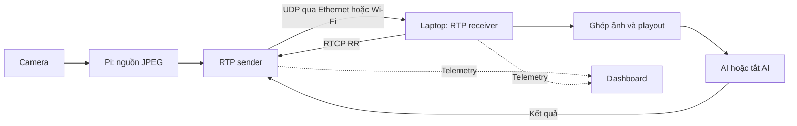
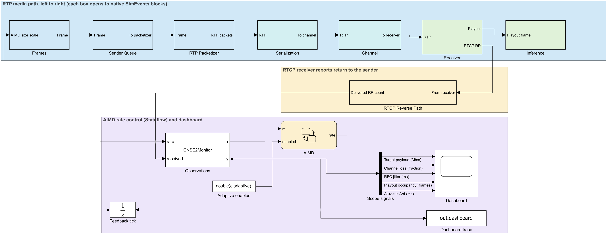

# Session 1 — A. Sản phẩm CN và đường đi của dữ liệu

Sau phần này, bạn giải thích được toàn bộ sản phẩm từ lúc camera tạo ảnh đến khi laptop trả kết quả. Đây là bản dựng lại Session 1 từ bản review ngày 24/11, mã nguồn và các nội dung đã học; không phải bản chép nguyên văn cuộc trò chuyện cũ.

**Quy ước bằng chứng:** SOURCE = cấu hình hoặc mã đã đọc; MEASURED = kết quả đo được báo cáo; SIMULATED = kết quả mô phỏng đã lưu; CALCULATED = tính từ dữ liệu đã nêu. Ví dụ minh họa không phải lần chạy mới. FLAGGED/UNKNOWN = chưa đủ điều kiện xác nhận. P50 là trung vị; P95 là phân vị 95%.

## A1. Bài toán và hai đường dữ liệu

Ta có Raspberry Pi 5, camera, laptop và một STM32 dùng cho bài OS. Bài CN tập trung vào truyền video qua mạng và xử lý ảnh ở máy nhận. Bài OS tập trung vào tính mới của kết quả và giám sát độc lập. Không được coi hai đường chức năng này là một thí nghiệm đồng thời đã được xác minh.

**RTP (Real-time Transport Protocol — giao thức truyền dữ liệu thời gian thực)** mang các mảnh JPEG. **RTCP (RTP Control Protocol — giao thức điều khiển)** chuyển báo cáo về chất lượng tiếp nhận. Dashboard chỉ quan sát telemetry (dữ liệu giám sát); nó không quyết định frame nào được đưa vào AI.

!!! note "Cách đọc hình"
    Đây là mô hình SIMULATED, không phải ảnh thiết bị. Đọc vùng RTP từ trái sang phải, sau đó theo đường RR quay về AIMD. Session 2 giải thích từng khối. Ở Session 1, chỉ cần phân biệt dữ liệu ảnh, phản hồi điều khiển và giám sát.

## A2. Camera, JPEG và source abstraction

Một frame là một ảnh tại một thời điểm. JPEG nén ảnh bằng biến đổi, lượng tử hóa và mã hóa. Tham số quality điều khiển mức nén của encoder. Quality 75 không có nghĩa giữ đúng 75% thông tin, 75% pixel hay 75% độ chính xác AI. Quan hệ giữa chất lượng và kích thước phụ thuộc nội dung ảnh.

SOURCE: baseline T2 dùng 640 × 480, quality 75, 15 FPS. Chu kỳ danh định (CALCULATED):

\[
T_f=1/15=66.67\,\mathrm{ms}.
\]

[`cn/rtp/rtp/sources.py`](https://github.com/KaiserRichard/edge-ai-video-runtime/blob/main/cn/rtp/rtp/sources.py) cung cấp bốn kiểu nguồn cùng giao diện `read()`:

| Nguồn | Nội dung |
|---|---|
| `synthetic` | Pillow vẽ dải màu, đường chuyển động và số frame, sau đó nén JPEG. Không phải ảnh do AI tạo. |
| `jpegdir:` | Đọc các tệp JPEG đã có. |
| `mjpeg-pipe` | Đọc luồng ảnh JPEG từ pipe. |
| `shm:` | Đọc camera Pi qua vùng shared memory và thư viện camera OS. |

Đối tượng `CapturedFrame` chứa frame ID, JPEG bytes, thời điểm capture theo monotonic clock và quality. Đây là **source abstraction (trừu tượng hóa nguồn)**: sender không cần biết nguồn ảnh được tạo như thế nào. Nguồn giả lập chạy được pipeline thật nhưng không chứng minh timing của camera thật, phân bố kích thước JPEG thật hoặc độ chính xác AI.

!!! tip "Nói đơn giản"
    Giống một bưu cục nhận phong bì có cùng định dạng. Phong bì có thể đến từ nhiều nơi; cách phân loại và vận chuyển không đổi. Nội dung và kích thước phong bì vẫn có thể khác nhau.

## A3. Từ Pi đến laptop

[`cn/rtp/rtp/sender.py`](https://github.com/KaiserRichard/edge-ai-video-runtime/blob/main/cn/rtp/rtp/sender.py) lấy frame, tính RTP timestamp, gọi `fragment_jpeg`, gửi từng packet qua UDP. [`receiver.py`](https://github.com/KaiserRichard/edge-ai-video-runtime/blob/main/cn/rtp/rtp/receiver.py) đọc socket, kiểm tra packet và nguồn gửi, cập nhật thống kê, đưa packet cho [`playout.py`](https://github.com/KaiserRichard/edge-ai-video-runtime/blob/main/cn/rtp/rtp/playout.py). Khi ghép đủ và đến hạn phát, receiver chuyển ảnh cho callback. [`edge_ai.py`](https://github.com/KaiserRichard/edge-ai-video-runtime/blob/main/cn/rtp/rtp/edge_ai.py) xử lý ảnh nếu bật AI.

UDP không đảm bảo đến đủ, đúng thứ tự hoặc đúng thời hạn. Với video trực tiếp, gửi lại một ảnh cũ đôi khi không có ích bằng gửi ảnh mới. RTP thêm thông tin để máy nhận nhận biết các packet, không biến UDP thành kênh tin cậy.

## A4. AI và các chế độ chạy

- `off`: không suy luận, tập trung vào đường RTP/RTCP và playout.
- `synthetic`: tạo workload mô phỏng thời gian phục vụ. Không chạy mạng neural thật.
- `onnx`: chạy MobileNetV2 qua ONNX Runtime (cần model và dependencies).

Synthetic source và synthetic inference là hai tùy chọn độc lập. Nguồn giả lập vẫn có thể đưa ảnh qua RTP thật; workload giả lập vẫn có thể dùng đường mạng thật.

## A5. Evidence ban đầu — CN-T2

MEASURED, [`hw_tables.md`](https://github.com/KaiserRichard/edge-ai-video-runtime/blob/main/cn/rtp/report/hw_tables.md), 5 run Ethernet baseline: 6.080 packet/frame, 0% mất packet, 100% frame đúng hạn, jitter 0.14 ms; capture-to-AI P50/P95 66.62/72.20 ms, 15.01 kết quả/s. Đây là baseline lịch sử; không bảo đảm mọi lần chạy hoặc mọi cấu hình giống như vậy.

Hình T5 giúp nhận ra bitrate không tỷ lệ tuyến tính với quality. Đọc các cấu hình quality và giá trị bitrate tương ứng; không suy ra phần trăm chất lượng hình ảnh từ bitrate. Chi tiết tại Session 2 C5.

## A. Trắc nghiệm cuối phần

Synthetic source có nghĩa gì?

- [ ] AI tạo ảnh để huấn luyện
- [x] Chương trình sinh JPEG kiểm thử theo cùng giao diện nguồn
- [ ] Mô phỏng toàn bộ giao thức RTP
- [ ] Bỏ qua encoder JPEG

Pillow vẽ ảnh kiểm thử và nén JPEG. RTP vẫn truyền các byte thật.

Quality 75 có ý nghĩa nào?

- [ ] Giữ đúng 75% pixel
- [ ] Độ chính xác AI là 75%
- [x] Tham số chất lượng của encoder
- [ ] Bitrate cố định 75%

Quality là tham số nén; kích thước còn phụ thuộc nội dung ảnh.

Loopback synthetic chứng minh điều gì?

- [ ] Camera Pi đã hoạt động
- [ ] Ethernet thật đạt baseline T2
- [x] Pipeline socket và RTP/RTCP cục bộ có thể hoạt động nếu kiểm thử đạt
- [ ] ONNX nhanh hơn

Không có camera hoặc mạng vật lý trong localhost. Phải tách phạm vi xác minh.

