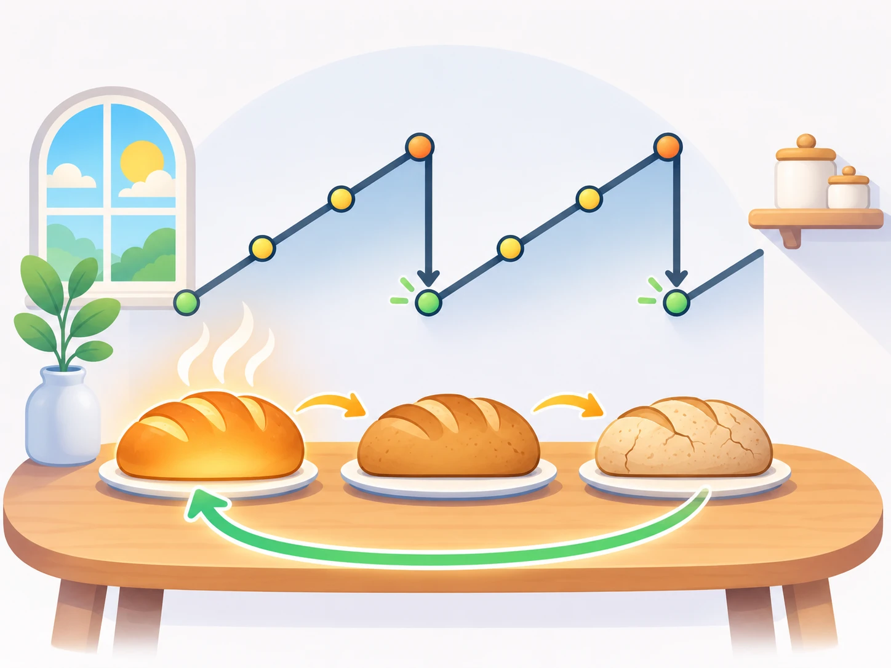
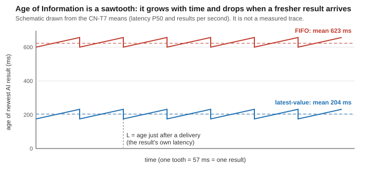

# Session 1 — B. Các cơ chế mạng: từ camera đến kết quả AI

Bài giảng 1A đã cho bạn thấy toàn cảnh đường ống truyền ảnh thời gian thực. Bài này đi sâu vào **từng cơ chế mạng** bên trong: vì sao dùng UDP, header RTP mang gì, receiver ghép ảnh ra sao, và hàng đợi AI quyết định độ tươi thông tin như thế nào.


---

## B1. UDP thay vì TCP — vì sao chấp nhận mất gói?


Video thời gian thực cần **nhịp đều**, không cần **truyền lại**. TCP đảm bảo mọi byte đến đích nhưng khi mất một phân đoạn, nó giữ lại toàn bộ dữ liệu phía sau chờ truyền lại — hiện tượng **Head-of-Line Blocking**.

Hệ thống của nhóm dùng **UDP** (datagram độc lập, không xác nhận). Mất một packet thì packet kế tiếp vẫn đến ứng dụng ngay. Ở 15 FPS, mỗi frame cách nhau 66,67 ms — một frame cũ bị mất có thể bỏ qua để xử lý frame mới.

```python
rtp = socket.socket(socket.AF_INET, socket.SOCK_DGRAM)
```
*(SOURCE: `cn/rtp/rtp/sender.py`)*

Cổng chẵn 5004 cho dữ liệu RTP, cổng lẻ 5005 cho điều khiển RTCP — đúng chuẩn RFC 3550 §11.

<p class="key">TCP đánh đổi trễ để đảm bảo tin cậy; UDP chấp nhận mất gói để giữ nhịp thời gian thực.</p>

---

## B2. RTP Header — 12 byte định danh mỗi packet


RTP header cố định 12 byte mang 5 trường quan trọng:

- **Sequence number (16 bit):** Khởi tạo ngẫu nhiên, tăng 1 mỗi packet. Phát hiện mất gói và đảo thứ tự.
- **Timestamp (32 bit, clock 90 kHz):** Mốc thời gian lấy mẫu media. Mọi packet cùng frame **chia sẻ chung** timestamp.
- **SSRC (32 bit):** Mã ngẫu nhiên định danh nguồn phát. Receiver khóa luồng theo cặp (IP, SSRC).
- **Marker (1 bit):** Bằng 1 **chỉ ở packet cuối cùng** của frame; các packet khác M = 0.
- **Payload Type = 96:** Dải động (96–127) theo RFC 3551. Receiver lọc bỏ mọi PT ≠ 96 (SOURCE: `cn/rtp/rtp/sender.py`).

Ví dụ nhỏ: ở 15 FPS, bước nhảy timestamp giữa hai frame liên tiếp là \(\Delta TS = 90000 / 15 = 6000\) tick (CALCULATED).

<p class="key">Sequence number nhận diện từng packet; Timestamp 90 kHz nhận diện thời điểm chụp frame — hai trường cùng frame chung timestamp nhưng khác sequence.</p>

---

## B3. Frame và Packet — một ảnh JPEG cắt thành nhiều mảnh


Một ảnh JPEG thường vài ngàn byte — không vừa trong một packet. Hàm `fragment_jpeg` cắt ảnh thành nhiều mảnh, mỗi mảnh tối đa 1200 byte payload RTP (SOURCE: `cn/rtp/rtp/payload.py`).

Mỗi payload 1200 byte còn phải chứa 8 byte header mảnh (mảnh đầu thêm 4 byte `total_length`). Vậy mỗi packet chở tối đa 1192 byte ảnh (mảnh đầu 1188 byte).

Ví dụ: frame 0 trong bài đo T3/loss5/run1 dài 6100 byte → **6 packet** (CALCULATED):

- 5 packet đầu: 1212 byte mỗi packet (12 RTP + 1200 payload).
- Packet cuối: 164 byte (12 RTP + 8 fragment header + 144 byte JPEG dư), và bật cờ marker = 1.
- Mọi 6 packet chung **một timestamp** (1546568660), nhưng sequence tăng liên tục (31318 → 31323) (MEASURED, `dashboard/samples/cn-loss5`).


!!! example "Cách đọc hình"
    Panel trái: 5 packet 1212 B, packet thứ 6 là 164 B với marker = 1. Panel phải: histogram bước timestamp dồn đỉnh tại 6000 tick (15 FPS danh định). (MEASURED)

<div class="widget" data-widget="fragments" data-count="6" data-title="Thử tắt mở từng mảnh packet"></div>

Thử tắt packet P1 (mang `total_length`): dù có đủ 5 packet còn lại kể cả marker, frame vẫn không hoàn chỉnh.

<p class="key">Một frame JPEG bị cắt thành N packet chung timestamp, liên tục sequence; chỉ packet cuối có marker = 1. Mất bất kỳ packet nào → mất cả frame.</p>

---

## B4. Receiver — ghép lại ảnh và kiểm tra hoàn chỉnh


`FrameReassembler` nhóm fragment theo khóa (SSRC, timestamp) và kiểm tra 3 điều kiện:

1. Đã nhận fragment đầu tiên → biết `total_length`.
2. Đã nhận fragment cuối (marker = 1) → biết biên kết thúc.
3. Các fragment phủ kín liên tục từ byte 0 → không có khoảng trống.

```python
for start, data in sorted(frame.fragments.items()):
    if start != pos:
        return None   # có khoảng trống → chưa hoàn chỉnh
    chunks.append(data)
    pos += len(data)
```
*(SOURCE: `cn/rtp/rtp/payload.py`)*

Nhận được marker **không đồng nghĩa** với frame hoàn chỉnh — nếu thiếu packet đầu, receiver không biết `total_length` và thiếu dữ liệu byte từ 0.

<p class="key">Frame hoàn chỉnh khi biết total_length, biết marker_end, và mọi byte liên tục không có khoảng trống.</p>

---

## B5. Mất packet khuếch đại thành mất frame

Với \(N\) packet mỗi frame và xác suất mất packet độc lập \(p\):

\[
\boxed{P_{\text{loss}} = 1 - (1 - p)^N}
\]

Ở cấu hình loss5 của CN-T3: \(p = 0{,}052\), \(\bar{N} = 5{,}106\) (MEASURED, `hw_tables.md`):

\[
P_{\text{loss}} = 1 - (1 - 0{,}052)^{5{,}106} \approx 23{,}9\% \quad (\text{CALCULATED})
\]

Đo thực tế: **24,0%** frame bị mất (MEASURED, `hw_tables.md`) — khớp với lý thuyết.

<div class="widget" data-widget="framesuccess" data-title="Xác suất tái cấu trúc frame thành công"></div>

Giữ \(p = 5\%\), tăng \(N\) từ 2 lên 12: tỷ lệ mất frame tăng vọt từ 9,75% lên 46%.

<p class="key">5,2% mất packet → 24% mất frame, do ảnh cần toàn bộ N packet. Đây là hệ quả toán học, không phải lỗi phần mềm.</p>

---

## B6. Jitter — gửi đều nhưng đến không đều


Sender gửi frame đều mỗi 66,67 ms. Qua mạng, mỗi packet trễ một chút khác nhau, nên khoảng cách lúc đến không còn đều.

Độ dao động đó là **jitter**. Jitter không phải độ trễ trung bình: một đường trễ cố định 200 ms vẫn có jitter bằng 0.

Receiver ước lượng jitter theo RFC 3550, bằng một bộ lọc làm mượt bậc một:

\[
\boxed{J_i = J_{i-1} + \frac{|D_i| - J_{i-1}}{16}}
\]

\(D_i\) là độ lệch giữa khoảng đến và khoảng timestamp của hai packet liên tiếp. Mỗi packet mới chỉ kéo \(J\) đi 1/16 quãng đường, nên một packet bất thường không làm jitter nhảy vọt.

Ví dụ: bắt đầu từ \(J=0\), một packet lệch 10 ms → \(J = 10/16 = 0{,}625\) ms (CALCULATED).

<div class="widget" data-widget="jitter" data-title="Bộ lọc jitter RFC 3550 phản ứng thế nào"></div>


!!! example "Cách đọc hình"
    Trục ngang là thời gian (s), trục dọc là jitter (ms). Ethernet sạch (T2) nằm quanh 0,14 ms; netem mất 5% (T3) quanh 0,22 ms (MEASURED, `hw_tables.md`). Hai panel có thang đo khác nhau.

Điểm mấu chốt: các packet cùng một frame chung timestamp nhưng đến cách nhau một chút, nên jitter đo được không bao giờ bằng đúng 0.

<p class="key">Jitter đo độ dao động của khoảng đến, không phải độ trễ; RFC 3550 làm mượt nó bằng hệ số 1/16.</p>

---

## B7. Playout — tái tạo nhịp camera tại receiver


Receiver dùng packet đầu tiên để **chốt mốc neo** (anchor) rồi tính hạn phát cho mọi frame sau:

\[
\boxed{d_i = t_0 + \frac{TS_i - TS_0}{90000} + B}
\]

Trong đó \(B\) là độ sâu bộ đệm playout (mặc định 100 ms trong `receiver.py`, 50 ms trong CN-T2).

```python
deadline = t0 + (extended - ts0) * 1_000_000_000 // CLOCK_RATE + self.delay_ns
```
*(SOURCE: `cn/rtp/rtp/playout.py`)*

Ví dụ: đến đầu tiên lúc 20 ms, 15 FPS, buffer 50 ms → \(d_0 = 70\) ms, \(d_1 = 136{,}67\) ms. Khoảng cách đều **66,67 ms** bất kể jitter (CALCULATED).

Mỗi frame được phân loại:

```python
status = "lost" if not complete else ("ok" if frame.completed <= frame.deadline else "late")
```
*(SOURCE: `cn/rtp/rtp/playout.py`)*

<div class="widget" data-widget="deadline" data-title="Thử thay đổi độ sâu bộ đệm"></div>

Điểm mấu chốt: hạn phát dựa trên timestamp gốc của camera, **không phải** thời điểm đến + B. Nhờ vậy jitter bị hấp thụ, nhịp phát frame đều đặn.

<p class="key">Playout deadline tái tạo nhịp camera đều đặn tại receiver bằng timestamp 90 kHz. Bộ đệm hấp thụ jitter nhưng không cứu được packet đã mất.</p>

---

## B8. RTCP Receiver Report — phản hồi về sender


Sender phát UDP thuần không tự biết chất lượng mạng. Giao thức **RTCP** (cổng 5005) cung cấp kênh phản hồi: mỗi **1 giây**, receiver gửi một gói **Receiver Report** (PT = 201) chứa:

- `fraction_lost`: tỷ lệ mất packet trong chu kỳ vừa qua.
- `jitter`: ước lượng jitter RFC 3550 hiện tại.
- `ext_high_seq`: sequence number cao nhất đã nhận.

```python
if expected_interval > 0 and lost_interval > 0:
    fraction = min(255, (lost_interval << 8) // expected_interval)
```
*(SOURCE: `cn/rtp/rtp/rxstats.py`)*

Giá trị `fraction_lost` bị lượng tử hóa: ở 15 FPS × 5,1 gói/frame ≈ 76 packet/s, mất 1 packet ra giá trị \(\lfloor 256/76 \rfloor = 3 \to 1{,}17\%\) (CALCULATED).

Bản thân gói RTCP cũng truyền qua UDP — có thể bị mất. Khi không nhận được RR, sender **không được** suy diễn rằng mạng đang tốt.

<p class="key">RTCP RR cho sender biết tỷ lệ mất gói và jitter mỗi giây. Trên toàn phiên, ước lượng trùng khớp cấu hình (5,2% đo tại netem 5%) (MEASURED, `hw_tables.md`).</p>

---

## B9. Hàng đợi suy luận AI — Producer–Consumer và chính sách FIFO / Latest-value


Sau playout, frame hợp lệ vào hàng đợi AI. Đây là bài toán **Producer–Consumer (sản xuất – tiêu thụ)**:

- Producer: camera 30 FPS → \(\lambda = 30\) frame/s.
- Consumer: AI trả \(\mu \approx 17{,}6\) kết quả/s (MEASURED, CN-T7), tức khoảng 56,7 ms mỗi kết quả (CALCULATED).
- \(\lambda > \mu\) → hàng đợi **chắc chắn** bị quá tải; phải loại bỏ frame.

Hai chính sách xử lý:

```python
if self.policy == "latest" and self._queue:
    skipped = self._queue.pop()       # bỏ frame chờ cũ
elif len(self._queue) >= self.queue_size:
    self.skipped += 1                 # FIFO: bỏ frame mới đến
    return False
self._queue.append(job)
```
*(SOURCE: `cn/rtp/rtp/edge_ai.py`)*

- **FIFO (8 slot):** Giữ frame cũ, bỏ frame mới khi đầy. AI luôn xử lý frame cũ nhất.
- **Latest-value (1 slot):** Bỏ frame chờ cũ để nhường chỗ frame mới. AI luôn nhận frame tươi nhất.

<div class="widget" data-widget="queue" data-title="Khảo sát hàng đợi khi λ > μ"></div>

Cả hai chính sách cùng thông lượng \(\mu\). Latest-value **không làm AI nhanh hơn** — nó chỉ chọn dữ liệu tươi hơn.

<p class="key">Khi λ > μ, việc loại bỏ frame là bắt buộc. FIFO giữ frame cũ; Latest-value ưu tiên frame mới nhất.</p>

---

## B10. Age of Information — đo độ tươi thông tin trong đường ống CN



**Age of Information (AoI — độ tuổi thông tin)** đo "thông tin mà hệ thống đang dùng đã cũ bao lâu":

\[
A(t) = t - u(t)
\]

Trong đó \(u(t)\) là mốc chụp của kết quả AI mới nhất tại thời điểm \(t\).

- Giữa hai kết quả: \(A(t)\) **tăng tuyến tính** (slope = 1).
- Khi kết quả mới đến: \(A(t)\) **nhảy xuống** bằng latency của frame đó.
- Quỹ đạo tạo thành đường **răng cưa (sawtooth)**.



AoI trung bình là diện tích dưới đường răng cưa chia cho thời gian:

\[
\overline{A} = \frac{1}{T_1 - T_0} \int_{T_0}^{T_1} A(t)\,dt
\]

```python
age = cursor - latest
width = received - cursor
area += age * width + width * width / 2
```
*(SOURCE: `cn/analysis/aoi.py`)*

**AoI khác Latency:** latency đo thời gian hoàn thành của **một** frame; AoI đo liên tục thông tin tại receiver **cũ bao lâu rồi**. Hệ thống có thể latency thấp nhưng AoI cao nếu cập nhật không đều.

<div class="widget" data-widget="aoi" data-title="Khảo sát đường răng cưa AoI"></div>

<p class="key">AoI là thước đo độ tươi liên tục, không phải trễ của một frame riêng lẻ.</p>

---

## B11. Kết quả CN-T7 — Latest-value giảm 67% AoI

Thí nghiệm CN-T7 chạy trên phần cứng thực với tải suy luận kiểm soát (`--ai synthetic`, 30 FPS), so sánh 5 lần chạy.


<div class="metric-row">
<div class="metric"><div class="m-label">Mean AoI (MEASURED, T7)</div><div class="m-value">623 → 204 ms</div><div class="m-sub">giảm 67,3% (CALCULATED)</div></div>
<div class="metric"><div class="m-label">Queue wait P50 (MEASURED, T7)</div><div class="m-value">440,20 → 16,48 ms</div><div class="m-sub">đo trên đồng hồ laptop</div></div>
<div class="metric"><div class="m-label">AI results/s (MEASURED, T7)</div><div class="m-value">17,63 → 17,52</div><div class="m-sub">thông lượng tương đương</div></div>
</div>

Phân tích:

- **Thông lượng bảo toàn:** 17,63 so với 17,52 kết quả/s — chênh dưới 0,6%. Năng lực AI bão hòa, **không phụ thuộc** chính sách hàng đợi (MEASURED, `hw_tables.md`).
- **Cơ chế giảm AoI:** FIFO tích tụ 8 frame chờ → mỗi frame đợi \(8 \times 56{,}7 \approx 453\) ms (CALCULATED), khớp sát P50 = 440 ms. Latest-value loại frame chờ cũ → P50 chỉ còn 16,48 ms (MEASURED, `hw_tables.md`).
- **Số frame bị loại tương đương:** FIFO bỏ 802 frame, Latest bỏ 809 frame (MEASURED, `hw_tables.md`).

??? note "Đào sâu — Giới hạn CN-T7"
    - T7 dùng tải suy luận giả lập (`synthetic`), chưa phản ánh biến động thời gian thực thi của MobileNetV2 thật.
    - Latest-value tối ưu cho nhận thức điều khiển tức thời; không phù hợp cho bài toán cần xử lý chuỗi liên tục (đếm vật thể, trích xuất quỹ đạo).

<p class="key">CN-T7: chuyển từ FIFO sang Latest-value giảm 67,3% AoI (623 → 204 ms) nhờ triệt tiêu thời gian lưu hàng đợi, trong khi số kết quả mỗi giây gần như giữ nguyên (17,63 → 17,52).</p>

---

## Trắc nghiệm

<div class="quiz" markdown>
<p class="quiz-q">Các packet sinh từ cùng một frame video chia sẻ chung trường nào trong RTP header?</p>

- [ ] Sequence number
- [x] RTP Timestamp
- [ ] Cờ Marker luôn bằng 1
- [ ] Payload offset

<div class="quiz-why" markdown>
Mọi packet cùng frame xuất phát từ cùng thời điểm chụp nên mang cùng Timestamp. Sequence number tăng liên tục, payload offset thay đổi theo vị trí byte, và cờ Marker chỉ bằng 1 ở packet cuối.
</div>
</div>

<div class="quiz" markdown>
<p class="quiz-q">Tăng bộ đệm playout lên rất lớn có khôi phục được packet bị mất không?</p>

- [ ] Có, vì bộ đệm lớn giúp tăng độ nhạy thu
- [x] Không, bộ đệm chỉ hấp thụ jitter; packet đã mất thì mất
- [ ] Có, vì RTCP sẽ gửi lại dữ liệu thiếu
- [ ] Có, vì UDP tự sửa lỗi khi buffer đủ lớn

<div class="quiz-why" markdown>
Bộ đệm playout kéo dài thời gian chờ để hấp thụ dao động trễ cho packet đang trên đường. UDP không có cơ chế truyền lại, và RTCP chỉ mang thống kê, không mang dữ liệu ảnh.
</div>
</div>

<div class="quiz" markdown>
<p class="quiz-q">Hệ thống nhận frame 15 FPS, AI xử lý Ts = 100 ms. Đánh giá trạng thái?</p>

- [ ] Hàng đợi FIFO bảo đảm không bao giờ đầy
- [x] μ = 10 frame/s < λ = 15 → quá tải, phải loại bỏ frame
- [ ] Latest-value tăng tốc AI lên 15 frame/s
- [ ] Consumer xử lý 100 frame/s

<div class="quiz-why" markdown>
\(\mu = 1/0{,}1 = 10\) frame/s. Do \(\lambda = 15 > \mu = 10\), mỗi giây dư 5 frame. Latest-value chỉ chọn frame nào xử lý, không tăng tốc phần cứng.
</div>
</div>

<div class="quiz" markdown>
<p class="quiz-q">Tại CN-T7, thông lượng AI gần không đổi (17,63 vs 17,52) nhưng AoI giảm từ 623 xuống 204 ms. Giải thích đúng nhất?</p>


- [ ] Latest-value tăng tốc suy luận AI
- [ ] Latest-value loại bỏ ít frame hơn FIFO
- [x] Latest-value loại frame chờ cũ để chọn frame mới nhất, triệt tiêu thời gian lưu hàng đợi
- [ ] FIFO gặp lỗi phần mềm xử lý sai thứ tự

<div class="quiz-why" markdown>
Thời gian phục vụ AI giống nhau ở cả hai cấu hình. Số frame bị loại tương đương (802 vs 809). Latest-value thay thế frame chờ cũ bằng frame mới, giảm thời gian chờ hàng đợi từ 440 xuống 16,5 ms, giúp mỗi kết quả có độ tươi cao hơn gấp 3 lần.
</div>
</div>

<div class="quiz" markdown>
<p class="quiz-q">Receiver nhận được packet marker (M = 1) và 5 packet khác, nhưng mất packet đầu (frag_offset = 0). Frame có hoàn chỉnh không?</p>

- [ ] Thành công, vì marker xác nhận frame kết thúc
- [x] Thất bại, vì thiếu packet đầu → không có total_length và thiếu byte từ 0
- [ ] Thành công, nếu tổng packet nhận ≥ N − 1
- [ ] Thất bại, vì marker bắt buộc nằm ở packet đầu

<div class="quiz-why" markdown>
Frame chỉ hoàn chỉnh khi biết `total_length` (chỉ mang trong packet đầu), biết `marker_end`, và fragment phủ kín liên tục từ byte 0. Cờ marker chỉ đánh dấu biên kết thúc.
</div>
</div>

---

## Câu thầy có thể hỏi khi bảo vệ

??? question "Mạng chỉ mất 5,2% packet mà hệ thống mất tới 24% frame — có phải thuật toán ghép frame bị lỗi?"
    "Thưa thầy, đây là hệ quả toán học của cơ chế phân mảnh. Một ảnh JPEG khoảng 6100 byte cần 5–6 packet. Do JPEG cần toàn vẹn dữ liệu, chỉ mất 1 packet là mất cả frame. Theo mô hình mất độc lập: \((1 - 0{,}052)^{5{,}106} \approx 76{,}1\%\) thành công, tương ứng 23,9% mất frame. Đo thực tế đạt 24,0%, khớp sát."

??? question "Tại sao receiver không đặt deadline = thời điểm đến + B mà phải dùng timestamp 90 kHz?"
    "Thưa thầy, nếu tính deadline = thời điểm đến + B, biến thiên jitter mạng sẽ chuyển nguyên vào ứng dụng, frame phát ra giật cục. Nhóm chốt mốc neo ở packet đầu tiên, rồi tính \(d_i = t_0 + (TS_i - TS_0)/90000 + B\). Do timestamp media sinh đều theo chu kỳ camera, khoảng cách deadline luôn đúng 66,67 ms (15 FPS). Cách này hấp thụ mọi jitter nhỏ hơn B và tái tạo nhịp mượt mà."

??? question "Latest-value chỉ là vứt frame — sao lại gọi là cải tiến?"
    "Thưa thầy, khi camera 30 FPS vượt năng lực AI (~17,6 kết quả/s), cả hai chính sách đều buộc phải hủy frame — FIFO bỏ 802, Latest bỏ 809, tương đương nhau. Điểm khác biệt là FIFO giữ frame cũ nên mỗi frame đợi ~440 ms trong hàng; Latest-value thay frame chờ cũ bằng frame mới, hạ thời gian đợi xuống 16,5 ms. Kết quả: AoI giảm từ 623 xuống 204 ms (67,3%) mà không mất thông lượng. Với ứng dụng cần phản ứng theo cảnh hiện tại, kết quả mới quan trọng hơn việc xử lý lần lượt mọi frame cũ."
