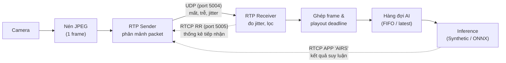

# Session 1 — B. RTP, receiver và producer–consumer

Session 1A đã khảo sát toàn bộ đường ống truyền ảnh từ camera trên Raspberry Pi 5 sang laptop để chạy mô hình AI. Bài giảng này phân tích các cơ chế mạng tầng giao vận và ứng dụng trong đường ống: đóng gói RTP, xử lý mất gói, lọc jitter, tái tạo frame, định thời playout, phản hồi RTCP và chính sách hàng đợi suy luận đo bằng Age of Information (AoI).



---

## B1. Giao thức truyền tải: Vì sao UDP thay vì TCP cho video thời gian thực?

### B1.1. Hiện tượng Head-of-Line Blocking
Trong truyền dẫn video phục vụ điều khiển và nhận thức thời gian thực, độ trễ và độ tươi dữ liệu quan trọng hơn độ tin cậy tuyệt đối. Giao thức TCP đảm bảo phân phát dữ liệu tuần tự và tin cậy thông qua cơ chế bắt tay, đánh số byte, gửi ACK và truyền lại (retransmission). Khi một phân đoạn TCP bị mất trên đường truyền:
1. Bên nhận giữ lại toàn bộ các phân đoạn đến sau trong bộ đệm socket cho đến khi phân đoạn mất được truyền lại thành công.
2. Ứng dụng AI ở tầng trên bị chặn hoàn toàn (**Head-of-Line Blocking - HoL**).
3. Khi phân đoạn mất được bù, ứng dụng nhận cùng lúc một cụm frame cũ đã tích lũy trong hàng đợi, làm mất tính kịp thời của thông tin điều khiển.

UDP hoạt động theo cơ chế connectionless, truyền các datagram độc lập không có xác nhận hay gửi lại. Mất mát một datagram không cản trở việc phân phát các datagram tiếp theo tới ứng dụng. Đối với bài toán thị giác máy tính, một frame bị mất hoàn toàn có thể bỏ qua để xử lý frame kế tiếp đúng chu kỳ camera (66,67 ms ở 15 FPS).

### B1.2. Hiện thực socket trong dự án
Hệ thống sử dụng RTP chạy trên nền UDP. Trong `cn/rtp/rtp/sender.py`, hàm `open_udp_pair` khởi tạo cặp socket UDP (`socket.SOCK_DGRAM`) theo chuẩn RFC 3550 §11:
- Cổng chẵn cho luồng dữ liệu media RTP (mặc định 5004).
- Cổng lẻ liền kề cho luồng điều khiển RTCP (mặc định 5005).

```python
def open_udp_pair(host, port):
    """RFC 3550 §11: RTCP port = even RTP port + 1; port 0 allocates a pair."""
    if port and (port < 1024 or port > 65534 or port % 2):
        raise ValueError("RTP port must be even and in 1024..65534, or 0")
    for _ in range(128):
        rtp = socket.socket(socket.AF_INET, socket.SOCK_DGRAM)
        rtcp = socket.socket(socket.AF_INET, socket.SOCK_DGRAM)
```
*(SOURCE: `cn/rtp/rtp/sender.py`)*

Sender không lưu trữ bộ đệm gửi lại; mỗi packet chỉ được phát qua hàm `sendto` một lần.

<p class="key">TCP loại bỏ mất mát bằng cách đánh đổi độ trễ thông qua retransmission và HoL blocking; UDP chấp nhận mất packet để duy trì nhịp thời gian thực của chuỗi frame.</p>

---

## B2. Đóng gói lồng nhau (Encapsulation) và kích thước packet

### B2.1. Cấu trúc các tầng header
Dữ liệu ảnh JPEG được phân mảnh và bọc qua nhiều tầng giao thức trước khi đẩy xuống tầng liên kết dữ liệu.

<svg viewBox="0 0 780 170" width="100%" style="max-width:780px;display:block;margin:1rem auto;" role="img" aria-label="Các lớp header của một gói RTP trong dự án">
  <rect x="10" y="30" width="90" height="50" rx="4" fill="rgba(99,102,241,0.18)" stroke="currentColor"/>
  <text x="55" y="52" text-anchor="middle" fill="currentColor" font-size="13" font-weight="700">IPv4</text>
  <text x="55" y="70" text-anchor="middle" fill="currentColor" font-size="12">20 B</text>
  <rect x="100" y="30" width="70" height="50" rx="4" fill="rgba(20,184,166,0.18)" stroke="currentColor"/>
  <text x="135" y="52" text-anchor="middle" fill="currentColor" font-size="13" font-weight="700">UDP</text>
  <text x="135" y="70" text-anchor="middle" fill="currentColor" font-size="12">8 B</text>
  <rect x="170" y="30" width="80" height="50" rx="4" fill="rgba(245,158,11,0.22)" stroke="currentColor"/>
  <text x="210" y="52" text-anchor="middle" fill="currentColor" font-size="13" font-weight="700">RTP</text>
  <text x="210" y="70" text-anchor="middle" fill="currentColor" font-size="12">12 B</text>
  <rect x="250" y="30" width="100" height="50" rx="4" fill="rgba(236,72,153,0.18)" stroke="currentColor"/>
  <text x="300" y="50" text-anchor="middle" fill="currentColor" font-size="12" font-weight="700">Header mảnh</text>
  <text x="300" y="68" text-anchor="middle" fill="currentColor" font-size="12">8 B (+4 B mảnh đầu)</text>
  <rect x="350" y="30" width="420" height="50" rx="4" fill="rgba(148,163,184,0.15)" stroke="currentColor"/>
  <text x="560" y="52" text-anchor="middle" fill="currentColor" font-size="13" font-weight="700">Dữ liệu JPEG payload</text>
  <text x="560" y="70" text-anchor="middle" fill="currentColor" font-size="12">1188 B (mảnh đầu) / 1192 B (mảnh sau)</text>
  <line x1="250" y1="100" x2="770" y2="100" stroke="currentColor"/>
  <text x="510" y="118" text-anchor="middle" fill="currentColor" font-size="12">RTP payload ≤ 1200 B (tham số --mtu-payload)</text>
  <line x1="170" y1="138" x2="770" y2="138" stroke="currentColor"/>
  <text x="470" y="156" text-anchor="middle" fill="currentColor" font-size="12">Packet RTP ≤ 1212 B (cột "bytes" trong receiver.csv)</text>
  <text x="100" y="20" text-anchor="middle" fill="currentColor" font-size="11">IP datagram ≤ 1240 B</text>
</svg>

Cấu trúc từng tầng header:
- **IPv4 Header (20 byte):** Định tuyến gói tin qua địa chỉ IP nguồn và đích.
- **UDP Header (8 byte):** Phân phát dữ liệu tới tiến trình ứng dụng qua cổng dịch vụ (5004).
- **RTP Fixed Header (12 byte):** RFC 3550 §5.1, mang thông tin đồng bộ thời gian và thứ tự packet.
- **Project Payload Header (8 byte hoặc 12 byte):** Định dạng riêng của nhóm (không dùng RFC 2435). Cấu trúc gồm: `frame_id` (uint32, 4 B), `frag_offset` (uint24, 3 B), `flags` (uint8, 1 B, bit 0 đánh dấu `FLAG_FIRST`). Riêng mảnh đầu tiên (`FLAG_FIRST = 1`) có thêm tiền tố `total_length` (uint32, 4 B) chỉ tổng kích thước ảnh JPEG (SOURCE: `cn/rtp/rtp/payload.py`).

### B2.2. Tính toán kích thước payload và quy ước mô hình
Tham số dòng lệnh `--mtu-payload` (mặc định 1200 B, SOURCE: `sender.py`) quy định trần kích thước của **toàn bộ RTP payload** (bao gồm header mảnh và dữ liệu JPEG):
- Mảnh đầu tiên: \(1200 - 8 - 4 = 1188\text{ byte JPEG}\).
- Mảnh tiếp theo: \(1200 - 8 = 1192\text{ byte JPEG}\).
- Kích thước packet RTP đầy: \(12\text{ (RTP)} + 1200\text{ (payload)} = 1212\text{ byte}\).
- Kích thước IP datagram: \(20\text{ (IPv4)} + 8\text{ (UDP)} + 1212\text{ (RTP)} = 1240\text{ byte}\) (CALCULATED).

Giá trị 1240 B nằm an toàn dưới ngưỡng MTU chuẩn của Ethernet (1500 B), tránh hiện tượng IP fragmentation ở tầng mạng.

!!! note "Phân biệt hai quy ước payload"
    - **Triển khai phần mềm Python:** 1200 B là giới hạn trần của toàn bộ RTP payload (header mảnh + JPEG), dẫn đến datagram IP là 1240 B.
    - **Mô hình SimEvents:** 1200 B quy ước riêng cho dữ liệu ảnh, cộng 48 B overhead cố định (20 IPv4 + 8 UDP + 12 RTP + 8 fragment header), tạo ra packet 1248 B (SOURCE: `SIMEVENTS_V2_REPORT.md`, `dt = 8*(size + 48)/linkBitRate`).

<p class="key">Với --mtu-payload 1200, IP datagram đạt cực đại 1240 B (tránh IP fragmentation). Mảnh đầu mang 1188 B JPEG, các mảnh sau mang 1192 B JPEG.</p>

**Tự luyện.** Nếu đặt `--mtu-payload 500` (như cấu hình `payload500` của CN-T5), mảnh đầu chứa được bao nhiêu byte JPEG, mảnh sau bao nhiêu, và IP datagram đầy dài bao nhiêu?

??? success "Xem đáp án"
    Mảnh đầu: \(500-8-4=488\) byte JPEG. Mảnh sau: \(500-8=492\) byte JPEG. IP datagram đầy: \(20+8+12+500=540\) byte (CALCULATED). Payload nhỏ nghĩa là một ảnh cần nhiều gói hơn — CN-T5 đo được 12,307 gói mỗi frame ở payload 500 B so với 5,232 gói ở 1200 B (MEASURED, `hw_tables.md`).

---

## B3. Cấu trúc RTP Header và các trường định danh

RTP header cố định gồm 12 byte (96 bit), tổ chức theo các từ 32 bit:

| Byte | Bit 0–1 | Bit 2 | Bit 3 | Bit 4–7 | Bit 8 | Bit 9–15 | Bit 16–31 |
|:---:|:---:|:---:|:---:|:---:|:---:|:---:|:---:|
| 0–3 | **V** = 2 | P = 0 | X = 0 | CC = 0 | **M** (marker) | **PT** = 96 | **Sequence number** (16 bit) |
| 4–7 | \multicolumn{7}{c|}{**Timestamp** (32 bit, clock 90 kHz)} |
| 8–11 | \multicolumn{7}{c|}{**SSRC** (32 bit, định danh nguồn phát)} |

### B3.1. Phân tích chức năng các trường
- **Version (V = 2):** Phiên bản RTP theo RFC 3550. `parse_packet` ném ngoại lệ nếu \(V \neq 2\).
- **Marker (M, 1 bit):** Đặt bằng 1 ở packet cuối cùng của một frame ảnh (`last = offset + len(chunk) == len(jpeg)`). Ở các packet trung gian, \(M = 0\).
- **Payload Type (PT = 96, 7 bit):** Thuộc dải động 96–127 (RFC 3551). Bên nhận lọc bỏ mọi packet có \(PT \neq 96\) (SOURCE: `receiver.py`).
- **Sequence Number (16 bit):** Khởi tạo ngẫu nhiên (`secrets.randbits(16)`), tăng 1 sau mỗi packet phát đi. Trường này dùng để phát hiện mất gói và đảo thứ tự.
- **Timestamp (32 bit):** Mốc thời gian lấy mẫu media, biểu diễn theo tần số clock quy ước 90 kHz. Mọi packet sinh ra từ cùng một frame chia sẻ chung một timestamp.
- **SSRC (32 bit):** Mã số ngẫu nhiên (`secrets.randbits(32)`) định danh duy nhất phiên phát RTP. Bên nhận khóa luồng dựa trên cặp `(IP nguồn, SSRC)`.

### B3.2. Xử lý quay vòng (Wrap-around) và bước nhảy Timestamp
Trường Sequence number 16 bit quay vòng modulo \(2^{16} = 65536\). Lớp `SourceStats` trong `cn/rtp/rtp/rxstats.py` theo dõi chu kỳ quay vòng qua biến `cycles`:
\[
\text{Extended Highest Sequence} = \text{cycles} + \text{max\_seq}
\]
Nhờ đó, bộ đếm tổng số packet kỳ vọng \(N_{\text{expected}} = \text{ext\_high\_seq} - \text{base\_seq} + 1\) tăng đơn điệu tuyến tính mà không bị lỗi khi sequence vượt qua 65535.

Đồng hồ timestamp 90 kHz chuyển đổi mốc chụp ảnh monotonic (nanosecond) của Pi sang tick:
```python
    def timestamp(self, capture_ns):
        # RFC 3550 §5.1: media sampling instant, in 90 kHz units, random offset.
        return (capture_ns * CLOCK_RATE // 1_000_000_000 + self.timestamp_offset) & 0xffffffff
```
*(SOURCE: `cn/rtp/rtp/sender.py`)*

Ở tốc độ camera 15 FPS danh định, khoảng cách timestamp giữa hai frame liên tiếp là:
\[
\Delta TS = \frac{90000\text{ tick/s}}{15\text{ frame/s}} = 6000\text{ tick}
\]
Ở 30 FPS, khoảng cách là \(\Delta TS = 3000\text{ tick}\).

<p class="key">Sequence number (16 bit) nhận diện packet riêng lẻ và phục vụ tính toán mất gói; Timestamp 90 kHz (32 bit) nhận diện thời điểm thu nhận frame và phục vụ đồng bộ playout.</p>

**Tự luyện**

??? success "Bài tập: Sequence tiếp theo là bao nhiêu?"
    Ảnh thứ nhất dùng sequence 65530 đến 65535 (6 gói). Ảnh thứ hai cũng 6 gói. Sequence của gói đầu và gói cuối ảnh thứ hai là bao nhiêu? Timestamp ảnh thứ hai so với ảnh thứ nhất (15 FPS, danh định)?

    **Đáp án.** Sau khi gửi xong, `sender.py` đặt `self.seq = (packets[-1].seq + 1) & 0xffff` \(=(65535+1)\,\&\,\texttt{0xffff}=0\). Ảnh thứ hai dùng sequence 0, 1, 2, 3, 4, 5. Timestamp ảnh thứ hai lớn hơn ảnh thứ nhất khoảng 6000 tick (CALCULATED, danh định).

---

## B4. Phân mảnh Frame thành Packet: Dữ liệu thực nghiệm CN-T3

### B4.1. Cơ chế phân mảnh trong `payload.py`
Khi kích thước frame JPEG vượt quá dung lượng chứa của một packet, hàm `fragment_jpeg` thực hiện chia nhỏ mảng byte:

```python
    while offset < len(jpeg) or not packets:
        first = offset == 0
        room = mtu_payload - PAYLOAD_HEADER_SIZE - (4 if first else 0)
        chunk = jpeg[offset:offset + room]
        payload = encode_fragment(frame_id, offset, chunk, first=first,
                                  total_length=len(jpeg) if first else None)
        last = offset + len(chunk) == len(jpeg)
        packets.append(RTPPacket(payload, (seq_start + len(packets)) & 0xffff,
                                 rtp_ts & 0xffffffff, ssrc & 0xffffffff,
                                 payload_type, last))
        offset += len(chunk)
```
*(SOURCE: `cn/rtp/rtp/payload.py`)*

### B4.2. Khảo sát Frame 0 (Bài đo T3/loss5/run1)
Dữ liệu trích xuất từ Frame 0 trong lần chạy thực nghiệm `T3/loss5/run1` (capture timestamp 1546568660) cho thấy một frame JPEG kích thước 6100 byte được chia thành 6 packet liên tiếp:

<svg viewBox="0 0 780 150" width="100%" style="max-width:780px;display:block;margin:1rem auto;" role="img" aria-label="Một ảnh JPEG 6100 byte được cắt thành sáu mảnh">
  <rect x="10" y="15" width="760" height="36" rx="6" fill="rgba(245,158,11,0.15)" stroke="currentColor"/>
  <text x="390" y="38" text-anchor="middle" fill="currentColor" font-size="13" font-weight="700">1 frame JPEG = 6100 byte, timestamp 1546568660</text>
  <rect x="10" y="85" width="148" height="40" rx="4" fill="rgba(20,184,166,0.18)" stroke="currentColor"/>
  <text x="84" y="102" text-anchor="middle" fill="currentColor" font-size="11">seq 31318 · off 0</text>
  <text x="84" y="117" text-anchor="middle" fill="currentColor" font-size="11">1188 B · FIRST</text>
  <rect x="162" y="85" width="148" height="40" rx="4" fill="rgba(20,184,166,0.18)" stroke="currentColor"/>
  <text x="236" y="102" text-anchor="middle" fill="currentColor" font-size="11">seq 31319 · off 1188</text>
  <text x="236" y="117" text-anchor="middle" fill="currentColor" font-size="11">1192 B</text>
  <rect x="314" y="85" width="148" height="40" rx="4" fill="rgba(20,184,166,0.18)" stroke="currentColor"/>
  <text x="388" y="102" text-anchor="middle" fill="currentColor" font-size="11">seq 31320 · off 2380</text>
  <text x="388" y="117" text-anchor="middle" fill="currentColor" font-size="11">1192 B</text>
  <rect x="466" y="85" width="120" height="40" rx="4" fill="rgba(20,184,166,0.18)" stroke="currentColor"/>
  <text x="526" y="102" text-anchor="middle" fill="currentColor" font-size="11">seq 31321 · 3572</text>
  <text x="526" y="117" text-anchor="middle" fill="currentColor" font-size="11">1192 B</text>
  <rect x="590" y="85" width="120" height="40" rx="4" fill="rgba(20,184,166,0.18)" stroke="currentColor"/>
  <text x="650" y="102" text-anchor="middle" fill="currentColor" font-size="11">seq 31322 · 4764</text>
  <text x="650" y="117" text-anchor="middle" fill="currentColor" font-size="11">1192 B</text>
  <rect x="714" y="85" width="56" height="40" rx="4" fill="rgba(236,72,153,0.25)" stroke="currentColor"/>
  <text x="742" y="102" text-anchor="middle" fill="currentColor" font-size="10">31323</text>
  <text x="742" y="117" text-anchor="middle" fill="currentColor" font-size="10">144 B M=1</text>
  <line x1="390" y1="51" x2="390" y2="80" stroke="currentColor" stroke-dasharray="4 3"/>
  <text x="400" y="72" fill="currentColor" font-size="11">fragment_jpeg(mtu_payload=1200)</text>
  <text x="390" y="145" text-anchor="middle" fill="currentColor" font-size="11">Mọi mảnh: chung timestamp 1546568660; seq tăng liên tục; chỉ mảnh cuối có marker = 1</text>
</svg>

| Packet | Seq | Timestamp | `frame_id` | `frag_offset` | `flags` (FIRST) | `total_length` | Payload JPEG (B) | Packet RTP (B) | Marker |
|:---:|:---:|:---:|:---:|:---:|:---:|:---:|:---:|:---:|:---:|
| 1 | 31318 | 1546568660 | 0 | 0 | 1 | 6100 | 1188 | 1212 | 0 |
| 2 | 31319 | 1546568660 | 0 | 1188 | 0 | — | 1192 | 1212 | 0 |
| 3 | 31320 | 1546568660 | 0 | 2380 | 0 | — | 1192 | 1212 | 0 |
| 4 | 31321 | 1546568660 | 0 | 3572 | 0 | — | 1192 | 1212 | 0 |
| 5 | 31322 | 1546568660 | 0 | 4764 | 0 | — | 1192 | 1212 | 0 |
| 6 | 31323 | 1546568660 | 0 | 5956 | 0 | — | 144 | 164 | **1** |

Tổng dung lượng JPEG khôi phục:
\[
1188 + (4 \times 1192) + 144 = 1188 + 4768 + 144 = 6100\text{ byte}
\]
Packet thứ 6 có kích thước wire-level là: \(12\text{ (RTP)} + 8\text{ (fragment header)} + 144\text{ (JPEG)} = 164\text{ byte}\) (CALCULATED).


!!! example "Cách đọc hình: Phân mảnh RTP và chu kỳ timestamp"
    - **Panel trái (Frame 0 · T3/loss5/run1):** Trục hoành là số thứ tự packet (`sequence number` từ 31318 đến 31323), trục tung là kích thước packet RTP (byte). 5 packet đầu đạt kích thước cực đại 1212 B; packet thứ 6 chứa phần dư cuối cùng 164 B và bật cờ `marker = 1`.
    - **Panel phải (Ethernet sạch · T2/run1):** Histogram phân bố khoảng cách timestamp giữa 967 frame liên tiếp. Phổ dồn đỉnh chính xác tại giá trị danh định 6000 tick (\(15\text{ FPS} \times 6000 = 90000\text{ Hz}\)), với độ lệch chuẩn nhỏ do jitter phần cứng của bộ hẹn giờ camera. (MEASURED)

<p class="key">Một frame JPEG 6100 B được phân rã thành 5 packet 1212 B và 1 packet 164 B; các packet chung timestamp 90 kHz, liên tục sequence, tích lũy offset và chỉ packet cuối có marker = 1.</p>

**Tự luyện**

**Bạn tự làm.** Ảnh dài 2400 B. Cần mấy gói? Gói cuối dài bao nhiêu byte (gói RTP)?

??? success "Xem đáp án"
    Gói đầu chứa 1188 B, còn \(2400-1188=1212\) B. Gói hai chứa 1192 B, còn \(1212-1192=20\) B. Gói ba chứa 20 B. Vậy **3 gói**. Gói cuối dài \(12+8+20=40\) B (CALCULATED). Ảnh 2400 B nghe như "vừa đúng 2 × 1200" nhưng thực ra cần 3 gói.

---

## B5. Tái cấu trúc Frame tại Receiver và điều kiện hoàn chỉnh

### B5.1. Thuật toán kiểm tra tính liên tục byte
Lớp `FrameReassembler` trong `cn/rtp/rtp/payload.py` nhóm các fragment theo khóa `(SSRC, timestamp)`. Một frame chỉ được xác nhận hoàn chỉnh khi thỏa mãn đồng thời 3 điều kiện:
1. **Biết kích thước danh định:** Đã tiếp nhận fragment đầu tiên (`frag_offset = 0`), giải mã được trường `total_length`.
2. **Biết biên kết thúc:** Đã tiếp nhận fragment mang cờ `marker = 1`, thỏa mãn \(\text{frag\_offset} + \text{len(chunk)} == \text{total\_length}\).
3. **Tính liên tục không có khoảng trống:** Sắp xếp các fragment theo `frag_offset`, kiểm tra khoảng byte tiếp giáp: mỗi fragment \(k\) phải bắt đầu chính xác tại byte kết thúc của fragment \(k-1\).

```python
        total = frame.total_length
        if total is None or frame.marker_end is None or total != frame.marker_end:
            return None
        pos, chunks = 0, []
        for start, data in sorted(frame.fragments.items()):
            if start != pos:
                return None
            chunks.append(data)
            pos += len(data)
        if pos != total:
            return None
```
*(SOURCE: `cn/rtp/rtp/payload.py`)*

### B5.2. Các kịch bản dị thường trên đường truyền
1. **Sequence wrap-around:** Quá trình reassembly hoàn toàn độc lập với sequence number; các fragment được xếp vị trí thuần túy theo `frag_offset`. Hiện tượng quay vòng sequence không ảnh hưởng tới việc ghép ảnh.
2. **Packet đến đảo thứ tự:** Nếu fragment đến theo thứ tự `P1, P2, P4, P3, P5, P6`, tại thời điểm P4 đến xuất hiện khoảng trống từ byte 2380 đến 3572 nên `add` trả về `None`. Khi P3 đến, khoảng trống được lấp đầy; khi P6 đến, frame hoàn tất hợp lệ.
3. **Mất packet giữa:** Thiếu P3, vòng lặp phát hiện lỗi hổng offset tại byte 2380. Frame không bao giờ đạt trạng thái hoàn chỉnh và bị hủy khi timeout.
4. **Nhận được marker nhưng thiếu packet đầu:** Mất P1 khiến receiver không thể biết `total_length` và thiếu đoạn byte từ 0 đến 1188. Việc nhận được packet marker (\(M = 1\)) **không đồng nghĩa** với việc frame đã hoàn chỉnh.

<div class="widget" data-widget="fragments" data-count="6" data-title="Khảo sát tái cấu trúc frame khi thiếu mảnh"></div>

*Dự đoán trước khi thử:* Nếu tắt packet P1 (mang `total_length`), frame có thể hoàn thành không? Sau khi thử: Dù nhận đủ 5 packet còn lại kể cả packet marker, cờ hoàn chỉnh vẫn bằng 0 do thiếu mốc kích thước gốc và khoảng byte đầu tiên.

<p class="key">Tái cấu trúc frame dựa trên kiểm tra offset liên tục và biên total_length; nhận được cờ marker không bảo đảm hoàn chỉnh nếu còn khoảng trống byte phía trước.</p>

---

## B6. Phân tích độ nhạy mất Frame: P_ loss = 1 - (1-p)^N

### B6.1. Mô hình toán học mất mát độc lập
Xét một frame bao gồm \(N\) packet. Giả sử kênh truyền có xác suất mất packet độc lập là \(p\) (Bernoulli loss). Để tái cấu trúc thành công frame ảnh JPEG, điều kiện bắt buộc là **toàn bộ \(N\) packet phải đến đích an toàn**:
\[
P_{\text{success}} = (1 - p)^N
\]
Xác suất mất frame \(P_{\text{loss}}\) tương ứng là:
\[
P_{\text{loss}} = 1 - P_{\text{success}} = 1 - (1 - p)^N
\]
Do \(N > 1\), tỷ lệ mất frame luôn tăng phi tuyến và lớn hơn đáng kể so với tỷ lệ mất packet đơn lẻ.

### B6.2. Kiểm chứng với số liệu thực nghiệm CN-T3
Tại cấu hình `loss5` của chiến dịch CN-T3 (netem cấu hình 5% packet loss), các thông số đo được trên phần cứng là: tỷ lệ mất packet thực tế \(p = 0{,}052\) (5,2%), số packet trung bình trên mỗi frame \(\bar{N} = 5{,}106\) (MEASURED, `hw_tables.md`).

Các bước tính toán xác suất mất frame lý thuyết:
1. Xác suất truyền thành công 1 packet: \(1 - p = 1 - 0{,}052 = 0{,}948\).
2. Lũy thừa bậc \(\bar{N}\):
   \[
   \ln(0{,}948) \approx -0{,}05340 \implies \bar{N} \cdot \ln(0{,}948) = 5{,}106 \times (-0{,}05340) \approx -0{,}27266
   \]
   \[
   P_{\text{success}} = e^{-0{,}27266} \approx 0{,}76135\quad (76{,}14\%)
   \]
3. Xác suất mất frame:
   \[
   P_{\text{loss}} = 1 - 0{,}76135 = 0{,}23865 \approx 23{,}9\%\quad (\text{CALCULATED})
   \]

Giá trị thực nghiệm đo đạc thực tế: tỷ lệ mất frame đạt **24,0%** (MEASURED, `hw_tables.md`), sai lệch dưới 0,1% so với mô hình giải tích.

<div class="widget" data-widget="framesuccess" data-title="Xác suất tái cấu trúc frame theo p và N"></div>

*Quan sát tương tác:* Giữ nguyên \(p = 5\%\), khi tăng \(N\) từ 2 lên 12 (tương ứng kích thước frame lớn hoặc payload MTU nhỏ), tỷ lệ mất frame tăng vọt từ 9,75% lên 46,0%.

### B6.3. Giới hạn của mô hình: Mất mát theo cụm (Burst Loss)
Khi mạng xuất hiện mất mát tương quan theo thời gian (mô hình Markov 2 trạng thái Gilbert–Elliott), các packet mất có xu hướng tập trung thành chuỗi dài.
Trong bài đo `ge5_b4` (loss gemodel 1.316% 25% 100% 0%, độ dài cụm xấu trung bình \(1/r = 4\) packet), tỷ lệ mất packet đo được là 5,3%, nhưng tỷ lệ mất frame thực tế chỉ là **8,8%** (MEASURED, `hw_tables.md`).
Lý do: Hiện tượng mất tập trung làm nhiều packet bị rơi dồn vào cùng một frame đã hỏng, giúp các frame lân cận hoàn toàn không bị ảnh hưởng. Công thức \((1-p)^N\) không áp dụng được cho kênh truyền có nhớ.

<p class="key">Mất packet độc lập khuếch đại tỷ lệ mất frame theo lũy thừa 1−(1−p)^N (5,2% packet loss biến thành 24,0% frame loss). Mất theo cụm (burst) dồn hư hỏng vào ít frame hơn nên giảm tỷ lệ mất frame tổng thể.</p>

**Tự luyện**

**Bạn tự làm.** Ở `loss10`, mất gói đo được 10,0% và 5,107 gói/ảnh. Dự đoán tỉ lệ mất ảnh.

??? success "Xem đáp án"
    \(\ln 0{,}9=-0{,}10536\); \(\times5{,}107=-0{,}5381\); \(e^{-0{,}5381}=0{,}5839\); \(P_{\mathrm{loss}}=41{,}6\%\) (CALCULATED). Đo thật: 41,5% (MEASURED, `hw_tables.md`).

---

## B7. Đo lường Jitter theo chuẩn RFC 3550

### B7.1. Định nghĩa và công thức lọc thông thấp đệ quy
Jitter biểu thị độ dao động thống kê của khoảng thời gian truyền packet qua mạng, không phải là giá trị trễ tuyệt đối (One-Way Delay). Một kênh truyền có trễ cố định 200 ms nhưng hoàn toàn ổn định sẽ có jitter bằng 0.

Xét hai packet liên tiếp \(i-1\) và \(i\) có timestamp media gửi là \(S_{i-1}, S_i\) và thời điểm tiếp nhận là \(R_{i-1}, R_i\) (quy đổi về đơn vị tick 90 kHz). Độ sai lệch thời gian tương đối \(D_i\) được tính bằng:
\[
D_i = (R_i - R_{i-1}) - (S_i - S_{i-1}) = (R_i - S_i) - (R_{i-1} - S_{i-1})
\]
Theo RFC 3550 §6.4.1, giá trị ước lượng jitter \(J_i\) được cập nhật qua bộ lọc thông thấp đệ quy bậc một với hệ số suy giảm \(\alpha = 1/16\):
\[
J_i = J_{i-1} + \frac{|D_i| - J_{i-1}}{16} = \frac{15}{16}J_{i-1} + \frac{1}{16}|D_i|
\]

Hiện thực mã nguồn trong `cn/rtp/rtp/rxstats.py`:
```python
        arrival_ts = (arrival_ns * self.clock_rate) // 1_000_000_000
        transit = arrival_ts - rtp_ts
        if self.transit is not None:
            difference = abs(transit - self.transit)
            # RFC 3550 section 6.4.1 and Appendix A.8: J += (|D| - J) / 16.
            self.jitter += (difference - self.jitter) / 16.0
        self.transit = transit
```
*(SOURCE: `cn/rtp/rtp/rxstats.py`)*

### B7.2. Ví dụ tính toán từng bước
Giả sử trạng thái ban đầu \(J_0 = 0\). Packet 1 và 2 có độ lệch khoảng đến so với mốc media là \(|D_1| = 300\text{ tick}\) (\(3{,}33\text{ ms}\)):
\[
J_1 = 0 + \frac{300 - 0}{16} = 18{,}75\text{ tick} \implies \frac{18{,}75}{90} \approx 0{,}208\text{ ms}\quad (\text{CALCULATED})
\]
Packet kế tiếp có \(|D_2| = 600\text{ tick}\) (\(6{,}67\text{ ms}\)):
\[
J_2 = 18{,}75 + \frac{600 - 18{,}75}{16} = 18{,}75 + 36{,}33 = 55{,}08\text{ tick} \implies \frac{55{,}08}{90} \approx 0{,}612\text{ ms}\quad (\text{CALCULATED})
\]
Hệ số \(1/16\) ngăn chặn phản ứng thái quá của bộ ước lượng trước các xung trễ đột biến cục bộ.

<div class="widget" data-widget="jitter" data-title="Khảo sát đáp ứng bộ lọc jitter RFC 3550"></div>

### B7.3. Phân tích kết quả thực nghiệm


!!! example "Cách đọc hình: Biểu đồ Jitter thời gian thực"
    - **Panel trái (Ethernet sạch · T2/run1):** Jitter duy trì ổn định tại mức sàn 0,14 ms. Xung gai đột biến lên khoảng 4,6 ms quanh giây thứ 45 (nguyên nhân không được ghi trong dữ liệu), sau đó suy giảm hàm mũ về mức sàn theo đúng đặc tính bộ lọc \(1/16\).
    - **Panel phải (netem loss 5% · T3/run1):** Jitter dao động liên tục trong dải 0,10–0,33 ms dạng răng cưa, phản ánh biến động hàng đợi khi có mất gói. Giá trị trung bình cuối phiên đạt 0,22 ms (MEASURED, `hw_tables.md`).

!!! note "Độ tán xạ nội khung (Intra-frame spread)"
    Các packet thuộc cùng một frame chia sẻ chung timestamp media (\(S_i - S_{i-1} = 0\)). Khoảng thời gian tuần tự hóa và trễ truyền dẫn giữa các mảnh liên tiếp đóng góp trực tiếp vào \(D_i\). Do đó, jitter đo được trên phần cứng không bao giờ triệt tiêu về 0 ngay cả trên liên kết Ethernet hoàn hảo (SOURCE: `cn/rtp/TEST_SCENARIOS.md`).

<p class="key">Jitter RFC 3550 đo biến thiên trễ tương đối qua bộ lọc làm mượt J += (|D| − J)/16; giá trị đo thực tế đạt 0,14 ms trên Ethernet sạch và 0,22 ms khi có 5% mất packet.</p>

**Tự luyện**

**Bạn tự làm.** Packet kế tiếp có \(D_3=0\). \(J_3\) bằng bao nhiêu?

??? success "Xem đáp án"
    \(J_3=55{,}08+\frac{0-55{,}08}{16}=55{,}08-3{,}44=51{,}64\) tick \(\approx0{,}574\) ms (CALCULATED). Khi mạng trở lại đều, jitter **giảm dần**, không về 0 ngay.

---

## B8. Bộ đệm Playout và thời hạn phát (Playout Deadline)

### B8.1. Thiết lập mốc tham chiếu (Anchor) và công thức hạn phát
Bộ đệm playout hấp thụ biến động jitter mạng để tái tạo chu kỳ phát frame đều đặn. Để khôi phục đúng nhịp gốc của camera mà không phụ thuộc vào độ lệch đồng hồ giữa hai máy, receiver thiết lập điểm neo tại packet đầu tiên tiếp nhận:
- Mốc thời gian receiver: \(t_0\) (thời điểm nhận packet đầu).
- Mốc timestamp media: \(TS_0\).

Hạn phát danh định \(d_i\) của frame thứ \(i\) có timestamp \(TS_i\) được tính theo công thức:
\[
d_i = t_0 + \frac{TS_i - TS_0}{90000} + B
\]
Trong đó \(B\) là độ sâu bộ đệm cấu hình (`--playout-ms`, mặc định 100 ms trong `receiver.py`; 50 ms trong CN-T2).

```python
        deadline = t0 + (extended - ts0) * 1_000_000_000 // CLOCK_RATE + self.delay_ns
```
*(SOURCE: `cn/rtp/rtp/playout.py`)*

Khoảng cách hạn phát giữa hai frame liên tiếp luôn bảo toàn chính xác chu kỳ media:
\[
d_{i} - d_{i-1} = \frac{TS_i - TS_{i-1}}{90000} = \frac{6000}{90000} = 66{,}67\text{ ms}
\]
Nếu tính hạn phát bằng \(\text{thời điểm đến} + B\), các biến động trễ mạng sẽ bị dịch chuyển sang tầng ứng dụng thay vì được khử bỏ.

<svg viewBox="0 0 760 175" width="100%" style="max-width:760px;display:block;margin:1rem auto;" role="img" aria-label="Mốc neo, hạn phát và trạng thái của ba ảnh">
  <line x1="40" y1="90" x2="740" y2="90" stroke="currentColor"/>
  <text x="700" y="112" fill="currentColor" font-size="11">ms (receiver)</text>
  <line x1="90" y1="80" x2="90" y2="100" stroke="currentColor" stroke-width="2"/>
  <text x="90" y="70" text-anchor="middle" fill="currentColor" font-size="11">neo t0 = 20</text>
  <line x1="215" y1="40" x2="215" y2="140" stroke="#14B8A6" stroke-dasharray="5 3"/>
  <text x="215" y="34" text-anchor="middle" fill="#14B8A6" font-size="11">d0 = 70</text>
  <line x1="381" y1="40" x2="381" y2="140" stroke="#14B8A6" stroke-dasharray="5 3"/>
  <text x="381" y="34" text-anchor="middle" fill="#14B8A6" font-size="11">d1 = 136,67</text>
  <line x1="548" y1="40" x2="548" y2="140" stroke="#14B8A6" stroke-dasharray="5 3"/>
  <text x="548" y="34" text-anchor="middle" fill="#14B8A6" font-size="11">d2 = 203,33</text>
  <circle cx="315" cy="90" r="6" fill="#14B8A6"/>
  <text x="315" y="125" text-anchor="middle" fill="currentColor" font-size="11">F1 đủ: 110</text>
  <text x="315" y="140" text-anchor="middle" fill="currentColor" font-size="11">chờ d1 → ok</text>
  <circle cx="577" cy="90" r="6" fill="#EC4899"/>
  <text x="600" y="125" text-anchor="middle" fill="currentColor" font-size="11">F2 đủ: 215</text>
  <text x="600" y="140" text-anchor="middle" fill="currentColor" font-size="11">sau d2 → late</text>
  <text x="381" y="165" text-anchor="middle" fill="currentColor" font-size="11">Hạn phát cách đều 66,67 ms theo timestamp 90 kHz; hấp thụ jitter nhỏ hơn B</text>
</svg>

### B8.2. Phân loại trạng thái Frame
Mỗi frame trong `frames_rx.csv` được phân định vào 1 trong 3 trạng thái duy nhất:
```python
        status = "lost" if not complete else ("ok" if frame.completed <= frame.deadline else "late")
```
*(SOURCE: `cn/rtp/rtp/playout.py`)*

1. `ok`: Thu nhận đủ 100% byte dữ liệu trước hoặc đúng hạn phát (\(t_{\text{complete}} \le d_i\)). Frame được giữ lại bộ đệm cho đến \(d_i\) mới chuyển sang tầng suy luận AI.
2. `late`: Thu nhận đủ byte nhưng sau hạn phát (\(d_i < t_{\text{complete}} \le d_i + \text{late\_window}\)). Bị loại bỏ, không chuyển sang AI.
3. `lost`: Không thu nhận đủ dữ liệu khi đã hết cửa sổ trễ late window (mặc định 1000 ms, `--late-window-ms`).

<div class="widget" data-widget="deadline" data-title="Mô phỏng hạn phát và độ sâu bộ đệm"></div>

### B8.3. Trade-off thực nghiệm trong CN-T4
Chiến dịch CN-T4 khảo sát sự đánh đổi giữa tỷ lệ trượt hạn và độ trễ phân phát khi thay đổi \(B \in \{20, 50, 100, 200\}\text{ ms}\) dưới điều kiện nhiễu jitter mạnh (`delay 20ms 20ms distribution normal`).


| Cấu hình đệm \(B\) | Tỷ lệ trượt hạn (`late`) | Độ trễ Capture \(\to\) AI P50 | Tốc độ kết quả AI |
|:---:|:---:|:---:|:---:|
| 20 ms | **93,5%** | 37,91 ms | 0,97 kết quả/s |
| 50 ms | **14,3%** | 75,32 ms | 12,88 kết quả/s |
| 100 ms | **0,0%** | 117,68 ms | 15,01 kết quả/s |
| 200 ms | **0,0%** | 216,61 ms | 15,02 kết quả/s |
*(MEASURED, `hw_tables.md`, trung bình 5 lần chạy)*

!!! example "Cách đọc hình: Sự đánh đổi độ trễ và độ tin cậy"
    - Khi \(B = 20\text{ ms}\), bộ đệm quá hẹp so với biên độ jitter mạng (khoảng dao động \(\pm 20\text{ ms}\)), khiến 93,5% frame bị đánh dấu `late` dù dữ liệu không hề bị mất.
    - Tăng \(B\) lên 100 ms giúp triệt tiêu hoàn toàn hiện tượng trượt deadline (late giảm về 0%), nhưng làm độ trễ P50 tăng tuyến tính thêm khoảng 80 ms.
    - Tiếp tục tăng \(B\) lên 200 ms không mang lại thêm lợi ích về tỷ lệ nhận (vẫn 0% late), trong khi làm trễ hệ thống tăng lãng phí lên 216,61 ms.
    - Bộ đệm playout chỉ khắc phục được trễ dao động, hoàn toàn **không thể cứu được packet bị mất thật sự** trên kênh truyền.

<p class="key">Hạn phát deadline thiết lập mốc thời gian đều đặn d_i = t0 + ΔTS/90000 + B. CN-T4 chứng minh: tăng bộ đệm từ 20 lên 100 ms giảm tỷ lệ late từ 93,5% về 0%, đánh đổi bằng việc tăng trễ P50 từ 38 lên 118 ms.</p>

---

## B9. Kênh phản hồi RTCP Receiver Report (RR)

### B9.1. Vai trò của kênh điều khiển ngược
Sender phát dữ liệu UDP thuần túy không thể tự nhận biết suy hao chất lượng mạng. Giao thức RTCP (RFC 3550) cung cấp kênh giám sát định kỳ thông qua cổng UDP 5005.

Bên nhận tổng hợp thống kê và phát gói **RTCP Receiver Report (PT = 201)** định kỳ mỗi 1,0 giây (`--rtcp-interval 1.0`, SOURCE: `sender.py`, `receiver.py`). Mỗi gói RR chứa một khối Report Block 24 byte:

| Trường | Kích thước | Ý nghĩa kỹ thuật |
|:---:|:---:|:---|
| `ssrc` | 32 bit | SSRC của nguồn phát được báo cáo |
| `fraction_lost` | 8 bit | Tỷ lệ mất packet trong chu kỳ báo cáo gần nhất, nhân tỷ lệ 256 |
| `cumulative_lost` | 24 bit | Tổng số packet mất tích lũy từ đầu phiên (dạng số bù hai có dấu) |
| `ext_high_seq` | 32 bit | Sequence number mở rộng cao nhất đã ghi nhận |
| `jitter` | 32 bit | Ước lượng jitter RFC 3550 hiện tại (đơn vị tick 90 kHz) |
| `lsr` | 32 bit | 32 bit giữa của mốc NTP timestamp nhận được từ gói Sender Report (SR) gần nhất |
| `dlsr` | 32 bit | Khoảng thời gian trễ từ khi nhận SR đến khi phát RR (đơn vị \(1/65536\text{ s}\)) |

### B9.2. Thuật toán lượng tử hóa `fraction_lost`
Giá trị `fraction_lost` được tính toán trong `cn/rtp/rtp/rxstats.py`:
```python
            expected_interval = expected - self._expected_prior
            received_interval = self.received - self._received_prior
            lost_interval = expected_interval - received_interval
            if expected_interval > 0 and lost_interval > 0:
                fraction = min(255, (lost_interval << 8) // expected_interval)
```
*(SOURCE: `cn/rtp/rtp/rxstats.py`)*

Biểu thức giải tích:
\[
q = \min\left(255, \left\lfloor \frac{256 \times N_{\text{lost}}}{N_{\text{expected}}} \right\rfloor\right) \implies \text{Tỷ lệ mất giải mã} = \frac{q}{256}
\]
Do số packet trong một chu kỳ 1 giây ở 15 FPS là hữu hạn (\(\approx 15 \times 5{,}1 \approx 76\text{ packet}\)), đại lượng \(q\) bị lượng tử hóa thành các mức bậc rời rạc:
- Mất 1 packet: \(\lfloor 256/76 \rfloor = 3 \implies 3/256 = 1{,}17\%\) (CALCULATED).
- Mất 2 packet: \(\lfloor 512/76 \rfloor = 6 \implies 6/256 = 2{,}34\%\) (CALCULATED).
- Mất 4 packet: \(\lfloor 1024/76 \rfloor = 13 \implies 13/256 = 5{,}08\%\) (CALCULATED).

### B9.3. Khảo sát thực nghiệm CN-T3


!!! example "Cách đọc hình: Độ tin cậy của báo cáo RTCP"
    - **Panel trái (CN-T3 · 5 lần chạy):** So sánh giữa mất gói cấu hình netem (0, 1, 5, 10%) với giá trị đo từ RTCP RR tích lũy (`cum_lost / expected`). Đường đo thực tế trùng khớp tuyệt đối với cấu hình: 0,000 / 0,010 / 0,052 / 0,100 (MEASURED, `hw_tables.md`).
    - **Panel phải (T3/loss5/run1 · từng chu kỳ):** Giá trị `fraction_lost / 256` dao động ngẫu nhiên quanh mốc 5% từ 0% đến 13%, rơi chính xác vào các bậc rời rạc do kích thước mẫu ngắn (76 packet/s).
    - Bộ điều khiển thích nghi tốc độ (AIMD) ở sender phải có cơ chế lọc nhiễu, tránh phản ứng đột ngột trước biến động tức thời của một gói RR đơn lẻ.
    - Bản thân gói RTCP truyền qua UDP cũng có thể bị mất. Khi không nhận được RR, sender duy trì trạng thái hiện tại, tuyệt đối **không được suy diễn rằng mạng đang hoàn hảo (0% loss)**.

<p class="key">RTCP RR cung cấp phản hồi định kỳ mỗi 1 giây về mất gói và jitter. Trên toàn phiên, ước lượng RR trùng khớp cấu hình netem (5,2% đo tại netem 5%); theo từng chu kỳ, fraction_lost lượng tử hóa thành các bậc rời rạc do mẫu quan sát hữu hạn.</p>

**Tự luyện**

**Bạn tự làm.** CN-T3 có khoảng 15 ảnh/s × 5,1 gói/ảnh ≈ 76 gói mỗi giây. Nếu trong một kỳ mất 1, 2, 3 hoặc 4 gói trên 76, `fraction_lost / 256` ra bao nhiêu phần trăm?

??? success "Xem đáp án"
    \(\lfloor256/76\rfloor=3\to1{,}17\%\); \(\lfloor512/76\rfloor=6\to2{,}34\%\); \(\lfloor768/76\rfloor=10\to3{,}91\%\); \(\lfloor1024/76\rfloor=13\to5{,}08\%\) (CALCULATED). Báo cáo chỉ có thể nhận những **bậc rời rạc** này — bạn sẽ thấy đúng các bậc 1,2 / 2,3 / 3,9 / 5,1% trên hình dưới.

---

## B10. Hàng đợi suy luận AI: Kiến trúc Producer–Consumer

### B10.1. Mất cân bằng tốc độ sinh và tiêu thụ
Sau khi qua bộ đệm playout, các frame hợp lệ (`status == "ok"`) được đưa vào hàng đợi suy luận của mô hình AI (`edge_ai.py`). Đây là bài toán **Producer–Consumer**:
- Bên sản xuất (playout buffer): Tốc độ sinh frame \(\lambda\).
- Bên tiêu thụ (AI worker thread): Tốc độ suy luận \(\mu = 1/T_s\).

Khi \(\lambda > \mu\), hàng đợi tích lũy backlog. Xét trường hợp camera 30 FPS (\(\lambda = 30\text{ frame/s}\)) và tiến trình AI cần thời gian xử lý \(T_s = 56{,}7\text{ ms}\) (\(\mu \approx 17{,}6\text{ kết quả/s}\)):
Mỗi giây có xấp xỉ \(30 - 17{,}6 = 12{,}4\text{ frame}\) dư thừa vượt quá năng lực phục vụ (CALCULATED). Hệ thống bắt buộc phải loại bỏ frame; chính sách quản lý hàng đợi quyết định frame nào bị loại bỏ.

### B10.2. So sánh chính sách FIFO và Latest-value
Lớp `EdgeAI` hỗ trợ 2 chính sách với hàng đợi kích thước tối đa \(K = 8\) (`queue_size = 8`):

```python
            if self.policy == "latest" and self._queue:
                skipped = self._queue.pop()
                self._write(skipped, status="skipped")
                self.skipped += 1
            elif len(self._queue) >= self.queue_size:
                self._write(job, status="skipped")
                self.skipped += 1
                return False
            self._queue.append(job)
```
*(SOURCE: `cn/rtp/rtp/edge_ai.py`)*

- **FIFO (First-In First-Out):** Khi hàng đợi chưa đầy (\(< 8\)), frame mới được đẩy vào cuối hàng. Khi hàng đợi đã đầy 8 slot, **frame mới đến bị loại bỏ ngay lập tức** (`status = "skipped"`). AI luôn lấy frame cũ nhất ở đầu hàng. Hậu quả: frame phải chờ đợi qua 8 chu kỳ suy luận trước đó, làm tăng thời gian lưu hàng đợi.
- **Latest-value:** Duy trì tối đa 1 phần tử chờ trong hàng đợi. Khi có frame mới đến trong lúc AI đang bận, frame đang chờ cũ hơn bị đẩy ra ngoài (`pop`) và đánh dấu `skipped` để nhường chỗ cho frame mới. AI luôn nhận frame mới nhất có thể.

<div class="widget" data-widget="queue" data-title="Khảo sát hàng đợi Producer–Consumer"></div>

*Lưu ý quan trọng:* Cả hai chính sách đều có cùng thông lượng phục vụ tối đa \(\mu\). Chính sách latest-value **không làm AI chạy nhanh hơn**, mà chỉ tối ưu hóa việc chọn lựa dữ liệu mới nhất.

<p class="key">Khi tốc độ sinh vượt quá năng lực AI (λ > μ), hàng đợi buộc phải loại bỏ frame. FIFO giữ frame cũ và bỏ frame mới; Latest-value loại frame chờ cũ để ưu tiên frame mới nhất, giữ thời gian chờ ở mức tối thiểu.</p>

**Tự luyện**

**Bạn tự làm.** Nếu AI cần 50 ms mỗi ảnh và ảnh đến 30 FPS, \(\mu\) bằng bao nhiêu? Có quá tải không?

??? success "Xem đáp án"
    \(\mu=1/0{,}05=20\) ảnh/s; \(\lambda=30\) ảnh/s \(>\mu\), nên quá tải: mỗi giây 10 ảnh không thể được xử lý (CALCULATED). Chính sách hàng đợi không thay đổi con số 20 ảnh/s này; nó chỉ quyết định 20 ảnh nào được chọn.

---

## B11. Độ tươi dữ liệu trong mạng: Phân tích Age of Information (AoI)

### B11.1. Khái niệm Age of Information và đồ thị răng cưa
Trong các hệ thống giám sát và điều khiển tự động, đại lượng **Latency** (đo thời gian hoàn thành của một frame riêng lẻ từ lúc chụp tới khi có kết quả: \(L_i = t_{\text{result},i} - t_{\text{capture},i}\)) không phản ánh được mức độ "tươi mới" liên tục của thông tin tại nút nhận.

**Age of Information (AoI)** là biến ngẫu nhiên liên tục theo thời gian \(A(t)\), định nghĩa là khoảng thời gian trôi qua kể từ thời điểm phát sinh của mốc thông tin mới nhất đã tiếp nhận:
\[
A(t) = t - u(t)
\]
Trong đó \(u(t)\) là mốc thời gian chụp của kết quả AI mới nhất hiện có tại thời điểm \(t\).
- Trong khoảng thời gian chờ giữa hai kết quả mới, \(u(t)\) không đổi, \(A(t)\) tăng tuyến tính với độ dốc bằng 1.
- Khi một kết quả mới từ frame chụp lúc \(t_i\) cập bến, \(u(t)\) nhảy vọt lên \(t_i\), làm \(A(t)\) giảm tức thời về giá trị latency của frame đó (\(L_i\)).
- Quỹ đạo của \(A(t)\) tạo thành đường **răng cưa (sawtooth)** đặc trưng.

<svg viewBox="0 0 720 260" width="100%" style="max-width:720px;display:block;margin:1rem auto;" role="img" aria-label="Đường răng cưa AoI cho hai trường hợp cùng tốc độ kết quả">
  <line x1="60" y1="220" x2="680" y2="220" stroke="currentColor"/>
  <line x1="60" y1="220" x2="60" y2="10" stroke="currentColor"/>
  <text x="670" y="240" text-anchor="end" fill="currentColor" font-size="11">thời gian t (ms)</text>
  <text x="15" y="15" fill="currentColor" font-size="11">A(t) ms</text>
  <text x="60" y="236" text-anchor="middle" fill="currentColor" font-size="10">200</text>
  <text x="260" y="236" text-anchor="middle" fill="currentColor" font-size="10">300</text>
  <text x="460" y="236" text-anchor="middle" fill="currentColor" font-size="10">400</text>
  <text x="660" y="236" text-anchor="middle" fill="currentColor" font-size="10">500</text>
  <text x="54" y="184" text-anchor="end" fill="currentColor" font-size="10">100</text>
  <text x="54" y="144" text-anchor="end" fill="currentColor" font-size="10">200</text>
  <text x="54" y="64" text-anchor="end" fill="currentColor" font-size="10">400</text>
  <text x="54" y="24" text-anchor="end" fill="currentColor" font-size="10">500</text>
  <polyline points="60,180 260,140 260,180 460,140 460,180 660,140" fill="none" stroke="#14B8A6" stroke-width="2.5"/>
  <polyline points="60,60 260,20 260,60 460,20 460,60 660,20" fill="none" stroke="#F97316" stroke-width="2.5"/>
  <line x1="60" y1="160" x2="660" y2="160" stroke="#14B8A6" stroke-dasharray="4 4"/>
  <line x1="60" y1="40" x2="660" y2="40" stroke="#F97316" stroke-dasharray="4 4"/>
  <text x="670" y="163" fill="#14B8A6" font-size="11">TB 150</text>
  <text x="670" y="43" fill="#F97316" font-size="11">TB 450</text>
  <text x="160" y="125" text-anchor="middle" fill="currentColor" font-size="11">A (latest): latency 100 ms</text>
  <text x="160" y="90" text-anchor="middle" fill="currentColor" font-size="11">B (FIFO): latency 400 ms</text>
  <text x="360" y="205" text-anchor="middle" fill="currentColor" font-size="10">Cùng tần suất kết quả, đáy răng cưa thấp hơn quyết định độ tươi thông tin</text>
</svg>

AoI trung bình theo thời gian trên cửa sổ \([T_0, T_1]\) là tích phân diện tích dưới đường răng cưa chia cho chiều dài cửa sổ:
\[
\overline{A} = \frac{1}{T_1 - T_0} \int_{T_0}^{T_1} A(t) \, dt \approx \bar{L} + \frac{\bar{T}}{2}
\]
Trong đó \(\bar{L}\) là độ trễ trung bình và \(\bar{T}\) là khoảng cách chu kỳ giữa hai lần cập nhật liên tiếp.

<div class="widget" data-widget="aoi" data-title="Khảo sát đường răng cưa AoI và độ trễ"></div>

### B11.2. Tính toán AoI trên đồng hồ phần cứng của Pi
Trong hệ thống thực tế, AoI được tính toán **hoàn toàn khép kín trên đồng hồ monotonic của Pi** để triệt tiêu sai số lệch đồng hồ giữa các thiết bị. Pi ghi lại mốc chụp `t_capture_mono_ns` trong `sender.csv` và mốc nhận kết quả suy luận qua gói RTCP APP "AIRS" `t_result_rx_mono_ns` trong `results_tx.csv`.

Hàm `area_aoi` tích lũy diện tích các hình thang (SOURCE: `cn/analysis/aoi.py`):
```python
        age = cursor - latest
        width = received - cursor
        area += age * width + width * width / 2
        peak = max(peak, received - latest)
        latest = max(latest, generated)
        cursor = received
```
*(SOURCE: `cn/analysis/aoi.py`)*

### B11.3. Bằng chứng thực nghiệm CN-T7 (FIFO vs Latest-value)
Thí nghiệm CN-T7 chạy trực tiếp trên phần cứng với tải suy luận kiểm soát (`--ai synthetic`, thời gian xử lý giả lập đồng nhất, `--fps 30`), so sánh 5 lần chạy độc lập giữa 2 chính sách hàng đợi.


<div class="metric-row">
<div class="metric"><div class="m-label">Mean AoI (MEASURED, T7)</div><div class="m-value">623 → 204 ms</div><div class="m-sub">giảm 67,3% (CALCULATED)</div></div>
<div class="metric"><div class="m-label">Queue wait P50 (MEASURED, T7)</div><div class="m-value">440,20 → 16,48 ms</div><div class="m-sub">đo trên đồng hồ laptop</div></div>
<div class="metric"><div class="m-label">AI results/s (MEASURED, T7)</div><div class="m-value">17,63 → 17,52</div><div class="m-sub">thông lượng tương đương</div></div>
</div>

| Chỉ số đo lường | FIFO (8 slot) | Latest-value (1 slot) | Không gian đo |
|:---|:---:|:---:|:---:|
| **Mean AoI (Tuổi trung bình kết quả AI)** | **623 ms** | **204 ms** | Đồng hồ Pi |
| Tốc độ kết quả phân phát | 17,63 kết quả/s | 17,52 kết quả/s | Đồng hồ Pi |
| Số frame bị loại bỏ (`skipped`) | 802 frame | 809 frame | Laptop |
| Thời gian chờ hàng đợi P50 / P95 | 440,20 / 461,57 ms | 16,48 / 31,53 ms | Đồng hồ Laptop |
| Độ trễ Chụp \(\to\) Nhận kết quả P50 / P95 | 599,90 / 621,20 ms | 175,47 / 191,67 ms | Đồng hồ Pi |
*(MEASURED, `cn/rtp/report/hw_tables.md`, trung bình qua 5 lần chạy)*

### B11.4. Phân tích nguyên lý cơ chế
1. **Mức suy giảm AoI:**
   \[
   \frac{623 - 204}{623} = \frac{419}{623} \approx 67{,}26\% \implies \mathbf{67{,}3\%}\quad (\text{CALCULATED})
   \]
2. **Bảo toàn thông lượng:** Tốc độ kết quả đạt 17,63 so với 17,52 kết quả/s (chênh lệch dưới 0,6%). Do AI worker chỉ chạy đơn luồng và thời gian phục vụ mỗi tác vụ là cố định, năng lực xử lý bão hòa hoàn toàn độc lập với chính sách điều phối hàng đợi.
3. **Cơ chế giảm trễ hàng đợi:** Hàng đợi FIFO tích tụ tối đa 8 frame. Một frame đi vào phải đợi 8 tác vụ phía trước hoàn thành: \(8 \times (1 / 17{,}63\text{ s}) \approx 8 \times 56{,}7\text{ ms} \approx 453{,}6\text{ ms}\) (CALCULATED), khớp sát với giá trị đo thực nghiệm P50 = 440,20 ms. Trong khi đó, Latest-value loại bỏ thời gian xếp hàng chờ đợi, hạ P50 xuống còn 16,48 ms.
4. **Kiểm chứng xấp xỉ giải tích:**
   - FIFO: \(\overline{A} \approx \bar{L} + \bar{T}/2 = 599{,}90 + 28{,}4 \approx 628{,}3\text{ ms}\) (so với thực nghiệm 623 ms).
   - Latest: \(\overline{A} \approx 175{,}47 + 28{,}5 \approx 204{,}0\text{ ms}\) (khớp chính xác 204 ms thực nghiệm).

### B11.5. Giới hạn đánh giá khoa học
- Kết quả CN-T7 sử dụng tải suy luận giả lập (`synthetic service`), chưa phản ánh biến động thời gian thực thi của mạng nơ-ron MobileNetV2 thật dưới hiện tượng nghẽn bộ nhớ đệm hay thay đổi tần số CPU.
- Chính sách Latest-value tối ưu cho nhận thức điều khiển tức thời; không phù hợp cho các bài toán yêu cầu xử lý chuỗi liên tục (như theo dõi đếm vật thể hoặc trích xuất quỹ đạo quang học).

<p class="key">CN-T7 chứng minh: chuyển từ FIFO sang Latest-value giảm 67,3% AoI (từ 623 xuống 204 ms) nhờ triệt tiêu thời gian lưu hàng đợi (440 ms xuống 16 ms), trong khi bảo toàn 100% thông lượng suy luận.</p>

---

## B12. Tổng kết đường ống dữ liệu: Vòng đời của Frame 0

| Giai đoạn | Module thực thi | Dữ liệu đầu vào | Thao tác kỹ thuật chính | Dữ liệu đầu ra |
|:---:|:---|:---|:---|:---|
| **1. Capture** | `sources.py` | Luồng cảm biến | Chụp ảnh, nén JPEG, gán mốc `t_capture_mono_ns` | 1 frame 6100 B |
| **2. Packetize** | `sender.py`, `payload.py` | Frame JPEG 6100 B | Quy đổi mốc chụp sang timestamp 90 kHz; phân rã thành 6 fragment với offset tích lũy | 6 packet RTP (seq 31318–31323, chung TS 1546568660) |
| **3. Truyền tải** | Socket UDP 5004 | 6 packet IP 1240 B | Truyền qua kênh mạng IP/UDP (chịu suy hao netem) | Các packet đến đích |
| **4. Ingress RX** | `receiver.py`, `rxstats.py` | Packet thu nhận | Thẩm định PT 96 và SSRC; theo dõi sequence mở rộng; cập nhật jitter RFC 3550 | Chuyển fragment vào bộ đệm |
| **5. Playout** | `playout.py`, `payload.py` | Tập hợp fragment | Ghép mảng byte theo offset; tính hạn phát \(d_i = t_0 + \Delta TS/90000 + B\); phân loại `ok`/`late`/`lost` | Frame hoàn chỉnh tại hạn phát \(d_i\) |
| **6. Dispatch AI** | `edge_ai.py` | Frame `ok` | Điều phối qua hàng đợi (FIFO giữ tối đa 8; Latest giữ frame mới nhất) | Job suy luận cho worker |
| **7. Inference** | `edge_ai.py` | Dữ liệu ảnh JPEG | Chạy mô hình (Synthetic / ONNX); đóng gói kết quả vào RTCP APP "AIRS" phát về Pi | Kết quả nhận diện |
| **8. Egress Pi** | `sender.py` | Gói RTCP APP | Ghép cặp theo `frame_id`, tính toán độ trễ Latency và tích phân hàm AoI trên đồng hồ Pi | Báo cáo hiệu năng |
| **Phản hồi** | `rxstats.py` \(\to\) RTCP 5005 | Thống kê tiếp nhận | Đóng gói Receiver Report 24 B mỗi 1 giây (`fraction_lost`, jitter, LSR/DLSR) | Giám sát chất lượng mạng |

---

## Trắc nghiệm kiểm tra hiểu biết

<div class="quiz" markdown>
<p class="quiz-q">Các packet phân mảnh sinh ra từ cùng một frame video chia sẻ chung trường thông tin nào trong RTP header?</p>

- [ ] Sequence number
- [x] RTP Timestamp
- [ ] Cờ Marker luôn bằng 1
- [ ] Payload offset

<div class="quiz-why" markdown>
Tất cả các packet thuộc cùng một frame xuất phát từ cùng một thời điểm lấy mẫu media, do đó mang cùng giá trị RTP Timestamp. Sequence number tăng liên tục để định danh từng packet riêng biệt, Payload offset thay đổi theo vị trí byte trong ảnh, và cờ Marker chỉ tích cực (bằng 1) duy nhất tại packet cuối cùng.
</div>
</div>

<div class="quiz" markdown>
<p class="quiz-q">Tăng độ sâu bộ đệm playout (B) lên giá trị rất lớn có thể khôi phục được packet bị mất trên đường truyền mạng không?</p>

- [ ] Có, vì bộ đệm lớn giúp tăng bitrate và độ nhạy của bộ thu
- [ ] Có, vì bộ đệm kích hoạt cơ chế tự sửa sai CRC ở tầng mạng
- [x] Không, bộ đệm chỉ kéo dài thời gian chờ các packet bị trễ, không thể bù đắp packet đã bị mạng drop
- [ ] Có, vì giao thức RTCP sẽ tự động gửi lại toàn bộ dữ liệu JPEG bị thiếu

<div class="quiz-why" markdown>
Bộ đệm playout chỉ cung cấp thời gian chờ để hấp thụ độ dao động trễ (jitter) cho các packet còn đang trên đường truyền. Hệ thống sử dụng UDP không có cơ chế truyền lại packet, và RTCP chỉ là giao thức điều khiển trao đổi dữ liệu thống kê, không mang payload ảnh.
</div>
</div>

<div class="quiz" markdown>
<p class="quiz-q">Một hệ thống nhận luồng frame ở tốc độ 15 FPS và luồng AI xử lý với thời gian phục vụ trung bình Ts = 100 ms. Đánh giá trạng thái hàng đợi?</p>

- [ ] Consumer có tốc độ xử lý đạt 100 frame/s
- [ ] Hàng đợi FIFO bảo đảm không bao giờ xảy ra hiện tượng đầy hàng
- [x] Tốc độ tiêu thụ μ = 10 frame/s nhỏ hơn tốc độ sinh λ = 15 frame/s; hàng đợi chắc chắn bị quá tải backlog
- [ ] Chính sách Latest-value giúp tăng tốc độ xử lý của CPU lên 15 frame/s

<div class="quiz-why" markdown>
Tốc độ tiêu thụ là \(\mu = 1/T_s = 1/0{,}1\text{ s} = 10\text{ frame/s}\). Do \(\lambda = 15 > \mu = 10\), hàng đợi tích lũy dư thừa 5 frame mỗi giây dẫn tới tràn đệm. Latest-value chỉ thay đổi chiến lược chọn lựa dữ liệu chờ, hoàn toàn không làm thay đổi năng lực tính toán phần cứng của CPU.
</div>
</div>

<div class="quiz" markdown>
<p class="quiz-q">Bên nhận đã tiếp nhận được packet có cờ Marker = 1 và đầy đủ các packet khác, nhưng bị thất lạc packet đầu tiên (frag_offset = 0). Frame ảnh có được ghép thành công không?</p>

- [ ] Thành công, vì cờ Marker = 1 xác nhận toàn bộ quá trình truyền frame đã kết thúc
- [ ] Thành công, nếu tổng số packet nhận được bằng N - 1
- [x] Thất bại, vì thiếu packet đầu tiên đồng nghĩa với việc không có total_length và thiếu mảng dữ liệu byte từ 0
- [ ] Thất bại, vì theo quy chuẩn cờ Marker bắt buộc phải nằm ở packet đầu tiên

<div class="quiz-why" markdown>
Theo thuật toán trong `FrameReassembler`, frame chỉ hoàn chỉnh khi biết `total_length` (chỉ mang trong packet đầu), biết điểm kết thúc `marker_end` (packet marker) và các fragment phủ kín liên tục từ byte 0. Cờ Marker chỉ đánh dấu biên kết thúc của frame, không bảo đảm tính toàn vẹn của các byte phía trước.
</div>
</div>

<div class="quiz" markdown>
<p class="quiz-q">Trên panel trái của biểu đồ metadata RTP, tại sao packet thứ 6 (seq 31323) chỉ có kích thước 164 byte trong khi 5 packet trước đó đều dài 1212 byte?</p>


- [ ] Vì packet cuối bị cắt bớt một phần dữ liệu khi truyền qua mạng UDP
- [x] Vì nó chỉ mang phần dữ liệu JPEG còn lại (144 B) cộng với header mảnh 8 B và header RTP 12 B
- [ ] Vì packet có cờ marker luôn được nén ở tỷ lệ chất lượng cao hơn
- [ ] Vì header RTP của packet cuối cùng được rút gọn xuống còn 4 byte

<div class="quiz-why" markdown>
Frame ảnh có dung lượng 6100 B. Năm packet đầu đã chứa \(1188 + (4 \times 1192) = 5956\text{ B}\) JPEG. Phần dư còn lại là \(6100 - 5956 = 144\text{ B}\). Khi đóng gói: \(144\text{ (JPEG)} + 8\text{ (fragment header)} + 12\text{ (RTP fixed header)} = 164\text{ byte}\). Kênh truyền UDP không làm mất một phần gói tin; header RTP luôn cố định 12 byte.
</div>
</div>

<div class="quiz" markdown>
<p class="quiz-q">Trong bài đo thực nghiệm CN-T4 (jitter cấu hình 20 ms), việc tăng độ sâu bộ đệm B từ 100 ms lên 200 ms đem lại kết quả kỹ thuật gì?</p>


- [ ] Giảm tỷ lệ frame muộn (late) từ 14,3% xuống 0%
- [ ] Không làm thay đổi bất kỳ chỉ số hiệu năng nào của hệ thống
- [x] Không giảm thêm tỷ lệ frame muộn (đã đạt 0% tại 100 ms), nhưng làm tăng trễ P50 thêm gần 100 ms
- [ ] Giúp giảm độ trễ P50 vì bộ đệm lớn giúp tăng tốc độ giải mã

<div class="quiz-why" markdown>
Ở \(B = 100\text{ ms}\), tỷ lệ frame trượt deadline đã triệt tiêu hoàn toàn về 0,0%. Tăng tiếp \(B\) lên 200 ms vẫn duy trì 0,0% frame muộn nhưng làm trễ P50 tăng từ 117,68 ms lên 216,61 ms (tăng thêm 98,93 ms, MEASURED). Bộ đệm lớn hơn luôn giữ frame lâu hơn trước khi phát nên không thể làm giảm độ trễ.
</div>
</div>

<div class="quiz" markdown>
<p class="quiz-q">Tại thí nghiệm CN-T7, thông lượng kết quả AI gần như không đổi (17,63 so với 17,52 kết quả/s) nhưng AoI trung bình giảm từ 623 ms xuống 204 ms. Kết luận nào phản ánh đúng bản chất?</p>


- [ ] Chính sách Latest-value giúp tăng tốc độ suy luận của mô hình AI
- [ ] Chính sách Latest-value loại bỏ ít frame hơn so với chính sách FIFO
- [x] Do thông lượng xử lý bão hòa như nhau, Latest-value loại bỏ frame chờ cũ để chọn frame mới nhất, triệt tiêu thời gian lưu hàng đợi
- [ ] Hàng đợi FIFO gặp sự cố lỗi phần mềm khiến frame bị xử lý sai thứ tự

<div class="quiz-why" markdown>
Năng lực xử lý của AI là cố định (thời gian phục vụ như nhau ở cả hai cấu hình). Số lượng frame bị drop tương đương nhau (FIFO bỏ 802, Latest bỏ 809 frame). Điểm khác biệt cốt lõi là Latest-value thay thế frame chờ cũ bằng frame mới nhất, giảm thời gian chờ hàng đợi từ 440,2 ms xuống 16,5 ms, giúp mỗi kết quả chuyển giao có độ tươi cao hơn gấp 3 lần.
</div>
</div>

---

## Câu thầy có thể hỏi khi bảo vệ

??? question "Tại sao mạng chỉ mất 5,2% packet mà hệ thống lại mất tới 24,0% frame ảnh? Có phải thuật toán ghép frame bị lỗi không?"
    "Thưa thầy, đây là hệ quả toán học tất yếu của cơ chế phân mảnh, hoàn toàn không phải lỗi phần mềm. Một frame ảnh JPEG kích thước khoảng 6100 byte vượt quá MTU nên bắt buộc phải cắt thành trung bình 5,106 packet. Do ảnh JPEG cần toàn vẹn dữ liệu để giải mã, chỉ cần mất bất kỳ 1 packet nào là toàn bộ frame bị hủy. Theo mô hình xác suất mất độc lập, tỷ lệ frame thành công là \((1 - p)^N = (1 - 0{,}052)^{5{,}106} \approx 76{,}1\%\), tương ứng tỷ lệ mất frame lý thuyết là \(23{,}9\%\). Số liệu thực nghiệm đo đạc thực tế của nhóm đạt đúng 24,0%, hoàn toàn khớp với mô hình giải tích. Để giảm thiểu tổn thất này, hệ thống cần cơ chế điều khiển thích nghi bitrate (AIMD) để giảm kích thước ảnh khi mạng suy hao."

??? question "Tại sao receiver không đặt hạn phát đơn giản bằng mốc 'thời điểm nhận + 100 ms' mà phải tính toán phức tạp qua RTP timestamp 90 kHz?"
    "Thưa thầy, nếu đặt hạn phát bằng thời điểm nhận cộng độ sâu bộ đệm, toàn bộ biến thiên jitter của mạng truyền dẫn sẽ bị chuyển dịch nguyên vẹn sang ứng dụng nhận, khiến các frame phát ra bị giật cục không đều. Nhóm sử dụng packet đầu tiên để chốt mốc neo thời gian (\(t_0, TS_0\)), sau đó tính hạn phát theo công thức \(d_i = t_0 + (TS_i - TS_0)/90000 + B\). Do timestamp media được sinh theo chu kỳ camera đều đặn của sender, khoảng cách hạn phát giữa các frame liên tiếp luôn bảo toàn chính xác chu kỳ 66,67 ms (ở 15 FPS). Cách làm này hấp thụ triệt để mọi dao động trễ nhỏ hơn độ sâu bộ đệm \(B\) và tái tạo nhịp hiển thị mượt mà cho tầng xử lý tiếp theo."

??? question "Bản chất của Latest-value chỉ là vứt bỏ bớt frame trong hàng đợi. Tại sao nhóm lại khẳng định đây là cải tiến quan trọng?"
    "Thưa thầy, khi tốc độ sinh frame của camera (30 FPS) vượt quá năng lực xử lý của mô hình AI (\(\approx 17{,}6\text{ kết quả/s}\)), hàng đợi chắc chắn bị tràn và việc hủy frame là bắt buộc về mặt toán học. Trên thực tế, cả hai chính sách đều hủy số lượng frame tương đương nhau (FIFO bỏ 802 frame, Latest bỏ 809 frame trên toàn bài đo). Điểm khác biệt là FIFO giữ lại frame cũ đã xếp hàng, khiến mỗi frame phải chịu trễ hàng đợi tích lũy lên tới 440 ms; trong khi Latest-value hủy frame chờ cũ để ưu tiên frame mới nhất vừa tới, hạ thời gian chờ xuống chỉ còn 16,5 ms. Kết quả là Age of Information trung bình giảm từ 623 ms xuống 204 ms (giảm 67,3%) mà không làm suy giảm bất kỳ phần trăm thông lượng nào của AI. Đối với bài toán điều khiển robot, thông tin nhận thức mới nhất quan trọng hơn nhiều so với việc xử lý tuần tự dữ liệu quá khứ."
