# Session 1 — Phần B. Từ gói tin RTP đến kết quả AI

**Thời gian học dự kiến:** 90–120 phút.

Trong Phần A, chúng ta đã hiểu camera tạo ảnh, JPEG giảm kích thước dữ liệu và Raspberry Pi chuẩn bị ảnh để truyền qua mạng.

Bây giờ, chúng ta sẽ đi theo một ảnh JPEG từ bên gửi đến bên nhận, tìm hiểu những vấn đề xảy ra trong quá trình truyền và cách hệ thống giải quyết chúng.

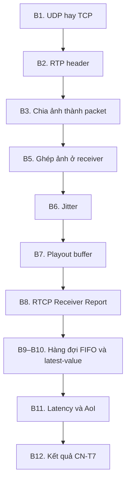

*Bản đồ kiến thức của Session 1B. Chúng ta sẽ lần lượt học từng khối từ trên xuống dưới.*

## B1. Vì sao sử dụng UDP thay vì TCP?

### B1.1. Vấn đề khi truyền video theo thời gian thực

Giả sử camera đang quan sát một chiếc xe di chuyển. Camera tạo ra các frame liên tiếp:

- Frame 1: chiếc xe ở vị trí ban đầu.
- Frame 2: chiếc xe đã di chuyển.
- Frame 3: chiếc xe tiếp tục tiến về phía trước.

Nếu dữ liệu của frame 1 bị mất, chúng ta có hai lựa chọn.

Một là chờ truyền lại frame 1 cho đến khi nhận được đầy đủ. Hai là chấp nhận mất frame 1 và tiếp tục nhận frame mới hơn.

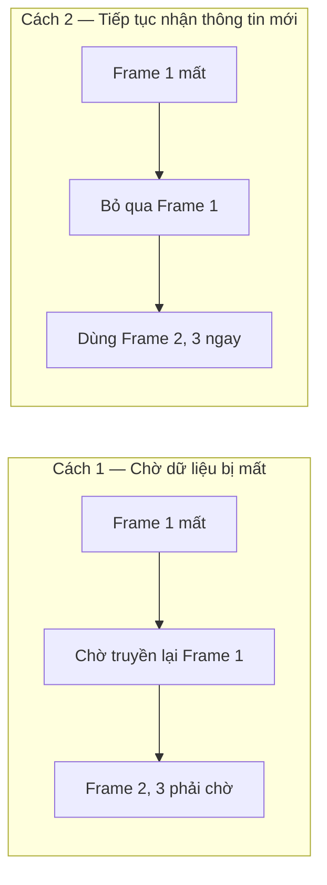

*Minh họa hai chiến lược truyền thông. Không phải mọi ứng dụng video đều sử dụng cùng một chiến lược.*

Đối với ứng dụng cần thông tin mới, nhận đủ một ảnh rất cũ đôi khi không hữu ích bằng nhận được một ảnh mới hơn.

Đây là lý do nhóm lựa chọn UDP làm giao thức vận chuyển dữ liệu video.

### B1.2. TCP và UDP khác nhau thế nào?

TCP — Transmission Control Protocol — cung cấp luồng byte tin cậy và đúng thứ tự cho ứng dụng. Nó có cơ chế phát hiện dữ liệu mất, truyền lại và kiểm soát tắc nghẽn.

UDP — User Datagram Protocol — cung cấp các datagram độc lập. Giao thức không tự thực hiện truyền lại hoặc đảm bảo thứ tự đến.

| Đặc điểm                             | TCP                            | UDP                                         |
| ------------------------------------ | ------------------------------ | ------------------------------------------- |
| Dạng dữ liệu                         | Luồng byte                     | Datagram riêng biệt                         |
| Truyền lại khi mất                   | Có cơ chế tích hợp             | Không tự truyền lại                         |
| Đúng thứ tự                          | Được đảm bảo ở giao diện luồng | Không đảm bảo                               |
| Kiểm soát tắc nghẽn                  | Có                             | Ứng dụng phải xử lý phù hợp                 |
| Dữ liệu mới khi dữ liệu trước bị mất | Có thể phải chờ                | Có thể tiếp tục nhận                        |
| Ví dụ ứng dụng                       | Tải file, HTTP                 | Một số ứng dụng thoại, video thời gian thực |

Một hiểu lầm cần tránh là UDP luôn nhanh hơn TCP. Điều đó không đúng trong mọi điều kiện.

Lợi ích quan trọng ở đây là UDP cho phép ứng dụng tự quyết định dữ liệu nào đáng chờ và dữ liệu nào nên bỏ qua.

### B1.3. UDP không đủ để xây dựng hệ thống truyền video

Hãy tưởng tượng receiver nhận ba datagram:

```text
Datagram A: một chuỗi byte
Datagram B: một chuỗi byte
Datagram C: một chuỗi byte
```

Chỉ từ UDP, receiver chưa biết:

- Chúng thuộc ảnh nào.
- Mảnh nào nằm trước, mảnh nào nằm sau.
- Thời điểm ảnh được tạo.
- Datagram nào có thể đã bị mất.

Vì vậy, chúng ta cần bổ sung một giao thức cung cấp thông tin liên quan đến dữ liệu media. Đó là RTP.

## B2. RTP — giao thức truyền dữ liệu thời gian thực

### B2.1. RTP nằm ở đâu trong hệ thống mạng?

**RTP (Real-time Transport Protocol)** cung cấp thông tin nhận dạng, thứ tự và thời gian media cho dữ liệu thời gian thực.

Trong dự án, RTP packet được đặt bên trong UDP datagram. Sau đó UDP datagram được đặt trong IPv4 packet.

Quá trình đặt dữ liệu của một tầng vào dữ liệu của tầng thấp hơn được gọi là **encapsulation (đóng gói)**.

<svg viewBox="0 0 600 70" role="img" aria-label="Đóng gói IPv4, UDP, RTP, fragment header, JPEG" style="width:100%;max-width:600px;height:auto;color:inherit">
<g stroke="currentColor" font-size="13" text-anchor="middle">
<rect x="5" y="10" width="95" height="40" fill="#64748b" fill-opacity=".25"/><rect x="100" y="10" width="80" height="40" fill="#3b82f6" fill-opacity=".25"/><rect x="180" y="10" width="85" height="40" fill="#14b8a6" fill-opacity=".3"/><rect x="265" y="10" width="125" height="40" fill="#f59e0b" fill-opacity=".25"/><rect x="390" y="10" width="205" height="40" fill="none"/>
</g>
<g fill="currentColor" font-size="13" text-anchor="middle"><text x="52" y="35">IPv4 20 B</text><text x="140" y="35">UDP 8 B</text><text x="222" y="35">RTP 12 B</text><text x="327" y="35">Fragment header</text><text x="492" y="35">Dữ liệu JPEG</text></g>
</svg>

*Sơ đồ đóng gói, không vẽ theo tỷ lệ kích thước byte.*

Mỗi tầng bổ sung thông tin cần thiết cho nhiệm vụ của mình.

| Tầng                      | Nhiệm vụ chính                                    |
| ------------------------- | ------------------------------------------------- |
| IPv4                      | Địa chỉ và chuyển packet giữa các thiết bị        |
| UDP                       | Xác định điểm nhận dữ liệu qua port               |
| RTP                       | Thứ tự packet, thời gian media và nhận dạng nguồn |
| Fragment header của dự án | Xác định vị trí mảnh dữ liệu trong ảnh            |
| JPEG                      | Dữ liệu ảnh cần truyền                            |

**Header (phần đầu gói)** chứa thông tin phục vụ xử lý và truyền thông.

**Payload (phần tải dữ liệu)** là dữ liệu được tầng hiện tại mang theo.

Điều quan trọng là payload của một tầng có thể chứa header của tầng phía trên.

### B2.2. Đọc RTP header

Đây là cấu trúc header RTP được sử dụng trong sản phẩm.

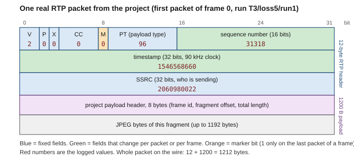

*Header RTP cơ bản.*

| Trường          | Số bit | Ý nghĩa                                    |
| --------------- | ------ | ------------------------------------------ |
| V               | 2      | Phiên bản RTP, sản phẩm dùng RTP version 2 |
| P               | 1      | Có padding hay không                       |
| X               | 1      | Có header extension hay không              |
| CC              | 4      | Số lượng CSRC                              |
| M               | 1      | Marker, trong dự án đánh dấu mảnh cuối     |
| PT              | 7      | Payload Type, dự án sử dụng 96             |
| Sequence number | 16     | Số thứ tự packet                           |
| Timestamp       | 32     | Thời điểm lấy mẫu media                    |
| SSRC            | 32     | Nhận dạng nguồn RTP                        |

**SOURCE:** `cn/rtp/rtp/packet.py`, `pack_packet()` và `parse_packet()`.

Header RTP cơ bản có kích thước 12 byte. Các trường mở rộng, nếu được sử dụng, có thể làm header lớn hơn.

Chúng ta sẽ tập trung vào bốn trường quan trọng nhất: Sequence, Timestamp, Marker và SSRC.

### B2.3. Sequence number — số thứ tự của từng packet

Giả sử sender gửi năm packet liên tiếp.

```text
100 → 101 → 102 → 103 → 104
```

Nhưng receiver quan sát:

```text
100 → 101 → 103 → 104
```

Receiver có thể nhận thấy sequence 102 chưa xuất hiện. Tuy nhiên, chưa thể kết luận ngay rằng packet 102 bị mất vĩnh viễn. Nó có thể chỉ đang đến muộn.

Đây là **packet reordering (gói tin đến sai thứ tự)**.

Sequence number giúp receiver theo dõi những hiện tượng như mất gói, đến sai thứ tự và quay vòng số thứ tự.

#### Sequence wrap-around

Sequence có độ dài 16 bit. Vì vậy, nó biểu diễn được \(2^{16}=65536\) giá trị khác nhau, từ 0 đến 65535.

Khi đạt 65535, packet tiếp theo có sequence bằng 0. Công thức là:

\[ seq_{\mathrm{next}}=(seq+1)\bmod65536 \]

Trong `payload.py`, nhóm thực hiện phép toán tương đương bằng:

```python
(seq_start + len(packets)) & 0xffff
```

Không cần học phép toán bit ngay lúc này. Chỉ cần hiểu rằng kết quả luôn được giữ trong phạm vi 16 bit.

### B2.4. RTP timestamp — thời điểm của nội dung ảnh

Sequence number trả lời câu hỏi:

> Đây là packet thứ mấy?

Timestamp trả lời câu hỏi khác:

> Dữ liệu của packet này thuộc thời điểm media nào?

Nếu một frame JPEG được chia thành sáu packet, cả sáu packet đều mô tả cùng một ảnh tại cùng một thời điểm. Vì vậy, chúng dùng chung RTP timestamp.

RTP video của dự án sử dụng media clock 90 kHz. Điều đó có nghĩa:

\[ 1\text{ s}=90000\text{ timestamp units} \]

Với frame rate 15 FPS, \(T_f=\frac{1}{15}\text{ s}\). Bước timestamp danh định giữa hai frame:

\[ \Delta TS=90000T_f \qquad \boxed{\Delta TS=\frac{90000}{15}=6000} \]

**CALCULATED — cấu hình danh định 15 FPS.**

Trong chương trình thật, timestamp được tính từ thời điểm capture và một offset ban đầu. Vì thời điểm capture có thể không hoàn toàn đều, bước timestamp thực tế có thể dao động quanh 6000.

Timestamp không phải thời điểm packet đến receiver. Nó cũng không phải một giá trị trực tiếp cho phép tính độ trễ một chiều giữa hai máy.

### B2.5. Marker và SSRC

**Marker** là trường một bit. Trong định dạng truyền JPEG của dự án:

- `M = 0`: chưa phải mảnh cuối.
- `M = 1`: mảnh cuối của frame.

Nhận được marker không có nghĩa đã nhận đủ frame. Nếu receiver nhận được mảnh cuối nhưng mất một mảnh ở giữa, frame vẫn chưa hoàn chỉnh.

**SSRC (Synchronization Source)** giúp nhận dạng nguồn RTP. Khi receiver quản lý dữ liệu từ các nguồn khác nhau, nó cần phân biệt những packet có thể trùng timestamp hoặc sequence.

Trong mã ghép ảnh của dự án, một frame đang được tái tạo được nhận diện bằng cặp:

```python
key = (packet.ssrc, packet.timestamp)
```

## B3. Packetization — cách một JPEG frame được chia thành nhiều packet

### B3.1. Vì sao không gửi toàn bộ ảnh trong một packet?

Một đường truyền mạng thường có giới hạn kích thước packet phù hợp. Ví dụ, Ethernet thường sử dụng IP MTU bằng 1500 byte.

MTU — Maximum Transmission Unit — biểu diễn kích thước đơn vị dữ liệu tối đa được truyền mà không cần phân mảnh ở tầng tương ứng.

Trong khi đó, một ảnh JPEG có thể chứa vài nghìn hoặc hàng chục nghìn byte.

Thay vì tạo một IP packet rất lớn, sender chia ảnh thành các RTP packet có kích thước phù hợp hơn.


### B3.2. Định dạng fragment header của sản phẩm

Đây là một chi tiết quan trọng mà chúng ta phải đọc đúng từ mã nguồn.

Nhóm không sử dụng định dạng RTP/JPEG chuẩn RFC 2435. Nhóm xây dựng một fragment header riêng để hỗ trợ ghép ảnh JPEG.

<svg viewBox="0 0 600 150" role="img" aria-label="Fragment header của mảnh đầu và các mảnh sau" style="width:100%;max-width:600px;height:auto;color:inherit">
<g fill="currentColor" font-size="13"><text x="5" y="18" font-weight="700">Mảnh đầu tiên</text><text x="5" y="93" font-weight="700">Các mảnh tiếp theo</text></g>
<g stroke="currentColor" fill="#14b8a6" fill-opacity=".25"><rect x="5" y="28" width="120" height="36"/><rect x="125" y="28" width="90" height="36"/><rect x="215" y="28" width="60" height="36"/><rect x="275" y="28" width="120" height="36" fill="#f59e0b"/><rect x="5" y="103" width="120" height="36"/><rect x="125" y="103" width="90" height="36"/><rect x="215" y="103" width="60" height="36"/></g>
<g stroke="currentColor" fill="none"><rect x="395" y="28" width="200" height="36"/><rect x="275" y="103" width="320" height="36"/></g>
<g fill="currentColor" font-size="12" text-anchor="middle"><text x="65" y="50">frame_id 4 B</text><text x="170" y="50">offset 3 B</text><text x="245" y="50">flags 1 B</text><text x="335" y="50">tổng chiều dài 4 B</text><text x="495" y="50">Dữ liệu JPEG</text><text x="65" y="125">frame_id 4 B</text><text x="170" y="125">offset 3 B</text><text x="245" y="125">flags 1 B</text><text x="435" y="125">Dữ liệu JPEG</text></g>
</svg>

*SOURCE — `payload.py`, `encode_fragment()` và `decode_fragment()`. Đây là RTP payload, không bao gồm 12 byte RTP header bên ngoài.*

**Byte offset** là vị trí bắt đầu của mảnh trong chuỗi byte JPEG ban đầu.

Ví dụ, offset bằng 1188 có nghĩa dữ liệu trong mảnh đó bắt đầu tại byte thứ 1188, nếu đánh số từ 0.

Mảnh đầu tiên còn mang tổng kích thước JPEG. Nhờ đó, receiver biết cần tái tạo bao nhiêu byte.

### B3.3. Ví dụ đầy đủ với ảnh JPEG 6000 byte

Trong chương trình Python, cấu hình:

```python
mtu_payload = 1200
```

giới hạn kích thước **toàn bộ RTP payload**, bao gồm fragment header.

Do đó, số byte ảnh tối đa trong mảnh đầu là:

\[ L_{\mathrm{first}}=1200-8-4=1188\text{ B} \]

Trong các mảnh tiếp theo:

\[ L_{\mathrm{next}}=1200-8=1192\text{ B} \]

Sau mảnh đầu, số byte còn lại là:

\[ 6000-1188=4812\text{ B} \]

Số mảnh bổ sung:

\[ N_{\mathrm{next}} =\left\lceil\frac{4812}{1192}\right\rceil =5 \]

Tổng số packet:

\[ \boxed{N=1+5=6} \]

**CALCULATED — theo định dạng Python hiện tại.**

Giả sử frame ID bằng 17, timestamp bằng 90000 và sequence bắt đầu từ 65533.

| Packet | Sequence | Offset | JPEG data | Marker |
| ------ | -------- | ------ | --------- | ------ |
| P1     | 65533    | 0      | 1188 B    | 0      |
| P2     | 65534    | 1188   | 1192 B    | 0      |
| P3     | 65535    | 2380   | 1192 B    | 0      |
| P4     | 0        | 3572   | 1192 B    | 0      |
| P5     | 1        | 4764   | 1192 B    | 0      |
| P6     | 2        | 5956   | 44 B      | 1      |

Tất cả packet đều có cùng timestamp và frame ID.

Kiểm tra tổng dữ liệu:

\[ 1188+4(1192)+44=6000\text{ B} \]

Như vậy, không có byte ảnh nào bị bỏ qua trong quá trình chia mảnh.

### B3.4. Interactive RTP Packetizer

<div id="s1b-packetizer">
<style>
#s1b-packetizer{border:1px solid currentColor;border-radius:12px;padding:16px;margin:20px 0}
#s1b-packetizer input[type=range]{width:100%;accent-color:#14b8a6}
#s1b-packetizer select{color:inherit;background:var(--md-default-bg-color,Canvas);padding:5px}
#s1b-packetizer .s1bp-packets{display:flex;flex-wrap:wrap;gap:6px;margin:16px 0}
#s1b-packetizer .s1bp-packet{border:1px solid #4389d8;border-radius:6px;padding:8px;font-size:.85em}
#s1b-packetizer .s1bp-last{border:2px solid #14b8a6}
</style>
<h3>Chia JPEG thành RTP packet</h3>
<label>Kích thước ảnh: <strong class="s1bp-size-value"></strong>
<input class="s1bp-size" type="range" min="500" max="12000" step="100" value="6000">
</label>
<label>Giới hạn RTP payload:
<select class="s1bp-limit">
<option value="500">500 B</option>
<option value="1200" selected>1200 B</option>
<option value="1400">1400 B</option>
</select></label>
<p class="s1bp-result" aria-live="polite"></p>
<div class="s1bp-packets"></div>
<small>CALCULATED — Mảnh đầu có 12 B metadata, mảnh sau có 8 B.</small>
<script>
(()=>{
 const r=document.getElementById("s1b-packetizer");
 const size=r.querySelector(".s1bp-size");
 const limit=r.querySelector(".s1bp-limit");
 function draw(){
  const s=Number(size.value),p=Number(limit.value);
  let parts=[],off=0;
  while(off<s){
   const n=Math.min(s-off,p-8-(off===0?4:0));
   parts.push({off,n,seq:(65533+parts.length)%65536});
   off+=n;
  }
  r.querySelector(".s1bp-size-value").textContent=s+" B";
  r.querySelector(".s1bp-result").textContent=
   parts.length+" packet | Mảnh đầu tối đa "+(p-12)+
   " B | Mảnh sau tối đa "+(p-8)+" B";
  r.querySelector(".s1bp-packets").innerHTML=parts.map((d,i)=>
   `<div class="s1bp-packet ${i===parts.length-1?"s1bp-last":""}">
    <strong>P${i+1}</strong><br>
    JPEG: ${d.n} B<br>Offset: ${d.off}<br>
    Seq: ${d.seq}<br>TS: 90000<br>
    M: ${i===parts.length-1?1:0}
    </div>`).join("");
 }
 size.addEventListener("input",draw);
 limit.addEventListener("change",draw);draw();
})();
</script>
</div>

Thử chọn payload 500 B rồi chọn 1400 B.

Bạn sẽ thấy kích thước ảnh không thay đổi, nhưng số lượng packet thay đổi rõ rệt. Đây là vấn đề mà nhóm khảo sát trong CN-T5.

### B3.5. Không được nhầm Python với SimEvents

| Tham số                               | Chương trình Python     | SimEvents            |
| ------------------------------------- | ----------------------- | -------------------- |
| Payload 1200 B                        | Bao gồm fragment header | Chỉ tính dữ liệu ảnh |
| Mảnh đầu tối đa                       | 1188 B ảnh              | 1200 B ảnh           |
| Mảnh tiếp theo tối đa                 | 1192 B ảnh              | 1200 B ảnh           |
| Ảnh 6000 B                            | 6 packet                | 5 packet             |
| IP packet đầy, theo quy ước tương ứng | 1240 B                  | 1248 B               |

Với Python và IPv4 header cơ bản:

\[ L_{\mathrm{IP}}=20+8+12+1200 =1240\text{ B} \]

Trong khi đó, mô hình SimEvents tính 1200 byte dữ liệu ảnh và thêm 48 byte overhead.

Cả hai cách biểu diễn đều có mục đích riêng. Không được trộn các quy ước khi tính số packet.

## B4. Quan sát packet thật trong kết quả đo


Hình gồm hai biểu đồ.

**Biểu đồ bên trái:** sáu packet của frame 0 trong CN-T3, cấu hình `loss5`, lần chạy 1.

- Trục ngang là sequence number.
- Trục đứng là kích thước RTP packet tính bằng byte.
- Năm packet đầu có kích thước 1212 B.
- Packet cuối có kích thước 164 B và marker bằng 1.

**Biểu đồ bên phải:** phân bố bước timestamp trong CN-T2.

- Trục ngang là chênh lệch timestamp giữa các frame.
- Trục đứng là số lần quan sát được mỗi giá trị.
- Phần lớn giá trị tập trung gần 6000.

**MEASURED — hình `01_rtp_metadata.png`.**

Tại sao năm packet đầu có kích thước 1212 B thay vì 1200 B? Bởi vì giá trị trong log receiver tính cả RTP header:

\[ 1200+12=1212\text{ B} \]

Con số này chưa bao gồm IPv4 header và UDP header.

Chúng ta vừa sử dụng được kiến thức về encapsulation để giải thích trực tiếp một kết quả đo của sản phẩm.

## B5. Frame reassembly — receiver ghép lại ảnh như thế nào?

### B5.1. Bài toán ghép ảnh

Sender đã chia một ảnh thành sáu packet. Receiver cần thực hiện quá trình ngược lại.

Hãy tưởng tượng ảnh JPEG giống như một bức tranh được cắt thành nhiều mảnh.


Nếu nhận đủ các mảnh, receiver có thể ghép lại bức tranh. Nếu thiếu một mảnh, nó chưa thể khẳng định đã tái tạo đầy đủ ảnh ban đầu.

Tuy nhiên, dữ liệu trong dự án không thực sự được cắt theo vùng hình học trên ảnh. Sender chia chuỗi byte JPEG liên tiếp thành các đoạn nhỏ. Hình ghép tranh chỉ là một phép minh họa.

### B5.2. Receiver có cần packet đến đúng thứ tự không?

Không nhất thiết. Giả sử receiver nhận theo thứ tự:

\[ P3\rightarrow P1\rightarrow P2 \rightarrow P5\rightarrow P6\rightarrow P4 \]

Mặc dù thứ tự đến khác thứ tự gửi, mỗi mảnh vẫn chứa byte offset. Receiver có thể lưu chúng vào đúng vị trí tương ứng trong ảnh.

Điều quan trọng không phải là packet nào đến trước, mà là receiver có nhận đủ dữ liệu và xác định được đúng vị trí của chúng hay không.

### B5.3. Điều kiện ghép ảnh thành công trong code thật

Hàm `FrameReassembler.add()` thực hiện các kiểm tra chính sau:

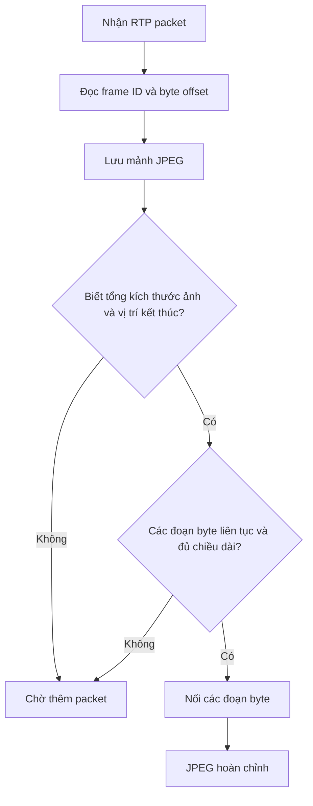

Receiver cần biết tổng chiều dài JPEG từ mảnh đầu. Nó cũng cần xác định vị trí kết thúc từ packet có marker.

Sau đó, nó sắp xếp các mảnh theo offset và kiểm tra xem có đoạn byte nào bị thiếu hay không.

Nếu một bản sao packet đến lần thứ hai với cùng offset và cùng dữ liệu, nó không tạo thêm một đoạn ảnh mới. Nếu dữ liệu trùng offset nhưng nội dung mâu thuẫn, mã có thể báo lỗi.

**SOURCE:** `cn/rtp/rtp/payload.py`, `FrameReassembler.add()`.

### B5.4. Interactive frame reconstruction

Bấm vào từng mảnh để chuyển giữa đã nhận và chưa nhận.

<div id="s1b-reassembly">
<style>
#s1b-reassembly{border:1px solid currentColor;border-radius:12px;padding:16px;margin:20px 0}
#s1b-reassembly .s1br-grid{display:grid;grid-template-columns:repeat(auto-fit,minmax(90px,1fr));gap:8px}
#s1b-reassembly button{color:inherit;background:transparent;border:1px solid currentColor;border-radius:6px;padding:10px;cursor:pointer}
#s1b-reassembly .s1br-ok{border-color:#14b8a6;background:rgba(20,184,166,.12)}
#s1b-reassembly .s1br-missing{border-color:#ef4444;background:rgba(239,68,68,.12)}
</style>
<h3>Ghép ảnh JPEG từ sáu mảnh</h3>
<div class="s1br-grid"></div>
<p class="s1br-result" aria-live="polite"></p>
<button class="s1br-reset" type="button">Nhận đủ tất cả</button>
<script>
(()=>{
 const r=document.getElementById("s1b-reassembly");
 const sizes=[1188,1192,1192,1192,1192,44];
 let received=[true,true,false,true,true,true];
 function draw(){
  const grid=r.querySelector(".s1br-grid");
  grid.innerHTML=received.map((ok,i)=>
   `<button type="button" data-index="${i}"
    aria-pressed="${ok}" class="${ok?"s1br-ok":"s1br-missing"}">
    <strong>P${i+1}</strong><br>${sizes[i]} B<br>
    M=${i===5?1:0}<br>${ok?"Đã nhận":"Chưa nhận"}
    </button>`).join("");
  grid.querySelectorAll("[data-index]").forEach(b=>
   b.addEventListener("click",()=>{
    const i=Number(b.dataset.index);
    received[i]=!received[i];draw();
   }));
  const bytes=sizes.reduce((sum,n,i)=>sum+(received[i]?n:0),0);
  r.querySelector(".s1br-result").textContent=
   `${bytes}/6000 B — Marker: ${received[5]?"Có":"Chưa"} — `+
   (received.every(Boolean)?"Ghép ảnh thành công":"Chưa đủ dữ liệu để ghép");
 }
 r.querySelector(".s1br-reset").onclick=()=>{
  received=Array(6).fill(true);draw();
 };
 draw();
})();
</script>
</div>

Hãy thử ba tình huống:

- Tắt P3 nhưng giữ P6. Receiver đã nhận marker nhưng vẫn thiếu dữ liệu.
- Tắt P1. Receiver chưa có thông tin tổng chiều dài ảnh từ mảnh đầu.
- Bật tất cả sáu mảnh. Receiver có thể ghép đủ 6000 byte.

Ví dụ này chỉ kiểm tra việc ghép ảnh. Một ảnh ghép thành công vẫn cần vượt qua điều kiện thời gian mà chúng ta sẽ học ở B7.

### B5.5. Vì sao mất ít packet vẫn có thể làm mất nhiều frame?

Giả sử một frame cần \(N\) packet. Xác suất mất độc lập của mỗi packet là \(p\).

Xác suất một packet đến thành công:

\[ P_{\mathrm{packet}}=1-p \]

Để frame hoàn chỉnh, tất cả packet bắt buộc phải đến. Do đó:

\[ \boxed{P_{\mathrm{frame,success}}=(1-p)^N} \qquad \boxed{P_{\mathrm{frame,loss}}=1-(1-p)^N} \]

Ví dụ minh họa: một frame cần năm packet, xác suất mất mỗi packet là 5%.

\[ P_{\mathrm{frame,success}}=0.95^5\approx77.38\% \qquad P_{\mathrm{frame,loss}}\approx22.62\% \]

**CALCULATED — giả thiết mất độc lập, cần đủ tất cả packet, không xét deadline.**

Như vậy, mất 5% packet không có nghĩa chỉ mất 5% ảnh.

Trong CN-T3, nhóm đo được 5.2% packet loss và 24% frame loss. Chúng ta sẽ phân tích chi tiết kết quả này trong Session 2.

## B6. Jitter — tại sao packet không đến đều?

### B6.1. Phân biệt delay và jitter

Giả sử mỗi packet đại diện cho một ảnh được tạo cách nhau 100 ms. Xét hai đường truyền.


| Gửi lúc | Đường truyền A — trễ lớn nhưng đều | Đường truyền B — trễ thấp hơn nhưng không đều |
| ------- | ---------------------------------- | --------------------------------------------- |
| 0 ms    | đến 100 ms                         | đến 20 ms                                     |
| 100 ms  | đến 200 ms                         | đến 150 ms                                    |
| 200 ms  | đến 300 ms                         | đến 230 ms                                    |

*CALCULATED — Ví dụ minh họa độ trễ và biến thiên thời gian đến.*

Đường truyền A làm mọi packet chậm thêm 100 ms. Tuy nhiên, khoảng cách giữa chúng không thay đổi.

Đường truyền B có độ trễ thấp hơn, nhưng khoảng cách giữa các packet khi đến receiver bị biến dạng.

Hiện tượng biến động thời gian truyền này được phản ánh thông qua **jitter (độ biến thiên trễ)**.

### B6.2. Receiver đo jitter như thế nào?

Receiver biết hai thông tin:

- RTP timestamp mô tả thời điểm media.
- Arrival time mô tả thời điểm packet thực sự đến.

Giả sử hai packet có khoảng cách media bằng 100 ms. Nhưng khoảng cách đến thực tế bằng 110 ms. Sai lệch là:

\[ D=110-100=10\text{ ms} \]

Tổng quát:

\[ D_k=(R_k-R_{k-1})-(S_k-S_{k-1}) \]

Trong đó:

| Ký hiệu       | Ý nghĩa                        |
| ------------- | ------------------------------ |
| \(R_k\)       | Thời điểm nhận packet hiện tại |
| \(R_{k-1}\)   | Thời điểm nhận packet trước    |
| \(S_k\)       | Media time hiện tại            |
| \(S_{k-1}\)   | Media time trước               |

Tất cả thời gian phải được biểu diễn bằng cùng đơn vị.

Receiver không chỉ sử dụng giá trị \(D\) mới nhất. Nó sử dụng một bộ lọc để ước lượng mức độ biến động theo thời gian. Đó là RFC 3550 jitter estimator.

\[ \boxed{J_k=J_{k-1}+\frac{|D_k|-J_{k-1}}{16}} \]

Có thể hiểu công thức này như một phép cập nhật dần:

- Nếu sai lệch mới lớn hơn estimate hiện tại, estimate tăng.
- Nếu sai lệch mới nhỏ hơn estimate hiện tại, estimate giảm.
- Estimate không thay đổi hoàn toàn chỉ vì một packet bất thường.

#### Ví dụ tính toán

Ban đầu \(J_0=0\). Packet tiếp theo tạo ra sai lệch 10 ms:

\[ J_1=0+\frac{10-0}{16} =0.625\text{ ms} \]

Quan sát tiếp theo có sai lệch 20 ms:

\[ J_2=0.625+\frac{20-0.625}{16} \qquad \boxed{J_2\approx1.836\text{ ms}} \]

**CALCULATED.**

Trong Session 2, chúng ta sẽ đi sâu hơn vào phép đổi đơn vị 90 kHz, ảnh hưởng của các mảnh cùng timestamp và bộ lọc đệ quy.

### B6.3. Interactive jitter estimator

<div id="s1b-jitter">
<style>
#s1b-jitter{border:1px solid currentColor;border-radius:12px;padding:16px;margin:20px 0}
#s1b-jitter input{width:100%;accent-color:#14b8a6}
#s1b-jitter button{color:inherit;background:transparent;border:1px solid currentColor;border-radius:6px;padding:8px;cursor:pointer}
#s1b-jitter svg{width:100%;height:auto}
</style>
<h3>Cập nhật RFC 3550 jitter</h3>
<label>Sai lệch |D|: <strong class="s1bj-dlabel"></strong>
<input class="s1bj-d" type="range" min="0" max="40" value="10">
</label>
<button type="button" class="s1bj-next">Nhận packet tiếp theo</button>
<button type="button" class="s1bj-reset">Reset</button>
<p class="s1bj-value" aria-live="polite"></p>
<svg class="s1bj-chart" viewBox="0 0 600 210" role="img" aria-label="Lịch sử ước lượng jitter"></svg>
<script>
(()=>{
 const r=document.getElementById("s1b-jitter");
 const d=r.querySelector(".s1bj-d");
 let h=[0];
 function draw(){
  const v=Number(d.value),j=h[h.length-1];
  r.querySelector(".s1bj-dlabel").textContent=v+" ms";
  r.querySelector(".s1bj-value").textContent=
   "J hiện tại: "+j.toFixed(3)+" ms | J tiếp theo: "+
   (j+(v-j)/16).toFixed(3)+" ms";
  let s='<path d="M40 10 V175 H580" stroke="currentColor" fill="none"/>';
  for(let y=0;y<=40;y+=10){
   const py=175-y*4;
   s+=`<path d="M40 ${py} H580" stroke="currentColor" opacity=".15"/>
       <text x="32" y="${py+4}" text-anchor="end" fill="currentColor">${y}</text>`;
  }
  const pts=h.map((v,i)=>
   `${40+i*540/Math.max(12,h.length-1)},${175-v*4}`).join(" ");
  s+=`<polyline points="${pts}" fill="none" stroke="#14b8a6" stroke-width="3"/>`;
  s+='<text x="310" y="202" text-anchor="middle" fill="currentColor">Packet updates</text>';
  r.querySelector(".s1bj-chart").innerHTML=s;
 }
 d.oninput=draw;
 r.querySelector(".s1bj-next").onclick=()=>{
  const j=h[h.length-1];
  h.push(j+(Number(d.value)-j)/16);draw();
 };
 r.querySelector(".s1bj-reset").onclick=()=>{h=[0];d.value=10;draw()};
 draw();
})();
</script>
</div>

Thử giữ sai lệch ở 20 ms và nhận nhiều packet liên tiếp. Sau đó giảm sai lệch xuống 0 ms.

Bạn sẽ thấy estimate giảm dần, chứ không lập tức trở về 0.

### B6.4. Đọc đồ thị jitter của sản phẩm

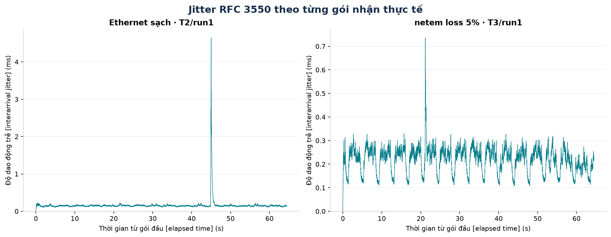

Hình bên trái là một lần chạy Ethernet baseline. Hình bên phải là một lần chạy có cấu hình mất gói 5%.

- Trục ngang: thời gian từ packet đầu tiên, tính bằng giây.
- Trục đứng: giá trị jitter estimator, tính bằng ms.

Hãy chú ý những đoạn có đỉnh cao rồi giảm dần.

Đây là biểu hiện của cơ chế lọc: khi xuất hiện một quan sát thời gian bất thường, estimate có thể tăng; khi các quan sát sau ổn định hơn, estimate giảm dần.

Không được đọc đường jitter như một đường biểu diễn độ trễ truyền một chiều.

**SOURCE:** `cn/rtp/rtp/rxstats.py`, `SourceStats.update()`.

**MEASURED:** `02_jitter_time.png`, dữ liệu từ CN-T2 và CN-T3.

## B7. Playout buffer — tại sao receiver không sử dụng ảnh ngay khi nhận đủ?

### B7.1. Vấn đề với thời điểm ảnh đến

Giả sử ba frame được tạo cách nhau 100 ms, nhưng mạng làm chúng đến không đều.

Nếu receiver sử dụng mỗi frame ngay khi nhận đủ, khoảng cách giữa những lần cập nhật có thể biến động rất nhiều.

Playout buffer (bộ đệm phát) giúp tạo một lịch sử dụng ảnh dựa trên thời gian media, thay vì phụ thuộc hoàn toàn vào thời điểm đến ngẫu nhiên.

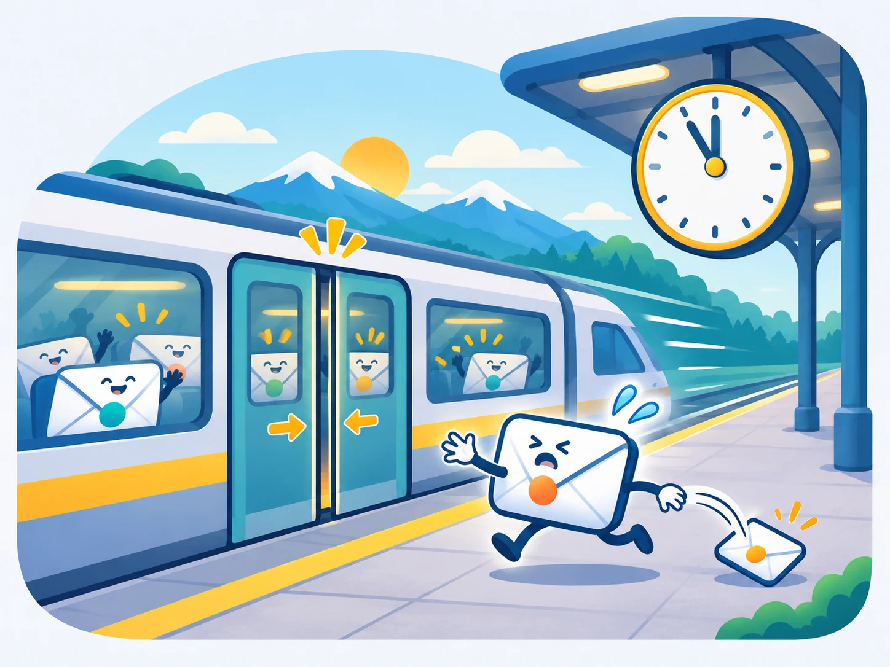

Hãy tưởng tượng một chuyến tàu có lịch khởi hành cố định. Hành khách đến sớm phải chờ. Hành khách đến quá muộn có thể không được lên chuyến đó.

### B7.2. Deadline được tính như thế nào?

Receiver lấy thời điểm đến của packet đầu tiên làm **anchor (mốc thời gian tham chiếu)**.

Gọi:

- \(t_0\): thời điểm đến của packet thiết lập anchor.
- \(TS_0\): RTP timestamp tương ứng.
- \(TS_i\): RTP timestamp của frame đang xét.
- \(B\): playout depth, tức thời gian đệm đã cấu hình.

Sau khi xử lý quay vòng timestamp:

\[ \boxed{d_i=t_0+\frac{TS_i-TS_0}{90000}+B} \]

Trong công thức này, các giá trị thời gian được biểu diễn bằng giây.

Giả sử \(t_0=20\text{ ms}\), \(B=50\text{ ms}\), \(f=15\text{ FPS}\).

Deadline của frame đầu tiên:

\[ d_1=20+50=70\text{ ms} \]

Deadline của frame thứ hai:

\[ d_2=20+\frac{6000}{90000}\times1000+50 \qquad \boxed{d_2=136.67\text{ ms}} \]

Deadline của frame thứ ba:

\[ \boxed{d_3=203.33\text{ ms}} \]

**CALCULATED — ví dụ minh họa.**

Quan trọng: deadline của frame thứ hai không được tính bằng thời điểm frame thứ hai đến cộng thêm 50 ms. Receiver sử dụng anchor ban đầu và khoảng thời gian media để thiết lập lịch phát.

### B7.3. Ba trạng thái của frame trong Python

Trong `playout.py`, receiver phân loại frame thành ba trường hợp.

| Trạng thái | Ý nghĩa                                          | Đưa vào inference   |
| ---------- | ------------------------------------------------ | ------------------- |
| `ok`       | Ghép đủ ảnh không muộn hơn deadline              | Có, tại lúc release |
| `late`     | Ghép đủ nhưng đã quá deadline, trong late window | Không               |
| `lost`     | Vẫn chưa ghép đủ khi hết thời gian theo dõi      | Không               |

Late window là khoảng thời gian bổ sung dùng để phân loại ảnh đến muộn với ảnh không ghép được. Đây không phải khoảng thời gian cho phép ảnh muộn được đưa vào AI.

Cấu hình mặc định của chương trình:

- Playout depth: 100 ms.
- Late window: 1000 ms.

**SOURCE — `PlayoutBuffer.__init__()` trong `cn/rtp/rtp/playout.py`.** Các lần chạy có thể sử dụng giá trị khác.

Một giới hạn nữa: nếu mọi packet của một frame đều bị mất, receiver không trực tiếp nhìn thấy frame đó. Cần đối chiếu log bên gửi để xác định những frame hoàn toàn không xuất hiện ở bên nhận.

### B7.4. Interactive playout deadline

<div id="s1b-playout">
<style>
#s1b-playout{border:1px solid currentColor;border-radius:12px;padding:16px;margin:20px 0}
#s1b-playout input[type=range]{width:100%;accent-color:#14b8a6}
#s1b-playout svg{width:100%;height:auto}
</style>
<h3>Ảnh có đến kịp deadline?</h3>
<p>Anchor: 20 ms. Frame thứ hai ở 15 FPS.</p>
<label>Playout depth: <strong class="s1bd-blabel"></strong>
<input class="s1bd-b" type="range" min="20" max="200" step="10" value="50">
</label>
<label>Thời điểm ghép đủ: <strong class="s1bd-alabel"></strong>
<input class="s1bd-a" type="range" min="90" max="300" step="5" value="145">
</label>
<label><input class="s1bd-missing" type="checkbox">
 Vẫn thiếu mảnh khi hết late window</label>
<svg class="s1bd-svg" viewBox="0 0 600 130" role="img" aria-label="Timeline deadline và thời điểm ghép ảnh"></svg>
<p class="s1bd-result" aria-live="polite"></p>
<script>
(()=>{
 const r=document.getElementById("s1b-playout");
 const b=r.querySelector(".s1bd-b"),a=r.querySelector(".s1bd-a");
 const missing=r.querySelector(".s1bd-missing");
 function draw(){
  const depth=Number(b.value),arrival=Number(a.value);
  const deadline=20+1000/15+depth;
  const x=t=>25+t*550/300;
  const status=missing.checked?"LOST":arrival<=deadline?"OK":"LATE";
  a.disabled=missing.checked;
  r.querySelector(".s1bd-blabel").textContent=depth+" ms";
  r.querySelector(".s1bd-alabel").textContent=arrival+" ms";
  r.querySelector(".s1bd-result").textContent=
   `Deadline ${deadline.toFixed(2)} ms — ${status}`;
  let s=`<rect x="25" y="45" width="${x(deadline)-25}" height="30" fill="#14b8a6" opacity=".15"/>
  <rect x="${x(deadline)}" y="45" width="${575-x(deadline)}" height="30" fill="#f59e0b" opacity=".15"/>
  <path d="M${x(deadline)} 20 V90" stroke="#f59e0b" stroke-width="2"/>
  <text x="${x(deadline)}" y="14" text-anchor="middle" fill="currentColor">Deadline</text>
  <path d="M25 75 H575" stroke="currentColor"/>`;
  if(!missing.checked)s+=`<circle cx="${x(arrival)}" cy="60" r="7"
  fill="${status==="OK"?"#14b8a6":"#ef4444"}"/>`;
  for(const t of [0,100,200,300])s+=
   `<text x="${x(t)}" y="103" text-anchor="middle" fill="currentColor">${t}</text>`;
  r.querySelector(".s1bd-svg").innerHTML=s;
 }
 [a,b,missing].forEach(e=>e.addEventListener("input",draw));draw();
})();
</script>
</div>

*Ví dụ CALCULATED. Trường hợp hoàn chỉnh muộn trong phạm vi slider vẫn nằm trong late window mặc định.*

Giữ thời điểm hoàn thành bằng 145 ms. Thay đổi depth từ 50 ms lên 100 ms.

Ban đầu, deadline là 136.67 ms nên ảnh bị muộn. Khi tăng depth, deadline trở thành 186.67 ms và ảnh có thể được sử dụng.

Tuy nhiên, receiver cũng phải đợi lâu hơn trước khi release ảnh.

### B7.5. Kết quả CN-T4 — đánh đổi giữa trễ và tỷ lệ ảnh đúng hạn

Trong cấu hình mạng có delay 20 ms và tham số biến thiên 20 ms theo phân bố normal, nhóm thay đổi playout depth.

| Depth  | Tỷ lệ frame muộn | Capture-to-AI P50 |
| ------ | ---------------- | ----------------- |
| 20 ms  | 93.5%            | 37.91 ms          |
| 50 ms  | 14.3%            | 75.32 ms          |
| 100 ms | 0%               | 117.68 ms         |
| 200 ms | 0%               | 216.61 ms         |

**MEASURED — CN-T4, năm lần chạy mỗi cấu hình.**

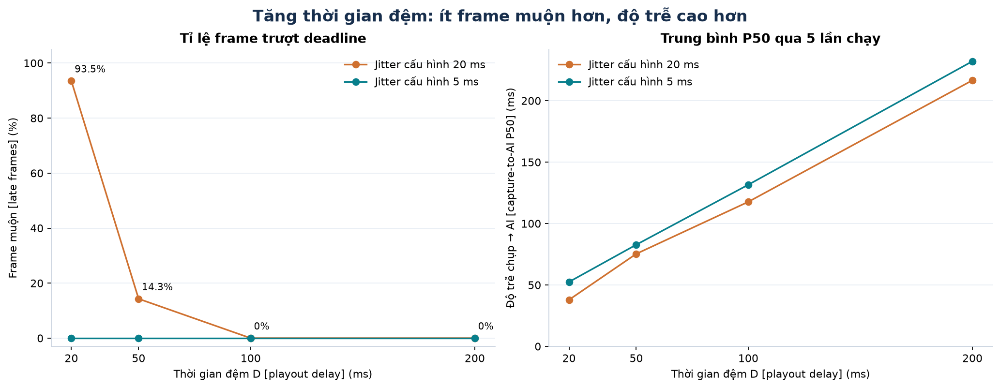

Khi tăng depth, tỷ lệ frame muộn giảm. Nhưng độ trễ tăng.

Đặc biệt, tăng depth từ 100 lên 200 ms không giúp giảm thêm tỷ lệ frame muộn trong điều kiện đã khảo sát, trong khi P50 tăng gần 100 ms.

Đây là một **trade-off (sự đánh đổi)**.

Playout buffer không khôi phục packet bị mất. Nó chỉ cho packet thêm cơ hội đến kịp trước hạn.

## B8. RTCP — làm thế nào để sender biết receiver đang gặp vấn đề?

### B8.1. RTP truyền ảnh, nhưng sender không biết mọi thứ ở bên nhận

Hãy tưởng tượng Raspberry Pi vừa gửi 100 packet. Việc chương trình gửi xong không có nghĩa receiver đã nhận đủ 100 packet.

Sender cần một cơ chế để hỏi hoặc nhận thông tin về tình trạng tiếp nhận. Đó là nhiệm vụ của **RTCP (RTP Control Protocol)**.


*Ví dụ minh họa: receiver cung cấp thông tin về những packet quan sát được.*

RTP mang dữ liệu ảnh. RTCP mang thông tin điều khiển và thống kê về quá trình truyền thông. Chúng có chức năng khác nhau, nhưng phối hợp để tạo thành một hệ thống hoàn chỉnh.

### B8.2. Sender Report và Receiver Report

Có hai loại báo cáo quan trọng.

| Báo cáo              | Bên tạo  | Nội dung chính                                                   |
| -------------------- | -------- | ---------------------------------------------------------------- |
| Sender Report — SR   | Sender   | Thông tin thời gian RTP/NTP, số packet và số byte payload đã gửi |
| Receiver Report — RR | Receiver | Mất gói, sequence mở rộng, jitter và thông tin hỗ trợ đo RTT     |

Trong cấu hình mặc định của sản phẩm, chu kỳ tạo báo cáo là 1 giây.

**SOURCE — `receiver.py`, `sender.py`, `rtcp.py`.**

Không phải cứ mỗi packet RTP đến là receiver lập tức gửi một RR. Receiver tích lũy thống kê qua nhiều packet, sau đó gửi báo cáo định kỳ.

### B8.3. Receiver tính fraction lost như thế nào?

Giả sử tại một thời điểm, receiver đã theo dõi luồng RTP ổn định. Trong kỳ báo cáo mới nhất:

\[ N_{\mathrm{expected}}=100 \qquad N_{\mathrm{received}}=85 \]

Số packet thiếu:

\[ N_{\mathrm{lost}}=100-85=15 \]

Tỷ lệ mất gói:

\[ p_{\mathrm{observed}}=\frac{15}{100}=0.15 \]

Nhưng trường `fraction_lost` trong RTCP chỉ sử dụng 8 bit. Thay vì truyền trực tiếp số thực 0.15, chương trình mã hóa nó thành một số nguyên:

\[ q=\left\lfloor256p_{\mathrm{observed}}\right\rfloor =\lfloor256\times0.15\rfloor \qquad \boxed{q=38} \]

Sender nhận giá trị 38 và giải mã:

\[ p_{\mathrm{decoded}}=\frac{38}{256} \qquad \boxed{p_{\mathrm{decoded}}=14.84375\%} \]

**CALCULATED.**

Sự khác biệt nhỏ giữa 15% và 14.84375% là do độ phân giải hữu hạn của trường dữ liệu.

#### Fraction lost khác cumulative lost thế nào?

Giả sử chúng ta có ba kỳ báo cáo.

| Kỳ | Packet dự kiến | Packet nhận | Mất trong kỳ | Mất tích lũy |
| -- | -------------- | ----------- | ------------ | ------------ |
| 1  | 100            | 95          | 5            | 5            |
| 2  | 100            | 85          | 15           | 20           |
| 3  | 100            | 100         | 0            | 20           |

Trong kỳ thứ ba, fraction lost bằng 0 vì kỳ này không mất packet. Nhưng cumulative lost vẫn bằng 20 vì những packet thiếu trước đó chưa được nhận bổ sung.

Đây là hai đại lượng khác nhau.

Trong mã thật, thống kê còn xử lý sequence quay vòng, khởi tạo nguồn, packet đến sai thứ tự và bản sao. Bởi vậy, thống kê RTCP không nhất thiết giống hệt cách đếm số sequence duy nhất từ toàn bộ log.

**SOURCE:** `cn/rtp/rtp/rxstats.py`, `SourceStats.report()`.

### B8.4. Receiver Report gồm những trường gì?

| Trường                    | Ý nghĩa                                           |
| ------------------------- | ------------------------------------------------- |
| SSRC                      | Nguồn RTP mà báo cáo đang đề cập                  |
| Fraction lost             | Tỷ lệ mất packet trong kỳ báo cáo, dạng số nguyên |
| Cumulative lost           | Số packet thiếu tích lũy theo thống kê RTP        |
| Extended highest sequence | Sequence cao nhất có tính số lần quay vòng        |
| Interarrival jitter       | Estimate jitter theo đơn vị timestamp RTP         |
| LSR                       | Thông tin thời gian từ Sender Report gần nhất     |
| DLSR                      | Thời gian chờ từ lúc nhận SR đến lúc gửi RR       |

LSR và DLSR hỗ trợ sender ước lượng RTT (Round-Trip Time — thời gian khứ hồi). Chúng không trực tiếp cho biết chính xác độ trễ một chiều của mạng.

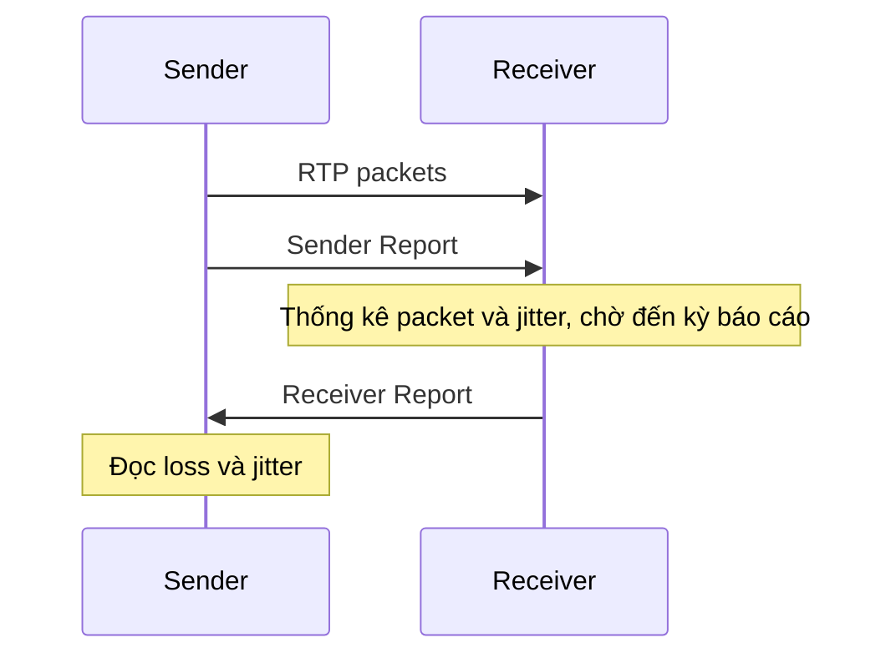

### B8.5. RR được sử dụng để làm gì trong sản phẩm?

Có hai chế độ.

- **Fixed:** sender tiếp tục truyền ảnh với cấu hình cố định.
- **AIMD:** sender sử dụng thông tin RR để điều chỉnh tham số ảnh nhằm thay đổi lượng dữ liệu cần truyền.

Trong chương trình Python thực tế, bộ điều khiển sử dụng packet loss và xu hướng jitter để quyết định thay đổi JPEG quality và resolution scale.

Một số quy tắc trong `abr.py`:

| Điều kiện                              | Hành động                        |
| -------------------------------------- | -------------------------------- |
| Loss báo cáo trên 5%                   | Giảm quality và resolution scale |
| Loss dưới 1%, jitter không tăng rõ rệt | Tích lũy báo cáo tốt             |
| Đủ ba báo cáo tốt                      | Tăng quality và resolution scale |
| Loss ở vùng trung gian                 | Giữ cấu hình hiện tại            |

**SOURCE — `AimdController.update()`.**

Ví dụ minh họa theo mã nguồn: nếu quality ban đầu bằng 75, scale bằng 1.0 và receiver báo loss 15%:

\[ Q_{\mathrm{new}}=\lfloor0.7\times75\rfloor=52 \qquad s_{\mathrm{resolution,new}}=0.9\times1=0.9 \]

Hai giá trị này không phải bitrate mới. Chúng là tham số mà encoder sử dụng để tạo ảnh. Kích thước JPEG thực tế sau thay đổi vẫn phụ thuộc nội dung ảnh.

Trong Session 2, chúng ta sẽ học thuật toán AIMD của SimEvents. Mô hình đó điều chỉnh trực tiếp hệ số kích thước byte, với bộ quy tắc riêng.

Không được sử dụng ngưỡng của Python để giải thích đồ thị AIMD trong mô hình.

### B8.6. Đọc kết quả RR thực tế

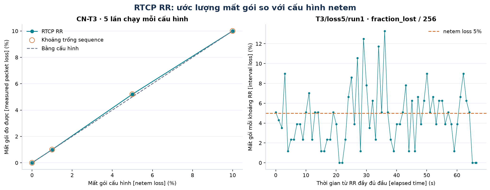

Hình bên trái so sánh packet loss cấu hình với packet loss đo được qua RR và sequence.

Hình bên phải biểu diễn fraction lost qua từng kỳ báo cáo trong một lần chạy CN-T3.

Hãy quan sát đường nét đứt ở mức 5%.

Mặc dù xác suất mất gói được cấu hình cố định, tỷ lệ mất quan sát được trong mỗi khoảng thời gian có thể thay đổi. Một kỳ có thể mất nhiều packet hơn và kỳ khác mất ít hơn.

Điều đó không có nghĩa cấu hình mạng đang tự thay đổi. Nó phản ánh biến động ngẫu nhiên của kết quả quan sát trong số lượng packet hữu hạn.

**MEASURED — CN-T3.**

Nếu RR bị mất trên đường phản hồi, sender không nhận được quan sát mới. Không được coi việc không nhận RR là dấu hiệu loss bằng 0.

## B9. Producer–consumer — khi AI xử lý chậm hơn tốc độ ảnh đến

### B9.1. Vấn đề không còn nằm ở đường truyền

Giả sử mạng rất tốt. Receiver nhận đủ tất cả các ảnh. Tuy nhiên, AI cần thời gian để xử lý từng ảnh.

Nếu receiver cung cấp ảnh nhanh hơn khả năng xử lý của AI, ảnh sẽ bắt đầu phải chờ.

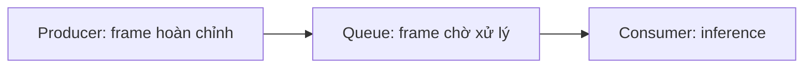

Producer (bên tạo công việc) cung cấp các frame hoàn chỉnh. Consumer (bên tiêu thụ công việc) thực hiện inference. Queue (hàng đợi) chứa các frame chưa được xử lý.

### B9.2. Tốc độ đến và tốc độ phục vụ

Gọi:

- \(\lambda\): tốc độ frame đến, đơn vị frame/s.
- \(T_s\): thời gian phục vụ một frame, đơn vị s.
- \(\mu\): tốc độ phục vụ tối đa, đơn vị frame/s.

\[ \boxed{\mu=\frac{1}{T_s}} \]

Ví dụ nếu mỗi lần inference cần 100 ms:

\[ T_s=0.1\text{ s} \qquad \mu=\frac{1}{0.1}=10\text{ frame/s} \]

Nếu ảnh đến với tốc độ 15 FPS thì \(\lambda=15\text{ frame/s}\). Ta có \(\lambda>\mu\).

Hàng đợi có xu hướng tăng nếu không loại bỏ dữ liệu.

Với một mô hình đơn giản có tốc độ ổn định, hàng đợi không giới hạn và không mất ảnh, lượng công việc tồn đọng tăng khoảng:

\[ 15-10=5\text{ frame/s} \]

Đó là **backlog (lượng công việc tồn đọng)**.

Trong sản phẩm thật, hàng đợi có giới hạn. Khi đầy, hệ thống phải quyết định bỏ ảnh nào.

## B10. FIFO và latest-value

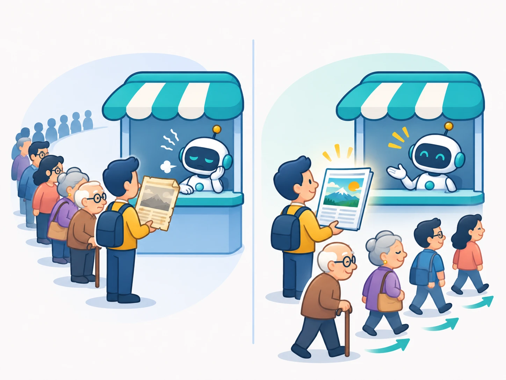

### B10.1. FIFO — giữ thứ tự đến

FIFO là First In, First Out. Frame nào vào hàng đợi trước sẽ được xử lý trước.

FIFO có ích khi thứ tự công việc quan trọng và cần bảo toàn các công việc đã được chấp nhận.

Nhưng đối với việc quan sát một cảnh đang thay đổi, FIFO có thể làm AI xử lý những ảnh đã cũ.

### B10.2. Latest-value — giữ ảnh mới nhất đang chờ

Latest-value hoạt động khác. Nếu một frame mới đến trong khi đã có frame đang chờ, frame cũ đang chờ sẽ được thay thế bằng frame mới.

Chú ý: latest-value không hủy frame mà AI đang xử lý. Nó chỉ thay thế frame đang chờ.

Đây là một hệ thống phục vụ **non-preemptive (không ngắt công việc đang xử lý)**.

### B10.3. Theo dõi từng frame trên timeline

Giả sử ảnh đến mỗi 40 ms. AI cần 100 ms cho mỗi ảnh.

**CALCULATED — ví dụ đơn giản, không phải cấu hình đo CN-T7.**

| Frame | Thời điểm đến |
| ----- | ------------- |
| F1    | 0 ms          |
| F2    | 40 ms         |
| F3    | 80 ms         |
| F4    | 120 ms        |
| F5    | 160 ms        |
| F6    | 200 ms        |

Tại 100 ms:

- FIFO bắt đầu xử lý F2, đã được tạo tại 40 ms.
- Latest-value bắt đầu xử lý F3, được tạo tại 80 ms.

Cả hai AI vẫn cần đúng 100 ms để xử lý ảnh.

Latest-value không tăng tốc AI. Nó chọn ảnh mới hơn.

### B10.4. Widget mô phỏng hai hàng đợi

Widget dưới đây mô phỏng một server với thời gian phục vụ cố định, FIFO giới hạn tám vị trí chờ và latest-value một vị trí chờ. Hai bên nhận cùng một chuỗi frame.

<div id="s1b-queue">
<style>
#s1b-queue{border:1px solid currentColor;border-radius:12px;padding:16px;margin:20px 0}
#s1b-queue input{width:100%;accent-color:#14b8a6}
#s1b-queue svg{width:100%;height:auto}
#s1b-queue .s1bq-results{display:grid;grid-template-columns:repeat(2,minmax(0,1fr));gap:12px}
#s1b-queue .s1bq-result{border:1px solid currentColor;border-radius:8px;padding:10px}
</style>
<h3>FIFO và Latest-value xử lý cùng một luồng ảnh</h3>
<label>Khoảng cách giữa frame: <strong class="s1bq-period-label"></strong>
<input class="s1bq-period" type="range" min="20" max="100" step="20" value="40">
</label>
<label>Thời gian inference: <strong class="s1bq-service-label"></strong>
<input class="s1bq-service" type="range" min="40" max="160" step="20" value="100">
</label>
<svg class="s1bq-svg" viewBox="0 0 650 190" role="img" aria-label="So sánh timeline xử lý frame"></svg>
<div class="s1bq-results"></div>
<small>CALCULATED — Cửa sổ quan sát 1200 ms, không drain.
Nếu sự kiện trùng thời điểm: hoàn thành, nhận frame, rồi chọn việc mới.</small>
<script>
(()=>{
 const r=document.getElementById("s1b-queue");
 const p=r.querySelector(".s1bq-period"),s=r.querySelector(".s1bq-service");
 const end=1200;
 function simulate(policy,P,S){
  let q=[],job=null,done=[],started=[],drop=0;
  for(let t=0;t<=end;t++){
   if(job&&job.finish===t){done.push(job);job=null}
   if(t<end&&t%P===0){
    const f={id:t/P+1,arrival:t};
    if(policy==="latest"&&q.length){q.pop();drop++}
    if(policy==="fifo"&&q.length>=8)drop++;
    else q.push(f);
   }
   if(!job&&q.length&&t<end){
    job={...q.shift(),start:t,finish:t+S};
    started.push(job);
   }
  }
  return {done,started,drop,waiting:q.length,busy:job?1:0};
 }
 function draw(){
  const P=Number(p.value),S=Number(s.value);
  r.querySelector(".s1bq-period-label").textContent=P+" ms";
  r.querySelector(".s1bq-service-label").textContent=S+" ms";
  const runs=[simulate("fifo",P,S),simulate("latest",P,S)];
  const names=["FIFO","Latest-value"],colors=["#4389d8","#14b8a6"];
  const x=t=>75+t*550/end;
  let svg="";
  runs.forEach((run,i)=>{
   const y=35+i*65;
   svg+=`<text x="5" y="${y+21}" font-size="12" fill="currentColor">${names[i]}</text>`;
   run.started.forEach(j=>{
    const w=x(Math.min(j.finish,end))-x(j.start);
    svg+=`<rect x="${x(j.start)}" y="${y}" width="${w}" height="32"
    fill="${colors[i]}" fill-opacity=".25" stroke="${colors[i]}"/>
    <text x="${x(j.start)+w/2}" y="${y+20}" font-size="10"
    text-anchor="middle" fill="currentColor">F${j.id}</text>`;
   });
  });
  for(let t=0;t<=end;t+=200)svg+=
   `<text x="${x(t)}" y="167" text-anchor="middle" font-size="11" fill="currentColor">${t}</text>`;
  svg+='<text x="350" y="187" text-anchor="middle" font-size="11" fill="currentColor">Thời gian (ms)</text>';
  r.querySelector(".s1bq-svg").innerHTML=svg;
  r.querySelector(".s1bq-results").innerHTML=runs.map((a,i)=>{
   const mean=a.done.length?a.done.reduce((v,j)=>v+j.start-j.arrival,0)/a.done.length:NaN;
   return `<div class="s1bq-result"><strong>${names[i]}</strong>
   <p>Hoàn thành: ${a.done.length}<br>Bỏ qua: ${a.drop}<br>
   Đang chờ: ${a.waiting}<br>Đang xử lý: ${a.busy}<br>
   Chờ trung bình của frame hoàn thành: ${isNaN(mean)?"N/A":mean.toFixed(1)+" ms"}</p></div>`;
  }).join("");
 }
 p.oninput=draw;s.oninput=draw;draw();
})();
</script>
</div>

Hãy giữ thời gian inference 100 ms, sau đó thay khoảng cách giữa các frame từ 40 lên 100 ms.

Khi ảnh đến chậm đủ để AI xử lý kịp, lợi ích của latest-value giảm đi.

Khi ảnh đến nhanh hơn, latest-value có thể giảm đáng kể thời gian chờ bằng cách bỏ những ảnh cũ chưa được xử lý.

### B10.5. Implementation thực tế

Trong `cn/rtp/rtp/edge_ai.py`, lớp `EdgeAI` có một worker xử lý các công việc được gửi vào hàng đợi.

Logic tiếp nhận frame có thể tóm tắt bằng sơ đồ:

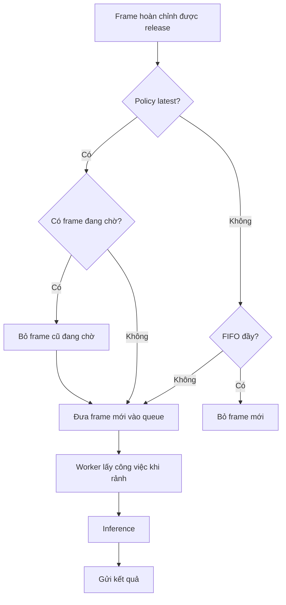

Đoạn code thực tế trong `EdgeAI.submit()`:

```python
if self.policy == "latest" and self._queue:
    skipped = self._queue.pop()
    self._write(skipped, status="skipped")
    self.skipped += 1
elif len(self._queue) >= self.queue_size:
    self._write(job, status="skipped")
    self.skipped += 1
    return False
self._queue.append(job)
```

Hàng đợi FIFO mặc định chứa tối đa tám frame đang chờ. Với latest-value, logic thay thế khiến chỉ một frame được giữ lại trong hàng đợi.

Frame đã được worker lấy ra xử lý không còn nằm trong hàng đợi này.

## B11. Latency và Age of Information

### B11.1. Latency — thời gian hoàn thành một ảnh

Giả sử frame được tạo lúc 100 ms. AI hoàn thành và kết quả được trả đến thiết bị gửi tại 250 ms.

Khi hai mốc thời gian được ghi trên cùng một đồng hồ:

\[ L=t_{\mathrm{result}}-t_{\mathrm{capture}} =250-100=150\text{ ms} \]

Đây là latency (độ trễ) của một kết quả cụ thể.

Tuy nhiên, điều gì xảy ra trong khoảng thời gian chưa có kết quả mới?

### B11.2. Age of Information — tuổi của thông tin đang có

Giả sử kết quả mới nhất mà chúng ta đang có thuộc một ảnh được tạo lúc 100 ms. Tại thời điểm hiện tại 250 ms, tuổi thông tin là:

\[ A(250)=250-100=150\text{ ms} \]

Nếu đến 300 ms vẫn chưa có kết quả mới:

\[ A(300)=300-100=200\text{ ms} \]

Thông tin trở nên cũ dần mặc dù không có thêm công việc nào được thực hiện.

Đó là **Age of Information (AoI — tuổi thông tin)**.

\[ \boxed{A(t)=t-u(t)} \]

Trong đó \(u(t)\) là thời điểm tạo ra thông tin mới nhất đã được nhận tại thời điểm \(t\).


*AoI có dạng răng cưa, tăng khi chưa có kết quả mới và giảm khi có thông tin mới hơn.*

Nếu một kết quả cũ hơn đến sau, nó không nên làm mất đi thông tin mới nhất đã có.

### B11.3. Tính mean AoI bằng diện tích dưới đường cong

Mean AoI không phải trung bình đơn giản của latency từng frame. Nó là trung bình theo thời gian:

\[ \boxed{ \overline A= \frac{1}{T_1-T_0} \int_{T_0}^{T_1}A(t)\,dt } \]

Xét ví dụ sau.

| Kết quả | Capture | Result receipt | Latency |
| ------- | ------- | -------------- | ------- |
| R1      | 0 ms    | 100 ms         | 100 ms  |
| R2      | 100 ms  | 200 ms         | 100 ms  |
| R3      | 300 ms  | 400 ms         | 100 ms  |

Cả ba kết quả có latency giống nhau, đều bằng 100 ms. Nhưng giữa R2 và R3, chúng ta phải chờ 200 ms mới có thông tin mới.

Diện tích AoI từ 100 đến 200 ms:

\[ S_1=\frac{100+200}{2}(200-100) =15000\text{ ms}^2 \]

Diện tích từ 200 đến 400 ms:

\[ S_2=\frac{100+300}{2}(400-200) =40000\text{ ms}^2 \]

Mean AoI trong cửa sổ 100–400 ms:

\[ \overline A=\frac{15000+40000}{300} \qquad \boxed{\overline A=183.33\text{ ms}} \]

**CALCULATED.**

Mặc dù mọi kết quả có latency bằng 100 ms, mean AoI lớn hơn 100 ms. Bởi vì giữa những lần nhận kết quả, thông tin vẫn tiếp tục cũ đi.

### B11.4. Interactive AoI sawtooth

Trong trường hợp lý tưởng có các kết quả định kỳ với latency không đổi:

\[ \boxed{\overline A=L+\frac{T_{\mathrm{update}}}{2}} \]

<div id="s1b-aoi">
<style>
#s1b-aoi{border:1px solid currentColor;border-radius:12px;padding:16px;margin:20px 0}
#s1b-aoi input{width:100%;accent-color:#14b8a6}
#s1b-aoi svg{width:100%;height:auto}
</style>
<h3>Latency và tuổi thông tin</h3>
<label>Chu kỳ kết quả: <strong class="s1ba-ptext"></strong>
<input class="s1ba-p" type="range" min="50" max="300" step="25" value="150">
</label>
<label>Latency mỗi kết quả: <strong class="s1ba-ltext"></strong>
<input class="s1ba-l" type="range" min="20" max="200" step="10" value="100">
</label>
<svg class="s1ba-svg" viewBox="0 0 600 230" role="img" aria-label="Đồ thị tuổi thông tin răng cưa"></svg>
<p class="s1ba-result" aria-live="polite"></p>
<small>CALCULATED — Kết quả định kỳ và latency không đổi.
Mean AoI tính trên các chu kỳ đầy đủ.</small>
<script>
(()=>{
 const r=document.getElementById("s1b-aoi");
 const p=r.querySelector(".s1ba-p"),l=r.querySelector(".s1ba-l");
 function draw(){
  const P=Number(p.value),L=Number(l.value),mean=L+P/2;
  const x=t=>40+.54*t,y=a=>195-.35*a;
  let s='<path d="M40 10 V195 H580" stroke="currentColor" fill="none"/>';
  for(let a=0;a<=500;a+=100)s+=
   `<path d="M40 ${y(a)} H580" stroke="currentColor" opacity=".12"/>
    <text x="33" y="${y(a)+4}" text-anchor="end" fill="currentColor">${a}</text>`;
  let d=`M${x(0)} ${y(L)}`;
  for(let t=0;t<1000;t+=P){
   const next=Math.min(t+P,1000);
   d+=` L${x(next)} ${y(L+next-t)}`;
   if(next<1000)d+=` V${y(L)}`;
  }
  s+=`<path d="${d}" stroke="#14b8a6" stroke-width="2.5" fill="none"/>
  <path d="M40 ${y(mean)} H580" stroke="#f59e0b" stroke-dasharray="5 3"/>`;
  for(const t of [0,250,500,750,1000])s+=
   `<text x="${x(t)}" y="216" text-anchor="middle" fill="currentColor">${t}</text>`;
  r.querySelector(".s1ba-svg").innerHTML=s;
  r.querySelector(".s1ba-ptext").textContent=P+" ms";
  r.querySelector(".s1ba-ltext").textContent=L+" ms";
  r.querySelector(".s1ba-result").textContent=
   `Mean latency: ${L} ms — Mean AoI: ${mean} ms`;
 }
 p.oninput=draw;l.oninput=draw;draw();
})();
</script>
</div>

*Đường nét đứt biểu diễn mean AoI trên các chu kỳ đầy đủ.*

Hãy giữ latency không đổi và tăng khoảng cách giữa các kết quả. Mean AoI tăng lên.

Điều này giải thích tại sao một hệ thống có latency thấp vẫn có thể cung cấp thông tin cũ nếu kết quả mới xuất hiện quá ít.

## B12. CN-T7 — cải tiến đã được đo trên sản phẩm thật

Đây là kết quả quan trọng mà chúng ta cần hiểu sau khi học FIFO, latest-value và AoI.

Nhóm so sánh hai chính sách hàng đợi inference trong điều kiện thí nghiệm sử dụng synthetic AI.

### B12.1. Kết quả thực tế

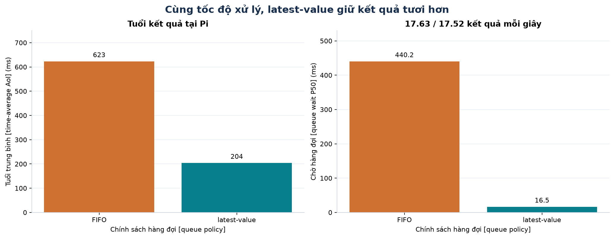

| Đại lượng          | FIFO      | Latest-value |
| ------------------ | --------- | ------------ |
| Mean AI-result AoI | 623 ms    | 204 ms       |
| AI results/s       | 17.63     | 17.52        |
| Frames skipped     | 802       | 809          |
| Queue wait P50     | 440.20 ms | 16.48 ms     |
| Queue wait P95     | 461.57 ms | 31.53 ms     |
| Capture-to-AI P50  | 599.90 ms | 175.47 ms    |
| Capture-to-AI P95  | 621.20 ms | 191.67 ms    |

**MEASURED — `hw_tables.md`, CN-T7, năm lần chạy mỗi chính sách.**

### B12.2. Tại sao mean AoI giảm?

Hãy đọc ba đại lượng theo thứ tự.

**Thứ nhất: queue waiting time.** FIFO có P50 queue wait bằng 440.20 ms. Latest-value giảm xuống 16.48 ms. Điều đó cho thấy frame được lấy ra xử lý sớm hơn nhiều so với thời điểm nó vào hàng đợi.

**Thứ hai: capture-to-result latency.** Khi thời gian chờ giảm, kết quả trả về có thể đại diện cho ảnh mới hơn.

**Thứ ba: mean AoI.** Nhờ các kết quả có độ tuổi thấp hơn khi được nhận, thông tin tại thiết bị gửi cũng mới hơn theo thời gian.

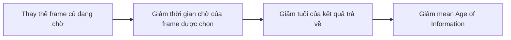

Tỷ lệ giảm AoI là:

\[ \frac{623-204}{623}\times100\% \qquad \boxed{\approx67.3\%} \]

**CALCULATED từ kết quả MEASURED.**

### B12.3. P50 và P95 có nghĩa gì?

Giả sử nhóm đo nhiều giá trị thời gian chờ. Sau đó sắp xếp chúng từ nhỏ đến lớn.

- P50 là trung vị, nằm ở khoảng giữa tập dữ liệu.
- P95 là phân vị 95%, phản ánh vùng thời gian chờ cao hơn của phần lớn mẫu.

P95 không phải độ trễ lớn nhất. Mean AoI cũng không phải P50 latency. Mỗi chỉ số trả lời một câu hỏi khác nhau về hệ thống.

### B12.4. Cần chú ý đồng hồ đo

Trong CN-T7, mean AoI được tính từ thời điểm capture và thời điểm Pi nhận lại kết quả AI. Hai timestamp dùng để tính khoảng thời gian tổng được ghi trên Pi.

Thời gian chờ và inference tại laptop được tính bằng các timestamp tại laptop.

Không được trực tiếp lấy một timestamp trên laptop trừ một timestamp trên Pi nếu chưa thiết lập được quan hệ thời gian giữa hai đồng hồ.

Chúng ta sẽ phân tích sâu hơn kiến trúc đo thời gian trong Phần C và Session 2, CN-T9.

### B12.5. CN-T7 chứng minh được điều gì?

Thí nghiệm chứng minh rằng trong workload đã khảo sát, latest-value giảm tuổi thông tin mà không làm thay đổi đáng kể số kết quả được xử lý mỗi giây.

Nó không chứng minh AI thực hiện phép toán nhanh hơn.

Nó cũng không chứng minh độ chính xác của mô hình neural thật được cải thiện, vì CN-T7 sử dụng synthetic inference.

Đây là cải tiến về **queue management (quản lý hàng đợi)** và freshness (tính mới của thông tin).

## B13. Tổng kết toàn bộ cơ chế truyền thông

Sau Phần B, hãy phân biệt được bốn vấn đề kỹ thuật:

| Vấn đề                       | Cơ chế xử lý                      |
| ---------------------------- | --------------------------------- |
| Ảnh quá lớn                  | RTP packetization                 |
| Mất mảnh hoặc đến sai thứ tự | Sequence, byte offset, reassembly |
| Thời gian đến không đều      | Jitter estimation và playout      |
| AI xử lý không kịp ảnh mới   | Latest-value và quản lý freshness |

RTCP cung cấp phản hồi để sender quan sát tình trạng tiếp nhận. AIMD sử dụng phản hồi đó để thích nghi.

## B14. Kiểm tra hiểu bài

<div class="quiz" markdown>
<p class="quiz-q">Các packet thuộc cùng một frame thường có trường nào giống nhau?</p>

- [ ] Sequence number
- [x] RTP timestamp
- [ ] Byte offset
- [ ] Marker luôn bằng 1

<div class="quiz-why" markdown>
Các mảnh thuộc cùng thời điểm media. Sequence và offset phân biệt từng mảnh.
</div>
</div>

<div class="quiz" markdown>
<p class="quiz-q">RTP payload Python giới hạn 1200 B. Mảnh đầu chứa tối đa bao nhiêu byte JPEG?</p>

- [ ] 1200 B
- [ ] 1192 B
- [x] 1188 B
- [ ] 1248 B

<div class="quiz-why" markdown>
Mảnh đầu có 8 B fragment header và 4 B tổng chiều dài. Còn lại 1188 B dữ liệu ảnh.
</div>
</div>

<div class="quiz" markdown>
<p class="quiz-q">Đã nhận marker nhưng thiếu một mảnh ở giữa. Frame có hoàn chỉnh không?</p>

- [ ] Có, vì đã nhận marker
- [x] Không, vì thiếu dữ liệu
- [ ] Có, vì đã nhận đa số mảnh
- [ ] Có, vì UDP tự truyền lại mảnh thiếu

<div class="quiz-why" markdown>
Marker chỉ đánh dấu mảnh cuối. Receiver vẫn cần đầy đủ các đoạn byte bắt buộc.
</div>
</div>

<div class="quiz" markdown>
<p class="quiz-q">Ảnh ghép đủ tại 145 ms, deadline 136.67 ms và vẫn trong late window. Trạng thái là gì?</p>

- [ ] OK
- [x] LATE
- [ ] LOST
- [ ] Không thể phân loại

<div class="quiz-why" markdown>
Ảnh ghép đủ nhưng quá deadline, nên bị phân loại late và không đưa vào inference.
</div>
</div>

<div class="quiz" markdown>
<p class="quiz-q">RR có fraction_lost bằng 38. Loss giải mã là bao nhiêu?</p>

- [ ] 38%
- [ ] 0.38%
- [x] 14.84%
- [ ] 256%

<div class="quiz-why" markdown>
Loss giải mã bằng 38/256, tương đương khoảng 14.84375%.
</div>
</div>

<div class="quiz" markdown>
<p class="quiz-q">Vì sao latest-value giảm AoI trong CN-T7?</p>

- [ ] AI tính toán nhanh hơn ba lần
- [ ] Mạng truyền packet nhanh hơn
- [x] AI chọn frame mới hơn, giảm thời gian chờ
- [ ] Mọi frame đều được xử lý

<div class="quiz-why" markdown>
Latest-value thay đổi chính sách hàng đợi, không tăng năng lực xử lý của AI. Kết quả trả về đại diện cho thông tin mới hơn.
</div>
</div>

## B15. Câu thầy có thể hỏi

??? question "Tại sao nhóm dùng RTP trên UDP mà không chỉ dùng UDP?"

    Dạ, UDP cung cấp datagram nhưng không có sẵn thông tin về thứ tự và thời điểm media. RTP bổ sung sequence, timestamp và nhận dạng nguồn. Fragment header riêng giúp receiver xác định vị trí từng mảnh JPEG để ghép lại ảnh.

??? question "Tăng playout buffer có phải lúc nào cũng tốt không?"

    Dạ không. Buffer lớn cho packet thêm thời gian đến, nhưng làm tăng latency. Trong CN-T4, tăng depth từ 20 lên 100 ms làm tỷ lệ frame muộn giảm từ 93.5% xuống 0%, còn latency trung vị tăng từ 37.91 lên 117.68 ms.

??? question "Tại sao latest-value giảm AoI nhưng throughput gần như không đổi?"

    Dạ, AI không được tăng tốc. Chính sách latest-value giữ frame mới nhất đang chờ, giúp AI không phải xử lý quá nhiều ảnh cũ. CN-T7 đo được AoI giảm từ 623 xuống 204 ms, trong khi số kết quả mỗi giây gần như không đổi. Thí nghiệm sử dụng synthetic inference.
