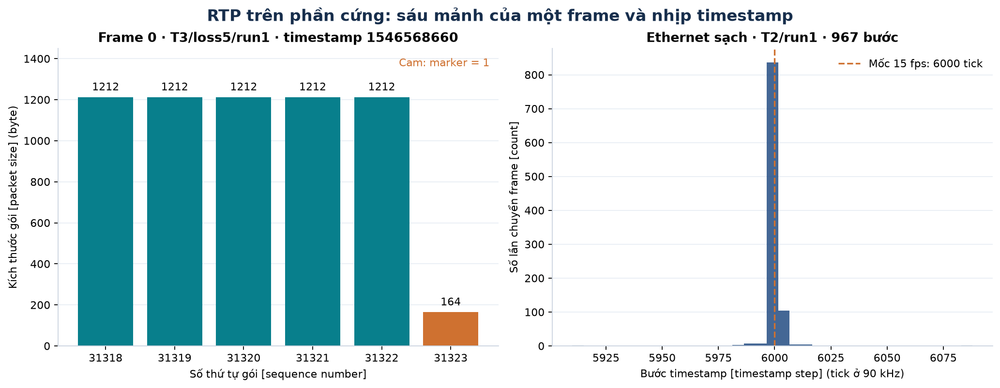

# Session 1 — B. RTP, receiver và producer–consumer

Sau phần này, bạn giải thích được tại sao mất một packet có thể làm hỏng cả frame, vì sao buffer thêm trễ và vì sao kết quả AI có thể quá cũ.

## B1. Header và packetization (chia gói)

Panel trái là kích thước packet theo sequence của một frame T3; cột cuối có marker=1. Panel phải là histogram bước timestamp ở T2, tập trung gần 6000 tick. Sequence nhận diện packet; RTP timestamp biểu diễn thời điểm lấy mẫu media, không phải thời điểm packet đến. Các mảnh cùng frame dùng chung timestamp.

SOURCE: [`packet.py`](https://github.com/KaiserRichard/edge-ai-video-runtime/blob/main/cn/rtp/rtp/packet.py), [`payload.py`](https://github.com/KaiserRichard/edge-ai-video-runtime/blob/main/cn/rtp/rtp/payload.py), [`sender.py`](https://github.com/KaiserRichard/edge-ai-video-runtime/blob/main/cn/rtp/rtp/sender.py) trong `cn/rtp/rtp/`. RTP header cơ bản 12 byte, PT=96, sequence 16 bit, timestamp 32 bit, SSRC nhận diện nguồn. Sequence quay vòng modulo 65536. Timestamp video dùng clock rate 90 kHz và offset ngẫu nhiên ở sender. Với 15 FPS, bước timestamp danh định (CALCULATED) là 6000. Giá trị thực có thể lệch chút vì thời điểm capture không hoàn toàn đều.

Payload của dự án không phải RFC 2435: frame ID u32, byte offset u24, flags u8 (8 B); mảnh đầu thêm 4 B tổng chiều dài JPEG. Cờ marker đánh dấu packet cuối, không chứng minh đủ mảnh.

Ví dụ trong bài cũ: ảnh 6000 B và sức chứa dữ liệu ảnh 1200 B cho 5 packet (CALCULATED, mô hình đơn giản). **Phân biệt SOURCE hiện tại:** `fragment_jpeg` giới hạn toàn bộ RTP payload ở 1200 B, nên mảnh đầu chứa tối đa 1188 B ảnh, mảnh sau 1192 B. Ảnh đúng 6000 B cần 6 packet theo mã này. Với IPv4 không option, UDP 8 B và RTP 12 B, IP datagram tối đa 1240 B khi giới hạn payload 1200 B. Mô hình SimEvents dùng 1200 B dữ liệu ảnh và overhead 48 B, ra 1248 B. Không trộn hai quy ước. Bảng T5 lịch sử dùng ước lượng payload + 48 B; giữ số đo, nhưng ghi rõ quy ước.

## B2. Loss (mất gói), reassembly (ghép ảnh)

Giả sử tất cả N mảnh đều cần thiết và mất độc lập xác suất p. Khi đó

\[
P_{\mathrm{success}}=(1-p)^N,\qquad P_{\mathrm{loss}}=1-(1-p)^N.
\]

Ví dụ minh họa: 4 frame, mỗi frame 5 packet. Mất 4 packet rải mỗi frame một packet có thể làm hỏng cả 4 frame. Mất 4 packet cùng một frame chỉ làm hỏng một frame. Cùng số packet mất, cấu trúc burst khác nhau tạo kết quả khác nhau. Công thức trên không trực tiếp áp dụng cho mất gói có tương quan.

## B3. Jitter và playout

Jitter (dao động thời gian đến) không đồng nghĩa với độ trễ trung bình. Một kênh có delay cố định lớn vẫn có thể có jitter thấp. RTP receiver dùng chênh lệch giữa khoảng đến và khoảng thời gian media. Session 2 B8 sẽ đi sâu công thức RFC 3550.

Đọc trục thời gian và đường ước lượng jitter; không đọc đường này như one-way delay. Receiver lấy mốc packet đầu, cộng khoảng media theo timestamp và buffer depth để đặt deadline (hạn phát). Ảnh ghép đủ sau deadline vẫn là ảnh muộn, không phải ảnh đúng hạn. Python phân loại `ok`, `late`, `lost` bằng deadline và late window (SOURCE: [`playout.py`](https://github.com/KaiserRichard/edge-ai-video-runtime/blob/main/cn/rtp/rtp/playout.py), `add`, `_finish`).

Tăng độ sâu buffer cho packet thêm thời gian đến, nhưng cũng làm ảnh già hơn. Buffer không phục hồi byte đã mất. T4 là phép đo trade-off, không phải bằng chứng rằng buffer càng lớn càng tốt.

## B4. RTCP và feedback (phản hồi)

Sender Report (SR) cung cấp thông tin của nguồn gửi. Receiver Report (RR) chứa loss, extended highest sequence, jitter và thông tin hỗ trợ RTT. RTT là thời gian khứ hồi, không phải hai lần one-way delay trong mọi trường hợp. Sender đọc RR để cập nhật AIMD nếu được bật. Mạnh chịu trách nhiệm tạo RR, Hiếu chịu trách nhiệm sử dụng RR.

Đọc các báo cáo theo thời gian/cấu hình; phân biệt loss tích lũy và loss trong kỳ báo cáo. Mất RR nghĩa là sender thiếu quan sát mới, không phải tự nhiên kênh tốt.

## B5. Producer–consumer và hàng đợi AI

Producer sinh frame với tốc độ \(\lambda\), consumer xử lý tốc độ \(\mu=1/T_s\). Ví dụ minh họa đã học: 15 FPS và service 100 ms, tức 10 frame/s. \(\lambda>\mu\), nên FIFO tích backlog nếu không bỏ dữ liệu. Với latest-value, ta chỉ giữ frame mới nhất đang chờ. Không cắt ngang frame đang chạy.

Latency là thời gian từ capture đến result của một frame. Age of Information (AoI — tuổi thông tin) là tuổi của thông tin mới nhất đang có, tăng dần khi chưa có kết quả mới. Hai đại lượng không giống nhau.

T7 cho thấy AoI giảm từ 623 xuống 204 ms trong khi số kết quả/s gần như không đổi (MEASURED, synthetic service). Chi tiết ở Session 2 C6. Cơ chế này liên quan trực tiếp đến tính mới của dữ liệu bên OS, nhưng bằng chứng và đồng hồ đo khác nhau.

## B. Trắc nghiệm cuối phần

Hai packet thuộc một frame có trường nào thường giống nhau?

- [ ] Sequence
- [x] RTP timestamp
- [ ] Marker luôn bằng 1
- [ ] Byte offset

Cùng một thời điểm lấy mẫu media. Sequence và byte offset phân biệt từng mảnh.

Buffer lớn có sửa được packet bị mất không?

- [ ] Có, vì tăng bitrate
- [ ] Có, vì sửa CRC
- [x] Không, chỉ cho thêm thời gian chờ packet đến
- [ ] Có, vì RTCP gửi JPEG thay thế

Chờ chỉ giúp packet còn đang đi trên mạng.

15 frame/s, service 100 ms. Kết luận?

- [ ] Consumer xử lý 100 frame/s
- [ ] FIFO chắc chắn không đầy
- [x] Consumer 10 frame/s, có nguy cơ backlog
- [ ] Latest tăng tốc độ CPU

Consumer chậm hơn producer. Latest thay chính sách chờ chứ không tăng năng lực tính toán.

RR dùng để làm gì?

- [ ] Mang toàn bộ ảnh JPEG
- [x] Cung cấp thống kê tiếp nhận cho sender
- [ ] Thay tất cả các RTP packet
- [ ] Đo trực tiếp chính xác độ trễ một chiều

RR là đường phản hồi; không chứa toàn bộ ảnh và không tự đồng bộ đồng hồ.

