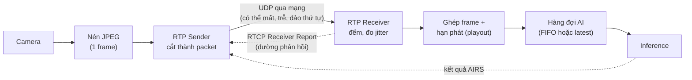
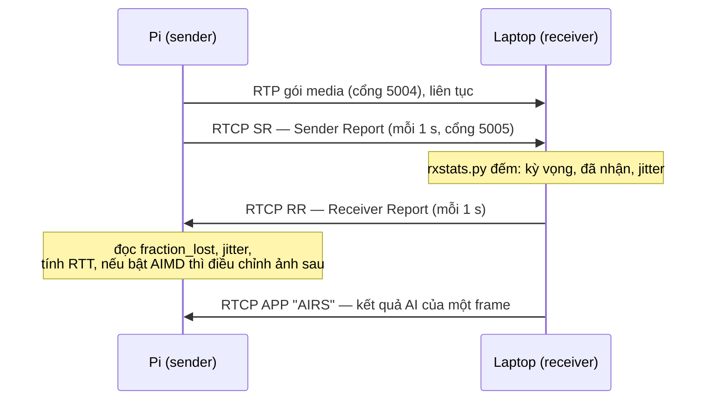

# Session 1 — B. RTP, receiver và producer–consumer

Ở Session 1A, bạn đã thấy sản phẩm từ xa: Raspberry Pi 5 chụp ảnh, nén JPEG, gửi qua mạng sang laptop; laptop ghép ảnh lại, chạy AI rồi gửi kết quả về. Bài này mở từng "hộp" trên đường đi đó và hỏi: **bên trong nó thực sự làm gì, và tại sao phải làm như vậy?**

Sau bài này, bạn sẽ tự giải thích được bằng lời của mình:

1. Tại sao video thời gian thực dùng **UDP** chứ không dùng **TCP**.
2. Một gói tin của nhóm gồm những lớp "nhãn" nào, mỗi lớp dài bao nhiêu byte.
3. Từng trường của **RTP header** — sequence, timestamp 90 kHz, SSRC, marker, PT 96 — để làm gì.
4. Vì sao một **frame** (ảnh) phải cắt thành nhiều **packet** (gói), và mất một gói thì cả ảnh hỏng.
5. Máy nhận ghép ảnh, đo **jitter**, đặt **hạn phát (playout deadline)** như thế nào.
6. Máy nhận "báo cáo" cho máy gửi bằng **RTCP Receiver Report** ra sao.
7. Vì sao hàng đợi trước AI có thể làm kết quả AI **cũ** dù AI chạy đúng tốc độ, và đại lượng **Age of Information (AoI)** đo cái "cũ" đó thế nào — kèm kết quả đo thật **CN-T7**: tuổi trung bình của kết quả giảm từ 623 ms xuống 204 ms.

!!! info "Cách đọc bài"
    Mỗi phần đi theo ba tầng. **Hiểu bản chất**: ví dụ đời thường và sơ đồ đơn giản. **Hiểu dự án**: công thức, phép tính từng bước, mã nguồn thật và số đo thật. **Đào sâu để bảo vệ**: các hộp `???` mở rộng, chứa chi tiết mã và câu hỏi vặn — bạn có thể bỏ qua khi đọc lần đầu, nhưng nên mở trước buổi bảo vệ.

    Nhãn số liệu nằm ngay trong câu: **SOURCE** (đọc từ mã nguồn hoặc file cấu hình), **MEASURED** (đo trên phần cứng), **SIMULATED** (từ mô phỏng), **CALCULATED** (tự tính từ các số đã nêu), **Ví dụ minh họa** (số do bài giảng đặt ra để dạy, không phải số đo), **UNVERIFIED** (chưa kiểm chứng được từ tệp nguồn).

Toàn bộ bài bám theo một đường ống duy nhất. Hãy giữ hình này trong đầu suốt bài:



Đường liền là **đường đi thuận** của ảnh. Hai đường nét đứt là **đường ngược**: báo cáo chất lượng mạng (RTCP RR) và kết quả AI (AIRS). Mỗi phần dưới đây phóng to một khối.

---

## B0. Ôn nhanh năm từ cơ bản: byte, ảnh, frame, packet, header/payload

Nếu bạn đã đọc kỹ 1A, phần này chỉ mất hai phút. Nhưng đừng bỏ qua, vì cả bài sẽ tính bằng byte.

- **Bit** là một chữ số 0 hoặc 1. **Byte** là 8 bit. Kích thước dữ liệu đo bằng byte (B); tốc độ mạng đo bằng bit mỗi giây (b/s). Đổi byte sang bit thì nhân 8.
- **Ảnh JPEG** là một dãy byte. Với nhóm, một ảnh 640×480 nén ở quality 75 thường dài khoảng 6–7 nghìn byte (xem 1A).
- **Frame (khung hình)** là *một* ảnh chụp ở *một* thời điểm. Video là chuỗi frame. Ở 15 frame mỗi giây (15 FPS), hai frame cách nhau \(1/15\text{ s}\approx 66{,}67\text{ ms}\).
- **Packet (gói tin)** là một khối dữ liệu mạng gửi đi trong một lần. Mạng giới hạn kích thước mỗi gói, nên một frame 6 nghìn byte phải cắt thành nhiều gói.
- Mỗi gói có **header (phần đầu, "nhãn trên phong bì")** và **payload (phần ruột, "lá thư bên trong")**. Header nói gói này là gì, của ai, thứ mấy; payload là một mảnh byte của ảnh.

!!! tip "Hình dung"
    Bạn gửi một cuốn sách dày qua bưu điện, nhưng bưu điện chỉ nhận phong bì mỏng. Bạn xé sách thành nhiều tập, mỗi tập cho vào một phong bì. Trên mỗi phong bì bạn ghi: "sách số 7, tập thứ 3, tổng cộng 6 tập". **Tập giấy** là payload, **dòng ghi trên phong bì** là header. Người nhận chỉ đọc được sách khi có đủ cả 6 tập.

<p class="key">Frame là một ảnh; packet là một phong bì chứa một mảnh ảnh; header là nhãn ghi trên phong bì, payload là mảnh ảnh bên trong.</p>

---

## B1. Tại sao video trực tiếp dùng UDP chứ không dùng TCP?

### B1.1. Vấn đề

Mạng giữa Pi và laptop không hoàn hảo. Một gói có thể **mất** (bộ đệm ở switch đầy, nhiễu Wi-Fi), có thể **đến muộn**, và hai gói gửi liên tiếp có thể **đến ngược thứ tự** nếu chúng đi qua hàng đợi hoặc đường khác nhau.

Có hai cách phản ứng. Cách thứ nhất: phát hiện gói mất rồi **gửi lại** cho đến khi nhận được, và không giao dữ liệu phía sau cho ứng dụng cho tới khi lỗ hổng được lấp. Đó là cách của **TCP (Transmission Control Protocol)**. Cách thứ hai: cứ gửi từng gói độc lập, mất thì thôi, ứng dụng tự lo. Đó là cách của **UDP (User Datagram Protocol)**.

Với tải tệp, cách thứ nhất là đúng: một tệp thiếu một byte là tệp hỏng. Nhưng với video trực tiếp cho AI, "chờ cho đủ" lại gây hại. Hãy xem ví dụ.

### B1.2. Ví dụ đơn giản: một gói mất làm tắc cả hàng

Ví dụ minh họa: camera 15 FPS, cứ 66,67 ms có một frame mới. Gói thứ 3 của frame 1 bị mất. Giả sử việc phát hiện mất và gửi lại tốn khoảng 150 ms.

| Thời điểm (ms) | Với TCP (đòi đủ, đúng thứ tự) | Với UDP + RTP (gửi tiếp, tự xử lý) |
|---|---|---|
| 0 | Frame 1 gửi đi, gói 3 mất | Frame 1 gửi đi, gói 3 mất |
| 66,7 | Frame 2 đến laptop nhưng **bị giữ lại** vì frame 1 còn thiếu | Frame 2 đến, ghép đủ, giao cho AI |
| 133,3 | Frame 3 đến, **vẫn bị giữ** | Frame 3 giao cho AI |
| ≈150 | Gói 3 được gửi lại tới nơi; frame 1, 2, 3 cùng lúc được giải phóng | Frame 1 bị đánh dấu hỏng, bỏ qua |
| Kết quả | AI nhận một cụm ảnh **cũ** cùng lúc, ảnh mới bị đẩy lùi | AI mất 1 ảnh, nhưng mọi ảnh khác đến **đúng nhịp** |

Hiện tượng ở cột TCP gọi là **head-of-line blocking (tắc đầu hàng)**: một gói mất ở đầu hàng làm tất cả gói phía sau phải đợi, dù chúng đã đến nơi.

Với AI quan sát cảnh đang diễn ra, một ảnh chụp từ 150 ms trước thường đã kém giá trị hơn ảnh vừa chụp. Bỏ một ảnh hỏng còn tốt hơn làm trễ cả chuỗi.

### B1.3. Thuật ngữ

- **UDP (User Datagram Protocol — giao thức gói dữ liệu người dùng)** gửi mỗi gói như một bức thư độc lập. UDP **không** đảm bảo gói đến nơi, **không** đảm bảo thứ tự, **không** gửi lại. Nó chỉ thêm 8 byte header: cổng nguồn, cổng đích, độ dài, checksum.
- **TCP** đảm bảo dữ liệu đến đủ và đúng thứ tự bằng cách đánh số, xác nhận (ACK) và gửi lại. Cái giá là độ trễ khi có mất gói.
- **RTP (Real-time Transport Protocol — giao thức truyền thời gian thực)** chạy **bên trên** UDP. RTP **không** làm UDP tin cậy hơn. Nó chỉ dán thêm nhãn (số thứ tự, mốc thời gian media, mã nguồn) để **máy nhận tự biết** gói nào mất, gói nào đảo thứ tự, gói nào thuộc ảnh nào.

!!! warning "Hiểu lầm hay gặp khi bảo vệ"
    "Dùng RTP thì không mất gói." — **Sai.** RTP chỉ giúp *phát hiện* mất gói và *sắp xếp* lại. Gói mất trên mạng vẫn mất hẳn; sản phẩm của nhóm không gửi lại gói RTP.

### B1.4. Trong dự án

Trong `cn/rtp/rtp/sender.py`, hàm `open_udp_pair` mở hai socket UDP (`socket.SOCK_DGRAM`): một cho RTP ở **cổng chẵn**, một cho RTCP ở **cổng lẻ ngay sau** (SOURCE, theo quy ước RFC 3550 §11). Mặc định máy nhận nghe RTP ở cổng 5004, nên RTCP ở 5005 (SOURCE: `receiver.py`, `--port` mặc định 5004; `sender.py`, `control_destination = port + 1`).

Không có dòng nào trong `sender.py` gửi lại gói đã gửi. Mỗi packet được `sendto` một lần rồi thôi.

??? question "Thầy hỏi: Vậy sao không dùng TCP rồi tắt cơ chế gửi lại đi?"
    "Thưa thầy, TCP không cho ứng dụng tắt việc gửi lại hay bỏ qua thứ tự; đó là bản chất của giao thức. Nếu muốn 'mất thì bỏ', ta phải dùng UDP. RTP được thiết kế đúng cho việc này: nó cung cấp số thứ tự và mốc thời gian để ứng dụng tự quyết định chờ hay bỏ, thay vì giao thức quyết định thay."

<p class="key">UDP gửi nhanh nhưng không hứa gì; RTP dán nhãn lên mỗi gói để máy nhận tự phát hiện mất và đảo thứ tự. Với video cho AI, bỏ một ảnh hỏng tốt hơn làm trễ cả chuỗi.</p>

---

## B2. Một gói tin của nhóm gồm những lớp nào? (đóng gói lồng nhau)

### B2.1. Vì sao lại có nhiều lớp nhãn?

Mỗi tầng mạng cần một loại thông tin khác nhau. Router cần biết **máy nào** nhận (địa chỉ IP). Hệ điều hành ở máy nhận cần biết **chương trình nào** nhận (cổng UDP). Chương trình nhận cần biết **gói này thuộc dòng video nào, thứ mấy, chụp lúc nào** (RTP). Và chương trình của nhóm cần biết **mảnh này nằm ở vị trí byte nào trong ảnh JPEG** (header riêng của nhóm).

Thay vì một nhãn khổng lồ, mỗi tầng bọc thêm một lớp phong bì bên ngoài. Cách bọc lồng này gọi là **encapsulation (đóng gói lồng nhau)**.

### B2.2. Sơ đồ một gói đầy

<svg viewBox="0 0 780 170" width="100%" style="max-width:780px;display:block;margin:1rem auto;" role="img" aria-label="Các lớp header của một gói RTP đầy trong dự án">
  <rect x="10" y="30" width="90" height="50" rx="4" fill="rgba(99,102,241,0.18)" stroke="currentColor"/>
  <text x="55" y="52" text-anchor="middle" fill="currentColor" font-size="13" font-weight="700">IPv4</text>
  <text x="55" y="70" text-anchor="middle" fill="currentColor" font-size="12">20 B</text>
  <rect x="100" y="30" width="70" height="50" rx="4" fill="rgba(20,184,166,0.18)" stroke="currentColor"/>
  <text x="135" y="52" text-anchor="middle" fill="currentColor" font-size="13" font-weight="700">UDP</text>
  <text x="135" y="70" text-anchor="middle" fill="currentColor" font-size="12">8 B</text>
  <rect x="170" y="30" width="80" height="50" rx="4" fill="rgba(245,158,11,0.22)" stroke="currentColor"/>
  <text x="210" y="52" text-anchor="middle" fill="currentColor" font-size="13" font-weight="700">RTP</text>
  <text x="210" y="70" text-anchor="middle" fill="currentColor" font-size="12">12 B</text>
  <rect x="250" y="30" width="100" height="50" rx="4" fill="rgba(236,72,153,0.18)" stroke="currentColor"/>
  <text x="300" y="50" text-anchor="middle" fill="currentColor" font-size="12" font-weight="700">Header mảnh</text>
  <text x="300" y="68" text-anchor="middle" fill="currentColor" font-size="12">8 B (+4 B mảnh đầu)</text>
  <rect x="350" y="30" width="420" height="50" rx="4" fill="rgba(148,163,184,0.15)" stroke="currentColor"/>
  <text x="560" y="52" text-anchor="middle" fill="currentColor" font-size="13" font-weight="700">Dữ liệu JPEG</text>
  <text x="560" y="70" text-anchor="middle" fill="currentColor" font-size="12">tối đa 1188 B (mảnh đầu) hoặc 1192 B (mảnh sau)</text>
  <line x1="250" y1="100" x2="770" y2="100" stroke="currentColor"/>
  <text x="510" y="118" text-anchor="middle" fill="currentColor" font-size="12">RTP payload ≤ 1200 B (tham số --mtu-payload)</text>
  <line x1="170" y1="138" x2="770" y2="138" stroke="currentColor"/>
  <text x="470" y="156" text-anchor="middle" fill="currentColor" font-size="12">Gói RTP ≤ 1212 B (cột "bytes" trong receiver.csv)</text>
  <text x="100" y="20" text-anchor="middle" fill="currentColor" font-size="11">IP datagram ≤ 1240 B</text>
</svg>

Đọc từ trái sang phải giống như bóc phong bì từ ngoài vào trong. Lớp ngoài cùng là IPv4, lớp trong cùng là các byte JPEG thật.

### B2.3. Từng lớp làm gì

| Lớp | Độ dài | Ai đọc nó | Nó trả lời câu hỏi |
|---|---|---|---|
| IPv4 header | 20 B (không có option) | Router, card mạng | Gói này đi tới **máy** nào? |
| UDP header | 8 B | Hệ điều hành máy nhận | Giao cho **chương trình** nào (cổng 5004)? |
| RTP header | 12 B (SOURCE: `packet.py`, "fixed 12-byte header") | `receiver.py` | Dòng video nào (SSRC), gói thứ mấy (sequence), ảnh chụp lúc nào (timestamp), có phải gói cuối của ảnh (marker)? |
| Header mảnh của nhóm | 8 B; mảnh đầu thêm 4 B (SOURCE: `payload.py`) | `payload.py`, `playout.py` | Mảnh này thuộc frame số mấy, bắt đầu ở byte thứ mấy của ảnh, ảnh dài tổng cộng bao nhiêu? |
| Dữ liệu JPEG | phần còn lại | Bộ giải mã ảnh, AI | Nội dung ảnh |

Header mảnh của nhóm **không phải** chuẩn RFC 2435 (chuẩn chính thức cho JPEG trên RTP). Nó là định dạng riêng (SOURCE: docstring đầu `payload.py`): `frame_id` 4 byte, `frag_offset` (vị trí byte) 3 byte, `flags` 1 byte; riêng mảnh đầu thêm 4 byte `total_length` (tổng chiều dài JPEG).

### B2.4. Tính tay: một gói đầy dài bao nhiêu byte?

Tham số `--mtu-payload` mặc định là 1200 (SOURCE: `sender.py`). Trong mã của nhóm, con số 1200 giới hạn **toàn bộ RTP payload**, tức gồm cả header mảnh lẫn dữ liệu JPEG.

**Mảnh đầu tiên** của một ảnh có header mảnh 8 B và thêm 4 B chiều dài tổng, nên chỗ còn lại cho JPEG là:

\[
1200-8-4=1188\text{ byte JPEG}
\]

**Các mảnh sau** chỉ có header 8 B:

\[
1200-8=1192\text{ byte JPEG}
\]

Một gói RTP đầy (RTP header + payload) là:

\[
12+1200=1212\text{ byte}
\]

Thêm UDP và IPv4 để ra IP datagram:

\[
20+8+1212=1240\text{ byte}
\]

1240 B nhỏ hơn giới hạn 1500 B của Ethernet, nên gói không bị IP cắt thêm lần nữa (CALCULATED).

#### Bài tập: bạn tự tính

Nếu đặt `--mtu-payload 500` (như cấu hình `payload500` của CN-T5), mảnh đầu chứa được bao nhiêu byte JPEG, mảnh sau bao nhiêu, và IP datagram đầy dài bao nhiêu?

??? success "Xem đáp án"
    Mảnh đầu: \(500-8-4=488\) byte JPEG. Mảnh sau: \(500-8=492\) byte JPEG. IP datagram đầy: \(20+8+12+500=540\) byte (CALCULATED). Payload nhỏ nghĩa là một ảnh cần nhiều gói hơn — CN-T5 đo được 12,307 gói mỗi frame ở payload 500 B so với 5,232 gói ở 1200 B (MEASURED, `hw_tables.md`).

!!! warning "Hai quy ước khác nhau — đừng trộn"
    Mã Python của sản phẩm thật: 1200 B là giới hạn **cả RTP payload** (header mảnh + JPEG), nên IP datagram tối đa 1240 B.

    Mô hình SimEvents ở Session 2 dùng quy ước khác: 1200 B là **dữ liệu ảnh** của một gói, cộng thêm 48 B overhead (20 IPv4 + 8 UDP + 12 RTP + 8 header mảnh), ra \(1200+48=1248\) B (SOURCE: `SIMEVENTS_V2_REPORT.md`, `dt = 8*(size + 48)/linkBitRate`). Bảng T5 trong `hw_tables.md` cũng ước lượng IP datagram bằng `mtu_payload + 48 B`. Cả hai cách đều hợp lệ trong bối cảnh của nó; chỉ đừng áp quy ước SimEvents vào mã Python.

<p class="key">Một gói đầy của nhóm = 20 B IPv4 + 8 B UDP + 12 B RTP + 1200 B RTP payload = 1240 B. Trong 1200 B payload, mảnh đầu chứa 1188 B ảnh, mảnh sau chứa 1192 B ảnh.</p>

---

## B3. RTP header: từng trường để làm gì?

RTP header cố định dài 12 byte. Trước khi xem từng bit, ta cần hiểu **hai vấn đề** mà header này giải quyết.

### B3.1. Vấn đề thứ nhất: gói gửi riêng lẻ có thể đến lộn xộn

Mỗi gói UDP đi một mình. Hai gói gửi cách nhau vài micro-giây có thể gặp hàng đợi khác nhau ở switch hoặc router, nên gói gửi sau đôi khi đến trước. Gói cũng có thể mất hẳn.

Nếu gói không có số thứ tự, máy nhận thấy gói đến theo thứ tự A, C, B sẽ không biết đó là "đảo thứ tự" hay "mất một gói rồi có gói lạ". Giải pháp: đánh số liên tiếp cho từng gói. Đó là **sequence number (số thứ tự gói)**.

### B3.2. Vấn đề thứ hai: "gói này là gói nào" khác với "ảnh này chụp lúc nào"

Sequence trả lời câu hỏi *gói thứ mấy*. Nhưng máy nhận còn cần biết *ảnh trong gói được chụp lúc nào*, để phát các ảnh cách nhau đúng nhịp camera.

Hai câu hỏi này khác nhau. Một ảnh cắt thành 6 gói thì 6 gói có 6 số thứ tự khác nhau, nhưng **cùng một** thời điểm chụp. Vì vậy RTP có trường thứ hai: **timestamp (mốc thời gian media)**.

!!! tip "Hình dung"
    Trong một xấp ảnh in gửi qua bưu điện, mỗi phong bì có **số phiếu gửi** riêng (sequence), nhưng mặt sau mỗi tấm ảnh in **ngày giờ chụp** (timestamp). Sáu mảnh của cùng một tấm ảnh có sáu số phiếu khác nhau nhưng cùng một ngày giờ chụp.

### B3.3. Sơ đồ 12 byte

RTP header được vẽ theo hàng 32 bit (4 byte mỗi hàng):

<table>
<tr><th>Bit</th><th colspan="2">0–1</th><th>2</th><th>3</th><th>4–7</th><th>8</th><th>9–15</th><th>16–31</th></tr>
<tr><td>Byte 0–3</td><td colspan="2"><b>V</b> = 2</td><td>P</td><td>X</td><td>CC</td><td><b>M</b> (marker)</td><td><b>PT</b> = 96</td><td><b>Sequence number</b> (16 bit)</td></tr>
<tr><td>Byte 4–7</td><td colspan="8"><b>Timestamp</b> (32 bit, đơn vị tick 90 kHz)</td></tr>
<tr><td>Byte 8–11</td><td colspan="8"><b>SSRC</b> (32 bit, mã nguồn phát)</td></tr>
</table>

Đọc từng ô:

- **V (version)** = 2: phiên bản RTP. `parse_packet` từ chối gói có version khác 2 (SOURCE: `packet.py`).
- **P (padding)**, **X (extension)**, **CC (số CSRC)**: nhóm không dùng, đều bằng 0.
- **M (marker)**: 1 bit, nhóm đặt bằng 1 ở **gói cuối cùng của một ảnh**.
- **PT (payload type)** = 96: 7 bit, nói payload thuộc định dạng gì.
- **Sequence number**: 16 bit, tăng 1 sau mỗi gói.
- **Timestamp**: 32 bit, thời điểm chụp ảnh tính theo đồng hồ media 90 kHz.
- **SSRC (Synchronization Source)**: 32 bit, "chứng minh thư" của dòng video.

### B3.4. Sequence number và hiện tượng quay vòng

16 bit biểu diễn được \(2^{16}=65536\) giá trị, từ 0 đến 65535. Sau 65535, số tiếp theo **quay về 0**. Đây gọi là **wrap-around (quay vòng)**.

Ví dụ minh họa: sender bắt đầu ở sequence 65533 và gửi một ảnh 6 gói:

| Gói thứ | 1 | 2 | 3 | 4 | 5 | 6 |
|---|---|---|---|---|---|---|
| Sequence | 65533 | 65534 | 65535 | **0** | **1** | **2** |

Gói số 4 mang sequence 0 nhưng **không phải** "gói đầu tiên của phiên". Máy nhận phải hiểu 0 đến *sau* 65535. Trong `rxstats.py`, mỗi lần sequence quay vòng, biến `cycles` cộng thêm 65536 (SOURCE: `_update_seq`). Nhờ đó máy nhận có **extended highest sequence (số thứ tự mở rộng)**: \(65536+2=65538\), một con số không bao giờ quay vòng, dùng để đếm số gói đã kỳ vọng.

Trong mã sender, quay vòng chỉ là một phép AND với `0xffff`:

```python
packets.append(RTPPacket(payload, (seq_start + len(packets)) & 0xffff,
```

(SOURCE: `payload.py`, `fragment_jpeg`). Sequence bắt đầu bằng một số ngẫu nhiên 16 bit (`secrets.randbits(16)` trong `sender.py`), theo khuyến nghị RFC 3550, nên quay vòng có thể xảy ra bất cứ lúc nào trong một phiên.

### B3.5. Timestamp 90 kHz

**Đồng hồ 90 kHz** là một quy ước của RTP cho video: một giây được chia thành 90 000 "tick". Đây **không phải** tần số CPU hay tần số camera, chỉ là thước đo thời gian chung giữa hai đầu.

Sender đổi thời điểm chụp (nano-giây, đồng hồ monotonic của Pi) sang tick:

```python
    def timestamp(self, capture_ns):
        # RFC 3550 §5.1: media sampling instant, in 90 kHz units, random offset.
        return (capture_ns * CLOCK_RATE // 1_000_000_000 + self.timestamp_offset) & 0xffffffff
```

(SOURCE: `sender.py`, `Sender.timestamp`; `CLOCK_RATE = 90_000` trong `playout.py`.) Dòng này làm ba việc: nhân số nano-giây với 90 000 rồi chia \(10^9\) để ra tick; cộng một **offset ngẫu nhiên** 32 bit (để timestamp không lộ giờ hệ thống); rồi giữ lại 32 bit thấp (quay vòng sau \(2^{32}\) tick).

**Bước timestamp giữa hai frame** ở 15 FPS (CALCULATED):

\[
\Delta TS=\frac{90\,000\ \text{tick/s}}{15\ \text{frame/s}}=6000\ \text{tick/frame}
\]

Đổi ngược lại ra thời gian: \(6000/90\,000=0{,}06667\text{ s}=66{,}67\text{ ms}\) — đúng chu kỳ khung hình. Ở 30 FPS, bước là \(90\,000/30=3000\) tick.

Thực tế bước không luôn đúng 6000, vì thời điểm chụp thật của camera dao động vài phần nghìn giây. Hình B4 bên dưới cho thấy điều đó trên dữ liệu đo.

### B3.6. SSRC, marker và PT 96

**SSRC** là một số ngẫu nhiên 32 bit mà sender chọn khi khởi động (`secrets.randbits(32)`, SOURCE: `sender.py`). Mọi gói của cùng một dòng video mang cùng SSRC. Máy nhận "khóa" vào nguồn đầu tiên nó thấy: `_accept_peer` chỉ nhận gói có cùng địa chỉ gửi và cùng SSRC với gói đầu (SOURCE: `receiver.py`). Máy nhận nhận diện một ảnh bằng cặp **(SSRC, timestamp)** (SOURCE: `FrameReassembler` và `PlayoutBuffer` dùng `key = packet.ssrc, packet.timestamp`).

**Marker** bằng 1 ở gói cuối của ảnh. Trong `fragment_jpeg`, cờ này là biến `last`, đúng khi mảnh vừa cắt chạm tới byte cuối của JPEG. Marker cho máy nhận biết *ảnh kết thúc ở byte nào*, nhưng — rất quan trọng — **nhận được gói marker không có nghĩa là đã đủ ảnh**. Phần B5 sẽ cho ví dụ.

**PT = 96**: RTP dành dải 96–127 cho các định dạng "động", do hai bên tự thỏa thuận (theo RFC 3551). Vì header mảnh của nhóm là định dạng riêng, dùng 96 là hợp lý. Máy nhận bỏ qua mọi gói có PT khác 96 (SOURCE: `receiver.py`, `if packet.payload_type != 96 ... continue`).

### B3.7. Tính tay: byte thứ hai của header

Byte thứ hai chứa marker (bit cao nhất) và PT (7 bit thấp). Mã: `second = (int(packet.marker) << 7) | packet.payload_type` (SOURCE: `packet.py`).

- Gói thường, marker = 0: \(96 = 0110\,0000_2 = \texttt{0x60}\).
- Gói cuối, marker = 1: \(1000\,0000_2 + 0110\,0000_2 = 1110\,0000_2 = \texttt{0xE0}\) (CALCULATED).

Byte đầu tiên luôn là \(2\ll 6 = 1000\,0000_2=\texttt{0x80}\) vì V = 2 và P, X, CC đều bằng 0.

Nếu mở một bản bắt gói bằng Wireshark, bạn sẽ thấy hai byte đầu là `80 60` ở gói thường và `80 E0` ở gói cuối của mỗi ảnh.

??? success "Bài tập: Sequence tiếp theo là bao nhiêu?"
    Ảnh thứ nhất dùng sequence 65530 đến 65535 (6 gói). Ảnh thứ hai cũng 6 gói. Sequence của gói đầu và gói cuối ảnh thứ hai là bao nhiêu? Timestamp ảnh thứ hai so với ảnh thứ nhất (15 FPS, danh định)?

    **Đáp án.** Sau khi gửi xong, `sender.py` đặt `self.seq = (packets[-1].seq + 1) & 0xffff` \(=(65535+1)\,\&\,\texttt{0xffff}=0\). Ảnh thứ hai dùng sequence 0, 1, 2, 3, 4, 5. Timestamp ảnh thứ hai lớn hơn ảnh thứ nhất khoảng 6000 tick (CALCULATED, danh định).

<p class="key">Sequence đánh số từng gói (16 bit, quay vòng sau 65535); timestamp ghi thời điểm chụp ảnh theo tick 90 kHz (mọi gói của một ảnh dùng chung); SSRC định danh dòng video; marker đánh dấu gói cuối của ảnh; PT 96 nói payload là định dạng riêng của nhóm.</p>

---

## B4. Frame và packet: cắt một ảnh JPEG thành nhiều gói

### B4.1. Tại sao phải cắt?

Một ảnh của nhóm dài khoảng 6 nghìn byte, trong khi một gói chỉ nên mang tối đa 1200 byte payload để IP datagram (1240 B) không vượt 1500 B. Nếu vượt, tầng IP sẽ tự cắt gói thành nhiều **IP fragment**, và mất bất kỳ fragment nào cũng làm hỏng cả datagram — CN-T5 đo đúng hiện tượng đó ở payload 3000 B. Vậy ứng dụng tự cắt ảnh trước, mỗi mảnh vừa một gói. Việc này gọi là **packetization (đóng gói / chia mảnh)**.

### B4.2. Ví dụ thật: frame 0 của một lần đo CN-T3

Thay vì bịa số, ta dùng đúng một frame đo thật. Hình dưới (panel trái) là frame 0 của lần chạy `T3/loss5/run1`.


!!! example "Cách đọc hình"
    **Panel trái** — tiêu đề "Frame 0 · T3/loss5/run1 · timestamp 1546568660". Trục ngang là **sequence number** của từng gói: 31318 đến 31323. Trục dọc là **kích thước gói** tính bằng byte (gói RTP, tức RTP header + payload). Năm cột xanh cao 1212 B, cột cam cuối cùng 164 B, có ghi chú "marker = 1".

    **Panel phải** — tiêu đề "Ethernet sạch · T2/run1 · 967 bước". Trục ngang là **bước timestamp** giữa hai frame liên tiếp (tick 90 kHz), trục dọc là số lần. Gần như toàn bộ cột dồn tại 6000, đúng đường đứt "mốc 15 fps: 6000 tick"; một cột nhỏ hơn ngay bên phải và vài giá trị lẻ tẻ quanh đó.

    **Ý chính:** một ảnh = 6 gói liên tiếp, chung timestamp, chỉ gói cuối có marker; và nhịp timestamp bám rất sát 6000 tick nhưng không tuyệt đối đều. (MEASURED)

Từ panel trái, ta suy ra được chiều dài ảnh JPEG (CALCULATED):

- Gói 1212 B = 12 B RTP header + 1200 B payload. Gói đầu chứa 1188 B ảnh, bốn gói sau mỗi gói 1192 B ảnh.
- Gói cuối 164 B = 12 B RTP header + 152 B payload = 12 + 8 B header mảnh + **144 B ảnh**.

\[
1188+4\times1192+144=1188+4768+144=6100\text{ byte JPEG}
\]

### B4.3. Bảng đầy đủ sáu gói

Đây là bảng mà bạn nên tự vẽ lại được trong buổi bảo vệ. Sequence, timestamp, kích thước và marker lấy từ hình; offset và byte JPEG là CALCULATED theo quy tắc của `fragment_jpeg`.

| Gói | Sequence | RTP timestamp | `frame_id` | `frag_offset` | `flags` (FIRST) | `total_length` | Byte JPEG | Gói RTP (B) | Marker |
|---|---|---|---|---|---|---|---|---|---|
| 1 | 31318 | 1546568660 | 0 | 0 | 1 | 6100 | 1188 | 1212 | 0 |
| 2 | 31319 | 1546568660 | 0 | 1188 | 0 | — | 1192 | 1212 | 0 |
| 3 | 31320 | 1546568660 | 0 | 2380 | 0 | — | 1192 | 1212 | 0 |
| 4 | 31321 | 1546568660 | 0 | 3572 | 0 | — | 1192 | 1212 | 0 |
| 5 | 31322 | 1546568660 | 0 | 4764 | 0 | — | 1192 | 1212 | 0 |
| 6 | 31323 | 1546568660 | 0 | 5956 | 0 | — | 144 | 164 | **1** |

Ba điều cần thấy trong bảng:

1. **Sequence khác nhau, timestamp giống nhau.** Sequence nhận diện *gói*; timestamp nhận diện *thời điểm chụp ảnh*.
2. **`frag_offset` cộng dồn.** Mỗi offset bằng offset trước cộng số byte JPEG của mảnh trước: \(0\to1188\to2380\to3572\to4764\to5956\). Máy nhận dùng offset để đặt mảnh vào đúng chỗ, kể cả khi mảnh đến lộn xộn.
3. **Chỉ mảnh đầu mang `total_length`, chỉ mảnh cuối mang marker.** Hai thông tin này cùng nhau cho biết ảnh dài bao nhiêu và kết thúc ở đâu.

<svg viewBox="0 0 780 150" width="100%" style="max-width:780px;display:block;margin:1rem auto;" role="img" aria-label="Một ảnh JPEG 6100 byte được cắt thành sáu mảnh">
  <rect x="10" y="15" width="760" height="36" rx="6" fill="rgba(245,158,11,0.15)" stroke="currentColor"/>
  <text x="390" y="38" text-anchor="middle" fill="currentColor" font-size="13" font-weight="700">1 frame JPEG = 6100 byte, timestamp 1546568660</text>
  <rect x="10" y="85" width="148" height="40" rx="4" fill="rgba(20,184,166,0.18)" stroke="currentColor"/>
  <text x="84" y="102" text-anchor="middle" fill="currentColor" font-size="11">seq 31318 · off 0</text>
  <text x="84" y="117" text-anchor="middle" fill="currentColor" font-size="11">1188 B · FIRST</text>
  <rect x="162" y="85" width="148" height="40" rx="4" fill="rgba(20,184,166,0.18)" stroke="currentColor"/>
  <text x="236" y="102" text-anchor="middle" fill="currentColor" font-size="11">seq 31319 · off 1188</text>
  <text x="236" y="117" text-anchor="middle" fill="currentColor" font-size="11">1192 B</text>
  <rect x="314" y="85" width="148" height="40" rx="4" fill="rgba(20,184,166,0.18)" stroke="currentColor"/>
  <text x="388" y="102" text-anchor="middle" fill="currentColor" font-size="11">seq 31320 · off 2380</text>
  <text x="388" y="117" text-anchor="middle" fill="currentColor" font-size="11">1192 B</text>
  <rect x="466" y="85" width="120" height="40" rx="4" fill="rgba(20,184,166,0.18)" stroke="currentColor"/>
  <text x="526" y="102" text-anchor="middle" fill="currentColor" font-size="11">seq 31321 · 3572</text>
  <text x="526" y="117" text-anchor="middle" fill="currentColor" font-size="11">1192 B</text>
  <rect x="590" y="85" width="120" height="40" rx="4" fill="rgba(20,184,166,0.18)" stroke="currentColor"/>
  <text x="650" y="102" text-anchor="middle" fill="currentColor" font-size="11">seq 31322 · 4764</text>
  <text x="650" y="117" text-anchor="middle" fill="currentColor" font-size="11">1192 B</text>
  <rect x="714" y="85" width="56" height="40" rx="4" fill="rgba(236,72,153,0.25)" stroke="currentColor"/>
  <text x="742" y="102" text-anchor="middle" fill="currentColor" font-size="10">31323</text>
  <text x="742" y="117" text-anchor="middle" fill="currentColor" font-size="10">144 B M=1</text>
  <line x1="390" y1="51" x2="390" y2="80" stroke="currentColor" stroke-dasharray="4 3"/>
  <text x="400" y="72" fill="currentColor" font-size="11">fragment_jpeg(mtu_payload=1200)</text>
  <text x="390" y="145" text-anchor="middle" fill="currentColor" font-size="11">Mọi mảnh: cùng timestamp, cùng frame_id; sequence tăng 1; chỉ mảnh cuối có marker</text>
</svg>

### B4.4. Mã thật làm việc này

```python
    while offset < len(jpeg) or not packets:
        first = offset == 0
        room = mtu_payload - PAYLOAD_HEADER_SIZE - (4 if first else 0)
        chunk = jpeg[offset:offset + room]
        payload = encode_fragment(frame_id, offset, chunk, first=first,
                                  total_length=len(jpeg) if first else None)
        last = offset + len(chunk) == len(jpeg)
        packets.append(RTPPacket(payload, (seq_start + len(packets)) & 0xffff,
                                 rtp_ts & 0xffffffff, ssrc & 0xffffffff,
                                 payload_type, last))
        offset += len(chunk)
```

(SOURCE: `cn/rtp/rtp/payload.py`, hàm `fragment_jpeg`.) Đọc bằng lời: lặp cho tới khi cắt hết ảnh. Mỗi vòng, tính chỗ trống `room` (1200 − 8, trừ thêm 4 nếu là mảnh đầu), cắt đúng chừng ấy byte, dán header mảnh, rồi tạo một gói RTP với sequence tăng dần, **cùng một `rtp_ts`**, và marker `last` chỉ đúng khi mảnh này chạm byte cuối.

### B4.5. Bài tập có lời giải và bài tập tự làm

**Bài giải mẫu.** Một ảnh dài đúng 6000 B, payload 1200 B. Cần bao nhiêu gói?

- Năm gói đầu chứa: \(1188+4\times1192=5956\) B.
- Còn thiếu: \(6000-5956=44\) B, nên cần gói thứ sáu chứa 44 B ảnh.
- Đáp số: **6 gói** (CALCULATED). Gói cuối dài \(12+8+44=64\) B.

Chú ý: nếu tính ngây thơ \(6000/1200=5\) gói thì sai, vì quên rằng mỗi payload 1200 B còn phải chứa header mảnh 8 B (và 4 B chiều dài ở mảnh đầu).

**Bạn tự làm.** Ảnh dài 2400 B. Cần mấy gói? Gói cuối dài bao nhiêu byte (gói RTP)?

??? success "Xem đáp án"
    Gói đầu chứa 1188 B, còn \(2400-1188=1212\) B. Gói hai chứa 1192 B, còn \(1212-1192=20\) B. Gói ba chứa 20 B. Vậy **3 gói**. Gói cuối dài \(12+8+20=40\) B (CALCULATED). Ảnh 2400 B nghe như "vừa đúng 2 × 1200" nhưng thực ra cần 3 gói.

??? note "Đào sâu: ảnh cũ trong bài trước ghi '6000 B → 5 packet' có sai không?"
    Con số "6000 B và 1200 B dữ liệu ảnh → 5 packet" là một **mô hình đơn giản** coi 1200 B là toàn bộ dữ liệu ảnh mỗi gói (giống quy ước SimEvents). Theo mã Python hiện tại, 6000 B cần 6 gói như tính ở trên. Khi bảo vệ, nói rõ bạn đang dùng quy ước nào.

<p class="key">Một ảnh 6100 B ở CN-T3 được cắt thành 6 gói: 5 gói 1212 B và 1 gói 164 B; sáu gói có sequence liên tiếp, chung một timestamp, offset cộng dồn, chỉ gói cuối mang marker.</p>

---

## B5. Máy nhận ghép ảnh lại như thế nào?

### B5.1. Vấn đề

Máy nhận thấy các gói đến lần lượt, có khi thiếu, có khi lộn thứ tự, có khi trùng. Nó phải trả lời một câu hỏi duy nhất cho mỗi ảnh: **"Tôi đã có đủ mọi byte từ byte 0 đến byte cuối chưa?"** Chỉ khi câu trả lời là "có" thì ảnh mới giải mã được.

### B5.2. Quy tắc ghép của nhóm, bằng lời

Lớp `FrameReassembler` trong `payload.py` gom các mảnh theo khóa (SSRC, timestamp) và coi một ảnh là **hoàn chỉnh** khi đủ cả ba điều kiện (SOURCE: hàm `add`):

1. Đã biết **chiều dài tổng** — tức đã nhận mảnh đầu (mảnh có `total_length`).
2. Đã biết **điểm kết thúc** — tức đã nhận mảnh có marker, và `offset + độ dài` của nó bằng chiều dài tổng.
3. Các mảnh **nối liền** từ byte 0 tới byte cuối, không có lỗ hổng.

```python
        total = frame.total_length
        if total is None or frame.marker_end is None or total != frame.marker_end:
            return None
        pos, chunks = 0, []
        for start, data in sorted(frame.fragments.items()):
            if start != pos:
                return None
            chunks.append(data)
            pos += len(data)
        if pos != total:
            return None
```

(SOURCE: `payload.py`, `FrameReassembler.add`.) Dòng đầu kiểm điều kiện 1 và 2. Vòng lặp sắp các mảnh theo offset và kiểm điều kiện 3: mỗi mảnh phải bắt đầu đúng chỗ mảnh trước kết thúc.

### B5.3. Năm tình huống — luyện từng cái

Dùng lại ảnh 6 mảnh ở B4 (gọi tắt P1…P6, offset 0, 1188, 2380, 3572, 4764, 5956).

**(a) Sequence quay vòng giữa ảnh.** Giả sử sáu gói mang sequence 65534, 65535, 0, 1, 2, 3. Việc ghép ảnh **không bị ảnh hưởng**, vì ghép dựa trên *offset byte* chứ không dựa trên sequence. Sequence quay vòng chỉ cần xử lý ở phần thống kê mất gói (`rxstats.py`, biến `cycles`).

**(b) Gói đến lộn thứ tự.** Thứ tự đến: P1, P2, P4, P3, P5, P6. Khi P4 đến, có lỗ hổng từ byte 2380 tới 3572, nên `add` trả `None` (chưa xong). Khi P3 đến, lỗ được lấp. Khi P6 đến, đủ cả ba điều kiện → ảnh hoàn chỉnh. **Kết luận:** đảo thứ tự không làm hỏng ảnh, miễn đủ mảnh trước hạn.

**(c) Mất một gói ở giữa.** P3 mất hẳn. P6 (marker) vẫn đến, chiều dài tổng 6100 đã biết từ P1, điểm kết thúc 6100 đã biết từ P6 — nhưng vòng lặp phát hiện lỗ 2380…3572. Ảnh **không bao giờ** hoàn chỉnh. Hàm `missing` sẽ trả về khoảng byte thiếu `(2380, 3572)`.

**(d) Có marker nhưng thiếu mảnh đầu.** P1 mất, P2…P6 đến đủ. Máy nhận biết điểm kết thúc (5956 + 144 = 6100) nhưng **không biết chiều dài tổng** (chỉ P1 mang `total_length`), và vòng lặp không thấy mảnh bắt đầu ở byte 0. Ảnh không hoàn chỉnh. Đây là ví dụ rõ nhất cho câu: **nhận được gói cuối ≠ nhận đủ ảnh.**

**(e) Đủ mảnh nhưng quá muộn.** Cả sáu mảnh đến, nhưng mảnh cuối đến sau hạn phát của ảnh. Ảnh *hoàn chỉnh về byte* nhưng *muộn về thời gian*; `playout.py` gắn nhãn `late` và **không** giao cho AI. Phần B8 giải thích hạn phát.

| Tình huống | Đủ byte? | Đúng hạn? | Trạng thái cuối (`frames_rx.csv`) | Đến AI? |
|---|---|---|---|---|
| (a) quay vòng sequence | Có | Có | `ok` | Có |
| (b) lộn thứ tự | Có | Có | `ok` | Có |
| (c) mất gói giữa | Không | — | `lost` | Không |
| (d) marker có, thiếu mảnh đầu | Không | — | `lost` | Không |
| (e) đủ nhưng muộn | Có | Không | `late` | Không |

Hãy tự thử với widget dưới đây. **Câu hỏi trước khi thử:** nếu bạn tắt chỉ P6 (gói có marker), ảnh có hoàn chỉnh không? Còn nếu bật P6 nhưng tắt P1?

<div class="widget" data-widget="fragments" data-count="6" data-title="Tắt một mảnh và quan sát trạng thái ghép"></div>

Sau khi thử, bạn sẽ thấy: chỉ cần **một** mảnh bất kỳ tắt là ảnh không hoàn chỉnh, bất kể mảnh đó là đầu, giữa hay cuối. Widget đếm đủ 6/6 mảnh mới bật cờ hoàn chỉnh; mã Python thật còn chặt hơn, vì nó kiểm tra *vị trí byte* chứ không chỉ *số lượng*.

??? note "Đào sâu: gói trùng thì sao?"
    Nếu cùng một mảnh đến hai lần với nội dung giống hệt, `FrameReassembler` chỉ ghi đè lên chính nó, không đếm thêm. Nếu hai mảnh cùng offset mà nội dung khác nhau, hàm ném `ValueError("conflicting duplicate fragment")`, và `receiver.py` đếm gói đó vào biến `malformed`. Docstring của `playout.py` cũng ghi: "Duplicate packets do not add frames." (SOURCE.) Đây là khác biệt với bộ đếm mảnh đơn giản trong mô hình SimEvents ở Session 2, vốn chỉ đếm số mảnh và không tự phát hiện trùng.

<p class="key">Ảnh chỉ hoàn chỉnh khi có mảnh đầu (biết chiều dài), có mảnh marker (biết điểm cuối) và mọi mảnh nối liền theo offset. Lộn thứ tự thì không sao; thiếu một mảnh bất kỳ thì hỏng; đủ mà muộn thì cũng không được dùng.</p>

---

## B6. Vì sao mất ít gói lại mất nhiều ảnh?

### B6.1. Vấn đề

Giả sử mạng mất 5% số gói. Nghe có vẻ nhỏ. Nhưng mỗi ảnh cần khoảng 5 gói, và thiếu *bất kỳ* gói nào là hỏng cả ảnh. Vậy tỉ lệ ảnh hỏng sẽ lớn hơn 5% rất nhiều. Bao nhiêu?

### B6.2. Ví dụ đơn giản

Một ảnh 2 gói, mỗi gói có xác suất đến nơi 0,95. Ảnh thành công khi **cả hai** gói đến:

\[
0{,}95\times0{,}95=0{,}9025
\]

Tức 90,25% ảnh thành công, 9,75% ảnh hỏng — gần gấp đôi tỉ lệ mất gói.

### B6.3. Công thức

Nếu ảnh cần \(N\) gói, mọi gói đều bắt buộc, và mỗi gói mất **độc lập** với xác suất \(p\):

\[
P_{\mathrm{success}}=(1-p)^N,\qquad P_{\mathrm{loss}}=1-(1-p)^N
\]

- \(p\): xác suất mất một gói (không đơn vị, từ 0 đến 1).
- \(N\): số gói của một ảnh.
- \((1-p)\): xác suất một gói đến nơi. Lũy thừa \(N\) vì cần \(N\) sự kiện độc lập cùng xảy ra.

### B6.4. Bài giải mẫu với số đo thật CN-T3

Ở cấu hình `loss5` của CN-T3, netem được đặt mất 5%. Máy nhận đo được tỉ lệ mất gói 5,2% và trung bình 5,106 gói mỗi ảnh (MEASURED, `hw_tables.md`).

Bước 1 — xác suất một gói đến nơi: \(1-0{,}052=0{,}948\).

Bước 2 — lũy thừa 5,106. Dùng logarit: \(\ln 0{,}948=-0{,}05340\); nhân \(5{,}106\): \(-0{,}2727\); lấy \(e^{-0{,}2727}=0{,}7613\).

Bước 3 — \(P_{\mathrm{loss}}=1-0{,}7613=0{,}239\), tức **23,9%** (CALCULATED).

Đo thật: **24,0%** ảnh bị mất (MEASURED). Công thức khớp rất sát. (Bảng `hw_tables.md` ghi cột CALCULATED là 0,230 vì nó dùng \(p\) cấu hình 0,05 thay vì \(p\) đo 0,052.)

**5,2% gói mất → 24% ảnh mất.** Đây là con số trung tâm để giải thích vì sao chia ảnh thành nhiều gói làm hệ thống nhạy cảm với mất gói.

**Bạn tự làm.** Ở `loss10`, mất gói đo được 10,0% và 5,107 gói/ảnh. Dự đoán tỉ lệ mất ảnh.

??? success "Xem đáp án"
    \(\ln 0{,}9=-0{,}10536\); \(\times5{,}107=-0{,}5381\); \(e^{-0{,}5381}=0{,}5839\); \(P_{\mathrm{loss}}=41{,}6\%\) (CALCULATED). Đo thật: 41,5% (MEASURED, `hw_tables.md`).

<div class="widget" data-widget="framesuccess" data-title="Xác suất ghép thành công theo p và N"></div>

**Câu hỏi khi dùng widget:** giữ \(p\) cố định ở 15%, giảm số gói từ 6 xuống 2. Tỉ lệ ghép thành công thay đổi thế nào? (Đáp: từ \(0{,}85^6=37{,}7\%\) lên \(0{,}85^2=72{,}25\%\), CALCULATED.) Đây chính là lý do bộ điều khiển thích nghi giảm kích thước ảnh khi mạng xấu: ít gói hơn thì mỗi ảnh ít "cửa" để hỏng hơn.

### B6.5. Mất độc lập và mất theo cụm (burst)

Công thức trên giả định mỗi gói mất độc lập. Mạng thật hay mất theo **cụm (burst)**: khi đã mất một gói, gói kế tiếp cũng dễ mất.

Ví dụ minh họa: 4 ảnh, mỗi ảnh 5 gói, tổng 20 gói, mất đúng 4 gói.

| Kiểu mất | Gói mất | Ảnh hỏng |
|---|---|---|
| Rải đều | 1 gói ở mỗi ảnh | **4/4** ảnh hỏng |
| Theo cụm | 4 gói liền nhau trong ảnh 2 | **1/4** ảnh hỏng |

Cùng số gói mất, nhưng mất theo cụm làm hỏng **ít ảnh hơn**, vì các gói mất "dồn" vào cùng một ảnh vốn đã hỏng.

Số đo thật xác nhận: cấu hình `ge5_b4` (mô hình Gilbert–Elliott, cụm trung bình khoảng 4 gói) có mất gói 5,3% nhưng chỉ **8,8%** ảnh mất, so với 24,0% ở `loss5` có mất gói gần bằng (MEASURED, `hw_tables.md`). Với mất theo cụm, không được dùng công thức \((1-p)^N\).

<p class="key">Vì mọi gói của ảnh đều bắt buộc, xác suất ảnh thành công là (1−p)^N; ở CN-T3, 5,2% gói mất biến thành 24% ảnh mất. Mất theo cụm làm hỏng ít ảnh hơn mất rải đều.</p>

---

## B7. Jitter: gửi đều nhưng đến không đều

### B7.1. Vấn đề

Sender gửi ảnh **đều đặn** 66,67 ms một lần. Nhưng mỗi gói đi qua mạng mất một khoảng thời gian hơi khác nhau, vì có lúc hàng đợi ở switch dài, có lúc ngắn. Kết quả: ở máy nhận, các ảnh đến cách nhau lúc 60 ms, lúc 75 ms, lúc 66 ms. Nếu phát ảnh ngay khi đến, video sẽ giật cục.

Sự dao động của khoảng cách đến này gọi là **jitter (độ dao động trễ)**. Lưu ý: jitter **không phải** độ trễ trung bình. Một đường truyền có trễ cố định 200 ms vẫn có jitter bằng 0, vì mọi gói đều trễ y như nhau.

### B7.2. Ví dụ đơn giản trên trục thời gian

Ví dụ minh họa: ba ảnh gửi ở 0; 66,67; 133,33 ms (đồng hồ sender). Chúng đến máy nhận ở 20; 90; 150 ms (đồng hồ receiver).

<svg viewBox="0 0 760 170" width="100%" style="max-width:760px;display:block;margin:1rem auto;" role="img" aria-label="Gửi đều nhưng đến không đều">
  <text x="10" y="40" fill="currentColor" font-size="12" font-weight="700">Gửi</text>
  <line x1="70" y1="35" x2="740" y2="35" stroke="currentColor"/>
  <text x="10" y="130" fill="currentColor" font-size="12" font-weight="700">Đến</text>
  <line x1="70" y1="125" x2="740" y2="125" stroke="currentColor"/>
  <circle cx="90" cy="35" r="5" fill="#14B8A6"/><text x="90" y="22" text-anchor="middle" fill="currentColor" font-size="11">F1: 0</text>
  <circle cx="290" cy="35" r="5" fill="#14B8A6"/><text x="290" y="22" text-anchor="middle" fill="currentColor" font-size="11">F2: 66,67</text>
  <circle cx="490" cy="35" r="5" fill="#14B8A6"/><text x="490" y="22" text-anchor="middle" fill="currentColor" font-size="11">F3: 133,33</text>
  <circle cx="150" cy="125" r="5" fill="#F59E0B"/><text x="150" y="148" text-anchor="middle" fill="currentColor" font-size="11">20</text>
  <circle cx="360" cy="125" r="5" fill="#F59E0B"/><text x="360" y="148" text-anchor="middle" fill="currentColor" font-size="11">90</text>
  <circle cx="540" cy="125" r="5" fill="#F59E0B"/><text x="540" y="148" text-anchor="middle" fill="currentColor" font-size="11">150</text>
  <line x1="90" y1="40" x2="150" y2="120" stroke="currentColor" stroke-dasharray="4 3"/>
  <line x1="290" y1="40" x2="360" y2="120" stroke="currentColor" stroke-dasharray="4 3"/>
  <line x1="490" y1="40" x2="540" y2="120" stroke="currentColor" stroke-dasharray="4 3"/>
  <text x="255" y="85" fill="currentColor" font-size="11">khoảng gửi 66,67 ms → khoảng đến 70 ms</text>
  <text x="470" y="85" fill="currentColor" font-size="11">66,67 ms → 60 ms</text>
  <text x="600" y="160" fill="currentColor" font-size="11">thời gian (ms)</text>
</svg>

Khoảng gửi luôn là 66,67 ms. Khoảng đến là 70 ms rồi 60 ms. Độ lệch giữa khoảng đến và khoảng gửi là: \(70-66{,}67=+3{,}33\) ms rồi \(60-66{,}67=-6{,}67\) ms. Jitter đo **độ lớn trung bình** của những độ lệch này.

Có một điểm tinh tế: máy nhận **không biết** thời điểm gửi thật (đồng hồ Pi và laptop không đồng bộ). Nó chỉ biết **RTP timestamp** — thời điểm chụp ghi trong gói. Vì timestamp tăng đều theo nhịp camera, khoảng timestamp thay được cho khoảng gửi.

### B7.3. Công thức RFC 3550

Với hai gói liên tiếp \(i-1\) và \(i\), máy nhận tính **độ lệch** (đơn vị tick 90 kHz):

\[
D_i=(R_i-R_{i-1})-(S_i-S_{i-1})
\]

- \(R_i\): thời điểm đến của gói \(i\), đổi sang tick 90 kHz theo đồng hồ máy nhận.
- \(S_i\): RTP timestamp của gói \(i\) (tick).
- \(R_i-R_{i-1}\): khoảng đến; \(S_i-S_{i-1}\): khoảng media.

Rồi cập nhật jitter bằng một bộ lọc làm mượt:

\[
J_i=J_{i-1}+\frac{|D_i|-J_{i-1}}{16}
\]

Mỗi gói mới chỉ kéo \(J\) dịch đi \(1/16\) khoảng cách tới \(|D_i|\). Đây là bộ lọc thông thấp bậc một bạn đã gặp trong DSP: \(J_i=\tfrac{15}{16}J_{i-1}+\tfrac{1}{16}|D_i|\). Nhờ đó một gói "bất thường" không làm jitter nhảy vọt.

Trong mã, máy nhận lưu **transit** \(=R_i-S_i\) và lấy hiệu hai transit liên tiếp — cùng một phép tính viết gọn hơn:

```python
        arrival_ts = (arrival_ns * self.clock_rate) // 1_000_000_000
        transit = arrival_ts - rtp_ts
        if self.transit is not None:
            difference = abs(transit - self.transit)
            # RFC 3550 section 6.4.1 and Appendix A.8: J += (|D| - J) / 16.
            self.jitter += (difference - self.jitter) / 16.0
        self.transit = transit
```

(SOURCE: `cn/rtp/rtp/rxstats.py`, `SourceStats.update`.)

### B7.4. Bài giải mẫu

Dùng ví dụ ở B7.2, bắt đầu với \(J_0=0\).

**Gói F2.** Khoảng đến 70 ms \(=70\times90=6300\) tick. Khoảng timestamp 6000 tick.

\[
D_2=6300-6000=300\text{ tick}
\]

\[
J_2=0+\frac{300-0}{16}=18{,}75\text{ tick}=\frac{18{,}75}{90}\text{ ms}=0{,}208\text{ ms}
\]

**Gói F3.** Khoảng đến 60 ms \(=5400\) tick. \(D_3=5400-6000=-600\), \(|D_3|=600\).

\[
J_3=18{,}75+\frac{600-18{,}75}{16}=18{,}75+36{,}33=55{,}08\text{ tick}\approx0{,}612\text{ ms}
\]

(CALCULATED, số đầu vào là Ví dụ minh họa.) Dù độ lệch thật là 3,33 ms và 6,67 ms, jitter ước lượng mới chỉ lên 0,612 ms, vì bộ lọc tăng từ từ.

**Bạn tự làm.** Gói F4 đến đúng 66,67 ms sau F3 (\(D_4=0\)). \(J_4\) bằng bao nhiêu?

??? success "Xem đáp án"
    \(J_4=55{,}08+\frac{0-55{,}08}{16}=55{,}08-3{,}44=51{,}64\) tick \(\approx0{,}574\) ms (CALCULATED). Khi mạng trở lại đều, jitter **giảm dần**, không về 0 ngay.

<div class="widget" data-widget="jitter" data-title="Bộ lọc jitter RFC 3550 phản ứng thế nào"></div>

**Trước khi thử:** nếu mọi gói đều có \(|D|=10\) ms, sau bao nhiêu gói jitter đạt gần 10 ms? Sau khi thử, bạn sẽ thấy đường jitter tăng theo dạng mũ, sau vài chục gói mới tiến sát giá trị đầu vào. Gói đầu tiên chỉ cho \(10/16=0{,}625\) ms.

### B7.5. Đọc số đo thật


!!! example "Cách đọc hình"
    **Trục ngang:** thời gian từ gói đầu tiên (giây), khoảng 0–65 s. **Trục dọc:** jitter RFC 3550 (ms). Chú ý hai panel có **thang đo khác nhau**.

    **Panel trái — "Ethernet sạch · T2/run1":** jitter nằm phẳng quanh 0,15 ms gần suốt lần chạy, có một gai đơn lẻ lên khoảng 4,6 ms quanh giây thứ 45 rồi tắt dần trong vài giây — đúng dáng bộ lọc 1/16 vừa học.

    **Panel phải — "netem loss 5% · T3/run1":** jitter dao động khoảng 0,1–0,33 ms, có dạng răng cưa lặp lại, và một gai lên khoảng 0,73 ms quanh giây thứ 21.

    **So sánh với bảng:** jitter cuối lần chạy trung bình 5 lần là 0,14 ms ở T2 và 0,22 ms ở T3 `loss5` (MEASURED, `hw_tables.md`). Khi cố ý thêm trễ dao động `delay 20ms 20ms distribution normal` ở CN-T4, jitter đo được lên khoảng 15–17 ms.

    **Không được đọc** đường này như độ trễ một chiều: nó đo *độ dao động* của khoảng đến, không đo gói mất bao lâu để tới nơi.

!!! note "Một chi tiết hay bị hỏi"
    Sáu gói của cùng một ảnh có **cùng timestamp** nhưng đến cách nhau một chút. Với chúng, \(S_i-S_{i-1}=0\), nên toàn bộ khoảng đến giữa hai mảnh được tính vào \(D\). Tài liệu thí nghiệm của nhóm ghi rõ: jitter "includes the intra-frame spread — reported, not hidden" (SOURCE: `cn/rtp/TEST_SCENARIOS.md`). Vì vậy jitter đo được không bao giờ bằng đúng 0, kể cả trên Ethernet sạch.

<p class="key">Jitter đo độ dao động của khoảng đến so với khoảng media, không phải độ trễ trung bình; RFC 3550 làm mượt nó bằng bộ lọc J += (|D| − J)/16. Ethernet sạch đo được khoảng 0,14 ms.</p>

---

## B8. Playout: chờ bao lâu thì đủ?

### B8.1. Vì sao máy nhận không thể chờ mãi?

Máy nhận muốn hai điều mâu thuẫn. Nó muốn **chờ thêm** để gói đến muộn kịp có mặt, ảnh được ghép đủ. Nhưng nó cũng muốn **giao ảnh sớm**, vì ảnh càng giữ lâu càng cũ, và một ảnh bị mất gói thì chờ bao lâu cũng không đủ được.

Giải pháp là đặt cho mỗi ảnh một **hạn phát (playout deadline)**: đến giờ đó mà ảnh đủ thì giao; chưa đủ thì coi là hỏng. Vùng chờ ngắn giữ ảnh đến giờ phát gọi là **playout buffer (bộ đệm phát)**. Khoảng chờ cố định thêm vào gọi là **độ sâu bộ đệm (playout delay, buffer depth)** \(B\).

### B8.2. Hạn phát được tính thế nào?

Ý tưởng: dựng lại **lịch phát đều** giống nhịp camera, dựa trên RTP timestamp.

1. Gói **đầu tiên** của phiên đến lúc \(t_0\), mang timestamp \(TS_0\). Đây là **mốc neo (anchor)**.
2. Một ảnh có timestamp \(TS_i\) được chụp sau ảnh đầu \((TS_i-TS_0)/90\,000\) giây.
3. Hạn phát của nó là mốc neo, cộng khoảng media đó, cộng độ sâu bộ đệm:

\[
d_i=t_0+\frac{TS_i-TS_0}{90\,000}+B
\]

Mã Python viết đúng như vậy, tính bằng nano-giây:

```python
        deadline = t0 + (extended - ts0) * 1_000_000_000 // CLOCK_RATE + self.delay_ns
```

(SOURCE: `cn/rtp/rtp/playout.py`, `PlayoutBuffer.add`; `extended` là timestamp đã xử lý quay vòng 32 bit bằng `unwrap32`.) Độ sâu mặc định là 100 ms (`--playout-ms`, SOURCE: `receiver.py`); CN-T2 dùng 50 ms.

### B8.3. Ví dụ trên một trục thời gian

Ví dụ minh họa: gói đầu đến lúc 20 ms, \(B=50\) ms, 15 FPS. Hạn phát (CALCULATED):

- Ảnh 0: \(20+0+50=70\) ms.
- Ảnh 1: \(20+66{,}67+50=136{,}67\) ms.
- Ảnh 2: \(20+133{,}33+50=203{,}33\) ms.

Giả sử ảnh 1 ghép đủ lúc 110 ms, ảnh 2 có mảnh cuối đến lúc 215 ms.

<svg viewBox="0 0 760 175" width="100%" style="max-width:760px;display:block;margin:1rem auto;" role="img" aria-label="Mốc neo, hạn phát và trạng thái của ba ảnh">
  <line x1="40" y1="90" x2="740" y2="90" stroke="currentColor"/>
  <text x="700" y="112" fill="currentColor" font-size="11">ms (receiver)</text>
  <line x1="90" y1="80" x2="90" y2="100" stroke="currentColor" stroke-width="2"/>
  <text x="90" y="70" text-anchor="middle" fill="currentColor" font-size="11">neo t0 = 20</text>
  <line x1="215" y1="40" x2="215" y2="140" stroke="#14B8A6" stroke-dasharray="5 3"/>
  <text x="215" y="34" text-anchor="middle" fill="#14B8A6" font-size="11">d0 = 70</text>
  <line x1="381" y1="40" x2="381" y2="140" stroke="#14B8A6" stroke-dasharray="5 3"/>
  <text x="381" y="34" text-anchor="middle" fill="#14B8A6" font-size="11">d1 = 136,67</text>
  <line x1="548" y1="40" x2="548" y2="140" stroke="#14B8A6" stroke-dasharray="5 3"/>
  <text x="548" y="34" text-anchor="middle" fill="#14B8A6" font-size="11">d2 = 203,33</text>
  <circle cx="315" cy="90" r="6" fill="#14B8A6"/>
  <text x="315" y="125" text-anchor="middle" fill="currentColor" font-size="11">ảnh 1 đủ: 110</text>
  <text x="315" y="140" text-anchor="middle" fill="currentColor" font-size="11">chờ tới d1 → ok</text>
  <circle cx="577" cy="90" r="6" fill="#EC4899"/>
  <text x="600" y="125" text-anchor="middle" fill="currentColor" font-size="11">ảnh 2 đủ: 215</text>
  <text x="600" y="140" text-anchor="middle" fill="currentColor" font-size="11">sau d2 → late</text>
  <text x="381" y="165" text-anchor="middle" fill="currentColor" font-size="11">Hạn phát cách nhau đúng 66,67 ms vì tính theo timestamp, không theo giờ đến</text>
</svg>

- Ảnh 1 đủ lúc 110 ms, **sớm hơn** hạn 136,67 ms. Bộ đệm giữ nó thêm 26,67 ms rồi giao cho AI đúng lúc 136,67 ms. Trạng thái: `ok`.
- Ảnh 2 đủ lúc 215 ms, **muộn hơn** hạn 203,33 ms. Dù đủ byte, nó bị gắn `late` và không giao cho AI.

### B8.4. Vì sao không dùng "giờ đến + B"?

Một cách nghĩ tự nhiên là: "mỗi ảnh đến thì chờ thêm 50 ms rồi phát". Với ví dụ trên, ảnh 1 sẽ phát lúc \(110+50=160\) ms và ảnh 2 lúc \(215+50=265\) ms — cách nhau 105 ms thay vì 66,67 ms. Cách đó chỉ **dời** sự không đều của mạng sang sau 50 ms chứ không **khử** nó. Dùng timestamp, hạn phát luôn cách nhau đúng nhịp camera, và mọi dao động nhỏ hơn \(B\) bị hấp thụ.

### B8.5. Ba trạng thái cuối của một ảnh

Mỗi ảnh nhìn thấy ở máy nhận được ghi đúng một dòng trong `frames_rx.csv` với một trong ba trạng thái (SOURCE: docstring và hàm `_finish` trong `playout.py`):

```python
        status = "lost" if not complete else ("ok" if frame.completed <= frame.deadline else "late")
```

| Trạng thái | Điều kiện | Đến AI? |
|---|---|---|
| `ok` | Đủ byte **trước hoặc đúng** hạn phát | Có, đúng lúc hạn phát |
| `late` | Đủ byte nhưng **sau** hạn phát (trong cửa sổ muộn) | Không |
| `lost` | Vẫn chưa đủ khi hết hạn phát + cửa sổ muộn | Không |

**Cửa sổ muộn (late window)** mặc định 1000 ms (`--late-window-ms`, SOURCE: `receiver.py`). Nó chỉ dùng để *phân loại* — chờ thêm để biết ảnh là "muộn" hay "mất hẳn" — chứ không làm ảnh muộn được dùng.

**Bạn tự làm.** Với cùng mốc neo 20 ms và \(B=50\) ms, hạn phát của ảnh 3 là bao nhiêu? Nếu ảnh 3 đủ lúc 265 ms thì trạng thái gì?

??? success "Xem đáp án"
    \(d_3=20+3\times66{,}67+50=270\) ms (CALCULATED). Ảnh đủ lúc 265 ms < 270 ms nên `ok`; bộ đệm giữ nó thêm 5 ms.

<div class="widget" data-widget="deadline" data-title="Bảng hạn phát: thử đổi độ sâu bộ đệm"></div>

**Trước khi thử:** giảm độ sâu bộ đệm từ 100 ms xuống 20 ms, dự đoán số ảnh `late` thay đổi thế nào khi mạng có jitter lớn? Sau khi thử: bộ đệm nhỏ làm hạn phát sát giờ đến, nên chỉ cần một gói chậm hơn thường là ảnh trượt hạn.

### B8.6. Đọc kết quả thực nghiệm CN-T4

CN-T4 cố ý làm mạng dao động bằng netem rồi đổi độ sâu bộ đệm \(D\) = 20, 50, 100, 200 ms, mỗi cấu hình chạy 5 lần.


!!! example "Cách đọc hình"
    **Panel trái — "Tỉ lệ frame trượt deadline":** trục ngang là độ sâu bộ đệm \(D\) (ms), trục dọc là phần trăm ảnh muộn. Đường cam là cấu hình jitter 20 ms (`delay 20ms 20ms distribution normal`), đường xanh là jitter 5 ms (`delay 20ms 5ms`).

    **Panel phải — "Trung bình P50 qua 5 lần chạy":** cùng trục ngang, trục dọc là độ trễ chụp → kết quả AI, trung vị P50 (ms). **P50** (trung vị) nghĩa là một nửa số ảnh nhanh hơn mốc này, một nửa chậm hơn.

    **Ba giá trị cụ thể (MEASURED, `hw_tables.md`, jitter 20 ms):** \(D\)=20 ms → 93,5% ảnh muộn, P50 37,91 ms. \(D\)=50 ms → 14,3% muộn, P50 75,32 ms. \(D\)=100 ms → 0% muộn, P50 117,68 ms. \(D\)=200 ms vẫn 0% muộn nhưng P50 lên 216,61 ms.

    **Giải thích:** khi dao động trễ lớn hơn \(D\), nhiều ảnh có mảnh cuối đến sau hạn. Tăng \(D\) cho mảnh thêm thời gian, nên tỉ lệ muộn giảm — nhưng mỗi ảnh cũng bị giữ lâu hơn, nên độ trễ tăng gần như cộng thẳng thêm \(D\). Với jitter 5 ms, mọi \(D\) đều 0% muộn; tăng \(D\) chỉ thêm trễ.

    **Hình KHÔNG chứng minh:** "bộ đệm càng lớn càng tốt" (từ 100 lên 200 ms không thêm lợi ích, chỉ thêm khoảng 100 ms trễ), và cũng không cho một giá trị \(D\) tối ưu chung cho mọi mạng.

!!! warning "Bộ đệm không sửa được gói mất"
    Chờ lâu hơn chỉ giúp những gói **còn đang trên đường**. Gói đã bị mạng bỏ thì không bao giờ tới. Ở CN-T4 không cấu hình mất gói, nên ảnh "muộn" ở đây là ảnh đủ byte nhưng trễ — đúng loại mà tăng \(D\) cứu được.

??? note "Đào sâu: điểm yếu của mốc neo cố định"
    Mốc neo lấy từ **gói đầu tiên** của phiên và không bao giờ cập nhật (SOURCE: `self.anchors[packet.ssrc]` chỉ gán một lần). Nếu gói đầu tình cờ đến rất nhanh, mọi hạn phát sau sẽ "chặt" hơn dự kiến; nếu gói đầu đến chậm, mọi hạn phát sẽ "lỏng" hơn. Đồng hồ hai máy trôi khác nhau trong phiên dài cũng làm hạn phát lệch dần. Bộ đệm thích nghi (tự chỉnh \(B\) theo jitter) có thể giảm vấn đề này nhưng nhóm **không** cài đặt nó; \(B\) cố định theo tham số dòng lệnh.

<p class="key">Hạn phát = mốc neo + khoảng media theo timestamp + độ sâu bộ đệm. Đủ byte trước hạn là ok, đủ sau hạn là late, không đủ là lost. CN-T4 cho thấy tăng bộ đệm từ 20 lên 100 ms đưa ảnh muộn từ 93,5% về 0% nhưng thêm khoảng 80 ms trễ.</p>

---

## B9. RTCP Receiver Report: máy nhận "báo cáo" cho máy gửi

### B9.1. Vì sao máy gửi không tự biết?

Pi gửi gói đi rồi không nhìn thấy gì nữa. Nó không biết gói nào mất, gói nào đến muộn, jitter bao nhiêu. Chỉ **máy nhận** thấy những điều đó. Nếu máy nhận không báo lại, máy gửi sẽ tiếp tục gửi y như cũ dù mạng đang mất 15% gói.

Vậy cần một **đường phản hồi (feedback)** từ máy nhận về máy gửi. Trong RTP, đường đó là **RTCP (RTP Control Protocol — giao thức điều khiển của RTP)**, chạy trên cổng UDP lẻ ngay sau cổng RTP (5005).

### B9.2. Hình dung: bảng điểm định kỳ

!!! tip "Hình dung"
    Hãy nghĩ RTCP Receiver Report như **phiếu báo điểm hằng tuần** mà nhà trường gửi về cho phụ huynh. Phụ huynh (máy gửi) không ngồi trong lớp nên không biết con học thế nào. Mỗi tuần, phiếu báo: tuần này vắng mấy buổi (*mất gói trong kỳ*), từ đầu năm vắng tổng cộng bao nhiêu (*mất gói tích lũy*), đã học tới bài số mấy (*sequence cao nhất*), và học có đều không (*jitter*). Phụ huynh dựa vào phiếu để điều chỉnh — nhưng phiếu luôn **trễ** một chút, chỉ đến **định kỳ**, và có thể **thất lạc**.

### B9.3. Một vòng phản hồi, theo thời gian



Có bốn loại gói RTCP trong dự án (SOURCE: `rtcp.py`, `PT_SR, PT_RR, PT_SDES, PT_BYE, PT_APP = 200, 201, 202, 203, 204`):

- **SR (Sender Report, PT 200)**: Pi gửi, mang đồng hồ NTP, timestamp RTP tương ứng, số gói và số byte đã gửi.
- **RR (Receiver Report, PT 201)**: laptop gửi, mang các con số tiếp nhận. Đây là phần quan trọng nhất.
- **SDES (PT 202)** mang tên định danh CNAME; **BYE (PT 203)** báo kết thúc phiên.
- **APP "AIRS" (PT 204)**: gói riêng của nhóm mang kết quả AI (`rtp_ts`, `frame_id`, `class_id`, độ tin cậy 1 byte, thời điểm xong).

Chu kỳ báo cáo trong thí nghiệm cố định 1 giây (`--rtcp-interval` mặc định 1, qua `fixed_rtcp_interval`, SOURCE: `sender.py`, `receiver.py`, `rtcp.py`).

### B9.4. Các trường của một khối báo cáo RR

Mỗi RR chứa một **report block** 24 byte cho nguồn được báo cáo (SOURCE: `rtcp.py`, `ReportBlock`):

| Trường | Kích thước | Ý nghĩa |
|---|---|---|
| `ssrc` | 32 bit | Báo cáo về nguồn nào (SSRC của Pi) |
| `fraction_lost` | 8 bit | Tỉ lệ mất **trong kỳ vừa qua**, nhân 256 |
| `cumulative_lost` | 24 bit có dấu | Tổng số gói mất **từ đầu phiên** |
| `ext_high_seq` | 32 bit | Sequence cao nhất đã thấy, dạng mở rộng (cộng số vòng × 65536) |
| `jitter` | 32 bit | Jitter RFC 3550, đơn vị **tick 90 kHz** (chia 90 ra ms) |
| `lsr` | 32 bit | 32 bit giữa đồng hồ NTP của SR gần nhất nhận được |
| `dlsr` | 32 bit | Thời gian từ lúc nhận SR đó tới lúc gửi RR này, đơn vị 1/65536 s |

### B9.5. Tính tay `fraction_lost`

Máy nhận tính trong `rxstats.py`:

```python
            expected_interval = expected - self._expected_prior
            received_interval = self.received - self._received_prior
            lost_interval = expected_interval - received_interval
            if expected_interval > 0 and lost_interval > 0:
                fraction = min(255, (lost_interval << 8) // expected_interval)
```

(SOURCE: `cn/rtp/rtp/rxstats.py`, `SourceStats.report`.) Bằng công thức:

\[
q=\left\lfloor\frac{256\cdot N_{\text{mất trong kỳ}}}{N_{\text{kỳ vọng trong kỳ}}}\right\rfloor,\qquad \text{tỉ lệ mất}\approx\frac{q}{256}
\]

`<< 8` nghĩa là nhân 256; `//` là chia lấy phần nguyên. "Kỳ vọng" lấy từ sequence: nếu sequence cao nhất tăng thêm 90 trong kỳ thì máy nhận kỳ vọng 90 gói, dù có thể chỉ nhận 85.

**Bài giải mẫu.** Trong một giây, kỳ vọng 90 gói, nhận 85 gói.

- Mất: \(90-85=5\).
- \(q=\lfloor 5\times256/90\rfloor=\lfloor1280/90\rfloor=\lfloor14{,}22\rfloor=14\).
- Sender giải mã: \(14/256=0{,}0547\), tức **5,47%** (CALCULATED). Tỉ lệ thật là \(5/90=5{,}56\%\); sai khác do làm tròn xuống.

**Bạn tự làm.** CN-T3 có khoảng 15 ảnh/s × 5,1 gói/ảnh ≈ 76 gói mỗi giây. Nếu trong một kỳ mất 1, 2, 3 hoặc 4 gói trên 76, `fraction_lost / 256` ra bao nhiêu phần trăm?

??? success "Xem đáp án"
    \(\lfloor256/76\rfloor=3\to1{,}17\%\); \(\lfloor512/76\rfloor=6\to2{,}34\%\); \(\lfloor768/76\rfloor=10\to3{,}91\%\); \(\lfloor1024/76\rfloor=13\to5{,}08\%\) (CALCULATED). Báo cáo chỉ có thể nhận những **bậc rời rạc** này — bạn sẽ thấy đúng các bậc 1,2 / 2,3 / 3,9 / 5,1% trên hình dưới.

### B9.6. Đọc số đo thật


!!! example "Cách đọc hình"
    **Panel trái — "CN-T3 · 5 lần chạy mỗi cấu hình":** trục ngang là mất gói cấu hình bằng netem (%), trục dọc là mất gói đo được (%). Chấm xanh nối liền là ước lượng từ RTCP RR (`cum_lost / expected`), vòng cam là ước lượng độc lập từ khoảng trống sequence ở máy nhận, đường đứt là "bằng cấu hình". Ở 0, 1, 5, 10%, ba thứ gần như trùng nhau: 0,000 / 0,010 / 0,052 / 0,100 (MEASURED, `hw_tables.md`).

    **Panel phải — "T3/loss5/run1 · fraction_lost / 256":** trục ngang là thời gian từ RR đầy đủ đầu tiên (s), trục dọc là mất gói **trong từng kỳ** RR (%). Đường đứt cam là 5%. Các điểm nhảy từ 0% lên tới khoảng 13% giữa các giây liền nhau, và chỉ rơi vào các bậc rời rạc như đã tính ở trên.

    **Ý chính:** tính trung bình cả phiên, RR đo mất gói rất đúng. Nhưng **một** RR đơn lẻ dao động mạnh, vì mỗi kỳ chỉ có khoảng 76 gói — mất 1 gói hay 10 gói trong kỳ đều có thể xảy ra ngẫu nhiên khi xác suất là 5%. Một bộ điều khiển đọc RR phải chịu được nhiễu này.

    **Không chứng minh:** độ trễ một chiều, hay rằng phản hồi luôn đến nơi.

### B9.7. Mất báo cáo nghĩa là gì?

RR cũng đi bằng UDP, nên cũng có thể mất. Khi RR mất, máy gửi đơn giản là **không nhận được quan sát mới**. Điều đó **không** có nghĩa là mạng tốt. Một bộ điều khiển thiết kế đúng phải phân biệt "không có báo cáo" với "báo cáo nói mất 0%".

Trong `sender.py`, chỉ khi một RR thật sự đến và có block mang đúng SSRC của mình thì `_apply_decision` mới chạy; không có RR thì không có quyết định nào. Khi bật `--abr aimd`, quyết định đó đổi **JPEG quality** và **tỉ lệ độ phân giải** của các ảnh sau (SOURCE: `sender.py`, `_apply_decision` gán `source.quality` và `resolution_scale`). Luật cụ thể của bộ điều khiển AIMD được dạy ở Session 2; ở đây chỉ cần nhớ: **RR là đầu vào, ảnh nhỏ hơn hoặc lớn hơn là đầu ra.** Thí nghiệm phần cứng CN-T8 cho vòng điều khiển này **chưa** được công bố là thành công.

Về phân công: Mạnh chịu trách nhiệm tạo RR, Hiếu chịu trách nhiệm sử dụng RR.

??? note "Đào sâu: RTT tính từ LSR và DLSR"
    Pi gửi SR lúc nào thì ghi nhớ. Laptop nhận SR, giữ 32 bit giữa đồng hồ NTP của nó làm `lsr`, rồi khi gửi RR thì ghi thêm `dlsr` = thời gian nó đã giữ SR đó. Pi nhận RR lúc \(A\) và tính (SOURCE: `rtcp.py`, `rtt_ms`):

    \[
    \text{RTT}=A-\text{LSR}-\text{DLSR}\quad(\text{đơn vị }1/65536\text{ s})
    \]

    Ví dụ minh họa: \(A-\text{LSR}=6554\) đơn vị (≈100 ms) và \(\text{DLSR}=3277\) đơn vị (≈50 ms) thì \(\text{RTT}=3277\times1000/65536\approx50{,}0\) ms (CALCULATED). Cả \(A\) và LSR đều đọc trên **đồng hồ của Pi**, còn DLSR là một *khoảng* đo trên đồng hồ laptop, nên phép trừ không cần hai đồng hồ đồng bộ. RTT là thời gian khứ hồi; nó **không** bằng hai lần độ trễ một chiều trong mọi trường hợp, vì đường đi và đường về có thể khác nhau.

??? note "Đào sâu: máy nhận chấp nhận một nguồn mới như thế nào?"
    `rxstats.py` theo thuật toán RFC 3550 Appendix A.1: nguồn mới phải "thử việc" với `MIN_SEQUENTIAL = 2` gói liên tiếp trước khi được tính. Một bước nhảy sequence nhỏ hơn `MAX_DROPOUT = 3000` được coi là mất gói bình thường; bước nhảy lùi trong `MAX_MISORDER = 100` được coi là đảo thứ tự hoặc trùng; bước nhảy lớn bất thường bị nghi là nguồn khởi động lại và chỉ được chấp nhận nếu gói kế tiếp xác nhận. `cumulative_lost` bị kẹp vào dải 24 bit có dấu. (SOURCE.)

<p class="key">Máy gửi không thấy mạng; nó chỉ biết qua RTCP Receiver Report mỗi giây: mất trong kỳ (fraction_lost/256), mất tích lũy, sequence cao nhất, jitter. RR đúng khi lấy trung bình nhưng nhiễu từng kỳ, và có thể mất — không có báo cáo không có nghĩa là mạng tốt.</p>

---

## B10. Hàng đợi trước AI: producer–consumer

### B10.1. Vấn đề

Đến đây, ảnh đã đến laptop, đã ghép đủ, đã qua hạn phát. Giờ nó được giao cho AI. Nhưng AI xử lý mỗi ảnh mất một khoảng thời gian. Nếu ảnh mới đến **nhanh hơn** AI xử lý, các ảnh phải xếp hàng chờ.

Đây là mô hình **producer–consumer (bên sản xuất – bên tiêu thụ)**. Bên sản xuất (playout buffer) tạo ảnh với tốc độ \(\lambda\) ảnh mỗi giây. Bên tiêu thụ (AI) xử lý với tốc độ \(\mu\) ảnh mỗi giây. Giữa hai bên là một **hàng đợi (queue)**.

### B10.2. Ví dụ đơn giản

Ví dụ minh họa (giữ từ bài trước): ảnh đến 15 FPS, AI cần 100 ms mỗi ảnh.

\[
\lambda=15\ \text{ảnh/s},\qquad \mu=\frac{1}{T_s}=\frac{1}{0{,}1\ \text{s}}=10\ \text{ảnh/s}
\]

Vì \(\lambda>\mu\), mỗi giây có \(15-10=5\) ảnh không được xử lý kịp (CALCULATED). Nếu cứ giữ hết, hàng đợi dài thêm 5 ảnh mỗi giây cho tới khi đầy.

Có hai cách giữ ảnh chờ:

<table>
<tr><th>Thời điểm</th><th>Sự kiện</th><th>FIFO (sức chứa 3)</th><th>Latest-value (giữ 1)</th></tr>
<tr><td>t1</td><td>AI đang xử lý F1; F2 đến</td><td>[F2]</td><td>[F2]</td></tr>
<tr><td>t2</td><td>F3 đến</td><td>[F2, F3]</td><td>[F3] — F2 bị bỏ</td></tr>
<tr><td>t3</td><td>F4 đến</td><td>[F2, F3, F4]</td><td>[F4] — F3 bị bỏ</td></tr>
<tr><td>t4</td><td>F5 đến</td><td>đầy → <b>F5 bị bỏ</b></td><td>[F5] — F4 bị bỏ</td></tr>
<tr><td>t5</td><td>AI xong F1, lấy ảnh tiếp</td><td>lấy <b>F2</b> (cũ nhất)</td><td>lấy <b>F5</b> (mới nhất)</td></tr>
</table>

Ở cả hai cột, AI đều xử lý một ảnh mỗi lần, cùng tốc độ. Khác biệt duy nhất là **ảnh nào** được chọn. FIFO (First In, First Out — vào trước ra trước) chọn ảnh đã chờ lâu nhất, nên kết quả mô tả cảnh **của quá khứ**. Latest-value (giá trị mới nhất) chọn ảnh vừa đến, nên kết quả mô tả cảnh **gần hiện tại** nhất. Ảnh F1 đang xử lý không bao giờ bị cắt ngang.

### B10.3. Trong dự án: `edge_ai.py`

Lớp `EdgeAI` có **một** luồng xử lý AI và một hàng đợi `deque` sức chứa mặc định 8 (`queue_size=8`, SOURCE). Ảnh hoàn chỉnh đi vào bằng hàm `submit`:

```python
            if self.policy == "latest" and self._queue:
                skipped = self._queue.pop()
                self._write(skipped, status="skipped")
                self.skipped += 1
            elif len(self._queue) >= self.queue_size:
                self._write(job, status="skipped")
                self.skipped += 1
                return False
            self._queue.append(job)
```

(SOURCE: `cn/rtp/rtp/edge_ai.py`, `EdgeAI.submit`.) Đọc bằng lời:

- **latest**: nếu đã có ảnh chờ, lấy ảnh chờ đó ra, ghi `skipped`, rồi đặt ảnh mới vào. Hàng đợi không bao giờ quá 1 ảnh chờ.
- **fifo**: nếu đã có 8 ảnh chờ, **ảnh mới** bị ghi `skipped` và bỏ. Nếu chưa đầy, xếp vào cuối hàng.

Luồng AI (`_run`) luôn lấy ảnh ở **đầu** hàng (`popleft`), ghi `t_start_rx_ns`, chạy model, rồi gọi `send_result` để gửi gói RTCP APP "AIRS" về Pi. Mỗi ảnh để lại một dòng trong `ai.csv` với `t_enqueue_rx_ns`, `t_start_rx_ns`, `t_done_rx_ns` — ba mốc **trên đồng hồ laptop**. Thời gian chờ hàng đợi = `t_start_rx_ns − t_enqueue_rx_ns`.

Chế độ `--ai synthetic` không chạy mạng neural nào: `_SyntheticModel.infer` chỉ `time.sleep(service_ms/1000)` rồi trả `(0, 1.0)` (SOURCE). Nó giả lập một AI có thời gian xử lý biết trước, để thử hàng đợi một cách có kiểm soát.

<div class="widget" data-widget="queue" data-title="So sánh tốc độ sinh và tốc độ xử lý"></div>

**Trước khi thử:** đặt tốc độ sinh 15 ảnh/s và xử lý 10 ảnh/s. Với FIFO, thời gian chờ của ảnh mới nhất sẽ tăng mãi hay dừng ở một mức? Sau khi thử: nó tăng cho tới khi hàng đợi đầy, rồi **đứng ở mức cao** — mỗi ảnh vào được phải chờ gần đủ cả hàng phía trước được xử lý. Latest giữ thời gian chờ ngắn vì luôn có tối đa một ảnh chờ.

**Bạn tự làm.** Nếu AI cần 50 ms mỗi ảnh và ảnh đến 30 FPS, \(\mu\) bằng bao nhiêu? Có quá tải không?

??? success "Xem đáp án"
    \(\mu=1/0{,}05=20\) ảnh/s; \(\lambda=30\) ảnh/s \(>\mu\), nên quá tải: mỗi giây 10 ảnh không thể được xử lý (CALCULATED). Chính sách hàng đợi không thay đổi con số 20 ảnh/s này; nó chỉ quyết định 20 ảnh nào được chọn.

<p class="key">Khi ảnh đến nhanh hơn AI xử lý, hàng đợi đầy. FIFO bắt AI xử lý ảnh đã chờ lâu nhất; latest-value thay ảnh chờ bằng ảnh mới nhất. Cả hai có cùng năng lực xử lý — latest không làm AI nhanh hơn.</p>

---

## B11. Kết quả AI cũ đến mức nào? Latency và Age of Information

### B11.1. Vấn đề

Một hệ thống có thể chạy "đúng" — không lỗi, AI trả kết quả đều đặn — mà kết quả vẫn **lỗi thời**. Nếu kết quả bạn đang cầm mô tả một ảnh chụp từ 600 ms trước, mọi quyết định dựa trên nó đều dựa trên cảnh đã cũ.

Ta cần một con số đo "kết quả mới nhất mình đang có cũ đến mức nào, tại mỗi thời điểm". Đó là **Age of Information (AoI — tuổi thông tin)**.

### B11.2. Hai đại lượng khác nhau

**Latency (độ trễ)** đo cho **từng** ảnh: từ lúc chụp đến lúc có kết quả của chính ảnh đó.

\[
L_i=t_{\text{result},i}-t_{\text{capture},i}
\]

**AoI** đo tại **từng thời điểm** \(t\): lấy kết quả mới nhất đang có, xem ảnh của nó được chụp lúc nào (\(u(t)\)), rồi trừ:

\[
A(t)=t-u(t)
\]

Giữa hai lần có kết quả mới, \(u(t)\) đứng yên còn \(t\) tăng, nên \(A(t)\) **tăng đều** với độ dốc 1 (mỗi giây trôi qua, thông tin già thêm 1 giây). Khi một kết quả mới đến, \(u(t)\) nhảy lên thời điểm chụp của ảnh mới, nên \(A(t)\) **rơi xuống** đúng bằng latency của ảnh đó. Đồ thị có dạng **răng cưa (sawtooth)**.

**AoI trung bình theo thời gian** là diện tích dưới đường răng cưa chia cho độ dài cửa sổ quan sát:

\[
\overline A=\frac{1}{T_1-T_0}\int_{T_0}^{T_1}A(t)\,dt
\]

### B11.3. Ví dụ: cùng số kết quả mỗi giây, tuổi rất khác nhau

Ví dụ minh họa: trong cả hai trường hợp, AI trả một kết quả mỗi 100 ms (10 kết quả/s). Khác nhau ở latency của mỗi kết quả.

- **Trường hợp A (giống latest):** mỗi kết quả có latency 100 ms.
- **Trường hợp B (giống FIFO đầy hàng):** mỗi kết quả có latency 400 ms, vì ảnh đã chờ lâu trong hàng.

<svg viewBox="0 0 720 260" width="100%" style="max-width:720px;display:block;margin:1rem auto;" role="img" aria-label="Đường răng cưa AoI cho hai trường hợp cùng tốc độ kết quả">
  <line x1="60" y1="220" x2="680" y2="220" stroke="currentColor"/>
  <line x1="60" y1="220" x2="60" y2="10" stroke="currentColor"/>
  <text x="670" y="240" text-anchor="end" fill="currentColor" font-size="11">thời gian t (ms)</text>
  <text x="15" y="15" fill="currentColor" font-size="11">A(t) ms</text>
  <text x="60" y="236" text-anchor="middle" fill="currentColor" font-size="10">200</text>
  <text x="260" y="236" text-anchor="middle" fill="currentColor" font-size="10">300</text>
  <text x="460" y="236" text-anchor="middle" fill="currentColor" font-size="10">400</text>
  <text x="660" y="236" text-anchor="middle" fill="currentColor" font-size="10">500</text>
  <text x="54" y="184" text-anchor="end" fill="currentColor" font-size="10">100</text>
  <text x="54" y="144" text-anchor="end" fill="currentColor" font-size="10">200</text>
  <text x="54" y="64" text-anchor="end" fill="currentColor" font-size="10">400</text>
  <text x="54" y="24" text-anchor="end" fill="currentColor" font-size="10">500</text>
  <polyline points="60,180 260,140 260,180 460,140 460,180 660,140" fill="none" stroke="#14B8A6" stroke-width="2.5"/>
  <polyline points="60,60 260,20 260,60 460,20 460,60 660,20" fill="none" stroke="#F97316" stroke-width="2.5"/>
  <line x1="60" y1="160" x2="660" y2="160" stroke="#14B8A6" stroke-dasharray="4 4"/>
  <line x1="60" y1="40" x2="660" y2="40" stroke="#F97316" stroke-dasharray="4 4"/>
  <text x="670" y="163" fill="#14B8A6" font-size="11">TB 150</text>
  <text x="670" y="43" fill="#F97316" font-size="11">TB 450</text>
  <text x="160" y="125" text-anchor="middle" fill="currentColor" font-size="11">A: latency 100 ms</text>
  <text x="160" y="90" text-anchor="middle" fill="currentColor" font-size="11">B: latency 400 ms</text>
  <text x="360" y="205" text-anchor="middle" fill="currentColor" font-size="10">mỗi cú rơi = một kết quả mới đến; độ dốc lên = 1</text>
</svg>

**Tính tay trường hợp A** trên cửa sổ 200–500 ms (CALCULATED):

- Ngay sau mỗi kết quả, tuổi = latency = 100 ms. Sau 100 ms không có gì mới, tuổi lên 200 ms. Rồi kết quả kế tiếp kéo nó về 100 ms.
- Mỗi đoạn 100 ms là một hình thang có hai cạnh 100 và 200 ms: diện tích \(=\frac{100+200}{2}\times100=15\,000\ \text{ms}^2\).
- Ba đoạn: \(3\times15\,000=45\,000\ \text{ms}^2\). Chia cho 300 ms: \(\overline A=150\) ms.

Nhận xét: \(\overline A=L+\frac{T}{2}\), với \(L\) là latency và \(T\) là khoảng giữa hai kết quả, khi cả hai đều không đổi.

**Bạn tự làm.** Tính \(\overline A\) cho trường hợp B.

??? success "Xem đáp án"
    Mỗi hình thang có hai cạnh 400 và 500 ms: \(\frac{400+500}{2}\times100=45\,000\ \text{ms}^2\); ba đoạn \(135\,000\ \text{ms}^2\); chia 300 ms ra \(\overline A=450\) ms (CALCULATED). Cùng 10 kết quả/s, nhưng tuổi trung bình gấp ba. **Đếm kết quả mỗi giây không cho biết kết quả có tươi hay không.**

<div class="widget" data-widget="aoi" data-title="Đường răng cưa AoI: thử đổi latency và khoảng giữa kết quả"></div>

**Trước khi thử:** giữ khoảng giữa hai kết quả cố định, tăng latency của mỗi kết quả lên. Đường răng cưa thay đổi ra sao? Sau khi thử: cả đường răng cưa **dịch lên** nguyên khối; răng không dài hơn, chỉ "đáy" cao hơn. Ngược lại, giãn khoảng giữa kết quả làm **răng dài ra**.

### B11.4. Dự án tính AoI thế nào?

Trong CN, AoI của kết quả AI được tính **hoàn toàn trên đồng hồ của Pi**. Pi biết thời điểm chụp (`t_capture_mono_ns` trong `sender.csv`) và thời điểm nhận gói AIRS mang kết quả (`t_result_rx_mono_ns` trong `results_tx.csv`). Ghép hai bảng theo `frame_id` cho ra các cặp (chụp, nhận kết quả) (SOURCE: `cn/rtp/analysis/metrics.py`, `_aoi_seconds`). Không có phép trừ nào giữa đồng hồ Pi và đồng hồ laptop.

Rồi hàm `area_aoi` cộng diện tích từng hình thang, đúng như bạn vừa làm tay:

```python
        age = cursor - latest
        width = received - cursor
        area += age * width + width * width / 2
        peak = max(peak, received - latest)
        latest = max(latest, generated)
        cursor = received
```

(SOURCE: `cn/analysis/aoi.py`, `area_aoi`.) `age * width` là phần chữ nhật dưới hình thang; `width * width / 2` là phần tam giác do tuổi tăng với độ dốc 1. Dòng `latest = max(latest, generated)` đảm bảo một kết quả **cũ hơn** cái đang có (đến muộn) không làm thông tin "trẻ lại". Cửa sổ quan sát chạy từ lần chụp sớm nhất tới lần nhận kết quả muộn nhất.

Đo latency và AoI trên cùng một đồng hồ là điều kiện để con số có nghĩa. Thời gian chờ hàng đợi thì đo trên đồng hồ laptop (`ai.csv`). Hai loại số này **không được trừ chéo** cho nhau.

### B11.5. Kết quả CN-T7: FIFO so với latest-value

**Câu hỏi của thí nghiệm:** khi AI chậm hơn tốc độ ảnh đến, đổi chính sách hàng đợi từ FIFO sang latest-value có làm kết quả tươi hơn không, và có làm giảm số kết quả không?

**Điều kiện:** camera 30 FPS (SOURCE: `cn/rtp/configs/CN-T7.yaml`, `--fps 30`), AI là **synthetic service** chạy trên phần cứng — tức AI giả lập thời gian xử lý, không phải mạng neural thật (SOURCE: README gốc, "CN T7 uses synthetic service on hardware"). Mỗi chính sách chạy 5 lần. Thứ duy nhất thay đổi giữa hai cấu hình là chính sách hàng đợi.


!!! example "Cách đọc hình"
    **Panel trái — "Tuổi kết quả tại Pi":** trục ngang là chính sách hàng đợi, trục dọc là AoI trung bình theo thời gian (ms). FIFO cao 623, latest-value cao 204.

    **Panel phải — tiêu đề "17.63 / 17.52 kết quả mỗi giây":** trục dọc là thời gian chờ hàng đợi, trung vị P50 (ms). FIFO 440,2 ms, latest-value 16,5 ms. Tiêu đề panel nhắc rằng số kết quả mỗi giây gần như bằng nhau.

    **Ý chính:** cùng tốc độ xử lý, latest-value giữ kết quả tươi hơn khoảng ba lần. (MEASURED)

<div class="metric-row">
<div class="metric"><div class="m-label">Mean AoI (MEASURED, T7)</div><div class="m-value">623 → 204 ms</div><div class="m-sub">giảm 67,3% (CALCULATED)</div></div>
<div class="metric"><div class="m-label">Queue wait P50 (MEASURED, T7)</div><div class="m-value">440,20 → 16,48 ms</div><div class="m-sub">đồng hồ laptop</div></div>
<div class="metric"><div class="m-label">AI results/s (MEASURED, T7)</div><div class="m-value">17,63 → 17,52</div><div class="m-sub">gần như không đổi</div></div>
</div>

Bảng đầy đủ (MEASURED, trung bình 5 lần chạy, `cn/rtp/report/hw_tables.md`):

| Đại lượng | FIFO | Latest-value | Đồng hồ |
|---|---|---|---|
| AoI trung bình của kết quả AI | 623 ms | 204 ms | Pi |
| Số kết quả mỗi giây | 17,63 | 17,52 | Pi |
| Số ảnh bị bỏ (`skipped`, trung bình mỗi lần chạy) | 802 | 809 | laptop |
| Chờ hàng đợi P50 / P95 | 440,20 / 461,57 ms | 16,48 / 31,53 ms | laptop |
| Chụp → kết quả P50 / P95 | 599,90 / 621,20 ms | 175,47 / 191,67 ms | Pi |

**Mức giảm AoI** (CALCULATED): \(\dfrac{623-204}{623}=\dfrac{419}{623}=0{,}673\), tức **67,3%**.

### B11.6. Giải thích bằng cơ chế

**Vì sao số kết quả mỗi giây gần như không đổi?** Vì AI chỉ có một luồng và thời gian xử lý mỗi ảnh như nhau trong cả hai cấu hình. Năng lực xử lý quyết định số kết quả; chính sách hàng đợi không làm AI nhanh hơn hay chậm hơn.

**Vì sao cả hai đều bỏ khoảng 800 ảnh?** Vì ảnh đến (30/s) nhiều hơn AI xử lý được (khoảng 17,6/s). Phần dư *buộc phải* bỏ, chỉ khác **ảnh nào** bị bỏ: FIFO bỏ ảnh **mới đến** khi hàng đầy; latest bỏ ảnh **đang chờ** để nhường chỗ cho ảnh mới hơn.

**Vì sao FIFO chờ tới 440 ms?** Hàng FIFO đầy 8 ảnh. Một ảnh vào được hàng phải đợi gần đủ 8 ảnh phía trước được xử lý. Ước lượng (CALCULATED, giả sử AI luôn bận): mỗi kết quả cách nhau khoảng \(1/17{,}63\approx56{,}7\) ms, nên 8 ảnh ≈ \(8\times56{,}7\approx454\) ms — cùng cỡ với 440 ms đo được.

**Kiểm tra chéo với công thức răng cưa.** Ở B11.3 ta có \(\overline A\approx L+T/2\). Lấy \(L\) bằng latency trung vị và \(T\approx56{,}7\) ms (CALCULATED, phép xấp xỉ): FIFO \(599{,}90+28{,}4\approx628\) ms so với 623 ms đo được; latest \(175{,}47+28{,}5\approx204\) ms so với 204 ms đo được. Công thức đơn giản giải thích được gần hết con số đo.

**Vì sao latest vẫn còn 175 ms latency?** Hàng đợi chỉ là một phần. Mỗi ảnh còn phải qua mạng, chờ playout, và được AI xử lý. Bảng T7 không tách riêng từng phần này, nên ta không gán con số cụ thể cho từng khâu ở đây.

### B11.7. Điều kết quả này KHÔNG chứng minh

- **Không** chứng minh AI thật (MobileNetV2) sẽ giảm đúng 67,3%. T7 dùng synthetic service; với thời gian xử lý khác, mức giảm sẽ khác.
- **Không** chứng minh latest-value luôn tốt hơn. Nếu ứng dụng cần xử lý **mọi** ảnh (ví dụ đếm vật thể qua từng khung), bỏ ảnh là không chấp nhận được.
- **Không** nói gì về độ chính xác nhận diện; T7 không đo accuracy.
- AoI ở đây đo tới lúc **Pi nhận được kết quả**, gồm cả đường AIRS quay về — không phải tới lúc AI tính xong trên laptop.

<p class="key">Latency đo một ảnh; AoI đo độ cũ của kết quả mới nhất tại mỗi thời điểm và lấy trung bình theo thời gian. CN-T7 (MEASURED, synthetic service): latest-value giảm AoI trung bình từ 623 xuống 204 ms (−67,3%) trong khi số kết quả mỗi giây gần như giữ nguyên (17,63 so với 17,52).</p>

---

## B12. Tổng kết: đi theo một ảnh từ đầu đến cuối

Hãy theo frame 0 của B4 qua toàn bộ đường ống. Bảng này là "bản đồ" để bạn kể lại trong buổi bảo vệ.

| Bước | Khối (file) | Cái gì vào | Khối làm gì | Cái gì ra |
|---|---|---|---|---|
| 1 | Nguồn ảnh (`sources.py`) | Ảnh chụp | Nén JPEG, ghi `t_capture_mono_ns` | 1 frame 6100 B |
| 2 | Sender (`sender.py`) | Frame | Đổi giờ chụp thành timestamp 90 kHz; gọi `fragment_jpeg` | 6 gói RTP, seq 31318–31323, cùng timestamp |
| 3 | Mạng (UDP) | 6 gói | Có thể mất, trễ, đảo thứ tự | 0–6 gói đến laptop |
| 4 | Receiver (`receiver.py`, `rxstats.py`) | Từng gói | Kiểm PT 96 và SSRC; đếm sequence; cập nhật jitter | Gói chuyển vào playout |
| 5 | Playout (`playout.py`, `payload.py`) | Các mảnh | Ghép theo offset; tính hạn phát; phân loại ok/late/lost | Ảnh `ok` đúng lúc hạn phát |
| 6 | Hàng đợi AI (`edge_ai.py`) | Ảnh ok | FIFO hoặc latest | Ảnh được chọn cho AI |
| 7 | AI (`edge_ai.py`) | Ảnh | Synthetic hoặc ONNX | Kết quả → gói AIRS về Pi |
| 8 | Pi (`sender.py`) | AIRS | Ghép với giờ chụp cùng `frame_id`, `rtp_ts` | Latency, AoI trên đồng hồ Pi |
| song song | RTCP RR mỗi 1 s | Thống kê ở bước 4 | Báo mất gói, jitter về Pi | Đầu vào cho AIMD (nếu bật) |

---

## Trắc nghiệm

<div class="quiz" markdown>
<p class="quiz-q">Hai packet thuộc một frame có trường nào thường giống nhau?</p>

- [ ] Sequence
- [x] RTP timestamp
- [ ] Marker luôn bằng 1
- [ ] Byte offset

<div class="quiz-why" markdown>
Cùng một thời điểm lấy mẫu media nên cùng RTP timestamp. Sequence và byte offset phân biệt từng mảnh. Marker chỉ bằng 1 ở mảnh cuối, nên "marker luôn bằng 1" là sai.
</div>
</div>

<div class="quiz" markdown>
<p class="quiz-q">Buffer lớn có sửa được packet bị mất không?</p>

- [ ] Có, vì tăng bitrate
- [ ] Có, vì sửa CRC
- [x] Không, chỉ cho thêm thời gian chờ packet đến
- [ ] Có, vì RTCP gửi JPEG thay thế

<div class="quiz-why" markdown>
Chờ chỉ giúp packet còn đang đi trên mạng. Sản phẩm không gửi lại gói RTP, và RTCP chỉ mang thống kê, không mang ảnh.
</div>
</div>

<div class="quiz" markdown>
<p class="quiz-q">15 frame/s, service 100 ms. Kết luận?</p>

- [ ] Consumer xử lý 100 frame/s
- [ ] FIFO chắc chắn không đầy
- [x] Consumer 10 frame/s, có nguy cơ backlog
- [ ] Latest tăng tốc độ CPU

<div class="quiz-why" markdown>
\(\mu=1/0{,}1=10\) frame/s < 15 frame/s: consumer chậm hơn producer. Lựa chọn "100 frame/s" nhầm 100 ms thành tốc độ. Latest thay chính sách chờ chứ không tăng năng lực tính toán.
</div>
</div>

<div class="quiz" markdown>
<p class="quiz-q">RR dùng để làm gì?</p>

- [ ] Mang toàn bộ ảnh JPEG
- [x] Cung cấp thống kê tiếp nhận cho sender
- [ ] Thay tất cả các RTP packet
- [ ] Đo trực tiếp chính xác độ trễ một chiều

<div class="quiz-why" markdown>
RR là đường phản hồi mang fraction lost, cumulative lost, extended highest sequence, jitter, LSR/DLSR. Nó không chứa ảnh. Từ LSR/DLSR chỉ tính được RTT khứ hồi, không phải độ trễ một chiều, vì hai máy không chung đồng hồ.
</div>
</div>

<div class="quiz" markdown>
<p class="quiz-q">Máy nhận đã có gói marker = 1 của một ảnh và mọi gói trừ gói đầu tiên. Ảnh có hoàn chỉnh không?</p>

- [ ] Có, vì marker báo ảnh đã kết thúc
- [ ] Có, nếu số gói nhận được bằng 5
- [x] Không, vì thiếu mảnh đầu nên thiếu byte 0 và thiếu chiều dài tổng
- [ ] Không, vì marker phải nằm ở gói đầu

<div class="quiz-why" markdown>
`FrameReassembler` chỉ trả ảnh khi biết chiều dài tổng (chỉ mảnh đầu mang `total_length`), biết điểm kết thúc (mảnh marker) và các mảnh nối liền từ byte 0. Đáp án "marker báo kết thúc" là hiểu lầm phổ biến nhất: marker cho biết *ảnh kết thúc ở đâu*, không cho biết *đã đủ mảnh*.
</div>
</div>

<div class="quiz" markdown>
<p class="quiz-q">Trên panel trái của hình, frame 0 có sáu gói. Vì sao gói cuối chỉ 164 byte?</p>


- [ ] Vì gói cuối bị mất một phần trên mạng
- [x] Vì nó chỉ chứa phần JPEG còn lại (144 B) cộng header
- [ ] Vì gói marker luôn được nén mạnh hơn
- [ ] Vì RTP header của gói cuối ngắn hơn

<div class="quiz-why" markdown>
Năm gói đầu đã chứa \(1188+4\times1192=5956\) B; ảnh 6100 B chỉ còn 144 B cho gói cuối, cộng 8 B header mảnh và 12 B RTP header ra 164 B. UDP không làm "mất một phần" gói — hoặc cả gói đến, hoặc mất hẳn. RTP header luôn 12 B.
</div>
</div>

<div class="quiz" markdown>
<p class="quiz-q">Ở CN-T4 (jitter cấu hình 20 ms), tăng độ sâu bộ đệm từ 100 ms lên 200 ms đem lại gì?</p>


- [ ] Giảm tỉ lệ ảnh muộn từ 14,3% xuống 0%
- [ ] Không đổi gì cả
- [x] Không giảm thêm ảnh muộn (đã 0%), nhưng tăng trễ P50 khoảng 100 ms
- [ ] Giảm độ trễ vì bộ đệm lớn chứa được nhiều ảnh hơn

<div class="quiz-why" markdown>
Ở 100 ms tỉ lệ muộn đã là 0%; ở 200 ms vẫn 0% nhưng P50 từ 117,68 lên 216,61 ms (MEASURED). Con số 14,3% là của \(D\)=50 ms, không phải 100 ms. Bộ đệm lớn hơn luôn giữ ảnh lâu hơn, nên không thể làm giảm độ trễ.
</div>
</div>

<div class="quiz" markdown>
<p class="quiz-q">Ở CN-T7, số kết quả mỗi giây gần như không đổi (17,63 so với 17,52) nhưng AoI giảm từ 623 xuống 204 ms. Cách giải thích nào đúng?</p>


- [ ] Latest-value làm AI chạy nhanh hơn
- [ ] Latest-value bỏ ít ảnh hơn FIFO
- [x] Cùng năng lực xử lý, latest chọn ảnh mới nhất nên mỗi kết quả mô tả cảnh gần hiện tại hơn
- [ ] FIFO bị lỗi nên trả kết quả sai

<div class="quiz-why" markdown>
AI có cùng tốc độ trong cả hai cấu hình (nên số kết quả mỗi giây gần bằng nhau). Latest cũng bỏ khoảng 800 ảnh như FIFO (809 so với 802) — khác ở *ảnh nào* bị bỏ. Chờ hàng đợi giảm từ 440 xuống 16 ms nên mỗi kết quả "trẻ" hơn. FIFO không lỗi; nó chỉ phục vụ ảnh cũ trước.
</div>
</div>

## Câu thầy có thể hỏi

??? question "Mạng mất 5% gói mà sao nhóm em mất tới 24% ảnh? Có phải code ghép ảnh có lỗi không?"
    "Thưa thầy, không phải lỗi ạ. Mỗi ảnh khoảng 6 nghìn byte, được cắt thành trung bình 5,1 gói, và thiếu bất kỳ gói nào thì ảnh không giải mã được. Nếu mỗi gói mất độc lập với xác suất 5,2% như bọn em đo được, xác suất cả 5,1 gói cùng đến là 0,948 mũ 5,106, khoảng 76%, tức mất khoảng 23,9% ảnh. Đo thật là 24,0%, khớp với công thức. Điều này cho thấy mất ảnh là hệ quả của việc chia ảnh thành nhiều gói, chứ không phải do bộ ghép. Muốn giảm thì phải giảm số gói mỗi ảnh hoặc giảm mất gói, đó là động cơ cho bộ điều khiển thích nghi ở Session 2."

??? question "Em nói receiver đặt hạn phát theo timestamp. Sao không đơn giản là giờ đến cộng 100 ms?"
    "Dạ, nếu lấy giờ đến cộng 100 ms thì mọi dao động của mạng vẫn còn nguyên, chỉ bị dời đi 100 ms. Ví dụ hai ảnh đến cách nhau 105 ms thì cũng được phát cách nhau 105 ms, video vẫn giật. Bọn em lấy gói đầu tiên làm mốc neo, rồi hạn phát của mỗi ảnh bằng mốc neo cộng khoảng timestamp chia 90 nghìn cộng độ sâu bộ đệm. Như vậy hai ảnh liên tiếp luôn có hạn phát cách nhau đúng 66,67 ms theo nhịp camera; dao động nào nhỏ hơn độ sâu bộ đệm thì được hấp thụ, còn ảnh đến sau hạn thì bị ghi là late."

??? question "Latest-value chỉ là vứt bớt ảnh đi. Sao em gọi đó là cải tiến?"
    "Thưa thầy, khi AI chậm hơn tốc độ ảnh đến thì kiểu gì cũng phải bỏ ảnh — trong CN-T7, FIFO cũng bỏ 802 ảnh, latest bỏ 809 ảnh, gần bằng nhau. Câu hỏi chỉ là bỏ ảnh nào. FIFO giữ ảnh cũ trong hàng và bỏ ảnh mới đến, nên mỗi ảnh phải chờ khoảng 440 ms trước khi được xử lý. Latest bỏ ảnh đang chờ và giữ ảnh mới nhất, nên chờ chỉ khoảng 16 ms. Kết quả là tuổi trung bình của kết quả AI tại Pi giảm từ 623 xuống 204 ms, trong khi số kết quả mỗi giây gần như không đổi. Tuy vậy em xin nói rõ giới hạn: thí nghiệm dùng AI giả lập thời gian xử lý, chưa đo với mạng neural thật, và nếu ứng dụng cần xử lý mọi ảnh thì latest không phù hợp."
