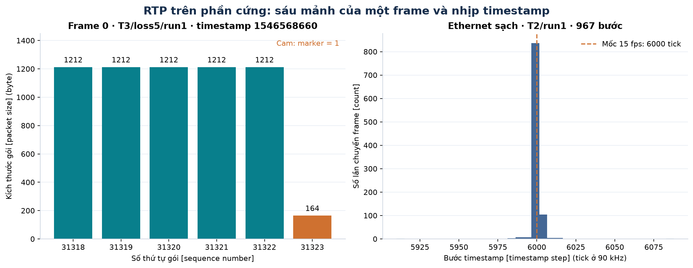
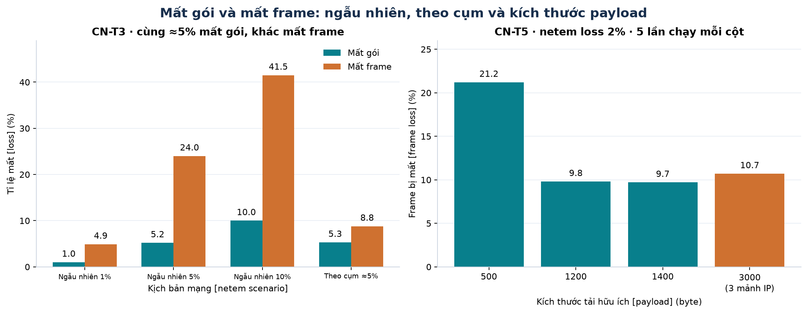

# Session 1 — C. Thực hành sản phẩm và đọc log

Sau phần này, bạn biết demo nào có thể làm trên laptop, đọc được kết quả và biết giới hạn của từng chế độ. Bài thực hành này dựng lại từ review và source; các lệnh chưa được chạy trong lần xuất tài liệu.

## C1. Chuẩn bị môi trường

Dùng repository staging của nhóm, Python 3.11+, thư mục gốc có `cn/rtp/` và `dashboard/`. Kiểm tra branch/commit, Python và dependencies trước khi chạy. Không giả định board đã được flash hay laptop đã cài đúng môi trường. [`dashboard/README.md`](https://github.com/KaiserRichard/edge-ai-video-runtime/blob/main/dashboard/README.md) là nguồn lệnh demo hiện hành. Với Bash POSIX, dùng virtualenv đúng đường dẫn interpreter; với Windows PowerShell dùng `.venv\Scripts\python.exe`. Không áp dụng lệnh dành cho WSL vào PowerShell.

## C2. Loopback RTP thật, không cần Pi

SOURCE: [`cn/rtp/scripts/loopback_demo.sh`](https://github.com/KaiserRichard/edge-ai-video-runtime/blob/main/cn/rtp/scripts/loopback_demo.sh). Chạy trong môi trường Bash tương thích (Linux/WSL) từ thư mục repo. Sau khi cài dependencies của repo, đặt `PYTHON` tới interpreter đã kiểm tra:

```bash
PYTHON="$PWD/.venv/bin/python" bash cn/rtp/scripts/loopback_demo.sh
```

Script mở receiver trên localhost, đợi READY, chạy sender synthetic 10 s ở 15 FPS, thu CSV và kiểm tra đủ 150 frame, đủ packet theo sender, mọi frame `ok`, có RR chứa RTT. Nếu thành công, nó in `MEASURED loopback: 150 frames, ... packets, all frames ok; run directory: ...`. Đây là **tiêu chí của script**, không phải lần chạy mới. Nếu lỗi, đọc `sender.log` và `receiver.log`; script có `finally` để dừng receiver. Không tự ý kill tiến trình không thuộc demo.

| Tệp | Cần xem |
|---|---|
| `sender.csv` | frame ID, timestamp, số packet, capture/send time |
| `receiver.csv` | sequence, RTP timestamp, arrival và jitter |
| `frames_rx.csv` | số mảnh, complete, deadline, status |
| `sender_rtcp.csv` | RR nhận được, RTT |
| `ai.csv` / `results_tx.csv` | nếu bật AI, thời gian queue và result |



Panel trái cho thấy sáu packet của một frame T3, cột cuối ngắn và có marker; panel phải là histogram bước timestamp T2. Bảng log giúp nối packet với frame. Không trừ trực tiếp timestamp monotonic của Pi với laptop để suy ra độ trễ vật lý một chiều.

## C3. Dashboard replay và live

Từ `dashboard/`, chạy theo README:

```bash
python -m dashboard --mode replay --replay samples/cn-loss5 --loop
```

Mở `http://127.0.0.1:8080/`, quan sát tỉ lệ loss, frame status, jitter và RTCP. Ctrl+C để dừng. Replay là dữ liệu lịch sử, không phải đo mới. Gói replay được review mô tả là 8 giây đầu của T3/loss5/run1.

SOURCE: snapshot mới có `Receiver._completed_frame()` phát `jpeg_b64` cho dashboard. Preview mặc định tối đa 5 FPS; không phải tốc độ RTP. README có demo live Windows PowerShell (ba terminal, mỗi terminal ở repo root và có biến môi trường giống nhau). Khởi động dashboard trước, rồi receiver, rồi sender:

```powershell
$env:PYTHONPATH = "$PWD\dashboard;$PWD\cn\rtp"
# Terminal 1
.\.venv\Scripts\python -m dashboard --mode live
# Terminal 2 (thiết lập PYTHONPATH lại)
.\.venv\Scripts\python -m rtp receiver --out-dir _ticket\output\rx --duration 12 --telemetry 127.0.0.1 --telemetry-session demo
# Terminal 3 (thiết lập PYTHONPATH lại)
.\.venv\Scripts\python -m rtp sender --host 127.0.0.1 --port 5004 --source synthetic --duration 8 --out-dir _ticket\output\tx --telemetry 127.0.0.1 --telemetry-session demo
```

Kiểm tra README, cổng và interpreter trên máy trước khi chạy. Nếu video không hiện, kiểm tra telemetry session và log receiver. Receiver có giới hạn tần suất và kích thước preview; mất preview không tự động nghĩa là mất RTP. Dừng dashboard bằng Ctrl+C sau khi sender/receiver kết thúc. Chế độ live localhost không chứng minh camera Pi hoạt động.

## C4. Netem và thí nghiệm vật lý (để sau lý thuyết)

`netem` tạo suy giảm mạng có kiểm soát: loss, delay, jitter, burst. Đọc config và actual qdisc log trước khi kết luận. T3/T4/T5/T7/T9 là kết quả đã báo cáo. T8 AIMD hardware chưa có campaign được xác nhận hoàn chỉnh. Không dùng demo loopback làm bằng chứng T8.



Trục/cấu hình loss cho biết điều kiện thử, tỉ lệ frame mất là kết quả. Hãy giải thích tại sao frame loss tăng nhanh hơn packet loss. Khi làm demo thật, cần Pi, camera, laptop, nguồn phù hợp và quyền netem trên interface đúng; không chạy lệnh thay qdisc lên mạng đang dùng chung nếu chưa biết cách khôi phục. Hardware checklist thuộc giai đoạn cuối của nhóm.

## C5. Tự đọc một kết quả

MEASURED: T3 loss5 có sequence loss 5.2%, frame loss 24%, on-time 76%, jitter 0.22 ms. Một lỗi mạng ảnh hưởng nhiều hơn một byte; nếu frame cần nhiều mảnh, một mảnh mất có thể khiến cả ảnh không tới AI. Session 2 sẽ giải thích từng khối bằng SimEvents và so sánh T3, T4, T5, T7 với mô phỏng.

## C. Trắc nghiệm cuối phần

<div class="quiz" markdown>
<p class="quiz-q">Loopback script kiểm tra điều gì?</p>

- [x] 150 frame và RR có RTT
- [ ] Đủ 150 frame từ camera Pi
- [ ] Nguồn 5 V không tụt áp
- [ ] AIMD đạt T8

<div class="quiz-why" markdown>
SOURCE: 10 s × 15 FPS = 150 frame và các điều kiện CSV/RTCP. Không có Pi trong loopback.
</div>
</div>

<div class="quiz" markdown>
<p class="quiz-q">Replay hiển thị loss 5% nghĩa là gì?</p>

- [ ] Đang đo mạng mới
- [x] Dữ liệu của lần chạy đã lưu
- [ ] Đã chạy lại netem
- [ ] Camera hiện tại mất 5% packet

<div class="quiz-why" markdown>
Replay đọc dữ liệu cũ; phải gắn nhãn replay.
</div>
</div>

<div class="quiz" markdown>
<p class="quiz-q">Preview dashboard 5 FPS có nghĩa RTP chỉ truyền 5 FPS?</p>

- [ ] Đúng
- [ ] Đúng nếu bật AIMD
- [x] Không, preview là đường telemetry riêng
- [ ] Đúng vì UDP chỉ hỗ trợ 5 FPS

<div class="quiz-why" markdown>
Preview giới hạn tần suất riêng; RTP không bị đồng nhất với preview.
</div>
</div>
