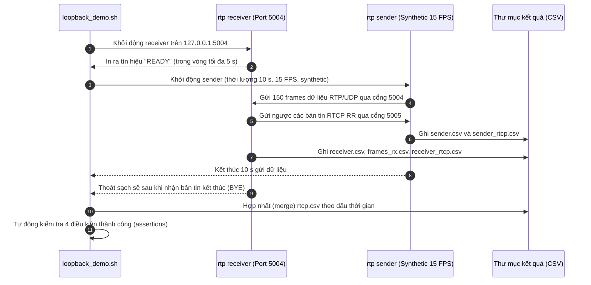
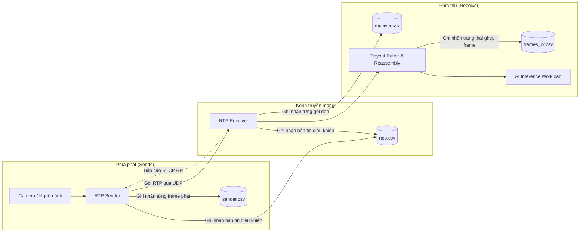

# Session 1 — C. Thực hành sản phẩm và đọc log

{ .figure-right loading=lazy }

Sau khi đã nắm vững cấu trúc bức ảnh JPEG ở Session 1A và cơ chế đóng gói RTP, bộ đệm playout cùng phản hồi RTCP ở Session 1B, câu hỏi thực tế quan trọng nhất của một kỹ sư là: **Làm thế nào để vận hành hệ thống phần mềm này, quan sát nó chạy trong thực tế, và đọc hiểu tường tận từng dòng nhật ký dữ liệu (log / CSV)?** 

Khi bước vào phòng thi hoặc bảo vệ trước hội đồng giảng viên, bạn không thể chỉ nói lý thuyết suông. Giảng viên sẽ yêu cầu bạn mở terminal lên chạy thử, chỉ vào các con số trong tệp CSV và hỏi: *"Dòng này nghĩa là gì? Frame này có được đưa vào AI không? Tại sao mạng chỉ mất 5% gói tin mà frame nhận diện lại hỏng tới 24%? Và chế độ bạn đang chiếu trên màn hình là đo trực tiếp hay chỉ phát lại dữ liệu cũ?"*

Bài học này giúp bạn tự tin làm chủ toàn bộ khâu thực hành và phân tích số liệu:
- Phân biệt rạch ròi ba chế độ vận hành: **Loopback tự động nội bộ**, **Bảng điều khiển trực quan (Dashboard)** và **Đo đạc mạng thật với Netem**.
- Nắm chắc từng câu lệnh chạy thực tế được sao chép chuẩn xác từ mã nguồn kho chứa (`cn/rtp/` và `dashboard/`).
- Bóc tách cấu trúc và ý nghĩa kỹ thuật của từng cột trong **bốn tệp CSV cốt lõi** (`sender.csv`, `receiver.csv`, `frames_rx.csv`, `rtcp.csv`), đồng thời cùng giảng viên đọc - giải mã từng con số trên các dòng dữ liệu thật.
- Nhận thức rõ ràng giới hạn kỹ thuật của từng chế độ demo để luôn trung thực và bảo vệ thuyết phục trước hội đồng.

---

## C0. Chuẩn bị nền tảng: Ba chế độ thực hành và cách thiết lập môi trường

Trước khi gõ bất kỳ câu lệnh nào vào bàn phím, một người mới bắt đầu cần hiểu rõ hệ thống phần mềm của chúng ta có thể vận hành ở những cấp độ nào và tại sao lại có sự phân chia đó.

### C0.1. Ba chế độ vận hành trong dự án

Trong thực tế phát triển hệ thống mạng, không phải lúc nào chúng ta cũng có sẵn một chiếc máy tính Raspberry Pi 5 cắm camera và một hệ thống dây cáp mạng hoàn chỉnh trên bàn làm việc. Nhóm đã thiết kế ba chế độ chạy thử nghiệm độc lập:

1. **Chế độ kiểm thử lặp nội bộ (Loopback demo):** Cả chương trình gửi (`rtp sender`) và chương trình nhận (`rtp receiver`) cùng chạy trên **một chiếc laptop duy nhất**. Dữ liệu không đi qua dây mạng hay sóng Wi-Fi vật lý mà đi qua giao diện mạng ảo nội bộ mang địa chỉ `127.0.0.1` (gọi là **localhost** hay địa chỉ loopback). Nguồn ảnh được sinh giả lập (`synthetic`) bằng các thuật toán tạo khối dữ liệu mẫu trong bộ nhớ máy tính.
2. **Chế độ quan sát bảng điều khiển (Dashboard demo — Replay & Live):** Người vận hành mở một giao diện web trên trình duyệt (`http://127.0.0.1:8080/`) để nhìn thấy hình ảnh JPEG được ghép lại, tốc độ khung hình và đồ thị thống kê mất gói, độ trễ. Chế độ này có thể chạy ở dạng **Replay** (đọc lại tệp dữ liệu đã ghi từ trước) hoặc **Live** (nhận dữ liệu telemetry gửi về qua mạng).
3. **Chế độ đo đạc phần cứng thật (Physical Hardware & Netem):** Máy phát là chiếc Raspberry Pi 5 thật gắn camera, máy thu là chiếc laptop, kết nối với nhau qua cáp Ethernet hoặc mạng Wi-Fi. Trên đường truyền đó, công cụ nhân Linux mang tên **Netem** được sử dụng để chủ động tạo ra suy giảm mạng có kiểm soát (rơi gói, biến thiên trễ) nhằm kiểm chứng khả năng thích ứng của hệ thống.

Bảng dưới đây đối chiếu cụ thể đặc điểm và mục đích của ba chế độ:

| Tiêu chí | 1. Loopback nội bộ | 2. Dashboard Replay | 3. Mạng phần cứng thật |
|---|---|---|---|
| **Thiết bị cần có** | Duy nhất 1 máy tính (laptop/PC) | Duy nhất 1 máy tính (laptop/PC) | Raspberry Pi 5 + Camera + Laptop + Dây cáp mạng |
| **Nguồn dữ liệu ảnh** | Tự sinh ngẫu nhiên (`synthetic`) | Dữ liệu đo cũ lưu trong thư mục `samples/` | Camera phần cứng thật (hoặc ảnh nạp sẵn) |
| **Đường truyền mạng** | Localhost nội bộ (`127.0.0.1`) | Đọc tệp đĩa cứng (không truyền qua mạng) | Cáp Ethernet hoặc Wi-Fi vật lý |
| **Giao diện hiển thị** | Dòng chữ kết quả trên Terminal | Giao diện Web trực quan trên trình duyệt | Terminal thu thập log + Dashboard Live |
| **Mục đích chứng minh** | Logic ghép gói và socket nội bộ không có lỗi cú pháp | Minh họa trực quan cho người xem hiểu luồng dữ liệu | Đo đạc hiệu năng thực tế của hệ thống truyền thông |
| **Giới hạn kỹ thuật** | Không chứng minh camera Pi hay cáp mạng hoạt động | Dữ liệu lịch sử, không phản ánh trạng thái hiện tại | Đòi hỏi thiết lập bàn thử vật lý và cấp nguồn chuẩn |

<svg viewBox="0 0 780 180" width="100%" style="max-width:780px;display:block;margin:1.5rem auto;" role="img" aria-label="Sơ đồ đối chiếu ba chế độ thực hành trong hệ thống CN">
  <!-- Mode 1: Loopback -->
  <rect x="10" y="15" width="230" height="150" rx="8" fill="rgba(20,184,166,0.08)" stroke="#14B8A6" stroke-width="1.5"/>
  <text x="125" y="38" text-anchor="middle" fill="currentColor" font-size="13" font-weight="700">1. Loopback nội bộ</text>
  <rect x="25" y="52" width="90" height="35" rx="5" fill="rgba(20,184,166,0.2)" stroke="#14B8A6"/>
  <text x="70" y="74" text-anchor="middle" fill="currentColor" font-size="11">Sender (Synthetic)</text>
  <rect x="135" y="52" width="90" height="35" rx="5" fill="rgba(20,184,166,0.2)" stroke="#14B8A6"/>
  <text x="180" y="74" text-anchor="middle" fill="currentColor" font-size="11">Receiver</text>
  <path d="M 115 65 L 135 65" stroke="#14B8A6" stroke-width="1.5" marker-end="url(#arrow)"/>
  <text x="125" y="105" text-anchor="middle" fill="currentColor" font-size="10">Chung 1 Laptop · IP 127.0.0.1</text>
  <text x="125" y="125" text-anchor="middle" fill="#14B8A6" font-size="10" font-weight="600">Kiểm thử tự động 150 frame</text>
  <text x="125" y="145" text-anchor="middle" fill="currentColor" font-size="10" opacity="0.8">Xuất ra tệp sender/receiver CSV</text>
  <!-- Mode 2: Replay Dashboard -->
  <rect x="275" y="15" width="230" height="150" rx="8" fill="rgba(245,158,11,0.08)" stroke="#F59E0B" stroke-width="1.5"/>
  <text x="390" y="38" text-anchor="middle" fill="currentColor" font-size="13" font-weight="700">2. Dashboard Replay</text>
  <rect x="290" y="52" width="90" height="35" rx="5" fill="rgba(245,158,11,0.2)" stroke="#F59E0B"/>
  <text x="335" y="74" text-anchor="middle" fill="currentColor" font-size="11">Tệp samples/</text>
  <rect x="400" y="52" width="90" height="35" rx="5" fill="rgba(245,158,11,0.2)" stroke="#F59E0B"/>
  <text x="445" y="74" text-anchor="middle" fill="currentColor" font-size="11">Web Dashboard</text>
  <path d="M 380 65 L 400 65" stroke="#F59E0B" stroke-width="1.5"/>
  <text x="390" y="105" text-anchor="middle" fill="currentColor" font-size="10">Trình duyệt http://127.0.0.1:8080</text>
  <text x="390" y="125" text-anchor="middle" fill="#F59E0B" font-size="10" font-weight="600">Phát lại 8 s của T3/loss5</text>
  <text x="390" y="145" text-anchor="middle" fill="currentColor" font-size="10" opacity="0.8">Dữ liệu lịch sử, không đo mới</text>
  <!-- Mode 3: Hardware Netem -->
  <rect x="540" y="15" width="230" height="150" rx="8" fill="rgba(59,130,246,0.08)" stroke="#3B82F6" stroke-width="1.5"/>
  <text x="655" y="38" text-anchor="middle" fill="currentColor" font-size="13" font-weight="700">3. Phần cứng thật + Netem</text>
  <rect x="555" y="52" width="85" height="35" rx="5" fill="rgba(59,130,246,0.2)" stroke="#3B82F6"/>
  <text x="597" y="74" text-anchor="middle" fill="currentColor" font-size="11">Pi 5 + Cam</text>
  <rect x="670" y="52" width="85" height="35" rx="5" fill="rgba(59,130,246,0.2)" stroke="#3B82F6"/>
  <text x="712" y="74" text-anchor="middle" fill="currentColor" font-size="11">Laptop Rx</text>
  <path d="M 640 65 L 670 65" stroke="#3B82F6" stroke-width="1.5"/>
  <text x="655" y="105" text-anchor="middle" fill="currentColor" font-size="10">Dây mạng LAN / Wi-Fi</text>
  <text x="655" y="125" text-anchor="middle" fill="#3B82F6" font-size="10" font-weight="600">netem loss 5%, delay 20ms</text>
  <text x="655" y="145" text-anchor="middle" fill="currentColor" font-size="10" opacity="0.8">Bằng chứng phần cứng T2/T3/T7</text>
</svg>

### C0.2. Quy tắc chuẩn bị môi trường dòng lệnh

Kho chứa mã nguồn của dự án yêu cầu môi trường **Python 3.11+** và quyền mở các cổng mạng socket nội bộ. Trước khi thực thi bất kỳ lệnh nào, hãy lưu ý hai quy tắc môi trường cốt lõi:
1. **Phân biệt Bash POSIX và Windows PowerShell:** 
   - Nếu chạy trong Linux hoặc môi trường WSL, ta kích hoạt môi trường ảo bằng đường dẫn `PYTHON="$PWD/.venv/bin/python"`.
   - Nếu chạy trên hệ điều hành Windows thuần túy bằng PowerShell, trình thông dịch Python nằm ở đường dẫn `.\.venv\Scripts\python.exe`. Tuyệt đối không dán các lệnh Bash có cú pháp `export` hay `PYTHON=...` vào cửa sổ PowerShell.
2. **Thiết lập biến môi trường `PYTHONPATH`:** Để Python tìm thấy các gói module tự viết của nhóm nằm trong thư mục `cn/rtp` và `dashboard`, biến môi trường `PYTHONPATH` phải được trỏ chính xác về thư mục gốc của các gói này trước khi chạy lệnh.

<p class="key">Nắm rõ ba chế độ chạy giúp kỹ sư chủ động: Loopback để kiểm tra code không lỗi cú pháp, Dashboard Replay để trình diễn trực quan khi không có phần cứng, và Hardware Netem để thu thập số liệu bảo vệ khoa học.</p>

---

## C1. Chế độ 1: Thử nghiệm Loopback RTP tự động (không cần Pi)

### C1.1. Tại sao cần cơ chế này?

Khi bạn vừa chỉnh sửa một đoạn mã xử lý hàng đợi hay sửa thuật toán tính toán jitter, làm thế nào để biết hệ thống có hoạt động trơn tru không mà không cần mất công cắm nguồn bật máy Raspberry Pi? Bạn cần một bài kiểm thử tự động, lặp khép kín (**automated loopback test**). 

Mục tiêu của kịch bản loopback là: khởi động một bên nhận, khởi động một bên gửi, đẩy dữ liệu qua cổng mạng thật trong 10 giây, sau đó tự động phân tích các tệp nhật ký để kiểm tra xem có gói tin nào bị mất vô cớ hay có lỗi xử lý logic nào không.

### C1.2. Kịch bản chạy thực tế trong mã nguồn dự án

Trong kho chứa của nhóm, kịch bản này được đóng gói hoàn chỉnh trong tệp shell script tại đường dẫn: `SOURCE`: `cn/rtp/scripts/loopback_demo.sh`.

Khi thực thi trên môi trường Linux/WSL từ thư mục gốc của repo, lệnh chạy chính xác như sau:

```bash
PYTHON="$PWD/.venv/bin/python" bash cn/rtp/scripts/loopback_demo.sh
```

Dưới đây là sơ đồ từng bước kịch bản này tự động thực hiện từ đầu đến cuối:



### C1.3. Bốn điều kiện nhận biết kịch bản chạy thành công

Kịch bản `loopback_demo.sh` không chỉ chạy rồi để đấy. Đoạn mã Python tích hợp bên trong script (`cn/rtp/scripts/loopback_demo.sh`, dòng 57–64) tự động mở các tệp CSV vừa ghi để kiểm tra nghiêm ngặt bốn tiêu chí kỹ thuật:

```python
# Trích đoạn kiểm tra tự động trong cn/rtp/scripts/loopback_demo.sh, dòng 57-64
expected = sum(int(row["n_pkts"]) for row in sent)
if len(sent) != 150 or len(packets) != expected or len(frames) != 150:
    raise RuntimeError(f"unexpected counts: sent={len(sent)}, packets={len(packets)}/{expected}, frames={len(frames)}")
if any(row["status"] != "ok" for row in frames):
    raise RuntimeError("loopback has late/lost frames")
if not any(row["dir"] == "rx" and row["type"] == "RR" and row["rtt_ms"] for row in control):
    raise RuntimeError("no RR with sender-clock RTT received")
print(f"MEASURED loopback: {len(sent)} frames, {len(packets)} packets, all frames ok; run directory: {out}")
```

Bốn tiêu chí này có ý nghĩa gì đối với một kỹ sư?
1. **Số lượng frame gửi đi:** Trong 10 giây ở tốc độ 15 FPS, máy phát phải tạo ra chính xác:
   \[
   N_{\mathrm{frames}} = 10\text{ s} \times 15\text{ FPS} = 150\text{ frames}
   \]
   Do đó `len(sent) == 150` trong `sender.csv`.
2. **Số lượng packet toàn vẹn:** Tổng số dòng trong `receiver.csv` (`len(packets)`) phải khớp chính xác với tổng số gói tin mà phía phát đã tạo ra (`expected = sum(n_pkts)`). Vì chạy trên localhost nội bộ không có nhiễu đường truyền, tỷ lệ mất gói bắt buộc phải bằng \(0\%\).
3. **Trạng thái frame tại đầu thu:** Toàn bộ 150 frame trong `frames_rx.csv` đều phải có cờ trạng thái `status == "ok"`. Không được phép có bất kỳ frame nào bị trễ hạn (`late`) hoặc bị mất mảnh (`lost`).
4. **Phản hồi thời gian khứ hồi (RTT):** Trong tệp nhật ký điều khiển `sender_rtcp.csv`, phải có ít nhất một bản tin báo cáo thu (`Receiver Report — RR`) quay về từ phía nhận mang theo giá trị đo RTT hợp lệ (`rtt_ms` không rỗng).

Nếu thỏa mãn cả 4 điều kiện trên, script sẽ in ra dòng thông báo thành công chuẩn:
`MEASURED loopback: 150 frames, ... packets, all frames ok; run directory: ...`

??? note "Đào sâu: Cơ chế dọn dẹp tiến trình trong khối finally"
    Trong lập trình hệ thống mạng, một lỗi rất phổ biến của sinh viên là khi script gặp sự cố, tiến trình `receiver` chạy nền vẫn tiếp tục bám vào cổng UDP 5004. Lần chạy tiếp theo sẽ báo lỗi `Address already in use`. Trong `loopback_demo.sh` (dòng 65–75), tác giả sử dụng khối lệnh `finally` để tự động kiểm tra: nếu `rx.poll() is None` (nghĩa là tiến trình thu vẫn đang sống), script sẽ gọi lệnh `rx.terminate()` và đợi 3 giây, nếu vẫn không dừng sẽ dùng `rx.kill()`. Nhờ đó, tài nguyên cổng mạng luôn được giải phóng an toàn tuyệt đối.

### C1.4. Loopback chứng minh điều gì và KHÔNG chứng minh điều gì?

Khi trình bày trước giảng viên, bạn phải nắm rõ giới hạn kỹ thuật của bài kiểm tra này:
- **Chứng minh được:** Mã nguồn Python của các lớp đóng gói RTP (`RTPPacket`), phân mảnh (`fragment_jpeg`), bộ đệm ghép ảnh (`PlayoutBuffer`) và đóng gói báo cáo RTCP (`build_compound`) vận hành đồng bộ, đúng chuẩn cú pháp và không bị deadlock (nghẽn luồng).
- **KHÔNG chứng minh được:** Không chứng minh được camera Raspberry Pi có khả năng chụp ảnh; không chứng minh được độ trễ khi truyền qua dây cáp mạng vật lý; và **không chứng minh được thuật toán thích nghi tốc độ AIMD (CN-T8)** trên phần cứng thật.

<p class="key">Lệnh loopback_demo.sh tự động kiểm tra 150 frame (10 s x 15 FPS) trên localhost; nó chứng minh logic phần mềm không lỗi nhưng không thay thế cho bài đo mạng vật lý.</p>

---

## C2. Chế độ 2 & 3: Bảng điều khiển Dashboard — Replay lịch sử và Live Telemetry

### C2.1. Tại sao cần Dashboard?

Người vận hành hệ thống không thể liên tục nhìn vào các dòng số nhấp nháy trên màn hình dòng lệnh để đánh giá xem video có bị giật hay không. **Dashboard** là ứng dụng web máy chủ nhẹ viết bằng Python chuẩn (chỉ dùng thư viện chuẩn, không cần cài đặt thêm gói ngoài), đóng vai trò như một **bảng đồng hồ giám sát trung tâm**:
- Hiển thị trực quan khung hình video JPEG đang nhận được.
- Vẽ đồ thị thời gian thực về tỷ lệ mất gói (`loss`), ước lượng độ giật trễ (`jitter`), và độ trễ khứ hồi (`RTT`).
- Thống kê tỷ lệ frame ghép thành công (`ok`), frame đến trễ (`late`) và frame bị hỏng (`lost`).

### C2.2. Vận hành Dashboard ở chế độ Replay (Xem lại dữ liệu lịch sử)

Nếu bạn cần giới thiệu dự án cho một người khác xem trên laptop mà không có mạng thử nghiệm, chế độ **Replay** là lựa chọn lý tưởng. Theo tài liệu hướng dẫn `SOURCE`: `dashboard/README.md`, từ thư mục `dashboard/`, ta chạy lệnh:

```bash
python -m dashboard --mode replay --replay samples/cn-loss5 --loop
```

Sau đó, mở trình duyệt web bất kỳ và truy cập vào địa chỉ:
`http://127.0.0.1:8080/`

!!! tip "Cách hiểu bản chất của chế độ Replay"
    Khi chọn `--mode replay`, Dashboard không hề mở socket mạng để bắt gói tin mới. Nó đơn thuần đọc tuần tự các dòng trong tệp dữ liệu đã lưu sẵn tại thư mục `dashboard/samples/cn-loss5/` (gồm `sender.csv`, `receiver.csv`, `frames_rx.csv`, `receiver_rtcp.csv`) rồi phát lại theo đúng nhịp thời gian trên đồng hồ với tùy chọn lặp vô tận (`--loop`).
    
    Theo tài liệu kiểm chứng (`dashboard/samples/cn-loss5/provenance.json`), tập dữ liệu mẫu này chính là **8 giây đầu tiên được trích xuất từ bài đo phần cứng thật mang tên T3/loss5/run1** (`MEASURED`). 

Khi bảo vệ trước giảng viên, nếu bàn thử phần cứng bị trục trặc kỹ thuật, bạn hoàn toàn có thể chuyển sang chế độ Replay để minh họa giao diện. Tuy nhiên, **quy tắc đạo đức kỹ thuật bắt buộc bạn phải tuyên bố rõ ràng**: *"Thưa thầy, đây là dữ liệu lịch sử đã được đo đạc và lưu lại từ bài đo T3 có cấu hình mất gói 5%, không phải là phép đo trực tiếp ngay tại thời điểm này."*

### C2.3. Vận hành Live trên Windows PowerShell (Kịch bản 3 Terminal)

Nếu muốn trải nghiệm luồng dữ liệu thời gian thực được đẩy trực tiếp giữa các tiến trình độc lập trên máy tính Windows, bạn mở **ba cửa sổ PowerShell riêng biệt** tại thư mục gốc của repository và chạy lần lượt theo đúng thứ tự (`SOURCE`: `dashboard/README.md`):

```powershell
# Thiết lập biến môi trường trỏ tới cả hai gói module dashboard và cn/rtp
$env:PYTHONPATH = "$PWD\dashboard;$PWD\cn\rtp"

# -------------------------------------------------------------
# Cửa sổ 1: Khởi động máy chủ Web Dashboard ở chế độ Live
# -------------------------------------------------------------
.\.venv\Scripts\python -m dashboard --mode live

# -------------------------------------------------------------
# Cửa sổ 2: Khởi động RTP Receiver (đầu thu)
# Lắng nghe dữ liệu, thời lượng 12 s, đẩy telemetry về Dashboard
# -------------------------------------------------------------
.\.venv\Scripts\python -m rtp receiver --out-dir _ticket\output\rx --duration 12 --telemetry 127.0.0.1 --telemetry-session demo

# -------------------------------------------------------------
# Cửa sổ 3: Khởi động RTP Sender (đầu phát)
# Phát luồng synthetic trong 8 s tới cổng 5004, đẩy telemetry về Dashboard
# -------------------------------------------------------------
.\.venv\Scripts\python -m rtp sender --host 127.0.0.1 --port 5004 --source synthetic --duration 8 --out-dir _ticket\output\tx --telemetry 127.0.0.1 --telemetry-session demo
```

Thứ tự bật các tiến trình này mang ý nghĩa kỹ thuật rõ ràng:
1. **Bật Dashboard trước** để cổng tiếp nhận telemetry và giao diện web sẵn sàng lắng nghe.
2. **Bật Receiver trước Sender** để cổng UDP 5004 đã được mở và vào trạng thái sẵn sàng đón gói. Nếu bật Sender trước, các gói RTP đầu tiên phát ra sẽ bị hệ điều hành hủy bỏ do chưa có tiến trình nào lắng nghe tại cổng đích.

### C2.4. Phân biệt tốc độ Preview Video (5 FPS) và tốc độ truyền RTP (15 FPS)

Một trong những câu hỏi bẫy kinh điển mà giảng viên thường hỏi sinh viên khi nhìn vào màn hình Dashboard là:
> *"Tại sao camera quay ở tốc độ 15 FPS mà trên trang web Dashboard tôi thấy video nhảy giật giật, đồng hồ báo chỉ khoảng 5 FPS? Có phải mạng bị nghẽn làm mất 2/3 số khung hình không?"*

Câu trả lời chính xác nằm ở kiến trúc phần mềm (`SOURCE`: `cn/rtp/rtp/receiver.py`, dòng 40–44 và 93–100):
- **Luồng truyền thông media chính (RTP):** Vẫn được phát đi và tiếp nhận đầy đủ ở tốc độ **15 FPS**. Mọi bức ảnh đều được ghép lại và đưa vào hàng đợi suy luận AI đúng hạn phát.
- **Luồng quan sát phụ (Telemetry Video Preview):** Để tránh việc mã hóa ảnh JPEG sang chuỗi Base64 và gửi gói tin JSON làm tiêu tốn tài nguyên CPU của đầu thu, tác giả đã chủ động giới hạn tốc độ đẩy ảnh lên giao diện web ở mức **tối đa 5 FPS** (`telemetry_video_fps = 5`, tương ứng chu kỳ tối thiểu \(200\text{ ms}\) một ảnh). Ngoài ra, nếu kích thước chuỗi Base64 của ảnh vượt quá 55.000 byte, ảnh preview đó sẽ bị bỏ qua (`telemetry_video_oversize_skips`).

<p class="key">Tốc độ hiển thị video trên Dashboard bị giới hạn chủ đích ở mức 5 FPS để tiết kiệm tài nguyên; nó hoàn toàn độc lập với tốc độ truyền media RTP 15 FPS của hệ thống bên dưới.</p>

---

## C3. Mổ xẻ 4 tệp Log / CSV cốt lõi: Cấu trúc cột và cách đọc từng dòng thực tế

Khi chạy bất kỳ kịch bản nào (dù là loopback, dashboard hay đo trên phần cứng), hệ thống đều tự động lưu lại toàn bộ diễn biến vào bốn tệp dữ liệu CSV dạng bảng tại thư mục kết quả (`out-dir`). Đây chính là **chứng cứ kỹ thuật gốc** để bạn bảo vệ đồ án.

Dưới đây là sơ đồ quan hệ cho thấy bốn tệp nhật ký này ghi lại những công đoạn nào trong toàn bộ đường ống truyền nhận:



Chúng ta sẽ lần lượt mổ xẻ chi tiết từng tệp một: cấu trúc các cột, đơn vị đo, và cùng phân tích các dòng dữ liệu thật lấy từ bài đo phần cứng `T3/loss5/run1` (`dashboard/samples/cn-loss5/`).

---

### C3.1. Tệp `sender.csv` — Nhật ký phía gửi

Tệp `sender.csv` do tiến trình `rtp sender` ghi lại (`SOURCE`: `cn/rtp/rtp/sender.py`, dòng 32). Mỗi dòng tương ứng với **một bức ảnh (frame)** được nén và đẩy ra mạng.

Tệp gồm chính xác 10 cột dữ liệu:

| Tên cột | Đơn vị / Định dạng | Ý nghĩa kỹ thuật |
|---|---|---|
| `frame_id` | Số nguyên tăng dần (`0, 1, 2...`) | Số định danh tuần tự của bức ảnh do máy phát đánh số |
| `rtp_ts` | Số nguyên 32-bit (tick 90 kHz) | Dấu thời gian RTP biểu diễn thời điểm lấy mẫu media |
| `seq_first` | Số nguyên 16-bit (`0..65535`) | Số thứ tự sequence của gói RTP đầu tiên thuộc frame này |
| `seq_last` | Số nguyên 16-bit (`0..65535`) | Số thứ tự sequence của gói RTP cuối cùng thuộc frame này |
| `n_pkts` | Số nguyên | Tổng số gói RTP cần thiết để chở hết bức ảnh này |
| `bytes` | Byte | Tổng kích thước của toàn bộ các gói RTP thuộc frame (gồm cả header) |
| `quality` | Số nguyên (`1..100` hoặc rỗng) | Hệ số chất lượng JPEG (để trống nếu dùng nguồn ảnh nạp sẵn) |
| `t_capture_mono_ns` | Nanosecond (đồng hồ Pi) | Thời điểm camera bắt đầu chụp bức ảnh |
| `t_send_first_mono_ns`| Nanosecond (đồng hồ Pi) | Thời điểm gói RTP đầu tiên được đẩy ra socket mạng |
| `t_send_last_mono_ns` | Nanosecond (đồng hồ Pi) | Thời điểm gói RTP cuối cùng đẩy xong ra socket mạng |

#### Phân tích một dòng dữ liệu thật từ `sender.csv`

Hãy cùng đọc dòng đầu tiên (khung hình số 0) trong tệp `dashboard/samples/cn-loss5/sender.csv`:

```text
0,1546568660,31318,31323,6,6224,,2932731220170,2932731362377,2932731504807
```

Giảng viên hỏi bạn: *"Hãy giải thích ý nghĩa các con số trên dòng này và kiểm tra tính nhất quán toán học của chúng."* Bạn trả lời như sau:

1. **Định danh và đóng gói:** Đây là bức ảnh số `frame_id = 0`. Nó được chia thành `n_pkts = 6` gói tin RTP. Gói đầu tiên mang số thứ tự `seq_first = 31318` và gói cuối cùng mang số thứ tự `seq_last = 31323`. 
   Phép toán kiểm tra:
   \[
   N_{\mathrm{packets}} = \text{seq\_last} - \text{seq\_first} + 1 = 31323 - 31318 + 1 = 6\text{ gói (khớp hoàn toàn)}
   \]
2. **Kích thước dữ liệu:** Tổng dung lượng của cả 6 gói tin là `bytes = 6224` byte. Trong mã nguồn của nhóm (`cn/rtp/rtp/payload.py`), giới hạn mỗi gói là 1212 byte (gồm 12 byte RTP header + 8 byte fragment header + tối đa 1192 byte ảnh). Năm gói đầu tiên đầy tải chở:
   \[
   5 \times 1212\text{ B} = 6060\text{ B}
   \]
   Gói thứ sáu chở nốt phần dữ liệu còn lại:
   \[
   6224\text{ B} - 6060\text{ B} = 164\text{ B}
   \]
   Con số 164 byte này sẽ xuất hiện chính xác ở bảng `receiver.csv` dưới đây!
3. **Thời gian đẩy gói tại máy phát:**
   - Thời điểm chụp ảnh: \(T_{\mathrm{cap}} = 2932731220170\text{ ns}\).
   - Thời điểm bắt đầu gửi gói đầu: \(T_{\mathrm{send1}} = 2932731362377\text{ ns}\). Khoảng thời gian từ lúc chụp xong đến lúc bắt đầu phát là:
     \[
     \Delta T_{\mathrm{prep}} = 2932731362377 - 2932731220170 = 142207\text{ ns} \approx 0.142\text{ ms}
     \]
   - Thời điểm phát xong gói cuối: \(T_{\mathrm{send6}} = 2932731504807\text{ ns}\). Thời gian máy phát đẩy hết 6 gói tin ra mạng là:
     \[
     \Delta T_{\mathrm{send}} = 2932731504807 - 2932731362377 = 142430\text{ ns} \approx 0.142\text{ ms}
     \]

---

### C3.2. Tệp `receiver.csv` — Nhật ký từng gói tin tại đầu thu

Tệp `receiver.csv` do tiến trình `rtp receiver` ghi lại (`SOURCE`: `cn/rtp/rtp/receiver.py`, dòng 30). Mỗi dòng tương ứng với **một gói tin RTP riêng lẻ** khi nó vừa chạm vào socket mạng của máy thu.

Tệp gồm chính xác 8 cột dữ liệu:

| Tên cột | Đơn vị / Định dạng | Ý nghĩa kỹ thuật |
|---|---|---|
| `seq` | Số nguyên 16-bit (`0..65535`) | Số thứ tự sequence của gói tin nhận được |
| `rtp_ts` | Số nguyên 32-bit (tick 90 kHz) | Dấu thời gian media (các gói cùng frame có `rtp_ts` giống hệt nhau) |
| `frame_id` | Số nguyên | Số định danh frame đọc từ phần đầu phân mảnh |
| `marker` | Nhị phân (`0` hoặc `1`) | Cờ marker của RTP; bằng `1` nếu đây là gói cuối cùng của frame |
| `bytes` | Byte | Chiều dài thực tế của gói tin nhận được từ socket UDP |
| `t_arrival_rx_ns` | Nanosecond (đồng hồ Laptop) | Thời điểm chính xác gói tin chạm vào tầng ứng dụng máy thu |
| `transit_ts_units` | Tick (chu kỳ 90 kHz) | Hiệu số giữa thời điểm đến và RTP timestamp quy về đơn vị 90 kHz |
| `jitter_ts_units` | Tick (chu kỳ 90 kHz) | Ước lượng jitter liên khoảng đến theo công thức RFC 3550 |

#### Phân tích các dòng dữ liệu thật từ `receiver.csv`

Dưới đây là toàn bộ 6 dòng dữ liệu tương ứng với Frame 0 trong tệp `dashboard/samples/cn-loss5/receiver.csv`:

```text
seq,rtp_ts,frame_id,marker,bytes,t_arrival_rx_ns,transit_ts_units,jitter_ts_units
31318,1546568660,0,0,1212,1211741650252307,107510179862,0.0
31319,1546568660,0,0,1212,1211741650644551,107510179898,2.25
31320,1546568660,0,0,1212,1211741650858321,107510179917,3.296875
31321,1546568660,0,0,1212,1211741651046931,107510179934,4.1533203125
31322,1546568660,0,0,1212,1211741651225227,107510179950,4.89373779296875
31323,1546568660,0,1,164,1211741651332543,107510179959,5.150379180908203
```

Khi quan sát sáu dòng này, ta thấy những cơ chế mạng nào hiện hình rõ nét?
1. **Liên kết chặt chẽ giữa các gói cùng frame:** Cả 6 gói tin đều mang chung dấu thời gian `rtp_ts = 1546568660` và chung định danh `frame_id = 0`.
2. **Kích thước và cờ Marker:** Năm gói đầu tiên (`31318` đến `31322`) đều có kích thước đúng `1212` byte và cờ `marker = 0`. Riêng gói cuối cùng `31323` có kích thước cụt đúng `164` byte (khớp hoàn toàn với phép tính ở `sender.csv`) và cờ `marker = 1`. Cờ marker là dấu hiệu để bộ ghép frame biết đây là mảnh kết thúc của bức ảnh.
3. **Khoảng thời gian đến giữa các mảnh:** Gói đầu tiên đến lúc `1211741650252307` ns, gói cuối cùng đến lúc `1211741651332543` ns. Thời gian để toàn bộ 6 mảnh bay qua mạng và đến đủ tại đầu thu là:
   \[
   \Delta T_{\mathrm{arrive}} = 1211741651332543 - 1211741650252307 = 1080236\text{ ns} \approx 1.08\text{ ms}
   \]
4. **Sự hình thành Jitter:** Ban đầu gói đầu tiên chưa có cơ sở so sánh nên `jitter = 0.0`. Khi các gói tiếp theo đến với khoảng cách thời gian có dao động nhỏ, bộ lọc đệ quy RFC 3550 tích lũy dần lên `5.15` tick (tương đương \(5.15 / 90 \approx 0.057\text{ ms}\)).

Toàn bộ hiện tượng này được minh họa trực quan trong hình đồ thị thực nghiệm dưới đây của nhóm:

{ loading=lazy }

!!! example "Cách đọc hình"
    - **Panel bên trái (Sáu mảnh của Frame 0):** Trục hoành là số thứ tự gói (`sequence number` từ 31318 đến 31323), trục tung là kích thước gói tính bằng byte. Năm gói đầu tiên cao vọt đạt 1212 byte; gói thứ sáu ngắn cụt 164 byte và được tô màu cam nổi bật vì mang cờ `marker = 1`. Đồ thị này trực quan hóa chính xác 6 dòng dữ liệu trong bảng `receiver.csv` ở trên.
    - **Panel bên phải (Histogram bước nhảy timestamp ở T2 Ethernet sạch):** Trục hoành là bước nhảy `rtp_ts` giữa hai frame liên tiếp, trục tung là số lần xuất hiện. Với tốc độ chuẩn 15 FPS trên đồng hồ 90 kHz, bước nhảy danh định là \(90000 / 15 = 6000\text{ tick}\). Hơn 800 frame tập trung chính xác quanh cột 6000 tick; một vài frame lệch nhẹ sang 5995 hoặc 6005 tick do dao động nhỏ của luồng chụp camera.
    - **Ý nghĩa cốt lõi:** Sequence phân biệt từng mảnh gói tin, còn RTP timestamp giữ nhịp thời gian phát đồng đều độc lập với biến thiên mạng.

---

### C3.3. Tệp `frames_rx.csv` — Nhật ký ghép frame và hạn phát playout

Tệp `frames_rx.csv` do lớp quản lý bộ đệm phát `PlayoutBuffer` ghi lại (`SOURCE`: `cn/rtp/rtp/playout.py`, dòng 25 và 131–134). Đây là tệp dữ liệu quan trọng nhất để đánh giá xem **ứng dụng nhận diện AI có nhận được ảnh hay không**.

Tệp gồm chính xác 8 cột dữ liệu:

| Tên cột | Đơn vị / Định dạng | Ý nghĩa kỹ thuật |
|---|---|---|
| `frame_id` | Số nguyên | Số định danh của bức ảnh |
| `rtp_ts` | Số nguyên 32-bit | Dấu thời gian RTP của frame |
| `n_expected` | Số nguyên hoặc rỗng | Số lượng gói tin dự kiến phải có (tính từ `seq_first` đến `seq_last`) |
| `n_received` | Số nguyên | Thực tế số lượng mảnh gói tin nhận được |
| `complete` | Nhị phân (`1` hoặc `0`) | Bằng `1` nếu toàn bộ dữ liệu ảnh được ghép hoàn chỉnh không thiếu byte nào |
| `t_complete_rx_ns`| Nanosecond hoặc rỗng | Thời điểm mảnh cuối cùng đến giúp ghép xong bức ảnh |
| `t_playout_rx_ns` | Nanosecond | Hạn phát (playout deadline) đã định sẵn cho bức ảnh |
| `status` | Chuỗi ký tự | Phân loại số phận frame: `"ok"`, `"late"` hoặc `"lost"` |

#### Quy tắc xác định số phận của một bức ảnh (`status`)

Theo mã nguồn tại `cn/rtp/rtp/playout.py` (dòng 124), bộ đệm phát ra quyết định phân loại bức ảnh theo ba trường hợp rất rõ ràng:
- **`status = "ok"` (Đúng hạn):** Bức ảnh ghép đủ \(100\%\) mảnh (`complete == 1`) và thời điểm ghép xong không vượt quá hạn phát:
  \[
  t_{\mathrm{complete\_rx\_ns}} \le t_{\mathrm{playout\_rx\_ns}}
  \]
  Chỉ những frame đạt trạng thái `"ok"` mới được chuyển giao cho tiến trình AI xử lý!
- **`status = "late"` (Đến muộn):** Bức ảnh vẫn ghép đủ \(100\%\) mảnh (`complete == 1`), nhưng mảnh cuối cùng lại chạm đích sau khi hạn phát đã trôi qua:
  \[
  t_{\mathrm{complete\_rx\_ns}} > t_{\mathrm{playout\_rx\_ns}}
  \]
  Dù ảnh nguyên vẹn, hệ thống vẫn loại bỏ vì dữ liệu đã quá cũ, không còn giá trị điều khiển thời gian thực.
- **`status = "lost"` (Bị mất / Thiếu mảnh):** Khi đã hết hạn phát cộng thêm một cửa sổ trễ tối đa (`late_window_ms = 1000 ms`), bức ảnh vẫn thiếu ít nhất một mảnh (`complete == 0`). Hệ thống lập tức giải phóng bộ nhớ và đánh dấu frame bị mất.

#### Đọc hai dòng dữ liệu thực tế đối lập: Thành công vs Thất bại

Hãy cùng đối chiếu hai dòng (dòng 2 và dòng 14) trong tệp `dashboard/samples/cn-loss5/frames_rx.csv`:

```text
frame_id,rtp_ts,n_expected,n_received,complete,t_complete_rx_ns,t_playout_rx_ns,status
0,1546568660,6,6,1,1211741651332543,1211741750252307,ok
1,1546574658,14,12,0,,1211741816896751,lost
```

Hãy cùng phân tích số liệu của từng dòng:

1. **Dòng Frame 0 — Thành công mỹ mãn (`status = ok`):**
   - Số gói dự kiến `n_expected = 6`, số gói nhận được `n_received = 6`. Nhận đủ toàn bộ nên `complete = 1`.
   - Thời điểm ghép xong ảnh: \(T_{\mathrm{comp}} = 1211741651332543\text{ ns}\) (chính là thời điểm gói cuối seq 31323 đến ở bảng `receiver.csv`!).
   - Hạn phát của frame: \(T_{\mathrm{play}} = 1211741750252307\text{ ns}\).
   - So sánh hai mốc thời gian:
     \[
     T_{\mathrm{play}} - T_{\mathrm{comp}} = 1211741750252307 - 1211741651332543 = 98919764\text{ ns} \approx 98.92\text{ ms}
     \]
     Bức ảnh ghép xong trước hạn phát tới gần \(99\text{ ms}\) (do cấu hình bộ đệm playout là \(100\text{ ms}\)). Nó nằm yên bình an trong bộ đệm và được xuất ra cho AI đúng giờ quy định.
2. **Dòng Frame 1 — Bị phá hủy vì mất gói mạng (`status = lost`):**
   - Bức ảnh số 1 có kích thước lớn hơn, cần tới `n_expected = 14` gói tin.
   - Tuy nhiên, mạng netem giả lập mất gói 5% đã làm rơi 2 gói tin trên đường đi, đầu thu chỉ nhận được `n_received = 12` gói.
   - Kết quả: `complete = 0`, cột `t_complete_rx_ns` để trống vì ảnh không bao giờ ghép xong. Khi bộ đệm phát đợi hết thời gian quy định, nó buộc phải tuyên bố `status = lost`. Cả bức ảnh bị hủy bỏ hoàn toàn!

---

### C3.4. Tệp `rtcp.csv` — Nhật ký kênh điều khiển phản hồi

Kênh RTCP chạy ngược chiều từ máy thu về máy phát để cung cấp thông tin giám sát chất lượng mạng (`SOURCE`: `cn/rtp/rtp/sender.py`, dòng 34). Mỗi dòng tương ứng với một khối báo cáo RTCP được ghi nhận.

Tệp gồm 11 cột chuẩn theo định dạng RFC 3550:

| Tên cột | Đơn vị | Ý nghĩa kỹ thuật |
|---|---|---|
| `t_mono_ns` | Nanosecond | Thời điểm ghi nhận bản tin (theo đồng hồ cục bộ của máy ghi) |
| `dir` | `"tx"` hoặc `"rx"` | Hướng bản tin: phát đi (`tx`) hay nhận về (`rx`) |
| `type` | `"SR"`, `"RR"`, `"APP"`... | Loại bản tin: Sender Report (SR), Receiver Report (RR), hoặc App result (AIRS) |
| `ssrc` | Số nguyên 32-bit | Mã định danh nguồn đồng bộ của bên phát bản tin |
| `fraction_lost` | Số nguyên (`0..255`) | Tỷ lệ mất gói trong chu kỳ báo cáo vừa qua, biểu diễn dưới dạng phân số có mẫu số 256 |
| `cum_lost` | Số nguyên có dấu 24-bit | Tổng số lượng gói tin bị mất tích lũy tính từ đầu phiên kết nối |
| `ext_high_seq` | Số nguyên | Số thứ tự mở rộng cao nhất mà máy thu đã ghi nhận |
| `jitter` | Tick (chu kỳ 90 kHz) | Ước lượng jitter liên khoảng đến |
| `lsr` | 32-bit giữa của NTP | Dấu thời gian LSR trích từ bản tin Sender Report gần nhất |
| `dlsr` | Phân số 1/65536 giây | Khoảng thời gian trễ từ lúc máy thu nhận được SR đến lúc phát ra RR này |
| `rtt_ms` | Millisecond | Thời gian khứ hồi (Round-Trip Time) do máy phát tính toán |

#### Phân tích một dòng báo cáo thu RR thật

Dưới đây là dòng số 13 trong tệp `dashboard/samples/cn-loss5/sender_rtcp.csv`:

```text
2933112327563,rx,RR,2060980022,13,3,31376,18,269973156,57156,1.7547607421875
```

Hãy cùng giải mã các giá trị này:
- `dir = rx, type = RR`: Máy phát vừa nhận được một bản tin **Receiver Report** gửi về từ máy thu.
- `fraction_lost = 13`: Trong chu kỳ báo cáo vừa qua, tỷ lệ mất gói mà máy thu quan sát được là:
  \[
  \text{Loss percentage} = \frac{13}{256} \approx 0.05078 = 5.08\%
  \]
  Kỳ này tình cờ gần mức netem 5%, nhưng từng RR riêng lẻ dao động mạnh (xem Session 1B); chỉ trung bình cả phiên mới khớp sát cấu hình.
- `cum_lost = 3`: Kể từ lúc bắt đầu chạy, mạng đã làm thất lạc tổng cộng 3 gói tin.
- `ext_high_seq = 31376`: Gói tin có số sequence cao nhất mà máy thu nhìn thấy tới thời điểm này là 31376.
- `jitter = 18`: Dao động trễ mạng hiện tại là 18 tick, đổi ra mili-giây:
  \[
  J = \frac{18}{90} = 0.20\text{ ms}
  \]
- `rtt_ms = 1.75476 ms`: Thời gian khứ hồi của mạng là \(1.75\text{ ms}\) (độ trễ cáp Ethernet cục bộ rất thấp).

??? note "Đào sâu: Công thức đo RTT không cần đồng bộ đồng hồ (RFC 3550 §6.4.1)"
    Làm sao máy phát biết được RTT nếu đồng hồ hai máy không khớp nhau?
    Khi máy phát gửi một bản tin SR, nó đính kèm thời điểm gửi NTP của mình. Máy thu khi nhận được SR sẽ ghi nhớ giá trị này vào trường `lsr` (Last SR timestamp). Khi máy thu soạn bản tin RR gửi ngược lại, nó đo xem bản thân đã giữ bản tin đó trong bao lâu rồi ghi vào trường `dlsr` (Delay since Last SR).
    Khi máy phát nhận được RR tại thời điểm hiện tại \(A\), nó tính:
    \[
    \text{RTT} = A - \text{lsr} - \text{dlsr}
    \]
    Toàn bộ phép trừ \(A - \text{lsr}\) diễn ra trên **cùng một đồng hồ của máy phát**, do đó sự lệch giờ giữa Pi và Laptop hoàn toàn bị triệt tiêu!

---

### C3.5. Cảnh báo kỹ thuật sống còn: Phân định miền đồng hồ (Clock Domains)

Đây là quy tắc số một mà mọi kỹ sư mạng phải khắc cốt ghi tâm khi làm việc với dữ liệu log:

!!! danger "Cảnh báo"
    **TUYỆT ĐỐI KHÔNG lấy dấu thời gian monotonic của Laptop (`t_arrival_rx_ns` trong `receiver.csv`) trừ đi dấu thời gian monotonic của Raspberry Pi (`t_send_first_mono_ns` trong `sender.csv`) để tính độ trễ truyền dẫn một chiều!**

Lý do vật lý:
Hàm `time.monotonic_ns()` trên Linux (Pi) và Windows (Laptop) lấy mốc số `0` là thời điểm chiếc máy tính đó được bật nguồn (boot time). Chiếc Pi có thể đã bật cách đây 2 giờ, trong khi Laptop mới bật cách đây 15 phút. Nếu lấy hai con số này trừ cho nhau, bạn sẽ thu được một kết quả vô nghĩa như âm hàng trăm giây hoặc dương hàng triệu giây.

Mọi phép đo độ trễ một chiều hợp lệ trong dự án đều phải sử dụng:
1. **Dấu thời gian media RTP 90 kHz:** Để đo khoảng cách tương đối giữa các khung hình (ví dụ tính jitter hoặc bù playout).
2. **Đo đạc khứ hồi (RTT) qua RTCP:** Như đã giải thích ở mục C3.4, toàn bộ vòng đo xuất phát và kết thúc trên cùng một đồng hồ của máy phát.

<p class="key">Bốn tệp CSV phản ánh toàn diện chu trình truyền thông: sender.csv ghi nhận phát frame, receiver.csv theo dõi từng gói đến, frames_rx.csv quyết định hạn phát, và rtcp.csv đo lường chất lượng phản hồi RTT/loss.</p>

---

## C4. Thí nghiệm mạng suy giảm với Netem và phân tích hiện tượng mất frame

### C4.1. Netem là gì?

Trong các bài đo đạc thực tế mang tên **CN-T3, CN-T4, CN-T5**, nhóm sử dụng công cụ chuẩn của nhân Linux mang tên **Netem (Network Emulator)** thông qua lệnh `tc` (Traffic Control). Netem cho phép can thiệp trực tiếp vào hàng đợi card mạng của Raspberry Pi để giả lập các tình huống môi trường khắc nghiệt:
- Giả lập rơi gói tin ngẫu nhiên: `sudo tc qdisc add dev eth0 root netem loss 5%`
- Giả lập độ trễ và biến thiên trễ: `sudo tc qdisc add dev eth0 root netem delay 20ms 20ms distribution normal`
- Giả lập rơi gói theo cụm (Gilbert–Elliott): `sudo tc qdisc add dev eth0 root netem loss gemodel 1.316% 25% 100% 0%`

Khi hoàn thành thí nghiệm, kỹ sư phải luôn nhớ lệnh khôi phục trạng thái mạng bình thường:
```bash
sudo tc qdisc del dev eth0 root
```

### C4.2. Nghịch lý mạng: Tại sao packet loss 5% lại gây ra frame loss 24%?

Đây là câu hỏi cốt lõi nhất của toàn bộ chương trình Mạng máy tính mà giảng viên chắc chắn sẽ chất vấn sinh viên:
> *"Tại sao trong báo cáo thực nghiệm CN-T3, khi nhóm đặt netem làm mất 5% gói tin, mà tỷ lệ mất khung hình của AI lại vọt lên tới 24%? Con số 24% này có bị đo sai không?"*

Câu trả lời là: **Con số 24% hoàn toàn chính xác về mặt toán học và phản ánh đúng bản chất của việc phân mảnh trong truyền thông!**

#### Công thức toán học và phép tính mẫu

Giả sử một bức ảnh JPEG được chia thành \(N\) mảnh gói tin nhỏ. Để bộ thu ghép lại thành công bức ảnh, **toàn bộ \(N\) mảnh đều phải sống sót qua mạng**. Nếu xác suất mất một gói tin độc lập trên đường truyền là \(p\), xác suất để cả \(N\) mảnh cùng đến đích an toàn là:
\[
P_{\mathrm{frame\_success}} = (1 - p)^N
\]
Do đó, xác suất bức ảnh bị phá hủy hoàn toàn (chỉ cần thiếu ít nhất 1 mảnh là hỏng cả ảnh) là:
\[
\boxed{ P_{\mathrm{frame\_loss}} = 1 - (1 - p)^N }
\]

Bây giờ, hãy cùng thay các con số thực tế từ bài đo `loss5` trong bảng kết quả phần cứng `CN-T3` (`SOURCE`: `cn/rtp/report/hw_tables.md`):
- Xác suất mất gói đo được: \(p = 0.052\) (tức \(5.2\%\)).
- Số gói tin trung bình cho một bức ảnh ở chất lượng 75: \(N = 5.106\) gói.

Từng bước tính toán chi tiết:
\[
1 - p = 1 - 0.052 = 0.948
\]
\[
P_{\mathrm{frame\_success}} = (0.948)^{5.106} = e^{5.106\,\ln 0.948} = e^{-0.2727} \approx 0.7613
\]
\[
P_{\mathrm{frame\_loss}} = 1 - 0.7613 = 0.2387 \approx 23.9\%
\]

<div class="metric-row">
<div class="metric"><div class="m-label">Mất gói thực tế (MEASURED)</div><div class="m-value">5.2%</div><div class="m-sub">Tỉ lệ packet loss trên đường truyền</div></div>
<div class="metric"><div class="m-label">Mất frame tính toán (CALCULATED)</div><div class="m-value">23.9%</div><div class="m-sub">Công thức 1 - (1 - p)^N</div></div>
<div class="metric"><div class="m-label">Mất frame thực tế (MEASURED)</div><div class="m-value">24.0%</div><div class="m-sub">Tỉ lệ frame bị huỷ trong frames_rx.csv</div></div>
</div>

Kết quả tính toán lý thuyết (\(23.9\%\)) khớp rất sát với số liệu đo đạc thực tế trên phần cứng (\(24.0\%\), `MEASURED`)! Điều này chứng minh rằng **trong truyền tải dữ liệu đa phương tiện, thiệt hại ở tầng ứng dụng luôn bị khuếch đại gấp nhiều lần so với tỷ lệ lỗi ở tầng mạng**.

Bạn hãy thử nghiệm trực quan quy luật này bằng công cụ tương tác dưới đây:

<div class="widget" data-widget="framesuccess" data-title="Mô phỏng tương tác: Xác suất sống sót của frame theo p và số mảnh N"></div>

### C4.3. Đọc hiểu đồ thị thực nghiệm CN-T3 và CN-T5

Hãy cùng mở và phân tích đồ thị tổng hợp kết quả đo đạc thực tế của nhóm:

{ loading=lazy }

!!! example "Cách đọc hình"
    - **Panel bên trái (CN-T3 — Mất gói ngẫu nhiên so với mất theo cụm):** Trục hoành là các kịch bản netem, trục tung là tỷ lệ phần trăm mất mát. Cột màu xanh là tỷ lệ mất gói (`packet loss`), cột màu cam là tỷ lệ mất frame (`frame loss`).
      * Với mất gói ngẫu nhiên: khi packet loss tăng từ \(1.0\%\) \(\rightarrow\) \(5.2\%\) \(\rightarrow\) \(10.0\%\), frame loss tăng phi tuyến tính tương ứng từ \(4.9\%\) \(\rightarrow\) \(24.0\%\) \(\rightarrow\) \(41.5\%\).
      * So sánh đặc biệt giữa mất ngẫu nhiên \(5\%\) và mất theo cụm Gilbert–Elliott (`ge5_b4`): Cùng có tỷ lệ mất gói xấp xỉ \(5.3\%\), nhưng mất theo cụm chỉ làm hỏng **\(8.8\%\) frame** (so với \(24.0\%\) của mất ngẫu nhiên). Lý do: khi rơi theo cụm, nhiều gói tin bị mất dồn vào cùng một bức ảnh, thay vì rơi rải rác làm hỏng nhiều bức ảnh khác nhau!
    - **Panel bên phải (CN-T5 — Ảnh hưởng của kích thước Payload ở mức mất gói 2%):** Khi giảm kích thước payload xuống 500 byte, một bức ảnh cần tới hơn 12 mảnh, khiến tỷ lệ mất frame vọt lên **\(21.2\%\)**. Khi tăng payload lên 1200 hoặc 1400 byte, số mảnh giảm xuống còn ~5 gói, và tỷ lệ mất frame giảm xuống **\(9.8\%\)** và **\(9.7\%\)**.
    - **Ý nghĩa cốt lõi:** Muốn giảm thiểu tỷ lệ mất ảnh trên mạng mất gói, hệ thống phải tìm cách giảm số lượng mảnh gói tin của mỗi frame (thông qua nén giảm kích thước hoặc tối ưu payload).

<p class="key">Mất 1 mảnh là hỏng cả ảnh: công thức P_loss = 1 - (1 - p)^N giải thích tại sao packet loss 5.2% khiến frame loss vọt lên 24.0% trên phần cứng thật CN-T3.</p>

---

## C5. Tổng kết và Giới hạn thực nghiệm để bảo vệ đồ án

Khi đứng trước hội đồng chấm thi, thái độ trung thực và sự am hiểu tường tận về giới hạn của từng kết quả nghiên cứu là yếu tố quyết định giúp bạn đạt điểm tuyệt đối. Dưới đây là bảng phân định rạch ròi các cấp độ bằng chứng kỹ thuật trong dự án CN:

| Hạng mục thực nghiệm | Bản chất bằng chứng | Trạng thái kỹ thuật trong dự án | Tuyên ngôn bảo vệ chuẩn xác |
|---|---|---|---|
| **Kịch bản Loopback 10s** | Kiểm thử phần mềm nội bộ (`loopback_demo.sh`) | Đã kiểm chứng thành công trên laptop (`MEASURED loopback`) | "Chứng minh logic xử lý gói tin nội bộ không có lỗi cú pháp; không đại diện cho camera Pi hay cáp mạng." |
| **Bản ghi Dashboard Replay** | Bản ghi dữ liệu lịch sử (`dashboard/samples/cn-loss5`) | Trích xuất 8 giây đầu của bài đo thật T3/loss5/run1 (`MEASURED`) | "Đây là bản ghi lại dữ liệu đo thực nghiệm cũ để minh họa giao diện, không phải phép đo mới tại phòng thi." |
| **Chiến dịch CN-T2 / T3 / T4 / T5 / T7** | Đo đạc vật lý trên bàn thử (`hw_tables.md`) | Đã hoàn thành 5 lần chạy lặp lại cho mỗi cấu hình (`MEASURED`) | "Số liệu phần cứng thật đo trên mạng Ethernet và netem, có đầy đủ các tệp CSV nhật ký đối chiếu." |
| **Chiến dịch CN-T8 (AIMD Hardware)** | Thích nghi tốc độ trên phần cứng có phản hồi | **CHƯA CÓ chiến dịch hoàn chỉnh được xác nhận** (`FLAGGED`) | "Cơ chế AIMD đã được mô phỏng chi tiết trên SimEvents v2; chiến dịch đo tự động trên phần cứng thật còn đang phát triển." |

!!! warning "Quan trọng"
    **Tuyệt đối không bao giờ tuyên bố rằng nhóm đã hoàn thành xuất sắc bài đo thích nghi phần cứng CN-T8!** Hãy thẳng thắn thừa nhận với giảng viên rằng: Nhóm đã kiểm chứng giải thuật thích ứng ABR/AIMD hoàn chỉnh trên mô hình mô phỏng SimEvents v2 (Session 2), còn trên bàn thử nghiệm phần cứng, nhóm đã xây dựng xong kịch bản chạy `run_scenario.py` nhưng chưa hoàn tất toàn bộ các lượt đo lặp lại có đối chứng sạch.

---

## C. Trắc nghiệm cuối bài

<div class="quiz" markdown>
<p class="quiz-q">Kịch bản kiểm thử loopback tự động (loopback_demo.sh) kiểm tra những điều kiện cốt lõi nào?</p>

- [x] Đủ 150 frame, đủ gói theo phía phát, mọi frame đều đạt status "ok" và nhận được RR có RTT
- [ ] Kiểm tra camera Raspberry Pi truyền đủ 150 bức ảnh có hình người thật
- [ ] Kiểm tra nguồn điện 5 V của Pi không bị sụt áp dưới tải nặng
- [ ] Chứng minh thuật toán thích nghi AIMD CN-T8 đã thành công trên phần cứng

<div class="quiz-why" markdown>
SOURCE từ mã nguồn `cn/rtp/scripts/loopback_demo.sh`: Trong 10 giây ở 15 FPS, máy phát sinh ra đúng 150 frame synthetic trên localhost; script kiểm tra đủ 150 frame, toàn bộ đạt status "ok", số packet khớp tuyệt đối và có bản tin RTCP RR mang RTT. Toàn bộ kịch bản chạy nội bộ trên laptop, không có camera Pi hay nguồn 5 V.
</div>
</div>

<div class="quiz" markdown>
<p class="quiz-q">Khi mở Dashboard ở chế độ replay và thấy màn hình hiển thị tỷ lệ mất gói 5.2%, điều đó có nghĩa là gì?</p>

- [ ] Đường mạng Wi-Fi hiện tại của phòng thi đang bị chập chờn mất 5.2% gói tin
- [x] Dashboard đang đọc lại tệp CSV lịch sử đã lưu của bài đo T3/loss5/run1
- [ ] Laptop vừa tự động kích hoạt lệnh netem làm mất 5.2% gói trên cổng loopback
- [ ] Camera thật của nhóm vừa gửi về một luồng ảnh bị lỗi 5.2%

<div class="quiz-why" markdown>
Lệnh `python -m dashboard --mode replay --replay samples/cn-loss5` chỉ đọc các tệp CSV đã ghi sẵn trong thư mục `samples/cn-loss5`. Đó là dữ liệu lịch sử của bài đo CN-T3 trước đây, hoàn toàn không phản ánh chất lượng mạng hay camera hiện tại.
</div>
</div>

<div class="quiz" markdown>
<p class="quiz-q">Video preview trên giao diện Web Dashboard hiển thị tốc độ khoảng 5 FPS, điều này có đồng nghĩa với việc giao thức RTP chỉ truyền được 5 FPS không?</p>

- [ ] Đúng, vì giao thức UDP chỉ hỗ trợ tốc độ tối đa 5 khung hình mỗi giây
- [ ] Đúng, vì thuật toán AIMD đã tự động bóp nghẹt tốc độ truyền xuống 5 FPS
- [x] Không, RTP vẫn truyền đủ 15 FPS; chỉ có luồng gửi ảnh preview lên web bị giới hạn 5 FPS để tiết kiệm CPU
- [ ] Đúng, vì mạng bị rơi mất 2/3 số gói tin khiến tốc độ giảm từ 15 FPS xuống 5 FPS

<div class="quiz-why" markdown>
SOURCE từ `cn/rtp/rtp/receiver.py`: Tham số `telemetry_video_fps` mặc định bằng 5 nhằm hạn chế việc mã hóa Base64 làm nghẽn CPU của đầu thu. Luồng truyền thông media chính RTP vẫn vận hành đầy đủ ở nhịp 15 FPS và đẩy đủ ảnh vào hàng đợi AI.
</div>
</div>

<div class="quiz" markdown>
<p class="quiz-q">Quan sát hình ảnh đồ thị thực nghiệm bên dưới (Panel trái), tại sao cột số 6 (seq 31323) lại ngắn hơn hẳn các cột khác và có màu cam?</p>


- [ ] Vì gói tin này bị suy hao mất dữ liệu trên đường truyền cáp Ethernet
- [ ] Vì gói tin này chứa bản tin điều khiển RTCP Receiver Report
- [x] Vì đây là mảnh cuối cùng của frame (chở 164 byte dữ liệu còn lại) và mang cờ marker = 1
- [ ] Vì đầu thu nhận nhầm gói tin của một luồng video khác

<div class="quiz-why" markdown>
Bức ảnh JPEG dài 6100 byte. Năm gói đầu đầy tải (mỗi gói RTP 1212 byte) chở 5956 byte ảnh; gói thứ sáu chở nốt 144 byte ảnh, cộng 8 byte header mảnh và 12 byte RTP header thành 164 byte. Tổng sáu gói là 6224 byte, đúng cột `bytes` trong `sender.csv`. Gói cuối cùng này được đánh dấu cờ `marker = 1` để báo hiệu cho bộ đệm phát biết đã tới mảnh kết thúc của frame.
</div>
</div>

<div class="quiz" markdown>
<p class="quiz-q">Dựa vào đồ thị thực nghiệm CN-T3 (Panel trái bên dưới), cùng có tỷ lệ mất gói xấp xỉ 5.3%, tại sao mất gói theo cụm (ge5_b4) chỉ làm hỏng 8.8% frame trong khi mất gói ngẫu nhiên làm hỏng tới 24.0% frame?</p>


- [ ] Vì mô hình Gilbert–Elliott tự động gửi lại các gói tin bị mất
- [x] Vì khi rơi theo cụm, các gói mất dồn vào cùng một frame, thay vì rơi rải rác làm hỏng nhiều frame riêng biệt
- [ ] Vì mất theo cụm làm giảm kích thước của các gói tin RTP
- [ ] Vì bộ đệm playout tự động kéo dài thời gian chờ vô hạn đối với mất gói theo cụm

<div class="quiz-why" markdown>
Để phá hủy một bức ảnh, mạng chỉ cần làm rơi 1 gói. Nếu 4 gói tin bị mất rơi rải rác vào 4 bức ảnh khác nhau, cả 4 bức ảnh đều bị hỏng. Nhưng nếu 4 gói tin đó rơi chụm vào cùng một bức ảnh, chỉ duy nhất 1 bức ảnh đó bị hỏng, còn 3 bức ảnh kia sống sót an toàn. Do đó, cùng một tỷ lệ mất gói, mất theo cụm tạo ra ít frame hỏng hơn mất rải rác độc lập.
</div>
</div>

---

## Câu thầy có thể hỏi khi bảo vệ đồ án

??? question "Câu hỏi 1: 'Em hãy chỉ vào tệp frames_rx.csv và giải thích sự khác biệt giữa một frame bị late và một frame bị lost?'"
    **Trả lời tự tin:**
    Thưa thầy, cả hai loại frame này đều không được chuyển giao cho tiến trình suy luận AI, nhưng nguyên nhân kỹ thuật hoàn toàn khác nhau:
    
    1. **Frame bị `lost` (mất):** Là bức ảnh bị **thiếu thông tin**. Do mạng làm rơi ít nhất một mảnh gói tin (`complete == 0`), nên dù bộ đệm phát đã đợi hết hạn phát (`deadline`) cộng thêm cả cửa sổ trễ tối đa (`late_window = 1000 ms`), bức ảnh vẫn không thể ghép lại thành tệp JPEG hoàn chỉnh. Cột `t_complete_rx_ns` trên dòng đó bị để trống.
    2. **Frame bị `late` (muộn):** Là bức ảnh **nguyên vẹn nhưng đến quá giờ**. Toàn bộ các mảnh gói tin đều chạm đích an toàn và ảnh được ghép thành công \(100\%\) (`complete == 1`), nhưng mảnh cuối cùng lại đến sau khi hạn phát đã trôi qua (\(t_{\mathrm{complete}} > t_{\mathrm{playout}}\)). Trong ứng dụng điều khiển thời gian thực, một kết quả nhận diện dựa trên khung hình đã lỗi thời không còn giá trị, do đó hệ thống chủ động hủy bỏ frame này để giải phóng hàng đợi.

??? question "Câu hỏi 2: 'Tại sao trong tệp sender.csv thời gian capture và send là khoảng 2.932.731 giây (tức hơn 33 ngày), có phải máy tính của nhóm đã chạy liên tục hơn một tháng không?'"
    **Trả lời tự tin:**
    Dạ thưa thầy, không phải ạ. Hàm lấy thời gian trong mã nguồn của nhóm là `time.monotonic_ns()`. Đây là đồng hồ đơn điệu của hệ điều hành, lấy mốc số 0 là thời điểm máy tính được khởi động (system boot time), chứ không phải đồng hồ thực tế UTC theo lịch thiên văn.
    
    Con số hơn 2.932.731 giây (tương đương khoảng 33.9 ngày) đơn giản là chiếc máy tính phát (Raspberry Pi) đã được cắm điện bật nguồn liên tục trong phòng thí nghiệm suốt 33 ngày mà chưa khởi động lại. Việc sử dụng đồng hồ đơn điệu là bắt buộc trong kỹ thuật mạng để tránh việc thời gian bị nhảy lùi nếu hệ điều hành tự động cập nhật đồng bộ giờ qua NTP.

??? question "Câu hỏi 3: 'Nếu hôm nay bảo vệ mà card mạng hoặc camera của Pi bị chập cháy không lên nguồn, nhóm sẽ chứng minh sản phẩm của mình như thế nào?'"
    **Trả lời tự tin:**
    Thưa thầy, hệ thống của nhóm được thiết kế có tính module hóa cao và có sẵn phương án dự phòng chuẩn công nghiệp:
    
    1. **Về mặt vận hành phần mềm:** Em sẽ dùng lệnh `bash cn/rtp/scripts/loopback_demo.sh` trên laptop. Kịch bản này tự động kích hoạt cả sender và receiver qua giao diện loopback nội bộ để chứng minh trước hội đồng rằng toàn bộ logic phân mảnh, đóng gói RTP, bộ đệm playout và phản hồi RTCP của nhóm hoàn toàn hoạt động ổn định và vượt qua mọi điều kiện kiểm thử tự động.
    2. **Về mặt trực quan hóa:** Em sẽ khởi động Dashboard ở chế độ `replay samples/cn-loss5` để hội đồng quan sát giao diện web theo dõi video và đồ thị biến thiên mạng. Em sẽ báo cáo trung thực với hội đồng rằng đây là dữ liệu lịch sử của bài đo CN-T3 trên phần cứng thật.
    3. **Về mặt số liệu khoa học:** Nhóm đã lưu trữ đầy đủ toàn bộ các tệp CSV nhật ký nguyên bản (`sender.csv`, `receiver.csv`, `frames_rx.csv`, `rtcp.csv`) từ các chiến dịch đo phần cứng trước đó tại thư mục `results/` để hội đồng kiểm tra độc lập bất cứ lúc nào.
