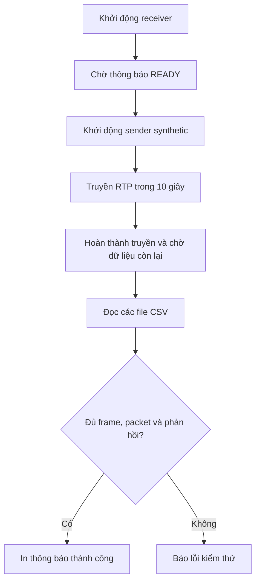
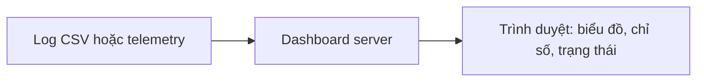
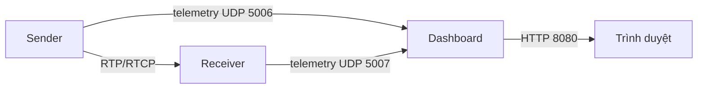
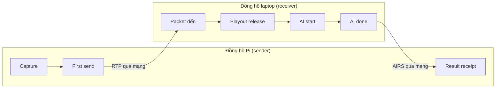
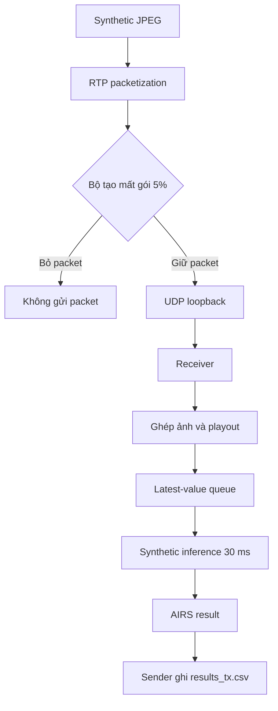
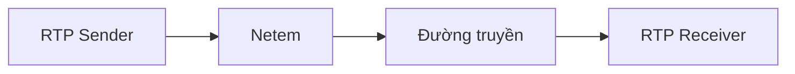

# Session 1 — Phần C. Chạy demo, đọc log và đánh giá hệ thống

**Thời gian học dự kiến:** 45–60 phút, chưa tính thời gian cài đặt môi trường.

Trong Phần A và B, chúng ta đã hiểu camera tạo ảnh như thế nào, cách RTP chia ảnh thành packet, receiver ghép ảnh, playout buffer, RTCP và hàng đợi inference.

Trong Phần C, chúng ta sẽ biến những kiến thức đó thành khả năng thực hành:

- Biết chương trình nào cần chạy trước.
- Biết dữ liệu đang đi qua những cổng mạng nào.
- Phân biệt loopback, replay và live.
- Đọc được từng cột trong các file CSV.
- Tự tính một số chỉ tiêu kỹ thuật từ log.
- Hiểu một lần demo thành công thực sự chứng minh được điều gì.

## C1. Trước khi chạy: chúng ta đang kiểm thử điều gì?

Có ba cách quan sát sản phẩm mà không nhất thiết phải sử dụng toàn bộ thiết bị vật lý.

1. **Loopback — kiểm thử giao thức trên cùng máy tính.** Sender và receiver thực sự hoạt động. Các packet được truyền qua giao diện mạng nội bộ của chính laptop.
2. **Dashboard replay — phát lại kết quả đã lưu.** Dashboard đọc dữ liệu của một thí nghiệm đã được lưu. Không cần chạy lại thí nghiệm.
3. **Dashboard live — quan sát chương trình đang chạy.** Dashboard nhận thông tin giám sát trực tiếp từ sender và receiver.

Ba chế độ này trả lời những câu hỏi khác nhau.

| Câu hỏi                                                       | Chế độ phù hợp                  |
| ------------------------------------------------------------- | ------------------------------- |
| Chương trình có thực sự gửi và ghép được RTP packet không?    | Loopback                        |
| Kết quả thí nghiệm mất gói trước đây như thế nào?             | Replay                          |
| Hiện tại sender và receiver đang hoạt động ra sao?            | Live                            |
| Camera vật lý và kết nối Ethernet thực tế có hoạt động không? | Demo phần cứng với hai thiết bị |

Không được sử dụng kết quả của một chế độ để khẳng định những điều mà chế độ đó chưa kiểm thử.

Ví dụ, loopback chạy thành công không có nghĩa camera Raspberry Pi đã hoạt động tốt.

## C2. IP address, port và socket

Trước khi đọc các câu lệnh demo, chúng ta cần hiểu ba khái niệm cơ bản.

### C2.1. Địa chỉ IP

Địa chỉ IP giúp xác định thiết bị hoặc giao diện mạng mà dữ liệu cần được chuyển tới.

Ví dụ minh họa, một Raspberry Pi và một laptop có hai địa chỉ IP khác nhau. Nếu Pi muốn gửi ảnh đến laptop, sender cần biết địa chỉ đích của laptop.

Nhưng nếu cả sender lẫn receiver đều chạy trên cùng một laptop thì sao? Ta có thể sử dụng:

```text
127.0.0.1
```

Đây là địa chỉ IPv4 loopback, thường được gọi là localhost.

Dữ liệu gửi tới địa chỉ này quay trở lại chính máy tính đang gửi. Nó không cần đi qua dây Ethernet hay thiết bị Wi-Fi bên ngoài.

### C2.2. Port — cổng nhận dữ liệu

Một laptop có thể chạy nhiều chương trình mạng cùng lúc.

Địa chỉ IP giúp tìm máy tính, còn port giúp chuyển dữ liệu đến điểm nhận tương ứng trên máy tính đó.

Hãy tưởng tượng IP giống như địa chỉ một tòa nhà. Port giống như số phòng trong tòa nhà.

Nếu sender gửi RTP đến port 5004 nhưng receiver chỉ đang lắng nghe ở port 5008, hai chương trình sẽ không trao đổi được RTP theo cấu hình mong muốn.

### C2.3. Socket là gì?

**Socket (điểm cuối giao tiếp mạng)** là giao diện mà chương trình sử dụng để gửi hoặc nhận dữ liệu.

Trong sản phẩm:

- Sender có socket gửi RTP.
- Receiver có socket nhận RTP.
- Hai bên còn có socket dành cho RTCP.
- Dashboard live sử dụng các socket riêng để nhận telemetry.

Một socket UDP cho phép chương trình gửi datagram đến một địa chỉ IP và port cụ thể.

Chúng ta không cần tự viết socket từ đầu trong bài này. Điều cần hiểu là các tham số `--host`, `--bind` và `--port` quyết định cách những chương trình kết nối với nhau.

### C2.4. Toàn bộ cổng mặc định trong demo

| Port | Giao thức | Vai trò                              |
| ---- | --------- | ------------------------------------ |
| 5004 | UDP       | Receiver nhận RTP                    |
| 5005 | UDP       | Cổng RTCP tương ứng tại receiver     |
| 5006 | UDP       | Dashboard nhận telemetry từ sender   |
| 5007 | UDP       | Dashboard nhận telemetry từ receiver |
| 8080 | HTTP/TCP  | Trình duyệt mở dashboard             |

**SOURCE:** `sender.py`, `receiver.py`, `telemetry.py`, `dashboard/dashboard/__main__.py`.

Sender có cặp cổng RTP/RTCP cục bộ riêng, được cấp phát tự động theo mặc định. Các cổng 5004/5005 là cặp đích mặc định tại receiver, không phải cổng bắt buộc ở cả hai đầu.

Đây là một chi tiết rất hữu ích khi gặp lỗi `Address already in use`.

## C3. Chuẩn bị môi trường chạy

### C3.1. Terminal là gì?

Terminal là cửa sổ cho phép chúng ta yêu cầu máy tính thực hiện công việc bằng câu lệnh. Khi viết:

```bash
python -m rtp receiver
```

Chúng ta đang yêu cầu Python chạy chương trình receiver thuộc package `rtp`.

Sender, receiver và dashboard là ba chương trình có thể hoạt động độc lập. Một terminal có thể đang chạy receiver, trong khi terminal khác chạy sender.

### C3.2. Xác định thư mục dự án

Repository: [edge-ai-video-runtime](https://github.com/KaiserRichard/edge-ai-video-runtime).

Các thư mục quan trọng đối với bài thực hành:

```text
edge-ai-video-runtime/
├── cn/
│   └── rtp/
│       ├── rtp/
│       │   ├── sender.py
│       │   ├── receiver.py
│       │   ├── sources.py
│       │   └── ...
│       ├── scripts/
│       │   ├── loopback_demo.sh
│       │   └── e2e_loopback.sh
│       └── analysis/
└── dashboard/
    ├── dashboard/
    ├── samples/
    └── README.md
```

`dashboard/samples/` là vị trí dữ liệu replay theo README (ví dụ `samples/cn-loss5`).

### C3.3. Kiểm tra Python và môi trường thư viện

Đối với Windows PowerShell, mở terminal tại thư mục gốc của repository.

```powershell
git rev-parse --short HEAD
git branch --show-current
python --version
```

Hai câu lệnh Git giúp xác định phiên bản chương trình đang sử dụng.

Dashboard yêu cầu Python 3.11 trở lên theo README. Nguồn ảnh synthetic sử dụng thư viện Pillow.

Nếu repository đã có môi trường `.venv`, kiểm tra:

```powershell
.\.venv\Scripts\python.exe --version
.\.venv\Scripts\python.exe -c "import PIL; print(PIL.__version__)"
```

Nếu chưa có môi trường, có thể tạo một môi trường riêng:

```powershell
python -m venv .venv
.\.venv\Scripts\python.exe -m pip install Pillow
```

Đối với Linux hoặc WSL:

```bash
python3 -m venv .venv
.venv/bin/python -m pip install Pillow
```

Virtual environment (môi trường Python riêng) giúp các thư viện của dự án không ảnh hưởng đến những dự án Python khác.

Đây là phần chuẩn bị tối thiểu cho demo RTP synthetic. Chế độ ONNX và các công cụ phân tích có thể cần thêm thư viện và file mô hình.

## C4. Demo 1 — Loopback RTP

### C4.1. Tại sao cần loopback?

Trước khi sử dụng Raspberry Pi, dây mạng và camera, chúng ta muốn kiểm tra một câu hỏi đơn giản:

> Bản thân chương trình sender và receiver có thể trao đổi dữ liệu đúng không?

Nếu chương trình không hoạt động ngay cả trên cùng một laptop, việc đưa thêm thiết bị vật lý vào sẽ khiến việc tìm lỗi trở nên khó khăn hơn.

Loopback giúp giảm số thành phần có thể gây lỗi.

### C4.2. Script tự động thực hiện những bước nào?

Mở file `cn/rtp/scripts/loopback_demo.sh`. Script thực hiện toàn bộ trình tự sau:



Tại sao receiver cần chạy trước? Vì sender sử dụng UDP. Nếu gửi packet trong khi chưa có receiver lắng nghe, dữ liệu đó có thể không được ứng dụng nào nhận.

### C4.3. Các tham số của loopback

| Tham số                  | Giá trị   |
| ------------------------ | --------- |
| Địa chỉ đích             | 127.0.0.1 |
| RTP port                 | 5004      |
| RTCP port                | 5005      |
| Nguồn ảnh                | Synthetic |
| Tốc độ                   | 15 FPS    |
| Thời gian tạo ảnh        | 10 s      |
| Receiver duration tối đa | 16 s      |
| Playout depth mặc định   | 100 ms    |
| AI                       | Off       |

**SOURCE — `loopback_demo.sh` và các tham số mặc định trong `receiver.py`.**

Số frame mà script mong đợi:

\[ N_f=15\times10=150 \]

**CALCULATED.**

Không được nhầm 150 frame với 150 packet. Nếu mỗi ảnh cần nhiều packet, tổng số packet sẽ lớn hơn rất nhiều.

### C4.4. Timeline của một lần chạy

**Drain** là khoảng thời gian chờ sau khi sender kết thúc tạo ảnh, để xử lý dữ liệu và phản hồi còn đang truyền.

Sender có `drain_seconds` mặc định bằng 1.2 s. Nhờ đó, thí nghiệm không nhất thiết phải dừng tất cả chương trình ngay khi frame cuối được tạo.

Receiver có thể kết thúc trước giới hạn tối đa 16 s sau khi nhận BYE.

### C4.5. Cách chạy tự động

Trên Linux hoặc WSL, từ thư mục gốc repository:

```bash
PYTHON="$PWD/.venv/bin/python" \
bash cn/rtp/scripts/loopback_demo.sh
```

Nếu đã có Python phù hợp ở một vị trí khác, thay đường dẫn interpreter tương ứng.

Lưu ý: đây là Bash script. Nó sử dụng `select` để theo dõi đầu ra của subprocess. Linux hoặc WSL là môi trường thích hợp hơn so với việc cố chạy trực tiếp script bằng Python Windows.

#### Kết quả mong đợi

```text
MEASURED loopback: 150 frames, ... packets,
all frames ok; run directory: ...
```

Dấu `...` đại diện cho giá trị thực tế mà chương trình sẽ in khi chạy. Không có một tổng số packet cố định được giả định ở đây.

Script chỉ in thông báo thành công sau khi kiểm tra:

- `sender.csv` chứa 150 frame.
- Tổng số packet nhận bằng tổng số packet dự kiến gửi.
- `frames_rx.csv` chứa 150 frame.
- Tất cả frame có trạng thái `ok`.
- Sender nhận được ít nhất một RR có giá trị RTT.

**SOURCE — `loopback_demo.sh`.**

Đây là tiêu chí kiểm thử thật trong mã, không phải kết quả của một lần chạy mới trong bài giảng này.

### C4.6. Tự chạy sender và receiver trên Windows

Cách chạy thủ công giúp hiểu rõ hơn từng chương trình. Mở hai PowerShell terminal, cùng tại thư mục gốc repository.

#### Terminal 1 — Receiver

```powershell
$env:PYTHONPATH = "$PWD\cn\rtp"

.\.venv\Scripts\python.exe -m rtp receiver `
  --bind 127.0.0.1 `
  --port 5004 `
  --duration 30 `
  --exit-on-bye `
  --out-dir runs\manual-rx `
  --rtcp-csv receiver_rtcp.csv
```

Ý nghĩa từng tham số:

| Tham số         | Nhiệm vụ                                                                       |
| --------------- | ------------------------------------------------------------------------------ |
| `--bind`        | Địa chỉ tại đó receiver lắng nghe                                              |
| `--port`        | Cổng RTP nhận                                                                  |
| `--duration`    | Giới hạn thời gian receiver hoạt động                                          |
| `--exit-on-bye` | Cho phép kết thúc sau khi nhận thông báo kết thúc luồng và chờ dữ liệu còn lại |
| `--out-dir`     | Thư mục lưu log                                                                |
| `--rtcp-csv`    | Tên file RTCP log                                                              |

Đợi receiver in:

```text
READY RTP=5004 RTCP=5005
```

Thông báo này chỉ xác nhận receiver đã sẵn sàng. Nó chưa xác nhận đã nhận thành công ảnh nào.

#### Terminal 2 — Sender

```powershell
$env:PYTHONPATH = "$PWD\cn\rtp"

.\.venv\Scripts\python.exe -m rtp sender `
  --host 127.0.0.1 `
  --port 5004 `
  --source synthetic `
  --fps 15 `
  --duration 10 `
  --out-dir runs\manual-tx `
  --rtcp-csv sender_rtcp.csv
```

Ý nghĩa:

| Tham số              | Nhiệm vụ                            |
| -------------------- | ----------------------------------- |
| `--host`             | Địa chỉ máy receiver                |
| `--source synthetic` | Tạo ảnh bằng chương trình           |
| `--fps 15`           | Tạo ảnh với tốc độ danh định 15 FPS |
| `--duration 10`      | Tạo ảnh trong 10 giây               |
| `--out-dir`          | Thư mục kết quả bên gửi             |

Ở cuối lần chạy, sender sẽ in thông báo theo dạng:

```text
sent ... frames, ... RTP packet attempts
```

Receiver in:

```text
received ... RTP packets; malformed=...
```

`malformed` là bộ đếm lỗi xử lý dữ liệu không hợp lệ thuộc các nhánh được mã receiver kiểm tra.

Hai dòng thông báo này rất hữu ích để kiểm tra ban đầu, nhưng muốn đánh giá chính xác cần đọc CSV.

## C5. Dashboard replay — đọc lại thí nghiệm đã có

### C5.1. Tại sao cần dashboard?

Trong một thí nghiệm, chương trình có thể ghi hàng nghìn dòng CSV. Rất khó nhìn trực tiếp toàn bộ những con số đó và nhận ra hệ thống đang gặp vấn đề gì.

Dashboard chuyển dữ liệu thành các biểu đồ, chỉ số và thông tin trạng thái dễ quan sát hơn.



*Sơ đồ nguyên lý dashboard, không phải ảnh chụp giao diện thật.*

Dashboard là công cụ quan sát, không thay thế sender, receiver hay log gốc.

### C5.2. Replay hoạt động ra sao?

Replay đọc các file CSV đã được tạo trước đó. Ví dụ một file có ba sự kiện:

| Sự kiện  | Thời gian tương đối |
| -------- | ------------------- |
| Packet 1 | 0 s                 |
| Packet 2 | 0.1 s               |
| Packet 3 | 0.4 s               |

Khi replay ở tốc độ bình thường, chương trình tái hiện ba sự kiện theo khoảng cách thời gian tương ứng. Ở tốc độ phát lại gấp đôi, khoảng cách hiển thị giảm một nửa.

Điều này không làm thay đổi kết quả đo của thí nghiệm.

### C5.3. Chạy dashboard replay

Từ thư mục `dashboard/`, dùng lệnh theo README:

```powershell
cd dashboard

..\.venv\Scripts\python.exe -m dashboard `
  --mode replay `
  --replay samples/cn-loss5 `
  --loop
```

Sau đó mở trình duyệt tại `http://127.0.0.1:8080/`.

Các tham số:

- `--mode replay`: đọc dữ liệu đã lưu.
- `--replay`: chỉ định file CSV hoặc thư mục một lần chạy.
- `--loop`: phát lại từ đầu khi hết dữ liệu.
- `--speed`: thay đổi tốc độ phát lại, mặc định bằng 1.

Nếu muốn phát lại ở tốc độ gấp đôi:

```powershell
..\.venv\Scripts\python.exe -m dashboard `
  --mode replay `
  --replay samples/cn-loss5 `
  --speed 2 `
  --loop
```

Nhấn `Ctrl+C` trong terminal để dừng dashboard.

Nếu thư mục `samples/cn-loss5` không tồn tại, cần tìm lại thư mục dữ liệu thật của một lần chạy. Không tạo số liệu giả rồi đặt tên giống thí nghiệm thật.

### C5.4. Chúng ta nên quan sát điều gì?

| Chỉ số       | Câu hỏi cần trả lời                                 |
| ------------ | --------------------------------------------------- |
| Bitrate      | Bên gửi đang cung cấp bao nhiêu dữ liệu mỗi giây?   |
| Packet loss  | Có bao nhiêu packet bị thiếu?                       |
| Jitter       | Khoảng cách thời gian đến biến động thế nào?        |
| Frame status | Bao nhiêu ảnh đúng hạn, muộn hoặc không hoàn chỉnh? |
| RTCP         | Receiver đã gửi báo cáo gì?                         |
| AI latency   | Kết quả mất bao lâu để được nhận?                   |

Hãy xác định dữ liệu đến từ một lần chạy thật, dữ liệu synthetic hay dữ liệu mô phỏng trước khi diễn giải bất kỳ con số nào.

Nếu đang ở replay mode, các giá trị đang hiển thị không phải kết quả đo mạng tại thời điểm hiện tại.

!!! note "Chi tiết nâng cao: đồng hồ khi replay"
    Trong `dashboard/dashboard/replay.py`, chương trình tạo mốc thời gian tương đối riêng cho bên gửi và bên nhận. Nó sử dụng frame tương ứng để căn chỉnh phục vụ hiển thị. Đây không phải phương pháp đồng bộ đồng hồ để đo độ trễ truyền một chiều chính xác.

## C6. Dashboard live — xem ảnh đang được truyền

### C6.1. Kiến trúc live có gì khác replay?

Replay đọc CSV cũ. Live nhận telemetry mới từ chương trình đang hoạt động.



*SOURCE — Kiến trúc live telemetry theo dashboard và mã sender/receiver.*

**Telemetry (dữ liệu giám sát)** là thông tin bổ sung được chương trình gửi đi để quan sát hoạt động.

Đường telemetry độc lập với đường RTP chính. Nếu một sự kiện telemetry bị mất, điều đó không tự động có nghĩa packet RTP tương ứng cũng bị mất.

### C6.2. Chạy live với ba terminal

Ví dụ này sử dụng Windows PowerShell và nguồn ảnh synthetic. Cả ba terminal đều mở từ thư mục gốc repository.

#### Terminal 1 — Dashboard

```powershell
$env:PYTHONPATH = "$PWD\dashboard;$PWD\cn\rtp"

.\.venv\Scripts\python.exe -m dashboard --mode live
```

Thông báo mong đợi:

```text
Dashboard: http://127.0.0.1:8080/ mode=live
UDP Pi=5006, receiver=5007; Ctrl+C to stop
```

Mở trình duyệt trước khi chạy hai chương trình còn lại.

#### Terminal 2 — Receiver

```powershell
$env:PYTHONPATH = "$PWD\dashboard;$PWD\cn\rtp"

.\.venv\Scripts\python.exe -m rtp receiver `
  --out-dir runs\rx `
  --duration 12 `
  --telemetry 127.0.0.1 `
  --telemetry-session demo
```

Đợi thông báo `READY`.

#### Terminal 3 — Sender

```powershell
$env:PYTHONPATH = "$PWD\dashboard;$PWD\cn\rtp"

.\.venv\Scripts\python.exe -m rtp sender `
  --host 127.0.0.1 `
  --port 5004 `
  --source synthetic `
  --duration 8 `
  --out-dir runs\tx `
  --telemetry 127.0.0.1 `
  --telemetry-session demo
```

**SOURCE — `dashboard/README.md`.**

Thực hiện hai lệnh cuối liên tiếp để sender bắt đầu trước khi receiver hết thời gian hoạt động.

`--telemetry-session demo` giúp nhận dạng dữ liệu thuộc cùng một phiên thử nghiệm. Hai đầu phải sử dụng cùng session ID.

Khi thử nghiệm lại, nên dùng thư mục output mới và session ID mới để tránh trộn dữ liệu hoặc ghi đè log.

### C6.3. Tại sao dashboard không hiển thị đủ 15 FPS?

Sender mặc định hoạt động ở 15 FPS. Nhưng receiver có tham số:

```text
--telemetry-video-fps 5
```

Điều đó nghĩa là receiver giới hạn số sự kiện JPEG gửi sang dashboard ở mức tối đa năm sự kiện mỗi giây. Code chọn theo thời gian, không bắt buộc chọn chính xác mỗi frame thứ ba.

Receiver mã hóa chuỗi JPEG thành Base64 để đưa vào sự kiện telemetry. Nó còn kiểm tra kích thước dữ liệu preview trước khi gửi.

Theo mã nguồn hiện tại:

- Chuỗi `jpeg_b64` dài hơn 55000 ký tự sẽ bị bỏ qua.
- Emitter có hàng đợi giới hạn 512 sự kiện.
- Datagram telemetry mã hóa dài hơn 60000 byte sẽ không được gửi.

**SOURCE — `Receiver._completed_frame()` và `telemetry.Emitter`.**

Điều này giúp tránh cho đường giám sát tiêu tốn quá nhiều tài nguyên của hệ thống chính.

Vì vậy, ảnh preview có thể không xuất hiện đầy đủ ngay cả khi receiver vẫn đang nhận và ghép ảnh thành công.

### C6.4. Khi demo không chạy, cần kiểm tra gì?

| Triệu chứng                               | Cách kiểm tra                                            |
| ----------------------------------------- | -------------------------------------------------------- |
| `No module named rtp`                     | Kiểm tra `PYTHONPATH` và thư mục hiện tại                |
| `No module named PIL`                     | Kiểm tra Pillow trong đúng môi trường Python             |
| `Address already in use`                  | Kiểm tra chương trình cũ đang chiếm cổng                 |
| Receiver không in `READY`                 | Đọc lỗi ở terminal receiver trước khi chạy sender        |
| Có `READY` nhưng không nhận packet        | Kiểm tra địa chỉ đích, port và thời gian chạy            |
| Dashboard không có dữ liệu                | Kiểm tra mode, telemetry host, session ID và port        |
| Dashboard có số liệu nhưng không hiện ảnh | Kiểm tra preview FPS, kích thước ảnh và trạng thái frame |
| Không có kết quả AI                       | Kiểm tra chế độ `--ai`; mặc định là `off`                |

Không nên đổi đồng thời nhiều tham số khi tìm lỗi.

Hãy kiểm tra lần lượt: receiver đã sẵn sàng chưa, sender có gửi không, receiver có nhận không, sau đó mới kiểm tra dashboard.

## C7. Log — dữ liệu mà chương trình ghi lại

### C7.1. Tại sao không chỉ sử dụng dashboard?

Dashboard giúp chúng ta quan sát nhanh. Nhưng khi làm báo cáo kỹ thuật, chúng ta cần biết:

- Con số được tính từ dữ liệu nào.
- Có bao nhiêu mẫu đo.
- Sử dụng đồng hồ nào.
- Mẫu số của tỷ lệ phần trăm là gì.
- Có thể tính lại kết quả hay không.

Vì vậy, sender và receiver ghi dữ liệu vào các file CSV.

CSV — Comma-Separated Values — là định dạng bảng trong đó các trường dữ liệu được phân cách bằng dấu phẩy. Mỗi dòng thường đại diện cho một sự kiện.

Điều quan trọng nhất là phải biết **mỗi dòng của từng file đại diện cho cái gì**.

| File             | Đơn vị quan sát                                   |
| ---------------- | ------------------------------------------------- |
| `sender.csv`     | Frame được sender xử lý để gửi                    |
| `receiver.csv`   | RTP packet hợp lệ được ghi nhận                   |
| `frames_rx.csv`  | Frame được receiver theo dõi và phân loại         |
| `rtcp.csv`       | Sự kiện giao thức điều khiển                      |
| `ai.csv`         | Công việc inference đã hoàn thành, lỗi hoặc bị bỏ |
| `results_tx.csv` | Kết quả AI được nhận lại tại sender               |

Chúng ta không được trực tiếp so sánh số dòng của các file này mà không xét đơn vị quan sát.

Một frame có thể tạo ra sáu dòng trong `receiver.csv`, nhưng chỉ tạo ra một dòng trong `frames_rx.csv`.

## C8. sender.csv — bên gửi đã tạo ra bao nhiêu dữ liệu?

### C8.1. Các trường dữ liệu thật

Trong `cn/rtp/rtp/sender.py`, chương trình khai báo:

```python
SENDER_FIELDS = (
    "frame_id,rtp_ts,seq_first,seq_last,n_pkts,bytes,"
    "quality,t_capture_mono_ns,t_send_first_mono_ns,"
    "t_send_last_mono_ns"
).split(",")
```

Đoạn trên được ngắt dòng để dễ đọc, giữ nguyên danh sách trường dữ liệu.

| Cột                    | Ý nghĩa                        | Đơn vị             |
| ---------------------- | ------------------------------ | ------------------ |
| `frame_id`             | ID của ảnh                     | Số nguyên          |
| `rtp_ts`               | RTP timestamp                  | Tick 90 kHz        |
| `seq_first`            | Sequence của packet đầu        | Số 16 bit          |
| `seq_last`             | Sequence của packet cuối       | Số 16 bit          |
| `n_pkts`               | Số packet được tạo để gửi      | Packet             |
| `bytes`                | Tổng kích thước các RTP packet | Byte               |
| `quality`              | Tham số JPEG quality, nếu có   | Không đơn vị       |
| `t_capture_mono_ns`    | Thời điểm lấy ảnh              | ns, đồng hồ sender |
| `t_send_first_mono_ns` | Thời điểm thử gửi packet đầu   | ns, đồng hồ sender |
| `t_send_last_mono_ns`  | Thời điểm thử gửi packet cuối  | ns, đồng hồ sender |

**SOURCE — `SENDER_FIELDS`, `Sender.send_frame()`.**

### C8.2. Ví dụ một dòng sender.csv

Giả sử chúng ta có frame JPEG 6000 byte từ ví dụ B3. Đây là dòng log minh họa được xây dựng theo đúng cấu trúc CSV, không phải dòng đo mới:

```text
frame_id,rtp_ts,seq_first,seq_last,n_pkts,bytes,quality,t_capture_mono_ns,t_send_first_mono_ns,t_send_last_mono_ns
17,90000,65533,2,6,6124,75,1000000000,1000100000,1000400000
```

Chúng ta có thể đọc dòng này như sau: Frame 17 được chia thành sáu packet. Sequence bắt đầu ở 65533 và quay vòng đến 2. Thời điểm lấy ảnh là 1 giây tính theo đồng hồ đơn điệu của sender.

#### Tại sao cột bytes bằng 6124 chứ không phải 6000?

Trong Python hiện tại, `bytes` của sender là tổng kích thước RTP datagram, không phải chỉ kích thước JPEG.

Mỗi packet có 12 byte RTP header và 8 byte fragment header. Packet đầu có thêm 4 byte chứa tổng chiều dài JPEG.

Với sáu packet:

\[ S_{\mathrm{RTP}} =S_{\mathrm{JPEG}}+6(12+8)+4 =6000+120+4 \qquad \boxed{S_{\mathrm{RTP}}=6124\text{ B}} \]

**CALCULATED.**

Cột này không tính IPv4 header, UDP header hay Ethernet overhead.

!!! warning "Lưu ý về số liệu CN-T5 ở Phần A"
    Script `analysis/hw_tables.py` đặt tên một cột là `Mean JPEG bytes/frame`, nhưng lấy trung bình trực tiếp từ `sender.bytes`. Trong khi đó, `sender.py` định nghĩa `bytes` là tổng kích thước RTP packet. Do đó, các giá trị CN-T5 đã báo cáo vẫn được giữ nguyên, nhưng phải đọc chúng là byte RTP trung bình mỗi frame, không phải kích thước JPEG thuần.

### C8.3. Tính thời gian chuẩn bị và gửi ảnh

Từ dòng minh họa:

\[ t_{\mathrm{capture}}=1000000000\text{ ns} \qquad t_{\mathrm{first}}=1000100000\text{ ns} \qquad t_{\mathrm{last}}=1000400000\text{ ns} \]

Vì \(1\text{ ms}=10^6\text{ ns}\), thời gian từ capture đến lần thử gửi đầu tiên:

\[ T_{\mathrm{prepare}} =\frac{1000100000-1000000000}{10^6} \qquad \boxed{T_{\mathrm{prepare}}=0.1\text{ ms}} \]

Khoảng thời gian giữa lần thử gửi packet đầu và cuối:

\[ T_{\mathrm{send,span}} =\frac{1000400000-1000100000}{10^6} \qquad \boxed{T_{\mathrm{send,span}}=0.3\text{ ms}} \]

Cần phân biệt đây là các timestamp do chương trình ghi nhận tại sender. Chúng không phải thời điểm từng bit thực sự xuất hiện trên dây mạng.

### C8.4. Packet attempts không nhất thiết là packet thực sự đi vào mạng

Trong `Sender.send_frame()`, chương trình có cơ chế chủ động bỏ packet để tạo lỗi kiểm thử.

Nó vẫn cập nhật bộ đếm packet và số byte của những packet được tạo, kể cả packet bị cơ chế kiểm thử bỏ trước khi gửi.

Do đó:

- `n_pkts` biểu diễn số packet dự kiến gửi trước bộ tạo mất gói.
- `bytes` biểu diễn tổng byte RTP trước bộ tạo mất gói.
- Telemetry bitrate live của sender đếm các byte thực sự được đưa vào nhánh gửi thành công qua `sendto()`.

Không nên giả định rằng mọi giá trị bitrate trên dashboard đều có cùng định nghĩa với bitrate tính từ CSV.

## C9. receiver.csv — theo dõi từng packet thực tế

Đây là file rất quan trọng đối với phần trình bày của Mạnh. Chúng ta sẽ đọc trực tiếp một file `receiver.csv` thật trong repo: `cn/rtp/results/T3/ge5_b4/run1/receiver.csv`.

### C9.1. Các cột trong receiver.csv

| Cột                | Ý nghĩa                                            |
| ------------------ | -------------------------------------------------- |
| `seq`              | Sequence number của packet                         |
| `rtp_ts`           | Media timestamp                                    |
| `frame_id`         | ID của ảnh mà packet thuộc về                      |
| `marker`           | Packet có phải mảnh cuối hay không                 |
| `bytes`            | Tổng kích thước RTP packet nhận được               |
| `t_arrival_rx_ns`  | Thời điểm nhận packet, theo đồng hồ receiver       |
| `transit_ts_units` | Tọa độ transit tương đối theo đơn vị RTP timestamp |
| `jitter_ts_units`  | Jitter estimator theo đơn vị RTP timestamp         |

**SOURCE — `RECEIVER_FIELDS` trong `receiver.py`.**

### C9.2. Sáu packet đầu tiên trong log thật

| Seq   | RTP timestamp | Frame ID | Marker | Bytes |
| ----- | ------------- | -------- | ------ | ----- |
| 40396 | 3506605502    | 0        | 0      | 1212  |
| 40397 | 3506605502    | 0        | 0      | 1212  |
| 40398 | 3506605502    | 0        | 0      | 1212  |
| 40399 | 3506605502    | 0        | 0      | 1212  |
| 40400 | 3506605502    | 0        | 0      | 1212  |
| 40401 | 3506605502    | 0        | 1      | 178   |

**MEASURED — sáu dòng đầu của `receiver.csv`, CN-T3, cấu hình ge5_b4, lần chạy 1.**

Có ba điều cần nhận ra ngay:

1. Sequence tăng từng đơn vị.
2. Timestamp giống nhau vì tất cả packet thuộc frame 0.
3. Packet cuối nhỏ hơn vì chỉ chứa phần dữ liệu còn lại, đồng thời marker bằng 1.

Tổng số byte RTP đã nhận của sáu packet:

\[ 5(1212)+178=6238\text{ B} \]

Nếu đây là toàn bộ sáu mảnh hợp lệ của frame theo định dạng Python hiện tại, kích thước JPEG tương ứng sẽ là:

\[ S_{\mathrm{JPEG}}=6238-6(20)-4 =6114\text{ B} \]

**CALCULATED — có điều kiện.** Chỉ riêng `receiver.csv` không chứa byte offset và tổng chiều dài JPEG để xác nhận đầy đủ quá trình reassembly.

### C9.3. Đọc arrival timestamp

Hai dòng đầu tiên có:

```text
1212508687730801
1212508688142635
```

Những số này rất lớn vì được biểu diễn bằng nanosecond. Chúng không phải số mili giây tính từ lúc thí nghiệm bắt đầu.

Để biết khoảng cách giữa hai packet đến:

\[ \Delta R= 1212508688142635-1212508687730801 =411834\text{ ns} \qquad \boxed{\Delta R=0.411834\text{ ms}} \]

Chúng ta vừa tính được khoảng cách nhận giữa hai packet thật.

Không cần biết giá trị tuyệt đối của đồng hồ bắt đầu từ lúc nào, vì đang tính hiệu hai timestamp trên cùng máy.

### C9.4. Đọc jitter trực tiếp từ log

Giá trị transit của hai packet đầu:

\[ T_1=105619176393 \qquad T_2=105619176430 \]

Hiệu transit:

\[ D=T_2-T_1=37\text{ ticks} \]

Jitter của packet đầu bằng 0. Theo RFC 3550:

\[ J_2=0+\frac{|37|-0}{16} \qquad \boxed{J_2=2.3125\text{ ticks}} \]

Đây chính xác là giá trị trong dòng thứ hai của log.

Để đổi sang ms:

\[ J_{\mathrm{ms}}=\frac{J_{\mathrm{ticks}}}{90} =\frac{2.3125}{90} \qquad \boxed{J_{\mathrm{ms}}\approx0.02569\text{ ms}} \]

**MEASURED/CALCULATED — tính lại jitter từ dữ liệu thật.**

Lưu ý: `transit_ts_units` không được sử dụng như độ trễ mạng một chiều tuyệt đối. Nó chứa tọa độ thời gian tương đối giữa timestamp và đồng hồ nhận.

### C9.5. Interactive packet log reader

<div id="s1c-packet-log">
<style>
#s1c-packet-log{border:1px solid currentColor;border-radius:12px;padding:16px;margin:20px 0}
#s1c-packet-log .s1cl-buttons{display:flex;flex-wrap:wrap;gap:6px;margin:12px 0}
#s1c-packet-log button{border:1px solid currentColor;border-radius:6px;background:transparent;color:inherit;padding:8px;cursor:pointer}
#s1c-packet-log button[aria-pressed=true]{border:2px solid #14b8a6;background:rgba(20,184,166,.12)}
#s1c-packet-log svg{width:100%;height:auto}
#s1c-packet-log .s1cl-formula{font-family:monospace;overflow-wrap:anywhere}
</style>
<h3>Đọc packet thật từ receiver.csv</h3>
<p>MEASURED — CN-T3 ge5_b4 run1, frame 0, RTP timestamp 3506605502.</p>
<div class="s1cl-buttons"></div>
<svg class="s1cl-svg" viewBox="0 0 600 120" role="img" aria-label="Timeline sáu RTP packet"></svg>
<div class="s1cl-details" aria-live="polite"></div>
<p class="s1cl-formula"></p>
<script>
(()=>{
 const root=document.getElementById("s1c-packet-log");
 const rows=[
  [40396,1212,0,0,0,0],
  [40397,1212,0,.411834,37,2.3125],
  [40398,1212,0,.554849,50,2.98046875],
  [40399,1212,0,.679559,61,3.481689453125],
  [40400,1212,0,.790655,71,3.8890838623046875],
  [40401,178,1,.899846,81,4.2710161209106445]
 ];
 let selected=1;
 function draw(){
  const [seq,bytes,marker,arrival,transit,j]=rows[selected];
  root.querySelector(".s1cl-details").innerHTML=
   `<p><strong>Sequence:</strong> ${seq}<br>
   <strong>RTP bytes:</strong> ${bytes} B<br>
   <strong>Marker:</strong> ${marker}<br>
   <strong>Arrival:</strong> ${arrival.toFixed(6)} ms từ P1<br>
   <strong>Jitter:</strong> ${(j/90).toFixed(5)} ms</p>`;
  root.querySelector(".s1cl-formula").textContent=
   selected===0?"Packet đầu tiên: khởi tạo J = 0.":
   `D = ${transit-rows[selected-1][4]} ticks; `+
   `J = ${rows[selected-1][5].toFixed(4)} + (`+
   `${Math.abs(transit-rows[selected-1][4])} - `+
   `${rows[selected-1][5].toFixed(4)})/16 = `+
   `${j.toFixed(4)} ticks.`;
  const x=t=>25+550*t;
  let svg='<path d="M25 70 H575" stroke="currentColor"/>';
  rows.forEach((row,i)=>{
   const px=x(row[3]),c=i===selected?"#14b8a6":"#4389d8";
   svg+=`<path d="M${px} 35 V70" stroke="${c}" stroke-width="2"/>
   <circle cx="${px}" cy="35" r="5" fill="${c}"/>
   <text x="${px}" y="22" fill="currentColor" text-anchor="middle" font-size="11">P${i+1}</text>`;
  });
  for(const t of [0,.25,.5,.75,1]){
   svg+=`<text x="${x(t)}" y="90" text-anchor="middle" fill="currentColor" font-size="11">${t}</text>`;
  }
  svg+='<text x="300" y="115" text-anchor="middle" fill="currentColor">Thời gian (ms)</text>';
  root.querySelector(".s1cl-svg").innerHTML=svg;
  root.querySelectorAll("[data-i]").forEach(b=>
   b.setAttribute("aria-pressed",String(+b.dataset.i===selected)));
 }
 root.querySelector(".s1cl-buttons").innerHTML=rows.map((r,i)=>
  `<button type="button" data-i="${i}">P${i+1}<br>${r[0]}</button>`
 ).join("");
 root.querySelectorAll("[data-i]").forEach(b=>
  b.onclick=()=>{selected=+b.dataset.i;draw()});
 draw();
})();
</script>
</div>

Hãy chọn lần lượt P1 đến P6.

Bạn sẽ thấy sáu packet thuộc cùng một ảnh đến trong khoảng 0.9 ms, mặc dù chu kỳ tạo ảnh danh định là khoảng 66.67 ms.

Đây là lý do cần phân biệt khoảng cách giữa các packet trong một frame với khoảng cách giữa hai frame.

### C9.6. Một ví dụ sequence gap trong dữ liệu thật

Trong cùng file log có bước nhảy sequence:

```text
40469 → 40473
```

Ba sequence nằm ở giữa là 40470, 40471, 40472. Chúng ta phát hiện một khoảng trống gồm ba số sequence.

Tuy nhiên, một khoảng trống tại thời điểm đang nhận có thể do packet đến sai thứ tự. Cần kiểm tra toàn bộ lần chạy và đối chiếu sender để kết luận mất gói cuối cùng.

File `receiver.csv` này chứa:

| Đại lượng             | Giá trị |
| --------------------- | ------- |
| Số dòng packet        | 4704    |
| Số sequence khác nhau | 4704    |
| Số frame ID xuất hiện | 952     |

**MEASURED/CALCULATED — đếm trực tiếp từ file CSV.**

Nhưng không thể khẳng định camera chỉ tạo 952 ảnh. Đó chỉ là số frame ID xuất hiện tại receiver. Nếu một frame mất toàn bộ packet, nó không xuất hiện trong file này.

## C10. frames_rx.csv — ảnh nào thực sự sử dụng được?

`receiver.csv` nói về packet. `frames_rx.csv` nói về frame. Đây là hai mức quan sát khác nhau.

### C10.1. Các trường dữ liệu

| Cột                | Ý nghĩa                                        |
| ------------------ | ---------------------------------------------- |
| `frame_id`         | ID ảnh                                         |
| `rtp_ts`           | Media timestamp                                |
| `n_expected`       | Số packet dự kiến của frame, nếu xác định được |
| `n_received`       | Số sequence khác nhau được ghi nhận cho frame  |
| `complete`         | 1 nếu ghép đủ ảnh, 0 nếu chưa đủ               |
| `t_complete_rx_ns` | Thời điểm ảnh được ghép đủ                     |
| `t_playout_rx_ns`  | Deadline được tính cho frame                   |
| `status`           | `ok`, `late` hoặc `lost`                       |

**SOURCE — `FRAME_FIELDS`, `PlayoutBuffer._finish()` trong `playout.py`.**

Có hai điểm đặc biệt:

- `n_expected` có thể trống nếu receiver chưa xác định được cả packet đầu và cuối.
- `t_playout_rx_ns` là thời điểm playout dự kiến theo lịch, không phải timestamp đo chính xác khi callback thực sự chạy.

### C10.2. Đọc một bảng frame minh họa

Để dễ đọc, bảng sau đã đổi timestamp sang ms và sử dụng một mốc thời gian tương đối chung tại receiver.

| Frame | Dự kiến | Nhận | Complete | Ghép đủ lúc | Deadline | Status |
| ----- | ------- | ---- | -------- | ----------- | -------- | ------ |
| F1    | 6       | 6    | 1        | 65 ms       | 100 ms   | `ok`   |
| F2    | 6       | 6    | 1        | 190 ms      | 167 ms   | `late` |
| F3    | 6       | 5    | 0        | —           | 233 ms   | `lost` |
| F4    | 6       | 6    | 1        | 285 ms      | 300 ms   | `ok`   |

**Ví dụ minh họa, không phải log thực nghiệm.**

Frame F2 đã nhận đủ tất cả packet. Nhưng \(190-167=23\text{ ms}\): frame hoàn thành muộn hơn deadline 23 ms nên không được sử dụng.

Frame F3 chưa ghép đủ ảnh khi được phân loại kết thúc. Vì vậy, thời điểm hoàn thành để trống.

### C10.3. Arrival offset — ảnh đến sớm hay muộn bao nhiêu?

Chúng ta có thể tính:

\[ \boxed{\Delta_{\mathrm{deadline}}= t_{\mathrm{complete}}-t_{\mathrm{playout}}} \]

- Giá trị âm: ảnh hoàn thành sớm.
- Giá trị bằng 0: ảnh hoàn thành đúng deadline.
- Giá trị dương: ảnh hoàn thành muộn.

Từ bảng minh họa trên: F1 = −35 ms, F2 = +23 ms, F4 = −15 ms. F3 không có giá trị vì chưa ghép đủ ảnh.

Đại lượng này hữu ích vì nó cho biết frame còn bao nhiêu thời gian dự phòng trước hạn sử dụng.

## C11. Tính packet loss, frame loss và on-time ratio

### C11.1. Packet loss

Để tính tỷ lệ mất packet theo cách đối chiếu sender và receiver:

\[ N_{\mathrm{sent}} =\sum_{\text{frame}}n_{\mathrm{pkts}} \]

Gọi \(N_{\mathrm{received,unique}}\) là số packet khác nhau thuộc lần chạy đã nhận.

\[ \boxed{ p_{\mathrm{packet}} =1-\frac{N_{\mathrm{received,unique}}}{N_{\mathrm{sent}}} } \]

Ví dụ: \(N_{\mathrm{sent}}=1000\), \(N_{\mathrm{received,unique}}=950\):

\[ p_{\mathrm{packet}}=1-\frac{950}{1000} \qquad \boxed{p_{\mathrm{packet}}=5\%} \]

**CALCULATED.**

Đây là cách tính gần với `analysis/hw_tables.py`, trong đó số packet gửi lấy từ tổng `n_pkts` và số nhận lấy từ các sequence khác nhau.

Giới hạn: nếu phiên truyền dài đến mức sequence 16 bit quay vòng nhiều lần, không thể chỉ đếm giá trị sequence khác nhau mà không quản lý thêm vòng sequence hoặc thông tin định danh tương ứng.

### C11.2. Frame loss và on-time ratio

Đối với tập frame đã phân loại đầy đủ:

\[ P_{\mathrm{lost}} =\frac{N_{\mathrm{lost}}}{N_f} \qquad P_{\mathrm{late}} =\frac{N_{\mathrm{late}}}{N_f} \qquad P_{\mathrm{on-time}} =\frac{N_{\mathrm{ok}}}{N_f} \]

Nếu tất cả frame đã gửi đều được đối chiếu đầy đủ:

\[ P_{\mathrm{lost}}+ P_{\mathrm{late}}+ P_{\mathrm{on-time}}=1 \]

Nhưng trong dữ liệu thật, một số frame có thể không xuất hiện trong `frames_rx.csv` vì toàn bộ packet của frame đã mất. Khi đó, cần báo cáo thêm số frame chưa đối chiếu được.

Không được tự động coi file log thiếu dữ liệu là một phép đo đầy đủ.

### C11.3. Mất cùng sáu packet nhưng kết quả có thể rất khác

Giả sử có mười ảnh, mỗi ảnh cần sáu packet. Tổng số packet \(N=10\times6=60\).

Chúng ta làm mất sáu packet. Tỷ lệ mất packet là:

\[ p=\frac{6}{60}=10\% \]

Nhưng tỷ lệ mất ảnh phụ thuộc vào những packet nào bị mất.

<div id="s1c-loss-lab">
<style>
#s1c-loss-lab{border:1px solid currentColor;border-radius:12px;padding:16px;margin:20px 0}
#s1c-loss-lab .s1cl-controls{display:flex;flex-wrap:wrap;gap:6px}
#s1c-loss-lab button{color:inherit;background:transparent;border:1px solid currentColor;border-radius:5px;padding:6px;cursor:pointer}
#s1c-loss-lab .s1cl-row{display:grid;grid-template-columns:32px repeat(6,minmax(20px,1fr)) 38px;gap:4px;align-items:center;margin:5px 0}
#s1c-loss-lab .s1cl-packet{background:#4389d8;border-color:#4389d8;color:white}
#s1c-loss-lab .s1cl-lost{background:#dc2626;border-color:#dc2626}
#s1c-loss-lab .s1cl-summary{font-weight:700;margin:15px 0}
</style>
<h3>Packet loss và frame loss</h3>
<p>Bấm vào packet để bật/tắt trạng thái mất gói.</p>
<div class="s1cl-controls">
<button type="button" data-mode="spread">Mất rải rác 6 gói</button>
<button type="button" data-mode="one">Mất 6 gói cùng ảnh</button>
<button type="button" data-mode="reset">Reset</button>
</div>
<div class="s1cl-frames"></div>
<p class="s1cl-summary" aria-live="polite"></p>
<small>CALCULATED — 10 frame, mỗi frame cần đủ 6 packet.</small>
<script>
(()=>{
 const root=document.getElementById("s1c-loss-lab");
 let lost=Array.from({length:60},(_,i)=>i%6===0&&i<36);
 function draw(){
  let framesLost=0,html="";
  for(let f=0;f<10;f++){
   const bad=lost.slice(f*6,f*6+6).some(Boolean);
   if(bad)framesLost++;
   html+=`<div class="s1cl-row"><span>F${f+1}</span>`;
   for(let k=0;k<6;k++){
    const i=f*6+k;
    html+=`<button type="button" data-packet="${i}"
    aria-label="Frame ${f+1}, packet ${k+1}"
    aria-pressed="${lost[i]}"
    class="s1cl-packet ${lost[i]?"s1cl-lost":""}">
    ${lost[i]?"×":k+1}</button>`;
   }
   html+=`<span>${bad?"Mất":"Đủ"}</span></div>`;
  }
  const n=lost.filter(Boolean).length;
  root.querySelector(".s1cl-frames").innerHTML=html;
  root.querySelector(".s1cl-summary").textContent=
   `Packet loss: ${(100*n/60).toFixed(1)}% (${n}/60) — `+
   `Frame loss: ${framesLost*10}% (${framesLost}/10)`;
  root.querySelectorAll("[data-packet]").forEach(b=>
   b.onclick=()=>{const i=+b.dataset.packet;lost[i]=!lost[i];draw()});
 }
 root.querySelectorAll("[data-mode]").forEach(b=>
  b.onclick=()=>{
   const mode=b.dataset.mode;
   lost=Array.from({length:60},(_,i)=>
    mode==="spread"?i%6===0&&i<36:mode==="one"?i<6:false);
   draw();
  });
 draw();
})();
</script>
</div>

Hãy so sánh hai nút mất sáu gói.

Trong cả hai trường hợp, packet loss đều bằng 10%. Nhưng khi sáu gói mất nằm trong sáu ảnh khác nhau, frame loss bằng 60%. Nếu cả sáu gói cùng thuộc một ảnh, frame loss chỉ bằng 10%.

Điều này giúp chúng ta hiểu rằng vị trí mất packet có ý nghĩa đối với khả năng ghép ảnh.

### C11.4. Đọc kết quả CN-T3


Hãy tập trung vào biểu đồ bên trái.

- Trục ngang: các cấu hình mạng.
- Trục đứng: tỷ lệ mất, đơn vị phần trăm.
- Cột xanh: packet loss.
- Cột cam: frame loss.

| Cấu hình | Packet loss | Frame loss | On-time | AI results/s |
| -------- | ----------- | ---------- | ------- | ------------ |
| loss1    | 1.0%        | 4.9%       | 95.1%   | 14.29        |
| loss5    | 5.2%        | 24.0%      | 76.0%   | 11.42        |
| loss10   | 10.0%       | 41.5%      | 58.5%   | 8.78         |

**MEASURED — CN-T3, năm lần chạy mỗi cấu hình.**

Khi tỷ lệ mất packet tăng, số ảnh ghép thành công giảm mạnh vì một ảnh cần nhiều packet.

Với cấu hình mất gói theo cụm `ge5_b4`, nhóm đo được packet loss 5.3% và frame loss 8.8%.

**MEASURED — `hw_tables.md`, CN-T3.**

Trong Session 2, chúng ta sẽ giải thích định lượng các kết quả mất gói độc lập bằng công thức xác suất và mô hình SimEvents.

### C11.5. Chú ý mẫu số trong mã phân tích

Mã nguồn hiện tại có hai cách tổng hợp cần phân biệt:

- `analysis/metrics.py` tính frame metrics trên các dòng của `frames_rx.csv`.
- `analysis/hw_tables.py` sử dụng số frame gửi làm mẫu số nếu có `sender.csv`.

Hai cách này có thể cho kết quả khác nhau nếu receiver thiếu hoàn toàn một số frame.

Đây là lý do không nên lấy một con số loss từ dashboard rồi so sánh trực tiếp với bảng báo cáo mà chưa kiểm tra định nghĩa.

## C12. rtcp.csv — đọc đường phản hồi

### C12.1. Tại sao có nhiều file RTCP?

Trong lần chạy tự động, script tạo `sender_rtcp.csv`, `receiver_rtcp.csv` và `rtcp.csv`.

Hai file đầu ghi dữ liệu điều khiển từ góc nhìn của từng chương trình. Sau khi cả hai chương trình kết thúc, script loopback ghép hai file lại thành `rtcp.csv` và sắp xếp theo `t_mono_ns`.

Cách ghép theo thời gian này phù hợp với loopback trên cùng máy tính, nơi hai chương trình sử dụng cùng cơ sở đồng hồ đơn điệu.

Đối với hai thiết bị vật lý, không được giả định timestamp monotonic của hai máy trực tiếp so sánh được với nhau.

### C12.2. Các loại sự kiện RTCP

| Type   | Ý nghĩa                                    |
| ------ | ------------------------------------------ |
| `SR`   | Sender Report                              |
| `RR`   | Receiver Report                            |
| `SDES` | Thông tin mô tả nguồn RTP                  |
| `BYE`  | Thông báo kết thúc luồng                   |
| `APP`  | Dữ liệu điều khiển riêng của ứng dụng      |
| `ABR`  | Sự kiện điều chỉnh bitrate được ghi cục bộ |

Trong dự án, kết quả AI có thể được đưa trở lại sender bằng RTCP APP với định dạng riêng tên AIRS.

`ABR` trong CSV là sự kiện chương trình tự ghi khi bộ điều khiển cập nhật. Nó không phải một loại RTCP packet chuẩn được gửi trên mạng.

### C12.3. Đọc từng cột

| Cột             | Ý nghĩa                                 |
| --------------- | --------------------------------------- |
| `t_mono_ns`     | Thời điểm ghi sự kiện tại máy tương ứng |
| `dir`           | Hướng sự kiện: `tx`, `rx` hoặc `local`  |
| `type`          | Loại sự kiện                            |
| `ssrc`          | Nguồn liên quan                         |
| `fraction_lost` | Loss được mã hóa trên tám bit           |
| `cum_lost`      | Số packet mất tích lũy                  |
| `ext_high_seq`  | Sequence cao nhất có tính vòng quay     |
| `jitter`        | Jitter theo RTP timestamp units         |
| `lsr`           | Thông tin từ Sender Report gần nhất     |
| `dlsr`          | Khoảng thời gian chờ báo cáo            |
| `rtt_ms`        | Giá trị RTT ước lượng tại sender        |

**SOURCE — `RTCP_FIELDS`, `log_rtcp()` trong `sender.py`.**

Không phải mọi sự kiện đều có đủ giá trị cho tất cả các cột. Ví dụ, một sự kiện BYE không cần cung cấp fraction lost hay jitter.

Ô trống không tự động có nghĩa giá trị bằng 0.

### C12.4. Ví dụ đọc một Receiver Report

| Trường          | Giá trị |
| --------------- | ------- |
| `dir`           | `rx`    |
| `type`          | `RR`    |
| `fraction_lost` | 13      |
| `cum_lost`      | 3       |
| `jitter`        | 18      |
| `rtt_ms`        | 2.0     |

**Ví dụ minh họa theo cấu trúc mã nguồn.**

Trước tiên, giải mã fraction lost:

\[ p=\frac{13}{256} \qquad \boxed{p=5.078125\%} \]

Tiếp theo, đổi jitter:

\[ J=\frac{18}{90} \qquad \boxed{J=0.2\text{ ms}} \]

`cum_lost = 3` nghĩa là số packet thiếu tích lũy trong phạm vi thống kê của báo cáo bằng ba.

Không được đọc `fraction_lost = 13` thành mất 13%.

### C12.5. RTT — thời gian khứ hồi

RTT là Round-Trip Time.

Hãy tưởng tượng sender gửi một tin nhắn tới receiver. Receiver phản hồi lại. Khoảng thời gian từ lúc gửi đến lúc nhận phản hồi bao gồm:

1. Thời gian đi tới receiver.
2. Thời gian receiver chờ trước khi trả lời.
3. Thời gian phản hồi quay lại sender.

Chúng ta muốn loại bỏ phần thời gian chờ tại receiver để ước lượng thời gian khứ hồi của đường truyền.

Trong công thức RFC sử dụng các trường thời gian dạng compact NTP:

\[ \boxed{ RTT=\frac{A-LSR-DLSR}{65536} } \]

Kết quả có đơn vị giây, sau khi xử lý phép trừ theo quy ước trường 32 bit.

Ví dụ minh họa: tổng khoảng thời gian 120 ms, receiver chờ trước khi gửi báo cáo 100 ms:

\[ RTT=120-100=20\text{ ms} \]

Điều này không khẳng định đường đi mất 10 ms và đường về mất 10 ms. Chúng ta chỉ biết tổng hai khoảng thời gian xấp xỉ 20 ms. Hai chiều có thể không đối xứng.

**SOURCE — `rtcp.rtt_ms()` và `sender.log_rtcp()`.**

### C12.6. Hình kết quả RTCP trong thí nghiệm thật


Hãy quan sát phần biểu diễn loss qua các kỳ báo cáo.

Nếu giá trị loss từng kỳ dao động quanh mức cấu hình, điều đó không có nghĩa chương trình tính sai. Mỗi RR đại diện cho một tập packet hữu hạn. Số packet mất quan sát được có thể thay đổi giữa các kỳ.

Khi nghiên cứu AIMD trong Session 2, chúng ta sẽ sử dụng chính chuỗi báo cáo như vậy làm đầu vào cho bộ điều khiển.

## C13. ai.csv và results_tx.csv — đo thời gian tạo kết quả

### C13.1. Một frame đi qua những mốc thời gian nào?

Sau khi receiver ghép ảnh và release frame, AI có thể chưa xử lý ngay lập tức. Frame cần vào hàng đợi.

| Mốc                 | Thời điểm (minh họa) |
| ------------------- | -------------------- |
| Enqueue vào hàng đợi | 100 ms              |
| Bắt đầu inference   | 180 ms               |
| Inference xong      | 232 ms               |

*CALCULATED — Ví dụ minh họa.*

Chúng ta cần phân biệt thời gian chờ và thời gian thực sự xử lý. Hai đại lượng này có nguyên nhân khác nhau.

### C13.2. Đọc ai.csv

| Cột               | Ý nghĩa                          |
| ----------------- | -------------------------------- |
| `frame_id`        | ID của ảnh                       |
| `rtp_ts`          | RTP timestamp                    |
| `policy`          | FIFO hoặc latest                 |
| `t_enqueue_rx_ns` | Thời điểm đưa ảnh vào hàng đợi   |
| `t_start_rx_ns`   | Thời điểm bắt đầu inference      |
| `t_done_rx_ns`    | Thời điểm inference hoàn thành   |
| `class_id`        | Mã lớp nhận dạng                 |
| `confidence`      | Độ tin cậy do chế độ AI cung cấp |
| `status`          | `ok`, `skipped` hoặc `error`     |

**SOURCE — `AI_FIELDS` trong `edge_ai.py`.**

Ví dụ, nếu frame bị latest-value thay thế khi vẫn đang chờ, log có thể ghi `skipped` và không có thời gian bắt đầu, hoàn thành. Frame đó không phải một kết quả inference thành công.

### C13.3. Tính queue waiting time

\[ \boxed{ T_{\mathrm{queue}} =t_{\mathrm{start}}-t_{\mathrm{enqueue}} } \]

Theo timeline minh họa:

\[ T_{\mathrm{queue}}=180-100 \qquad \boxed{T_{\mathrm{queue}}=80\text{ ms}} \]

### C13.4. Tính inference service time

\[ \boxed{ T_{\mathrm{inference}} =t_{\mathrm{done}}-t_{\mathrm{start}} } \]

\[ T_{\mathrm{inference}}=232-180 \qquad \boxed{T_{\mathrm{inference}}=52\text{ ms}} \]

Hai khoảng thời gian này đều sử dụng timestamp tại receiver. Vì vậy, không cần đồng bộ đồng hồ với sender để tính chúng.

### C13.5. results_tx.csv ghi gì?

Sau khi AI hoàn thành, receiver gửi thông tin kết quả về sender. Sender đối chiếu kết quả với thông tin capture đã lưu và ghi:

| Cột                   | Ý nghĩa                           |
| --------------------- | --------------------------------- |
| `frame_id`            | ID ảnh được xử lý                 |
| `rtp_ts`              | RTP timestamp tương ứng           |
| `t_capture_mono_ns`   | Thời điểm lấy ảnh tại sender      |
| `t_result_rx_mono_ns` | Thời điểm sender nhận lại kết quả |
| `class_id`            | Mã lớp nhận dạng                  |

**SOURCE — `RESULT_FIELDS`, `Sender.receive_control()`.**

Đây là file quan trọng để tính độ trễ toàn hành trình của kết quả AI.

## C14. Kiến trúc đo thời gian — không được trừ hai đồng hồ khác nhau

### C14.1. Tại sao đồng hồ của hai máy là vấn đề?

Giả sử sender ghi thời điểm lấy ảnh là 500 ms. Receiver ghi thời điểm nhận ảnh là 1700 ms.

Có thể kết luận mạng gây trễ 1200 ms không? Không.

Hai máy có thể bắt đầu bộ đếm thời gian từ hai mốc khác nhau. Để tính khoảng thời gian đúng, chúng ta cần các timestamp thuộc cùng một cơ sở thời gian hoặc có phương pháp đồng bộ phù hợp.

### C14.2. T9 measurement architecture



Tại sender, chúng ta có thể tính:

\[ L_{\mathrm{prepare}} =t_{\mathrm{first-send}}-t_{\mathrm{capture}} \]

\[ L_{\mathrm{send-result}} =t_{\mathrm{result-receipt}}-t_{\mathrm{first-send}} \]

\[ L_{\mathrm{total}} =t_{\mathrm{result-receipt}}-t_{\mathrm{capture}} \]

Vì chúng sử dụng cùng ba timestamp, với mỗi frame:

\[ \boxed{ L_{\mathrm{total}}= L_{\mathrm{prepare}}+L_{\mathrm{send-result}} } \]

Tại receiver, chúng ta tính các khoảng thời gian playout, queue và inference bằng đồng hồ receiver.

Chú ý: sơ đồ gộp playout release và AI enqueue cho dễ hiểu. Trong code thật, deadline dự kiến, callback thực tế và timestamp enqueue là các mốc có thể khác nhau một khoảng nhỏ.

### C14.3. Kết quả CN-T9

Nhóm thực hiện phép đo phân tách latency với playout depth 50 ms.

| Chỉ số P50                  | Không loss | Loss 5%  |
| --------------------------- | ---------- | -------- |
| Capture → first send        | 0.07 ms    | 0.07 ms  |
| First send → result receipt | 67.84 ms   | 67.93 ms |
| Capture → result receipt    | 67.91 ms   | 68.01 ms |
| Receiver playout wait       | 50.26 ms   | 50.16 ms |
| AI queue wait               | 0.12 ms    | 0.12 ms  |
| AI inference                | 12.51 ms   | 12.52 ms |

**MEASURED — CN-T9, trung bình các P50 của năm lần chạy, từ `hw_tables.md`.**

Trong thí nghiệm này, thời gian playout lớn hơn nhiều so với thời gian chờ AI. Đó là lý do chỉ nhìn inference time sẽ đánh giá không đầy đủ latency của hệ thống.

#### Vì sao 0.07 + 67.93 không đúng chính xác 68.01?

Bởi vì các số trong bảng là giá trị P50 đã được tổng hợp qua các lần chạy. Trung vị của tổng không nhất thiết bằng tổng của từng trung vị.

Điều quan trọng là đẳng thức thời gian phải được kiểm tra trên từng frame tương ứng.

Bảng CN-T9 báo cáo sai số tuyệt đối lớn nhất của phép kiểm tra tổng thành phần sender-clock bằng 0.000 ms ở cả hai cấu hình.

Không được lấy việc trừ các thống kê P50 riêng biệt để suy ra chính xác thời gian truyền mạng một chiều.

## C15. Interactive latency laboratory

Bây giờ chúng ta tạo một mô hình đơn giản để hiểu vì sao latency tổng có thể lớn hơn nhiều so với thời gian inference.

Giả sử các thành phần thời gian nối tiếp nhau gồm: chuẩn bị và gửi ảnh, truyền mạng đi, chờ playout, chờ AI, xử lý AI, trả kết quả về.

<div id="s1c-latency">
<style>
#s1c-latency{border:1px solid currentColor;border-radius:12px;padding:16px;margin:20px 0}
#s1c-latency input{width:100%;accent-color:#14b8a6}
#s1c-latency .s1ct-row{margin:10px 0}
#s1c-latency .s1ct-bar{display:flex;height:32px;border-radius:6px;overflow:hidden;margin:12px 0}
#s1c-latency .s1ct-segment{display:flex;align-items:center;justify-content:center;color:white;font-size:.8em;overflow:hidden}
#s1c-latency .s1ct-key{display:inline-block;width:12px;height:12px;border-radius:2px;margin-right:8px}
</style>
<h3>Phân tách độ trễ toàn hành trình</h3>
<div class="s1ct-controls"></div>
<p>Tổng latency: <strong class="s1ct-total"></strong></p>
<div class="s1ct-bar"></div>
<div class="s1ct-legend"></div>
<small>CALCULATED — Ví dụ minh họa, không phải phép đo CN-T9.</small>
<script>
(()=>{
 const root=document.getElementById("s1c-latency");
 const parts=[
  ["Chuẩn bị ảnh",2,0,20,1,"#64748b"],
  ["Truyền đi",8,0,50,1,"#4389d8"],
  ["Playout wait",50,0,200,5,"#0d9488"],
  ["AI queue wait",20,0,450,5,"#b45309"],
  ["Inference",13,1,100,1,"#7c3aed"],
  ["Trả kết quả",4,0,50,1,"#4389d8"]
 ];
 root.querySelector(".s1ct-controls").innerHTML=parts.map((p,i)=>
  `<div class="s1ct-row"><label>${p[0]}:
   <strong data-value="${i}"></strong>
   <input type="range" data-index="${i}" value="${p[1]}"
    min="${p[2]}" max="${p[3]}" step="${p[4]}">
   </label></div>`
 ).join("");
 const inputs=[...root.querySelectorAll("[data-index]")];
 function draw(){
  const v=inputs.map(e=>Number(e.value));
  const total=v.reduce((a,b)=>a+b,0);
  v.forEach((n,i)=>{
   root.querySelector(`[data-value="${i}"]`).textContent=n+" ms";
  });
  root.querySelector(".s1ct-total").textContent=total+" ms";
  root.querySelector(".s1ct-bar").innerHTML=v.map((n,i)=>
   n===0?"":`<div class="s1ct-segment"
    style="flex:${n};background:${parts[i][5]}"
    title="${parts[i][0]}: ${n} ms">
    ${n/total>.12?n+" ms":""}</div>`
  ).join("");
  root.querySelector(".s1ct-legend").innerHTML=v.map((n,i)=>
   `<div><span class="s1ct-key" style="background:${parts[i][5]}"></span>
    ${parts[i][0]}: ${n} ms (${(100*n/total).toFixed(1)}%)</div>`
  ).join("");
 }
 inputs.forEach(e=>e.oninput=draw);draw();
})();
</script>
</div>

Hãy thử tăng AI queue wait lên 440 ms nhưng giữ nguyên inference time. Sau đó giảm AI queue wait xuống 15 ms.

Bạn sẽ thấy latency tổng giảm rất mạnh dù tốc độ xử lý AI không đổi. Đó là trực giác đằng sau cải tiến FIFO → latest-value trong CN-T7.

## C16. Demo 2 — truyền ảnh, mất gói và inference

Sau khi đã đọc được log, chúng ta có thể thực hiện một demo phức tạp hơn. Repository có script `cn/rtp/scripts/e2e_loopback.sh`.

E2E là End-to-End, nghĩa là kiểm thử từ đầu vào ảnh đến kết quả AI được nhận lại.

### C16.1. Cấu hình

| Tham số                     | Giá trị   |
| --------------------------- | --------- |
| Nguồn ảnh                   | Synthetic |
| Frame rate                  | 15 FPS    |
| Thời gian tạo ảnh           | 20 s      |
| Mất gói chủ động tại sender | 5%        |
| Random seed                 | 7         |
| AI                          | Synthetic |
| Queue policy                | Latest    |
| Service time                | 30 ms     |
| AI threads                  | 1         |

**SOURCE — `e2e_loopback.sh`.**

Random seed là giá trị khởi tạo bộ sinh số giả ngẫu nhiên. Giữ cùng seed giúp tái tạo chuỗi quyết định mất gói trong điều kiện tương ứng, mặc dù thời gian chạy thực tế vẫn có thể dao động.

### C16.2. Đường đi của dữ liệu



Ở đây, bộ tạo mất gói nằm trong chương trình sender. Nó không phải phép đo suy giảm đường truyền Ethernet vật lý.

### C16.3. Cách chạy

Trong môi trường Bash Linux hoặc WSL:

```bash
PYTHON="$PWD/.venv/bin/python" \
bash cn/rtp/scripts/e2e_loopback.sh
```

Script này cần thêm các thư viện phân tích như NumPy, pandas và module tính AoI `cn/analysis/aoi.py` của repository. Hãy kiểm tra dependencies trước khi chạy.

### C16.4. Những gì script kiểm tra

Khác với loopback không mất gói, script này không yêu cầu tất cả frame phải `ok`. Mục đích là xác nhận hệ thống vẫn tạo được kết quả AI khi có mất gói.

Nó kiểm tra:

- Có dữ liệu frame ở sender.
- Có kết quả AIRS được nhận lại.
- Có thể tính latency P50 và P95.

Kết quả mong đợi có dạng:

```text
MEASURED loopback summary

frames sent                    ...
AIRS results received          ...
capture->AI latency P50        ... ms
capture->AI latency P95        ... ms
run directory                  ...
```

Dấu ba chấm phải được thay bằng kết quả thực tế của lần chạy, không phải giá trị đặt trước.

## C17. Từ một lần demo đến một thí nghiệm kỹ thuật

### C17.1. Demo và experiment khác nhau như thế nào?

Demo chủ yếu trả lời:

> Hệ thống có thể hoạt động được không?

Experiment (thí nghiệm) trả lời một câu hỏi cụ thể hơn:

> Khi thay đổi một điều kiện, chỉ số kỹ thuật thay đổi như thế nào?

Ví dụ:

- Tăng packet loss từ 1% lên 5% có làm frame loss tăng không?
- Tăng playout depth có giảm tỷ lệ frame muộn không?
- Thay FIFO bằng latest-value có giảm AoI không?

Để trả lời đáng tin cậy, chúng ta cần giữ các điều kiện khác ổn định, thay đổi tham số đang khảo sát và thực hiện nhiều lần chạy.

### C17.2. Netem là gì?

`netem` là công cụ tạo suy giảm mạng có kiểm soát. Nó cho phép tạo các điều kiện như mất packet, trễ truyền và biến động trễ.

Trong thí nghiệm vật lý, nhóm có thể cấu hình netem trên giao diện mạng đang truyền dữ liệu.



Netem giúp chúng ta khảo sát hệ thống dưới điều kiện mạng xác định thay vì phải chờ sự cố ngẫu nhiên xuất hiện.

Việc chạy netem trên thiết bị thật thuộc bài demo phần cứng. Cần xác định đúng giao diện mạng, lưu cấu hình trước khi thay đổi và có phương án khôi phục.

### C17.3. Bản đồ các thí nghiệm CN

| Thí nghiệm | Câu hỏi kỹ thuật                                                     |
| ---------- | -------------------------------------------------------------------- |
| CN-T2      | Hệ thống hoạt động thế nào ở điều kiện Ethernet baseline?            |
| CN-T3      | Packet loss ảnh hưởng đến frame loss ra sao?                         |
| CN-T4      | Playout depth đánh đổi latency và tỷ lệ đúng hạn thế nào?            |
| CN-T5      | Kích thước packet và JPEG quality ảnh hưởng đến truyền thông ra sao? |
| CN-T6      | Hệ thống hoạt động thế nào qua kết nối Wi-Fi đã khảo sát?            |
| CN-T7      | Latest-value cải thiện freshness bao nhiêu?                          |
| CN-T8      | Điều khiển bitrate thích nghi hoạt động ra sao khi mạng thay đổi?    |
| CN-T9      | Những thành phần nào tạo nên latency tổng?                           |

CN-T8 trên phần cứng chưa có đủ bằng chứng để được công nhận là hoàn thành thành công.

Kết quả AIMD từ SimEvents sẽ được học trong Session 2 và phải được gắn nhãn SIMULATED.

### C17.4. Tại sao cần lưu cả cấu hình?

Giả sử hai lần chạy đều báo packet loss bằng 5%. Nhưng một lần dùng ảnh lớn, một lần dùng ảnh nhỏ. Frame loss có thể khác nhau vì số packet cần thiết cho mỗi ảnh khác nhau.

Nếu chỉ lưu tỷ lệ mất gói cuối cùng, chúng ta không thể giải thích đầy đủ kết quả.

Một lần chạy tốt cần giữ lại thông tin như:

| Thông tin                          | Mục đích                        |
| ---------------------------------- | ------------------------------- |
| Commit hoặc phiên bản chương trình | Biết đang đo implementation nào |
| Kích thước ảnh, FPS, quality       | Biết lượng dữ liệu đầu vào      |
| Payload limit                      | Biết cách chia packet           |
| Playout depth                      | Biết hạn sử dụng ảnh            |
| Cấu hình mất gói và delay          | Biết điều kiện mạng             |
| AI mode và queue policy            | Biết cách xử lý ảnh             |
| Log gốc                            | Có thể kiểm tra lại kết quả     |

Các thông tin này giúp kết quả có khả năng truy xuất và tái lập.

## C18. Tổng kết Session 1

| Phần | Nội dung |
| ---- | -------- |
| **A — Hiểu sản phẩm** | Frame, JPEG, FPS, bitrate, camera, nguồn synthetic và các chế độ AI. |
| **B — Hiểu cơ chế truyền** | UDP, RTP, fragment, sequence, timestamp, jitter, playout, RTCP, FIFO/latest và AoI. |
| **C — Hiểu thực nghiệm** | Loopback, dashboard, đọc CSV, tính loss, latency và phân biệt các mốc thời gian. |

Bây giờ, khi mở mô hình SimEvents trong Session 2, chúng ta sẽ không còn nhìn nó như một tập hợp những khối MATLAB xa lạ. Chúng ta đã biết mỗi khối đang đại diện cho cơ chế nào trong sản phẩm thật.

## C19. Kiểm tra hiểu bài

<div class="quiz" markdown>
<p class="quiz-q">Loopback chạy thành công với 150 frame chứng minh điều gì?</p>

- [ ] Camera vật lý chắc chắn hoạt động
- [x] Sender và receiver vượt qua kiểm thử truyền thông nội bộ
- [ ] Mọi mạng Ethernet đều không mất gói
- [ ] CN-T8 đã hoàn thành

<div class="quiz-why" markdown>
Loopback kiểm tra phần mềm truyền thông trên cùng máy. Nó không xác nhận camera hoặc đường truyền vật lý.
</div>
</div>

<div class="quiz" markdown>
<p class="quiz-q">Một ảnh chia thành sáu packet và receiver nhận đủ. receiver.csv có bao nhiêu dòng tương ứng?</p>

- [ ] 1
- [ ] 2
- [x] 6
- [ ] 12

<div class="quiz-why" markdown>
receiver.csv ghi theo packet. frames_rx.csv ghi theo frame được phân loại.
</div>
</div>

<div class="quiz" markdown>
<p class="quiz-q">sender.csv có n_pkts = 6 và bytes = 6124. JPEG ban đầu chứa bao nhiêu byte theo định dạng Python hiện tại?</p>

- [ ] 6124 B
- [x] 6000 B
- [ ] 6052 B
- [ ] 6248 B

<div class="quiz-why" markdown>
Trừ 6 × 20 B header và 4 B bổ sung ở mảnh đầu. Kết quả là 6000 B dữ liệu JPEG.
</div>
</div>

<div class="quiz" markdown>
<p class="quiz-q">RR có fraction_lost = 13 và jitter = 18 ticks. Kết quả giải mã là gì?</p>

- [ ] 13% và 18 ms
- [ ] 5.08% và 18 ms
- [x] 5.08% và 0.2 ms
- [ ] 13% và 0.2 ms

<div class="quiz-why" markdown>
Loss bằng 13/256. Jitter bằng 18/90 ms.
</div>
</div>

<div class="quiz" markdown>
<p class="quiz-q">Mất sáu trong 60 packet, mỗi packet mất thuộc một trong sáu frame khác nhau. Tổng cộng có 10 frame. Frame loss bằng bao nhiêu?</p>

- [ ] 10%
- [x] 60%
- [ ] 6%
- [ ] 0%

<div class="quiz-why" markdown>
Sáu frame khác nhau đều thiếu dữ liệu bắt buộc. Vì vậy mất sáu trong mười frame.
</div>
</div>

<div class="quiz" markdown>
<p class="quiz-q">Muốn tính capture-to-result latency mà không đồng bộ hai đồng hồ, nên dùng dữ liệu nào?</p>

- [ ] Arrival receiver trừ capture sender bất kỳ
- [ ] RTP timestamp trừ arrival timestamp
- [x] Result receipt trừ capture, cùng đồng hồ sender
- [ ] Jitter cộng RTT

<div class="quiz-why" markdown>
Hai timestamp cùng đồng hồ sender cho phép tính khoảng thời gian toàn hành trình trực tiếp.
</div>
</div>

## C20. Câu thầy có thể hỏi

??? question "Không có camera, nhóm có kiểm thử được sản phẩm không?"

    Dạ có. Nhóm chạy loopback bằng nguồn JPEG synthetic. Sender và receiver vẫn trao đổi RTP và RTCP thật. Script kiểm tra đủ frame, packet, trạng thái đúng hạn và RR có RTT. Tuy nhiên, phép thử không xác nhận hoạt động của camera vật lý hoặc mạng bên ngoài.

??? question "Làm thế nào phân biệt ảnh mất và ảnh đến muộn?"

    Dạ, receiver theo dõi khả năng ghép đủ ảnh và deadline. Ảnh hoàn chỉnh đúng hạn là ok. Ảnh hoàn chỉnh quá hạn trong khoảng theo dõi là late. Ảnh không hoàn chỉnh khi kết thúc theo dõi là lost. Cần đối chiếu sender để tìm frame mất toàn bộ packet.

??? question "Hai máy có đồng hồ khác nhau thì đo latency thế nào?"

    Dạ, nhóm ghi thời điểm capture và nhận lại kết quả trên cùng đồng hồ sender. Hiệu hai mốc này cho latency toàn hành trình. Queue wait và inference được tính riêng trên đồng hồ receiver. Không trừ trực tiếp timestamp của hai máy để kết luận độ trễ mạng một chiều.
