# Session 2 — Phần A. Nền tảng mô phỏng SimEvents

**Thời gian học dự kiến:** 30–40 phút.

Ở Session 1, chúng ta đã tìm hiểu sản phẩm thật: Raspberry Pi gửi dữ liệu JPEG qua mạng, laptop nhận packet, ghép ảnh, kiểm tra deadline và đưa ảnh vào AI.

Bây giờ, chúng ta sẽ xây dựng một cách nhìn khác về chính hệ thống đó: nhìn nó dưới dạng các đối tượng di chuyển, chờ đợi, được xử lý hoặc bị loại bỏ theo thời gian.

Đó là cách tiếp cận của SimEvents.

## Bản đồ Session 2

| Phần | Nội dung |
| ---- | -------- |
| **A — SimEvents Fundamentals** (bài này) | Hiểu entity, event, signal và các khối mô phỏng. |
| **B — Native Model Walkthrough** | Đi qua từng subsystem, công thức và thuật toán. |
| **C — Experimental Evidence** | Phân tích AIMD, mất gói, băng thông, playout và AoI. |
| **D — Engineering Summary & Defence** | Tổng hợp kiến thức và chuẩn bị bảo vệ. |

Sau Phần A, mục tiêu là bạn có thể mở mô hình `CN_simevents_v2.slx`, nhìn vào các khối và hiểu chúng đại diện cho những cơ chế nào trong hệ thống truyền video.

Chưa cần biết lập trình MATLAB nâng cao.

## A1. Tại sao cần SimEvents khi đã có sản phẩm thật?

### A1.1. Hãy bắt đầu bằng một câu hỏi kỹ thuật

Giả sử nhóm muốn nghiên cứu ảnh hưởng của tốc độ đường truyền đến khả năng truyền video.

Chúng ta có thể chạy sản phẩm với đường truyền 100 Mb/s, sau đó giảm xuống 10 Mb/s, 1 Mb/s và 0.55 Mb/s.

Nhưng nếu sử dụng sản phẩm thật, mỗi lần thử nghiệm còn có nhiều yếu tố khác thay đổi:

- Nội dung ảnh camera.
- Kích thước JPEG sau nén.
- Thời điểm packet được gửi và nhận.
- Thời gian xử lý của AI.
- Sự biến động ngẫu nhiên của mạng.

Những yếu tố này làm cho việc giải thích nguyên nhân của một kết quả trở nên khó khăn hơn.

Chúng ta cần một môi trường có thể kiểm soát các điều kiện thử nghiệm tốt hơn.

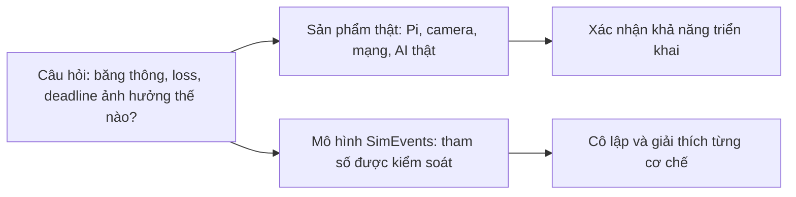

*Sơ đồ khái niệm: cùng một bài toán truyền thông được nghiên cứu bằng hai phương pháp khác nhau.*

Mô phỏng không thay thế sản phẩm thật. Nó giúp chúng ta hiểu rõ hơn các cơ chế mà sản phẩm thật đang sử dụng.

### A1.2. Mô hình cần giữ lại thông tin gì?

Hãy tưởng tượng một ảnh JPEG chứa 6960 byte.

Trong sản phẩm thật, sender phải đọc và gửi toàn bộ 6960 byte dữ liệu ảnh.

Nhưng nếu mục tiêu chỉ là nghiên cứu số packet, thời gian truyền và xác suất mất ảnh, chúng ta có thật sự cần biết màu sắc của từng pixel không?

Không.

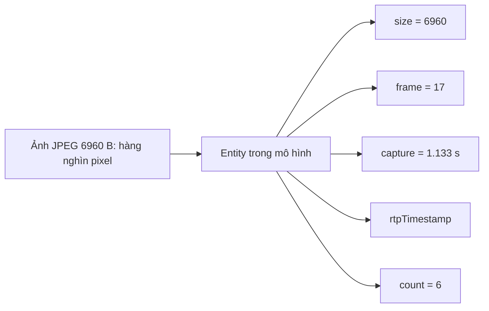

*Hình giản lược dữ liệu ảnh thành các thuộc tính cần cho mô phỏng. 6960 B là kích thước frame đại diện trong cấu hình mô hình (5 mảnh đầy 1200 B và mảnh cuối 960 B).*

Trong SimEvents, chúng ta chỉ cần giữ lại những thuộc tính có ảnh hưởng đến bài toán đang nghiên cứu.

| Thuộc tính     | Vì sao cần giữ lại?                   |
| -------------- | ------------------------------------- |
| Kích thước ảnh | Để tính số packet và thời gian truyền |
| Frame ID       | Để biết packet thuộc ảnh nào          |
| Capture time   | Để tính latency và AoI                |
| RTP timestamp  | Để tính jitter và playout deadline    |
| Fragment count | Để biết khi nào ảnh được ghép đủ      |

Cách làm này được gọi là **abstraction (trừu tượng hóa)**.

Nó không có nghĩa chúng ta bỏ qua các cơ chế quan trọng. Chúng ta chỉ bỏ đi những chi tiết không cần thiết cho câu hỏi đang nghiên cứu.

### A1.3. Ví dụ: không cần pixel vẫn tính được thời gian truyền

Giả sử mô hình nhận một packet chứa 1200 byte dữ liệu ảnh. Mỗi packet trong mô hình có thêm 48 byte overhead.

Tổng kích thước:

\[ L=1200+48=1248\text{ B} \]

Số bit cần truyền:

\[ L_{\mathrm{bit}}=1248\times8=9984\text{ bit} \]

Nếu đường truyền có tốc độ \(C=100\times10^6\text{ bit/s}\), thời gian phát hết packet:

\[ T_{\mathrm{ser}}=\frac{9984}{100\times10^6} \qquad \boxed{T_{\mathrm{ser}}=0.09984\text{ ms}} \]

**CALCULATED — theo quy ước kích thước packet của SimEvents v2.**

Trong toàn bộ phép tính này, chúng ta chỉ cần biết số byte và tốc độ đường truyền. Không cần biết nội dung ảnh là khuôn mặt, một chiếc ô tô hay một bức tường.

Đó chính là lý do SimEvents phù hợp để nghiên cứu các cơ chế truyền thông này.

!!! note "Hai quy ước kích thước packet"
    Quy ước 1200 B dữ liệu + 48 B overhead là của mô hình SimEvents. Chương trình Python ở Session 1 dùng quy ước khác: payload 1200 B đã gồm 8 B fragment header (mảnh đầu thêm 4 B). Đừng trộn hai quy ước khi so sánh số liệu.

### A1.4. Mô hình nghiên cứu được và không nghiên cứu được điều gì?

| Có thể nghiên cứu                                   | Không thể kết luận trực tiếp                        |
| --------------------------------------------------- | --------------------------------------------------- |
| Packet loss ảnh hưởng đến frame loss                | Chất lượng hình ảnh sau nén                         |
| Băng thông ảnh hưởng đến hàng đợi                   | Độ chính xác của MobileNetV2                        |
| Jitter và deadline ảnh hưởng đến tỷ lệ ảnh đúng hạn | Camera vật lý hoạt động ổn định trong mọi điều kiện |
| FIFO và latest-value ảnh hưởng đến AoI              | Thời gian chạy thực của AI trên mọi thiết bị        |
| AIMD thay đổi kích thước dữ liệu                    | Hiệu quả AIMD trên phần cứng chưa kiểm thử đầy đủ   |

Một mô hình tốt phải phù hợp với câu hỏi nghiên cứu của nó. Không nhất thiết phải mô phỏng mọi thứ.

## A2. Discrete-event simulation — mô phỏng sự kiện rời rạc

### A2.1. Hai cách nhìn một hệ thống theo thời gian

Trong những môn như xử lý tín hiệu, chúng ta thường quan tâm đến một đại lượng biến thiên theo thời gian. Ví dụ, điện áp của tín hiệu hình sin:

\[ v(t)=A\sin(2\pi ft) \]

Tại bất kỳ thời điểm nào, chúng ta có thể xác định giá trị điện áp của tín hiệu.

Nhưng trong hệ thống truyền packet, những câu hỏi quan trọng thường khác. Chúng ta muốn biết:

- Packet được tạo lúc nào?
- Packet vào hàng đợi lúc nào?
- Packet bắt đầu truyền lúc nào?
- Packet đến receiver lúc nào?
- Khi nào ảnh được ghép đủ?

Đó là những sự kiện xảy ra tại những thời điểm cụ thể.

<svg viewBox="0 0 640 220" role="img" aria-label="Tín hiệu liên tục và các sự kiện rời rạc" style="width:100%;max-width:640px;height:auto;color:inherit">
<text x="10" y="18" fill="currentColor" font-size="13" font-weight="700">Time-varying signal — tín hiệu biến thiên theo thời gian</text>
<line x1="20" y1="70" x2="620" y2="70" stroke="currentColor" opacity=".4"/>
<path d="M20 70 C 57 20, 95 20, 132 70 S 207 120, 245 70 S 320 20, 357 70 S 432 120, 470 70 S 545 20, 582 70" fill="none" stroke="#4389d8" stroke-width="2.5"/>
<text x="10" y="135" fill="currentColor" font-size="13" font-weight="700">Discrete events — các sự kiện rời rạc của một frame</text>
<line x1="20" y1="185" x2="620" y2="185" stroke="currentColor"/>
<g fill="#14b8a6"><circle cx="40" cy="185" r="6"/><circle cx="150" cy="185" r="6"/><circle cx="190" cy="185" r="6"/><circle cx="420" cy="185" r="6"/><circle cx="560" cy="185" r="6"/></g>
<g fill="currentColor" font-size="11" text-anchor="middle"><text x="40" y="165">tạo</text><text x="150" y="165">vào queue</text><text x="200" y="210">bắt đầu gửi</text><text x="420" y="165">đến receiver</text><text x="560" y="165">ghép đủ</text></g>
</svg>

SimEvents là môi trường mô phỏng các hệ thống mà những sự kiện như vậy đóng vai trò quan trọng.

**Discrete-event simulation (mô phỏng sự kiện rời rạc)** tập trung vào sự thay đổi trạng thái của hệ thống khi một sự kiện xảy ra.

### A2.2. Rời rạc không có nghĩa thời gian phải là số nguyên

Đây là một điểm dễ hiểu nhầm. Một sự kiện có thể xảy ra tại \(t=0.0201\text{ s}\). Sự kiện tiếp theo có thể xảy ra tại \(t=0.021327\text{ s}\).

Không có yêu cầu rằng mọi packet phải đến đúng vào các mốc 1 ms, 2 ms, 3 ms.

Các sự kiện rời rạc vì chúng là những lần xảy ra riêng biệt. Khoảng thời gian giữa chúng không nhất thiết bằng nhau.

Trong mô hình của nhóm, đường truyền có thể hoàn thành việc phát một packet sau 99.84 µs. Điều này không bị làm tròn thành 1 ms chỉ vì bộ điều khiển AIMD sử dụng chu kỳ lấy mẫu 1 ms.

Hai cơ chế thời gian này khác nhau.

### A2.3. Event calendar — lịch sự kiện

Hãy tưởng tượng bộ mô phỏng có một lịch ghi lại những sự kiện sẽ xảy ra tiếp theo.

Giả sử một máy xử lý cần 50 ms cho mỗi frame. Camera tạo ảnh mỗi 40 ms. Ban đầu, lịch có sự kiện:

| Thời điểm | Sự kiện           |
| --------- | ----------------- |
| 0 ms      | Frame 1 xuất hiện |
| 40 ms     | Frame 2 xuất hiện |
| 80 ms     | Frame 3 xuất hiện |

Tại thời điểm 0 ms, frame 1 bắt đầu được xử lý. Vì thời gian xử lý bằng 50 ms, bộ mô phỏng có thể xác định rằng công việc sẽ hoàn thành tại:

\[ t_{\mathrm{finish}}=0+50=50\text{ ms} \]

Sự kiện hoàn thành được bổ sung vào lịch. Lịch mới có thứ tự:

| Thời điểm | Sự kiện            |
| --------- | ------------------ |
| 40 ms     | Frame 2 xuất hiện  |
| 50 ms     | Hoàn thành Frame 1 |
| 80 ms     | Frame 3 xuất hiện  |

Tại 40 ms, frame 2 vào hàng đợi vì máy vẫn đang xử lý frame 1.

Tại 50 ms, frame 1 hoàn thành. Máy có thể bắt đầu frame 2 và lập lịch hoàn thành tại 100 ms.

Đó là nguyên lý của việc mô phỏng theo sự kiện.

Không cần thực sự chạy một mạng neural trong 50 ms. Chỉ cần mô hình hóa thời gian phục vụ bằng việc lập lịch sự kiện hoàn thành.

### A2.4. Interactive discrete-event simulation

Widget này giúp bạn trực tiếp đóng vai bộ mô phỏng.

Có ba frame xuất hiện tại 0, 40 và 80 ms. Mỗi frame cần 50 ms để xử lý. Máy chỉ có thể xử lý một frame tại một thời điểm.

Bấm **Next event** và quan sát sự thay đổi của hàng đợi, công việc đang thực hiện và thời gian mô phỏng.

<div id="s2a-events">
<style>
#s2a-events{border:1px solid currentColor;border-radius:12px;padding:16px;margin:20px 0;color:inherit}
#s2a-events button{color:inherit;background:transparent;border:1px solid currentColor;border-radius:6px;padding:8px 14px;cursor:pointer}
#s2a-events button:disabled{opacity:.4;cursor:default}
#s2a-events .s2ae-flow{display:grid;grid-template-columns:1fr 1.2fr 1fr;gap:8px;margin:16px 0}
#s2a-events .s2ae-block{border:1px solid currentColor;border-radius:7px;padding:10px 4px;text-align:center}
#s2a-events .s2ae-queue{background:rgba(245,158,11,.1)}
#s2a-events .s2ae-server{background:rgba(20,184,166,.1)}
#s2a-events .s2ae-clock{font-size:1.8em;font-weight:700}
</style>
<h3>Bộ mô phỏng sự kiện rời rạc</h3>
<p>Ba frame xuất hiện tại 0, 40, 80 ms. Mỗi frame cần 50 ms xử lý.</p>
<div class="s2ae-clock" aria-live="polite"></div>
<div class="s2ae-flow">
  <div class="s2ae-block"><strong>Generator</strong><div>3 frame</div></div>
  <div class="s2ae-block s2ae-queue"><strong>Queue</strong><div class="s2ae-waiting"></div></div>
  <div class="s2ae-block s2ae-server"><strong>Server</strong><div class="s2ae-busy"></div></div>
</div>
<p>Đã hoàn thành: <strong class="s2ae-done"></strong></p>
<p class="s2ae-event" aria-live="polite"></p>
<strong>Event calendar</strong>
<ol class="s2ae-calendar"></ol>
<button type="button" class="s2ae-next">Next event</button>
<button type="button" class="s2ae-reset">Reset</button>
<p><small>CALCULATED — Ví dụ FIFO đơn giản, không phải kết quả chạy MATLAB.</small></p>
<script>
(()=>{
 const root=document.getElementById("s2a-events");
 let time,calendar,queue,busy,done,message;
 function reset(){
  time=0;
  calendar=[0,40,80].map((t,i)=>({t,type:"arrival",id:"F"+(i+1)}));
  queue=[];busy=null;done=[];message="Chưa bắt đầu";
  draw();
 }
 function start(){
  if(!busy&&queue.length){
   busy=queue.shift();
   calendar.push({t:time+50,type:"finish",id:busy});
  }
 }
 function next(){
  if(!calendar.length)return;
  calendar.sort((a,b)=>a.t-b.t);
  const e=calendar.shift();
  time=e.t;
  if(e.type==="arrival"){
   queue.push(e.id);
   message=e.id+" xuất hiện";
   if(busy)message+=", vào hàng đợi";
  }else{
   done.push(e.id);busy=null;
   message=e.id+" hoàn thành";
  }
  const wasIdle=!busy;
  start();
  if(wasIdle&&busy)message+="; bắt đầu xử lý "+busy;
  draw();
 }
 function draw(){
  const text=(cls,val)=>root.querySelector(cls).textContent=val;
  text(".s2ae-clock",time+" ms");
  text(".s2ae-waiting",queue.join(" → ")||"Trống");
  text(".s2ae-busy",busy||"Rảnh");
  text(".s2ae-done",done.join(", ")||"Chưa có");
  text(".s2ae-event",message);
  const list=root.querySelector(".s2ae-calendar");
  list.replaceChildren();
  [...calendar].sort((a,b)=>a.t-b.t).forEach(e=>{
   const li=document.createElement("li");
   li.textContent=e.t+" ms — "+e.id+(e.type==="arrival"?" xuất hiện":" hoàn thành");
   list.appendChild(li);
  });
  if(!calendar.length){
   const li=document.createElement("li");
   li.textContent="Không còn sự kiện";
   list.appendChild(li);
  }
  root.querySelector(".s2ae-next").disabled=calendar.length===0;
 }
 root.querySelector(".s2ae-next").onclick=next;
 root.querySelector(".s2ae-reset").onclick=reset;
 reset();
})();
</script>
</div>

Hãy chú ý hai điều:

- Đồng hồ mô phỏng nhảy từ 0 đến 40, rồi đến 50 ms. Không cần có sự kiện tại mọi mili giây.
- Khi frame vào queue, thời gian xử lý chưa bắt đầu. Khi server rảnh, frame mới được lấy ra phục vụ.

Sau khi hiểu widget này, bạn đã có nền tảng để đọc các khối Generator, Queue và Server trong mô hình thật.

## A3. Entity, Attribute, Event và Signal

Đây là bốn thuật ngữ quan trọng nhất để đọc mô hình SimEvents.

### A3.1. Entity — thực thể

Một **entity (thực thể)** là một đối tượng riêng biệt di chuyển trong mô hình.

Trong dự án, entity có thể đại diện cho:

- Một frame JPEG.
- Một RTP packet.
- Một RTCP Receiver Report.

Ví dụ, tại một thời điểm, trong hệ thống có thể tồn tại một frame đang chờ ở sender, sáu packet đang đi qua mạng và một frame khác đang được AI xử lý.

Đó là nhiều entity khác nhau. Mỗi entity có thông tin và trạng thái riêng.

### A3.2. Attribute — thuộc tính của entity

Entity không chỉ là một hình chữ nhật trống di chuyển giữa các khối. Nó mang theo thông tin được gọi là **attribute (thuộc tính)**.

Ví dụ, một packet entity có thể chứa:

| Attribute      | Giá trị minh họa | Ý nghĩa                |
| -------------- | ---------------- | ---------------------- |
| `frame`        | 1                | Thuộc frame số 1       |
| `seq`          | 2                | Sequence number        |
| `fragment`     | 3                | Mảnh thứ ba            |
| `count`        | 6                | Tổng số mảnh cần thiết |
| `size`         | 1200             | Số byte dữ liệu        |
| `rtpTimestamp` | 0                | Thời gian media        |
| `marker`       | 0                | Chưa phải mảnh cuối    |

Khi packet đi từ sender đến receiver, các khối có thể bổ sung thêm thuộc tính. Ví dụ:

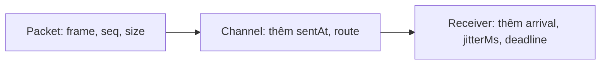

Như vậy, một entity vừa mang thông tin ban đầu, vừa có thể mang thêm các kết quả được tính trong quá trình mô phỏng.

Trong Phần B, chúng ta sẽ học đầy đủ cấu trúc 18 trường `CNSE2Entity` của mô hình.

### A3.3. Event — sự kiện xảy ra với entity

Cần phân biệt entity với event.

- Frame 1 là một entity.
- Việc frame 1 được sinh tại 0 ms là một event.
- Frame 1 bắt đầu được xử lý tại 10 ms là một event khác.
- Frame 1 hoàn thành tại 60 ms lại là một event khác.

| Entity                                         | Event                                    |
| ---------------------------------------------- | ---------------------------------------- |
| Đối tượng được mô phỏng                        | Điều xảy ra tại một thời điểm            |
| Có thể tồn tại trong nhiều khối theo thời gian | Có thời điểm xảy ra cụ thể               |
| Mang attribute                                 | Có thể kích hoạt việc cập nhật attribute |

Một entity có thể trải qua rất nhiều event trong vòng đời của nó.

### A3.4. Signal — tín hiệu số học

Signal trong Simulink mang một giá trị số hoặc một tập giá trị số.

Ví dụ, AIMD xuất ra hệ số kích thước frame \(r=0.8\).

Số 0.8 không phải một packet được gửi qua mạng. Nó là tín hiệu điều khiển kích thước của những frame được sinh tiếp theo.

<svg viewBox="0 0 640 130" role="img" aria-label="Đường entity và đường signal" style="width:100%;max-width:640px;height:auto;color:inherit">
<text x="10" y="22" fill="currentColor" font-size="13" font-weight="700">Entity connection — đường thực thể</text>
<line x1="20" y1="45" x2="600" y2="45" stroke="#4389d8" stroke-width="4" marker-end="url(#s2a-ar1)"/>
<g fill="#4389d8"><rect x="80" y="35" width="40" height="20" rx="3"/><rect x="250" y="35" width="40" height="20" rx="3"/><rect x="420" y="35" width="40" height="20" rx="3"/></g>
<text x="10" y="90" fill="currentColor" font-size="13" font-weight="700">Signal connection — đường tín hiệu</text>
<line x1="20" y1="112" x2="600" y2="112" stroke="#b45309" stroke-width="2" stroke-dasharray="6 4" marker-end="url(#s2a-ar2)"/>
<text x="300" y="106" fill="currentColor" font-size="12" text-anchor="middle">r = 0.8</text>
<defs><marker id="s2a-ar1" viewBox="0 0 10 10" refX="9" refY="5" markerWidth="6" markerHeight="6" orient="auto"><path d="M0 0L10 5L0 10z" fill="#4389d8"/></marker><marker id="s2a-ar2" viewBox="0 0 10 10" refX="9" refY="5" markerWidth="6" markerHeight="6" orient="auto"><path d="M0 0L10 5L0 10z" fill="#b45309"/></marker></defs>
</svg>

*Hai kiểu đường kết nối được minh họa bằng màu khác nhau để dễ phân biệt. Đây không phải quy ước màu bắt buộc của MATLAB.*

Trong mô hình của nhóm, hai loại đường kết nối phối hợp với nhau.

Entity mang các frame, packet và báo cáo qua những cơ chế truyền thông.

Signal mang hệ số điều khiển, vector báo cáo đã được lấy mẫu và các chỉ số hiển thị.

#### Một ví dụ kết nối hai loại dữ liệu

Giả sử AIMD vừa giảm scale từ 1.0 xuống 0.8. Một frame có kích thước cơ sở 6960 B được sinh sau thời điểm điều chỉnh. Kích thước mới là:

\[ S=\operatorname{round}(6960\times0.8) \qquad S=5568\text{ B} \]

Số 0.8 là signal. Frame mang thuộc tính `size = 5568` là entity.

Như vậy, signal có thể ảnh hưởng đến nội dung của những entity được sinh trong tương lai.

## A4. Bảy khối cơ bản của SimEvents

Trước khi mở toàn bộ mô hình, chúng ta cần hiểu từng loại khối cơ bản.

Nếu hiểu được bảy khối này, bạn sẽ thấy hầu hết các subsystem trong Phần B chỉ là sự kết hợp của những cơ chế khá đơn giản.

### A4.1. Entity Generator — khối sinh thực thể

Generator có nhiệm vụ tạo ra entity tại những thời điểm được xác định.

Ví dụ, nếu camera hoạt động ở 15 FPS thì Generator sinh một frame mới sau mỗi khoảng thời gian danh định:

\[ T_f=\frac{1}{15}=0.066667\text{ s} \]

- **Đầu vào:** lịch tạo entity và các tham số.
- **Hoạt động:** sinh entity mới, gán những thuộc tính ban đầu.
- **Đầu ra:** từng entity xuất hiện theo thời gian.

Trong mô hình thật, có hai Generator đặc biệt quan trọng:

| Tên khối                  | Entity được tạo | Chu kỳ                     |
| ------------------------- | --------------- | -------------------------- |
| `Frame clock`             | Frame ảnh       | \(1/f_{\mathrm{frame}}\)   |
| `RTCP report clock (1 s)` | Receiver Report | 1 s                        |

**SOURCE — `build_cn_simevents_v2.m`, các subsystem Frames và Receiver.**

Hai Generator hoạt động theo hai lịch khác nhau. Không phải cứ sinh một frame thì phải sinh một RR.

### A4.2. Entity Queue — hàng đợi

Queue giữ những entity chưa thể tiếp tục đi sang khối tiếp theo.

Giả sử AI đang xử lý frame F1. Các frame F2, F3 và F4 xuất hiện trong thời gian đó. Nếu chúng không bị loại bỏ, chúng cần một nơi để chờ.

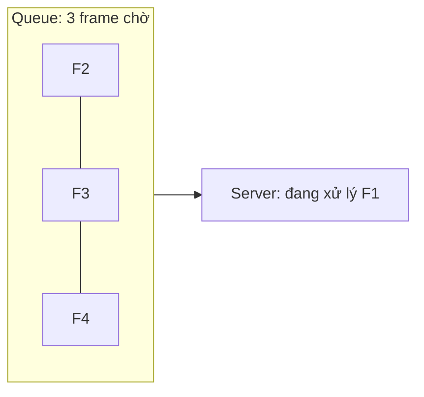

Capacity (sức chứa) của queue cho biết có thể giữ bao nhiêu entity đang chờ.

Trong ví dụ trên, có ba frame trong queue và một frame trong server. Nếu queue capacity bằng ba, queue đang đầy mặc dù tổng số frame chưa hoàn thành là bốn.

Trong mô hình, queue có thể được cấu hình với các chính sách khác nhau:

- FIFO: lấy entity cũ nhất đang chờ.
- Latest-value: giữ entity mới nhất đang chờ.
- Infinite capacity: không đặt giới hạn số entity chờ trong khối.

Queue không tự làm AI xử lý nhanh hơn. Nó quyết định các công việc được lưu và chuyển tiếp như thế nào.

**Vị trí trong mô hình thật:**

| Khối                   | Loại entity chờ                   |
| ---------------------- | --------------------------------- |
| `Frame FIFO or latest` | Frame trước packetizer            |
| `Fragment line`        | Các bản sao đang chờ gán metadata |
| `Packet FIFO`          | RTP packet trước đường truyền     |
| `AI waiting frames`    | Frame hoàn chỉnh trước inference  |

### A4.3. Entity Server — khối phục vụ thực thể

Tên Server trong SimEvents dễ khiến người học nghĩ đến một máy chủ mạng. Nhưng ở đây, Entity Server có ý nghĩa rộng hơn.

Nó đại diện cho một cơ chế giữ hoặc xử lý entity trong một khoảng thời gian.

Nếu entity bắt đầu được phục vụ tại \(t_s\), với thời gian phục vụ \(T_s\), thì thời điểm hoàn thành là:

\[ \boxed{t_{\mathrm{finish}}=t_s+T_s} \]

Ví dụ: \(t_{\mathrm{finish}}=100+50=150\text{ ms}\).

#### Server capacity khác queue capacity

Server capacity cho biết số entity có thể được phục vụ đồng thời. Queue capacity cho biết số entity có thể chờ.

Đây là hai tham số hoàn toàn khác nhau.

#### Một khối Server có thể đại diện cho nhiều cơ chế

| Server trong mô hình         | Ý nghĩa thời gian phục vụ                   |
| ---------------------------- | ------------------------------------------- |
| `Sender processing`          | Thời gian xử lý tại sender được cấu hình    |
| `Link serializer`            | Thời gian phát các bit của packet           |
| `Per-packet delay remainder` | Phần thời gian còn lại của quá trình truyền |
| `Playout buffer`             | Thời gian giữ packet đến deadline           |
| `Inference service`          | Thời gian xử lý AI được cấu hình            |

#### Server có service time bằng 0 là gì?

Một số Server không được dùng để tạo độ trễ. Chúng được dùng làm nơi thực hiện một phép tính hoặc cập nhật attribute.

Ví dụ `Count fragments` tính:

\[ N=\left\lceil\frac{S}{L}\right\rceil \]

Sau đó gán kết quả cho entity.

Service time của khối này bằng 0 vì phép tính chia mảnh không được mô hình hóa thành một khoảng thời gian xử lý riêng ở đó.

Điều này không có nghĩa MATLAB thực thi phép tính trong đúng 0 giây ngoài đời thật. Nó chỉ có nghĩa thời gian mô phỏng không tăng vì thao tác đó.

### A4.4. Entity Replicator — khối nhân bản thực thể

Giả sử một frame cần được chia thành sáu RTP packet. Trước hết, mô hình tính số lượng packet cần thiết. Sau đó, Replicator tạo ra sáu bản sao của frame entity.

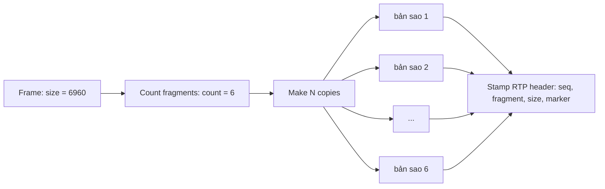

Có một chi tiết rất quan trọng: Replicator chỉ nhân bản entity. Nó chưa tự biến các bản sao thành sáu packet có đúng kích thước và sequence.

Nhiệm vụ đó thuộc về khối tiếp theo, `Stamp RTP header`.

Trong mô hình thật, Replicator có tên `Make N copies`. Số bản sao được lấy từ attribute `count`.

**SOURCE — `build_cn_simevents_v2.m`, subsystem RTP Packetizer.**

### A4.5. Entity Output Switch — khối chuyển hướng thực thể

Một packet đi qua Channel có thể sống sót hoặc bị mất. Hai kết quả đó cần dẫn đến hai đường khác nhau.

Output Switch chọn đường đi của entity. Trong mô hình thật, các Output Switch sử dụng attribute `route` để chọn cổng đầu ra.

Bản thân Switch không nhất thiết tính xác suất mất gói. Phép tính có thể được thực hiện tại Server trước nó. Server gán `route`, sau đó Switch đọc giá trị này và chuyển entity sang nhánh tương ứng.

Ví dụ:

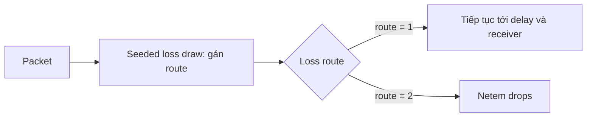

**SOURCE — `build_cn_simevents_v2.m`, subsystem Channel.**

Đây là cách khối Channel phân tách quyết định mất gói khỏi việc định tuyến entity.

### A4.6. Entity Terminator — kết thúc vòng đời entity

Terminator là nơi entity được loại khỏi dòng mô phỏng. Điều này không phải lúc nào cũng có nghĩa entity gặp lỗi.

Hãy phân biệt hai ví dụ:

| Terminator    | Ý nghĩa |
| ------------- | ------- |
| `Netem drops` | Packet bị mất trong Channel. Entity không đến receiver. |
| `AI result`   | Inference hoàn thành. Thời điểm kết quả được ghi lại, rồi entity kết thúc vòng đời. |

Cả hai đều sử dụng Entity Terminator. Một trường hợp đại diện cho thất bại. Trường hợp còn lại đại diện cho việc hoàn thành nhiệm vụ.

Vì vậy, khi đọc Terminator, hãy đọc tên khối và sự kiện gắn với nó trước khi kết luận ý nghĩa.

### A4.7. Entity Transport Delay — khối mô phỏng thời gian di chuyển

Đây là khối đại diện cho thời gian entity đi từ một vị trí đến vị trí tiếp theo.

Giả sử hai packet được đưa lên đường truyền tại hai thời điểm khác nhau:

- P1 bắt đầu di chuyển tại 0 ms.
- P2 bắt đầu di chuyển tại 2 ms.

Cả hai đều cần 20 ms để tới receiver. P1 đến tại \(0+20=20\text{ ms}\). P2 đến tại \(2+20=22\text{ ms}\).

Hai packet có thể cùng đang di chuyển trong mạng. Transport Delay không bắt P2 phải đợi P1 đến đích rồi mới bắt đầu di chuyển.

Đây là khác biệt quan trọng so với Link serializer chỉ phục vụ một packet tại một thời điểm.

Trong Phần B, chúng ta sẽ phân tích vì sao Channel thật còn có `Guaranteed delay (s)` và `Per-packet delay remainder`, thay vì chỉ sử dụng một khối delay đơn giản.

### A4.8. Bảng ghi nhớ bảy khối

| Khối                   | Hãy nghĩ đến                                            |
| ---------------------- | ------------------------------------------------------- |
| Entity Generator       | Nguồn tạo đối tượng                                     |
| Entity Queue           | Khu vực chờ                                             |
| Entity Server          | Nơi xử lý hoặc giữ đối tượng trong một khoảng thời gian |
| Entity Replicator      | Máy tạo nhiều bản sao                                   |
| Entity Output Switch   | Ngã rẽ quyết định đường đi                              |
| Entity Terminator      | Điểm kết thúc                                           |
| Entity Transport Delay | Thời gian di chuyển                                     |

Đừng học thuộc hình dạng icon của từng khối trước. Hãy hiểu nhiệm vụ của chúng. Khi nhiệm vụ đã rõ, việc đọc hình MATLAB sẽ dễ hơn rất nhiều.

## A5. Mở mô hình SimEvents thật của dự án

Bây giờ chúng ta đã đủ kiến thức nền để nhìn vào toàn bộ mô hình. Đây là **hình gốc được xuất từ MATLAB**, không phải sơ đồ vẽ lại.

[](../assets/fig/simevents/CN_simevents_v2.png)

*Bấm vào hình để mở hình gốc và phóng to các khối.*

**SOURCE — `CN_simevents_v2.slx`, `build_cn_simevents_v2.m` và hình xuất từ mô hình.**

Nếu nhìn toàn bộ hình ngay lập tức, bạn có thể cảm thấy có quá nhiều đường nối. Thực ra, chúng ta chỉ cần chia nó thành ba vùng.

### A5.1. Vùng màu xanh — đường truyền dữ liệu RTP

Đây là hàng ngang trên cùng trong mô hình.

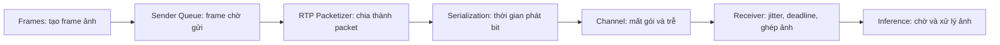

Hãy đọc từ trái sang phải trong hình MATLAB. Đó chính là đường đi của dữ liệu video.

#### Theo dõi số lượng entity

Có một điều rất đáng chú ý: số lượng entity không được bảo toàn khi đi qua toàn bộ hệ thống.

Ví dụ, một frame đi vào RTP Packetizer có thể tạo ra sáu packet. Channel có thể làm mất một packet. Khi đến Receiver, năm packet còn lại không đủ để ghép một frame hoàn chỉnh.

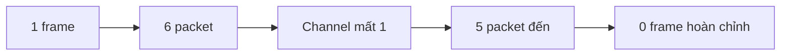

*CALCULATED — Ví dụ một frame bị mất một mảnh bắt buộc.*

Đây là lý do cần thống kê packet và frame riêng biệt.

### A5.2. Vùng màu vàng — đường phản hồi RTCP

Hãy nhìn xuống hàng thứ hai trong hình MATLAB. Khối Receiver có hai đầu ra:

- `Playout`: chuyển frame hoàn chỉnh đúng hạn đến Inference.
- `RTCP RR`: chuyển báo cáo về phía sender.

Hai đầu ra này đại diện cho hai loại entity có nhiệm vụ khác nhau.

Trong mô hình, báo cáo RR được tạo theo chu kỳ 1 giây. Sau khi tạo, RR không xuất hiện ngay tại sender. Nó phải đi qua RTCP Reverse Path.

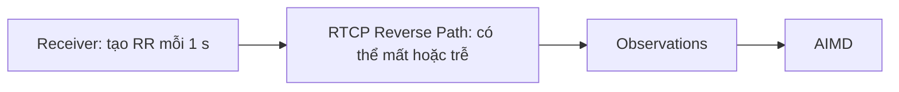

Báo cáo có thể bị mất hoặc đến muộn tùy theo cấu hình đường phản hồi.

Đây là một điểm quan trọng của hệ thống thích nghi: **sender không biết trực tiếp trạng thái mạng. Nó chỉ biết những gì được receiver báo cáo và những báo cáo mà nó thực sự nhận được.**

### A5.3. Vùng màu tím — điều khiển AIMD và quan sát

Phần dưới của mô hình có các khối `Observations`, `Adaptive enabled`, `AIMD`, `Feedback tick`, `Scope signals`, `Dashboard` và `Dashboard trace`.

Chúng không trực tiếp truyền các packet video. Chúng thu thập thông tin, cập nhật hệ số điều khiển và hiển thị kết quả.

#### Khối Observations làm gì?

Observations sử dụng lớp `CNSE2Monitor`. Nhiệm vụ của nó là lấy thông tin từ các sự kiện đã xảy ra trong mô hình và xuất chúng dưới dạng signal.

Ví dụ, khi có một Receiver Report mới đến sender, Observations cung cấp vector báo cáo cho AIMD xử lý.

Nếu không có báo cáo mới, Observations xuất một vector có cờ valid bằng 0. Đây là cách phân biệt:

- Không có RR mới.
- Có RR mới báo loss bằng 0.

Hai trường hợp không giống nhau.

#### Adaptive enabled làm gì?

Đây là tín hiệu cho biết có bật điều khiển thích nghi hay không.

Nếu tắt, mô hình giữ scale cố định bằng 1. Nếu bật, AIMD có thể thay đổi scale khi nhận được báo cáo phù hợp.

Nhờ đó, nhóm có thể chạy hai cấu hình thử nghiệm: Fixed-rate và Adaptive-rate. Các điều kiện mạng khác có thể được giữ nguyên để khảo sát ảnh hưởng của việc điều chỉnh kích thước frame.

## A6. Ba nhịp thời gian trong cùng một mô hình

Đây là phần rất quan trọng trước khi học AIMD.

Nhiều bạn nhìn thấy Feedback tick bằng 1 ms rồi nghĩ rằng camera, packet và RTCP đều hoạt động theo chu kỳ 1 ms. Thực tế không phải vậy.

### A6.1. Frame clock — nhịp sinh ảnh

Với 15 FPS:

\[ T_{\mathrm{frame}}=\frac{1}{15}=66.67\text{ ms} \]

Frame mới xuất hiện theo lịch của Generator.

### A6.2. Packet events — sự kiện truyền packet

Thời điểm packet hoàn thành serialization hoặc đến receiver phụ thuộc vào kích thước packet, tốc độ đường truyền, hàng đợi và delay được cấu hình.

Những sự kiện này không có một chu kỳ cố định chung. Một packet có thể đến lúc 20.138 ms. Packet khác có thể đến lúc 20.265 ms.

### A6.3. Feedback tick — nhịp điều khiển

Khối Observations, AIMD và Feedback tick hoạt động với chu kỳ lấy mẫu 1 ms:

\[ T_{\mathrm{control}}=0.001\text{ s} \qquad f_{\mathrm{control}}=\frac{1}{0.001}=1000\text{ Hz} \]

**SOURCE/CALCULATED — `CNSE2Monitor.m` và cấu hình Stateflow trong `build_cn_simevents_v2.m`.**

Nhưng Receiver Report chỉ được sinh theo chu kỳ 1 giây. Hãy phân biệt hai tốc độ:

\[ T_{\mathrm{RR}}=1\text{ s} \qquad T_{\mathrm{control}}=1\text{ ms} \]

Trong một giây, khối điều khiển được lấy mẫu khoảng 1000 lần. Điều này không có nghĩa nó được phép tăng hoặc giảm rate 1000 lần dựa trên một RR duy nhất.

Nó chỉ cập nhật thuật toán khi có một báo cáo mới hợp lệ.

<svg viewBox="0 0 640 200" role="img" aria-label="Ba nhịp thời gian trong một giây" style="width:100%;max-width:640px;height:auto;color:inherit">
<g fill="currentColor" font-size="12">
<text x="10" y="35">Frame clock (66.67 ms)</text>
<text x="10" y="95">Feedback tick (1 ms)</text>
<text x="10" y="155">RR (1 s)</text>
<text x="170" y="190">0 s</text><text x="590" y="190">1 s</text>
</g>
<g stroke="currentColor" opacity=".35"><line x1="180" y1="40" x2="610" y2="40"/><line x1="180" y1="100" x2="610" y2="100"/><line x1="180" y1="160" x2="610" y2="160"/></g>
<rect x="180" y="88" width="420" height="12" fill="#b45309" opacity=".55"/>
<text x="390" y="83" fill="currentColor" font-size="11" text-anchor="middle">1000 lần lấy mẫu dày đặc</text>
<circle cx="180" cy="160" r="7" fill="#14b8a6"/><circle cx="600" cy="160" r="7" fill="#14b8a6"/>
<g fill="#4389d8"><rect x="178" y="26" width="4" height="14"/><rect x="206" y="26" width="4" height="14"/><rect x="234" y="26" width="4" height="14"/><rect x="262" y="26" width="4" height="14"/><rect x="290" y="26" width="4" height="14"/><rect x="318" y="26" width="4" height="14"/><rect x="346" y="26" width="4" height="14"/><rect x="374" y="26" width="4" height="14"/><rect x="402" y="26" width="4" height="14"/><rect x="430" y="26" width="4" height="14"/><rect x="458" y="26" width="4" height="14"/><rect x="486" y="26" width="4" height="14"/><rect x="514" y="26" width="4" height="14"/><rect x="542" y="26" width="4" height="14"/><rect x="570" y="26" width="4" height="14"/><rect x="598" y="26" width="4" height="14"/></g>
</svg>

*SOURCE/CALCULATED — Lịch danh định trong một giây. Thời điểm RR thực sự đến còn phụ thuộc đường phản hồi.*

### A6.4. Tại sao có khối Feedback tick \(1/z\)?

Khối này là Unit Delay (trễ một mẫu). Nó nhận rate từ AIMD, giữ lại và cung cấp giá trị đó ở lần lấy mẫu tiếp theo. Với chu kỳ 1 ms:

\[ \boxed{r_{\mathrm{out}}[k]=r_{\mathrm{in}}[k-1]} \]

Ví dụ, nếu AIMD thay đổi rate tại một lần cập nhật:

| Lần lấy mẫu | AIMD output | Feedback tick output |
| ----------- | ----------- | -------------------- |
| \(k=0\)     | 1.0         | 1.0                  |
| \(k=1\)     | 0.8         | 1.0                  |
| \(k=2\)     | 0.8         | 0.8                  |
| \(k=3\)     | 0.8         | 0.8                  |

**CALCULATED — ví dụ minh họa Unit Delay.**

Khối này làm cho đường phản hồi có quan hệ nhân quả theo từng lần lấy mẫu. Nó tránh việc các giá trị phụ thuộc lẫn nhau tức thời trong vòng điều khiển.

Không được hiểu \(1/z\) là bộ đệm 1 ms cho các RTP packet. Nó chỉ tác động lên **signal rate**.

## A7. Tham số mô hình và cách thiết lập thí nghiệm

### A7.1. Một mô hình có thể tạo ra nhiều thí nghiệm

Chúng ta không cần xây dựng một mô hình hoàn toàn mới mỗi khi muốn khảo sát packet loss hay băng thông. Thay vào đó, mô hình sử dụng một tập tham số cấu hình.

| Tham số         | Giá trị cơ sở | Ý nghĩa                                               |
| --------------- | ------------- | ----------------------------------------------------- |
| `fps`           | 15            | Số frame sinh mỗi giây                                |
| `meanPackets`   | 6.080         | Số packet trung bình dùng để tạo kích thước ảnh cơ sở |
| `payload`       | 1200 B        | Sức chứa dữ liệu ảnh của một packet mô phỏng          |
| `rate`          | 100 Mb/s      | Tốc độ đường truyền                                   |
| `loss`          | 0             | Xác suất mất được cấu hình                            |
| `delay`         | 0 s           | Trễ truyền cơ sở                                      |
| `jitter`        | 0 s           | Tham số biến thiên trễ                                |
| `depth`         | 50 ms         | Playout depth                                         |
| `policy`        | Latest        | Chính sách hàng đợi                                   |
| `queueCapacity` | 8             | Số vị trí chờ khi dùng FIFO                           |
| `samples`       | 12.5 ms       | Thời gian phục vụ inference                           |
| `adaptive`      | False         | Chưa bật AIMD                                         |
| `seed`          | 1             | Seed cho bộ sinh số giả ngẫu nhiên                    |

**SOURCE — `sim/+course/defaults.m`.**

Đây là cấu hình cơ sở, không phải mọi lần chạy đều sử dụng tất cả giá trị trên. Một số trường được thay đổi trong `run_cn_simevents_v2_study.m` để tạo các thí nghiệm riêng.

!!! warning "Hai biến cùng tên `rate`"
    `rate` trong cấu hình cơ sở là tốc độ đường truyền tính bằng bit/s. Trong chart AIMD, biến `rate` lại là hệ số kích thước không có đơn vị. Hai biến cùng tên nhưng thuộc hai ngữ cảnh khác nhau.

### A7.2. Random seed — tại sao cần lưu seed?

Giả sử mạng được cấu hình mất packet với xác suất 5%. Điều đó không có nghĩa cứ gửi đúng 100 packet thì chắc chắn mất đúng năm packet. Có lần mất ba packet, có lần mất bảy packet.

Random seed (giá trị khởi tạo bộ sinh số giả ngẫu nhiên) cho phép tái tạo một chuỗi số giả ngẫu nhiên theo cùng điều kiện. Điều này giúp việc kiểm tra và lặp lại mô phỏng dễ dàng hơn.

Trong mô hình thật, mỗi cơ chế ngẫu nhiên sử dụng một bộ sinh riêng.

| Cơ chế           | Seed sử dụng     |
| ---------------- | ---------------- |
| Kích thước frame | Seed cơ sở + 100 |
| Mất gói chiều đi | Seed cơ sở + 200 |
| Delay chiều đi   | Seed cơ sở + 300 |
| Mất RR chiều về  | Seed cơ sở + 600 |
| Delay chiều về   | Seed cơ sở + 700 |

**SOURCE — `cnse2_runtime.m`, nhánh `init`.**

Việc tách các bộ sinh giúp những cơ chế khác nhau không phải cùng tiêu thụ một chuỗi số ngẫu nhiên duy nhất.

Tuy nhiên, sử dụng cùng seed không có nghĩa hai cấu hình khác nhau sẽ mất chính xác những packet thuộc cùng các frame. Nếu AIMD thay đổi số packet, thứ tự tiêu thụ các mẫu ngẫu nhiên cũng có thể thay đổi.

#### Ví dụ từ kết quả mô phỏng đã lưu

Ba lần chạy Stage A có cùng các tham số: packet loss cấu hình 5%, base delay 20 ms, tham số biến thiên trễ 20 ms, playout depth 50 ms, thời gian tạo ảnh 20 s. Chúng sử dụng ba seed khác nhau.

<svg viewBox="0 0 640 220" role="img" aria-label="Sequence loss theo seed" style="width:100%;max-width:640px;height:auto;color:inherit">
<g fill="currentColor" font-size="12">
<text x="10" y="18" font-weight="700">Sequence loss quan sát (cấu hình 5%)</text>
<text x="52" y="194" text-anchor="end">0%</text><text x="52" y="149" text-anchor="end">2%</text><text x="52" y="104" text-anchor="end">4%</text><text x="52" y="59" text-anchor="end">6%</text>
<text x="160" y="212" text-anchor="middle">Seed 1</text><text x="330" y="212" text-anchor="middle">Seed 17</text><text x="500" y="212" text-anchor="middle">Seed 903</text>
<text x="160" y="85" text-anchor="middle">4.33%</text><text x="330" y="45" text-anchor="middle">6.09%</text><text x="500" y="88" text-anchor="middle">4.20%</text>
</g>
<g stroke="currentColor" opacity=".25"><line x1="60" y1="190" x2="620" y2="190"/><line x1="60" y1="145" x2="620" y2="145"/><line x1="60" y1="100" x2="620" y2="100"/><line x1="60" y1="55" x2="620" y2="55"/></g>
<line x1="60" y1="77.5" x2="620" y2="77.5" stroke="#dc2626" stroke-dasharray="6 4"/>
<text x="616" y="72" fill="#dc2626" font-size="11" text-anchor="end">5% cấu hình</text>
<g fill="#4389d8"><rect x="120" y="92.6" width="80" height="97.4"/><rect x="290" y="53" width="80" height="137"/><rect x="460" y="95.5" width="80" height="94.5"/></g>
</svg>

| Seed | Số packet gửi | Sequence loss | On-time frame |
| ---- | ------------- | ------------- | ------------- |
| 1    | 1823          | 4.33%         | 73.61%        |
| 17   | 1828          | 6.09%         | 54.65%        |
| 903  | 1823          | 4.20%         | 61.34%        |

**SIMULATED — `sim/study_simevents_v2/stage_A_results.csv`.**

Mặc dù xác suất mất gói được cấu hình là 5% trong cả ba trường hợp, tỷ lệ mất thực tế quan sát trong mô phỏng khác nhau.

Tỷ lệ ảnh đúng hạn cũng khác nhau, do ảnh hưởng của cả chuỗi mất gói và thời điểm đến.

Vì vậy, chúng ta không nên kết luận tính năng của hệ thống chỉ dựa vào một lần chạy ngẫu nhiên.

### A7.3. Capture duration, warm-up và drain

Khi chạy mô phỏng, cần biết khoảng thời gian nào được sử dụng để thu thập và đánh giá dữ liệu. Ba tham số quan trọng là:

- **Duration:** thời gian sinh ảnh.
- **Warm-up:** khoảng thời gian đầu được bỏ qua khi tính những chỉ số cần tránh ảnh hưởng khởi tạo.
- **Drain:** khoảng thời gian sau khi dừng sinh ảnh để các công việc còn lại tiếp tục hoàn thành.

Ví dụ, thí nghiệm Stage B so sánh Fixed và AIMD sử dụng:

\[ T_{\mathrm{capture}}=50\text{ s} \qquad T_{\mathrm{warmup}}=2\text{ s} \qquad T_{\mathrm{drain}}=2\text{ s} \]

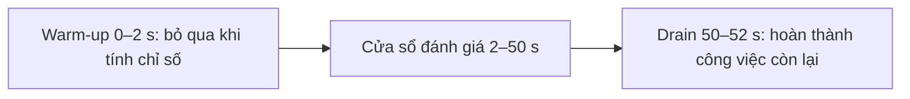

*SOURCE/CALCULATED — Cửa sổ thời gian của thí nghiệm Stage B loss-step.*

Số frame danh định được sinh trong 50 giây:

\[ N_f=50\times15=750 \]

**CALCULATED.**

Nhưng số kết quả AI có thể nhỏ hơn 750 vì mất gói, ảnh đến muộn hoặc bị loại trong hàng đợi.

Cần lưu ý rằng số đếm toàn bộ lần chạy và các chỉ tiêu tính trong cửa sổ đánh giá sau warm-up không nhất thiết có cùng phạm vi thời gian. Chúng ta sẽ kiểm tra điều này khi đọc các bảng kết quả ở Phần C.

## A8. Dashboard trong SimEvents

Ở Session 1, chúng ta đã học dashboard của chương trình truyền thông thật. Mô hình MATLAB cũng có một Dashboard, nhưng nó hiển thị các chỉ số của mô phỏng.

Trong mô hình thật, Observations xuất năm signal sang Scope signals và Dashboard.

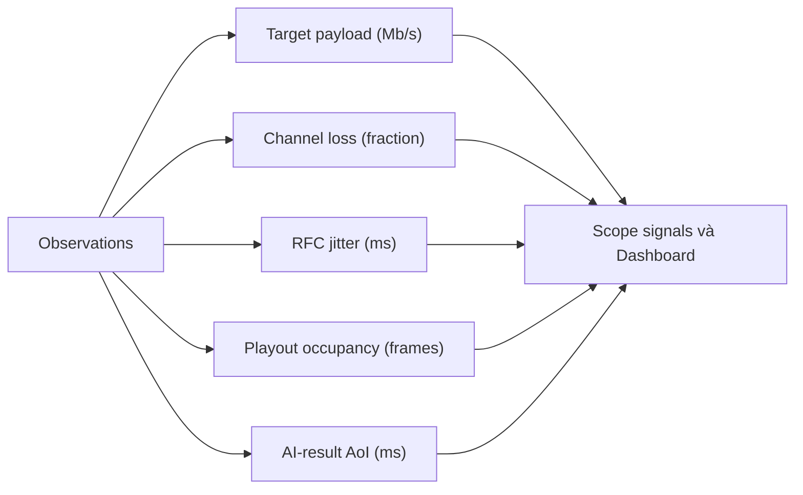

*Sơ đồ minh họa năm kênh quan sát, không phải các đường dữ liệu thực nghiệm.*

### A8.1. Đọc ý nghĩa từng đường

| Signal                     | Đại lượng biểu diễn                                           |
| -------------------------- | ------------------------------------------------------------- |
| Target payload (Mb/s)      | Bitrate dữ liệu ảnh mục tiêu, tính từ scale và cấu hình nguồn |
| Channel loss (fraction)    | Tỷ lệ packet bị Channel loại, tính tích lũy                   |
| RFC jitter (ms)            | Estimate jitter hiện tại                                      |
| Playout occupancy (frames) | Số frame đã ghép đủ đúng hạn đang chờ release                 |
| AI-result AoI (ms)         | Tuổi của thông tin mới nhất đã được xử lý                     |

**SOURCE — `cnse2_runtime.m`, nhánh `poll`.**

Có ba chi tiết quan trọng.

**Thứ nhất**, Target payload là bitrate mục tiêu tính từ mô hình kích thước ảnh. Nó không phải tốc độ bit thực tế đo trên dây mạng.

**Thứ hai**, Channel loss trên Dashboard được tính tích lũy:

\[ p_{\mathrm{cumulative}}(t)=\frac{N_{\mathrm{dropped}}(t)}{\max(1,N_{\mathrm{channel}}(t))} \]

Nó khác xác suất mất được cấu hình tại một thời điểm. Ví dụ, sau khi mạng trở lại điều kiện không mất gói, tỷ lệ mất tích lũy không lập tức trở về 0.

**Thứ ba**, AoI chưa xác định nếu chưa có kết quả AI nào hoàn thành. Khi đó, chương trình có thể xuất `NaN` — Not a Number.

Không được đọc `NaN` thành 0 ms hoặc kết luận hệ thống có độ trễ rất tốt.

## A9. Tìm các thành phần trong MATLAB

Phần này giúp bạn biết mở file nào khi muốn tự khám phá mô hình.

| File                                                 | Nhiệm vụ                                               |
| ---------------------------------------------------- | ------------------------------------------------------ |
| `sim/generated/CN_simevents_v2.slx`                  | Mô hình Simulink/SimEvents                             |
| `sim/generated/CN_simevents_v2.sldd`                 | Data Dictionary chứa cấu trúc entity                   |
| `sim/study_simevents_v2/build_cn_simevents_v2.m`     | Script xây dựng mô hình                                |
| `sim/study_simevents_v2/cnse2_runtime.m`             | Tạo kích thước, sinh ngẫu nhiên, thống kê và ghi trace |
| `sim/study_simevents_v2/CNSE2Monitor.m`              | Lấy mẫu các thông tin quan sát                         |
| `sim/study_simevents_v2/cnse2_run.m`                 | Chạy mô hình với một cấu hình                          |
| `sim/study_simevents_v2/run_cn_simevents_v2_study.m` | Chạy các nhóm thí nghiệm                               |
| `sim/study_simevents_v2/stage_A_results.csv`         | Kết quả nhóm thí nghiệm A                              |
| `sim/study_simevents_v2/stage_B_results.csv`         | Kết quả nhóm thí nghiệm B                              |
| `sim/study_simevents_v2/stage_C_results.csv`         | Kết quả nhóm thí nghiệm C                              |
| `sim/study_simevents_v2/figures/`                    | Hình xuất từ mô hình                                   |

Repository: [edge-ai-video-runtime](https://github.com/KaiserRichard/edge-ai-video-runtime).

### A9.1. Subsystem là gì?

Subsystem (hệ thống con) là một khối lớn chứa các khối nhỏ hơn bên trong.

Ví dụ, ở mô hình tổng thể, RTP Packetizer chỉ hiện ra như một hình chữ nhật. Khi mở subsystem đó, bạn sẽ thấy các cơ chế chi tiết.

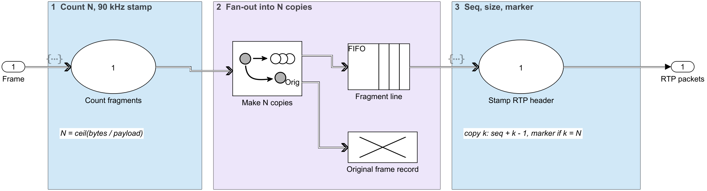

Hãy thử tìm ba khối: `Count fragments`, `Make N copies` và `Stamp RTP header`.

Bây giờ bạn có thể nhận ra chúng làm gì, mặc dù chưa đọc code. Count fragments xác định số bản sao cần tạo. Replicator tạo các bản sao. Stamp RTP header gán thông tin riêng cho mỗi packet.

Những công thức và thuộc tính chi tiết sẽ được học tại B5.

### A9.2. Event action là gì?

SimEvents cung cấp các khối cơ bản, nhưng mỗi dự án có thể cần thực hiện những phép tính riêng.

Event action (hành động tại sự kiện) là đoạn mã được thực hiện khi một sự kiện tương ứng xảy ra.

Ví dụ, khi một entity đi vào khối `Count fragments`, mô hình thực hiện dòng mã:

```matlab
entity.count = ceil(entity.size / payload);
```

**SOURCE — `build_cn_simevents_v2.m`, EntryAction của `Count fragments`.**

Không cần hiểu toàn bộ cú pháp MATLAB để đọc dòng này. Nó có ba bước:

1. Lấy kích thước ảnh từ `entity.size`.
2. Chia cho kích thước dữ liệu tối đa `payload`.
3. Làm tròn lên và lưu vào `entity.count`.

Ví dụ:

\[ \operatorname{ceil}(6960/1200)=\operatorname{ceil}(5.8)=6 \]

Như vậy, chính các phép tính nhỏ được gắn vào khối native tạo nên cơ chế riêng của dự án.

### A9.3. Có cần tự xây dựng lại mô hình không?

Không cần.

Mục tiêu của khóa học là hiểu mô hình, giải thích cơ chế và đọc bằng chứng.

Khi có MATLAB cùng các toolbox cần thiết, hãy mở mô hình đã được cung cấp, quan sát từng subsystem và xem các tham số.

Không nên tự chạy lại script xây dựng mô hình trên bản gốc chỉ để xem cấu trúc, vì script có thao tác tạo và lưu lại model cùng data dictionary. Hãy sử dụng một bản sao nếu muốn thử thay đổi cấu hình.

## A10. Tổng kết Phần A

Sau phần này, bạn cần hiểu được ba lớp kiến thức:

| Lớp | Nội dung |
| --- | -------- |
| **Đối tượng** | Frame, packet và RR được biểu diễn bằng entity. |
| **Cơ chế** | Các khối Generator, Queue, Server, Replicator, Switch, Terminator và Transport Delay xử lý những entity đó. |
| **Quan sát và điều khiển** | Các signal số học cung cấp thông tin để AIMD điều chỉnh nguồn ảnh và Dashboard hiển thị kết quả. |

Đó là toàn bộ nền tảng để bước vào mô hình chi tiết.

## A11. Kiểm tra hiểu bài

<div class="quiz" markdown>
<p class="quiz-q">Tại sao mô hình không cần lưu toàn bộ pixel ảnh JPEG?</p>

- [ ] Vì RTP không truyền dữ liệu ảnh
- [ ] Vì mọi JPEG có cùng kích thước
- [x] Vì loss, timing và queue chỉ cần metadata phù hợp
- [ ] Vì mô hình tự nhận dạng được ảnh

<div class="quiz-why" markdown>
Kích thước, ID và timestamp đủ cho các cơ chế mạng đã mô hình hóa, nhưng không đủ để đánh giá chất lượng ảnh.
</div>
</div>

<div class="quiz" markdown>
<p class="quiz-q">Frame F1 tồn tại trong queue từ 20 đến 50 ms. Frame F1 là gì?</p>

- [x] Entity
- [ ] Event
- [ ] Signal
- [ ] Random seed

<div class="quiz-why" markdown>
Frame là một thực thể. Việc nó vào hoặc rời queue là những sự kiện xảy ra tại các thời điểm cụ thể.
</div>
</div>

<div class="quiz" markdown>
<p class="quiz-q">Khối nào tạo nhiều bản sao của một entity?</p>

- [ ] Entity Queue
- [x] Entity Replicator
- [ ] Entity Terminator
- [ ] Unit Delay

<div class="quiz-why" markdown>
Replicator tạo bản sao. Stamp RTP header tiếp tục gán các thuộc tính riêng cho từng packet.
</div>
</div>

<div class="quiz" markdown>
<p class="quiz-q">Có ba frame đang chờ và một frame đang xử lý. Có bao nhiêu frame chưa hoàn thành?</p>

- [ ] 1
- [ ] 2
- [ ] 3
- [x] 4

<div class="quiz-why" markdown>
Queue chứa ba frame chờ. Server đang giữ một frame. Tổng cộng có bốn frame chưa hoàn thành.
</div>
</div>

<div class="quiz" markdown>
<p class="quiz-q">AIMD lấy mẫu mỗi 1 ms, còn RR sinh mỗi 1 s. Điều nào đúng?</p>

- [ ] AIMD điều chỉnh rate 1000 lần từ mỗi RR
- [ ] Packet bắt buộc đến đúng mốc 1 ms
- [x] AIMD chỉ cập nhật theo luật khi có RR mới hợp lệ
- [ ] Camera bắt buộc chạy 1000 FPS

<div class="quiz-why" markdown>
Chu kỳ lấy mẫu khác chu kỳ tạo báo cáo. Cờ valid giúp AIMD không xử lý lặp một RR cũ.
</div>
</div>

<div class="quiz" markdown>
<p class="quiz-q">Cùng loss cấu hình 5% nhưng khác seed, kết quả loss có thể khác nhau không?</p>

- [ ] Không, chắc chắn mô hình sai
- [x] Có, do các mẫu mất gói ngẫu nhiên hữu hạn
- [ ] Không, loss cấu hình phải bằng loss quan sát
- [ ] Có, nhưng chỉ khi FPS thay đổi

<div class="quiz-why" markdown>
Xác suất mất 5% không bắt buộc đúng 5% packet phải bị mất trong mỗi lần chạy hữu hạn.
</div>
</div>

## A12. Câu thầy có thể hỏi

??? question "Tại sao cần SimEvents khi đã có sản phẩm Python thật?"

    Dạ, sản phẩm thật giúp xác nhận khả năng triển khai. SimEvents giúp kiểm soát các tham số loss, delay, băng thông, hàng đợi và thời gian inference. Nhóm có thể khảo sát từng cơ chế mà không cần thực sự truyền hoặc xử lý toàn bộ pixel của ảnh.

??? question "Entity và signal khác nhau thế nào?"

    Dạ, entity là đối tượng riêng biệt như frame, packet hoặc RR, có các thuộc tính và đi qua các khối. Signal là giá trị số học, chẳng hạn hệ số AIMD, có thể điều chỉnh cách entity mới được tạo.

??? question "Mô phỏng thành công có chứng minh phần cứng hoạt động tốt không?"

    Dạ chưa. Mô phỏng chỉ xác nhận hành vi trong những giả thiết và điều kiện đã cấu hình. Các kết luận về hiệu năng phần cứng, chất lượng ảnh và độ chính xác AI cần bằng chứng thực nghiệm phù hợp.
