# Session 2 — B. Đi qua mô hình SimEvents v2 thực tế

Ở [Session 2A](02-A-simevents-theory.md), bạn đã làm quen với tư duy mô phỏng sự kiện rời rạc (**Discrete-Event Simulation**) và bảy khối cơ bản của SimEvents. Sang bài này, chúng ta sẽ mở hẳn mô hình **CN SimEvents v2** (`sim/generated/CN_simevents_v2.slx`) do nhóm xây dựng và **đi bộ từ đầu đến cuối theo đúng đường đi của một bức ảnh**: từ lúc camera sinh frame, xếp hàng ở máy gửi, cắt thành nhiều gói RTP, đẩy từng bit lên dây mạng, đi qua kênh truyền có mất gói và trễ bất thường, tới máy nhận tính jitter, đặt hạn phát, ghép ảnh, chạy suy luận AI, rồi gửi báo cáo RTCP quay ngược về cho bộ điều khiển AIMD. Sau bài này, bạn có thể chỉ vào bất kỳ khối nào trên sơ đồ để giải thích nó làm gì, tính tay được mọi con số chính của bài, và tự tin trả lời các câu hỏi vặn của giảng viên khi bảo vệ.

!!! info "Cách đọc bài giảng và quy ước bằng chứng"
    Mỗi cơ chế quan trọng trong bài đều đi theo trình tự từ dễ đến sâu: **bài toán thực tế** (vì sao cần nó) → **ví dụ nhỏ và hình vẽ trực quan** (chưa đụng code) → **thuật ngữ và công thức tính tay** → **bài tập tự dự đoán** → **sơ đồ SimEvents thật của nhóm và lần theo từng khối** → **thử nghiệm tương tác**. Các đoạn mã MATLAB/Python trích trực tiếp từ mã nguồn và những trường hợp biên nâng cao để ôn bảo vệ được xếp gọn vào các hộp mở rộng (`Đào sâu để bảo vệ`) để bạn không bị ngợp ở lần đọc đầu.

    Mọi con số đều được gắn nhãn ngay trong câu giải thích: **SOURCE** là tham số hoặc logic đọc từ mã nguồn (`sim/study_simevents_v2/`, `sim/+course/`, `cn/rtp/rtp/`); **SIMULATED** là kết quả đã lưu từ các lần chạy mô phỏng v2 (`stage_B_results.csv`, `stage_C_results.csv`); **CALCULATED** là phép tính suy ra từng bước từ dữ liệu đã nêu; **Ví dụ minh họa** là kịch bản số nhỏ tự dựng để bạn hiểu cơ chế, không phải phép đo mới.

---

## B1. Kiến trúc mức cao — bức tranh toàn cảnh trước khi mở từng hộp

### Tại sao cần nhìn toàn cảnh trước khi xem chi tiết?

Hãy tưởng tượng bạn lần đầu bước vào một nhà máy đóng gói và vận chuyển hàng hóa. Nếu người hướng dẫn dắt bạn đi thẳng vào xem bảng mạch của một chiếc cân điện tử ở trạm số 4, bạn sẽ hoàn toàn mù mờ không biết chiếc hộp đi từ đâu tới và sau khi cân xong thì đi đâu. Với một mô hình mô phỏng lớn cũng vậy: nếu mở ngay từng khối bên trong, bạn sẽ thấy hàng chục ô tròn, hình thang và mũi tên rời rạc. Ngược lại, khi nắm được bản đồ tổng thể gồm **ba vùng chức năng**, mọi khối chi tiết phía sau đều tự động có chỗ đứng rõ ràng.

### Ba vùng trên sơ đồ và hai loại đường dây

Nhìn vào bức tranh tổng thể của hệ thống truyền video thời gian thực (tương tự sản phẩm Python ở [Session 1A](01-A-cn-product.md)), toàn bộ mô hình `CN_simevents_v2.slx` (`SOURCE`: `sim/study_simevents_v2/build_cn_simevents_v2.m`) được chia thành **ba vùng màu**:

1. **Vùng xanh dương (hàng trên, từ trái sang phải) — Đường đi thuận RTP (`RTP media path`):** mang dữ liệu hình ảnh theo đúng thứ tự: `Frames` (sinh frame) → `Sender Queue` (hàng đợi máy gửi) → `RTP Packetizer` (chia một frame thành nhiều packet) → `Serialization` (đẩy từng bit lên dây truyền) → `Channel` (mạng làm mất và làm trễ packet) → `Receiver` (nhận, đo jitter, canh hạn phát, ghép ảnh) → `Inference` (hàng đợi và bộ xử lý AI).
2. **Vùng vàng (hàng giữa, đi ngược từ phải sang trái) — Đường phản hồi RTCP (`RTCP Reverse Path`):** cứ mỗi giây, `Receiver` tạo một báo cáo chất lượng tiếp nhận **RTCP RR (Receiver Report)** và gửi quay ngược lại phía phát qua kênh phản hồi riêng (cũng có mất báo cáo và trễ truyền lan).
3. **Vùng tím (hàng dưới) — Quan sát, điều khiển thích nghi và bảng theo dõi (`AIMD rate control and dashboard`):** khối `Observations` (`CNSE2Monitor`) nhận báo cáo mới từ đường vàng, đưa cho bộ điều khiển **AIMD** (Stateflow) tính ra hệ số kích thước mới `rate`, truyền qua khối trễ một nhịp `Feedback tick` quay ngược lên `Frames` ở đầu hàng trên để điều chỉnh kích thước các bức ảnh *tạo ra về sau*; đồng thời xuất `5` tín hiệu số liệu sang `Dashboard` để vẽ đồ thị theo thời gian.

Trên sơ đồ SimEvents, bạn sẽ thấy **hai loại dây nối khác hẳn nhau**:

- **Dây nét đôi (Entity wire — dây thực thể):** mang từng *đối tượng riêng lẻ* di chuyển từ khối này sang khối khác — ví dụ một frame ảnh, một RTP packet, hay một báo cáo RR. Nếu đường mạng bị đứt ở `Channel`, thực thể biến mất (bị tiêu hủy).
- **Dây nét đơn (Signal wire — dây tín hiệu số):** mang một *con số liên tục hoặc lấy mẫu theo chu kỳ* — ví dụ con số `rate` (như `1.0`, `0.8`, `0.64`) đi từ `Feedback tick` lên `Frames`, hay 5 con số đo gửi vào `Dashboard`. Nhờ kết hợp cả dây thực thể (sự kiện rời rạc) lẫn dây tín hiệu số (điều khiển lấy mẫu mỗi `1 ms`), mô hình của nhóm là một **mô phỏng lai (hybrid simulation)**.


!!! example "Cách đọc hình"
    **Các vùng màu và khối chính:** Hàng trên (khung xanh) gồm 7 subsystem nối tiếp nhau từ trái sang phải qua **dây nét đôi** (entity). Từ cổng số 2 (`RTCP RR`) ở góc dưới bên phải của `Receiver`, dây thực thể rẽ xuống vùng **vàng** đi ngược sang trái qua `RTCP Reverse Path`, rồi phát tín hiệu đếm `Delivered RR count` (dây nét đơn) vào khối `Observations` (`CNSE2Monitor`) ở vùng **tím**. Khối `Observations` đưa vector báo cáo `rr` sang khối `AIMD` (biểu tượng hai trạng thái tròn của Stateflow), kết hợp với công tắc `Adaptive enabled` (`double(c.adaptive)`). Ngõ ra `rate` của `AIMD` đi qua khối `Feedback tick` (`1/z` — Unit Delay `1 ms`), rồi một nhánh quay về `Observations` và một nhánh chạy dọc mép trái lên cổng `AIMD size scale` của `Frames`. Nhánh `y` của `Observations` đi qua `Scope signals` (Demux 5 đường) tới `Dashboard` và `Dashboard trace` (`out.dashboard`).

    **Một câu rút gọn:** Hàng trên chở ảnh và packet từ trái sang phải; hàng giữa chở báo cáo mạng quay ngược về; vùng dưới đọc báo cáo để vặn kích thước ảnh tương lai và vẽ đồ thị quan sát.

<p class="key">Mô hình CN SimEvents v2 gồm ba vùng: đường RTP thuận (7 subsystem nối bằng dây thực thể nét đôi), đường RTCP ngược (mang báo cáo RR về phía phát), và vòng điều khiển AIMD + Dashboard (nối bằng dây tín hiệu nét đơn).</p>

---

## B2. Thực thể `CNSE2Entity` — bên trong một "phong bì" di chuyển có những gì?

### Tại sao mô hình không mang theo pixel ảnh?

Trong sản phẩm thật, mỗi bức ảnh mang hàng nghìn byte dữ liệu JPEG đã nén (các pixel đã mã hóa). Nhưng mục tiêu của SimEvents là nghiên cứu *tốc độ truyền, mất gói, dao động trễ, ghép mảnh và tuổi thông tin* — những cơ chế này không cần giải mã xem trong ảnh là con mèo hay chiếc xe. Vì vậy, thay vì nhét hàng nghìn byte pixel vào mỗi đối tượng chạy trong SimEvents, nhóm gói tất cả thông tin mô tả cần thiết vào một cấu trúc dữ liệu nhẹ gọi là **`CNSE2Entity`**.

!!! tip "Hình dung"
    Hãy coi `CNSE2Entity` giống một **tờ phiếu theo dõi đơn hàng** gắn trên mỗi gói hàng trong kho vận. Tờ phiếu ghi rõ: đây là đơn hàng số mấy (`frame`), nặng bao nhiêu gram (`size`), xuất kho lúc mấy giờ (`capture`), đây là kiện thứ mấy trên tổng số mấy kiện (`fragment`, `count`), có phải kiện cuối cùng chưa (`marker`). Người vận hành chỉ cần đọc tờ phiếu là tính được thời gian chất lên xe, kiểm tra xem đơn hàng đã đủ kiện chưa và có bị trễ hẹn giao hay không — mà không cần mở tung ruột hàng hóa bên trong.

### 18 thuộc tính của `CNSE2Entity` và vòng đời thay đổi của chúng

Theo tệp từ điển dữ liệu `sim/generated/CN_simevents_v2.sldd` được khai báo trong `build_cn_simevents_v2.m` (`SOURCE`), mỗi thực thể `CNSE2Entity` gồm đúng **18 thuộc tính** đều có kiểu số thực `double` (riêng `rr` là một mảng vector `1 × 7` dùng khi thực thể đóng vai báo cáo RTCP, 17 trường còn lại là số vô hướng):

| Nhóm thông tin | Tên thuộc tính (`SOURCE`) | Ý nghĩa kỹ thuật | Khối nào gán / sửa nó? |
|---|---|---|---|
| **Danh tính & kích thước frame** | `frame`, `size`, `capture` | Mã số frame (`1, 2, ...`), kích thước byte (lúc đầu là cả ảnh, sau khi chia gói là byte payload ảnh của mảnh), thời điểm chụp (giây) | `Frames` gán ban đầu; `Stamp RTP header` cắt `size` thành kích thước từng mảnh |
| **Nhãn gói RTP** | `seq`, `rtpTimestamp`, `SSRC` | Số thứ tự gói (`0..65535` quay vòng), mốc thời gian media 90 kHz, mã nguồn phát (`20261119`) | `RTP Packetizer` (`Count fragments` & `Stamp RTP header`) |
| **Thông tin phân mảnh** | `fragment`, `count`, `marker` | Thứ tự mảnh `1..N`, tổng số mảnh `N` của frame, cờ mảnh cuối (`1` ở mảnh `N`, `0` ở mảnh khác) | `Stamp RTP header` gán; `Frame to AI` xóa `fragment = 0` khi ghép thành 1 frame |
| **Mốc thời gian mạng & phát** | `sentAt`, `forwardDelay`, `arrival`, `deadline` | Thời điểm rời serializer gửi lên kênh, trễ kênh thuận được bốc, thời điểm tới receiver, hạn chót playout | `Channel` gán `sentAt`, `forwardDelay`; `Receiver` (`Arrival`) gán `arrival`, `deadline` |
| **Trạng thái tại máy nhận** | `jitterMs`, `complete` | Giá trị ước lượng jitter RFC 3550 (ms) và cờ báo "mảnh này vừa làm frame đủ bộ" (`0` hoặc `1`) | `Receiver` (`Arrival`) gọi hàm `rfcJitter` và `fragmentCounter` |
| **Định tuyến & phản hồi RTCP** | `route`, `rr`, `reverseDelay` | Số cổng ra (`1` hoặc `2`) cho các `Entity Output Switch`; vector `1×7` của RTCP RR; trễ kênh ngược | Mỗi switch tự đọc `route` do khối Server ngay trước nó ghi; `Receiver` và `RTCP Reverse Path` ghi `rr`, `reverseDelay` |

??? note "Đào sâu để bảo vệ: Khai báo chính xác `CNSE2Entity` trong `build_cn_simevents_v2.m`"
    Trích đoạn nguyên văn từ `sim/study_simevents_v2/build_cn_simevents_v2.m` (dòng 15–22, **SOURCE**):

    ```matlab
    % Entity bus. v1 fields plus the receiver attributes that are now visible.
    names={'seq','rtpTimestamp','size','SSRC','frame','fragment','count','marker','capture',...
     'route','rr','reverseDelay','forwardDelay','sentAt','arrival','deadline','jitterMs','complete'};
    elements=Simulink.BusElement.empty;
    for k=1:numel(names)
     e=Simulink.BusElement;e.Name=names{k};e.DataType='double';
     if strcmp(e.Name,'rr'),e.Dimensions=[1 7];else,e.Dimensions=1;end
     elements(k)=e;
    end
    ```

    Điểm tinh tế cần nhớ nếu giảng viên hỏi: **vì sao cả frame, RTP packet lẫn báo cáo RTCP RR đều dùng chung một kiểu `CNSE2Entity`?** Vì trong SimEvents, dùng chung một Bus object giúp mọi `Entity Generator`, `Entity Server`, `Entity Queue` và `Entity Output Switch` nối tiếp nhau trực tiếp mà không cần ép kiểu; thực thể đóng vai trò nào thì sử dụng nhóm thuộc tính tương ứng của giai đoạn đó.

<p class="key">CNSE2Entity là "phiếu theo dõi" 18 trường đi cùng từng thực thể trong SimEvents: nó mang danh tính, số byte, mốc thời gian, định tuyến và báo cáo RTCP thay cho pixel ảnh thật.</p>

---

## B3. `Frames` — Nguồn ảnh mô phỏng và cách AIMD thu nhỏ kích thước ảnh

### Tại sao cần sinh frame theo lịch và điều chỉnh được kích thước?

Camera của sản phẩm thật tạo ra ảnh theo một nhịp đều đặn (ví dụ 15 ảnh mỗi giây) và kích thước mỗi bức ảnh JPEG sau khi nén thay đổi quanh một giá trị trung bình. Nếu mô hình mô phỏng chỉ phát đi một con số byte cứng nhắc giống hệt nhau cho mọi frame, nó sẽ không phản ánh được sự dao động tự nhiên của ảnh nén (`6` hoặc `7` gói cho một bức ảnh). Hơn nữa, khi đường mạng xấu đi, hệ thống cần một "van điều chỉnh" ở ngay nguồn sinh ảnh để giảm lượng byte mỗi bức ảnh nhằm cứu tỉ lệ truyền thành công — nhưng ở phần mô phỏng này, nhóm muốn kiểm tra tác động của việc giảm *kích thước ảnh* trong khi giữ nguyên *tốc độ chụp (FPS)*.

### Hiểu bằng ví dụ đơn giản: nhịp đồng hồ và kích thước từng ảnh

Hãy tưởng tượng một máy chụp ảnh tự động đặt chế độ chụp **15 tấm mỗi giây**. Cứ sau mỗi khoảng:

\[
T_f = \frac{1}{15\text{ frame/s}} \approx 0.06667\text{ s} = 66.67\text{ ms}
\]

máy lại bấm chụp một tấm (**CALCULATED**). Dù tấm ảnh chụp ra nặng hay nhẹ, nhịp bấm máy vẫn là cứ `66,67 ms` một lần.

Bây giờ, thay vì chạy cả một thuật toán nén ảnh JPEG thật trên pixel, ta mô phỏng kết quả đầu ra của bộ nén bằng một phân bố xác suất lấy từ phép đo phần cứng nền **CN-T2** (`SOURCE` trong `sim/+course/defaults.m`: `meanPackets = 6.080` gói/frame, `payload = 1200 B`).

Khoan đã: một bức ảnh thực tế **không thể** chứa `6,08` gói tin — không ai gửi `0,08` gói cả! Con số `6,080` là **trung bình thống kê** qua hàng trăm bức ảnh: phần lớn bức ảnh cần `6` gói, thỉnh thoảng có bức ảnh nhiều chi tiết hơn một chút nên cần `7` gói. Cụ thể, mô hình tách phần nguyên `6` và phần lẻ `0,08` để bốc thăm:
- Với xác suất `92%` (`0,92`), frame có kích thước tương ứng `6` gói.
- Với xác suất `8%` (`0,08`), frame có kích thước tương ứng `7` gói.
Kiểm tra lại kỳ vọng trung bình: \(6 \times 0.92 + 7 \times 0.08 = 5.52 + 0.56 = 6.08\) gói/frame (**CALCULATED**).

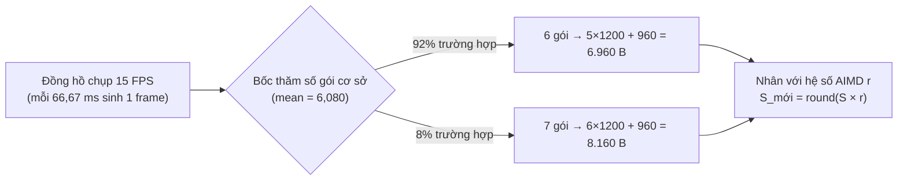

### Công thức kích thước gốc và phép co giãn theo AIMD

Trong cấu hình cơ sở khi chưa gán `meanBytes` hữu hạn (`c.meanBytes = NaN`), mô hình quy ước các mảnh đầu đều đầy \(L_p = 1200\text{ B}\), còn mảnh cuối cùng ban đầu bằng `80%` sức chứa payload, tức `0,8 × 1200 = 960 B` (`SOURCE`: `cnse2_runtime.m`). Từ đó, kích thước một frame gốc trước khi nhân hệ số AIMD là:

\[
S_n = (n - 1) \cdot L_p + 0.8 \cdot L_p
\]

Trong đó:
- \(n \in \{6, 7\}\) là số gói gốc được bốc thăm ngẫu nhiên theo `meanPackets = 6.080`.
- \(L_p = 1200\text{ B}\) là phần dữ liệu ảnh tối đa trong một gói RTP (`c.payload`, đơn vị: byte).
- \(0.8 \cdot L_p = 960\text{ B}\) là kích thước mảnh cuối cùng (`tail`).

Khi bộ điều khiển AIMD gửi về hệ số tỷ lệ chuẩn hóa \(r\) (**AIMD size scale**, khởi đầu bằng `1`, dao động trong đoạn `[0.15, 1.5]`), kích thước frame đầu ra của khối `Frames` trở thành:

\[
S_{\text{adaptive}} = \max\!\big(1,\ \operatorname{round}(r \cdot S_n)\big)
\]

- **Biến đo được vs biến điều khiển:** Đây là điểm quan trọng của lý thuyết điều khiển phản hồi (**feedback control**): *biến đo được* là tỉ lệ mất gói trong báo cáo RTCP từ đầu nhận, còn *biến điều khiển* tại khối `Frames` là kích thước ảnh tính bằng byte \(S_{\text{adaptive}}\) (thông qua hệ số `r`), **không phải** tốc độ khung hình FPS.
- **Lưu ý phân biệt với sản phẩm Python:** Hệ số `r = 0.8` trong SimEvents **không phải** là tham số `JPEG quality = 80`. SimEvents nhân thẳng số byte với `r`, còn trong ứng dụng Python thật (`abr.py`), AIMD chỉnh tham số `quality` của bộ nén JPEG và `resolution_scale` (mà ở CN-T5 ta biết `quality` liên hệ phi tuyến với số byte).

#### Bài tập có lời giải (tính theo thông số thật của mô hình)

Tính kích thước gốc của cả hai trường hợp \(n = 6\) và \(n = 7\) (khi \(r = 1\)), kích thước trung bình kỳ vọng mỗi frame, và kích thước + số gói cần thiết nếu AIMD giảm hệ số xuống \(r = 0.70\) cho frame 6 gói (**CALCULATED**):

1. **Khi \(r = 1\) và bốc được \(n = 6\):**
   \[
   S_6 = (6 - 1) \times 1200 + 0.8 \times 1200 = 5 \times 1200 + 960 = 6000 + 960 = 6960\text{ B}.
   \]
2. **Khi \(r = 1\) và bốc được \(n = 7\):**
   \[
   S_7 = (7 - 1) \times 1200 + 0.8 \times 1200 = 6 \times 1200 + 960 = 7200 + 960 = 8160\text{ B}.
   \]
3. **Kích thước trung bình gốc của luồng ảnh:**
   \[
   \overline{S} = 0.92 \times 6960 + 0.08 \times 8160 = 6403.2 + 652.8 = 7056\text{ B/frame}
   \]
   *(khớp chính xác với dòng `meanBytes = (6.080 - 0.2) * 1200 = 7056` trong `cnse2_runtime.m`, dòng 123).*
4. **Khi AIMD giảm xuống \(r = 0.70\) (với frame gốc `6960 B`):**
   \[
   S_{\text{adaptive}} = \operatorname{round}(0.70 \times 6960) = 4872\text{ B}.
   \]
   Số gói cần thiết ở khâu chia gói phía sau sẽ giảm từ `6` gói xuống còn \(\lceil 4872 / 1200 \rceil = 5\) gói (`4` gói `1200 B` + `1` gói `72 B`).

#### Bài tập thực hành: tự dự đoán trước khi mở đáp án

Giả sử mạng nghẽn nặng khiến hệ số AIMD tụt xuống \(r = 0.50\) và sau đó xuống mức sàn \(r = 0.15\). Với frame gốc `6960 B`:
1. Ở \(r = 0.50\), kích thước ảnh là bao nhiêu byte và cần chia thành mấy gói?
2. Ở mức sàn \(r = 0.15\), kích thước ảnh là bao nhiêu byte và cần mấy gói?

??? success "Xem đáp án và các bước tính"
    1. **Tại \(r = 0.50\) (CALCULATED):**
       - Kích thước ảnh: \(\operatorname{round}(0.50 \times 6960) = 3480\text{ B}\).
       - Số gói cần: \(\lceil 3480 / 1200 \rceil = \lceil 2.9 \rceil = 3\text{ gói}\) (`1200 B`, `1200 B`, `1080 B`).
    2. **Tại \(r = 0.15\) (CALCULATED):**
       - Kích thước ảnh: \(\operatorname{round}(0.15 \times 6960) = 1044\text{ B}\).
       - Số gói cần: \(\lceil 1044 / 1200 \rceil = \lceil 0.87 \rceil = 1\text{ gói duy nhất}\)! Lúc này một bức ảnh nằm gọn trong một gói tin đơn lẻ, không còn bị khuếch đại mất gói do chia nhiều mảnh nữa.

### Cơ chế này nằm ở đâu trong dự án?

Hãy mở subsystem đầu tiên trên đường xanh: `Frames`. Nó gồm hai khối hình ảnh lồng nhau: sơ đồ chính của `Frames` và hàm Simulink Function `sizeScale()` đọc dây tín hiệu phản hồi từ AIMD.

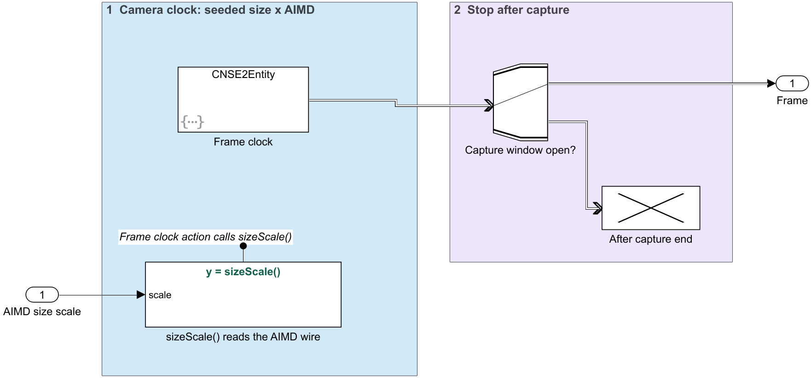


!!! example "Cách đọc hình"
    **Lần theo một frame qua `Frames`:**
    1. **Cổng vào `AIMD size scale` (dây nét đơn bên trái):** nhận con số `rate` từ `Feedback tick` và đưa vào hàm Simulink Function `sizeScale() reads the AIMD wire` (`y = sizeScale()`). Trong hình nhỏ thứ hai, bên trong hàm này không hề làm phép tính phức tạp nào — nó chỉ là cầu nối đưa cổng tín hiệu `scale` sang đầu ra `y` để các khối sự kiện rời rạc phía trên có thể "gọi hỏi" giá trị mới nhất của `rate`.
    2. **Khối `Frame clock` (Entity Generator, vùng 1 màu xanh `1 Camera clock: seeded size x AIMD`):** cứ mỗi `1/c.fps` giây (`66,67 ms` ở 15 FPS), khối này sinh một thực thể `CNSE2Entity`. Mã lệnh khi sinh sẽ gọi `scale = sizeScale()`, rồi gọi `cnse2_runtime('frame', scale)` để lấy `[frame, capture, bytes]` theo bộ sinh số ngẫu nhiên riêng `cameraRng` (`seed + 100`).
    3. **Khối `Capture window open?` (Entity Output Switch, vùng 2 màu tím `2 Stop after capture`):** kiểm tra `row(1) == 0`. Khi thời gian mô phỏng còn nằm trong cửa sổ chụp (`t < c.duration`), `route = 1`, thực thể là frame hợp lệ đi thẳng qua cổng ra `Frame` sang `Sender Queue`. Khi đã hết thời gian chụp (`t >= c.duration`), `Frame clock` vẫn chạy tiếp trong khoảng thời gian xả ống (**drain** — chẳng hạn `2 s` sau `50 s` chụp trong Stage B) để những gói cũ đang bay trên mạng kịp về đích và đóng góp vào thống kê; những thực thể rỗng sinh ra trong lúc xả ống bị gán `route = 2` và chuyển xuống khối `After capture end` (Entity Terminator) để tiêu hủy ngay, không gửi vào hệ thống.

### Thử nghiệm tương tác: AIMD scale → kích thước ảnh và số packet

Trước khi kéo thanh trượt bên dưới, hãy tự trả lời: **Nếu giữ nguyên ảnh gốc `6960 B` và giảm `AIMD scale r` từ `1.0` xuống `0.35` (mức cuối của Stage B ở giây thứ 50), kích thước ảnh và số gói cần thiết giảm xuống còn bao nhiêu?** Sau đó kéo thanh trượt về `0.35` để kiểm chứng.

<div class="widget" data-widget="framesize" data-title="Thử: scale AIMD → byte và số packet (mô hình)"></div>

*Diễn giải:* Khi `r = 0.35`, kích thước giảm từ `6960 B` xuống `2436 B` và số gói giảm từ `6` xuống `3` gói (`1200 + 1200 + 36 B`). Trong suốt quá trình đó, nhịp sinh ảnh `15 FPS` không đổi — chỉ có "gánh nặng dữ liệu" của từng bức ảnh thay đổi.

??? note "Đào sâu để bảo vệ: Mã nguồn sinh kích thước ảnh và `Capture window`"
    Trích đoạn từ `sim/study_simevents_v2/cnse2_runtime.m`, nhánh `'frame'` (dòng 33–38, **SOURCE**):

    ```matlab
    if t<s.c.duration-1e-10
     s.frame=s.frame+1;n=floor(s.c.meanPackets)+(rand(s.cameraRng)<mod(s.c.meanPackets,1));
     tail=.8*s.c.payload;
     if isfinite(s.c.meanBytes),tail=s.c.meanBytes-(s.c.meanPackets-1)*s.c.payload;end
     bytes=max(1,round(((n-1)*s.c.payload+min(s.c.payload,max(1,tail)))*rate));
     v=[s.frame t bytes];s.camera(end+1,:)=[t s.frame t bytes rate];
    ```

    Để ý biến `tail`: khi chạy các cấu hình đo của `CN-T5` (`cnConfigs.m`), nhóm có điền `meanBytes` hữu hạn (ví dụ `6071 B` cho `payload1200_loss2`), lúc đó `tail` được tính khớp theo `meanBytes` thay vì mặc định `0.8 * payload`. Nếu giảng viên hỏi *"Tại sao có thời gian drain sau capture?"*, câu trả lời là: nếu dừng mô phỏng cái rụp ngay tại `t = 50 s`, các frame chụp ở `49.9 s` vẫn đang nằm trong playout buffer hoặc trên đường truyền và sẽ bị cắt ngang số liệu; giữ thêm `drain = 2 s` (`StopTime = c.duration + c.drain`) và khóa nguồn bằng `Capture window open?` giúp đường ống tự xả sạch một cách công bằng.

<p class="key">Khối Frames sinh 1 thực thể mỗi 1/fps giây, bốc thăm kích thước JPEG đại diện quanh meanPackets = 6,080 (6.960 B hoặc 8.160 B), nhân với hệ số AIMD r (giữ nguyên FPS), và dùng cửa sổ chụp để tách frame hợp lệ khỏi giai đoạn drain.</p>

---

## B4. `Sender Queue` — Hàng đợi máy gửi và bài toán Producer–Consumer

### Tại sao cần hàng đợi ở máy gửi, và khi đầy thì xử lý thế nào?

Trong bất kỳ hệ thống truyền tin nào, bộ phận tạo dữ liệu (**Producer — bên sản xuất**, ở đây là camera) và bộ phận xử lý gửi dữ liệu (**Consumer — bên tiêu thụ**, ở đây là bộ nén/đóng gói bên phát) không phải lúc nào cũng chạy cùng tốc độ. Nếu bên sản xuất chụp nhanh hơn tốc độ xử lý của bên gửi (\(\lambda > \mu\)), các bức ảnh mới chụp sẽ bắt đầu ứ đọng lại trong khi bức ảnh cũ vẫn đang được xử lý.

Nếu không có chỗ đứng chờ, ảnh mới sẽ va thẳng vào khâu xử lý đang bận hoặc làm treo bộ sinh ảnh. Ngược lại, nếu có một **hàng đợi (queue)** đứng trước khâu xử lý, câu hỏi sống còn đặt ra là: *Khi hàng đợi đã đầy ứ, ta nên giữ lại những bức ảnh cũ đã xếp hàng từ lâu (**FIFO**) hay vứt bỏ bức ảnh cũ đang chờ để nhường chỗ cho bức ảnh mới vừa chụp (**Latest-value**)?*

### Hiểu bằng ví dụ đơn giản: FIFO vs Latest-value trên trục thời gian

!!! tip "Hình dung"
    Hãy hình dung một **quầy đóng gói ở kho** (`Sender processing`) chỉ xử lý được từng thùng hàng một. Phía trước quầy có một băng chuyền chờ (`Queue`).
    - Với kiểu **FIFO (First In, First Out — vào trước ra trước)** sức chứa 4 chỗ: khi thùng 1 đang được đóng gói trong quầy, thùng 2, 3, 4, 5 xếp hàng ngoài băng chuyền. Thùng 6 vừa tới thấy băng chuyền đã kín `4/4` chỗ → thùng 6 bị bảo vệ ở cửa chặn lại và vứt bỏ (`Sender overflow`), còn quầy vẫn tiếp tục đóng gói lần lượt các thùng cũ `2, 3, 4, 5` dù lúc đóng xong thì thông tin trong đó đã lỗi thời!
    - Với kiểu **Latest-value (giá trị mới nhất)** sức chứa `1` chỗ chờ: khi thùng 1 đang đóng gói trong quầy (lưu ý: **không bao giờ cắt ngang thùng đang đóng dở**), ngoài băng chuyền chỉ giữ đúng **1** vị trí chờ. Thùng 2 tới đứng chờ ở đó; lát sau thùng 3 tới liền **đẩy thùng 2 ra khỏi vị trí chờ và thế chỗ vào**; lát sau thùng 4 tới lại thay thế thùng 3. Khi quầy đóng xong thùng 1, nó bốc ngay **thùng 4 mới nhất** vào làm — bỏ qua những thùng trung gian đã cũ mà không tốn thời gian xử lý vô ích!

Sơ đồ trạng thái dưới đây so sánh hai chính sách trên cùng một chuỗi frame đến (ví dụ minh họa 4 chỗ chờ cho FIFO):

```
[Trục thời gian]    Frame 1 vào quầy       Frame 2,3,4,5 chờ      Frame 6 tới lúc đầy!
───────────────────────────────────────────────────────────────────────────────────────
Chính sách FIFO     [Đang xử lý: F1]  ←  [ F2 | F3 | F4 | F5 ]  ←  F6 bị TỪ CHỐI (overflow)
(sức chứa chờ = 4)  → Xử lý tiếp theo: F2 (cũ hơn), F6 bị mất.

Chính sách Latest   [Đang xử lý: F1]  ←  [ F5 (đã thay F2,F3,F4) ] ← F6 THAY THẾ F5
(sức chứa chờ = 1)  → Xử lý tiếp theo: F6 (mới nhất tại thời điểm rảnh).
```

### Thuật ngữ và toán học cơ bản của hàng đợi

- **Tốc độ đến (\(\lambda\) — arrival rate):** số frame sinh ra mỗi giây (\(\lambda = \text{FPS}\), đơn vị: frame/s).
- **Thời gian phục vụ (\(T_s\) — service time):** thời gian khối xử lý mất để xong 1 frame (đơn vị: giây).
- **Năng lực phục vụ (\(\mu\) — service rate):** số frame tối đa khối xử lý hoàn thành được trong 1 giây, \(\mu = 1 / T_s\) (đơn vị: frame/s).
- **Hệ số tải (\(\rho\) — utilization / traffic intensity):**

\[
\rho = \frac{\lambda}{\mu} = \lambda \cdot T_s
\]

Khi \(\rho \le 1\) (xử lý kịp nhịp chụp), hàng đợi không bị dồn ứ dài hạn. Khi \(\rho > 1\) (**quá tải**), tốc độ sinh vượt tốc độ xử lý; mỗi giây hàng đợi tăng thêm trung bình \(\lambda - \mu\) frame tồn đọng.

#### Bài tập có lời giải (đúng cấu hình bài kiểm tra quá tải máy gửi Stage B)

Trong kịch bản `B_sender_fifo` và `B_sender_latest` (`SOURCE`: `sim/study_simevents_v2/run_cn_simevents_v2_study.m`), nhóm đặt: tốc độ chụp `fps = 30`, thời gian xử lý máy gửi `senderService = 0.05 s = 50 ms`, sức chứa hàng đợi `queueCapacity = 8`. Hãy tính \(\lambda\), \(\mu\), \(\rho\), và giải thích chuyện gì xảy ra với FIFO vs Latest-value (**CALCULATED**):

1. **Tốc độ đến:** \(\lambda = 30\text{ frame/s}\) (chu kỳ \(33.33\text{ ms}\)).
2. **Năng lực phục vụ:** \(\mu = \frac{1}{0.05\text{ s}} = 20\text{ frame/s}\).
3. **Hệ số tải:** \(\rho = \frac{30}{20} = 1.5 > 1\). Mỗi giây thừa ra \(30 - 20 = 10\text{ frame}\) không xử lý kịp!
4. **Hậu quả thực tế trong `stage_B_results.csv` (`SIMULATED`, chạy 12 s):**
   - Với **FIFO** (`queueCapacity = 8`): ngay khi đủ 8 frame đứng chờ (sau chưa đầy 1 giây), các frame mới bắt đầu bị chặn ở cửa (`sender_overflow = 112` frame), trong khi `8` frame cũ trong hàng đợi chờ tới `8 × 50 ms = 400 ms` trước khi tới lượt đóng gói → trễ hạn phát playout hàng loạt (`0%` frame đúng hạn, Mean AoI vọt lên `6933.3 ms`)!
   - Với **Latest-value** (`OverwriteOldest = 'on'`, sức chứa chờ = `1`): `0` overflow ở cửa, `119` frame chờ cũ bị thay thế (`sender_replaced = 119`), mỗi frame được đưa đi đóng gói chỉ chờ tối đa dưới 1 nhịp phục vụ nên `66.7%` đạt đúng hạn và Mean AoI giảm xuống `140.5 ms`! *(Lưu ý: ở cấu hình nền chuẩn CN-T2 và Stage B adaptive, `c.senderService = 0`, nên hàng đợi máy gửi trống và không gây trễ).*

### Cơ chế này nằm ở đâu trong dự án?

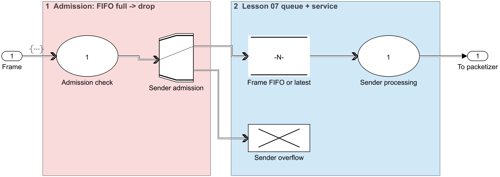

!!! example "Cách đọc hình"
    **Lần theo một frame qua `Sender Queue`:**
    1. **Khối `Admission check` (Entity Server, service time `0`, vùng 1 màu hồng `1 Admission: FIFO full -> drop`):** Frame vừa từ `Frames` đi vào sẽ chạy hành động `admitSender` (`cnse2_runtime.m`). Nếu chính sách đang là `'fifo'` và số frame đang chờ `s.senderWaiting` đã chạm ngưỡng `c.queueCapacity` (`8`), khối gán `entity.route = 2` và tăng biến đếm `senderDrops`; ngược lại gán `route = 1`.
    2. **Công tắc `Sender admission` (Entity Output Switch):** Đọc `entity.route`. Nếu `route == 2`, chuyển frame xuống nhánh dưới tới `Sender overflow` (Terminator) để hủy bỏ; nếu `route == 1`, cho đi nhánh trên sang vùng 2 (`2 Lesson 07 queue + service`).
    3. **Khối `Frame FIFO or latest` (Entity Queue):** Sức chứa đặt bằng biểu thức `max(1, c.queueCapacity * strcmp(c.policy, 'fifo'))`. Khi `policy = 'fifo'`, biểu thức ra `8` (còn `Admission check` đã chặn frame thứ 9 ở ngoài cửa để khối `Frame clock` không bị nghẽn ngược); khi `policy = 'latest'`, biểu thức ra `1` và thuộc tính `OverwriteOldest` được `cnse2_run.m` bật `'on'`, nên mỗi khi `Sender processing` đang bận mà có frame mới tới, hàng đợi tự vứt frame đang chờ cũ nhất để giữ frame mới nhất.
    4. **Khối `Sender processing` (Entity Server):** Giữ frame trong thời gian `c.senderService` (`0` ở cấu hình nền; `50 ms` ở bài thử nghiệm quá tải máy gửi), rồi đẩy sang cổng `To packetizer`.

### Thử nghiệm tương tác: Tốc độ sinh λ và tốc độ phục vụ μ

Trước khi bấm chỉnh thanh trượt, hãy dự đoán: **Nếu camera vẫn chụp ở `15 FPS` nhưng máy gửi/AI chậm đi tới mức mất `100 ms` cho mỗi frame, hệ số tải \(\rho\) bằng bao nhiêu và hàng đợi FIFO sẽ ổn định hay tràn?**

<div class="widget" data-widget="queue" data-title="Thử: tốc độ sinh λ và tốc độ phục vụ μ"></div>

*Diễn giải:* Tại `λ = 15/s` và `service = 100 ms` (`μ = 10/s`), hệ số tải \(\rho = 1.50\) — giống hệt mức quá tải của bài `30/s` với `50 ms`! Chỉ khi kéo thời gian phục vụ xuống dưới `66,67 ms` (`μ > 15/s`, tức \(\rho < 1\)), hàng đợi mới thoát khỏi trạng thái quá tải.

??? note "Đào sâu để bảo vệ: Trích đoạn `admitSender` và cấu hình dung lượng hàng đợi"
    Trích đoạn từ `sim/study_simevents_v2/cnse2_runtime.m` (dòng 47–52, **SOURCE**):

    ```matlab
    case 'admitSender'
     route=1;
     if strcmp(s.c.policy,'fifo') && s.senderWaiting>=s.c.queueCapacity
      route=2;s.senderDrops=s.senderDrops+1;
     end
     varargout={route};
    ```

    **Câu hỏi hay gặp khi bảo vệ:** *“Tại sao trong FIFO lại phải viết thêm `Admission check` + `Sender admission` ở trước `Entity Queue`, sao không để thẳng vào `Entity Queue` có sức chứa 8?”*
    Vì trong SimEvents, nếu một `Entity Queue` thông thường bị đầy và thuộc tính ghi đè tắt (`OverwriteOldest = 'off'`), nó sẽ **chặn ngược (backpressure)** không cho khối `Frame clock` phía trước phát frame mới đúng lịch `1/fps` — làm sai lệch đồng hồ camera! Cửa kiểm soát `Admission check` đứng ngoài giúp chuyển hướng frame dư sang `Sender overflow` ngay lập tức để camera vẫn giữ đúng nhịp chụp `15 FPS` hoặc `30 FPS`.

<p class="key">Sender Queue giải quyết bài toán producer–consumer trước khâu đóng gói: FIFO giữ tối đa 8 frame chờ theo thứ tự và từ chối frame thứ 9; Latest-value chỉ giữ 1 chỗ chờ và thay frame cũ bằng frame mới mà không ngắt frame đang xử lý.</p>

---

## B5. `RTP Packetizer` — Biến một bức ảnh thành nhiều gói tin

### Tại sao không gửi cả bức ảnh trong một gói tin duy nhất?

Một bức ảnh JPEG `6960 B` giống như một chiếc bàn dài `3 mét`, trong khi cánh cửa của đường mạng Ethernet (gọi là **MTU — Maximum Transmission Unit**, thông thường `1500 B`) chỉ cho từng kiện tối đa khoảng `1,5 mét` đi lọt không phải cưa đôi ở tầng mạng. Nếu cố nhồi cả `6960 B` vào một gói UDP khổng lồ, tầng IP bên dưới sẽ tự động chặt nó thành nhiều mảnh IP mù chữ (nếu mất 1 mảnh IP thì toàn bộ gói UDP `6960 B` bị vứt sạch). Vì thế, ứng dụng chủ động cắt mỗi bức ảnh thành **\(N\) gói RTP nhỏ vừa vặn** ngay từ tầng ứng dụng.

Nhưng khi một bức ảnh bị xẻ làm `6` gói gửi đi nối đuôi nhau trên mạng UDP, hai vấn đề lập tức xuất hiện:
1. Các gói đi độc lập trên mạng có thể **đến lệch thứ tự** (gói 3 tới trước gói 2) hoặc **rơi mất giữa chừng** — máy nhận phải biết gói này là mảnh thứ mấy của bức ảnh nào, và đánh số liên tiếp để phát hiện mất gói.
2. Máy nhận phải biết **gói nào thuộc cùng một bức ảnh** (dựa vào `rtpTimestamp` và `frame`), và đâu là mảnh cuối cùng (`marker`), mà không nhầm lẫn giữa *mã thứ tự gói* (`seq`) với *giờ chụp ảnh* (`rtpTimestamp`).

### Hiểu bằng ví dụ đơn giản: chia 6960 byte thành 6 gói tin

Hãy theo dõi bức ảnh đầu tiên (`frame = 1`, chụp lúc `t = 0 s`) có kích thước **6.960 byte**, với giới hạn phần dữ liệu ảnh mỗi gói là **1.200 byte** (`c.payload = 1200`). Để chia hết `6.960` byte, ta cần:

\[
N = \left\lceil \frac{6960}{1200} \right\rceil = \lceil 5.8 \rceil = 6\text{ gói}
\]

5 gói đầu tiên lấy trọn `1200 B` dữ liệu ảnh mỗi gói (`5 × 1200 = 6000 B`), còn gói thứ 6 lấy phần dư cuối cùng là `6960 - 6000 = 960 B`.

<svg viewBox="0 0 760 210" width="100%" style="max-width:760px;display:block;margin:1rem auto;" role="img" aria-label="Sơ đồ chia 1 frame 6960 B thành 6 gói RTP">
  <rect x="10" y="55" width="155" height="92" rx="10" fill="rgba(20,184,166,0.12)" stroke="#14B8A6" stroke-width="2"/>
  <text x="87" y="82" text-anchor="middle" fill="currentColor" font-size="13" font-weight="700">Frame 1</text>
  <text x="87" y="103" text-anchor="middle" fill="currentColor" font-size="12">size = 6.960 B</text>
  <text x="87" y="122" text-anchor="middle" fill="currentColor" font-size="11">capture = 0 s</text>
  <text x="87" y="138" text-anchor="middle" fill="#14B8A6" font-size="11" font-weight="700">N = ceil(6960/1200) = 6</text>
  <line x1="170" y1="101" x2="225" y2="101" stroke="currentColor" stroke-width="2"/>
  <polygon points="225,96 235,101 225,106" fill="currentColor"/>
  <text x="200" y="90" text-anchor="middle" fill="currentColor" font-size="11">Cắt gói</text>
  <rect x="242" y="12" width="506" height="26" rx="5" fill="rgba(20,184,166,0.08)" stroke="currentColor" stroke-opacity="0.45"/>
  <text x="495" y="29" text-anchor="middle" fill="currentColor" font-size="11">P1: seq=0 | frag=1/6 | rtpTS=0 | payload=1200 B | marker=0</text>
  <rect x="242" y="43" width="506" height="26" rx="5" fill="rgba(20,184,166,0.08)" stroke="currentColor" stroke-opacity="0.45"/>
  <text x="495" y="60" text-anchor="middle" fill="currentColor" font-size="11">P2: seq=1 | frag=2/6 | rtpTS=0 | payload=1200 B | marker=0</text>
  <rect x="242" y="74" width="506" height="26" rx="5" fill="rgba(20,184,166,0.08)" stroke="currentColor" stroke-opacity="0.45"/>
  <text x="495" y="91" text-anchor="middle" fill="currentColor" font-size="11">P3: seq=2 | frag=3/6 | rtpTS=0 | payload=1200 B | marker=0</text>
  <rect x="242" y="105" width="506" height="26" rx="5" fill="rgba(20,184,166,0.08)" stroke="currentColor" stroke-opacity="0.45"/>
  <text x="495" y="122" text-anchor="middle" fill="currentColor" font-size="11">P4: seq=3 | frag=4/6 | rtpTS=0 | payload=1200 B | marker=0</text>
  <rect x="242" y="136" width="506" height="26" rx="5" fill="rgba(20,184,166,0.08)" stroke="currentColor" stroke-opacity="0.45"/>
  <text x="495" y="153" text-anchor="middle" fill="currentColor" font-size="11">P5: seq=4 | frag=5/6 | rtpTS=0 | payload=1200 B | marker=0</text>
  <rect x="242" y="167" width="440" height="28" rx="5" fill="rgba(245,158,11,0.18)" stroke="#F59E0B" stroke-width="1.5"/>
  <text x="462" y="185" text-anchor="middle" fill="currentColor" font-size="11" font-weight="700">P6: seq=5 | frag=6/6 | rtpTS=0 | payload=960 B | marker=1</text>
</svg>

Hãy nhìn kỹ từng cột của bảng thông tin cho 6 packet này (**CALCULATED** theo luật của `build_cn_simevents_v2.m`):

| Packet | `frame` | `seq` | `rtpTimestamp` | `fragment` | `count` | `size` (byte ảnh) | `marker` |
|---|---:|---:|---:|---:|---:|---:|---:|
| P1 | 1 | 0 | 0 | 1 | 6 | 1200 | 0 |
| P2 | 1 | 1 | 0 | 2 | 6 | 1200 | 0 |
| P3 | 1 | 2 | 0 | 3 | 6 | 1200 | 0 |
| P4 | 1 | 3 | 0 | 4 | 6 | 1200 | 0 |
| P5 | 1 | 4 | 0 | 5 | 6 | 1200 | 0 |
| P6 | 1 | 5 | 0 | 6 | 6 | **960** | **1** |

Có hai quy tắc vàng mà giảng viên rất thích hỏi:
1. **Tất cả 6 gói cùng thuộc Frame 1 đều có chung `rtpTimestamp = 0`**, nhưng `seq` tăng dần `0, 1, 2, 3, 4, 5` — vì `seq` định danh *từng packet*, còn `rtpTimestamp` định danh *thời điểm chụp của cả frame*.
2. **Gói P6 có `marker = 1` chỉ báo "tôi là mảnh cuối cùng", KHÔNG chứng minh 5 mảnh trước đã tới nơi!** Nếu P3 bị mất giữa đường mà P1, P2, P4, P5, P6 vẫn tới, receiver thấy `marker = 1` nhưng mới đếm được `5/6` mảnh → bức ảnh vẫn bị hỏng!

### Công thức đếm mảnh, tính timestamp 90 kHz và kích thước từng mảnh

1. **Số mảnh \(N\):**
   \[
   N = \left\lceil \frac{S_f}{L_p} \right\rceil
   \]
   Trong đó \(S_f\) là tổng số byte ảnh của frame (đơn vị: B), \(L_p = 1200\text{ B}\) là sức chứa dữ liệu ảnh tối đa của mỗi gói (`payload`). Dấu \(\lceil \cdot \rceil\) (`ceil`) làm tròn lên số nguyên gần nhất vì phần dư dù chỉ `1 byte` cũng cần một gói riêng.

2. **Mốc thời gian RTP 90 kHz (`rtpTimestamp`):**
   \[
   TS = \operatorname{round}(t_{\text{capture}} \times 90000) \bmod 2^{32}
   \]
   Tại sao là **90.000 Hz**? Đây là tần số đồng hồ media tiêu chuẩn của video trong RFC 3550 (chia hết cho nhiều tốc độ khung hình như `15, 24, 25, 30, 50, 60 FPS`). **Nó KHÔNG phải tần số xung nhịp CPU!** Với `15 FPS`, bước nhảy timestamp danh định giữa hai frame liên tiếp là:
   \[
   \Delta TS = \frac{90000}{15} = 6000\text{ tick}
   \]
   Ở `30 FPS`, bước nhảy là \(90000 / 30 = 3000\text{ tick}\). Phép chia lấy dư \(\bmod 2^{32}\) biểu diễn bộ đếm 32-bit tự quay vòng về 0 khi tràn qua `4.294.967.295`.

3. **Các trường của mảnh thứ \(k \in \{1, \dots, N\}\):**
   \[
   \text{seq}_k = (\text{seq}_0 + k - 1) \bmod 65536,\qquad S_{p,k} = \min\!\big(L_p,\ S_f - (k-1)L_p\big)
   \]
   Trong đó `65536 = 2^16` (16-bit sequence wrap), còn `marker = 1` khi và chỉ khi \(k = N\).

#### Bài tập thực hành: dự đoán Frame 2 nối tiếp ngay sau Frame 1

Giả sử **Frame 2** được chụp ở `15 FPS` (\(t_{\text{capture}} = 1/15\text{ s}\)), có kích thước sau AIMD là `5.100 B` (`L_p = 1200 B`). Hãy điền trước giá trị của **P1** và **P5** (gói cuối) của Frame 2 (biết Frame 1 đã dùng hết `seq = 0..5`):

??? success "Xem đáp án và các bước tính"
    - **Số mảnh (CALCULATED):** \(N = \lceil 5100 / 1200 \rceil = \lceil 4.25 \rceil = 5\text{ gói}\).
    - **RTP timestamp (CALCULATED):** \(TS = \operatorname{round}((1/15) \times 90000) = 6000\text{ tick}\). Cả 5 gói đều mang `rtpTimestamp = 6000`.
    - **Sequence khởi đầu:** Frame 1 đã lấy `0..5`, nên `nextSeq` cho Frame 2 là `6`.
    - **Gói P1 của Frame 2 (`k = 1`):** `seq = 6`, `fragment = 1`, `count = 5`, `size = min(1200, 5100) = 1200 B`, `marker = 0`.
    - **Gói P5 của Frame 2 (`k = 5`):** `seq = 6 + 5 - 1 = 10`, `fragment = 5`, `count = 5`, `size = min(1200, 5100 - 4×1200) = 300 B`, `marker = 1`.
    - Sau Frame 2, `nextSeq` được cộng thêm `5` thành `11` để dành cho Frame 3.

### Cơ chế này nằm ở đâu trong dự án?


!!! example "Cách đọc hình"
    **Lần theo Frame 1 qua `RTP Packetizer` (`SOURCE`: `build_cn_simevents_v2.m`):**
    1. **Vùng 1 (`1 Count N, 90 kHz stamp`) — `Count fragments` (Entity Server, service time `0`):** Frame 1 (`6960 B`, `capture = 0`) đi vào. Khối tính `entity.count = 6`, `entity.rtpTimestamp = 0`, gán `entity.SSRC = 20261119`, gán `entity.seq = 0` (số sequence đầu tiên của frame), rồi cộng sẵn `nextSeq = nextSeq + 6` cho frame sau.
    2. **Vùng 2 (`2 Fan-out into N copies`) — `Make N copies` (Entity Replicator):** Khối đọc thuộc tính `count = 6`, nhân bản ra **6 bản sao** đẩy qua cổng 1 vào hàng đợi `Fragment line` (FIFO vô hạn), còn **bản gốc (`Orig`)** được đẩy qua cổng 2 xuống khối `Original frame record` (Terminator) để kết thúc vòng đời thực thể frame gốc.
    3. **Vùng 3 (`3 Seq, size, marker`) — `Stamp RTP header` (Entity Server, service time `0`):** Từng bản sao trong 6 bản sao đi ra khỏi `Fragment line` qua khối này. Với biến đếm nội bộ `k` chạy từ `1` đến `6`, khối đóng dấu `fragment = k`, `seq = 0 + k - 1`, cắt `size` thành `1200` (cho `k = 1..5`) hoặc `960` (cho `k = 6`), gắn `marker = 1` ở bản sao thứ `6`, rồi reset `k = 0` khi `k == entity.count`. Ngõ ra `RTP packets` lúc này xuất ra đúng 6 thực thể gói tin RTP riêng biệt.

??? note "Đào sâu để bảo vệ: Khác biệt quy ước payload giữa SimEvents và code Python thật"
    Đừng bao giờ trộn lẫn hai quy ước sau (**SOURCE** đã đối chiếu):
    - **Trong SimEvents v2 (`build_cn_simevents_v2.m`, `cnse2_runtime.m`):** `payload = 1200 B` là sức chứa **thuần dữ liệu ảnh**; còn `48 B` header (IPv4 + UDP + RTP + fragment header) được cộng thêm ở khối `Serialization` (`entity.size + 48`). Vì vậy một gói đầy dài `1248 B` trên dây mạng.
    - **Trong ứng dụng Python thật (`cn/rtp/rtp/payload.py`, hàm `fragment_jpeg`):** `--mtu-payload = 1200 B` giới hạn **toàn bộ phần payload bên trong gói RTP** (tức đã bao gồm `PAYLOAD_HEADER_SIZE = 8 B` header phân mảnh riêng của nhóm, và thêm `4 B` ghi `total_length` ở mảnh đầu tiên!). Do đó mảnh đầu tiên trong Python chỉ chứa tối đa `1200 - 8 - 4 = 1188 B` JPEG, các mảnh sau chứa tối đa `1200 - 8 = 1192 B` JPEG. Ngoài ra `sender.py` khởi tạo `seq_start` và `timestamp_offset` ngẫu nhiên chứ không bắt đầu từ `0`.

    *(Trích `Stamp RTP header` trong `build_cn_simevents_v2.m`, dòng 111–116, **SOURCE**):*
    ```matlab
    k = k + 1; % fragment index 1..N
    entity.fragment = k;
    entity.seq = mod(entity.seq + k - 1, 65536);
    entity.size = min(payload, entity.size - (k-1)*payload);
    entity.marker = double(k == entity.count); % last fragment of the frame
    if k == entity.count, k = 0; end
    ```

<p class="key">RTP Packetizer tách 1 frame thành N = ceil(S_f / L_p) packet qua 3 trạm: tính N và timestamp 90 kHz, nhân bản bằng Entity Replicator, rồi đóng dấu seq (tăng liên tiếp), size từng mảnh và cờ marker = 1 ở mảnh cuối. Cờ marker không xác nhận các mảnh trước đã tới nơi.</p>

---

## B6. `Serialization` — Vì sao một đường dây có tốc độ hữu hạn lại sinh ra hàng đợi?

### Tại sao 6 gói của cùng một bức ảnh không lên dây mạng cùng một lúc?

Khi máy tính gửi một bức ảnh đã cắt thành `6` gói qua mạng, cả 6 gói không thể lao lên sợi dây cáp trong cùng một khoảnh khắc tức thời. Một đường truyền vật lý giống như một cây cầu một làn xe: nó chỉ đẩy được một số lượng bit nhất định mỗi giây (**bitrate** hay **bandwidth**, ký hiệu \(C\), tính bằng bit/s hoặc Mb/s). Gói càng nhiều bit càng chiếm sợi dây lâu hơn; trong lúc gói 1 đang được đẩy từng bit một lên đường dây, gói 2, 3, 4, 5, 6 bắt buộc phải **xếp hàng chờ tới lượt**.

### Hiểu bằng ví dụ đơn giản: 6 gói xếp hàng trước một đường dây chậm

Hãy xem điều gì xảy ra khi cả 6 gói của Frame 1 (`5` gói `1200 B` + `1` gói `960 B`) tới cùng lúc ở đầu vào một đường dây chậm **`0.55 Mb/s`** (trong khi `100 Mb/s` nhanh hơn gần 182 lần). Mỗi gói trong mô hình SimEvents mang theo `48 byte` header bổ sung (`IPv4 + UDP + RTP + fragment header`):
- Gói đầy `1200 B` ảnh có tổng chiều dài trên dây: \(1200 + 48 = 1248\text{ byte} = 1248 \times 8 = 9984\text{ bit}\).
- Tại **100 Mb/s** (\(100 \times 10^6\text{ bit/s}\)): mỗi gói đầy chỉ chiếm đường dây `0,09984 ms` (chưa tới một phần mười mili-giây!). Cả 6 gói đi qua hết trong chưa đầy `0,58 ms`.
- Tại **0,55 Mb/s** (\(550{,}000\text{ bit/s}\)): mỗi gói đầy chiếm đường dây tới `18,15 ms`!

```
[Thời gian tại link 0,55 Mb/s]  (Đơn vị: ms)
0        18,15      36,30      54,46      72,61      90,76     105,43 ms
├──────────┼──────────┼──────────┼──────────┼──────────┼──────────┤
│    P1    │    P2    │    P3    │    P4    │    P5    │    P6    │
│(18,15 ms)│(18,15 ms)│(18,15 ms)│(18,15 ms)│(18,15 ms)│(14,66 ms)│
└──────────┴──────────┴──────────┴──────────┴──────────┴──────────┘
                                       ↑ Frame 2 tới lúc 66,67 ms:
                                         P5 vẫn chưa phát xong! Hàng đợi phình ra!
```

Nhìn trục thời gian trên là thấy ngay bản chất vấn đề: ở `15 FPS`, cứ **66,67 ms** lại có 6 gói của bức ảnh tiếp theo đổ tới. Nhưng ở `0,55 Mb/s`, đường dây mất tận **105,43 ms** mới đẩy xong 6 gói của Frame 1! Ngay cả khi mạng **không hề làm mất một gói nào**, hàng đợi `Packet FIFO` trước đường dây vẫn phình to mãi theo thời gian, làm mọi gói sau bị trễ dần rồi quá hạn phát.

### Công thức độ trễ tuần tự hóa (`Serialization delay`)

**Serialization delay (độ trễ tuần tự hóa)** \(T_{\mathrm{ser}}\) là thời gian cần thiết để đẩy toàn bộ các bit của một packet từ card mạng lên đường truyền có tốc độ \(C\):

\[
T_{\mathrm{ser}} = \frac{8 \cdot (S_p + 48)}{C}
\]

Trong đó:
- \(S_p\) là kích thước phần dữ liệu ảnh của gói (byte, từ `entity.size`).
- `48` là tổng kích thước phần đầu gói tin (byte) trong quy ước mô hình SimEvents (`SOURCE`: `dt = 8*(entity.size + 48)/linkBitRate`).
- `8` là hệ số đổi từ byte sang bit (`1 byte = 8 bit`).
- \(C\) là tốc độ bit của đường truyền (`linkBitRate`, đơn vị: **bit/s** — chú ý `1 Mb/s = 10^6 bit/s`).
- Kết quả \(T_{\mathrm{ser}}\) có đơn vị là **giây (s)** (nhân `1000` để đổi sang **ms**).

#### Bài tập có lời giải (tính cho đủ 6 gói của frame 6960 B tại hai mức link của Stage B)

1. **Với mỗi gói đầy (\(S_p = 1200\text{ B}\)):** tổng số bit trên dây là \(L_{\text{full}} = 8 \times (1200 + 48) = 8 \times 1248 = 9984\text{ bit}\) (**CALCULATED**).
   - Tại \(C = 100\text{ Mb/s}\): \(T_{\mathrm{ser}} = \frac{9984}{100 \times 10^6} = 0.00009984\text{ s} = 0.09984\text{ ms}\) (năng lực tối đa \(1 / 0.00009984 \approx 10{,}016\) gói đầy/s).
   - Tại \(C = 0.55\text{ Mb/s}\): \(T_{\mathrm{ser}} = \frac{9984}{550{,}000} \approx 0.0181527\text{ s} \approx 18.15\text{ ms}\) (chỉ khoảng `55,1` gói đầy/s).
2. **Với gói cuối (\(S_p = 960\text{ B}\)):** tổng số bit là \(L_{\text{last}} = 8 \times (960 + 48) = 8 \times 1008 = 8064\text{ bit}\).
   - Tại \(100\text{ Mb/s}\): \(T_{\mathrm{ser,6}} = \frac{8064}{10^8} = 0.08064\text{ ms}\). Tổng cả 6 gói của Frame 1 là \(5 \times 0.09984 + 0.08064 = 0.57984\text{ ms}\) (nếu cả 6 gói đều đầy `1200 B` thì là `0,599 ms`).
   - Tại \(0.55\text{ Mb/s}\): \(T_{\mathrm{ser,6}} = \frac{8064}{550{,}000} \approx 14.66\text{ ms}\). Tổng cả 6 gói là \(5 \times 18.1527 + 14.6618 \approx 105.43\text{ ms}\) (nếu 6 gói đầy thì là `108,92 ms`).

#### Bài tập thực hành: kiểm tra khi nào đường dây bị nghẽn cổ chai

Trong kịch bản Stage B bottleneck (`run_cn_simevents_v2_study.m`), đường dây đặt \(C = 0.55\text{ Mb/s}\), camera giữ `15 FPS` với kích thước trung bình trước overhead là `7056 B/frame`.
1. Tính tốc độ bit *thuần dữ liệu ảnh* đổ ra mạng mỗi giây (chưa kể header `48 B/gói`) rồi so sánh với `0,55 Mb/s`.
2. Nếu AIMD hạ hệ số xuống `r = 0.5`, tốc độ dữ liệu ảnh còn bao nhiêu và hàng đợi có thoát nghẽn không?

??? success "Xem đáp án và các bước tính"
    1. **Tại \(r = 1\) (CALCULATED):**
       \(R_{\text{img}} = 15 \times 7056 \times 8 = 846{,}720\text{ bit/s} = 0.84672\text{ Mb/s}\). Ngay cả khi **chưa tính 48 B header mỗi gói**, lượng dữ liệu ảnh đã vượt xa sức chứa `0,55 Mb/s`! Trong mô phỏng `B_bottleneck0` (`SIMULATED`, `stage_B_results.csv`), với `rate = 1` cố định, **0%** frame kịp hạn phát (tất cả `1.740` mảnh tới receiver đều quá muộn).
    2. **Tại \(r = 0.5\) (CALCULATED):**
       \(R_{\text{img}} = 0.5 \times 0.84672 = 0.42336\text{ Mb/s}\), cộng thêm khoảng `4` gói × `48 B` header mỗi frame (`~0.023 Mb/s`) vẫn nhỏ hơn `0,55 Mb/s`. Nhờ AIMD giảm `rate` xuống `0.15–0.16` trong `B_bottleneck1` (`SIMULATED`), tỉ lệ frame đúng hạn vọt từ **0%** lên **96,64%** và jitter rơi từ **22,93 ms** xuống **2,54 ms**!

### Cơ chế này nằm ở đâu trong dự án?


!!! example "Cách đọc hình"
    **Lần theo 6 gói của Frame 1 qua `Serialization`:**
    1. Gói `P1..P6` từ `RTP Packetizer` đi qua cổng `RTP` vào **`Packet FIFO`** (Entity Queue sức chứa `Inf`, tức mô phỏng bộ đệm phát của card mạng không tự vứt gói ở đây).
    2. **`Link serializer`** là một Entity Server **dung lượng `1`** (chỉ phục vụ đúng 1 packet tại một thời điểm — thể hiện bằng số `1` bên trong hình bầu dục). Ngay khi `P1` vào `Link serializer`, hàm phục vụ tính `dt = 8*(entity.size + 48)/linkBitRate` (`0,09984 ms` ở `100 Mb/s`). Trong khoảng `dt` đó, `P2..P6` đứng chờ trong `Packet FIFO`. Khi `P1` xong, nó rời cổng `To channel` sang `Channel`, và `P2` lập tức thế chỗ vào `Link serializer`.

### Thử nghiệm tương tác: Tốc độ link và thời gian đẩy một packet

Hãy thử thay đổi thanh trượt `Link (Mb/s)`: **Khi giảm tốc độ từ `100 Mb/s` xuống `0.55 Mb/s` với payload `1200 B`, thời gian đẩy 1 gói tăng gấp bao nhiêu lần và tối đa một giây đẩy được bao nhiêu gói?**

<div class="widget" data-widget="serialization" data-title="Thử: tốc độ link và thời gian đẩy một packet"></div>

*Diễn giải:* Tại `100 Mb/s`, mỗi gói tốn `0,100 ms` (`10.016 gói/s`). Tại `0,55 Mb/s`, mỗi gói tốn `18,153 ms` (gấp ~182 lần, chỉ còn `55 gói/s`). Khi tốc độ gói đến vượt quá `55 gói/s` (`15 FPS × 6,08 = 91,2 gói/s`), hàng đợi `Packet FIFO` sẽ tắc nghẽn ngay cả khi đường dây không mất một bit nào.

<p class="key">Serialization delay T_ser = 8(S_p + 48)/C là thời gian chiếm dụng dây truyền nối tiếp từng packet một. Khi tốc độ bit sinh ra vượt C, Packet FIFO sẽ tích backlog kể cả khi mất gói bằng 0.</p>

---

## B7. `Channel` — Kênh truyền làm mất gói và làm trễ gói như thế nào?

### Tại sao kênh mạng không chỉ "mất hoặc còn", và vì sao cần nhiều chuỗi ngẫu nhiên tách biệt?

Sau khi rời card mạng của máy phát (`Serialization`), các gói tin đi vào mạng thật (Ethernet, Wi-Fi hoặc bộ giả lập mạng `netem`). Mạng gây ra **hai tác động hoàn toàn độc lập về mặt khái niệm**:
1. **Gói có sống sót qua đường mạng không?** (Mất gói độc lập từng gói, hay mất từng chùm liên tiếp).
2. **Nếu sống sót, gói mất bao lâu mới tới máy nhận?** (Thời gian bay qua mạng — có gói đi nhanh `10 ms`, có gói kẹt hàng đợi bộ định tuyến nên tới chậm `45 ms`, thậm chí có gói đi sau lại về trước).

Ngoài ra, trong mô phỏng khoa học, nhóm cần **tái lập chính xác** kết quả (`reproducibility`): nếu muốn so sánh `FIFO` với `Latest-value` hay `Fixed` với `AIMD`, hai lần chạy phải gặp *cùng một chuỗi biến động mạng* chứ không thể để hễ AIMD thay đổi số lượng ảnh là thứ tự rút thăm mất gói của kênh bị xô lệch loạn xạ! Đó là lý do mô hình tách `5` chuỗi số ngẫu nhiên (**Random Number Generator — RNG**) riêng biệt với hạt giống (**seed**) cộng thêm `100, 200, 300, 600, 700` cho camera, mất gói thuận, trễ thuận, mất gói ngược và trễ ngược (`SOURCE`: `cnse2_runtime.m`).

### Hiểu bằng ví dụ đơn giản: mất gói độc lập vs mất gói theo chùm (`Gilbert–Elliott`)

Giả sử bạn gửi 2 bức ảnh liên tiếp (`Frame 1` gồm 5 gói `P1..P5`, `Frame 2` gồm 5 gói `P6..P10`), và tổng cộng mạng làm rơi **2 gói** (tỉ lệ mất gói `2/10 = 20%`). Hãy xem hai kiểu mất khác nhau gây hậu quả khác nhau thế nào:

- **Mất độc lập (Bernoulli):** Giống như mỗi gói đi qua đều tung một đồng xu lỗi độc lập. Nếu `P2` của Frame 1 và `P8` của Frame 2 bị rơi rải rác, **cả 2 bức ảnh đều thiếu mảnh và hỏng sạch** (`frame loss = 100%` dù mới mất 20% gói!).
- **Mất theo chùm (Burst loss — mô hình Gilbert–Elliott):** Kênh truyền có hai trạng thái: **Good (tốt — gói đi qua hết)** và **Bad (xấu — nhiễu Wi-Fi hoặc kẹt hàng đợi làm rớt liên tiếp nhiều gói)**. Nếu trạng thái `Bad` rơi trúng lúc đang gửi `P2, P3` của Frame 1 rồi kênh chuyển lại sang `Good`, thì Frame 1 hỏng nhưng **Frame 2 sống nguyên vẹn** (`frame loss = 50%`).

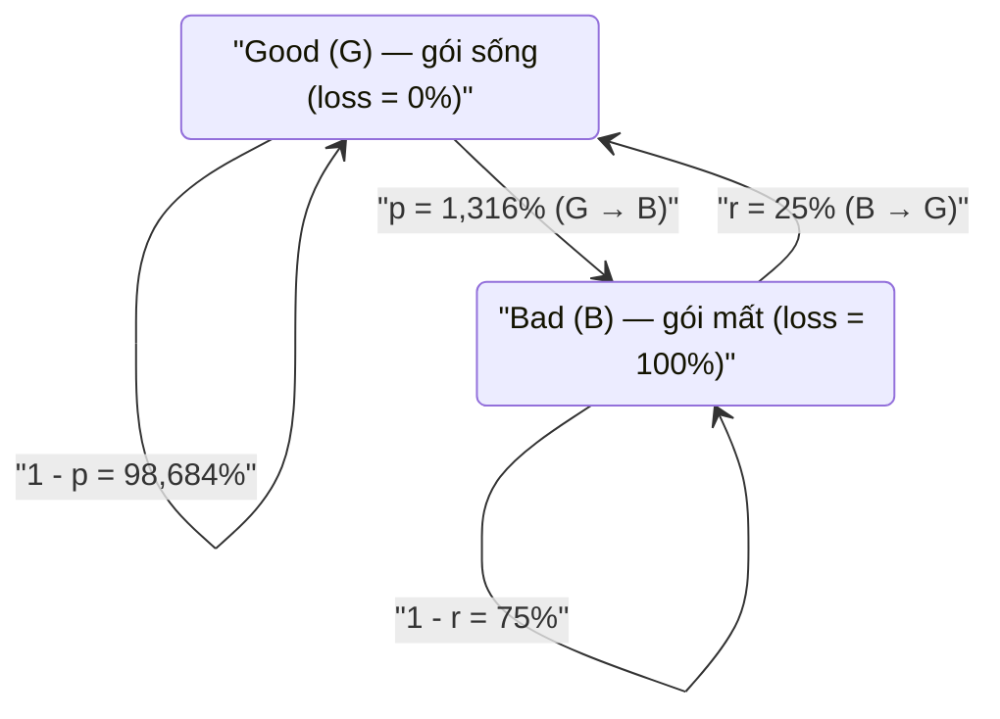

### Toán học của Gilbert–Elliott và luật trễ mạng

1. **Chuỗi Markov hai trạng thái Gilbert–Elliott (`sim/+course/Loss.m`, cấu hình `ge5_b4` của T3):**
   Khi kênh đang ở trạng thái `Good`, sau mỗi gói nó chuyển sang `Bad` với xác suất \(p = 0.01316\) (`1,316%`). Khi đang ở `Bad`, nó làm rớt gói hiện tại rồi chuyển về `Good` với xác suất \(r = 0.25\) (`25%`), hoặc ở lại `Bad` với xác suất `75%`. Từ đây tính được (**CALCULATED**):
   - **Tỉ lệ thời gian/gói ở trạng thái xấu (mất gói dài hạn):**
     \[
     P_B = \frac{p}{p + r} = \frac{0.01316}{0.01316 + 0.25} = \frac{0.01316}{0.26316} \approx 0.0500 = 5.0\%
     \]
   - **Độ dài chùm mất gói trung bình mỗi lần rơi vào trạng thái xấu:**
     \[
     E[L_B] = \frac{1}{r} = \frac{1}{0.25} = 4\text{ gói liên tiếp}
     \]
   Đó chính là lý do cấu hình trong thí nghiệm mang tên **`ge5_b4`** (trung bình mất `5%`, chùm dài trung bình `4` gói). Lưu ý nhỏ: đây chỉ là một chuỗi Markov mô tả *môi trường kênh truyền*, không phải bài toán Học tăng cường (RL), và bộ điều khiển AIMD của chúng ta dùng luật xác định chứ không dùng RL.

2. **Luật bốc trễ mạng (`sim/+course/Delay.m`):**
   Với mỗi gói sống sót gửi ở thời điểm \(t\), độ trễ truyền lan được bốc theo công thức:
   \[
   d = \max(0,\ d_0 + \sigma Z)
   \]
   Trong đó \(d_0\) là trễ nền (`Base`, giây), \(\sigma\) là tham số biến thiên (`Jitter`, giây), và \(Z\) là biến ngẫu nhiên phân phối chuẩn \(\mathcal{N}(0,1)\) (cho chế độ `'normal'`) hoặc phân phối đều \(\mathcal{U}(-1, 1)\) (cho chế độ `'uniform'`). Vì thời gian trễ không bao giờ được phép âm (gói không thể tới trước khi được gửi!), phép lấy \(\max(0, \dots)\) **chặn các giá trị âm về `0`**. Chính vì bị chặn ở `0`, ở cấu hình chuẩn `d_0 = 20 ms, σ = 20 ms` (của bài T4), phân phối thực bị cắt mất phần đuôi âm (`~15,9%` xác suất bị đẩy về `0 ms`) nên giá trị trung bình thực hơi lớn hơn `20 ms` một chút (`~21,7 ms` đối với chuẩn tắc cắt cụt, **CALCULATED**)!

   <svg viewBox="0 0 640 165" width="100%" style="max-width:640px;display:block;margin:1rem auto;" role="img" aria-label="Minh họa phân phối trễ chuẩn cắt về 0 khi Base = 20 ms, Jitter = 20 ms">
     <line x1="60" y1="130" x2="590" y2="130" stroke="currentColor" stroke-width="1.5"/>
     <line x1="150" y1="20" x2="150" y2="135" stroke="currentColor" stroke-width="1.5" stroke-dasharray="4 3"/>
     <text x="150" y="150" text-anchor="middle" fill="currentColor" font-size="11" font-weight="700">0 ms (bị chặn)</text>
     <text x="310" y="150" text-anchor="middle" fill="currentColor" font-size="11">20 ms (d₀)</text>
     <text x="470" y="150" text-anchor="middle" fill="currentColor" font-size="11">40 ms</text>
     <path d="M 70 128 Q 115 123 150 105" fill="none" stroke="currentColor" stroke-opacity="0.35" stroke-width="2" stroke-dasharray="4 3"/>
     <path d="M 150 105 Q 230 35 310 28 Q 390 35 470 105 Q 520 125 580 128" fill="rgba(20,184,166,0.16)" stroke="#14B8A6" stroke-width="2.5"/>
     <rect x="144" y="55" width="12" height="75" fill="#F59E0B" fill-opacity="0.7"/>
     <text x="150" y="45" text-anchor="middle" fill="#F59E0B" font-size="11" font-weight="700">Phần âm (~15,9%) dồn về 0 ms</text>
     <text x="435" y="55" fill="#14B8A6" font-size="11" font-weight="700">max(0, 20 + 20·Z) ms</text>
   </svg>

### Cơ chế này nằm ở đâu trong dự án?

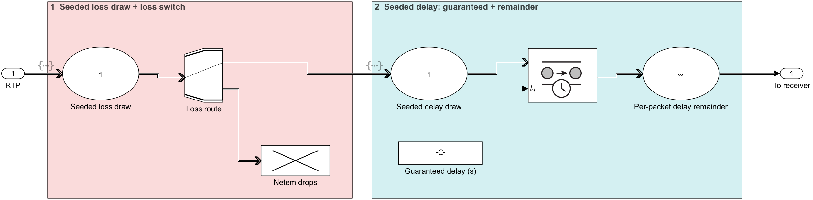

!!! example "Cách đọc hình"
    **Lần theo một packet qua `Channel` (`SOURCE`: `build_cn_simevents_v2.m`):**
    1. **Vùng 1 (`1 Seeded loss draw + loss switch`):** Gói đi vào `Seeded loss draw` (`0 s`). Khối gọi `cnse2_runtime('lossDraw', entity)` (dùng stream `seed + 200`), ghi lại thời điểm rời serializer vào `entity.sentAt`, bốc thăm mất gói (nếu gói dài vượt `1480 B` như trong bài T5 `3000 B`, vòng lặp bốc thăm một lần cho mỗi mảnh IP ước lượng!), và gán `route = 2` nếu rớt hoặc `route = 1` nếu sống. Công tắc `Loss route` đẩy gói rớt xuống `Netem drops` (Terminator), cho gói sống đi sang Vùng 2.
    2. **Vùng 2 (`2 Seeded delay: guaranteed + remainder`):**
       - `Seeded delay draw` (`0 s`) bốc tổng thời gian trễ thuận `d` từ `course.Delay` (`seed + 300`) và lưu vào `entity.forwardDelay`.
       - `Entity Transport Delay` cộng với hằng số `Guaranteed delay (s)` (`c.transportBase + c.transportFloor`) đảm bảo phần trễ tối thiểu chắc chắn có (ví dụ khi `jitter = 0` thì giữ đúng `c.delay`, khi `uniform` thì giữ `max(0, c.delay - c.jitter)`).
       - `Per-packet delay remainder` là một Entity Server có **dung lượng `∞` (vô hạn)**, giữ gói nốt phần thời gian dư `max(0, entity.forwardDelay - (t - entity.sentAt))`, rồi đưa sang `To receiver`.

    **Phân biệt cực kỳ quan trọng khi bảo vệ:** Tại sao `Link serializer` ở B6 có **dung lượng `1`**, còn `Per-packet delay remainder` ở B7 lại có **dung lượng `∞`**? Vì ở `Serialization`, đường dây chỉ đẩy từng packet một nối đuôi nhau; còn khi đã lên mạng (sợi cáp quang / không khí / các hàng đợi mạng rộng lớn), **hàng chục packet có thể cùng đang bay trên đường tại cùng một thời điểm**! Nếu đặt dung lượng `1` ở đây, packet 2 sẽ phải chờ packet 1 đi hết cả `20 ms` đường mạng rồi mới được phép khởi hành — hoàn toàn sai vật lý mạng!

??? note "Đào sâu để bảo vệ: Xử lý phân mảnh IP trong `lossDraw` và tùy chọn `PreserveOrder`"
    Trích đoạn từ `sim/study_simevents_v2/cnse2_runtime.m` (dòng 68–72, **SOURCE**):

    ```matlab
    for k=1:size(s.c.lossSteps,1),if t>=s.c.lossSteps(k,1),p=s.c.lossSteps(k,2);end,end
    drop=false;for k=1:ceil((e.size+28)/1480),drop=s.L(p)||drop;end
    ```

    - `lossSteps` chính là cách Stage B tạo bước nhảy mất gói theo thời gian (ví dụ `[0 0; 15 0.15; 35 0]`: `0–15 s` mất `0%`, `15–35 s` mất `15%`, `35–50 s` quay lại `0%`).
    - Biểu thức `ceil((e.size+28)/1480)` giải thích tại sao trong thí nghiệm CN-T5, khi đặt payload `3000 B` vượt Ethernet MTU `1500 B`, một gói RTP bị chặt làm `3` mảnh IP (`ceil(3028/1480) = 3`), nên ở `loss = 2%` xác suất mất cả gói RTP tăng lên thành \(1 - 0.98^3 = 5.88\%\) (**CALCULATED**).
    - Với `PreserveOrder = false` (mặc định), một gói đi trước có thể bốc được `d = 35 ms` còn gói đi sau bốc được `d = 10 ms` → gói sau tới trước gói trước (**out-of-order / reordering**), đúng như `955–965` gói đảo thứ tự xuất hiện ở bảng `stage_A_results.csv` (`SIMULATED`)!

<p class="key">Channel tách riêng cơ chế mất gói (Bernoulli độc lập hoặc Gilbert–Elliott theo chùm) khỏi cơ chế trễ (Entity Transport Delay cộng server vô hạn dung lượng cho phép nhiều gói bay song song), dùng các RNG seed tách biệt để tái lập thí nghiệm công bằng.</p>

---

## B8. `Receiver` — Jitter RFC 3550, Hạn phát Playout và Ghép ảnh

Đây là khối quan trọng nhất đối với phần trình bày của **Mạnh** (và là câu hỏi trọng tâm của giảng viên khi bảo vệ CN). Máy nhận không chỉ đứng hứng gói tin; nó phải trả lời đồng thời bốn câu hỏi: *Mạng có đang giật cục không (jitter)? Gói này có tới kịp giờ để đưa cho AI không (playout deadline)? Đã đủ tất cả mảnh của bức ảnh này chưa (reassembly)? Và đến hẹn 1 giây thì gửi báo cáo gì ngược về máy phát (RTCP RR)?*

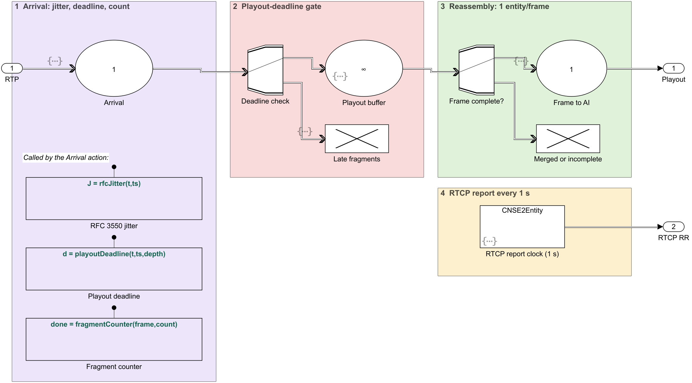

Hãy đi từng bước qua ba công thức cốt lõi bên trong `Arrival` rồi xem cách hai công tắc phía sau phối hợp với nhau.

### B8.1. RFC 3550 Jitter — Đo độ giật cục khi gói đến không đều

#### Tại sao độ trễ trung bình 20 ms chưa nói lên điều gì về jitter?

Giả sử bạn hẹn một người bạn đi xe buýt tới chỗ làm việc mỗi sáng, chuyến xe xuất phát đều đặn cách nhau đúng **66,67 ms** (trong thế giới gói tin).
- Nếu chuyến nào cũng đi mất đúng `20 ms`, khoảng cách giữa hai chuyến xe lúc tới nơi **vẫn đều tăm tắp 66,67 ms** → độ giật cục (**jitter**) bằng `0 ms`!
- Ngược lại, nếu chuyến 1 mất `20 ms`, chuyến 2 kẹt xe mất `35 ms`, chuyến 3 thông thoáng chỉ mất `15 ms`, thì khoảng cách lúc tới bến bị **co giãn thất thường** lúc `81,67 ms`, lúc `46,67 ms`. Chính sự **biến thiên khoảng cách tương đối** này mới là **jitter** — hoàn toàn khác với độ trễ trung bình!

#### Ví dụ trực quan trước công thức: đo độ lệch thời gian giữa hai gói liên tiếp

Hãy nhìn trục thời gian dưới đây: Máy phát chụp Frame 1 tại `0 ms` (`TS_1 = 0`) và Frame 2 tại `66,67 ms` (`TS_2 = 6000` tick ở 90 kHz).
- Gói của Frame 1 đi mất `20 ms`, nên tới máy nhận lúc `t_1 = 20,00 ms`.
- Nếu mạng ổn định, gói của Frame 2 phải tới sau đúng `66,67 ms` tức lúc `86,67 ms`. Nhưng vì mạng bị trễ thêm `10 ms`, nó lại tới lúc `t_2 = 96,67 ms`.

```
Thời điểm phát (media time):   [Frame 1: 0 ms] ──── ΔTS = 66,67 ms ────► [Frame 2: 66,67 ms]
                                      │ (+20 ms trễ)                            │ (+30 ms trễ)
Thời điểm nhận (arrival):             ▼                                         ▼
                               [t₁ = 20,00 ms] ────── Δt = 76,67 ms ─────► [t₂ = 96,67 ms]
                                                                          Chênh lệch |D| = 10,00 ms!
```

Khoảng cách giữa hai lần **nhận** (`76,67 ms`) trừ đi khoảng cách giữa hai lần **phát** (`66,67 ms`) đúng bằng **10,00 ms** — đó chính là đại lượng sai lệch truyền dẫn \(D_k\)!

#### Công thức RFC 3550 và liên hệ với bộ lọc DSP

Trong hàm `rfcJitter(t, ts)` (`SOURCE`: `build_cn_simevents_v2.m`), mọi phép tính đều quy về đơn vị **tick 90 kHz** (`1 ms = 90 tick`):

\[
\Delta TS_k = (TS_k - TS_{k-1})_{\text{signed 32-bit}},\qquad D_k = 90000 \cdot (t_k - t_{k-1}) - \Delta TS_k
\]

\[
J_k = J_{k-1} + \frac{|D_k| - J_{k-1}}{16} = \frac{15}{16} J_{k-1} + \frac{1}{16} |D_k|
\]

\[
J_{\text{ms},k} = \frac{1000 \cdot J_k}{90000}
\]

Trong đó:
- \(t_k, t_{k-1}\) là thời điểm gói thứ \(k\) và \(k-1\) tới máy nhận (giây).
- \(TS_k, TS_{k-1}\) là trường `rtpTimestamp` của hai gói (tick 90 kHz).
- \(D_k\) là độ chênh lệch thời gian truyền dẫn giữa hai gói liên tiếp (tick).
- \(J_k\) là ước lượng jitter làm mượt theo chuẩn RFC 3550 mục 6.4.1 (tick), còn \(J_{\text{ms},k}\) là giá trị quy đổi sang mili-giây.

Bạn đã từng gặp công thức \(J_k = \frac{15}{16} J_{k-1} + \frac{1}{16} |D_k|\) trong môn **Xử lý tín hiệu số (DSP)**: đây chính xác là một **bộ lọc thông thấp IIR bậc một (làm mượt hàm mũ)**! Nó giữ lại **15/16** giá trị lịch sử và chỉ tin **1/16** biến động đột ngột của gói mới nhất, giúp con số jitter không bị nhảy dựng lên chỉ vì một gói đơn lẻ bị lag nhẹ.

#### Bài tập có lời giải: tính từng bước từ ví dụ |D| = 10 ms

Giả sử \(J_0 = 0\) và các gói liên tiếp đều có sai lệch truyền dẫn không đổi \(|D_k| = 10\text{ ms} = 900\text{ tick}\) (**CALCULATED**):
1. **Sau gói thứ 2 (\(k = 1\) lần cập nhật):**
   \[
   J_1 = 0 + \frac{900 - 0}{16} = 56.25\text{ tick} \implies J_{\text{ms},1} = \frac{1000 \times 56.25}{90000} = 0.625\text{ ms}.
   \]
2. **Sau gói thứ 3 (\(k = 2\) lần cập nhật):**
   \[
   J_2 = 56.25 + \frac{900 - 56.25}{16} = 56.25 + 52.734 = 108.984\text{ tick} \implies J_{\text{ms},2} \approx 1.211\text{ ms}.
   \]

*Lưu ý cực hay bị hỏi vặn:* Với nhiều gói thuộc **cùng một bức ảnh**, chúng có cùng `rtpTimestamp` (\(\Delta TS_k = 0\)), nhưng vẫn tới cách nhau ít nhất một khoảng `T_ser`! Do đó chính khoảng cách đến giữa các mảnh cùng frame cũng góp một chút vào `D_k` (đó là lý do ngay cả khi tắt hoàn toàn jitter kênh truyền trong `A_no_loss`, giá trị đo vẫn khoảng `0,133 ms` chứ không phải `0`!). Và **tuyệt đối không đọc `jitterMs` như là độ trễ truyền một chiều (one-way delay)!**

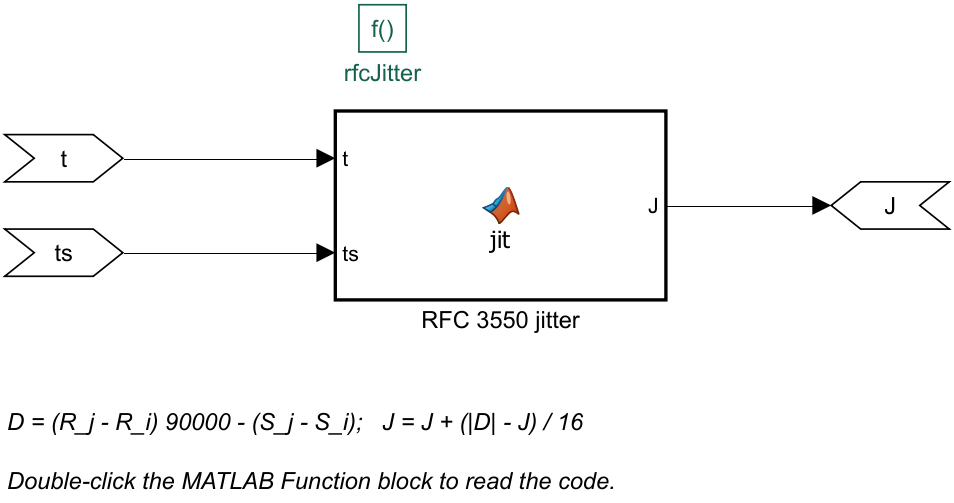

#### Thử nghiệm tương tác: Đáp ứng bộ lọc jitter RFC 3550

Trước khi thử, hãy dự đoán: **Với sai lệch cố định `|D| = 10 ms`, sau 16 gói thì `J` đã tiến tới `10 ms` chưa, hay vẫn còn thấp hơn đáng kể?**

<div class="widget" data-widget="jitter" data-title="Thử: đáp ứng bộ lọc jitter RFC 3550"></div>

*Diễn giải:* Sau `1` gói, `J = 0,625 ms`; sau `16` gói (bằng hằng số thời gian \(\tau \approx 16\) gói của bộ lọc), `J` mới đạt `~6,44 ms` (`1 - (15/16)^16 ≈ 64,4%` giá trị ổn định), và sau `64` gói mới đạt `~9,84 ms`.

---

### B8.2. Playout Deadline — Vì sao không đặt hạn phát bằng `giờ đến + buffer`?

#### Tại sao máy nhận không thể đợi mãi, nhưng cũng không được thả ảnh ngay khi vừa ghép xong?

Nếu thiếu một mảnh, máy nhận không thể ngồi đợi đến vô tận được — vì camera vẫn đang chụp các bức ảnh mới phía sau. Ngược lại, nếu vừa ghép xong một bức ảnh là ném ngay sang AI, bức ảnh đến sớm thì chạy vội, bức ảnh đến muộn một chút lại dồn sát bức tiếp theo — toàn bộ sự giật cục của mạng sẽ truyền thẳng sang bên tiêu thụ.

Vì vậy máy nhận đặt ra một **Playout buffer (bộ đệm phát đúng hạn)** với độ sâu \(B\) (ví dụ `50 ms` hoặc `100 ms`), giữ mỗi bức ảnh đến một mốc giờ chốt cố định gọi là **deadline (hạn phát)**. **Sai lầm kinh điển nhất của người mới học** là nghĩ: *"Cứ hễ gói của Frame \(i\) tới lúc \(t_{\text{arrival},i}\) thì hẹn phát nó ở \(t_{\text{arrival},i} + B\)."* Nếu làm vậy, Frame 2 tới muộn `30 ms` sẽ có deadline cũng dời muộn theo `30 ms`, tức là chẳng khác nào copy nguyên độ giật cục của mạng sang ngõ ra!

#### Hiểu bằng ví dụ đơn giản: neo vào gói đầu tiên, rồi bám theo nhịp chụp gốc

Thay vì bám theo giờ đến thất thường của từng gói sau, máy nhận chỉ lấy **gói đầu tiên từng nhận được** làm **mốc neo thời gian (`anchor`)**, rồi dùng hiệu `rtpTimestamp` (tức nhịp chụp gốc đều đặn `66,67 ms` ở 15 FPS) để tính toàn bộ lịch phát tương lai:

\[
d_i = t_{\text{anchor}} + \frac{(TS_i - TS_0)_{\text{signed 32-bit}}}{90000} + B
\]

Trong đó:
- \(t_{\text{anchor}}\) là thời điểm gói *đầu tiên* tới máy nhận (giây).
- \(TS_0\) là `rtpTimestamp` của gói đầu tiên đó.
- \(TS_i\) là `rtpTimestamp` của frame thứ \(i\).
- \(B\) là độ sâu bộ đệm (`playoutDepth`, giây — ví dụ `0.05 s = 50 ms`).

#### Bài tập có lời giải: lập bảng lịch phát cho 3 frame liên tiếp

Giả sử tốc độ chụp là **15 FPS** (khoảng cách giữa hai frame là `66,67 ms`), gói đầu tiên của Frame 1 (`TS_0 = 0`) tới lúc **`20 ms`**, và bộ đệm có độ sâu **`B = 50 ms`** (**Ví dụ minh họa / CALCULATED**):

| Frame | Nhịp chụp gốc \((TS_i - TS_0)/90000\) | Giờ gói tới thực tế (giả sử biến động) | **Deadline đúng** \(d_i = t_{\text{anchor}} + \frac{\Delta TS_i}{90000} + B\) | Kết luận |
|---:|---:|---:|---:|---|
| Frame 1 | `0 ms` | `20,00 ms` (mốc neo) | \(20 + 0 + 50 = \mathbf{70.00\text{ ms}}\) | Đúng hạn (chờ `50 ms` rồi phát) |
| Frame 2 | `66,67 ms` | `100,00 ms` *(trễ mạng thêm `13,33 ms`)* | \(20 + 66.67 + 50 = \mathbf{136.67\text{ ms}}\) | **Vẫn đúng hạn!** Chờ `36,67 ms` rồi phát đều đặn ở `136,67 ms` *(KHÔNG phải `150 ms`!)* |
| Frame 3 | `133,33 ms` | `210,00 ms` *(trễ mạng tới `56,67 ms`)* | \(20 + 133.33 + 50 = \mathbf{203.33\text{ ms}}\) | **QUÁ HẠN (Late)!** Đến sau `203,33 ms` → bị loại! |

Nhìn vào Frame 2: dù gói đến chậm hơn dự kiến tới `13,33 ms`, nhờ có quỹ đệm `B = 50 ms` nên nó vẫn kịp mốc `136,67 ms` và được phát ra **đúng nhịp 66,67 ms sau Frame 1**! Còn Frame 3 bị kẹt quá sâu (`56,67 ms` biến động > `50 ms` đệm), tới tận `210 ms` nên không còn kịp hẹn `203,33 ms`.

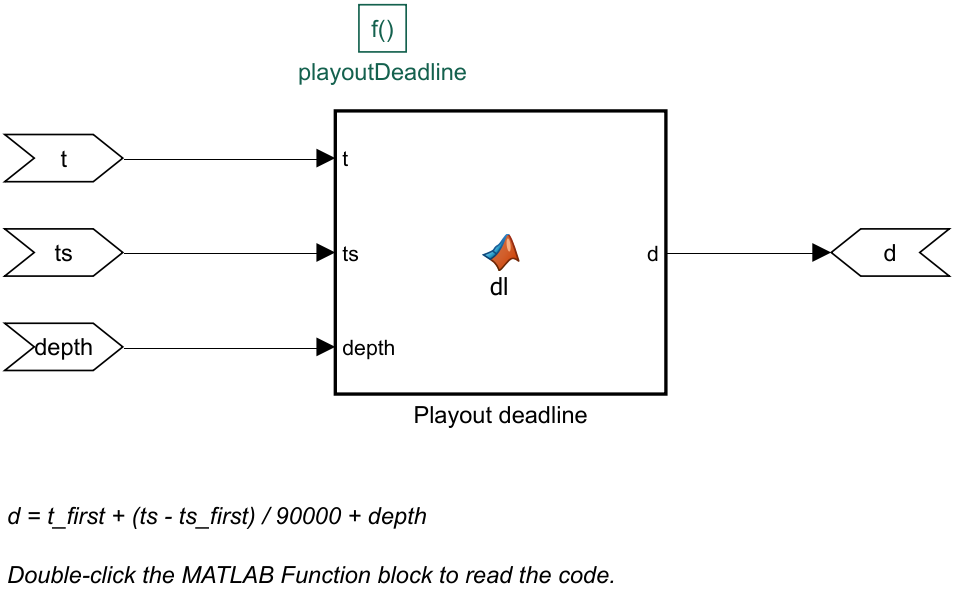

#### Thử nghiệm tương tác: Lịch đến và lịch phát dựa vào timestamp

Thử thay đổi `Độ sâu buffer B` từ `50 ms` xuống `20 ms` (giữ `Gói đầu tới lúc = 20 ms`, `15 FPS`) và kiểm tra xem deadline của Frame 2 và Frame 3 thay đổi ra sao:

<div class="widget" data-widget="deadline" data-title="Thử: lịch đến và hạn phát dựa vào timestamp"></div>

*Diễn giải:* Khi giảm `B` từ `50 ms` xuống `20 ms`, deadline của Frame 2 tụt từ `136,67 ms` xuống `106,67 ms`, nên chỉ cần gói bị trễ thêm hơn `20 ms` là lập tức rơi vào trạng thái quá hạn (giải thích tại sao trong thí nghiệm **CN-T4**, cấu hình `D20` bị tới `93,5%` frame muộn!).

---

### B8.3. Fragment Counter — Đếm đủ mảnh, và tại sao `marker == 1` chưa đủ để ghép ảnh

Khi các mảnh của cùng một frame lần lượt tới `Arrival`, làm sao hệ thống biết mảnh nào vừa giúp bức ảnh trở nên hoàn chỉnh? Hàm `fragmentCounter(frame, count)` (`SOURCE`: `build_cn_simevents_v2.m`) dùng một mảng đếm tĩnh `got` gồm `65.536` ô:
- Ánh xạ mã số frame vào chỉ số mảng: `k = mod(frame, 65536) + 1`.
- Mỗi khi một mảnh của frame đó tới đúng hạn (thực ra là ngay tại bước `Arrival`), tăng `got(k) = got(k) + 1`.
- Khi và chỉ khi `got(k) == count` (tức số mảnh đã tới bằng đúng tổng số mảnh `N` của frame), cờ `done` (gán vào `entity.complete`) bật lên **`1`** trên đúng mảnh đến sau cùng đó; tất cả `N - 1` mảnh đến trước đó đều mang `complete = 0`!


#### Thử nghiệm tương tác: Tắt một mảnh trong sáu mảnh

Trong widget dưới đây, hãy thử bấm tắt `P3` và bấm bật `P6 ★` (gói mang bit `marker = 1`), rồi quan sát cờ hoàn thành:

<div class="widget" data-widget="fragments" data-title="Thử: tắt một mảnh trong sáu mảnh và xem cờ hoàn thành"></div>

*Diễn giải:* Khi chỉ nhận `P1, P2, P4, P5, P6 ★` (`5/6`), cờ hoàn thành vẫn là `0`. Bắt buộc phải nhận đủ cả `6/6` mảnh thì cờ hoàn thành mới chuyển thành `1`.

---

### B8.4. Ghép nối trong `Receiver`: Cổng hạn phát và phát đúng 1 thực thể mỗi ảnh

Bây giờ hãy ghép hai công tắc ở Vùng 2 và Vùng 3 của `Receiver` lại với nhau:

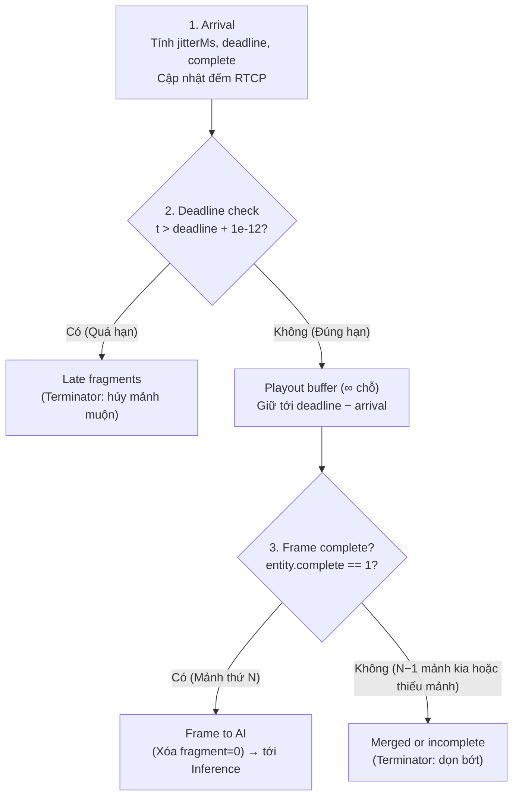

Hãy lần theo một frame `6` mảnh từ lúc vào `Receiver` cho tới khi ra `Playout`:
- **Trường hợp 1 (Thành công):** Cả 6 mảnh đều tới trước `deadline`. Năm mảnh đến trước có `complete = 0`, mảnh thứ 6 đến sau cùng có `complete = 1`. Tất cả 6 mảnh cùng ngồi chờ trong `Playout buffer` (`Capacity = Inf`) đúng tới thời điểm `deadline`. Ngay tại khoảnh khắc `deadline`, cả 6 mảnh đồng loạt ra khỏi buffer và đi qua công tắc `Frame complete?`: **chỉ duy nhất mảnh mang `complete = 1`** rẽ lên nhánh trên qua `Frame to AI` để đại diện cho cả bức ảnh đi tiếp vào `Inference`; `5` mảnh còn lại (`complete = 0`) rẽ xuống `Merged or incomplete` để tiêu hủy, tránh việc 1 bức ảnh biến thành 6 lần chạy AI!
- **Trường hợp 2 (Đủ mảnh nhưng muộn):** 5 mảnh đến đúng hạn, mảnh thứ 6 đến sau `deadline`. Khi mảnh thứ 6 tới `Arrival`, `fragmentCounter` có thể báo `got == 6` (`complete = 1`), nhưng ngay sau đó `Deadline check` thấy `t > deadline` nên ném thẳng mảnh thứ 6 vào `Late fragments`! Còn 5 mảnh trước khi hết giờ chờ ở `Playout buffer` đều có `complete = 0` nên cũng bị ném vào `Merged or incomplete`. Kết quả: **không có thực thể nào đi tới `Inference`**.

Điều kiện vàng để một frame có ích trong mô hình SimEvents là:

\[
\boxed{\text{Đủ tất cả mảnh (complete)} \quad \mathbf{VÀ} \quad \text{Mảnh cuối cùng đến trước hạn phát (on-time)}}
\]

??? note "Đào sâu để bảo vệ: Giới hạn của `fragmentCounter` và khác biệt `late window` ở Python"
    Trích đoạn ba hàm nội bộ tại `Receiver` trong `sim/study_simevents_v2/build_cn_simevents_v2.m` (**SOURCE**):
    - **Jitter (dòng 190–193):**
      ```matlab
      ds = mod(ts - lastTs + 2^31, 2^32) - 2^31;
      D = (t - last)*90000 - ds;
      Jt = Jt + (abs(D) - Jt)/16;
      ```
    - **Fragment counter (dòng 206–210):**
      ```matlab
      persistent got
      if isempty(got), got = zeros(1, 65536); end
      k = mod(frame, 65536) + 1;
      got(k) = got(k) + 1;
      done = double(got(k) == count);
      ```
    - **Hai hạn chế có chủ ý cần nói thẳng khi thầy hỏi:**
      1. `fragmentCounter` của SimEvents **không kiểm tra trùng gói (duplicate)**; nếu một gói bị nhân đôi, `got(k)` sẽ tăng hai lần (tuy nhiên trong mô hình kênh v2 không sinh duplicate, và hàm kiểm chứng `cnse2_validate.m` đối chiếu mỗi bước với `course.Depacketizer` vốn có kiểm tra duplicate — kết quả khớp 100% qua mọi bài chạy). Đồng thời bộ nhớ đếm quay vòng sau `65.536` frame (khoảng `72 phút` ở 15 FPS, thừa đủ cho các thí nghiệm `5–65 s`).
      2. **Khác với Python thật (`cn/rtp/rtp/playout.py`, `FrameReassembler` và `PlayoutBuffer`):** Python ghép mảnh bằng **byte offset thực tế** và từ điển theo `(ssrc, rtp_ts)` có chống trùng gói; đồng thời Python giữ các frame chưa xong thêm một khoảng `late_window_ms` (mặc định `1000 ms`) để phân biệt rạch ròi trạng thái **`late`** (ghép đủ sau deadline) với **`lost`** (mất hẳn), trong khi SimEvents v2 loại các mảnh muộn ngay tại `Deadline check`.

<p class="key">Receiver dùng RFC 3550 để làm mượt jitter (IIR 1/16), neo deadline vào gói đầu cộng khoảng timestamp media và depth B (không cộng vào giờ đến từng gói), và chỉ cho đúng 1 thực thể đại diện đi sang AI khi frame vừa đủ mảnh vừa đúng hạn.</p>

---

## B9. `Inference` — Hàng đợi AI và sự khác nhau giữa Latency và AoI

### Tại sao hai khâu có tốc độ xử lý bằng nhau lại cần đo bằng "độ tươi của thông tin"?

Sau khi ghép ảnh xong đúng hạn ở `Receiver`, bức ảnh bước vào bộ xử lý **Inference** (trong sản phẩm thật là mô hình MobileNetV2 nhận diện đối tượng). Khối `Inference` của SimEvents có cấu trúc gần như y hệt `Sender Queue`, chỉ khác ở chỗ thời gian phục vụ bây giờ mô phỏng **thời gian chạy AI (`c.samples(1)`)** — ví dụ `12,5 ms` ở máy mạnh hoặc `50 ms` khi cố tình thử nghiệm quá tải.

Nhưng điều thú vị nhất nằm ở cách đo hiệu quả của AI khi hệ thống quá tải (ví dụ chụp `30 FPS` = mỗi `33,33 ms` có một ảnh, mà AI chạy mất `50 ms` = tối đa chỉ xử lý được `20 ảnh/giây`). Dù ta dùng hàng đợi **FIFO** hay **Latest-value**, CPU vẫn chỉ chạy xong tối đa khoảng `20 kết quả/giây` — vậy **làm sao chứng minh được Latest-value tốt hơn FIFO vượt trội?**

Câu trả lời nằm ở sự khác biệt giữa **Latency (độ trễ của từng kết quả)** và **AoI — Age of Information (độ tuổi thông tin hiện tại)**.

### Hiểu bằng ví dụ đơn giản: Đường răng cưa AoI

!!! tip "Hình dung"
    Hãy tưởng tượng bạn là người vận hành đang nhìn lên màn hình hiển thị vị trí một chiếc xe đang chạy. Màn hình chỉ được cập nhật mỗi khi bộ AI gửi về một kết quả mới.
    - Giả sử bức ảnh chụp lúc `t = 0 ms` đi qua mạng, xếp hàng và chạy AI mất tổng cộng **150 ms**, nên tới `t = 150 ms` màn hình mới hiện kết quả của ảnh `0 ms`. Tại giây phút mới nhận kết quả đó, thông tin trên màn hình đã **già 150 ms**!
    - Trong suốt `100 ms` tiếp theo (từ `t = 150 ms` đến `t = 250 ms`), chưa có kết quả mới nào về tới nơi. Chiếc xe ngoài đời vẫn tiếp tục chạy, nhưng màn hình của bạn vẫn đứng yên ở bức ảnh chụp lúc `0 ms`. Vì vậy cứ mỗi mili-giây trôi qua, tuổi của thông tin bạn đang nắm **tăng đều 1 ms mỗi ms** (đường đi lên với độ dốc bằng `1`), cho đến `t = 249,9 ms` thì nó già tới `249,9 ms`.
    - Đúng lúc `t = 250 ms`, kết quả của bức ảnh chụp lúc `100 ms` (cũng mất `150 ms` xử lý) vừa về tới! Ngay lập tức, màn hình được làm mới và tuổi thông tin **rơi thẳng đứng** từ `250 ms` xuống còn `250 - 100 = 150 ms`!

Nếu vẽ đường tuổi thông tin theo thời gian, ta thu được một hình **răng cưa (sawtooth)**:

<svg viewBox="0 0 700 225" width="100%" style="max-width:700px;display:block;margin:1rem auto;" role="img" aria-label="Đồ thị răng cưa Age of Information A(t)">
  <line x1="65" y1="185" x2="660" y2="185" stroke="currentColor" stroke-width="1.5"/>
  <line x1="65" y1="20" x2="65" y2="185" stroke="currentColor" stroke-width="1.5"/>
  <text x="650" y="203" text-anchor="end" fill="currentColor" font-size="11">Thời gian t (ms)</text>
  <text x="58" y="28" text-anchor="end" fill="currentColor" font-size="11">A(t) (ms)</text>
  <line x1="65" y1="115" x2="640" y2="115" stroke="currentColor" stroke-opacity="0.25" stroke-dasharray="4 4"/>
  <text x="58" y="119" text-anchor="end" fill="currentColor" font-size="11">150</text>
  <line x1="65" y1="45" x2="640" y2="45" stroke="currentColor" stroke-opacity="0.25" stroke-dasharray="4 4"/>
  <text x="58" y="49" text-anchor="end" fill="currentColor" font-size="11">250</text>
  <text x="150" y="202" text-anchor="middle" fill="currentColor" font-size="11">150</text>
  <text x="300" y="202" text-anchor="middle" fill="currentColor" font-size="11">250</text>
  <text x="450" y="202" text-anchor="middle" fill="currentColor" font-size="11">350</text>
  <text x="600" y="202" text-anchor="middle" fill="currentColor" font-size="11">450</text>
  <polygon points="150,185 150,115 300,45 300,185" fill="rgba(20,184,166,0.14)"/>
  <polygon points="300,185 300,115 450,45 450,185" fill="rgba(20,184,166,0.08)"/>
  <polygon points="450,185 450,115 600,45 600,185" fill="rgba(20,184,166,0.14)"/>
  <polyline points="150,115 300,45 300,115 450,45 450,115 600,45 600,115" fill="none" stroke="#14B8A6" stroke-width="2.5"/>
  <circle cx="150" cy="115" r="4" fill="#F59E0B"/>
  <circle cx="300" cy="115" r="4" fill="#F59E0B"/>
  <circle cx="450" cy="115" r="4" fill="#F59E0B"/>
  <circle cx="600" cy="115" r="4" fill="#F59E0B"/>
  <text x="225" y="68" text-anchor="middle" fill="currentColor" font-size="11">Độ dốc = 1</text>
  <text x="375" y="152" text-anchor="middle" fill="#14B8A6" font-size="11" font-weight="700">Diện tích hình thang / 100 ms</text>
  <text x="375" y="168" text-anchor="middle" fill="#14B8A6" font-size="11" font-weight="700">= AoI trung bình = 200 ms</text>
</svg>

### Công thức Latency, AoI tức thời và AoI trung bình theo thời gian

1. **Latency (độ trễ của riêng kết quả thứ \(i\)):**
   \[
   L_i = t_{\mathrm{result},i} - t_{\mathrm{capture},i}
   \]
   Chỉ đo riêng từng bức ảnh hoàn thành được: nó mất bao lâu từ lúc chụp tới lúc AI trả kết quả. *(Nếu một bức ảnh bị rơi mất giữa đường, nó không có trong trung bình latency — nhưng nó lại làm răng cưa AoI tiếp tục leo cao mãi!)*.

2. **Age of Information tức thời \(A(t)\):**
   \[
   A(t) = t - u(t)
   \]
   Trong đó \(u(t)\) là thời điểm chụp (`capture`) của bức ảnh mới nhất đã có kết quả tính tới thời điểm \(t\).

3. **Mean AoI (tuổi thông tin trung bình theo thời gian trên cửa sổ \([T_0, T_1]\)):**
   \[
   \overline{A} = \frac{1}{T_1 - T_0} \int_{T_0}^{T_1} A(t)\,dt
   \]
   Đây chính là **diện tích dưới đường răng cưa chia cho tổng thời gian quan sát** (`SOURCE`: `sim/+course/aoi.m`).

#### Bài tập có lời giải: tính AoI trung bình từ diện tích hình thang

Trong ví dụ hình vẽ phía trên (**Ví dụ minh họa / CALCULATED**), các kết quả về đều đặn mỗi `T = 100 ms`, mỗi kết quả có latency `L = 150 ms`. Hãy tính Mean AoI trên một chu kỳ `[150 ms, 250 ms]`:
- Tại `t = 150 ms`, kết quả vừa tới nên \(A(150) = 150\text{ ms}\).
- Ngay trước `t = 250 ms`, tuổi đã tăng thêm `100 ms` thành \(A(250^-) = 250\text{ ms}\).
- Diện tích hình thang dưới đường răng cưa trong khoảng `100 ms`:
  \[
  \text{Diện tích} = \frac{150 + 250}{2} \times 100 = 200 \times 100 = 20{,}000\text{ ms}^2.
  \]
- Chia cho độ dài khoảng thời gian `100 ms`:
  \[
  \overline{A} = \frac{20{,}000}{100} = 200\text{ ms} = L + \frac{T}{2}.
  \]

#### Bài tập thực hành: kiểm tra bài toán quá tải hàng đợi AI trong Stage B

Trong thử nghiệm `B_queue_fifo` và `B_queue_latest` (`SOURCE`: `run_cn_simevents_v2_study.m`), camera chụp **`30 FPS`** (\(\lambda = 30\text{ frame/s}\), \(T_f = 33.33\text{ ms}\)), AI xử lý **`50 ms/frame`** (`c.samples = 0.05`, tức \(\mu = 20\text{ frame/s}\)), hàng đợi AI sức chứa **`8`**.
1. Tính hệ số tải \(\rho\) của hàng đợi AI.
2. Tại sao khi đổi từ `FIFO` sang `Latest-value`, số kết quả AI chạy được trong toàn bài `12 s` gần như không đổi (`248` vs `241` kết quả trong `stage_B_results.csv`), nhưng Mean AoI lại giảm mạnh từ **`516,87 ms`** xuống chỉ còn **`150,20 ms`** (`SIMULATED`)?

??? success "Xem đáp án và lời giải"
    1. **Hệ số tải (CALCULATED):** \(\rho = \lambda / \mu = 30 / 20 = 1.5 > 1\). Khâu AI bị quá tải có chủ ý.
    2. **Giải thích cơ chế:** Chính sách hàng đợi **không làm CPU hay mô hình AI chạy nhanh hơn** (`c.samples` vẫn là `50 ms`, nên cả hai đều chỉ trả về khoảng `20 kết quả/s`, nhịp `T = 50 ms`). Điểm khác biệt là: với **FIFO**, mỗi frame phải xếp hàng chờ sau `8` frame cũ suốt khoảng `400 ms` trước khi tới lượt chạy AI, nên kết quả trả ra mang thông tin cũ rích (`capture-to-result P50 ≈ 491,87 ms`, cộng thêm `T/2 = 25 ms` ra Mean AoI `~516,87 ms`). Với **Latest-value**, mọi frame chờ cũ đều bị thay bằng frame mới nhất vừa tới nên mỗi frame chỉ chờ tối đa phần còn lại của 1 lần chạy AI, kéo Mean AoI rơi xuống còn **`150,20 ms`**!

<div class="metric-row">
<div class="metric"><div class="m-label">Mean AoI — B_queue (SIMULATED)</div><div class="m-value">516,87 → 150,20 ms</div><div class="m-sub">FIFO → Latest-value (30 FPS, 50 ms AI)</div></div>
<div class="metric"><div class="m-label">Kết quả toàn chạy 12 s (SIMULATED)</div><div class="m-value">248 vs 241</div><div class="m-sub">thông lượng AI gần như giữ nguyên</div></div>
</div>

### Cơ chế này nằm ở đâu trong dự án?

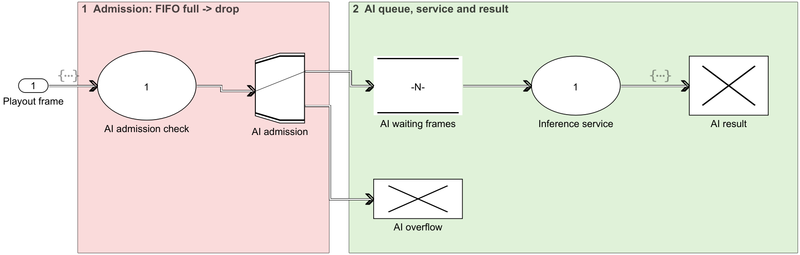

!!! example "Cách đọc hình"
    **Lần theo một frame hoàn chỉnh qua `Inference` (`SOURCE`: `build_cn_simevents_v2.m`):**
    1. Frame đại diện từ `Receiver` vào cổng `Playout frame`, qua **`AI admission check`** (gọi `admitAI`) và công tắc **`AI admission`**. Nếu đang dùng `'fifo'` mà `AI waiting frames` đã đủ `8` frame, frame mới bị loại xuống `AI overflow`.
    2. **`AI waiting frames`** giữ tối đa `8` frame (`fifo`) hoặc `1` frame có ghi đè `OverwriteOldest = 'on'` (`latest`).
    3. **`Inference service`** giữ frame đúng thời gian `c.samples(1)` (`12,5 ms` ở nền hoặc `50 ms` ở thí nghiệm T7/Stage B queue), rồi chuyển tới **`AI result`** (Terminator) để ghi nhận thời điểm hoàn thành `t_result` dùng cho phép tính latency và AoI.

### Thử nghiệm tương tác: Đồ thị AoI dạng răng cưa

Hãy thử tăng `Độ trễ mỗi kết quả` từ `150 ms` lên `450 ms` (tương ứng trường hợp FIFO bị kẹt hàng đợi) trong khi giữ `Chu kỳ có kết quả mới = 100 ms`: quan sát trục dọc và giá trị `AoI trung bình` thay đổi ra sao!

<div class="widget" data-widget="aoi" data-title="Thử: đồ thị AoI dạng răng cưa"></div>

*Diễn giải:* Toàn bộ răng cưa được nâng cao lên thêm `300 ms`, khiến `AoI trung bình` nhảy từ `200 ms` lên `500 ms` dù chu kỳ có kết quả mới (`100 ms`, tức thông lượng `10 kết quả/s`) hoàn toàn giữ nguyên.

??? note "Đào sâu để bảo vệ: Khi nào `aoi.m` trả về `NaN`?"
    Trích đoạn từ `sim/+course/aoi.m` (dòng 7–9, **SOURCE**):

    ```matlab
    idx=find(done<=start,1,'last');
    if isempty(idx), value=NaN; t=[]; age=[]; return; end
    fresh=max(capture(1:idx)); last=start; area=0; t=start; age=start-fresh;
    ```

    Nếu tính từ đầu mô phỏng đến hết thời gian khởi động `start` (`c.warmup`) mà **chưa có bất kỳ kết quả AI nào kịp hoàn thành** (`isempty(idx)`), ta không biết \(u(start)\) là gì để bắt đầu tích phân diện tích, nên `course.aoi` trả về **`NaN`** (không xác định) chứ không gán bằng `0`! Đây là lý do trong `stage_B_results.csv`, ô `aoi_ms` của `B_bottleneck0` (mạng `0,55 Mb/s`, Fixed, `0` kết quả) ghi là `NaN`.

<p class="key">Latency đo độ trễ của riêng từng kết quả trả về; Age of Information (AoI) là diện tích trung bình dưới đường răng cưa A(t) = t − u(t), phản ánh cả độ trễ lẫn khoảng trống giữa các lần cập nhật.</p>

---

## B10. `RTCP Reverse Path` — Làm thế nào máy phát biết mạng đang gặp sự cố?

### Tại sao máy phát bị "mù" nếu thiếu đường phản hồi ngược?

Hãy nhìn lại phía máy phát (`Frames` và `Sender Queue`): một khi máy phát đã ném các gói UDP vào `Channel`, giao thức UDP **không hề gửi lại xác nhận đã nhận**. Dù đường truyền phía trước có đang làm rơi `50%` số gói, máy phát vẫn cứ vô tư gửi tiếp như không có chuyện gì xảy ra — trừ khi đầu nhận (`Receiver`) chủ động gửi một tấm **"phiếu báo điểm"** quay ngược về báo tình hình.

Tuy nhiên, chính tấm phiếu báo điểm (**RTCP Receiver Report — RR**) này cũng phải đi qua mạng thật trên chiều ngược lại! Nó có **chu kỳ gửi cố định** (chậm hơn tốc độ frame), có **độ trễ truyền lan**, và thậm chí **có thể bị mất giữa đường**.

### Hiểu bằng ví dụ đơn giản: phiếu báo điểm mỗi giây một lần và phép lượng tử hóa 8 bit

Mỗi **1 giây** (`RTCP report clock (1 s)`), `Receiver` tổng kết tình hình gói tin đến trong 1 giây vừa qua:
- Trong kỳ báo cáo vừa rồi, dựa vào `seq` cao nhất nhận được so với kỳ trước, lẽ ra phải nhận \(\Delta N_{\text{expected}}\) gói, thực tế nhận được \(\Delta N_{\text{received}}\) gói.
- Chuẩn RFC 3550 không gửi số thực dấu phẩy động mà nén tỉ lệ mất gói trong kỳ vào **một số nguyên 8 bit** \(q \in \{0, 1, \dots, 255\}\) (gọi là `fraction_lost`, hiểu là tỉ lệ phần `256`):

\[
q = \min\!\left(255,\ \max\!\left(0,\ \left\lfloor 256 \cdot \frac{\Delta N_{\text{expected}} - \Delta N_{\text{received}}}{\Delta N_{\text{expected}}} \right\rfloor\right)\right)
\]

Sau đó khi báo cáo đi qua đường ngược tới nơi, bộ điều khiển máy phát chia ngược lại `q / 256` để khôi phục tỉ lệ mất gói.

#### Bài tập có lời giải: tính mã `q` và sai số lượng tử hóa

1. Giả sử phía phát đọc được `rr(2) = 38`. Tỉ lệ mất gói mà bộ điều khiển giải mã được là bao nhiêu? (**CALCULATED**)
   \[
   \frac{38}{256} = 0.1484375 \approx \mathbf{14.84\%}.
   \]
2. Giả sử trong 1 giây (15 FPS × ~6 gói/frame), kỳ vọng có \(\Delta N_{\text{expected}} = 90\text{ gói}\), nhưng chỉ nhận được \(\Delta N_{\text{received}} = 76\text{ gói}\) (mất `14` gói, tức tỉ lệ thực `14 / 90 = 15,56%`). Tính `q` gửi đi và giá trị giải mã được ở máy phát (**CALCULATED**):
   - Tính `q`: \(\left\lfloor 256 \times \frac{90 - 76}{90} \right\rfloor = \left\lfloor \frac{3584}{90} \right\rfloor = \lfloor 39.822 \rfloor = \mathbf{39}\).
   - Giải mã tại máy phát: \(39 / 256 \approx \mathbf{15.23\%}\). Vì `floor` làm tròn xuống thành số nguyên `0..255`, độ phân giải tối thiểu của mỗi nấc là `1 / 256 ≈ 0,39%`.

*Phân biệt cực kỳ quan trọng:* **`fraction_lost` (`rr(2)/256`) đo tỉ lệ mất trong 1 giây gần nhất**, khác hoàn toàn với **`cumulativeLost` (mất tích lũy từ đầu phiên)**. Chính nhờ dùng tỉ lệ mất *trong kỳ*, khi đường mạng từ xấu (`15%`) phục hồi về tốt (`0%`), `rr(2)` nhanh chóng tụt về `0` để AIMD bắt đầu tăng lại; nếu dùng mất tích lũy thì con số đó mãi mãi dương và AIMD sẽ không bao giờ phục hồi được!

### Cơ chế này nằm ở đâu trong dự án?

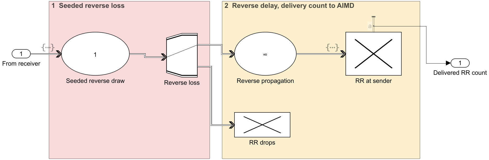

!!! example "Cách đọc hình"
    **Lần theo một báo cáo RR từ `Receiver` quay về `Observations` (`SOURCE`: `build_cn_simevents_v2.m` & `cnse2_runtime.m`):**
    1. Tại Vùng 4 của `Receiver`, đồng hồ **`RTCP report clock (1 s)`** (chưa phát ở `t = 0`, lần đầu phát lúc `t = 1 s`) gọi `cnse2_runtime('report')` tạo vector `rr` gồm 7 phần tử `[valid, fraction, jitterTicks, cumulativeLost, highestSequence, 0, 0]` (`valid = 1`).
    2. Thực thể RR đi qua cổng `From receiver` vào **`Seeded reverse draw`**: gọi `course.Loss` (`seed + 600`) và `course.Delay` (`seed + 700`, mặc định `reverseDelay = 10 ms`, `reverseJitter = 2 ms`, `reverseLoss = 0`).
    3. Công tắc **`Reverse loss`**: nếu mất báo cáo (`route = 2`), đẩy xuống **`RR drops`** (Terminator). Nếu sống (`route = 1`), đi vào **`Reverse propagation`** (Entity Server dung lượng `∞`, giữ đúng thuộc tính `reverseDelay`).
    4. Khi hết `reverseDelay`, thực thể RR chạm **`RR at sender`** (Terminator). Khối này bật `NumberEntitiesArrived = 'on'`, nên nó tự động đẩy con số tổng số RR đã tới nơi (dây nét đơn `a` ở phía trên) ra cổng **`Delivered RR count`** dẫn thẳng vào chân `received` của `Observations`, đồng thời hàm `feedback` xếp vector `entity.rr` vào hàng chờ `s.pending` để AIMD lấy dùng.

    **Hệ quả trong mô phỏng Stage B (`stage_B_results.csv`, `SIMULATED`):** Ở `B_reverse_all_lost` (`reverseLoss = 100%`, đường thuận mất `15%`), có `8` RR được gửi nhưng `0` RR tới đích → máy phát hoàn toàn không biết đường thuận đang mất gói, giữ nguyên `rate = 1.0`, chỉ đạt `32,4%` frame đúng hạn. Ngược lại ở `B_reverse_impaired` (`reverseLoss = 25%`, `reverseDelay = 50 ms`), có `5/8` RR sống sót về tới nơi → đủ kéo `rate` xuống `0.512` và nâng tỉ lệ đúng hạn lên `50,0%`!

??? note "Đào sâu để bảo vệ: Khác biệt cấu trúc RTCP giữa SimEvents và Python"
    Trích đoạn từ `sim/+course/ReceiverReport.m` (dòng 24–30, **SOURCE**):

    ```matlab
    if report && ~isnan(o.Highest)
        expected=o.Highest-o.Base+1;lost=expected-o.Received;
        ei=expected-o.ExpectedPrior;ri=o.Received-o.ReceivedPrior;
        fraction=0;if ei>0,fraction=min(255,max(0,floor(256*(ei-ri)/ei)));end
        rr=[1 fraction floor(o.JitterTicks) max(-2^23,min(2^23-1,lost)) o.Highest 0 0];
        o.ExpectedPrior=expected;o.ReceivedPrior=o.Received;
    end
    ```

    Trong sản phẩm Python (`cn/rtp/rtp/rtcp.py` và `receiver.py`), nhóm đóng gói nhị phân chuẩn RFC 3550 gồm `ReceiverReport` + `SDES` (Compound RTCP), có cả `lsr` và `dlsr` để tính RTT, và gửi kết quả AI bằng gói RTCP `APP` (`AIRS`). Còn trong SimEvents v2, nhằm cô lập cơ chế điều khiển mạng, RTCP RR được tối giản thành vector 7 số thực `rr` đi qua `RTCP Reverse Path` mà không tuần tự hóa byte nhị phân hay gửi `AIRS`.

<p class="key">RTCP Reverse Path mang từng báo cáo RR (tạo mỗi 1 s, mã hóa tỉ lệ mất gói trong kỳ bằng số nguyên q = floor(256·lost/expected)) đi qua kênh mất và trễ ngược riêng về máy phát. Mất RR làm máy phát mù trước sự cố đường thuận.</p>

---

## B11. `AIMD` Stateflow & Dashboard — Vòng lặp khép kín điều khiển kích thước ảnh

### Tại sao phải giảm thật nhanh khi nghẽn, nhưng tăng thật từ từ khi mạng tốt?

Khi thấy đường mạng bắt đầu mất nhiều gói, nếu bộ điều khiển chỉ nhích giảm từng chút một rất chậm, hàng nghìn gói tin tiếp tục đổ ra sẽ làm tắc nghẽn kéo dài và rớt hàng loạt bức ảnh. Ngược lại, khi mạng vừa mới hết nghẽn, nếu bộ điều khiển vội vàng tăng vọt kích thước ảnh lên lại như cũ ngay lập tức, nó rất dễ tự đạp mình rơi ngược vào trạng thái quá tải lần nữa!

Đó là triết lý kinh điển của **AIMD — Additive Increase, Multiplicative Decrease (tăng cộng, giảm nhân)**:
- **Khi thấy xấu:** **Giảm nhân** (nhân tỉ lệ với `0,8`, tức tụt hẳn `20%` mỗi nhịp báo cáo xấu).
- **Khi thấy sạch:** Phải kiên nhẫn chờ **đủ 3 báo cáo sạch liên tiếp** (`clean >= 3`, tức khoảng `3 giây`) mới **tăng cộng** thêm một bước nhỏ cố định **`+0,05`**.

### Luật thực tế bên trong Stateflow `AIMD` và tính tay từng bước


Nhìn thẳng vào hình chụp khối `AIMD` (`SOURCE`: `build_cn_simevents_v2.m`), biểu đồ Stateflow chỉ có đúng một trạng thái **`RUN`**. Khi khởi động (`entry:`), nó đặt `rate = 1` và `clean = 0`. Ở mỗi chu kỳ chạy (`during:`), khi có báo cáo hợp lệ mới (`rr(1) > 0`) và chế độ thích nghi đang bật (`enabled > 0`), nó kiểm tra tỉ lệ mất gói giải mã từ `rr(2)/256` theo bảng luật chính xác dưới đây:

| Điều kiện đầu vào (`rr(1) > 0 && enabled > 0`) | Hành động lên `rate` (giới hạn `[0.15, 1.5]`) | Hành động lên bộ đếm `clean` |
|---|---|---|
| **Mất cao:** `rr(2)/256 > 0.02` (`> 2%`) | \(r_{k+1} = \max(0.15,\ 0.8 \cdot r_k)\) (giảm 20%) | Xóa về `0` (`clean = 0`) |
| **Kênh sạch:** `rr(2)/256 <= 0.005` (`<= 0,5%`) | Tăng `clean` lên `1`. Nếu `clean >= 3`: \(r_{k+1} = \min(1.5,\ r_k + 0.05)\) | Nếu đạt `3` thì xóa về `0`; chưa đạt `3` thì giữ |
| **Vùng đệm giữa:** `0.005 < rr(2)/256 <= 0.02` | Giữ nguyên `rate` | Xóa về `0` (`clean = 0`) |
| **Không có RR mới (`rr(1) == 0`) hoặc tắt (`enabled == 0`)** | Giữ nguyên `rate` | Giữ nguyên `clean` |

#### Bài tập có lời giải: lần theo chuỗi báo cáo trong kịch bản Stage B (`B_adaptive1`)

Trong kịch bản loss-step của Stage B (`0–15 s` mất `0%`, `15–35 s` mất `15%`, `35–50 s` quay lại `0%`, `SOURCE`: `run_cn_simevents_v2_study.m`), hãy tính tay xem `rate` biến thiên thế nào qua ba giai đoạn (**CALCULATED**, khớp với `rateLog` của `B_adaptive1.mat` sẽ phân tích kỹ ở Session 2C):

1. **Giai đoạn mạng sạch đầu (`0–15 s`, `0%` loss):** `rate` bắt đầu ở `1.0`. Sau 3 RR sạch (`~3 s`), tăng thành `1.05`; sau 3 RR nữa (`~6 s`), thành `1.10`; cứ thế tới giây thứ `15` đạt `1.25`.
2. **Giai đoạn mất `15%` (`15–35 s`):** Tại giây `16` (`16.009 s`), RR mang loss `~15% > 2%` về tới. Từ `rate = 1.25`, các nhịp giảm nhân liên tiếp cho:
   \[
   1.25 \xrightarrow{\times 0.8} 1.00 \xrightarrow{\times 0.8} 0.80 \xrightarrow{\times 0.8} 0.64 \xrightarrow{\times 0.8} 0.512 \xrightarrow{\times 0.8} 0.4096 \rightarrow \dots \rightarrow \mathbf{0.15}
   \]
   Chỉ mất khoảng `10` nhịp báo cáo (`t ≈ 25 s`), `rate` đã chạm sàn `0.15`! *(Nếu bắt đầu từ `1.0` nhận 3 báo cáo xấu liên tiếp: `1 → 0.8 → 0.64 → 0.512`).*
3. **Giai đoạn phục hồi (`35–50 s`, `0%` loss):** Phải chờ 3 báo cáo sạch liên tiếp (tới giây `~38`) mới nhích được bước đầu `0.15 + 0.05 = 0.20`, giây `41` lên `0.25`, giây `44` lên `0.30`, giây `47` lên `0.35`. Kết thúc 50 giây, `rate` mới phục hồi được về **`0.35`** — minh họa rõ nét đặc tính **giảm rất nhanh, phục hồi rất chậm** của AIMD!

### Thử nghiệm tương tác: Gửi từng báo cáo RR theo luật Stateflow thực

Hãy tự thử kịch bản trên bằng widget dưới đây: chọn `15% loss`, bấm `Gửi 1 RR hợp lệ` **4 lần** rồi xem `Scale r`; sau đó đổi sang `0% loss` và bấm thêm **3 lần** để thấy bộ đếm `clean` hoạt động!

<div class="widget" data-widget="aimd" data-title="Thử: gửi từng báo cáo RR theo luật Stateflow thực"></div>

*Diễn giải:* `4` báo cáo `15% loss` đẩy `rate` tụt ngay từ `1.000 → 0.800 → 0.640 → 0.512 → 0.410`. Khi chuyển sang `0% loss`, 2 lần bấm đầu chỉ tăng `clean` lên `1/3`, `2/3` mà `rate` chưa nhúc nhích; tới lần bấm thứ 3 (`clean = 3`), `rate` mới tăng `+0.05` lên `0.460` và `clean` reset về `0/3`.

### B11.1. Hệ thống đa tốc độ (`1 kHz` vs `1 Hz`) và khối `Feedback tick`

Một câu hỏi cực hay khiến nhiều sinh viên lúng túng khi bảo vệ: *"Thầy thấy khối `RTCP report clock` chạy chu kỳ **`1 giây`** (`1 Hz`), còn khối `Observations` (`CNSE2Monitor`) và Stateflow `AIMD` lại chạy chu kỳ **`1 ms`** (`1 kHz`). Vậy khi mạng mất `15%`, tại sao `AIMD` không nhân `rate` với `0,8` một nghìn lần trong mỗi giây?!"*

Hãy lần theo cơ chế thực sự (`SOURCE`: `CNSE2Monitor.m` và `cnse2_runtime.m`, hàm `'poll'`):
1. Khi một báo cáo RR đi qua `RTCP Reverse Path` và chạm `RR at sender`, biến đếm `Delivered RR count` tăng lên `1` và vector `rr` đó được xếp vào danh sách chờ `s.pending`.
2. Ở chu kỳ `1 ms` hiện tại, `CNSE2Monitor` kiểm tra xem `Delivered RR count` có lớn hơn số báo cáo mình đã lấy trước đó (`s.sampledRR`) hay không. Nếu **có** báo cáo mới, nó lấy đúng 1 báo cáo ra (có `rr(1) = 1`) và tăng `s.sampledRR`. Trong **999 nhịp `1 ms` còn lại** của giây đó, không có báo cáo mới nào nên `poll` trả về vector toàn số không `[0; 0; 0; 0; 0; 0; 0]`.
3. Nhờ điều kiện gác cổng **`if rr(1) > 0 && enabled > 0`** ngay dòng đầu tiên của Stateflow `RUN`, ở 999 nhịp không có báo cáo mới, chart bỏ qua hoàn toàn không sửa `rate` hay `clean`!

Và ngay sau ngõ ra `rate` của `AIMD`, tại sao phải đặt khối **`Feedback tick`** (`Unit Delay` `1/z`, chu kỳ `0.001 s`, giá trị khởi đầu `InitialCondition = 1`)? Bởi vì trong Simulink/SimEvents, đường vòng từ `Observations` → `AIMD` → `Frames` và `AIMD` → `Observations` tạo thành một vòng lặp đại số khép kín tại cùng một thời điểm lấy mẫu; khối Unit Delay \(y[k] = x[k-1]\) giữ giá trị `rate` sang tick `1 ms` kế tiếp để phá vòng lặp đại số và đảm bảo tại `t = 0` hệ thống luôn khởi động sạch sẽ với `rate = 1`.

### B11.2. Khối `Observations` và năm tín hiệu trên `Dashboard`

Ngoài `rr` gửi cho `AIMD`, khối `Observations` (`CNSE2Monitor`) xuất ra vector `y` gồm **5 tín hiệu số** đi qua bộ tách `Scope signals` (Demux) vào `Dashboard` và lưu vào biến `out.dashboard` (`SOURCE`: `build_cn_simevents_v2.m` và `cnse2_runtime.m`, dòng 121–126):

| Kênh Dashboard | Tên tín hiệu trên sơ đồ | Cách tính trong `cnse2_runtime('poll')` (`SOURCE`) | Lưu ý không hiểu nhầm |
|---|---|---|---|
| Kênh 1 | `Target payload (Mb/s)` | `rate * fps * meanBytes * 8 / 1e6` | Là **tải ảnh mục tiêu** ở nguồn (chưa tính header, chưa trừ mất gói), **không phải** goodput thực nhận! |
| Kênh 2 | `Channel loss (fraction)` | `channelDropped / max(1, totalSent)` | Là **mất gói tích lũy từ đầu chạy**, khác với `rr(2)/256` (mất trong kỳ `1 s`) dùng để điều khiển AIMD. |
| Kênh 3 | `RFC jitter (ms)` | `s.jms` | Jitter RFC 3550 hiện tại tại `Receiver` (ms). |
| Kênh 4 | `Playout occupancy (frames)` | `s.playoutWaiting` | Số frame đã hoàn chỉnh đang nằm chờ tới deadline trong `Playout buffer`. |
| Kênh 5 | `AI-result AoI (ms)` | `1000 * (t - s.fresh)` (nếu chưa có kết quả nào thì `NaN`) | Độ tuổi thông tin tức thời tính đến kết quả AI mới nhất đã xong. |

### B11.3. Đối chiếu AIMD của SimEvents với AIMD trong ứng dụng Python thật

Đây là bảng đối chiếu bắt buộc phải tách bạch khi bảo vệ (theo `SOURCE`: `build_cn_simevents_v2.m` vs `cn/rtp/rtp/abr.py` và `sender.py`):

| Tiêu chí | SimEvents v2 (`AIMD` Stateflow) | Ứng dụng Python thật (`cn/rtp/rtp/abr.py`, `AimdController`) |
|---|---|---|
| **Biến điều khiển (Actuator)** | Hệ số byte chuẩn hóa `rate` \(\in [0.15, 1.5]\) (nhân trực tiếp số byte JPEG đại diện). | Bộ nén JPEG **`quality`** (mặc định sàn `20`, trần `95`) **VÀ** hệ số độ phân giải **`resolution_scale`** \(\in [0.5, 1.0]\). |
| **Ngưỡng giảm nhân** | `loss > 2%` (`rr(2)/256 > 0.02`): `rate * 0.8` (sàn `0.15`). | `fraction_lost > 5%` (`> 0.05 * 256`): `int(quality * 0.7)` (sàn `floor=20`) và `resolution_scale * 0.9` (sàn `0.5`). |
| **Ngưỡng tăng cộng** | `loss <= 0.5%` đủ `3` RR liên tiếp: `rate + 0.05` (trần `1.5`). | `fraction_lost < 1%` (`< 0.01 * 256`) đủ `3` RR liên tiếp: `quality + 5` (trần `ceiling=95`) và `resolution_scale + 0.05` (trần `1.0`). |
| **Kiểm tra jitter (Jitter guard)** | **Không có** — `jitter` không chặn bộ đếm `clean`. | **Có:** nếu jitter đang tăng mạnh (`jitter >= 1.5 * last_jitter` **VÀ** `jitter - last_jitter >= 90` tick = `1 ms`), reset `clean_reports = 0` và giữ nguyên cấu hình (`hold_jitter`). |
| **Bằng chứng hiện tại** | Đã có kết quả mô phỏng Stage B (`73,16% → 87,07%` đúng hạn, `SIMULATED`). | Đã cài đặt mã nguồn trong `sender.py`/`abr.py`, nhưng chiến dịch phần cứng **CN-T8** đầy đủ **chưa hoàn tất xác minh** (`UNKNOWN` / pending). |

Do khác cả ngưỡng, biến điều khiển lẫn cơ chế chặn theo jitter, **không được dùng widget AIMD của SimEvents để dự đoán chính xác từng con số chạy của `abr.py` trên Python**.

??? note "Đào sâu để bảo vệ: Mã lệnh Stateflow `RUN` và đối chiếu `AimdController` trong `cn/rtp/rtp/abr.py`"
    Trích đoạn nguyên văn hành động trạng thái `RUN` của chart `AIMD` trong `sim/study_simevents_v2/build_cn_simevents_v2.m` (dòng 298–301, **SOURCE**):

    ```matlab
    entry: rate=1;clean=0;
    during:
    if rr(1)>0 && enabled>0
     if rr(2)/256>0.02
      rate=max(0.15,0.8*rate);clean=0;
     elseif rr(2)/256<=0.005
      clean=clean+1;
      if clean>=3
       rate=min(1.5,rate+0.05);clean=0;
      end
     else
      clean=0;
     end
    end
    ```

    Và trích đoạn `AimdController.update()` từ `cn/rtp/rtp/abr.py` (dòng 48–66, **SOURCE**):

    ```python
    if fraction_lost > 0.05 * 256:
        self.clean_reports = 0
        self.quality = max(self.floor, int(self.quality * 0.7))
        self.resolution_scale = max(0.5, round(self.resolution_scale * 0.9, 3))
    elif fraction_lost < 0.01 * 256:
        if trend == "rising":
            self.clean_reports = 0
            action = "hold_jitter"
        else:
            self.clean_reports += 1
            if self.clean_reports >= 3:
                self.quality = min(self.ceiling, self.quality + 5)
                self.resolution_scale = min(1.0, round(self.resolution_scale + 0.05, 3))
                self.clean_reports = 0
    ```

    Mở rộng thêm khi thầy hỏi về **Stage B loss-step (`SIMULATED`)**: trong `stage_B_results.csv`, bật AIMD giúp tỉ lệ frame đúng hạn tăng từ **`73,16%`** lên **`87,07%`** (`+13,91` điểm phần trăm) và Mean AoI giảm từ **`147,70 ms`** xuống **`111,87 ms`** (`-24,3%`) dù tỉ lệ mất gói cấu hình của kênh vẫn giữ nguyên `15%`. Tại sao? Bởi vì thu nhỏ kích thước ảnh làm giảm số gói cần sống sót mỗi frame (ví dụ từ `6` gói xuống `2` gói), nâng xác suất ghép thành công \((1 - 0.15)^N\) từ `37,7%` lên `72,25%`! Chi tiết toàn bộ các thí nghiệm Stage B và T3–T7 bạn sẽ học ở [Session 2C](02-C-cn-evidence.md).

<div class="metric-row">
<div class="metric"><div class="m-label">On-time Stage B loss-step (SIMULATED)</div><div class="m-value">73,16% → 87,07%</div><div class="m-sub">+13,91 điểm phần trăm · Fixed → AIMD</div></div>
<div class="metric"><div class="m-label">Mean AoI Stage B loss-step (SIMULATED)</div><div class="m-value">147,70 → 111,87 ms</div><div class="m-sub">giảm 24,3% · P95 giữ 62,70 ms</div></div>
</div>

<p class="key">AIMD trong SimEvents là một trạng thái RUN chạy ở 1 kHz nhưng chỉ phản ứng khi có RR mới (rr(1) > 0): mất >2% nhân 0,8; mất <=0,5% đủ 3 lần cộng 0,05; khoảng giữa giữ nguyên và reset clean. Phản ứng giảm nhanh nhưng phục hồi chậm, và khác biệt rõ với luật quality/resolution + jitter guard của Python.</p>

---

## Trắc nghiệm

<div class="quiz" markdown>
<p class="quiz-q">1. Ở hệ số AIMD `r = 0.5`, một bức ảnh gốc `6.960 B` cần chia thành bao nhiêu gói RTP theo quy ước của SimEvents (payload `1.200 B/gói`)?</p>

- [ ] 6 gói
- [ ] 1 gói
- [x] 3 gói
- [ ] 3.480 gói

<div class="quiz-why" markdown>
**Đúng (`3 gói`):** Tại `r = 0.5`, kích thước bức ảnh giảm còn `round(0.5 × 6960) = 3480 B`. Chia cho `1200 B` được `2.9`, làm tròn lên (`ceil`) thành `3` gói (`1200 B`, `1200 B`, `1080 B`).

**Vì sao các lựa chọn khác sai:**
- *6 gói:* đó là số gói khi chưa giảm kích thước (`r = 1`).
- *1 gói:* chỉ đúng khi kích thước ảnh giảm xuống dưới `1200 B` (ví dụ tại sàn `r = 0.15`, ảnh còn `1044 B`).
- *3.480 gói:* `3.480` là số **byte** của ảnh sau khi nhân `0.5`, không phải số gói.
</div>
</div>

<div class="quiz" markdown>
<p class="quiz-q">2. Quan sát khối `Channel` dưới đây: tại sao `Per-packet delay remainder` lại đặt dung lượng bằng vô hạn (`∞`), trong khi `Link serializer` ở khối trước đặt dung lượng `1`?</p>


- [ ] Vì đường mạng có tốc độ bit (bitrate) vô hạn
- [x] Vì nhiều gói tin có thể cùng đang bay trên đường truyền tại một thời điểm
- [ ] Vì khối `Channel` không tạo ra độ trễ nào cả
- [ ] Vì mọi gói tin đều bị mất ở `Netem drops`

<div class="quiz-why" markdown>
**Đúng:** `Link serializer` (dung lượng `1`) mô hình việc card mạng chỉ đẩy được từng gói một nối đuôi nhau lên dây cáp; còn khi đã lên đường mạng (`Channel`), nhiều gói có thể cùng đang truyền lan song song trên đường đi, nên `Per-packet delay remainder` phải có dung lượng `∞` để các gói không bắt buộc phải chờ gói trước tới đích mới được phép bay.

**Vì sao các lựa chọn khác sai:**
- *Bitrate vô hạn:* tốc độ bit hữu hạn đã được mô hình hóa ở khối `Serialization` ngay phía trước rồi.
- *Không có độ trễ:* `Seeded delay draw` và hai khối tiếp theo chính là nơi tạo trễ truyền lan `forwardDelay`.
- *Mọi gói đều mất:* công tắc `Loss route` chỉ đưa các gói bị rớt xuống `Netem drops`, còn các gói sống sót vẫn đi qua vùng 2.
</div>
</div>

<div class="quiz" markdown>
<p class="quiz-q">3. Quan sát khối `Receiver` dưới đây: điều gì xảy ra nếu 5 mảnh đầu của một bức ảnh tới đúng hạn, còn mảnh thứ 6 (mang `marker = 1`) tới ngay sau `deadline`?</p>


- [ ] Cờ `marker = 1` tự động bảo đảm bức ảnh vẫn được tính là đúng hạn và đưa sang AI
- [x] Mảnh thứ 6 làm bộ đếm thấy đủ mảnh, nhưng nó bị `Deadline check` đẩy sang `Late fragments` nên bức ảnh không đi tới AI
- [ ] `Playout buffer` tự động dời deadline lùi lại để chờ mảnh thứ 6
- [ ] Jitter RFC 3550 lập tức trở về `0`

<div class="quiz-why" markdown>
**Đúng:** Mảnh thứ 6 tới sau `deadline` bị công tắc `Deadline check` chuyển xuống `Late fragments` (Terminator). Trong khi đó `5` mảnh trước ngồi trong `Playout buffer` đều mang `complete = 0`, nên khi hết giờ chờ chúng đi qua `Frame complete?` xuống `Merged or incomplete`. Kết quả là không có thực thể nào qua được `Frame to AI` — một frame trong SimEvents phải **vừa đủ mảnh vừa đúng hạn**.

**Vì sao các lựa chọn khác sai:**
- *Marker bảo đảm đúng hạn:* `marker` chỉ đánh dấu mảnh cuối của frame, không kiểm tra giờ đến và cũng không chứng minh 5 mảnh trước đã tới.
- *Playout buffer dời deadline:* `playoutDeadline` neo theo gói đầu tiên cộng `delta_TS/90000 + depth`, không tự dời theo gói muộn.
- *Jitter về 0:* gói tới muộn làm tăng độ lệch `|D|` và làm jitter tăng lên chứ không về `0`.
</div>
</div>

<div class="quiz" markdown>
<p class="quiz-q">4. Stateflow `AIMD` chạy lấy mẫu mỗi `1 ms` (1.000 lần/giây), trong khi báo cáo RTCP RR chỉ được sinh mỗi `1 s`. Vì sao khi mạng mất `15%`, hệ số `rate` không bị nhân với `0,8` tới `1.000` lần trong một giây?</p>


- [ ] Vì đồng hồ RTP 90 kHz khóa cứng tốc độ `rate`
- [x] Vì `Observations` chỉ cấp một vector `rr` có `rr(1) > 0` đúng vào tick có báo cáo mới tới, còn các tick khác trả `0`
- [ ] Vì Stateflow tự động tắt mỗi khi `rate < 1`
- [ ] Vì AIMD không dùng thông tin mất gói trong báo cáo RR

<div class="quiz-why" markdown>
**Đúng:** Hàm `cnse2_runtime('poll')` chỉ lấy một báo cáo mới khi số báo cáo nhận được `Delivered RR count` tăng lên; ở `999` nhịp `1 ms` còn lại trong giây đó, nó trả về vector `zeros(7, 1)` (`rr(1) = 0`), nên nhánh điều kiện `if rr(1) > 0 && enabled > 0` chặn việc cập nhật lặp lại báo cáo cũ.

**Vì sao các lựa chọn khác sai:**
- *Đồng hồ 90 kHz:* `90 kHz` là tần số đếm của `rtpTimestamp` ở `RTP Packetizer`, không điều khiển chu kỳ Stateflow.
- *Tự tắt khi `rate < 1`:* `rate` có thể giảm tiếp xuống sàn `0,15`.
- *Không dùng mất gói:* AIMD đọc trực tiếp `rr(2)/256` để quyết định tăng hay giảm `rate`.
</div>
</div>

<div class="quiz" markdown>
<p class="quiz-q">5. Trong hai thí nghiệm quá tải hàng đợi (`Inference` nhận `30 FPS` và xử lý `50 ms/frame`), vì sao đổi từ `FIFO` sang `Latest-value` lại giảm mạnh Mean AoI dù số kết quả AI mỗi giây gần như không đổi?</p>

- [ ] Vì `Latest-value` ép CPU chạy mô hình AI nhanh gấp ba lần
- [x] Vì `Latest-value` bỏ các frame cũ đang xếp hàng để xử lý frame mới nhất vừa tới, nên kết quả trả ra ít bị lỗi thời hơn
- [ ] Vì `Latest-value` làm mạng ngừng mất gói
- [ ] Vì `Latest-value` bỏ qua bước chờ trong `Playout buffer`

<div class="quiz-why" markdown>
**Đúng:** Năng lực xử lý của `Inference service` vẫn cố định ở `1 / 0,05 = 20 frame/s`, nên thông lượng kết quả/giây gần như không đổi. Tuy nhiên thay vì bắt frame ngồi chờ sau `8` frame cũ suốt hơn `400 ms` như FIFO, `Latest-value` thay thế frame chờ cũ bằng frame mới nhất, giúp `Capture-to-result` và độ tuổi thông tin AoI giảm mạnh.

**Vì sao các lựa chọn khác sai:**
- *CPU nhanh gấp ba:* chính sách hàng đợi không đổi thời gian suy luận `c.samples`.
- *Ngừng mất gói:* `Inference` nằm sau `Channel` và `Receiver`, không sửa được mất gói trên mạng.
- *Bỏ qua `Playout buffer`:* `Playout buffer` nằm trong `Receiver` trước khi tới `Inference`.
</div>
</div>

---

## Câu thầy có thể hỏi

??? question "Nếu thầy hỏi: 'Em giải thích giúp thầy tại sao ở máy phát đã có hàng đợi, sang máy nhận lại có thêm Playout buffer rồi lại thêm hàng đợi AI — sao lắm hàng đợi thế, không gộp làm một được à?'"
    Thưa thầy, ba bộ đệm đó nằm ở **ba vị trí khác nhau** và giải quyết **ba bài toán hoàn toàn khác nhau** nên không thể gộp làm một được ạ:
    1. **`Sender Queue` (phía phát, trước Packetizer):** giữ các bức ảnh mới chụp nếu bộ đóng gói/gửi của máy phát tạm thời xử lý chưa kịp (`c.senderService`).
    2. **`Playout buffer` (phía nhận, bên trong Receiver):** có mục tiêu **chủ động chờ** cho tới mốc `deadline = t_anchor + ΔTS/90000 + B` để gom đủ các mảnh của một bức ảnh và triệt tiêu dao động trễ (**jitter**) của mạng, biến dòng đến thất thường thành nhịp phát đều đặn.
    3. **`AI waiting frames` (phía nhận, trước Inference):** giải quyết bài toán **quá tải tính toán** khi tốc độ ảnh đã ghép xong vượt quá tốc độ suy luận AI (\(\lambda > \mu\)); lúc này chính sách **Latest-value** bỏ ảnh cũ đang chờ để AI luôn làm việc trên ảnh mới nhất, giữ cho Mean AoI thấp.

??? question "Nếu thầy hỏi: 'Nếu chỉ nhận được gói có cờ `marker = 1` và các mảnh sau của một frame, máy nhận có ghép được ảnh không? Và nếu ghép đủ 6 mảnh nhưng sau `deadline`, SimEvents v2 xử lý thế nào?'"
    Thưa thầy, câu trả lời đều là **không được tính thành công** ạ. Thứ nhất, cờ `marker = 1` chỉ cho biết gói đó là mảnh cuối cùng (`k == count`), hoàn toàn không đảm bảo các mảnh trước đó đã tới nơi — `fragmentCounter` phải đếm đủ `got(k) == count` (tất cả `6/6` mảnh ở ví dụ `6960 B`) thì cờ `complete` mới lên `1`. Thứ hai, nếu mảnh thứ 6 đến sau `deadline`, công tắc `Deadline check` trong SimEvents v2 chuyển thẳng nó sang `Late fragments` để loại bỏ, còn `5` mảnh nằm sẵn trong `Playout buffer` có `complete = 0` nên khi hết hạn chờ cũng đi ra nhánh `Merged or incomplete`. Trong SimEvents v2, một frame muốn đi tiếp tới `Inference` bắt buộc phải thỏa mãn đồng thời **đủ mảnh VÀ đúng hạn**.

??? question "Nếu thầy hỏi: 'Tại sao bảng kết quả lại nói AIMD trong SimEvents làm tăng tỉ lệ frame đúng hạn dù xác suất mất gói của kênh vẫn là 15%? Bộ AIMD tự sửa được kênh truyền à?'"
    Thưa thầy, AIMD hoàn toàn **không sửa được kênh truyền** — xác suất mất từng gói `p = 15%` do `Channel` quy định vẫn giữ nguyên. Cơ chế giúp AIMD cứu được tỉ lệ frame đúng hạn là **giảm số lượng mảnh `N` phải sống sót cho mỗi bức ảnh**: vì một bức ảnh chỉ ghép thành công khi tất cả `N` mảnh đều sống sót với xác suất \((1 - p)^N\), nên ở `p = 15%`, một bức ảnh `6` mảnh chỉ có `0,85^6 ≈ 37,7%` cơ hội sống sót, nhưng khi AIMD giảm `rate` để thu nhỏ bức ảnh xuống còn `2` mảnh, xác suất sống sót nhảy vọt lên `0,85^2 = 72,25%`. Tuy nhiên, nhóm cũng ghi nhận rõ giới hạn của mô phỏng là **chưa đo độ chính xác nhận diện AI bị giảm bao nhiêu** khi kích thước ảnh bị thu nhỏ xuống mức đó.
