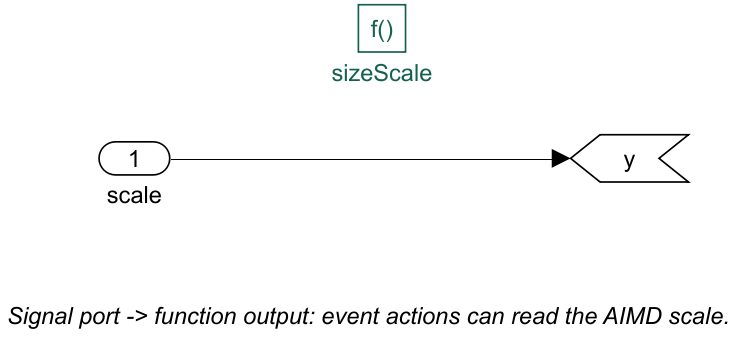
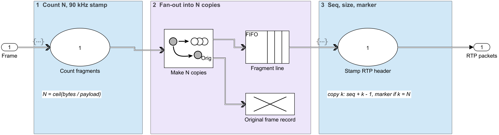
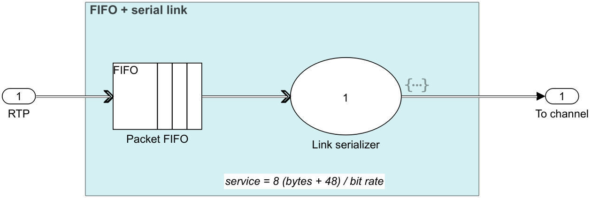
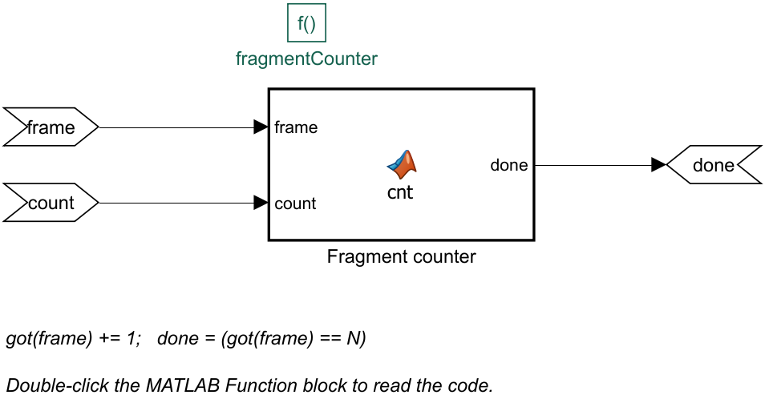
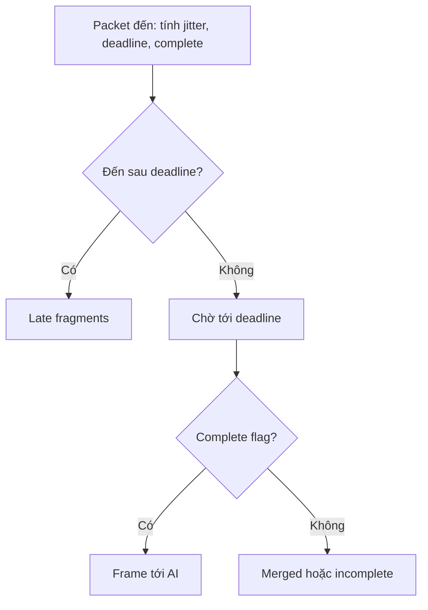
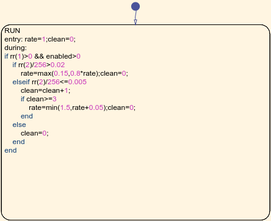

# Session 2 — B. Đi qua mô hình SimEvents v2 thực tế

Sau phần này, bạn lần theo được một frame qua mọi subsystem, tính số packet, thời gian truyền, jitter, deadline và giải thích vòng phản hồi AIMD. Các đoạn MATLAB dưới đây là phần logic thực trong [`sim/study_simevents_v2/build_cn_simevents_v2.m`](https://github.com/KaiserRichard/edge-ai-video-runtime/blob/main/sim/study_simevents_v2/build_cn_simevents_v2.m) và [`cnse2_runtime.m`](https://github.com/KaiserRichard/edge-ai-video-runtime/blob/main/sim/study_simevents_v2/cnse2_runtime.m); không phải toàn bộ chương trình. Các ví dụ số được tính từ tham số của bài hoặc ghi rõ là minh họa.

## B1. Top-level architecture (kiến trúc mức cao)


Ba vùng: xanh — RTP forward path: Frames → Sender Queue → RTP Packetizer → Serialization → Channel → Receiver → Inference; vàng — RTCP Reverse Path; tím — Observations, AIMD, Feedback tick và Dashboard. Từ receiver, RR về Observations để AIMD thay scale. Dây entity mang packet/report; dây signal mang số liệu như `rate`. Dashboard nhận các tín hiệu quan sát, không gửi packet ảnh.

## B2. CNSE2Entity — thông tin đi cùng entity

SOURCE: data dictionary `sim/generated/CN_simevents_v2.sldd`. Builder khai báo:

```matlab
names={'seq','rtpTimestamp','size','SSRC','frame','fragment','count','marker','capture',...
 'route','rr','reverseDelay','forwardDelay','sentAt','arrival','deadline','jitterMs','complete'};
```

Các trường kiểu double, `rr` là vector 1×7. Giống C struct: thay vì mang pixel, entity mang metadata cho các phép tính.

| Thuộc tính | Ý nghĩa |
|---|---|
| `frame`, `size`, `capture` | ID, số byte, thời điểm capture |
| `seq`, `rtpTimestamp`, `SSRC` | Sequence, media timestamp, nguồn |
| `fragment`, `count`, `marker` | Số thứ tự mảnh, tổng mảnh, cờ cuối |
| `sentAt`, `arrival`, `deadline` | Mốc gửi, nhận, hạn phát |
| `forwardDelay`, `reverseDelay` | Trễ kênh thuận/ngược |
| `jitterMs`, `complete` | Jitter và cờ hoàn thành |
| `route`, `rr` | Cổng ra và báo cáo RTCP |

## B3. Frames — nguồn ảnh mô phỏng


### B3.1. Frame clock

`Frame clock` sinh entity với khoảng cách `1/c.fps`. Stage B dùng 15 FPS, tức \(T_f=66.67\,\mathrm{ms}\) (CALCULATED).

### B3.2. Kích thước JPEG

SOURCE: [`cnse2_runtime.m`](https://github.com/KaiserRichard/edge-ai-video-runtime/blob/main/sim/study_simevents_v2/cnse2_runtime.m), action `frame`:

```matlab
s.frame=s.frame+1;n=floor(s.c.meanPackets)+(rand(s.cameraRng)<mod(s.c.meanPackets,1));
tail=.8*s.c.payload;
if isfinite(s.c.meanBytes),tail=s.c.meanBytes-(s.c.meanPackets-1)*s.c.payload;end
bytes=max(1,round(((n-1)*s.c.payload+min(s.c.payload,max(1,tail)))*rate));
```

Baseline T2 có 6.080 packet/frame. Mô hình chọn 6 với xác suất 92%, 7 với xác suất 8%. Dùng payload dữ liệu ảnh 1200 B, mảnh cuối 80% payload khi không đặt `meanBytes` hữu hạn. CALCULATED:

\[
S_6=5(1200)+0.8(1200)=6960\,\mathrm B,\quad S_7=8160\,\mathrm B.
\]

Đây là phân bố đại diện, không phải encoder JPEG.

### B3.3. AIMD size scale



Event action gọi `sizeScale()` để đọc giá trị signal. Với scale \(r\), kích thước mới gần bằng \(\operatorname{round}(r S)\). Mô hình giữ FPS, thay đổi số byte. Scale 0.8 không phải JPEG quality 80. Python thực tế thay quality và resolution; hai luật khác nhau (B11).

<div class="widget" data-widget="framesize" data-title="Scale AIMD → byte và số packet (mô hình)"></div>

### B3.4. Capture window

`Capture window open?` chỉ đưa frame hợp lệ sang sender. Sau thời gian capture, entity placeholder đi vào `After capture end`. Stage B loss-step: capture 50 s, drain 2 s; drain giúp packet còn trên đường hoàn thành mà không sinh thêm frame hợp lệ.

## B4. Sender Queue — producer và consumer


`Admission check` gọi `admitSender`; nếu FIFO đang có đủ `queueCapacity` frame chờ, chuyển sang `Sender overflow`. `Frame FIFO or latest` giữ frame chờ; `Sender processing` mô hình thời gian xử lý `c.senderService`.

```matlab
route=1;
if strcmp(s.c.policy,'fifo') && s.senderWaiting>=s.c.queueCapacity
 route=2;s.senderDrops=s.senderDrops+1;
end
```

| Policy | Sức chứa chờ trong bài Stage B | Khi đầy |
|---|---:|---|
| FIFO | 8 | Loại frame đến |
| Latest-value | 1 | Thay frame chờ cũ bằng frame mới |

Khối queue đặt `OverwriteOldest` on; admission chặn FIFO đầy nên overwrite chỉ là cơ chế cần cho latest. Frame đang được xử lý không bị ngắt. Baseline sender service bằng 0; bài test sender backlog đặt service khác 0.

<div class="widget" data-widget="queue" data-title="Producer–consumer: tốc độ sinh và tốc độ phục vụ"></div>

## B5. RTP Packetizer — một frame thành N packet



**Bước 1 — Count fragments.** \(N=\lceil S_f/L_p\rceil\). Với 6960 B, payload dữ liệu 1200 B, cần 6 packet. Timestamp là `mod(round(entity.capture*90000), 2^32)`, tức clock media 90 kHz. 15 FPS cho bước 6000 tick. Khối đặt SSRC 20261119, lưu `nextSeq` và dành N sequence liên tiếp.

**Bước 2 — Make N copies.** Entity Replicator dùng attribute `count`, bản gốc tới `Original frame record`, bản sao tới `Fragment line`.

**Bước 3 — Stamp RTP header.** Logic trong event action:

```matlab
entity.fragment = k;
entity.seq = mod(entity.seq + k - 1, 65536);
entity.size = min(payload, entity.size - (k-1)*payload);
entity.marker = double(k == entity.count);  % last fragment of the frame
```

Ví dụ CALCULATED: frame đầu, capture 0 s, timestamp 0 theo mô hình. 

| Packet | Seq | Fragment | Byte ảnh | Marker |
|---|---:|---:|---:|---:|
| P1 | 0 | 1 | 1200 | 0 |
| P2 | 1 | 2 | 1200 | 0 |
| P3 | 2 | 3 | 1200 | 0 |
| P4 | 3 | 4 | 1200 | 0 |
| P5 | 4 | 5 | 1200 | 0 |
| P6 | 5 | 6 | 960 | 1 |

Tất cả cùng timestamp. Marker không xác nhận mảnh trước đã đến. Python khác ở giới hạn payload và first fragment length (Session 1 B1).

## B6. Serialization — link có dung lượng hữu hạn



Entity Server chỉ phục vụ một packet tại một thời điểm, queue chờ phía trước. SOURCE: service action `dt = 8*(entity.size + 48)/linkBitRate;`. 48 B là overhead đơn giản hóa IPv4/UDP/RTP/custom fragment header trong mô hình.

\[
T_{ser}=\frac{8(S_p+48)}{C}.
\]

CALCULATED, với packet đủ 1200 B ảnh: 9984 bit. Tại 100 Mb/s: 0.09984 ms; tại 0.55 Mb/s: 18.15 ms. Sáu packet đầy tương ứng khoảng 0.599 ms hoặc 108.92 ms. Ví dụ sáu packet đầy khác frame 6960 B có mảnh cuối ngắn hơn. Nếu tốc độ tới vượt tốc độ truyền, backlog tăng dù không có mất gói.

<div class="widget" data-widget="serialization" data-title="Tính thời gian phát một packet"></div>

## B7. Channel — mất gói và trễ mạng


### B7.1. Seeded loss draw

`course.Loss` hỗ trợ Bernoulli (mất độc lập) và GE (mất theo trạng thái). GE của mô hình làm mất packet ở Bad, rồi chuyển trạng thái. `Netem drops` kết thúc entity bị loại. Seed cố định cho phép tái tạo nếu cấu hình và thứ tự gọi RNG giữ nguyên. Các stream camera, loss thuận, delay thuận, loss ngược, delay ngược dùng seed cộng lần lượt 100, 200, 300, 600, 700 (SOURCE: `cnse2_runtime` init).

### B7.2. Delay draw

SOURCE: `sim/+course/Delay.m`. Với normal hoặc uniform:

\[
d=\max(0,d_0+\sigma Z),\quad Z\sim\mathcal N(0,1)\ \text{hoặc}\ \mathcal U(-1,1).
\]

Ở cấu hình normal 20 ms base và 20 ms variation, giá trị âm bị chặn về 0; mean thực không nhất thiết bằng 20 ms. Uniform dùng variation làm biên độ, không phải độ lệch chuẩn. Có tùy chọn giữ thứ tự packet. `Entity Transport Delay` đảm bảo phần trễ tối thiểu (có floor); `Per-packet delay remainder` có capacity Inf, nhiều packet có thể đang di chuyển cùng lúc. Serializer khác: truyền tuần tự theo tốc độ link. Đừng cộng một lần transport delay vào thời gian phục vụ tuần tự cho tất cả packet.

## B8. Receiver — jitter, deadline và ghép ảnh


`Arrival` đọc thời gian, tính jitter, deadline và complete. Các switch chọn fragment đúng hạn, buffer giữ tới lịch phát, entity hoàn thành frame đi tiếp AI.

### B8.1. RFC 3550 jitter


Lấy hiệu timestamp có xử lý quay vòng 32 bit. Hiệu transit giữa hai lần nhận:

\[
D_k=90000(t_k-t_{k-1})-\Delta TS_k,\qquad
J_k=J_{k-1}+\frac{|D_k|-J_{k-1}}{16}.
\]

J tính bằng tick media; đổi ra ms qua \(1000J/90000\). Giống bộ lọc IIR bậc một trong DSP: giữ 15/16 giá trị cũ, lấy 1/16 biến thiên mới. Với \(|D|=10\,\mathrm{ms}\), khởi đầu 0, update đầu ra 0.625 ms (ví dụ CALCULATED). Nếu lặp input này, J tiến dần về 10 ms, không nhảy ngay. Mảnh cùng frame có cùng timestamp nên khoảng cách đến giữa chúng cũng đóng góp jitter. Không dùng J như one-way delay.

<div class="widget" data-widget="jitter" data-title="Đáp ứng bộ lọc jitter RFC 3550"></div>

### B8.2. Playout deadline


SOURCE: function `dl` trong builder. `anchor` và `ts0` được lưu tại packet đầu. `delta` là hiệu timestamp signed wrap. Với depth B:

\[
d_i=t_{anchor}+\frac{\Delta TS_i}{90000}+B.
\]

Ví dụ minh họa: frame rate 15 FPS, packet đầu đến 20 ms, B=50 ms. Deadline frame đầu 70 ms, frame thứ hai 136.67 ms, frame thứ ba 203.33 ms. Nếu frame thứ hai đến 100 ms thì không đặt deadline 150 ms; deadline phải theo lịch media ban đầu. Nhờ vậy playout không truyền nguyên độ bất thường của arrival sang consumer.

<div class="widget" data-widget="deadline" data-title="Lịch đến và lịch phát dựa vào timestamp"></div>

### B8.3. Fragment counter



Hàm `cnt` trong builder tạo `got=zeros(1,65536)`, lấy index `k = mod(frame,65536)+1`, tăng `got(k)` và đặt `done` bằng điều kiện `got(k)==count`. Frame 6 packet hoàn thành khi nhận mảnh thứ sáu. Mô hình không xử lý độc lập duplicate hoặc tái sử dụng slot sau 65536 frame ID; phù hợp các test hữu hạn không có các trường hợp này, không phải reassembler production. Python dùng byte offset và dữ liệu thật.

<div class="widget" data-widget="fragments" data-title="Thử mất một mảnh trong sáu mảnh"></div>

### B8.4. Deadline check và release

Builder dùng `entity.route = 1 + double(t > entity.deadline + 1e-12);` để chọn late branch. Fragment đúng hạn được giữ bởi `Playout buffer` tới `max(0,entity.deadline-entity.arrival)`. Ở cuối buffer chọn đường complete; entity đại diện frame hoàn thành mới tới Inference.



Phân biệt điều kiện complete và on-time. Một frame có thể đủ mảnh nhưng đã muộn. Python giữ frame muộn trong late window để phân loại `late` thay vì bỏ ngay như đường entity v2; không trình bày hai cách hiện thực là giống hệt.

## B9. Inference — xử lý và độ mới


Giống Sender Queue: admission → FIFO/latest → server → kết quả. Service time `c.samples(1)`. Bài Stage B queue test đặt 30 FPS, service 50 ms, queue capacity 8. CALCULATED: \(\lambda=30\), \(\mu=1/0.05=20\) frame/s, overload có chủ đích. Latest không nhanh hơn CPU, chỉ giảm thời gian chờ của thông tin được xử lý.

### B9.1. Latency khác AoI

\[
L_i=t_{result,i}-t_{capture,i},\qquad A(t)=t-u(t),
\]

với u(t) là capture time mới nhất của kết quả đã đến. Giữa các lần trả kết quả, tuổi tăng với dốc 1. Khi nhận kết quả mới hơn, tuổi giảm. Trung bình theo thời gian:

\[
\bar A=\frac{1}{T_1-T_0}\int_{T_0}^{T_1} A(t)\,dt.
\]

`sim/+course/aoi.m` tính diện tích dưới đường tuổi, không chỉ trung bình latency từng result. Nếu chưa có result tại đầu cửa sổ đo, trả NaN theo implementation. Không hiểu NaN là 0.

<div class="widget" data-widget="aoi" data-title="AoI dạng răng cưa"></div>

## B10. RTCP Reverse Path — báo cáo đến sender


RR tạo mỗi giây. Reverse loss có thể loại báo cáo; propagation làm trễ báo cáo sống. `RR at sender` ghi delivered feedback; `Delivered RR count` cung cấp số báo cáo tới monitor. Sender không biết trạng thái channel tức thời; nó dùng quan sát trễ và có thể thiếu.

SOURCE: `sim/+course/ReceiverReport.m` và runtime. Vector 7 trường `[valid, fraction, jitterTicks, cumulativeLost, highestSequence, 0, 0]`. Loss fraction trong kỳ là

\[
q=\left\lfloor 256\frac{\Delta N_{expected}-\Delta N_{received}}{\Delta N_{expected}}\right\rfloor
\]

khi mẫu số dương, chặn 0..255. AIMD đọc `rr(2)/256`. CALCULATED: 38/256 = 14.84%. Loss trong kỳ khác loss tích lũy. Mô hình giản lược RR, không serialize RTCP bytes như Python.

## B11. AIMD — luật adaptive thực trong Stateflow



Additive Increase, Multiplicative Decrease (tăng cộng, giảm nhân). Stateflow có một state `RUN`. SOURCE: builder, chart action (định dạng xuống dòng để dễ đọc):

```matlab
entry: rate=1;clean=0;
during:
if rr(1)>0 && enabled>0
 if rr(2)/256>0.02
  rate=max(0.15,0.8*rate);clean=0;
 elseif rr(2)/256<=0.005
  clean=clean+1;
  if clean>=3
   rate=min(1.5,rate+0.05);clean=0;
  end
 else
  clean=0;
 end
end
```

| RR hợp lệ, bật adaptive | Hành động |
|---|---|
| Loss >2% | Nhân rate 0.8, chặn dưới 0.15, reset clean |
| Loss ≤0.5% | Tăng clean; đủ 3 report thì cộng 0.05, chặn trên 1.5, reset clean |
| Loss ở giữa | Giữ rate, reset clean |
| Không RR mới hoặc tắt adaptive | Không cập nhật |

CALCULATED: 1 → 0.8 → 0.64 → 0.512 khi liên tục nhận báo cáo xấu. Phục hồi cộng từ từ, không nhân ngược. Giới hạn scale không phải giới hạn JPEG quality.

<div class="widget" data-widget="aimd" data-title="Thử từng RR theo luật Stateflow thực"></div>

### B11.1. Multirate và Unit Delay

Report clock 1 s; monitor và chart chạy chu kỳ 1 ms (SOURCE). `cnse2_runtime('poll',...)` chỉ lấy một RR mới khi có delivered count chưa xử lý; bình thường trả vector 0. Do đó 1000 lần thực thi chart/s không phải 1000 lần giảm rate/s. `Feedback tick` là Unit Delay 1 ms, \(y[k]=x[k-1]\), giá trị ban đầu 1. Frame generator đọc scale qua dây signal.

### B11.2. Observations và dashboard

`CNSE2Monitor` đưa ra RR vector cùng năm tín hiệu: target payload Mb/s, channel loss tích lũy, RFC jitter ms, số frame complete chờ playout và AI-result AoI ms. Target payload tính từ mean bytes × FPS × scale; không phải goodput thực. Loss tích lũy trên dashboard khác RR interval fraction dùng điều khiển.

### B11.3. Đối chiếu Python thực tế (SOURCE mới)

[`cn/rtp/rtp/abr.py`](https://github.com/KaiserRichard/edge-ai-video-runtime/blob/main/cn/rtp/rtp/abr.py): loss >5% giảm quality nhân 0.7 (có floor) và resolution scale nhân 0.9 (floor 0.5); loss <1% có thể tích clean nếu jitter không rising; đủ 3 report tăng quality 5 và scale 0.05 trong giới hạn. Khác ngưỡng, actuator và jitter guard của Stateflow. Cả hai là AIMD nhưng không phải cùng luật số. [`sender.py`](https://github.com/KaiserRichard/edge-ai-video-runtime/blob/main/cn/rtp/rtp/sender.py) nhận RR và áp dụng quyết định; T8 vật lý chưa được xác nhận đầy đủ. Không dùng widget Stateflow để dự đoán chính xác Python.

## B. Trắc nghiệm cuối phần

<div class="quiz" markdown>
<p class="quiz-q">Ở scale 0.5, frame baseline 6960 B cần bao nhiêu packet theo SimEvents?</p>

- [ ] 6
- [ ] 1
- [x] 3
- [ ] 3480

<div class="quiz-why" markdown>
3480 B chia 1200 B, làm tròn lên được 3 packet.
</div>
</div>

<div class="quiz" markdown>
<p class="quiz-q">Tại sao server delay dùng capacity Inf?</p>

- [ ] Vì link có bitrate vô hạn
- [x] Vì nhiều packet có thể đang truyền lan đồng thời
- [ ] Vì không có delay
- [ ] Vì mọi packet mất

<div class="quiz-why" markdown>
Serializer giới hạn tốc độ phát tuần tự; propagation mô tả nhiều packet đang đi.
</div>
</div>

<div class="quiz" markdown>
<p class="quiz-q">Nếu packet cuối đến sau deadline thì điều gì đúng?</p>

- [ ] Marker bảo đảm on-time
- [x] Frame có thể complete nhưng muộn
- [ ] Receiver sửa được delay
- [ ] Jitter trở về 0

<div class="quiz-why" markdown>
Đủ mảnh không đồng nghĩa đủ trước deadline.
</div>
</div>

<div class="quiz" markdown>
<p class="quiz-q">Stateflow chạy 1 ms, RR mới tới mỗi giây. Vì sao rate không giảm mỗi ms?</p>

- [ ] Vì clock 90 kHz
- [x] Vì RR vector chỉ hợp lệ khi có báo cáo mới
- [ ] Vì rate cố định
- [ ] Vì loss không được dùng

<div class="quiz-why" markdown>
Guard rr(1)>0 ngăn xử lý lặp báo cáo cũ.
</div>
</div>
