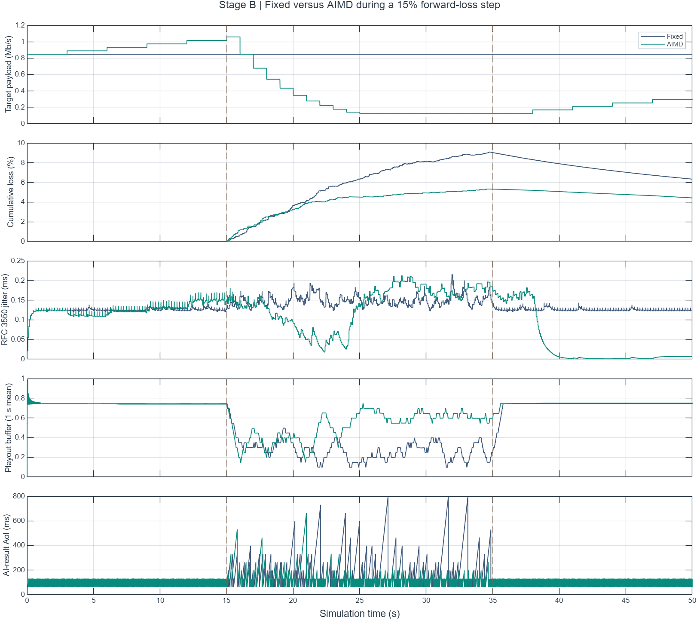
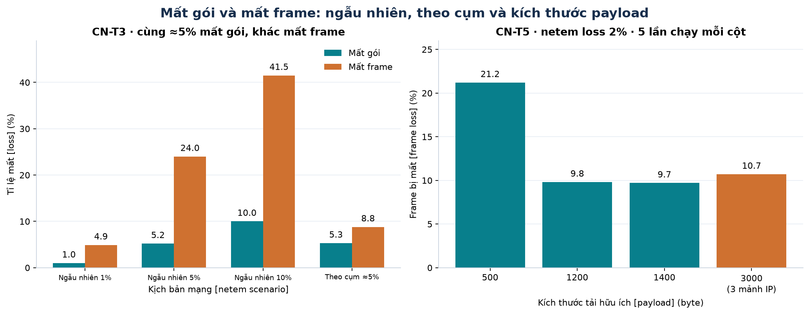
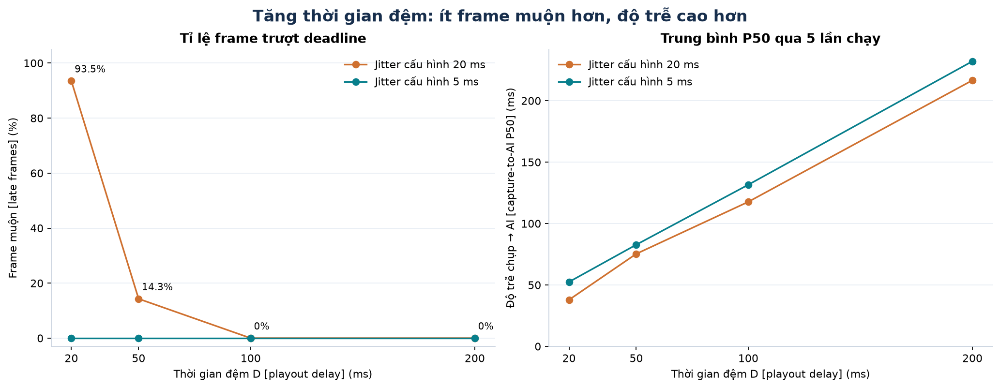
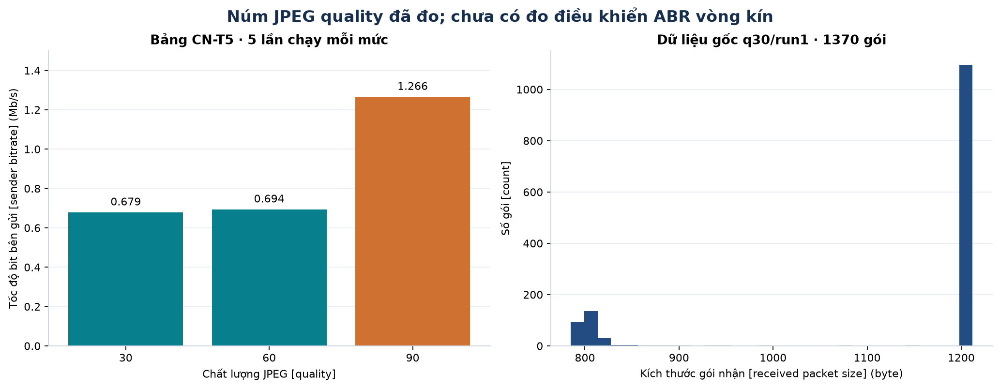
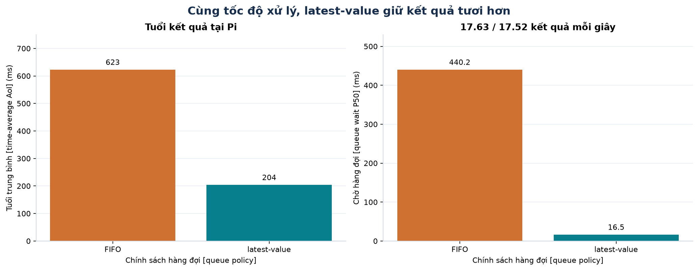
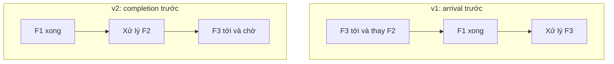

# Session 2 — C. Kết quả và bằng chứng kỹ thuật

Sau phần này, bạn giải thích được tác dụng của từng cải tiến, đọc bảng và plot, phân biệt số đo thật với kết quả mô phỏng. Nguồn: `OSCN_ChatGPT_pack.zip/hw_tables.md` (MEASURED), `CN_SimEvents_Study.zip/sim/study_simevents_v2/stage_B_results.csv`, `stage_C_results.csv`, [`SIMEVENTS_V2_REPORT.md`](https://github.com/KaiserRichard/edge-ai-video-runtime/blob/main/sim/study_simevents_v2/SIMEVENTS_V2_REPORT.md) (SIMULATED). Các run không được chạy lại trong bài này.

## C1. Stage B — AIMD khi loss thay đổi

SOURCE: [`run_cn_simevents_v2_study.m`](https://github.com/KaiserRichard/edge-ai-video-runtime/blob/main/sim/study_simevents_v2/run_cn_simevents_v2_study.m) đặt 50 s capture, warmup 2 s, seed 1, lossSteps `[0 0;15 .15;35 0]`, so sánh adaptive false/true. Baseline link 100 Mb/s, 15 FPS, depth 50 ms, inference service 12.5 ms.

| Thời gian (s) | Loss cấu hình |
|---|---:|
| 0–15 | 0% |
| 15–35 | 15% |
| 35–50 | 0% |

### C1.1. Trace rate thực từ v2

SIMULATED, saved `B_adaptive1.mat`, `rateLog` (giây, scale). Loss step là điều kiện bên ngoài, không phải do AIMD điều khiển.

| Trước impairment | Giảm trong impairment | Phục hồi |
|---|---|---|
| 0: 1.00 | 16.009: 1.00 | 38.013: 0.20 |
| 3.011: 1.05 | 17.008: 0.80 | 41.012: 0.25 |
| 6.013: 1.10 | 18.010: 0.64 | 44.011: 0.30 |
| 9.011: 1.15 | 19.015: 0.512 | 47.015: 0.35 |
| 12.012: 1.20 | 20.009: 0.4096 | 50: 0.35 (giá trị tại cuối capture) |
| 15.015: 1.25 | 21.013: 0.32768 | |
| | 22.010: 0.262144 | |
| | 23.011: 0.2097152 | |
| | 24.009: 0.16777216 | |
| | 25.014: 0.15 | |

Trước loss step, rate tăng từ 1 lên 1.25. RR mới tới sau step nên giảm lần đầu ở 16.009 s. Chạm floor 0.15 ở 25.014 s. Sau phục hồi ở 35 s, cần các RR sạch nên tăng ở 38.013 s và mới đạt 0.35 ở cuối capture. Trace còn tăng lên 0.40 ở 50.011 s trong drain, ngoài capture window; `rate_final` của CSV chỉ tính đến 50 s nên vẫn là 0.35. Controller giảm nhanh nhưng phục hồi chậm.

### C1.2. Dashboard gốc



!!! note "Cách đọc hình"
    Đây là hình lưu từ v1, không phải hình dashboard native v2. Đọc các panel cùng trục thời gian: target bitrate, loss, jitter, occupancy, AoI. So sánh fixed với adaptive theo cùng đoạn kênh bị suy giảm. Bảng compare xác nhận aggregate của hai loss-step run v1/v2 khớp. Trace rate bên trên lấy từ v2 đã lưu.

### C1.3. So sánh định lượng

**SIMULATED — Stage B loss-step:**

| Metric | Fixed | AIMD |
|---|---:|---:|
| Packet đã gửi (toàn run) | 4557 | 2730 |
| Frame loss | 26.84% | 12.93% |
| On-time frame ratio | 73.16% | 87.07% |
| AI results (toàn run) | 557 | 657 |
| Mean AoI | 147.70 ms | 111.87 ms |
| Capture-to-result P95 | 62.70 ms | 62.70 ms |
| Final scale | 1.00 | 0.35 |

Các ratio và latency dùng cửa sổ quan sát; số đếm ghi trên toàn run. CALCULATED: on-time tăng 13.91 điểm phần trăm, mean AoI giảm khoảng 24.3%. P95 latency các result thành công không đổi. Điều đó không mâu thuẫn với AoI giảm: nhiều result mới đến hơn.

### C1.4. Vì sao nhỏ frame lại giúp dù p không đổi?

Trong đoạn 15–35 s, p cấu hình vẫn là 0.15. Với N mảnh độc lập, \(P_s=(1-p)^N\). CALCULATED: 6 packet → \(0.85^6=37.7\%\); 2 packet → \(0.85^2=72.25\%\). Giảm kích thước làm giảm số mảnh phải sống sót. Không phải AIMD sửa kênh hoặc giảm xác suất mất của từng packet. Các xác suất ví dụ là trong đoạn loss 15%, không phải on-time trung bình toàn run 87.07%.

<div class="widget" data-widget="framesuccess" data-title="Frame sống sót theo p và N"></div>

Không có kết quả đánh giá chất lượng ảnh hoặc accuracy khi scale giảm. Đây là hạn chế chính của Stage B.

## C2. Stage B — bottleneck dung lượng thật trong mô hình

SOURCE: capture 20 s, warmup 10 s, drain 15 s, loss 5%, link 0.55 Mb/s. Tải ảnh sinh trung bình (CALCULATED):

\[
R=15(6.08-0.2)1200\times8=0.84672\,\mathrm{Mb/s}.
\]

Chưa tính header đã lớn hơn capacity 0.55 Mb/s. Ở scale 0.5, tải ảnh còn khoảng 0.42336 Mb/s; phải tính thêm header khi kiểm tra tải link thực. FIFO serializer tăng backlog và frame trễ hạn.

| SIMULATED | Fixed | AIMD |
|---|---:|---:|
| On-time | 0% | 96.64% |
| Mean RFC jitter | 22.93 ms | 2.54 ms |
| AI result (toàn run) | 0 | 170 |
| Mean AoI | NaN | 116.97 ms |

NaN vì không có kết quả để định nghĩa AoI. Khác C1: ở đây giảm offered load còn giúp giải phóng bottleneck serialization, ngoài lợi ích giảm số packet/frame. Không gọi đây là phép đo link vật lý 0.55 Mb/s.

## C3. CN-T3 — khuếch đại mất gói thành mất frame



Panel trái so sánh loss packet/frame của T3 theo cấu hình netem; panel phải là frame loss của T5 theo payload. Đọc panel trái ở mục này. Hai mẫu số khác nhau. Một phần trăm packet không đồng nghĩa một phần trăm frame. MEASURED, mỗi cấu hình 5 run:

| Cấu hình | Sequence loss | Packet/frame | Frame loss | On-time | Jitter ms | AI results/s |
|---|---:|---:|---:|---:|---:|---:|
| loss0 | 0% | 5.607 | 0% | 99.9% | 0.15 | 15.00 |
| loss1 | 1.0% | 5.096 | 4.9% | 95.1% | 0.18 | 14.29 |
| loss5 | 5.2% | 5.106 | 24.0% | 76.0% | 0.22 | 11.42 |
| loss10 | 10% | 5.107 | 41.5% | 58.5% | 0.23 | 8.78 |
| GE burst | 5.3% | 5.121 | 8.8% | 89.5% | 0.20 | 13.45 |

CALCULATED (xấp xỉ dùng mean N): \(1-(1-0.052)^{5.106}\approx23.9\%\), gần 24.0% đo được. Nếu dùng p cấu hình 5%, xấp xỉ 23.0% như bảng gốc. Trung bình đúng cho N biến thiên cần kỳ vọng theo phân bố N, không chỉ thế mean. GE có tương quan; công thức mất độc lập không áp dụng trực tiếp. Loss và on-time GE là các metric báo cáo, không ép thành phần bù chính xác khi mẫu số/quy tắc đo khác.

| Frame loss | MEASURED | SIMULATED Stage C |
|---|---:|---:|
| loss1 | 4.9% | 4.78% |
| loss5 | 24.0% | 21.91% |
| loss10 | 41.5% | 40.93% |
| GE burst | 8.8% | 10.34% |

Mô phỏng tái tạo xu hướng, không chứng minh mọi con số trùng nhau. T3 đặc tả vấn đề, không tự nó là cải tiến.

## C4. CN-T4 — trade-off playout depth



Đọc depth ở trục X, tỉ lệ late và capture-to-result latency trên các panel/trục tương ứng. Hai đại lượng khác đơn vị. SOURCE: netem `delay 20ms 20ms distribution normal`, không loss. MEASURED và SIMULATED Stage C:

| Depth | Late HW | Late sim | P50 HW (ms) | P50 sim (ms) | P95 HW (ms) |
|---:|---:|---:|---:|---:|---:|
| 20 ms | 93.5% | 91.10% | 37.91 | 38.82 | 42.65 |
| 50 ms | 14.3% | 16.24% | 75.32 | 68.82 | 80.15 |
| 100 ms | 0% | 0% | 117.68 | 118.82 | 122.14 |
| 200 ms | 0% | 0% | 216.61 | 218.82 | 221.17 |

Từ 20 tới 100 ms, loại hết late quan sát được nhưng thêm khoảng 80 ms median latency. Tăng tiếp 200 ms không đem thêm continuity trong profile này. Jitter đo ở receiver vẫn khoảng 15–17 ms; buffer không xóa jitter mạng. Profile ít biến thiên `d20j5` có 100% on-time ở cả bốn depth; P50 52.47/82.76/131.60/232.11 ms. Do đó chọn depth theo profile và latency budget, không phải luôn lấy lớn nhất. Với ứng dụng cần phản hồi nhanh, dữ liệu liên tục nhưng quá cũ vẫn bất lợi.

## C5. CN-T5 — packet size và MTU

IP MTU là kích thước IP datagram tối đa truyền qua link không cần fragmentation. MTU Ethernet thông thường 1500 B. Trong quy ước đơn giản hóa mô hình, payload ảnh 1200 B + 48 B =1248 B; 3000 B +48 B=3048 B. Trong Python hiện tại, 1200 B là giới hạn RTP payload gồm header riêng, xem 01-B B1. Dù quy ước khác, 3000 B vẫn vượt MTU.

SOURCE: [`cnse2_runtime.m`](https://github.com/KaiserRichard/edge-ai-video-runtime/blob/main/sim/study_simevents_v2/cnse2_runtime.m), `lossDraw` thực hiện draw cho từng IP fragment ước lượng:

```matlab
drop=false;for k=1:ceil((e.size+28)/1480),drop=s.L(p)||drop;end
```

CALCULATED: payload 3000 B → 3 IP fragment; giả sử mất độc lập 2% mỗi fragment, mất cả datagram \(1-0.98^3=5.88\%\). Đây là quy tắc mô hình, không phải capture đầy đủ header IPv4 mọi trường hợp.

| Payload setting | Packet/frame HW | Loss packet HW | Frame loss HW | Frame loss sim |
|---:|---:|---:|---:|---:|
| 500 B | 12.307 | 1.9% | 21.2% | 22.47% |
| 1200 B | 5.232 | 2.0% | 9.8% | 9.90% |
| 1400 B | 5.002 | 2.0% | 9.7% | 9.68% |
| 3000 B | 2.318 | 4.8% | 10.7% | 11.12% |

Bảng HW 5 run/cấu hình, simulation Stage C seed 11. Payload nhỏ: nhiều packet/frame. Payload quá lớn: tăng rủi ro IP fragmentation. 1200 B là lựa chọn thận trọng, không phải tối ưu toàn cục. Không lấy công thức 2% mất RTP cho datagram đã phân mảnh.

### C5.1. JPEG quality và bitrate



Đọc bitrate theo từng cấu hình quality, không xem trục quality là phần trăm pixel giữ lại. MEASURED:

| Quality | JPEG bytes/frame | Bitrate (Mb/s) |
|---:|---:|---:|
| 30 | 5650.4 | 0.679 |
| 60 | 5777.2 | 0.694 |
| 90 | 10537.4 | 1.266 |

Không tuyến tính. AIMD scale của SimEvents điều khiển byte trực tiếp; ứng dụng Python điều chỉnh quality/resolution, không thể đồng nhất hai giá trị. Không có số accuracy ứng với các mức quality ở đây.

## C6. CN-T7 — cải tiến chính đã đo trên phần cứng



Đọc các cột theo policy và đơn vị. Đặc biệt phân biệt mean AoI theo thời gian, queue wait percentile và throughput result/s.

| MEASURED, 5 run/policy | FIFO | Latest |
|---|---:|---:|
| Mean AI-result AoI | 623 ms | 204 ms |
| Queue wait P50 | 440.20 ms | 16.48 ms |
| Queue wait P95 | 461.57 ms | 31.53 ms |
| Results/s | 17.63 | 17.52 |
| Frames skipped | 802 | 809 |
| Capture→result P50 | 599.90 ms | 175.47 ms |
| Capture→result P95 | 621.20 ms | 191.67 ms |

CALCULATED: AoI giảm 67.3%. Throughput gần như giữ nguyên. Latest bỏ frame cũ đang chờ, không ngắt inference đang chạy và không làm neural network tính nhanh hơn.

| Evidence | FIFO mean AoI | Latest mean AoI | Reduction (CALCULATED) |
|---|---:|---:|---:|
| MEASURED | 623 ms | 204 ms | 67.3% |
| SIMULATED Stage C | 566.867 ms | 200.201 ms | 64.7% |

Hai phía cùng xu hướng. Hardware tính tuổi tới khi kết quả trở về Pi (cùng clock); SimEvents tính khi inference hoàn thành. Workload AI trong T7 là synthetic service time trên hardware, không phải ONNX benchmark. Đây là cải tiến CN vật lý chính nên nhấn mạnh.

## C7. T2, T6, T9 — kết quả hỗ trợ

| MEASURED | Kết quả đại diện |
|---|---|
| T2 Ethernet | 100% on-time, jitter 0.14 ms, P50/P95 66.62/72.20 ms |
| T6 Wi-Fi D50 | 96.6% on-time, jitter 0.29 ms, P50/P95 102.24/144.72 ms; RSSI mean/min −72.3/−74.2 dBm |
| T9 noloss_D50 | Đo thành phần theo clock riêng |

T9 dùng hai clock domain. Trên Pi đo capture, first send và result receipt; laptop đo các khoảng nội bộ. MEASURED, `noloss_D50`:

| Thành phần | P50/P95 (ms) | Clock |
|---|---:|---|
| Capture→first send | 0.07 / 0.09 | Pi |
| First send→result receipt | 67.84 / 72.95 | Pi |
| Tổng capture→result receipt | 67.91 / 73.03 | Pi |
| Playout wait | 50.26 / 50.54 | Laptop |
| AI queue wait | 0.12 / 0.13 | Laptop |
| Inference | 12.51 / 12.93 | Laptop |

Kiểm tra tổng thành phần theo từng cặp frame Pi có max error 0.000 ms theo độ chính xác bảng. Không lấy median/P95 của các thành phần khác clock trừ nhau để khẳng định one-way latency. Không cần đồng bộ clock để tính một khoảng thời gian trên cùng clock.

## C8. Verification — v2 có giữ hành vi v1?

SOURCE: [`SIMEVENTS_V2_REPORT.md`](https://github.com/KaiserRichard/edge-ai-video-runtime/blob/main/sim/study_simevents_v2/SIMEVENTS_V2_REPORT.md), `shared_test_results.csv`, `stage_*_compare.csv`, [`tie_check.csv`](https://github.com/KaiserRichard/edge-ai-video-runtime/blob/main/sim/study_simevents_v2/tie_check.csv).

| Kiểm tra | Kết quả đã báo cáo |
|---|---:|
| Regression suite | 31/31 passed |
| Trace-oracle checks, 43 run | 1032/1032 passed |
| Stage A | 100/100 identical |
| Stage B | 194/200 identical, 194/200 within tolerance |
| Stage C | 554/560 identical, 555/560 within tolerance |

Đây là consistency với model cũ và oracle, không phải accuracy tuyệt đối so với hardware.

### C8.1. Event tie — hai sự kiện cùng thời điểm

30 FPS cho chu kỳ 33.33 ms, service 50 ms. Các mốc danh định trùng mỗi 100 ms. Giả sử F1 đang hoàn thành, F2 đang chờ, F3 vừa đến đúng lúc đó:



Kết quả khác do thứ tự event của scheduler. v1 đặt priority arrival trước; native v2 phục vụ completion trước ở trường hợp tie. Cùng policy latest không nhất thiết cùng từng timestamp.

### C8.2. Thử nhiễu động có kiểm soát

SOURCE: [`cnse2_tie_check.m`](https://github.com/KaiserRichard/edge-ai-video-runtime/blob/main/sim/study_simevents_v2/cnse2_tie_check.m) thay service time 50 ms ±1 ns để bỏ trùng chính xác. Kết quả 32/32 metric rows identical, max abs diff 0 theo báo cáo. Đây là cách cô lập nguyên nhân, không thay hàng loạt tham số. Ý nghĩa trong mô phỏng mạng: khi hai sự kiện có cùng thời điểm, event calendar của SimEvents phải chọn một thứ tự; thứ tự đó quyết định ảnh nào khối Inference lấy ra tiếp theo. Lệch đi 1 ns làm hai sự kiện không còn trùng, nên kết quả không còn phụ thuộc vào cách phá thế hòa.

## C. Trắc nghiệm cuối phần

<div class="quiz" markdown>
<p class="quiz-q">AIMD loss-step vì sao cải thiện frame survival?</p>

- [ ] Vì thay p cấu hình từ 15% xuống 0
- [x] Vì giảm số mảnh phải nhận đủ
- [ ] Vì luôn tăng FPS
- [ ] Vì sửa CRC trong RTP

<div class="quiz-why" markdown>
Xác suất tất cả N packet sống tăng khi N giảm với cùng p.
</div>
</div>

<div class="quiz" markdown>
<p class="quiz-q">Với T4, tại sao không chọn 200 ms luôn?</p>

- [ ] Buffer không có tác dụng
- [ ] 200 ms luôn mất nhiều packet hơn
- [x] 100 ms đã hết late trong profile thử, tăng nữa làm tăng latency
- [ ] 200 ms làm jitter mạng bằng 0

<div class="quiz-why" markdown>
Đây là trade-off continuity và latency, không phải tối ưu mọi môi trường.
</div>
</div>

<div class="quiz" markdown>
<p class="quiz-q">T7 cho thấy cơ chế nào?</p>

- [ ] AI nhanh hơn gấp ba
- [x] Latest cải thiện freshness mà throughput gần như không đổi
- [ ] Latest bảo đảm không mất frame
- [ ] CPU chạy ONNX nhanh hơn

<div class="quiz-why" markdown>
AoI 623→204 ms, results/s 17.63→17.52. Workload synthetic.
</div>
</div>

<div class="quiz" markdown>
<p class="quiz-q">31/31 regression pass chứng minh gì?</p>

- [ ] Mọi hardware timing đã đúng
- [ ] T8 hardware hoàn tất
- [x] Mô hình vượt các test đã định nghĩa
- [ ] JPEG accuracy đã được xác nhận

<div class="quiz-why" markdown>
Verification không thay thế validation trên thiết bị thật.
</div>
</div>
