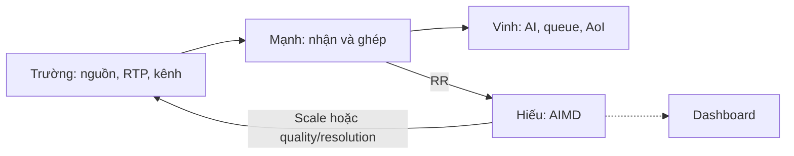

# Session 2 — D. Tổng hợp và bảo vệ kết quả

Sau phần này, bạn kể được câu chuyện kỹ thuật từ vấn đề tới thiết kế, cải tiến và giới hạn. Không cần trình bày toàn bộ mã MATLAB.

## D1. Năm luận điểm chính

| Luận điểm | Bằng chứng | Điều phải giải thích |
|---|---|---|
| Vấn đề — T3 | MEASURED: 5.2% packet loss → 24.0% frame loss | Cần đủ mảnh, mất độc lập làm loss khuếch đại |
| Trade-off — T4 | MEASURED: late 93.5% → 0% với depth 20→100 ms; P50 37.91→117.68 ms | Buffer mua continuity bằng latency |
| Cấu hình gói — T5 | MEASURED: frame loss 21.2/9.8/9.7/10.7% ứng với 500/1200/1400/3000 B | Cân bằng số packet và IP fragmentation |
| Cải tiến vật lý — T7 | MEASURED: mean AoI 623→204 ms | Latest chọn dữ liệu mới, không làm AI chạy nhanh hơn |
| Cải tiến mô phỏng — Stage B | SIMULATED: on-time 73.16→87.07%, AoI 147.70→111.87 ms | AIMD giảm số byte/frame, recovery chậm |

## D2. Knowledge map

Nhìn theo hai hướng. Trường: Frames, Sender Queue, RTP Packetizer, Serialization, Channel. Mạnh: Receiver, jitter, deadline, ghép ảnh, tạo RR. Hiếu: tiêu thụ RR, Observations, AIMD, Feedback tick, dashboard. Vinh: Inference, queue và AoI. Đường AI nhận frame từ receiver, không nhận frame từ AIMD. AIMD quay về nguồn ảnh.

## D3. Phạm vi và giới hạn

| Thành phần | Evidence hiện có |
|---|---|
| RTP/RTCP | Có phép đo vật lý lịch sử |
| Dashboard video | SOURCE có `jpeg_b64`, localhost verification được báo cáo; preview không phải FPS RTP |
| Latest-value | T7 measured và Stage C simulated; khác measurement boundary |
| SimEvents v2 | Regression/trace check; không tự chứng minh accuracy vật lý |
| AIMD | Có code Python và chart mô phỏng; Stage B là simulated |
| CN-T8 full hardware campaign | UNKNOWN/pending, không tuyên bố đạt chỉ vì runner và analysis có sẵn |
| Dashboard với Pi camera thật hiện tại | Chưa xác minh trong bài học |
| Accuracy khi giảm JPEG bytes | Không có bằng chứng |

Không chạy thêm MATLAB hoặc hardware trong lần xuất bài. Khi demo lỗi, dùng replay có nhãn rõ ràng. Không gọi replay là live.

## D4. Trình bày với thầy

Câu chuyện 12 phút của bài học cá nhân trước đây: vấn đề → kiến trúc → demo → cải tiến và số liệu → giới hạn. Với nhóm, thứ tự Trường → Mạnh → Hiếu → Vinh; thời lượng cụ thể thống nhất với nhóm theo yêu cầu buổi bảo vệ, không coi thời gian gợi ý là rubric chính thức.

??? question "Vì sao dùng RTP trên UDP?"
    RTP thêm sequence, timestamp, SSRC và marker giúp nhận biết dữ liệu thời gian thực. UDP không bảo đảm tin cậy; thiết kế phải xử lý mất và đến muộn. Không nói RTP tự gửi lại mọi packet.

??? question "Tại sao AIMD có thể cải thiện on-time mà P95 latency không đổi?"
    Nhiều frame hoàn thành hơn do số packet/frame giảm. Những frame đã thành công vẫn theo cùng depth và service time, nên percentile latency có thể giữ nguyên. AoI giảm vì thông tin mới được cập nhật thường xuyên hơn.

??? question "Tại sao dùng latest trong AI nhưng lại cần playout buffer?"
    Playout buffer giải quyết đến không đều, bảo vệ lịch phát; latest giải quyết backlog ở consumer. Mục tiêu và vị trí hàng đợi khác nhau. Cả hai phải được cân bằng theo ngân sách latency và freshness.

??? question "Số liệu mô phỏng có thể thay thế đo thật không?"
    Không. Mô phỏng cho phép kiểm soát giả thiết và quan sát cơ chế. Đo thật mới đánh giá implementation trên cấu hình vật lý cụ thể; kết quả mô phỏng không xác minh chất lượng JPEG hay T8 hardware.

## D. Trắc nghiệm cuối phần

Ai giải thích việc tạo RR?

- [ ] Hiếu
- [x] Mạnh
- [ ] Vinh
- [ ] Dashboard tự tạo

Receiver tạo report; Hiếu giải thích sender dùng report.

Kết quả nào là MEASURED?

- [ ] Stage B 73.16→87.07%
- [ ] Stage C 566.867→200.201 ms
- [x] T7 623→204 ms
- [ ] 31/31 regression là phép đo mạng

T7 là đo trên Pi/laptop với synthetic AI service.

T8 đã có code và analysis. Có thể tuyên bố hardware pass?

- [ ] Có, vì có code
- [ ] Có, vì v2 regression pass
- [x] Không, cần campaign vật lý hợp lệ
- [ ] Có, nếu dashboard chạy replay

Implementation và bằng chứng thử nghiệm là hai phạm vi khác nhau.

## Phụ lục (không bắt buộc)

??? info "Liên hệ với môn Hệ điều hành — đọc thêm, không bắt buộc"
    Phần này chỉ dành cho người học cả hai môn (Hiếu, Vinh). Nó không nằm trong lộ trình bắt buộc, trắc nghiệm hay phần bảo vệ CN.

    **Hai hàng đợi ở hai chỗ khác nhau.** Trong CN, hàng đợi FIFO/latest-value nằm trên laptop, giữa receiver (ảnh đã hoàn chỉnh, đúng hạn) và mô hình AI; T7 đo AoI của kết quả AI trên đồng hồ Pi. Trong OS, hàng đợi input và hàng đợi bridge nằm trên Raspberry Pi, giữa camera, inference và bridge UART; OS-T4 và E3/E3b đo trên đường đi tới MCU. Cùng tên chính sách nhưng vị trí hàng đợi, đồng hồ và biên đo khác nhau, nên không so sánh trực tiếp các con số.

    **Chờ để liên tục, hay bỏ để mới.** Playout buffer của CN cố tình chờ thêm một khoảng để ảnh phát đều, chấp nhận trễ hơn. Latest-value (ở cả hai môn) bỏ dữ liệu cũ để giữ thông tin mới, chấp nhận mất một số ảnh. Không chính sách nào tốt tuyệt đối; chọn theo yêu cầu của ứng dụng.

    **Thứ tự sự kiện cùng thời điểm.** Trong SimEvents, thứ tự hai sự kiện trùng thời điểm do event calendar quyết định (C8). Trong firmware OS, supervisor cố tình kiểm tra hạn trước rồi mới nhận frame mới, để frame đến muộn không che một lần vi phạm timeout.
