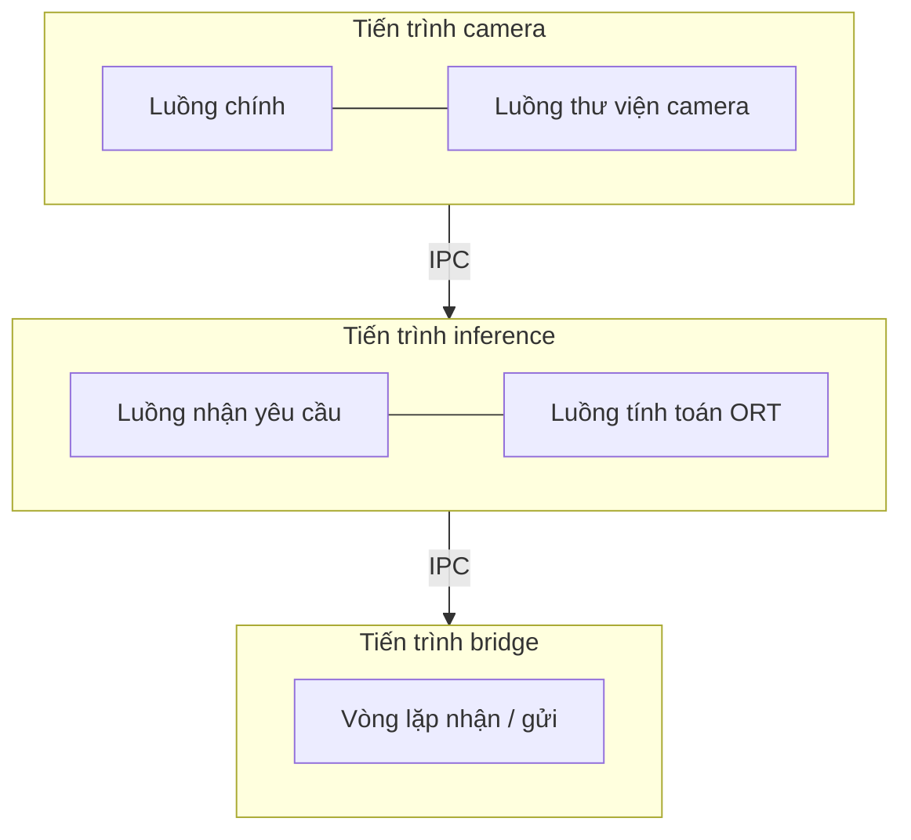
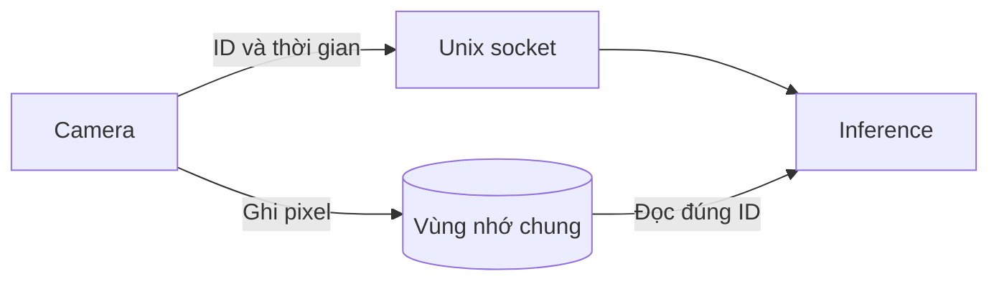
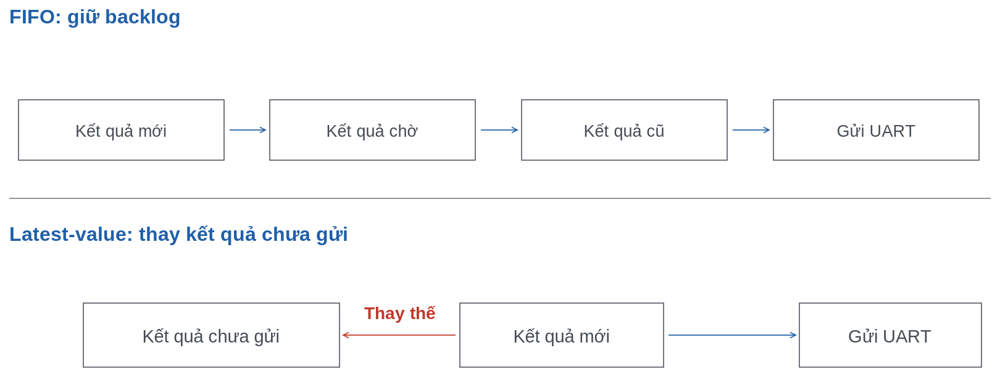
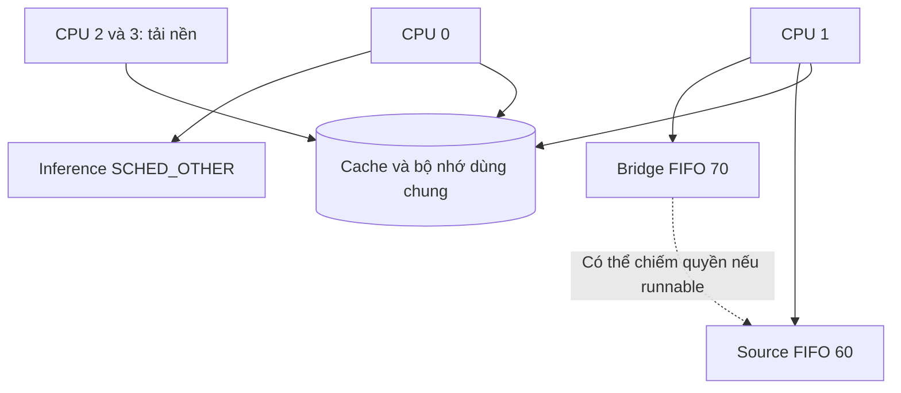
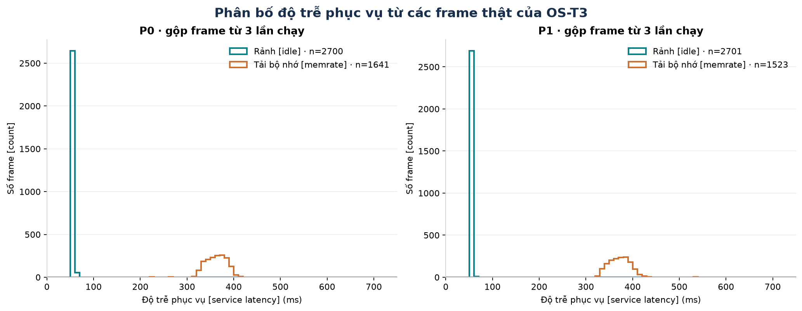

# SESSION 3 — Linux trên Raspberry Pi

## PART A — Nền tảng lý thuyết

Sau phần này, bạn giải thích được vì sao một hệ thống AI có thể chạy đúng nhưng trả kết quả quá muộn, và vì sao đổi độ ưu tiên CPU không nhất thiết giải quyết được vấn đề.

**Quy ước bằng chứng dùng xuyên suốt hai session:** SOURCE = cấu hình, mã hoặc tài liệu đã đọc; MEASURED = kết quả đo được báo cáo (kèm điều kiện); SIMULATED = mô phỏng; CALCULATED = tính từ các số đã nêu; FLAGGED = dữ liệu bị loại khỏi so sánh hợp lệ. Lý thuyết chung không phải kết quả đo của dự án. Các số thứ tự mục, tên phiên bản, mã lỗi và tên thí nghiệm là định danh. Ví dụ minh họa không phải lần chạy mới.

## A1. Từ sản phẩm đến câu hỏi OS

!!! note "Cách đọc hình"
    Bên trái là Raspberry Pi chạy Linux workload và bridge. Bên phải là MCU nhận UART rồi đánh giá trạng thái. Hai mũi tên INFERENCE và HEARTBEAT biểu diễn hai thông tin khác nhau. Hình là kiến trúc chức năng, không phải sơ đồ đấu chân hay trace lịch chạy. Session 3 tập trung nửa trái; Session 4 đi sâu nửa phải.

Một camera sinh dữ liệu, bộ suy luận xử lý nó, bridge đóng gói kết quả và gửi sang bộ giám sát. Mục tiêu không chỉ là chạy được MobileNetV2. Mục tiêu là hiểu thời gian đáp ứng, tranh chấp tài nguyên, tính mới của kết quả và ranh giới quyền điều khiển.

### A1.1. Vì sao đây là đề tài OS?

- Các chương trình tranh nhau CPU và bộ nhớ.
- Dữ liệu di chuyển qua các cơ chế IPC, có thể bị xếp hàng hoặc bỏ.
- Chính sách lập lịch thay đổi thời gian được chạy, không thay đổi yêu cầu phải có dữ liệu mới.
- MCU có đồng hồ và nhiệm vụ riêng. Nó không cần đợi Linux tự báo rằng Linux đang bị treo.

!!! tip "Nói đơn giản"
    Một bếp có thể nấu đúng món nhưng giao món sau khi khách đã đi. Bài OS nghiên cứu thời điểm món được nấu và giao, không chỉ chất lượng công thức.

## A2. Process và thread (tiến trình và luồng)

**Process** là chương trình đang thực thi, có không gian địa chỉ và tài nguyên được hệ điều hành quản lý. **Thread** là một luồng thực thi bên trong tiến trình. Các luồng cùng tiến trình thường chia sẻ heap, vùng dữ liệu và file descriptor, nhưng mỗi luồng có ngăn xếp và trạng thái thanh ghi riêng.

| Khía cạnh | Tiến trình | Luồng |
|---|---|---|
| Bộ nhớ | Không gian địa chỉ riêng theo mặc định | Chia sẻ bộ nhớ của tiến trình |
| Trao đổi dữ liệu | IPC hoặc bộ nhớ chia sẻ có chủ đích | Biến chung, cần đồng bộ |
| Lập lịch | Linux lập lịch các thực thể luồng | Có trạng thái runnable/blocked riêng |
| Lỗi | Có ranh giới cách ly tiến trình | Lỗi bộ nhớ có thể ảnh hưởng cả tiến trình |

SOURCE: [`os/linux/camera/README.md`](https://github.com/KaiserRichard/edge-ai-video-runtime/blob/main/os/linux/camera/README.md) mô tả luồng của libcamera và callback; không tự tạo thêm luồng capture trong ứng dụng. [`os/linux/inference/README.md`](https://github.com/KaiserRichard/edge-ai-video-runtime/blob/main/os/linux/inference/README.md) mô tả ONNX Runtime (ORT), các luồng tính toán nội bộ và việc xử lý từng đầu vào. Tăng số luồng ORT không đồng nghĩa với nhiều frame được suy luận đồng thời.

### A2.1. Song song và xen kẽ

**Concurrency** (đồng thời): nhiều công việc tiến triển trong cùng khoảng thời gian, có thể xen kẽ trên một lõi. **Parallelism** (song song): nhiều công việc thực sự chạy cùng lúc trên nhiều lõi. Khi luồng chờ I/O, kernel có thể chạy luồng khác. Khi luồng đang tính toán, ngắt hoặc một luồng ưu tiên cao hơn có thể giành CPU.

Thời gian thực thi một đoạn công việc không nhất thiết bằng thời gian đồng hồ trôi qua kể từ lúc bắt đầu. Chờ được lập lịch, chờ bộ nhớ và chờ I/O đều có thể kéo dài thời gian hoàn thành.

!!! tip "Nói đơn giản"
    Tiến trình giống phòng làm việc riêng. Luồng giống những nhân viên trong phòng đó. Họ dùng chung tài liệu, nên dễ phối hợp nhưng cũng có thể ghi đè công việc của nhau.

## A3. IPC — Inter-Process Communication (giao tiếp giữa tiến trình)

| Cơ chế | Đơn vị truyền | Đặc điểm | Vai trò trong dự án |
|---|---|---|---|
| Pipe | Luồng byte | Thường đọc theo thứ tự; không tự giữ ranh giới bản ghi | Lý thuyết để so sánh; không phải đường IPC chính |
| Message queue | Bản tin | Có ranh giới bản tin và hàng đợi hữu hạn | Hàng đợi là khái niệm; không khẳng định dùng POSIX mq |
| Unix domain datagram socket | Datagram cục bộ | Bản ghi có ranh giới; có thể đầy hoặc gửi lỗi | SOURCE: notification và kết quả |
| Shared memory | Vùng byte dùng chung | Tránh chuyển toàn bộ ảnh qua socket; cần đồng bộ và kiểm tra đời dữ liệu | SOURCE: CAM1 ring chứa pixel |

Unix socket trong dự án giao tiếp nội bộ trên Pi. Đây không phải UDP qua Ethernet. UART là một đường truyền khác, sang MCU.

### A3.1. Tại sao không gửi ảnh nguyên vẹn trong mỗi thông báo?

SOURCE: camera dùng ảnh RGB, thông báo `hea_input` chứa frame ID và timestamp, dài 12 B. Kích thước ảnh 640 × 480 được nêu trong [`os/linux/camera/README.md`](https://github.com/KaiserRichard/edge-ai-video-runtime/blob/main/os/linux/camera/README.md) ở ví dụ chạy camera.

CALCULATED: ảnh RGB 8 bit mỗi kênh có dung lượng

\[
S=640\times480\times3=921600\ \mathrm{B}.
\]

Thông báo chỉ dài 12 B. Tỷ số dung lượng ảnh/thông báo là 76800. Đây là tỷ số kích thước dữ liệu, không phải mức tăng tốc đo được; vẫn cần ghi và đọc pixel trong bộ nhớ, sao chép và xử lý ảnh.

Một thông báo hợp lệ không bảo đảm ảnh vẫn còn trong vùng nhớ vòng. Đọc phải phát hiện ảnh đã bị ghi đè hoặc đang được ghi dở. Xem chi tiết ở Part B.

## A4. Producer–consumer (bên sinh và bên tiêu thụ dữ liệu)

Ký hiệu \(\lambda\) là tốc độ sinh frame, \(\mu\) là tốc độ phục vụ trung bình trong điều kiện đang xét. Với chu kỳ sinh \(T\) và thời gian phục vụ cố định \(S\), mô hình đơn giản cho:

\[
\lambda=1/T,\qquad \mu=1/S,\qquad \rho=\lambda/\mu.
\]

Nếu \(\rho>1\) kéo dài, công việc tới nhanh hơn khả năng xử lý. Hàng đợi không giới hạn sẽ tích lũy; hàng đợi hữu hạn phải làm rơi dữ liệu hoặc tạo áp lực ngược. \(\rho<1\) không bảo đảm mọi deadline được đáp ứng khi có burst hoặc thời gian phục vụ biến động.

### A4.1. Ví dụ từ E3

SOURCE: chu kỳ nguồn cấu hình 100 ms. MEASURED: một trung vị khoảng cách giữa các kết quả trong E3 memrate/FIFO là 121.72 ms ([`STAGE_REPORT.md`](https://github.com/KaiserRichard/edge-ai-video-runtime/blob/main/os/docs/STAGE_REPORT.md), E3). CALCULATED: nếu dùng trung vị này như khoảng cách phục vụ đều trong mô hình minh họa:

\[
\lambda=10\ \mathrm{s}^{-1},\quad \mu\approx8.22\ \mathrm{s}^{-1},\quad \lambda-\mu\approx1.78\ \mathrm{s}^{-1}.
\]

Hàng đợi có thể tích thêm gần hai frame mỗi giây trong mô hình đơn giản này. Đây **không** phải tốc độ backlog đo trực tiếp; nghịch đảo trung vị không phải throughput trung bình chính xác. Quan sát trong báo cáo là input-to-completion tăng lên nhiều giây, trong khi khoảng cách hoàn thành chỉ khoảng một phần mười giây.

!!! note "Cách đọc hình"
    Hàng trên FIFO giữ kết quả cũ phía trước kết quả mới. Hàng dưới latest-value thay thế kết quả chưa gửi. Hình mô tả hàng đợi bridge. Hàng đợi đầu vào inference là một vị trí khác, dù cùng ý tưởng ưu tiên dữ liệu mới.

FIFO (First In, First Out): xử lý theo thứ tự đến. Latest-value: giữ giá trị mới nhất đang chờ. Không hủy một inference đã bắt đầu. Chính sách nào tốt phụ thuộc vào mục tiêu: đầy đủ dữ liệu hay tính mới.

## A5. Linux scheduling (lập lịch)

CPU scheduler chọn luồng runnable (sẵn sàng chạy), không chọn luồng đang ngủ chờ dữ liệu. Một context switch lưu/khôi phục trạng thái thực thi. Preemption (chiếm quyền chạy) xảy ra khi scheduler dừng luồng đang chạy để cho luồng khác chạy.

| Chính sách | Ý tưởng | Lưu ý |
|---|---|---|
| SCHED_OTHER / lớp fair | Chia cơ hội CPU theo trọng số | Không bảo đảm deadline cứng |
| CFS (Completely Fair Scheduler) | Mô hình cổ điển dùng virtual runtime | Kernel mới có thể dùng EEVDF trong lớp fair; không suy ra phiên bản thuật toán từ nhãn P0 |
| nice | Điều chỉnh trọng số lớp fair | Nice thấp hơn thường được ưu tiên tỷ lệ CPU hơn; không biến luồng thành real-time |
| SCHED_FIFO | Ưu tiên real-time cố định | Luồng cùng ưu tiên không tự luân phiên theo quantum; chạy đến khi block, yield hoặc bị ưu tiên cao hơn chiếm quyền |
| SCHED_RR | Real-time với luân phiên giữa các luồng cùng ưu tiên | Vẫn có thể bị luồng ưu tiên cao hơn chiếm quyền |

SOURCE: dự án dùng SCHED_OTHER và SCHED_FIFO, không có benchmark SCHED_RR hoặc sweep nice trong các số liệu được cung cấp. Lý thuyết CFS, nice và RR ở trên là kiến thức OS chung, không phải tuyên bố đã thử các chế độ này.

### A5.1. Profile P0 và P1 trong dự án

MEASURED (stage report, applied settings): E2 P1 đặt source FIFO 60, bridge FIFO 70, cả hai trên CPU 1 và khóa bộ nhớ; inference SCHED_OTHER trên CPU 0. Đừng nhầm với cyclictest P1, ở đó luồng đo dùng FIFO 50.

SOURCE: [`os/linux/src/hea_runtime.c`](https://github.com/KaiserRichard/edge-ai-video-runtime/blob/main/os/linux/src/hea_runtime.c), `hea_schedule` gọi `mlockall`, `sched_setaffinity`, `sched_setscheduler` và trả lỗi nếu áp dụng thất bại. [`os/tools/experiments/e4_campaign.py`](https://github.com/KaiserRichard/edge-ai-video-runtime/blob/main/os/tools/experiments/e4_campaign.py) tạo FIFO hog ưu tiên 99 trong F4. Vì vậy ưu tiên cao hơn bridge có thể làm bridge không gửi được heartbeat. Không tự thử hog ưu tiên cao trên máy đang sử dụng.

### A5.2. CPU affinity và memory locking

CPU affinity (ràng buộc CPU) xác định tập lõi mà luồng được phép chạy, không tự cấp lõi độc quyền. Pinning (ghim lõi) giúp kiểm soát di chuyển giữa lõi. Memory locking (khóa trang nhớ) hạn chế paging của vùng được khóa, nhưng không xóa mọi cache miss, ngắt hay tranh chấp băng thông. Linux RT throttling và cấu hình kernel cũng ảnh hưởng kết quả.

!!! tip "Nói đơn giản"
    Ghim người nấu vào một bếp không tạo thêm nguyên liệu. Nếu kho nguyên liệu dùng chung bị quá tải, người có ưu tiên cao vẫn có thể chờ.

## A6. Contention (tranh chấp tài nguyên)

- CPU contention: nhiều luồng muốn sử dụng thời gian thực thi của cùng lõi.
- Cache contention: các tác vụ làm thay thế dữ liệu nhau trong cache.
- Memory bandwidth contention: nhiều lõi yêu cầu dữ liệu từ hệ thống bộ nhớ dùng chung.

Không suy ra loại tranh chấp chính chỉ từ CPU utilization. Một luồng inference có thể dành phần đáng kể thời gian chờ dữ liệu, dù đã được cấp CPU. Cần phép đo đối chứng hoặc counter phần cứng để kết luận nguyên nhân cụ thể.

!!! note "Cách đọc hình"
    Trục X là độ trễ phục vụ theo ms; trục Y đếm frame. Hai panel P0/P1 gộp frame của các lần chạy. Đường idle tập trung bên trái; memrate dịch sang phải ở cả hai panel. Đây là OS-T3 sau này, không phải histogram E1/E2. Không dùng chiều cao cột để so throughput vì số frame giữa nhóm khác nhau.

MEASURED (OS-T3, nhãn trên `08_contention_summary.png`): P0 idle P50/P99 = 58/60 ms, memrate = 363/408 ms; P1 idle = 58/60 ms, memrate = 371/422 ms. Hai profile cùng chịu tải bộ nhớ. Part C giải thích đầy đủ phạm vi của các phép đo.

## A7. Trắc nghiệm

Trong sơ đồ, bộ nhớ chia sẻ có nhiệm vụ gì?

- [ ] Thay CRC UART
- [x] Giúp các tiến trình trên Pi trao đổi dữ liệu lớn; sơ đồ tổng quan chưa vẽ chi tiết vùng nhớ ảnh
- [ ] Bảo đảm MCU nhận được frame đúng hạn
- [ ] Làm tăng ưu tiên scheduler

IPC và vùng nhớ là cơ chế trao đổi dữ liệu. Chúng không tự cấp bảo đảm thời gian thực hay thay thế giao thức UART.

Trong histogram, vì sao pinning và FIFO priority chưa đủ?

- [ ] P1 loại bỏ mọi độ trễ
- [ ] Memrate làm giảm service latency
- [x] Tải bộ nhớ vẫn làm phân bố lệch sang độ trễ cao ở cả P0 và P1
- [ ] Hình chứng minh CPU không bao giờ bị tranh chấp

Cả hai profile đều có cụm memrate lệch phải. Hình hỗ trợ nhận định priority không giải quyết toàn bộ tranh chấp; không xác định được chi tiết cơ chế bus chỉ từ histogram.

Khi nguồn nhanh hơn inference kéo dài, cách nào trực tiếp tránh xử lý quá nhiều frame cũ?

- [ ] Tăng dung lượng FIFO vô hạn
- [ ] Tăng tốc UART dù bridge đang rảnh
- [ ] Tăng số luồng ORT luôn luôn giải quyết được
- [x] Chọn latest-value ngay ở hàng đợi đầu vào inference nếu ứng dụng chấp nhận bỏ frame

Latest-value tại đúng nút thắt bỏ công việc đã lỗi thời trước khi tốn tài nguyên. Tăng FIFO có thể làm tuổi dữ liệu lớn hơn.

Một luồng SCHED_FIFO đang runnable có ưu tiên cao hơn bridge trên cùng CPU. Điều gì có thể xảy ra?

- [x] Bridge bị chậm hoặc không được chạy trong thời gian luồng ưu tiên cao chiếm CPU
- [ ] Bridge chắc chắn được chạy đúng chu kỳ
- [ ] Scheduler tự nâng priority của bridge mỗi lần chờ
- [ ] Hai luồng chắc chắn chạy song song trên cùng lõi

FIFO ưu tiên luồng real-time có mức ưu tiên cao hơn. Chính sách này không tự đảm bảo tất cả nhiệm vụ có đủ thời gian CPU.

## A8. Câu thầy có thể hỏi

??? question "Process và thread khác nhau thế nào trong dự án?"
    Camera, inference và bridge có các tiến trình riêng, giao tiếp bằng IPC. ORT có luồng tính toán nội bộ dùng chung tài nguyên tiến trình inference. Thêm luồng không nhất thiết thêm throughput hoặc giảm đuôi độ trễ.

??? question "Tại sao không đặt tất cả thành FIFO priority cao nhất?"
    Có thể làm tác vụ khác đói CPU; F4 chính là trường hợp minh họa. Cần giới hạn công việc, tách nhiệm vụ, kiểm tra lịch chạy và vẫn xét bộ nhớ dùng chung.

??? question "Vì sao đề tài liên quan tới OS chứ không chỉ AI?"
    Inference là workload để kích thích lập lịch, IPC, hàng đợi và tranh chấp tài nguyên. Chất lượng phân lớp không phải kết quả chính của các thí nghiệm này.

**Nguồn:** [`os/linux/README.md`](https://github.com/KaiserRichard/edge-ai-video-runtime/blob/main/os/linux/README.md), [`os/linux/camera/README.md`](https://github.com/KaiserRichard/edge-ai-video-runtime/blob/main/os/linux/camera/README.md), [`os/linux/inference/README.md`](https://github.com/KaiserRichard/edge-ai-video-runtime/blob/main/os/linux/inference/README.md), [`os/linux/src/hea_runtime.c`](https://github.com/KaiserRichard/edge-ai-video-runtime/blob/main/os/linux/src/hea_runtime.c), [`os/tools/experiments/e4_campaign.py`](https://github.com/KaiserRichard/edge-ai-video-runtime/blob/main/os/tools/experiments/e4_campaign.py), [`STAGE_REPORT.md`](https://github.com/KaiserRichard/edge-ai-video-runtime/blob/main/os/docs/STAGE_REPORT.md) (Applied settings, E1–E3), các hình gốc trong `oscn_figures.zip`. Không có phép đo mới.
