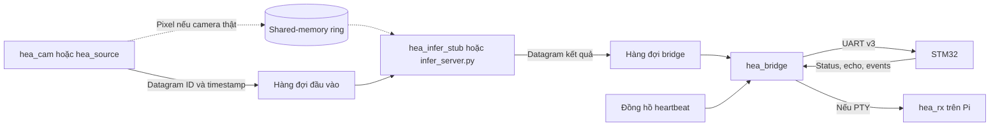
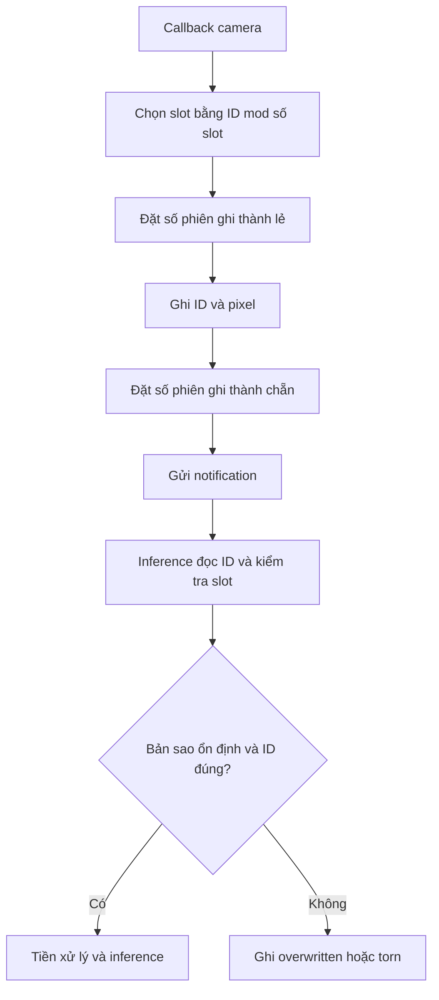
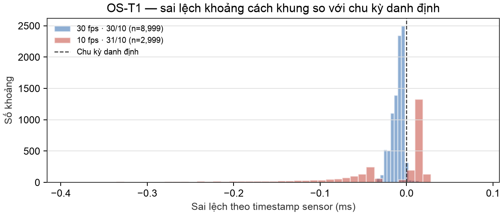
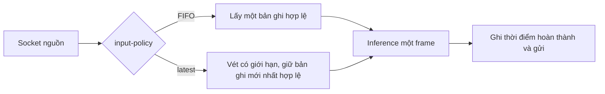
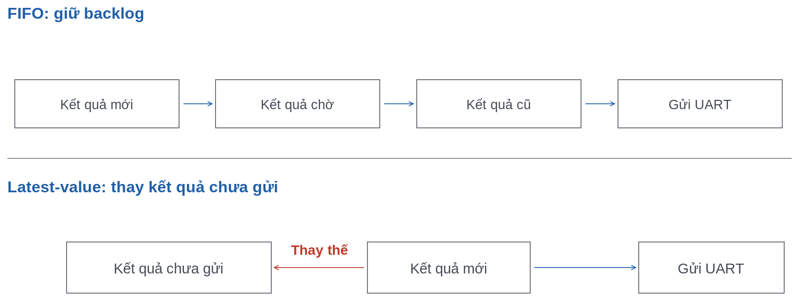
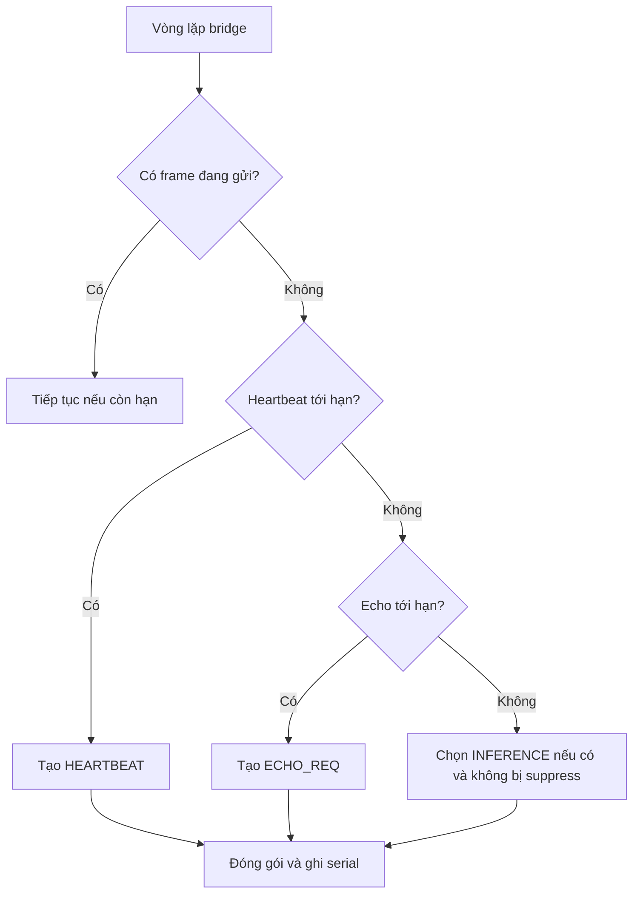

# SESSION 3 — PART B: Từ camera đến bridge

Sau phần này, bạn lần theo được một frame từ thời điểm chụp đến lúc kết quả được đóng gói, biết có hai vị trí hàng đợi độc lập và tính được tuổi dữ liệu khi gửi.

## B1. Sơ đồ sản phẩm và ba đường chạy


!!! note "Cách đọc hình"
    Khối Linux workload chứa ONNX Runtime/MobileNetV2, bridge đứng ở biên UART. Hình không liệt kê riêng từng process nguồn và inference; không suy ra MCU dùng IRQ từng byte chỉ từ chữ UART ISR trong hình lịch sử. Firmware hiện có RX DMA. Mũi tên heartbeat độc lập với kết quả.



SOURCE: [`os/scripts/pi/run_pipeline.sh`](https://github.com/KaiserRichard/edge-ai-video-runtime/blob/main/os/scripts/pi/run_pipeline.sh) chạy `hea_source`, chọn `hea_infer_stub` hoặc [`infer_server.py`](https://github.com/KaiserRichard/edge-ai-video-runtime/blob/main/os/linux/inference/infer_server.py), tạo `hea_bridge`, dùng `socat` và `hea_rx` nếu không chỉ định serial. Script này không tự khởi động camera vật lý. Đường camera CAM1 được mô tả trong [`os/linux/camera/README.md`](https://github.com/KaiserRichard/edge-ai-video-runtime/blob/main/os/linux/camera/README.md) và [`os/tools/experiments/camera_pipeline.sh`](https://github.com/KaiserRichard/edge-ai-video-runtime/blob/main/os/tools/experiments/camera_pipeline.sh).

| Chế độ | Nguồn | Workload | Đích |
|---|---|---|---|
| Stub | `hea_source` tạo notification | Giả lập CPU work | PTY hoặc serial |
| ONNX cố định | `hea_source` | MobileNetV2, ảnh xác định trước | PTY hoặc serial |
| CAM1 | `hea_cam` | ONNX đọc pixel từ shared memory | Tùy runner camera |

E1–E3 lịch sử dùng PTY, không đo thời gian truyền UART vật lý. Thay nguồn/đích không làm thay đổi mục tiêu của giao thức thông báo nhưng thay đổi workload và ranh giới phép đo.

!!! tip "Nói đơn giản"
    Pipeline giống dây chuyền sản xuất. Có thể dùng hộp rỗng để thử tốc độ băng chuyền, dùng hàng thật để thử cả khâu chế biến, hoặc nối sang máy khác để thử khâu giao hàng. Ba phép thử không chứng minh cùng một thứ.

## B2. Nguồn sinh dữ liệu: lịch phát và frame ID

SOURCE: [`os/linux/src/hea_source.c`](https://github.com/KaiserRichard/edge-ai-video-runtime/blob/main/os/linux/src/hea_source.c), `main`, dùng deadline tuyệt đối theo `CLOCK_MONOTONIC`. Mỗi release gán ID, lấy thời điểm `hea_raw_now`, gửi bản ghi. Nếu quá hạn tiếp theo, bỏ các release đã lỡ thay vì tạo bù một đợt dữ liệu.

SOURCE: [`os/linux/src/hea_runtime.c`](https://github.com/KaiserRichard/edge-ai-video-runtime/blob/main/os/linux/src/hea_runtime.c), `hea_options_parse` đặt mặc định source 100 ms, heartbeat 20 ms, echo 1000 ms, baud 921600. Các period là cấu hình, không phải bảo đảm thực tế.

\[
t_k=t_0+kT,\qquad e_k=t_{\mathrm{actual},k}-t_k.
\]

Absolute sleep (ngủ tới mốc tuyệt đối) giữ lịch danh định, giảm tích lũy sai lệch so với ngủ tương đối sau mỗi lần làm việc. Nếu quá tải, release vẫn có thể muộn. CALCULATED từ T=100 ms: tốc độ danh định 10 notification/s.

??? note "Mã nguồn (tuỳ chọn)"
    [`os/linux/src/hea_source.c`](https://github.com/KaiserRichard/edge-ai-video-runtime/blob/main/os/linux/src/hea_source.c), `main` (đoạn sau khi ghi log), dòng 30–35:

    ```c
    ++generated; deadline += period;
    uint64_t now = hea_now(CLOCK_MONOTONIC);
    if (now > deadline) {
        uint64_t skip = (now - deadline) / period + 1u;
        deadline += skip * period; missed += skip;
    }
    ```

## B3. Camera thật và shared-memory ring

SOURCE: [`os/linux/camera/README.md`](https://github.com/KaiserRichard/edge-ai-video-runtime/blob/main/os/linux/camera/README.md), CAM1 ABI: vùng nhớ vòng có mặc định bốn slot. Metadata đầu vào vẫn là frame ID và timestamp. Camera dùng callback libcamera; producer không chờ inference. `frame_id % slots` xác định vị trí lưu.



Số phiên ghi lẻ biểu thị đang ghi; số chẵn biểu thị đã công bố. Reader kiểm tra trước và sau khi sao chép. Nếu thay đổi hoặc đang ghi thì không dùng ảnh. Nếu ID trong slot khác ID yêu cầu, frame đã bị thay thế. Đây là mô tả theo README và header [`ring.h`](https://github.com/KaiserRichard/edge-ai-video-runtime/blob/main/os/linux/camera/ring.h); các tệp C++ capture thực thi đầy đủ không có trong ZIP nên không trích mã giả thay cho chúng.

CALCULATED: với bốn slot và 30 FPS (SOURCE: camera README), thời gian một vị trí được dùng lại theo lịch lý tưởng là 4/30 ≈ 133.33 ms. Không coi đó là thời gian lưu bảo đảm; phụ thuộc callback và ID thực tế.



!!! note "Cách đọc hình"
    Trục X là sai lệch khoảng cách timestamp sensor so với chu kỳ danh định (ms), không phải độ trễ inference. Trục Y đếm khoảng. MEASURED theo nhãn hình: 30 FPS có 8999 khoảng (30/10); 10 FPS có 2999 khoảng (31/10). Đường đứt là sai lệch bằng không. Hai đám phân bố gần gốc cho thấy khoảng cách chụp gần lịch danh định; không chứng minh callback hay IPC luôn đúng hạn.

??? info "Chi tiết nâng cao — đồng hồ camera"
    SOURCE: README nói SensorTimestamp theo CLOCK_BOOTTIME. Callback lấy cặp mẫu BOOTTIME/RAW, chọn khoảng bracket RAW hẹp nhất rồi ánh xạ timestamp sensor sang CLOCK_MONOTONIC_RAW. Giả thiết không suspend, độ lệch ổn định trong khoảng đo. Đây là ánh xạ trong cùng Pi, khác phép fit Pi–STM32. Không trừ timestamp khác clock chỉ vì chúng cùng đơn vị ns.

## B4. Định dạng IPC: dữ liệu nhỏ có ý nghĩa lớn

SOURCE: [`os/linux/include/hea_ipc.h`](https://github.com/KaiserRichard/edge-ai-video-runtime/blob/main/os/linux/include/hea_ipc.h), [`os/linux/src/hea_ipc.c`](https://github.com/KaiserRichard/edge-ai-video-runtime/blob/main/os/linux/src/hea_ipc.c), [`os/linux/inference/bench_common.py`](https://github.com/KaiserRichard/edge-ai-video-runtime/blob/main/os/linux/inference/bench_common.py).

| Đường truyền | Bố cục little-endian | Kích thước SOURCE |
|---|---|---:|
| Source → inference | `frame_id` u32, `t_input_ns` u64 | 12 B |
| Inference → bridge | `frame_id` u32, `t_input_ns` u64, `t_done_ns` u64, `class_id` u8, `confidence` u8 | 22 B |

Little-endian (byte ít quan trọng trước) xác định thứ tự byte, không phải thứ tự frame. Các bản ghi được pack rõ ràng, không phụ thuộc padding struct C. Datagram quá ngắn hoặc quá dài bị từ chối. `t_input_ns` đi xuyên suốt pipeline không đổi.

??? note "Mã nguồn (tuỳ chọn)"
    [`os/linux/inference/bench_common.py`](https://github.com/KaiserRichard/edge-ai-video-runtime/blob/main/os/linux/inference/bench_common.py), dòng 11–12:

    ```python
    SOURCE_RECORD = struct.Struct('<IQ')
    RESULT_RECORD = struct.Struct('<IQQBB')
    ```

## B5. Inference: vị trí hàng đợi đầu tiên

SOURCE: [`os/linux/inference/infer_server.py`](https://github.com/KaiserRichard/edge-ai-video-runtime/blob/main/os/linux/inference/infer_server.py), `receive_input` và `serve`. Tiến trình chờ bản ghi hợp lệ, có thể vét thêm các datagram đang đợi, sau đó đọc ảnh (nếu có nguồn SHM), preprocess, gọi model, postprocess, lấy `t_done_ns`, gửi bản ghi kết quả. Không có worker pool xử lý nhiều frame song song ở vòng lặp này. ORT có các worker nội bộ.



SOURCE: `DRAIN_LIMIT = 64`, `DRAIN_NS = 2_000_000`. Latest đọc tối đa thêm 64 datagram hoặc tới ngưỡng thời gian kiểm tra 2 ms (đến điều kiện nào trước); malformed cũng tiêu hao lượt vét. Không coi giới hạn này là worst-case latency cứng khi OS có thể treo luồng. Frame bị thay thế được log `skipped_stale`, không có timestamp hoàn thành. Không preempt inference đang chạy.

!!! tip "Nói đơn giản"
    Nhân viên chỉ có thể đọc một tập hồ sơ tại một thời điểm. Trước khi đọc, anh ta có thể bỏ các bản cập nhật đã hết hạn và chọn bản mới nhất. Nhưng khi đã đọc, anh ta không bỏ ngang để bắt đầu lại ở mỗi bản mới.

??? note "Mã nguồn (tuỳ chọn)"
    [`os/linux/inference/infer_server.py`](https://github.com/KaiserRichard/edge-ai-video-runtime/blob/main/os/linux/inference/infer_server.py), `receive_input`, dòng 54–62:

    ```python
    if newest is not None:
        skipped += 1
        if samples is not None:
            samples.writerow((*newest, '', 'skipped_stale'))
    newest = record
    if drain_started is None:
        drain_started = time.monotonic_ns()
    if input_policy == 'fifo':
        return newest, skipped
    ```

### B5.1. Workload và phép đo

Model ONNX MobileNetV2 là workload thực, nhưng chế độ nguồn ảnh cố định không kiểm tra chất lượng nhận dạng camera. SOURCE: README mô tả resize 224×224, chuẩn hóa, tensor NCHW, CPUExecutionProvider; kết quả class ID rút gọn modulo 256 là giới hạn đã biết. Không suy ra độ chính xác phân lớp.

Hai đồng hồ timestamp input và done dùng Pi RAW. \(t_{done}-t_{input}\) bao gồm cả thời gian chờ đầu vào, preprocess, inference và postprocess. Không gọi toàn bộ khoảng này là thời gian nhân ma trận của model. Một benchmark riêng [`infer_bench.py`](https://github.com/KaiserRichard/edge-ai-video-runtime/blob/main/os/linux/inference/infer_bench.py) đo thời gian gọi model đồng bộ.

## B6. Bridge: vị trí hàng đợi thứ hai



!!! note "Cách đọc hình"
    Hàng trên giữ kết quả cũ chờ UART; hàng dưới ghi đè kết quả chưa gửi. Khác B5, kết quả ở đây đã tốn thời gian inference. Nếu upstream tích backlog thì hàng đợi bridge trống cũng không làm kết quả mới hơn.

SOURCE: [`os/linux/src/hea_ipc.c`](https://github.com/KaiserRichard/edge-ai-video-runtime/blob/main/os/linux/src/hea_ipc.c), `hea_queue_push` và `hea_queue_pop`; [`os/linux/include/hea_ipc.h`](https://github.com/KaiserRichard/edge-ai-video-runtime/blob/main/os/linux/include/hea_ipc.h), `HEA_QUEUE_CAPACITY=256`. FIFO đầy bỏ kết quả mới; latest ghi đè phần tử đang chờ. [`hea_bridge.c`](https://github.com/KaiserRichard/edge-ai-video-runtime/blob/main/os/linux/src/hea_bridge.c) còn có một `pending` frame đang chuẩn bị hoặc gửi từng phần. Latest có thể thay pending inference chưa bắt đầu gửi. Không thay các byte thuộc frame đã gửi dở.

| Chính sách | Nơi áp dụng | Khi quá tải |
|---|---|---|
| `--input-policy fifo/latest` | Trước inference | Chọn frame nào sẽ được xử lý |
| `--policy fifo/latest` | Trước UART | Chọn kết quả đã có nào sẽ được gửi |

??? note "Mã nguồn (tuỳ chọn)"
    [`os/linux/src/hea_ipc.c`](https://github.com/KaiserRichard/edge-ai-video-runtime/blob/main/os/linux/src/hea_ipc.c), `hea_queue_push`, dòng 42–47:

    ```c
    if (q->latest && q->count != 0u) {
        q->items[q->head] = *r; ++q->overwritten; return 1;
    }
    if (q->count == HEA_QUEUE_CAPACITY) { ++q->dropped; return 0; }
    q->items[(q->head + q->count) % HEA_QUEUE_CAPACITY] = *r;
    ++q->count; return 1;
    ```

### B6.1. Thứ tự dispatch heartbeat và inference

SOURCE: [`os/linux/src/hea_bridge.c`](https://github.com/KaiserRichard/edge-ai-video-runtime/blob/main/os/linux/src/hea_bridge.c), `main`, vòng lặp `poll` chờ IPC/serial/deadline; giới hạn batch đọc IPC. Khi chọn **frame mới**, ưu tiên heartbeat đã tới hạn, sau đó echo, rồi inference từ hàng đợi. Không ngắt frame đang gửi dở. Khi lịch heartbeat bị trễ, mốc tiếp theo được đưa về tương lai thay vì gửi bù mọi heartbeat đã lỡ.



SOURCE: mặc định heartbeat 20 ms → CALCULATED 50 bản tin/s danh định. Hệ điều hành vẫn có thể ngừng cấp CPU. Không được coi heartbeat là bộ định thời bảo đảm cứng.

## B7. Age-at-send (tuổi dữ liệu khi gửi)

Đặt \(t_c\) = `t_input_ns`, \(t_d\) = `t_done_ns`, \(t_s\) = timestamp ngay trước lần ghi phần đầu frame. Cả ba thuộc clock RAW của Pi.

\[
A_{send}=\left\lceil\frac{t_s-t_c}{1000}\right\rceil\quad(\mu s),\qquad
 t_s-t_c=(t_d-t_c)+(t_s-t_d).
\]

SOURCE: [`os/protocol/src/hea_proto.c`](https://github.com/KaiserRichard/edge-ai-video-runtime/blob/main/os/protocol/src/hea_proto.c), `hea_age_at_send_us`: từ chối thời gian đi lùi, làm tròn lên microsecond và giới hạn ở UINT32_MAX thay vì tràn vòng. [`hea_bridge.c`](https://github.com/KaiserRichard/edge-ai-video-runtime/blob/main/os/linux/src/hea_bridge.c), `prepare` lấy `hea_raw_now` và tính tuổi; `transmit` gọi prepare khi chưa có prefix đã ghi. Nếu mới gửi được một phần, timestamp cũ phải giữ nguyên.

!!! tip "Nói đơn giản"
    Hãy ghi tuổi của món ăn lúc chuẩn bị giao, không phải lúc nấu xong. Thời gian món nằm trên quầy vẫn tính vào tuổi của nó.

### B7.1. Ví dụ làm việc

MEASURED: F5 r4 vào HOLD sau 175.596 ms kể từ inference cuối. SOURCE lịch sử: ngưỡng HOLD 200 ms, allowance 5 ms. CALCULATED, bỏ qua sai số lấy mẫu và dùng mốc ngưỡng: \(A_{send}\approx200-175.596-5=19.404\) ms. Đây là **suy ngược xấp xỉ**, không phải trường age-at-send đo trực tiếp của r4. Nó minh họa vì sao phần chờ từ trước khi nhận được kết quả không thể bỏ qua. Session 4 sẽ giải thích điều kiện đánh giá bằng clock MCU.

??? note "Mã nguồn (tuỳ chọn)"
    [`os/protocol/src/hea_proto.c`](https://github.com/KaiserRichard/edge-ai-video-runtime/blob/main/os/protocol/src/hea_proto.c), `hea_age_at_send_us`, dòng 13–17:

    ```c
    if (age_us == NULL || send_ns < input_ns) return -1;
    uint64_t elapsed = send_ns - input_ns;
    uint64_t us = elapsed / UINT64_C(1000) + (elapsed % UINT64_C(1000) != 0u ? 1u : 0u);
    *age_us = us > UINT32_MAX ? UINT32_MAX : (uint32_t)us;
    return 0;
    ```

### B7.2. Khác biệt phiên bản hiện tại

SOURCE: [`os/stm32/firmware/uart_budget.h`](https://github.com/KaiserRichard/edge-ai-video-runtime/blob/main/os/stm32/firmware/uart_budget.h) đặt budget ghi 2000 µs và margin RX 3000 µs, cộng thời gian serial của frame tối đa. [`hea_bridge.c`](https://github.com/KaiserRichard/edge-ai-video-runtime/blob/main/os/linux/src/hea_bridge.c) hết budget thì bỏ frame dở, flush prefix còn trong hàng đợi TX và chờ khoảng yên trước frame mới. CALCULATED tại baud mặc định, tổng allowance hiện tại 5793 µs (chi tiết Session 4). Không thay ngược 5 ms của F2/F5 lịch sử bằng số mới. Đây là budget được thiết kế, chưa phải bound vật lý được hiệu chuẩn.

## B8. Clock domain và đọc log

| File CSV | Nội dung | Clock / giới hạn |
|---|---|---|
| `source.csv` | ID, input, trạng thái gửi | Pi RAW |
| `infer.csv` | Input, done, sent/dropped/skipped | Pi RAW; skip không có done |
| `bridge.csv` | seq, frame ID, input, done, send | Pi RAW |
| `rx.csv` | Đích PTY | Pi RAW; không có MCU |
| `state_events.csv` | Old/new, reason, last HB/INF | MCU timestamp, có thời điểm nhận Pi riêng |
| `inf_rx.csv` | MCU source age, mapped age, state | Hai đại lượng khác nhau |
| `echo.csv` | T1–T4 và fit | Cần mapping trước khi so khác clock |

SOURCE: [`hea_bridge.c`](https://github.com/KaiserRichard/edge-ai-video-runtime/blob/main/os/linux/src/hea_bridge.c), `main` mở các CSV, `mapped_time` dùng ước lượng offset/drift và `inf_map` ghép wire sequence với result. Nếu không ghép được, không bịa ID. `CLOCK_MONOTONIC` dùng lập lịch; `CLOCK_MONOTONIC_RAW` dùng timestamp đo. Không trộn hai loại clock khi lấy hiệu.

??? info "Chi tiết nâng cao — echo và độ trễ một chiều"
    Đổi T1,T4 từ Pi ns sang µs. T2,T3 là clock MCU µs đã mở rộng wrap. Lý thuyết (giả sử clock có cùng rate trong một lần trao đổi):

    \[
    \hat\theta=\frac{(T_2-T_1)+(T_3-T_4)}2,\qquad \delta=(T_4-T_1)-(T_3-T_2).
    \]

    Offset bị sai lệch nếu đường đi/về không đối xứng. Fit affine \(t_M=a t_P+b\) cho phép ánh xạ ngược \(t_P=(t_M-b)/a\); RMS phần dư không phải giới hạn tuyệt đối của lỗi một chiều. SOURCE: [`os/protocol/CLOCK_SYNC.md`](https://github.com/KaiserRichard/edge-ai-video-runtime/blob/main/os/protocol/CLOCK_SYNC.md), [`os/protocol/src/hea_clock_sync.c`](https://github.com/KaiserRichard/edge-ai-video-runtime/blob/main/os/protocol/src/hea_clock_sync.c), `hea_bridge.c:mapped_time`. Không cần đồng bộ hai clock để cộng age-at-send (một khoảng thời gian Pi) với elapsed (một khoảng thời gian MCU); vẫn có sai số tốc độ clock và allowance truyền.

## B9. Trắc nghiệm

<div class="quiz" markdown>
<p class="quiz-q">Đổi latest-value ở bridge làm gì?</p>


- [ ] Hủy toàn bộ inference đang chạy
- [x] Thay kết quả cũ đang chờ gửi bằng kết quả mới, không tự sửa backlog trước inference
- [ ] Xóa độ trễ model
- [ ] Tăng UART baud tự động

<div class="quiz-why" markdown>
Bridge chỉ nhận kết quả đã xử lý. Nếu dữ liệu cũ ngay từ đầu vào inference, thay kết quả ở bridge là quá muộn để tiết kiệm công việc đó.
</div>
</div>

<div class="quiz" markdown>
<p class="quiz-q">Trục X của OS-T1 thể hiện đại lượng nào?</p>


- [ ] Thời gian nhận UART
- [ ] Thời gian suy luận ONNX
- [x] Sai lệch khoảng cách timestamp sensor so với chu kỳ danh định
- [ ] Thời gian từ camera tới FAILSAFE

<div class="quiz-why" markdown>
Đây là phân bố sai lệch khoảng cách chụp. Camera có lịch ổn định vẫn có thể gặp trễ ở inference hoặc bridge.
</div>
</div>

<div class="quiz" markdown>
<p class="quiz-q">Nếu t_done và t_send khác nhau, tuổi dữ liệu gửi cần lấy mốc nào?</p>

- [ ] t_done trừ t_input, luôn luôn đủ
- [ ] t_send trừ clock MCU
- [ ] Chỉ thời gian serialization
- [x] t_send trừ t_input trên cùng clock Pi

<div class="quiz-why" markdown>
Phải bao gồm cả thời gian chờ sau inference. Clock MCU có gốc khác nên không thể lấy hiệu trực tiếp với timestamp Pi.
</div>
</div>

<div class="quiz" markdown>
<p class="quiz-q">Heartbeat còn được gửi đều, nhưng bridge không gửi INFERENCE. MCU có thể kết luận gì?</p>


- [x] Bridge có dấu hiệu còn hoạt động, nhưng chưa đủ chứng minh dữ liệu còn mới
- [ ] Model chắc chắn chạy đúng
- [ ] Mọi kết quả mới đến đúng hạn
- [ ] Camera chắc chắn đang chụp

<div class="quiz-why" markdown>
Hai bản tin có chức năng khác nhau. Đây là lý do supervisor kiểm tra liveness và freshness riêng.
</div>
</div>

## B10. Câu thầy có thể hỏi

??? question "Tại sao có hai hàng đợi và vì sao E3 đổi queue vẫn chậm?"
    Queue trước inference chứa công việc chưa xử lý; queue bridge chứa kết quả đã có. E3 đổi queue bridge nhưng dữ liệu đã chờ lâu trước inference. Cần latest tại đúng vị trí tạo backlog.

??? question "Vì sao cần t_input, t_done, t_send thay vì chỉ t_done?"
    Để phân biệt tuổi từ khi chụp, thời điểm hoàn thành workload và chờ gửi. MCU nhận tuổi dữ liệu chứ không chỉ thông tin rằng một kết quả vừa tới.

??? question "Heartbeat có phải gói có priority trên UART theo nghĩa preemption không?"
    Không. Bridge ưu tiên chọn heartbeat khi bắt đầu frame mới; frame đang ghi dở không bị chen byte heartbeat. Scheduler, UART và budget còn ảnh hưởng thời gian giao thực tế.

**Nguồn:** các đường dẫn đã ghi trong từng mục; [`STAGE_REPORT.md`](https://github.com/KaiserRichard/edge-ai-video-runtime/blob/main/os/docs/STAGE_REPORT.md), [`os/linux/camera/README.md`](https://github.com/KaiserRichard/edge-ai-video-runtime/blob/main/os/linux/camera/README.md), [`os/protocol/PROTOCOL.md`](https://github.com/KaiserRichard/edge-ai-video-runtime/blob/main/os/protocol/PROTOCOL.md), các hình `oscn_figures.zip`. Nội dung code được đọc từ ZIP hiện tại, không chạy lại chương trình.
