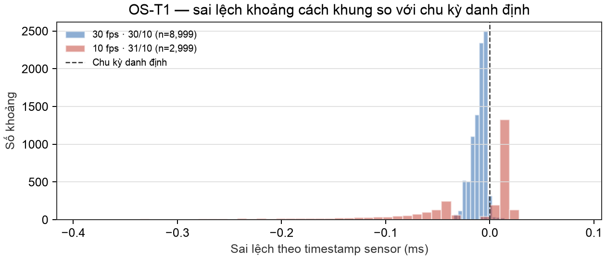
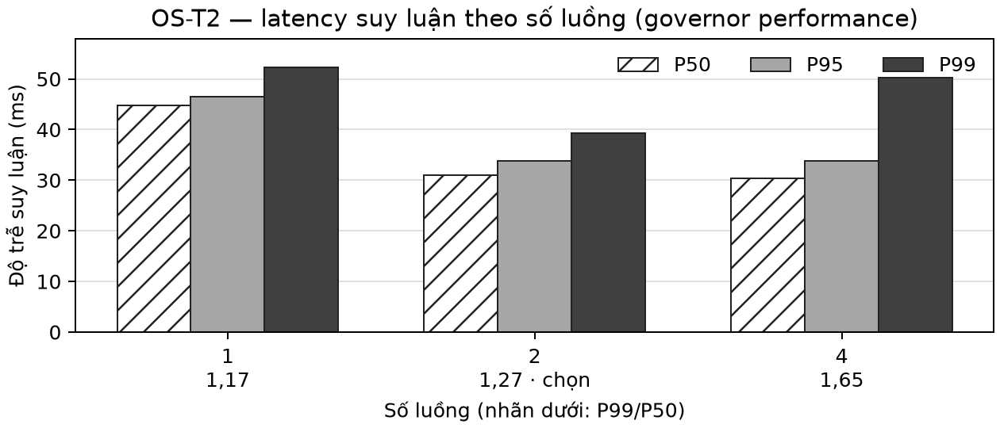
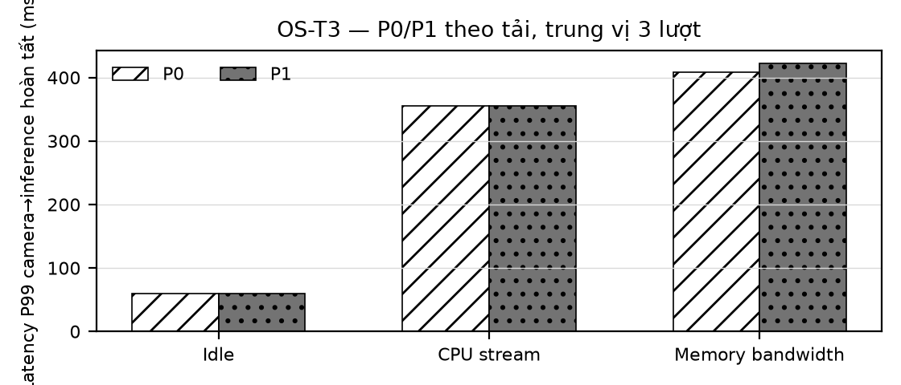
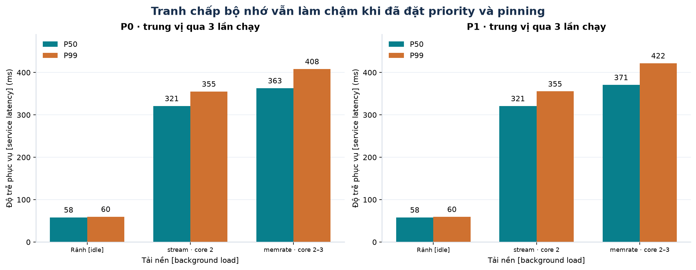
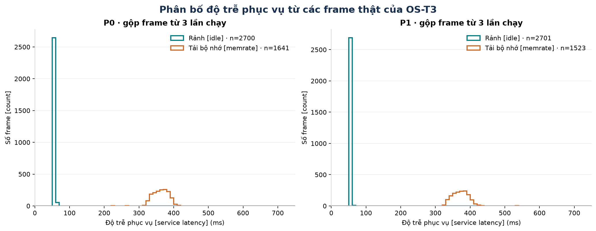
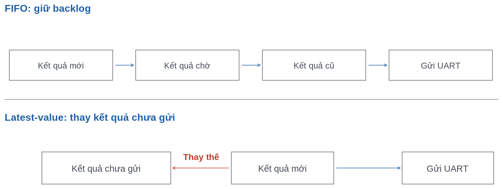
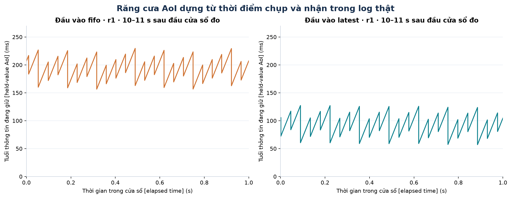
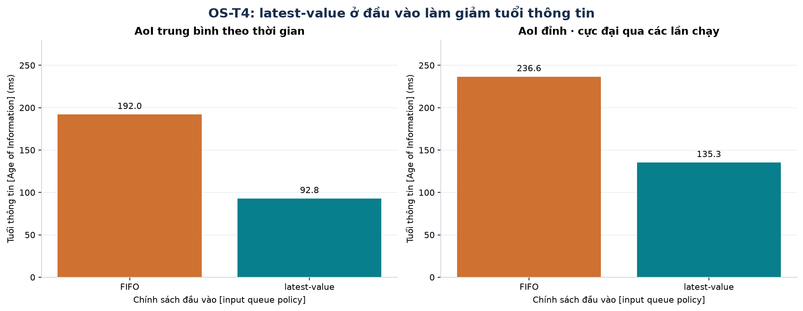
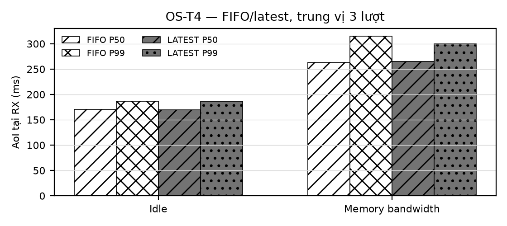
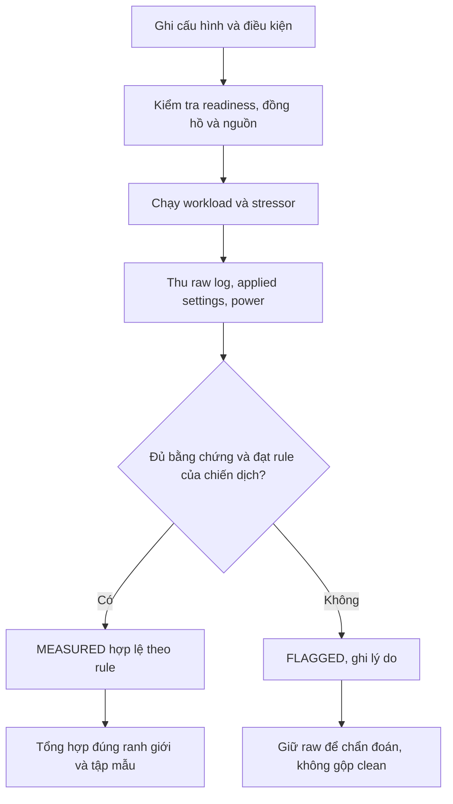

# SESSION 3 — PART C: Thí nghiệm và kết quả Linux

Sau phần này, bạn giải thích được các thí nghiệm E1–E4, phân biệt OS-T1–T4 với chiến dịch E trước đó, biết vì sao kết quả bị loại và không biến một phép đo chẩn đoán thành bằng chứng an toàn.

## C1. Đọc metric trước khi đọc số

| Metric | Định nghĩa | Điểm cần nhớ |
|---|---|---|
| Wake-up latency | Thời điểm thức dậy thực tế trừ deadline timer | Không phải thời gian inference |
| Model-call latency | Thời gian gọi model đồng bộ | Không gồm chờ frame trước khi bắt đầu |
| Pipeline service | Input → hoàn thành inference | Gồm chờ đầu vào và xử lý |
| Delivery latency | Input → nhận ở endpoint | Phải biết endpoint là PTY hay MCU |
| Reception age | Tuổi của một kết quả tại lúc nhận | Một mẫu theo sự kiện |
| Held-value AoI | Tuổi thông tin mới nhất đang được giữ | Trung bình theo thời gian, kể cả lúc không có kết quả mới |

P50 là trung vị. P99 mô tả phần đuôi cao của phân bố. Max là giá trị lớn nhất quan sát được, không phải worst-case bound (giới hạn trường hợp xấu nhất).

??? info "Chi tiết nâng cao — percentile và tập mẫu"
    Với nearest rank, sắp xếp n mẫu và chọn vị trí \(\lceil pn\rceil\), với p là tỷ lệ từ 0 đến 1. Benchmark inference dùng nội suy tuyến tính theo README, không phải mọi phép đo đều dùng nearest rank. Bảng stage report thường lấy trung vị của các percentile theo lần chạy và max lớn nhất qua các lần. Không gộp percentile bằng cách lấy trung bình tùy ý. Đừng so histogram gộp frame với percentile trung vị qua run như thể chúng là một thống kê.

## C2. Cyclictest — độ trễ đánh thức luồng

**Câu hỏi:** đặt một luồng đo thức dậy định kỳ; khi deadline tới, OS cho luồng chạy trễ bao lâu?

\[
L_k=t_{wake,k}-t_{target,k}.
\]

SOURCE/MEASURED theo [`STAGE_REPORT.md`](https://github.com/KaiserRichard/edge-ai-video-runtime/blob/main/os/docs/STAGE_REPORT.md), Timer wake-up diagnostic: kernel stock `6.8.0-1064-raspi` PREEMPT_DYNAMIC, governor performance, khóa bộ nhớ, CPU 0, chu kỳ 1 ms; P0 SCHED_OTHER, P1 SCHED_FIFO priority 50. Ba lần/cell, 120 s/lần, 30/30 được chấp nhận theo v1.

**MEASURED — µs; P50/P99/P99.9 là trung vị qua các lần, max là max quan sát.**

| Tải | P0 P50 / P99 / P99.9 / max | P1 P50 / P99 / P99.9 / max |
|---|---:|---:|
| Idle | 53 / 57 / 678 / 2659 | 3 / 9 / 15 / 92 |
| CPU 2–3 | 54 / 68 / 914 / 2636 | 3 / 11 / 17 / 73 |
| Stream CPU 2 | 56 / 300 / 1573 / 3565 | 5 / 39 / 51 / 211 |
| Cache 2M CPU 2 | 54 / 203 / 1463 / 4780 | 3 / 35 / 52 / 233 |
| Memrate CPU 2–3 | 55 / 613 / 2092 / 5170 | 5 / 239 / 588 / 1094 |

CALCULATED: idle max P0/P1 ≈ 2659/92 = 28.9. Không nói "Linux nhanh hơn 29 lần". Chỉ tỷ số giữa hai observed maxima của phép đo đánh thức. P1 memrate max vẫn cao hơn P1 idle. Timer slack mặc định của P0 có thể góp phần vào chênh lệch trung vị (INFERRED trong báo cáo). Không quy toàn bộ chênh lệch cho scheduler.

!!! warning "Không có hình cyclictest gốc trong oscn_figures.zip"
    Bảng trên lấy từ stage report. Không dùng `os_t3_p0_p1.png` làm histogram cyclictest: nó là latency camera → inference, đơn vị ms khác µs.

## C3. Baseline model riêng và OS-T1/T2

!!! note "Cách đọc hình"
    X là sai lệch khoảng cách sensor timestamp (ms) so với chu kỳ danh định; Y là số khoảng. Đọc độ rộng và vị trí so với đường đứt tại zero. Hình OS-T1 không đo callback latency hoặc UART. MEASURED theo hình: 8999 khoảng tại 30 FPS và 2999 tại 10 FPS.

!!! note "Cách đọc hình"
    X là số luồng inference; Y là latency ms; ba kiểu cột là P50, P95, P99. Hình governor performance đánh dấu chọn hai luồng, tỷ số P99/P50 ghi dưới nhóm là 1.27 (MEASURED theo hình). Bốn luồng có P50 gần hai luồng nhưng P99 cao hơn. Đây là chiến dịch OS-T2, không phải bảng baseline governor ondemand dưới đây.

Stage report, Inference workload alone: đo 1000 lần gọi sau 50 warm-up (SOURCE), ảnh xác định, governor ondemand, CPU 0–3. 21/24 run hợp lệ (MEASURED/CALCULATED theo báo cáo). Kết quả **MEASURED ms**, percentile trung vị qua các lần hợp lệ:

| Tải | ORT threads | Run hợp lệ | P50 | P99 | Max |
|---|---:|---:|---:|---:|---:|
| Idle | 1 | 3 | 44.0 | 48.0 | 57.0 |
| Idle | 2 | 3 | 31.1 | 42.9 | 51.8 |
| Idle | 3 | 3 | 29.4 | 38.5 | 52.8 |
| Idle | 4 | 1 | 31.4 | 70.7 | 94.1 |
| CPU 2–3 | 1 | 3 | 45.1 | 53.7 | 65.5 |
| CPU 2–3 | 2 | 3 | 33.2 | 46.1 | 105.5 |
| CPU 2–3 | 3 | 3 | 45.5 | 77.6 | 91.1 |
| CPU 2–3 | 4 | 2 | 60.3 | 100.5 | 150.3 |

CALCULATED idle speedup trung vị từ một sang hai luồng: 44.0/31.1 ≈ 1.41, không phải nhân đôi. Nhiều luồng tăng overhead, chia cache/băng thông; dữ liệu ở đây không cô lập được nguyên nhân. Số run hợp lệ không đều. Không điền P95 baseline từ hình OS-T2 vào bảng này.

## C4. E1 — contention trong pipeline PTY

Mục tiêu: giữ workload và profile P0, đổi tải nền. Ranh giới đo là Pi input đến inference done và Pi receiver (PTY). Không có MCU hay truyền serial vật lý. SOURCE: báo cáo E1–E2, 3 run hợp lệ mỗi cell theo v1; nominal source window 60 s.

**MEASURED ms, P50/P99/max.**

| Tải E1 P0 | Service | Delivery |
|---|---:|---:|
| Idle | 44.25 / 48.28 / 56.31 | 44.37 / 48.47 / 56.47 |
| CPU 2–3 | 45.20 / 48.13 / 80.74 | 45.41 / 48.30 / 80.98 |
| Stream CPU 2 | 76.46 / 88.50 / 202.80 | 76.99 / 89.02 / 203.40 |
| Cache 2M CPU 2 | 67.58 / 97.30 / 121.60 | 68.00 / 98.83 / 121.80 |
| Memrate CPU 2–3 | 6626 / 13980 / 15120 | 6626 / 13980 / 15120 |

CALCULATED: P50 service memrate/idle ≈ 149.7. Điều đó không có nghĩa model-call mất 6.626 s. Service bắt đầu từ input, bao gồm thời gian chờ. Khi đầu vào nhanh hơn đầu ra, tuổi của công việc tăng dần dù mỗi inference vẫn hoàn thành.

## C5. E2 — ưu tiên và pinning có giải quyết được không?

**MEASURED ms, service P50/P99/max, 3 valid repeats/cell (v1).**

| Tải | P0 | P1 |
|---|---:|---:|
| Idle | 43.90 / 49.15 / 58.33 | 43.94 / 48.81 / 56.24 |
| Memrate | 6506 / 13260 / 13410 | 6000 / 12890 / 14070 |
| Cache 2M | 66.36 / 73.10 / 108.80 | 69.80 / 96.58 / 135.70 |

P1 giúp cấu trúc lịch chạy source/bridge nhưng không loại bỏ hàng đợi tích tụ. P99 cache còn cao hơn trong mẫu đo P1. Không tuyên bố P1 luôn tốt hơn.

### C5.1. Đọc chiến dịch OS-T3 sau này (không nhập chung E2)

!!! note "Cách đọc hình"
    Hình OS-T3 đầu tiên chỉ so P99 camera → inference hoàn tất (ms), trung vị các lần. Hình thứ hai tách P0/P1 thành hai panel, có P50 và P99. Trục X là nhóm tải nền. MEASURED theo số ghi trên cột: cả hai profile idle 58/60 ms; stream 321/355 ms; memrate P0 363/408 ms và P1 371/422 ms. Số của chiến dịch camera này không thay cho E2 PTY trước đó.

!!! note "Cách đọc hình"
    X: service latency (ms), Y: số frame. Hình gộp frame từ ba lượt theo nhãn; idle tập trung gần 60 ms còn memrate quanh vài trăm ms. Đây là phân bố, không phải đường thời gian; không biết frame nào đến trước. Chênh lệch số mẫu khiến không được dùng chiều cao đỉnh như tỷ lệ mất frame.

Kết luận chung của hai chiến dịch: lịch ưu tiên không giải quyết mọi contention. Chưa có counter phần cứng để quy chính xác phần trễ cho bus bộ nhớ.

## C6. E3 — đổi hàng đợi bridge chưa đúng chỗ

Giữ input FIFO, thay policy bridge. **MEASURED PTY, theo v1; AoI ms, số đếm là trung vị theo run, peak lớn nhất.**

| Tải / bridge | Mean AoI | Peak AoI | Generated/delivered/missing | Replaced |
|---|---:|---:|---|---:|
| Idle FIFO | 94.69 | 158 | 602/602/0 | 0 |
| Idle latest | 94.59 | 156 | 602/602/0 | 0 |
| Memrate FIFO | 6660 | 13660 | 605/480/125 | 0 |
| Memrate latest | 6958 | 14170 | 605/472/132 | 0 |

Bridge không thay kết quả nào dưới tải. Khoảng hoàn thành median qua các run memrate FIFO là 121.72, 125.89, 127.99 ms; latest là 129.07, 123.32, 130.49 ms (MEASURED). Source cấu hình 100 ms (SOURCE). **INFERRED:** backlog tích trước inference; bridge nhận kết quả rời rạc và có thể gửi kịp, nhưng kết quả đã cũ. Đây là bài học tìm đúng nút thắt, không phải chứng minh latest vô ích.

### C6.1. Công thức AoI

Gọi \(u(t)\) là thời điểm sinh của thông tin mới nhất đã nhận tới t:

\[
A(t)=t-u(t),\qquad \bar A=\frac{1}{T_1-T_0}\int_{T_0}^{T_1}A(t)\,dt.
\]

!!! note "Cách đọc hình"
    Trục X: thời gian tương đối trong cửa sổ một giây (nhãn hình: 10–11 s sau đầu cửa sổ đo); Y: held-value AoI ms. Tuổi tăng giữa hai lần nhận. Tuổi giảm khi thông tin mới hơn đến. Panel latest nằm thấp hơn. Diện tích dưới đường chia cho thời gian mới là trung bình theo thời gian, không lấy trung bình các điểm đáy.

Trong khoảng giữa hai lần nhận, nếu tuổi bắt đầu là \(a_i\), độ dài khoảng là \(h_i\), diện tích đoạn là \(a_i h_i+h_i^2/2\). Tính cả đuôi tới cuối cửa sổ. Trước lần nhận có thông tin đầu tiên, AoI chưa xác định. E3 tính trên khoảng đã khởi tạo; không tự đặt tuổi bằng zero lúc chưa có dữ liệu.

## C7. E3b — chuyển latest lên đầu vào

SOURCE: `infer_server.py:receive_input` vét input và log skip. Giữ bridge latest, đổi input FIFO → latest. **FLAGGED — mọi run tải memrate sau đây đều không hợp lệ do power; số tính từ raw timestamp được báo cáo, không phải cải thiện đã kiểm chứng dưới nguồn sạch.**

| Policy input / repeat | Receipts | P50 age ms | P99 age ms | Skips |
|---|---:|---:|---:|---:|
| FIFO r1 | 455 | 8676.0 | 15891.0 | 0 |
| FIFO r2 | 475 | 6527.4 | 13821.6 | 0 |
| FIFO r3 | 457 | 7193.5 | 15579.1 | 0 |
| Latest r1 | 435 | 189.3 | 254.0 | 171 |
| Latest r2 | 435 | 190.3 | 256.0 | 172 |
| Latest r3 | 432 | 190.7 | 267.9 | 173 |

Đây là reception age percentile, không phải held-value mean AoI. Xu hướng chẩn đoán ủng hộ việc chọn frame mới trước inference; không được dùng làm kết quả causal sạch. Tổng E3b hợp lệ 3/12, tất cả tải đều bị loại (CALCULATED theo validity records).

### C7.1. OS-T4, bằng chứng PTY sau này

!!! note "Cách đọc hình"
    Panel trái là time-average AoI, panel phải peak lớn nhất qua các lượt. X là input policy; Y là ms. MEASURED theo hình: idle mean 192.0 → 92.8 ms, peak 236.6 → 135.3 ms. Không nhầm peak với P99.

!!! note "Cách đọc hình"
    Trục X idle/memory bandwidth; Y AoI tại RX (ms). Bốn cột phân biệt P50/P99 của FIFO/latest, theo trung vị ba lượt. Đây là thống kê khác time-average AoI; không lấy độ cao cột thay cho số mean ở hình trước.

Theo `OSCN_DEMO_REVIEW.md`, OS-T4 ngày 30 Oct, bridge latest, PTY, 3 valid repeats; gate deck yêu cầu 5, chưa đạt. **MEASURED:** time-average AoI idle 192.0 → 92.8 ms; memrate 334.7 → 223.5 ms. CALCULATED: giảm tương ứng 51.7% và 33.2%. Đây là bằng chứng thích hợp để trình bày hiệu quả của input policy, trong phạm vi PTY và workload đã đo. Không khẳng định MCU hay actuator có cùng mức cải thiện.

### C7.2. E3 real UART: không có clean comparison

**FLAGGED 0/18 hợp lệ.** Ví dụ memrate r1 ([`STAGE_REPORT.md`](https://github.com/KaiserRichard/edge-ai-video-runtime/blob/main/os/docs/STAGE_REPORT.md), E3 real UART), CALCULATED từ raw đã báo cáo:

| Input / bridge | MCU age P50/P99 ms | Mapped age P50/P99 ms |
|---|---:|---:|
| FIFO/FIFO | 9412.861 / 17995.587 | 9408.471 / 17991.042 |
| FIFO/latest | 9380.214 / 18520.423 | 9375.129 / 18515.654 |
| Latest/latest | 189.510 / 253.305 | 184.895 / 248.357 |

MCU age gồm allowance; mapped age dùng fit clock, không phải cùng đại lượng. Tất cả các run latest/latest có tải báo FAILSAFE tại mọi reception, thiếu state events. Không tuyên bố đo được HOLD gián đoạn chỉ vì age có mẫu vượt 200 ms. Không lấy phần trăm mẫu vượt ngưỡng làm thời gian occupancy HOLD.

## C8. E4 — khi Linux không còn phục vụ được

SOURCE: [`os/tools/experiments/e4_campaign.py`](https://github.com/KaiserRichard/edge-ai-video-runtime/blob/main/os/tools/experiments/e4_campaign.py) có fault F1 kill bridge, F2 SIGSTOP bridge, F3 SIGSTOP inference, F4 FIFO hog priority 99, F5 suppress inference bằng SIGUSR1. F4 làm bridge có thể mất cơ hội chạy dù hệ thống chưa crash. F5 khác F2: bridge vẫn chạy, heartbeat vẫn gửi; kết quả bị giữ lại.

!!! note "Cách đọc hình"
    Panel trái có HOLD và FAILSAFE tính từ inference cuối, panel phải tuổi HB lúc HOLD. MEASURED/CALCULATED theo F5: tuổi HB quanh 17–19 ms, thấp hơn ngưỡng 100 ms, trong khi source age đã quá cũ. Session 4 giải thích mốc thời gian và reason chính xác.

## C9. Runner, validity và loại run

SOURCE: [`os/tools/timing/cyclictest_campaign.sh`](https://github.com/KaiserRichard/edge-ai-video-runtime/blob/main/os/tools/timing/cyclictest_campaign.sh), [`os/tools/experiments/e_campaign.py`](https://github.com/KaiserRichard/edge-ai-video-runtime/blob/main/os/tools/experiments/e_campaign.py), [`e3_real.py`](https://github.com/KaiserRichard/edge-ai-video-runtime/blob/main/os/tools/experiments/e3_real.py), [`e4_campaign.py`](https://github.com/KaiserRichard/edge-ai-video-runtime/blob/main/os/tools/experiments/e4_campaign.py), [`os/scripts/pi/run_pipeline.sh`](https://github.com/KaiserRichard/edge-ai-video-runtime/blob/main/os/scripts/pi/run_pipeline.sh). Runner tạo thư mục riêng, ghi command và config, kiểm tra tiến trình, ghi power/setting/CSV, chạy các điều kiện và tổng hợp. Không chạy lại hoặc cố làm cho số liệu tốt hơn trong bài học.

| Chiến dịch | Kết quả chấp nhận (MEASURED/CALCULATED theo report) | Phạm vi |
|---|---|---|
| Cyclictest v1 | 30/30 | Timer wake-up |
| E1/E2/E3 v1 | 15/15, 18/18, 12/12 | PTY |
| E3b | 3/12 | Không có loaded clean |
| E3 real UART | 0/18 | FLAGGED |
| E4 gốc | 17/25 | Gồm F5 chưa thực hiện trong đợt gốc |
| F5 riêng | 5/5 | Cửa sổ ngắn, không qualification recovery |
| F4 bổ sung | 5/9 | Chỉ transition cửa sổ ngắn |
| E4 + F5 + F4 bổ sung | 27/34 | Retained attempts theo báo cáo; khác scope, không gộp thành độ tin cậy |

Nguồn Pi lịch sử 5 V/3 A; rail dưới tải báo 4.66–4.92 V (MEASURED). Power monitor lấy mẫu mỗi 0.5 s ở các chiến dịch mô tả; không chứng minh không có sụt áp giữa các mẫu. Với E3 real, các lý do chồng lấp: 16/18 live power flags, cả 9 memrate RMS vượt 200 µs, 14/18 thiếu STATE_EVENT. Không cộng các nhóm lỗi như số run độc lập.

??? info "Chi tiết nâng cao — v1/v2 và clock fit"
    Stage report: v1 sử dụng kiểm tra đang áp dụng lúc đo. V2 yêu cầu log power có timestamp RAW phủ cửa sổ, gap tối đa 1.5 s theo mô tả report, liveness stressor, clock fit không cũ quá 5 s. Replay v2 không xác nhận được E1–E3 (0/45) và cyclictest chỉ 3/15 mỗi profile (idle), do thiếu bằng chứng bổ sung, không phải chứng minh số đo sai. E4 gốc vẫn 17/25. `ANALYSIS_READINESS.md` còn ghi bộ kiểm tra E3 real cụ thể chặt hơn (gap 0.75 s, echo gần nhất 2 s, RMS 200 µs); không áp các ngưỡng khác nhau như một rule chung. Các module analysis OS không có đầy đủ trong source ZIP để kiểm lại thực thi. Empty event có thể hợp lệ nếu đã chứng minh steady FRESH, nhưng các run FLAGGED ở đây báo FAILSAFE; không hồi tố sửa verdict.

!!! warning "Điều có thể và chưa thể tuyên bố"
    Có bằng chứng lịch sử về contention, chính sách freshness PTY và state transitions trên MCU. Không có clean comparison E3 real; không chứng minh worst-case latency, an toàn robot, độ tin cậy dài hạn hoặc độ trễ GPIO vật lý. Nguồn raw đầy đủ không có trong ZIP; các bảng E dùng stage report, OS-T4 dùng demo review và hình gốc.

## C10. Trắc nghiệm

Hai panel OS-T3 nói điều gì về P1?

- [ ] P1 xóa toàn bộ contention
- [ ] P1 luôn có P99 thấp hơn P0
- [x] Memrate vẫn có độ trễ cao ở cả hai profile; không có cải thiện đồng nhất
- [ ] Hình đo latency UART vật lý

Hai nhóm memrate vẫn cao hơn idle rõ rệt. Hình là service latency camera/inference, không đo UART.

Muốn tính mean AoI theo thời gian từ đồ thị răng cưa, phải làm gì?

- [ ] Chỉ trung bình các đáy
- [x] Lấy diện tích dưới đường chia cho thời gian đã khởi tạo trong cửa sổ đo
- [ ] Lấy peak lớn nhất
- [ ] Lấy nghịch đảo P99

Tuổi tăng ngay cả khi chưa có kết quả mới. Chỉ lấy đáy bỏ mất phần chờ giữa các lần nhận.

Hình OS-T4 mean AoI chứng minh điều gì?

- [ ] MCU chắc chắn cải thiện giống hệt
- [ ] Mọi run E3 real đã hợp lệ
- [ ] Mọi kết quả đều giảm latency theo tỷ lệ như nhau
- [x] Latest input làm giảm mean AoI trong phép đo PTY được báo cáo

Đó là kết quả trên endpoint PTY. Không chuyển số liệu này thành thời gian đáp ứng actuator hay kết quả clean real UART.

Run có power flag nhưng age thấp hơn rất nhiều nên được xử lý thế nào?

- [x] Giữ lại làm FLAGGED để chẩn đoán, loại khỏi kết luận clean
- [ ] Đưa vào trung bình nếu trend đẹp
- [ ] Xóa raw log
- [ ] Đổi nhãn sang SIMULATED

Validity phải độc lập với kết quả đẹp hay xấu. Việc bị loại không biến phép đo thành mô phỏng.

## C11. Câu thầy có thể hỏi

??? question "Vì sao latest ở bridge không hiệu quả trong E3, nhưng OS-T4 lại cải thiện?"
    E3 cho thấy kết quả đã cũ do backlog trước inference; bridge không thay kết quả nào. OS-T4 chuyển latest tới đúng hàng đợi input, giảm mean AoI PTY idle từ 192.0 xuống 92.8 ms (MEASURED), chỉ trong phạm vi chiến dịch này.

??? question "Tại sao P1 tốt trong cyclictest nhưng chưa giải quyết được E2?"
    Cyclictest đo đánh thức một luồng. Pipeline còn chờ input, tính toán, IPC và bộ nhớ. Priority không cô lập cache/băng thông; P99 memrate vẫn cao.

??? question "Tại sao 0/18 real UART không phủ định mọi kết quả OS?"
    Đó là một tập đo bị loại vì nguồn, fit và thiếu sự kiện. E4 và OS-T4 là chiến dịch khác, có phạm vi hợp lệ riêng. Không gộp hoặc nâng cấp bằng chứng qua các phạm vi.

**Nguồn:** [`STAGE_REPORT.md`](https://github.com/KaiserRichard/edge-ai-video-runtime/blob/main/os/docs/STAGE_REPORT.md) (Linux measurements, Freshness, Physical faults, validity rule versions); `OSCN_DEMO_REVIEW.md` mục OS; `ANALYSIS_READINESS.md`; mã runner đã nêu; hình gốc trong `oscn_figures.zip`. Số liệu được giữ theo cách báo cáo, không chạy lại chiến dịch.
