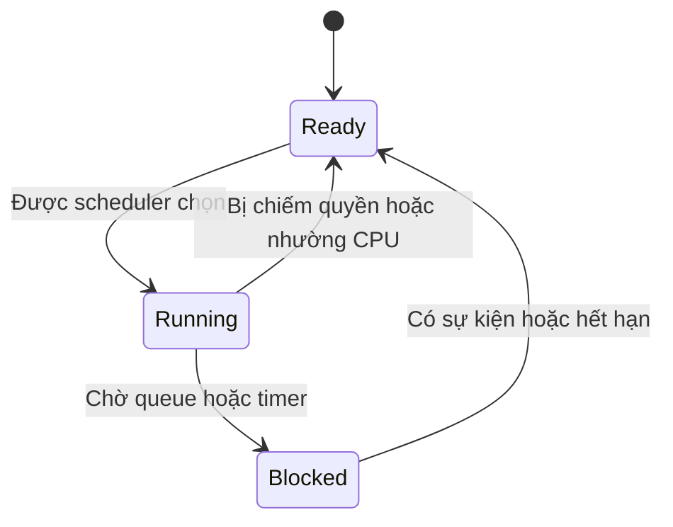
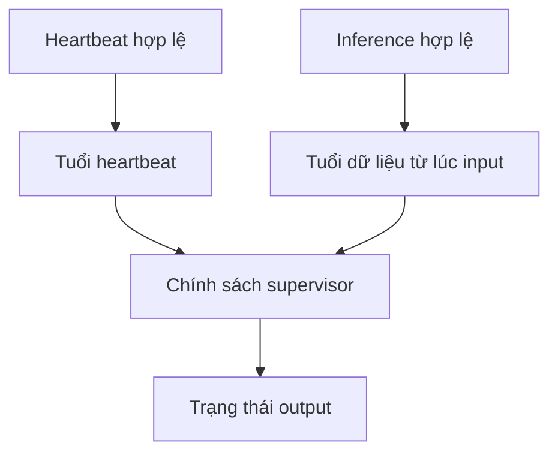
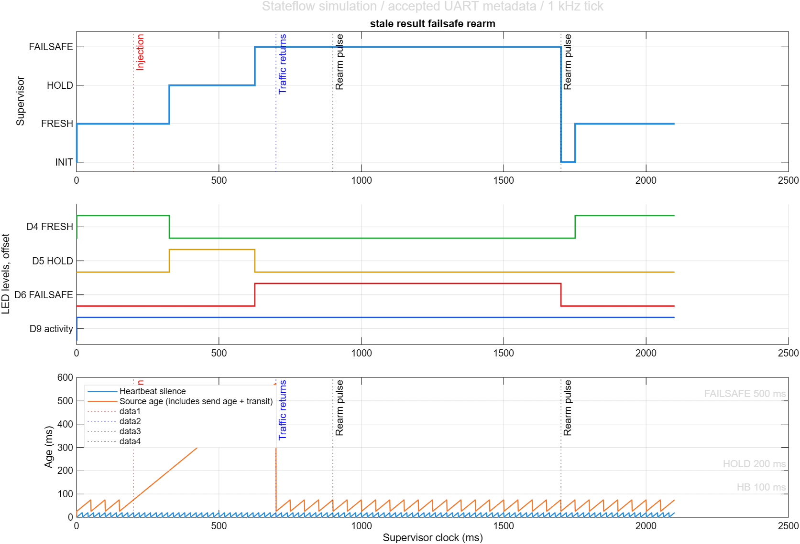
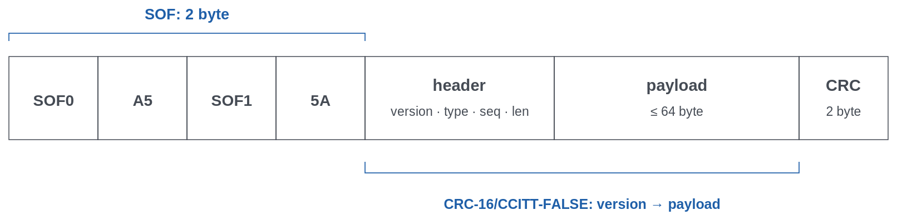
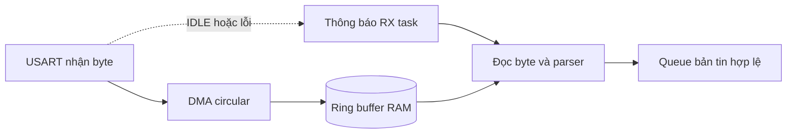

# SESSION 4 — Bộ giám sát FreeRTOS trên STM32

## PART A — Lý thuyết

Sau phần này, bạn hiểu lý do tách giám sát khỏi Linux, vai trò của RTOS, định dạng UART, CRC và DMA. Part B sẽ bám vào firmware thực tế; Part C đọc bằng chứng lỗi.

## A1. General-purpose OS và RTOS

| Tiêu chí | Linux tổng dụng | RTOS (Real-Time Operating System — hệ điều hành thời gian thực) |
|---|---|---|
| Mục tiêu | Chia tài nguyên hiệu quả, chạy ứng dụng đa dạng | Phản ứng theo yêu cầu thời gian, phân tích lịch dễ hơn |
| Tổ chức | Tiến trình, luồng, bộ nhớ ảo, dịch vụ kernel | Task, queue, timer, interrupt; ở MCU này task chung không gian địa chỉ |
| Lịch chạy | Nhiều lớp lập lịch; có chế độ real-time | Thường ưu tiên cố định, tùy cấu hình |
| Kết luận an toàn | Không tự bảo đảm deadline | Cũng không tự bảo đảm deadline nếu thiếu phân tích WCET và ngắt |

Real-time không đồng nghĩa chạy nhanh nhất. Một tác vụ đúng chức năng nhưng muộn deadline có thể vô dụng. Với hard real-time (thời gian thực cứng), việc lỡ deadline là lỗi hệ thống theo yêu cầu; cần chứng minh các giới hạn phù hợp. Dự án là nguyên mẫu giảng dạy, không phải hệ thống an toàn được chứng nhận.


!!! note "Cách đọc hình"
    Linux bên trái có quyền sinh kết quả; MCU bên phải có quyền quyết định trạng thái output. UART nối hai miền. Sơ đồ không có actuator thật và không phải sơ đồ đấu dây cập nhật.

## A2. Task, tick và lập lịch ưu tiên chiếm quyền

Task là đơn vị thực thi của FreeRTOS. Trạng thái thường gặp: Ready (chờ CPU), Running (đang chạy), Blocked (đợi sự kiện/timeout), Suspended (tạm dừng rõ ràng). Task ưu tiên cao nhất đang Ready được chọn trong cấu hình preemptive (chiếm quyền).



Tick là nhịp cơ sở kernel dùng để quản lý thời gian chờ và lịch định kỳ. SOURCE: [`os/stm32/firmware/FreeRTOSConfig.h`](https://github.com/KaiserRichard/edge-ai-video-runtime/blob/main/os/stm32/firmware/FreeRTOSConfig.h), [`clock_config.h`](https://github.com/KaiserRichard/edge-ai-video-runtime/blob/main/os/stm32/firmware/clock_config.h): preemption và time slicing được bật; tick 1000 Hz, CALCULATED chu kỳ 1 ms. Không có nghĩa mọi task phải chạy đủ đúng mỗi tick. ISR (Interrupt Service Routine — trình phục vụ ngắt) có thể chạy ngoài lịch task, có priority ngắt riêng.

### A2.1. Deadline và chu kỳ task

Với task định kỳ, gọi \(T\) là chu kỳ, \(C\) là thời gian CPU cần, \(D\) là deadline. Trong mô hình đơn giản, utilization \(U=C/T\). Khi nhiều task tranh một lõi, tổng utilization là \(\sum_i C_i/T_i\). Điều kiện tải không vượt khả năng xử lý chỉ là bước đầu, không đủ chứng minh mọi deadline trong hệ ưu tiên cố định. Còn blocking, ISR và worst-case execution time (WCET — thời gian thực thi trường hợp xấu nhất).

SOURCE: supervisor task có kỳ 1 ms. Chưa có WCET đã đo độc lập để kết luận chắc chắn đáp ứng mọi deadline. Thời gian event đo gần ngưỡng không thay thế phân tích đó.

!!! tip "Nói đơn giản"
    Người kiểm tra an toàn có quyền ưu tiên hơn người ghi báo cáo. Nhưng nếu công việc kiểm tra quá dài hoặc bị ngắt lâu, lịch ưu tiên một mình vẫn không đủ.

## A3. Vì sao phải có MCU giám sát độc lập?

Một process bridge có thể còn hoạt động nhưng inference ngừng cập nhật. Heartbeat chỉ báo đường liveness (khả năng còn hoạt động của phía gửi) trong phạm vi bản tin hợp lệ được nhận. Freshness (tính mới) hỏi liệu kết quả có còn đủ mới để sử dụng hay không.



| Tình huống | Liveness | Freshness | Ý nghĩa |
|---|---|---|---|
| Bridge và inference hoạt động | Có thể tốt | Có thể tốt | Chỉ cho dùng khi qua cả kiểm tra |
| Bridge dừng | HB mất dần | Kết quả cũng cũ dần | MCU tự timeout |
| Bridge còn chạy, inference bị suppress | HB tiếp tục | Tuổi dữ liệu tăng | MCU vẫn có thể HOLD/FAILSAFE |
| Gói kết quả lặp lại | Có thể có traffic | Không phải thông tin mới | Kiểm tra sequence |



!!! note "Cách đọc hình"
    SIMULATED: panel trên là trạng thái, giữa là LED logic, dưới là tuổi HB/source theo clock supervisor ms. Đường tuổi source tăng tới HOLD rồi FAILSAFE dù heartbeat thấp; khi traffic phục hồi, FAILSAFE chưa tự thoát. Đây là mô hình, không phải đo tín hiệu GPIO.

## A4. UART framing (định khung UART)

UART truyền một luồng byte nối tiếp bất đồng bộ, không tự cung cấp ranh giới bản tin ứng dụng. Cấu hình 8N1 (SOURCE, dự án): một start bit, tám data bits, không parity, một stop bit. Từ byte lên bản tin ứng dụng cần SOF (Start of Frame — dấu bắt đầu frame), length và kiểm tra CRC.



!!! note "Cách đọc hình"
    Đọc trái sang phải: A5/5A, header, payload, CRC. Dấu ngoặc dưới chỉ vùng CRC tính từ version tới hết payload. Hình vẽ SOF theo các ô chú thích, không phải bốn byte; SOF là hai byte A5 5A. Payload tối đa 64 B theo SOURCE.

SOURCE: [`os/protocol/PROTOCOL.md`](https://github.com/KaiserRichard/edge-ai-video-runtime/blob/main/os/protocol/PROTOCOL.md), [`os/protocol/include/hea_proto.h`](https://github.com/KaiserRichard/edge-ai-video-runtime/blob/main/os/protocol/include/hea_proto.h). Với v3 INFERENCE dài 35 byte và baud danh định 921600, CALCULATED:

\[
T_{line}=\frac{35\times10}{921600}\,s\approx0.3798\,ms.
\]

Đây chỉ là thời gian truyền bit trên dây, chưa gồm kernel buffer, thời gian chờ scheduler, DMA, parser hoặc task supervisor.

## A5. CRC — phát hiện dữ liệu bị hỏng

CRC (Cyclic Redundancy Check — kiểm tra dư vòng) xem chuỗi bit như đa thức trên GF(2). Phép cộng/trừ modulo hai là XOR, không có nhớ. Sender tính một giá trị kiểm tra, receiver tính lại rồi so sánh. CRC phát hiện nhiều mẫu lỗi, không sửa lỗi, không xác thực người gửi và không đảm bảo tuyệt đối không có va chạm.

SOURCE: [`os/protocol/src/hea_proto.c`](https://github.com/KaiserRichard/edge-ai-video-runtime/blob/main/os/protocol/src/hea_proto.c), `hea_crc16_update`, `hea_crc16`: CRC-16/CCITT-FALSE, polynomial 0x1021, init 0xFFFF, xử lý MSB trước, không final XOR. CRC trong frame là little-endian. Phạm vi CRC không gồm SOF và hai byte CRC.

### A5.1. Ví dụ tính nhỏ với test vector thật

SOURCE: [`os/protocol/tests/test_proto.c`](https://github.com/KaiserRichard/edge-ai-video-runtime/blob/main/os/protocol/tests/test_proto.c) kiểm tra chuỗi ASCII `123456789`, CRC mong đợi 0x29B1. Ta tính thử bước đầu tiên theo thuật toán dự án. Byte ký tự `1` = 0x31 (CALCULATED theo ASCII). XOR ban đầu \(0xFFFF\oplus0x3100=0xCEFF\). Mỗi bit: dịch trái; nếu bit cao cũ bằng một thì XOR 0x1021; giữ 16 bit thấp.

| Bước | Thanh ghi CRC (CALCULATED) |
|---|---|
| Khởi đầu sau XOR byte | CEFF |
| Dịch/XOR lần đầu | 8DDF |
| Sau lần thứ hai | 0B9F |
| Sau đủ tám bit | C782 |
| Sau cả chuỗi `123456789` | 29B1 |

CALCULATED bằng cùng CRC-16: đổi byte cuối thành `8` (`123456788`) cho CRC 0x3990, khác 0x29B1. Nếu dữ liệu đổi nhưng CRC gửi cũ không đổi, receiver phát hiện mismatch và loại bản tin. Chuỗi test là payload kiểm tra thuật toán độc lập, không phải một frame UART v3 hoàn chỉnh.

??? note "Mã nguồn (tuỳ chọn)"
    [`os/protocol/src/hea_proto.c`](https://github.com/KaiserRichard/edge-ai-video-runtime/blob/main/os/protocol/src/hea_proto.c), `hea_crc16_update`, dòng 22–25:

    ```c
    uint32_t c = (uint32_t)crc ^ ((uint32_t)byte << 8);
    for (int i = 0; i < 8; i++)
        c = (c & 0x8000u) ? ((c << 1) ^ 0x1021u) : (c << 1);
    return (uint16_t)(c & 0xFFFFu);
    ```

!!! tip "Nói đơn giản"
    CRC giống dấu kiểm tra trên bưu kiện. Nếu nội dung bị thay đổi, dấu kiểm tra thường không còn khớp. Nhưng dấu khớp không bảo đảm bưu kiện còn mới hoặc đến từ người được phép gửi.

## A6. DMA reception (nhận dữ liệu bằng truy cập bộ nhớ trực tiếp)

Không dùng DMA: mỗi byte tới USART có thể tạo RXNE interrupt; CPU phải đọc thanh ghi kịp để tránh overrun. DMA tự chuyển dữ liệu từ thanh ghi ngoại vi vào RAM theo cấu hình; CPU xử lý các nhóm byte khi được đánh thức. DMA không tự hiểu header hay CRC.



SOURCE: [`os/stm32/firmware/main.c`](https://github.com/KaiserRichard/edge-ai-video-runtime/blob/main/os/stm32/firmware/main.c), [`rx_dma_cursor.h`](https://github.com/KaiserRichard/edge-ai-video-runtime/blob/main/os/stm32/include/rx_dma_cursor.h): vòng nhận 2048 byte, DMA2 Stream2 channel 4; RX task có IDLE wake-up hoặc poll một tick. Với 8N1 tại 921600 baud, CALCULATED một byte khoảng 10.85 µs, một vòng đầy nếu truyền liên tục khoảng 22.22 ms. Nếu task không lấy mẫu kịp cả vòng, chỉ nhìn chỉ số write không biết đã mất bao nhiêu dữ liệu. Firmware có kiểm tra khả năng bị ghi vòng và bỏ dữ liệu nghi ngờ thay vì tiếp tục ghép frame cũ.

DMA giảm áp lực phục vụ từng byte; không loại bỏ ISR, cache/memory contention, queue overflow hoặc độ trễ parser. Timestamp RX DMA là lúc RX task xử lý byte, không phải timestamp vật lý đúng cạnh UART.

## A7. Trắc nghiệm

<div class="quiz" markdown>
<p class="quiz-q">Trong sơ đồ, tại sao MCU đặt ở phía bên kia UART?</p>


- [ ] Để tăng độ chính xác MobileNetV2
- [ ] Để Linux tự xác nhận nó đang bị treo
- [x] Để có miền giám sát, đồng hồ và quyết định độc lập với tiến trình Linux
- [ ] Để mọi độ trễ tự bằng zero

<div class="quiz-why" markdown>
MCU có thể phát hiện sự im lặng của Linux bằng clock riêng. Kiến trúc này không tự chứng minh an toàn mọi lỗi.
</div>
</div>

<div class="quiz" markdown>
<p class="quiz-q">Phần nào của frame được CRC bảo vệ?</p>


- [ ] Chỉ SOF
- [x] Version đến hết payload
- [ ] Chỉ sequence
- [ ] Cả start/stop bit vật lý và chân GPIO

<div class="quiz-why" markdown>
Dấu ngoặc dưới hình chỉ vùng tính CRC. CRC không kiểm trực tiếp mức điện hay xác thực người gửi.
</div>
</div>

<div class="quiz" markdown>
<p class="quiz-q">Trong mô phỏng, tuổi source tăng nhưng HB còn mới. Điều gì đúng?</p>


- [ ] HB mới bảo đảm FRESH
- [ ] CRC chắc chắn sai
- [ ] Tăng baud chắc chắn giải quyết
- [x] Supervisor cần đánh giá freshness độc lập và có thể vào FAILSAFE

<div class="quiz-why" markdown>
HB và tuổi dữ liệu là hai điều kiện khác nhau. Bản tin có thể hợp lệ nhưng nội dung quá cũ.
</div>
</div>

<div class="quiz" markdown>
<p class="quiz-q">DMA thay thế công việc nào?</p>

- [x] Chuyển byte từ ngoại vi vào RAM, không thay parser hoặc supervisor
- [ ] Tự giải mã CRC và xác nhận session
- [ ] Tự lập lịch mọi task
- [ ] Tự bảo đảm không mất byte khi ring đầy

<div class="quiz-why" markdown>
DMA chỉ chuyển dữ liệu theo cấu hình. CPU vẫn phải đọc đúng vùng nhớ, nhận biết lỗi và xử lý logic.
</div>
</div>

## A8. Câu thầy có thể hỏi

??? question "Tại sao FreeRTOS không đồng nghĩa hard real-time đã được chứng minh?"
    Cần biết WCET, blocking, ISR và response time của task trong điều kiện xấu nhất. Tick và priority là cơ chế lập lịch, không phải chứng nhận giới hạn phản ứng.

??? question "CRC và sequence number giải quyết hai vấn đề nào?"
    CRC phát hiện lỗi nội dung; sequence hỗ trợ nhận biết bản tin lặp hoặc cũ. Một frame CRC đúng có thể vẫn bị từ chối vì sequence, session hoặc timestamp.

??? question "DMA giảm lỗi như thế nào?"
    CPU không phải phục vụ mỗi RXNE byte theo deadline ngắn. Nhưng vẫn có giới hạn vòng đệm, lỗi DMA và task parser; cần ghi counter và không xem DMA là không mất dữ liệu tuyệt đối.

**Nguồn:** [`os/stm32/firmware/FreeRTOSConfig.h`](https://github.com/KaiserRichard/edge-ai-video-runtime/blob/main/os/stm32/firmware/FreeRTOSConfig.h), [`clock_config.h`](https://github.com/KaiserRichard/edge-ai-video-runtime/blob/main/os/stm32/firmware/clock_config.h), [`main.c`](https://github.com/KaiserRichard/edge-ai-video-runtime/blob/main/os/stm32/firmware/main.c), [`os/stm32/include/rx_dma_cursor.h`](https://github.com/KaiserRichard/edge-ai-video-runtime/blob/main/os/stm32/include/rx_dma_cursor.h), [`os/protocol/PROTOCOL.md`](https://github.com/KaiserRichard/edge-ai-video-runtime/blob/main/os/protocol/PROTOCOL.md), [`os/protocol/src/hea_proto.c`](https://github.com/KaiserRichard/edge-ai-video-runtime/blob/main/os/protocol/src/hea_proto.c), [`os/protocol/tests/test_proto.c`](https://github.com/KaiserRichard/edge-ai-video-runtime/blob/main/os/protocol/tests/test_proto.c); hình gốc; lý thuyết OS và CRC giải thích bổ sung. Không thực hiện phép đo mới.
