# SESSION 4 — PART B: Bộ giám sát STM32 thực tế

Sau phần này, bạn giải thích được từng khối từ UART RX tới output, tính tuổi dữ liệu bằng hai miền thời gian, đọc đủ tám kịch bản Stateflow và phân biệt re-arm có điều kiện với reset vật lý.

## B1. Kiến trúc firmware: từ byte tới quyết định


!!! note "Cách đọc hình"
    Bên trái sinh bản tin; bên phải kiểm tra bản tin, đưa qua buffer/task, quyết định trạng thái output. Đó là ranh giới trách nhiệm. Hình dùng chữ UART ISR theo kiến trúc báo cáo; hiện tại mặc định RX là circular DMA, IRQ nhận từng byte là phương án fallback. Không suy ra độ trễ GPIO từ sơ đồ.

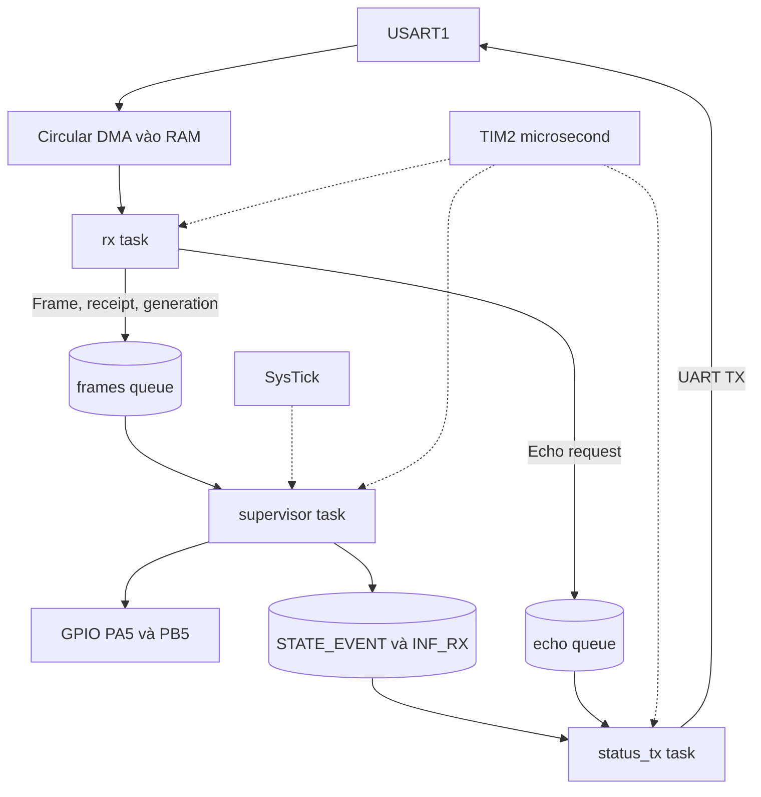

## B2. Ba task và hai đồng hồ

SOURCE: `os/stm32/firmware/main.c:main`, `supervisor_task`, `rx_task`, `status_task`; [`FreeRTOSConfig.h`](https://github.com/KaiserRichard/edge-ai-video-runtime/blob/main/os/stm32/firmware/FreeRTOSConfig.h).

| Task | Priority (SOURCE) | Công việc | Điều kiện đánh thức |
|---|---:|---|---|
| `supervisor` | 3 | Chủ duy nhất cập nhật supervisor; expiry, nhận frame, state, GPIO | Định kỳ một tick |
| `rx` | 2 | Đọc DMA, parser, đóng sự kiện vào queue, chuẩn bị echo | IDLE notification hoặc chờ một tick (DMA); stream buffer ở fallback |
| `status_tx` | 1 | Chủ duy nhất UART TX; event, INF_RX, echo, status | Notification hoặc poll một tick |

Tất cả task ứng dụng tạo tĩnh; stack mỗi task `APP_STACK=512` phần tử `StackType_t` (SOURCE, không nhầm 512 byte). `frames` và `echoes` có `FRAME_DEPTH=8` phần tử. Có idle task do kernel quản lý, nên "ba task" chỉ là ba task ứng dụng.

### B2.1. Supervisor task — ưu tiên quyết định, không ưu tiên ghi log

Mỗi release: kiểm tra thời gian hiện tại trước khi xử lý frame; xử lý batch tối đa `FRAME_DEPTH`; cập nhật GPIO; báo task status nếu có event. `vTaskDelayUntil(&release, 1)` giữ lịch tuyệt đối. Nếu task overrun, không bảo đảm có đủ thời gian cho các task thấp hơn. RX và TX không tự quyết định FRESH.

??? note "Mã nguồn (tuỳ chọn)"
    [`os/stm32/firmware/main.c`](https://github.com/KaiserRichard/edge-ai-video-runtime/blob/main/os/stm32/firmware/main.c), `supervisor_task`, dòng 429–436:

    ```c
    supervisor_update(&supervisor, NULL, now_task());
    /* Bounded batch prevents traffic from extending one release forever. */
    for (unsigned i = 0; i < FRAME_DEPTH; ++i) {
        frame_event_t event;
        if (xQueueReceive(frames, &event, 0) != pdPASS) break;
        supervisor_receive_frame(&supervisor, &event.frame, event.generation,
                                 event.receipt, now_task());
    }
    ```

### B2.2. Tick kernel không phải clock timestamp

| Clock | Nguồn / cấu hình SOURCE | Vai trò |
|---|---|---|
| SysTick | Kernel tick 1 kHz | Quản lý wait, release supervisor, periodic status |
| TIM2 | Bộ đếm nominal 1 MHz, 32 bit | Timestamp nhận, tuổi kết quả, event và echo |
| Pi RAW | Clock monotonic raw trên Pi, ns | Thời gian input/done/send, t1/t4 |

SOURCE: [`clock_config.h`](https://github.com/KaiserRichard/edge-ai-video-runtime/blob/main/os/stm32/firmware/clock_config.h): HSE MCO 8 MHz hoặc HSI fallback 16 MHz, cấu hình PLL nominal core 84 MHz. APB1 42 MHz, clock timer nhân đôi thành 84 MHz. `main.c:board_init` cấu hình TIM2 prescaler = HEA_TIM2_HZ/1000000 − 1. CALCULATED prescaler 83, chu kỳ count 1 µs danh định. Tick 1 ms không đủ để phân biệt timestamp microsecond; TIM2 không thay chức năng lập lịch của SysTick.

!!! tip "Nói đơn giản"
    Một đồng hồ báo giờ để nhắc kiểm tra đều đặn. Một đồng hồ bấm giờ đo xem đã trôi qua bao lâu. Hai chức năng không giống nhau, dù cả hai đều đo thời gian.

??? info "Chi tiết nâng cao — wrap và kiểm tra clock"
    CALCULATED: TIM2 raw 32 bit wrap sau \(2^{32}/10^6\approx4294.97\) s (71.58 phút); nửa vòng 35.79 phút. `supervisor_extend_mcu_us` dùng hiệu unsigned 32 bit và từ chối delta từ nửa vòng trở lên; mở rộng thành 64 bit nếu lấy mẫu đủ thường xuyên. HSE/HSI đều nominal 84 MHz sau PLL nhưng độ chính xác thực khác nhau. Tick diagnostic so sánh SysTick và TIM2, không phải hiệu chuẩn độc lập. MEASURED F5 r5: −8 ppm trong 1000 ms (stage report); không có bằng chứng lỗi tick giải thích mốc HOLD. [`CLOCK_SYNC.md`](https://github.com/KaiserRichard/edge-ai-video-runtime/blob/main/os/protocol/CLOCK_SYNC.md) và stage report phân biệt drift, offset, RMS phần dư. Không dùng timestamp Pi trừ trực tiếp MCU.

## B3. RX DMA, parser và sự kiện nhận

SOURCE: `main.c:rx_task`, `USART1_Handler`, [`uart_budget.h`](https://github.com/KaiserRichard/edge-ai-video-runtime/blob/main/os/stm32/firmware/uart_budget.h), [`rx_dma_cursor.h`](https://github.com/KaiserRichard/edge-ai-video-runtime/blob/main/os/stm32/include/rx_dma_cursor.h).

- DMA nhận byte vào vòng RAM. `NDTR` là số transfer còn lại; chỉ số write `(size-ndtr)%size`. Hai giá trị chỉ số bằng nhau có thể là rỗng hoặc đã ghi hết vòng.
- RX task lấy snapshot write index, kiểm tra lỗi và thời gian kể từ lần lấy mẫu. Nếu có khả năng mất vòng hoặc vượt margin RX, bỏ phần nghi ngờ, quay parser về tìm SOF. Không timestamp cũ thành dữ liệu mới giả tạo.
- Parser xử lý byte từ SOF qua header/payload đến CRC. Frame hợp lệ mới tạo `frame_event_t` cùng timestamp receipt và generation. Queue đầy ghi lỗi drop, không chờ vô hạn.
- `record.raw_us` trong DMA là lúc task đọc byte. Timestamp receipt của frame là lúc xử lý byte CRC cuối, không phải timestamp vật lý của cạnh UART. IRQ fallback dùng timestamp RXNE từng byte.

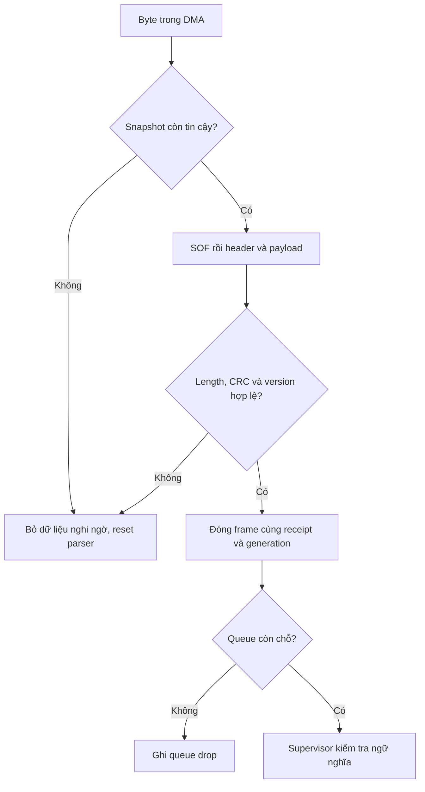

Đây là sơ đồ khái niệm của luồng xử lý, không tái hiện từng nhánh code. Parser sau CRC sai bắt đầu tìm SOF từ byte tiếp theo, không quét lại candidate; một frame tốt nằm trong candidate lỗi có thể mất. `hea_uart_feed` giới hạn thời gian ghép tính từ SOF đầu, không từ byte cuối; traffic nhỏ giọt không thể giữ candidate cũ vô hạn.

## B4. Giao thức v3: một frame có gì?

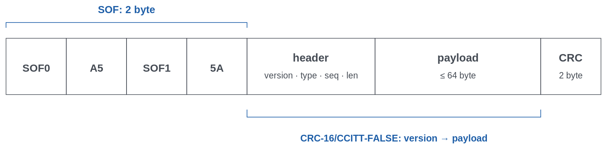

| Trường | Byte (SOURCE) | Ý nghĩa |
|---|---:|---|
| SOF | 2 | A5 5A |
| Version | 1 | Encoder v3; decoder nhận v1/v2/v3 |
| Type | 1 | HEARTBEAT, INFERENCE, ECHO... |
| Seq | 2 | Wire sequence mỗi chiều |
| Len | 1 | Payload 0–64 B |
| Payload | Len | Dữ liệu bản tin little-endian |
| CRC | 2 | CRC-16/CCITT-FALSE từ version đến payload |

SOURCE: [`os/protocol/PROTOCOL.md`](https://github.com/KaiserRichard/edge-ai-video-runtime/blob/main/os/protocol/PROTOCOL.md), [`hea_proto.h`](https://github.com/KaiserRichard/edge-ai-video-runtime/blob/main/os/protocol/include/hea_proto.h), [`hea_proto.c`](https://github.com/KaiserRichard/edge-ai-video-runtime/blob/main/os/protocol/src/hea_proto.c). Tổng overhead 9 B.

| Message | Payload SOURCE | Tổng frame CALCULATED |
|---|---|---:|
| HEARTBEAT v3 (0x01) | `linux_send_ns` u64, `session_id` u64 | 25 B |
| INFERENCE v3 (0x02) | input_ns u64, done_ns u64, input_seq u32, class_id u8, confidence u8, age_at_send_us u32 | 35 B |
| ECHO_REQ (0x03) | T1 Pi ns u64 | 17 B |
| ECHO_RESP (0x83) | T1 u64, T2 u32, T3 u32 | 25 B |
| STATE_EVENT (0x85) | MCU time, old/new, reason, last HB/INF receipt, lost count | 40 B |
| INF_RX (0x86) | wire seq, MCU age, MCU receipt, state, lost count | 32 B |

MCU_STATUS (0x84) có base và extension tùy version/length. Không nhầm v3 session ID trên wire 64 bit với `new_session()` hiện tại của C bridge tạo giá trị random 32 bit rồi đưa vào trường 64 bit. Session ID là định danh lần chạy, không phải timestamp. Sequence wire khác frame ID input.

### B4.1. Transit allowance hiện tại và lịch sử

SOURCE: [`uart_budget.h`](https://github.com/KaiserRichard/edge-ai-video-runtime/blob/main/os/stm32/firmware/uart_budget.h), frame tối đa 73 B, write budget 2000 µs, RX margin 3000 µs. CALCULATED từ 921600 baud:

\[
T_{max,line}=\left\lceil\frac{73\times10\times10^6}{921600}\right\rceil=793\,\mu s,
\]
\[
B_{assembly}=793+2000=2793\,\mu s,\qquad B_{transit}=2793+3000=5793\,\mu s.
\]

Đây là budget chung current source mặc định; không phải measured physical bound. Kiểm tra code có cơ chế từ chối frame quá budget, không đảm bảo đầy đủ mọi delay vật lý. Trong report lịch sử và Stateflow, allowance là **5 ms (SOURCE/ASSUMED)**; khi đọc F2/F5 phải dùng allowance lịch sử, không sửa ngược số đo.

## B5. Accept checks — CRC đúng vẫn chưa đủ

SOURCE: `os/stm32/src/supervisor_protocol.c:supervisor_receive_frame`, `os/stm32/src/supervisor.c:accept`, `supervisor_seq_compare16`, `supervisor_seq_compare`.

| Lớp kiểm tra | Điều kiện / lý do |
|---|---|
| Parser | SOF, length, CRC, version hợp lệ |
| Semantic | Unpack đúng type/length; confidence trong miền hợp lệ; done ≥ input; age không nhỏ hơn thời gian input→done (v2/v3, trừ saturation) |
| Generation | Frame đến từ epoch/generation đang xử lý |
| Receipt | Không tương lai, không trước epoch, không đi lùi so với last receipt cùng loại |
| Session | V3 HB mới hoặc đổi session thiết lập lại lịch sử; legacy không được downgrade session đã biết |
| Wire sequence | Bản tin phải mới hơn watermark |
| Input sequence | Kết quả phải thuộc input mới; frame wire mới không đủ |

Heartbeat cập nhật `last_heartbeat_ticks`; result mới cập nhật `last_result_ticks` và age-at-send. ECHO là loại OTHER, không tự làm mới hai timer này. Wire frame hợp lệ mới có thể tiến watermark dù input sequence bị lặp. Lặp input không cập nhật freshness. Session change có thể đưa trạng thái về INIT nhưng không tự xóa FAILSAFE đã latch.

### B5.1. Sequence wrap

Với wire sequence 16 bit, SOURCE logic unsigned modulo:

\[
\Delta=(s_{new}-s_{last})\bmod65536.
\]

CALCULATED: nếu last=65535 và new=0, delta=1, nghĩa là mới. Nếu last=new, delta=0 là lặp. Delta 32768 (nửa vòng) mơ hồ nên không chấp nhận mới; delta lớn hơn nửa vòng được xem là cũ. Input sequence dùng quy tắc tương tự với 32 bit. Đây là ví dụ toán học từ miền của kiểu dữ liệu, không phải packet capture.

??? note "Mã nguồn (tuỳ chọn)"
    [`os/stm32/src/supervisor.c`](https://github.com/KaiserRichard/edge-ai-video-runtime/blob/main/os/stm32/src/supervisor.c), `supervisor_seq_compare16`, dòng 30–34:

    ```c
    uint16_t delta = (uint16_t)(current - last);
    if (delta == 0u) return SUPERVISOR_SEQ_DUPLICATE;
    if (delta < UINT16_C(0x8000)) return SUPERVISOR_SEQ_NEWER;
    if (delta == UINT16_C(0x8000)) return SUPERVISOR_SEQ_AMBIGUOUS;
    return SUPERVISOR_SEQ_OLDER;
    ```

Generation là token nội bộ giúp loại event đã xếp hàng trước khi đổi session/re-arm. Session ID do Pi sinh; generation do supervisor quản lý. Hai thứ không thay CRC và không xác thực bảo mật.

## B6. Chính sách trạng thái: INIT, FRESH, HOLD, FAILSAFE

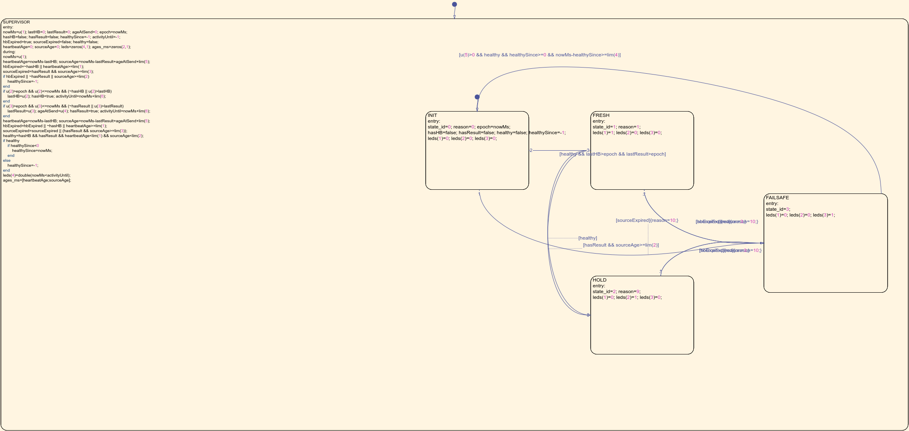

!!! note "Cách đọc hình"
    Chart có bốn state và đường transition có guard. Đọc nhóm điều kiện hết hạn heartbeat và source trước, rồi đường trở về FRESH và re-arm. Đây là chart mô phỏng metadata UART đã được chấp nhận, không phải bản sao toàn bộ C firmware.

| Tham số | SOURCE (nominal) | Điều kiện |
|---|---:|---|
| Heartbeat timeout | 100 ms | Hết hạn khi tuổi HB ≥ ngưỡng |
| Result HOLD | 200 ms | Source age ≥ ngưỡng, chưa FAILSAFE |
| Result FAILSAFE | 500 ms | Source age ≥ ngưỡng |
| Healthy re-arm interval | 1000 ms | Cần healthy liên tục, có yêu cầu re-arm |
| Transit allowance | 5 ms lịch sử/model; 5.793 ms current default (CALCULATED) | Cộng vào tuổi dữ liệu |

Đặt \(t\) là clock MCU lúc đánh giá; \(r_H,r_I\) là receipt MCU của heartbeat/inference được chấp nhận cuối; \(a_s\) là age-at-send Pi (đổi cùng đơn vị). Hai timer:

\[
h(t)=t-r_H,\qquad a(t)=a_s+(t-r_I)+B_{transit}.
\]

Cả hai elapsed theo MCU, age-at-send là khoảng thời gian Pi. Không cần trừ hai timestamp khác clock. V1 thiếu age-at-send nên fallback receipt silence, không xem age v1 bằng 0 thật. C dùng saturating addition để tránh tràn số. Healthy cần đã có HB và result, HB age nhỏ hơn 100 ms và result age nhỏ hơn 200 ms.

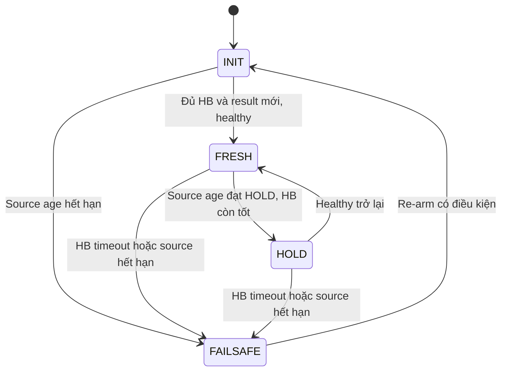

Sơ đồ khái niệm không liệt kê đường INIT do đổi session hay FAILSAFE do lỗi clock/config. Trong FRESH/HOLD, C ưu tiên HB timeout (reason 3), rồi source expiry (reason 10 nếu age có mặt), sau đó HOLD (reason 9). Nếu cùng hết hạn, HB timeout được ưu tiên. INIT không đòi ngay một HB tại lúc vừa khởi động; chờ đủ dữ liệu, nhưng result v2/v3 quá cũ có thể latch FAILSAFE. Lỗi config hoặc thời gian MCU đi lùi cũng có thể FAILSAFE.

| State | Ý nghĩa | GPIO PA5/PB5 hiện tại (SOURCE `main.c:output`) |
|---|---|---|
| INIT (0) | Chờ dữ liệu đủ mới | 00 |
| FRESH (1) | Cả liveness và freshness đạt | 11 |
| HOLD (2) | Hạn chế output mới, còn grace | 01 |
| FAILSAFE (3) | Trạng thái bị chốt, output an toàn theo prototype | 00 |

Không nhầm GPIO hai bit này với các kênh D4/D5/D6/D9 trong mô phỏng. Không có actuator thật trên prototype. HOLD không đồng nghĩa giữ mô-men hay ra lệnh giảm tốc đã được kiểm chứng.

### B6.1. Ví dụ số từ F5

MEASURED F5 r4: HOLD sau 175.596 ms tính từ inference cuối, HB age 18.336 ms; FAILSAFE sau 475.596 ms tính từ cùng inference. SOURCE lịch sử: 200/500 ms và allowance 5 ms. CALCULATED xấp xỉ tuổi đã có lúc receipt là 200−175.596≈24.404 ms. Khi không có result mới, tuổi tăng tiếp đúng khoảng 300 ms giữa HOLD và FAILSAFE; do đó mốc receipt→FAILSAFE gần 475.6 ms, không phải 500 ms. Đây là phép suy ngược gần ngưỡng, không phải age-at-send đo trực tiếp. HB ở HOLD còn rất mới.

### B6.2. Expiry trước arrival: vì sao thứ tự quan trọng?

`supervisor_update` đánh giá trạng thái theo now trước khi nhận event mới, sau đó accept, cập nhật source age và đánh giá lại. Nếu heartbeat mới đến đúng lúc deadline hết hạn thì trạng thái FRESH cũ đã đủ điều kiện FAILSAFE; frame mới không xóa latch. Nếu accept trước expiry, frame mới có thể che việc vừa vi phạm timeout. Tương tự ý nghĩa thứ tự event tie trong CN SimEvents, nhưng ở đây là chính sách giám sát có chủ đích.

## B7. Latching, re-arm và reset

**Latch (chốt trạng thái):** FAILSAFE không tự biến thành FRESH khi dữ liệu trở lại. Task vẫn có thể nhận dữ liệu tốt để theo dõi khoảng healthy.

SOURCE: `supervisor.c:supervisor_rearm`: chỉ thành công khi đang FAILSAFE, generation không hết miền, healthy liên tục đủ 1000 ms và có lời gọi re-arm; kiểm tra lại update trước. Thành công chuyển INIT, tăng generation, xóa has_heartbeat/has_result, thiết lập epoch mới. Phải nhận lại dữ liệu mới trước khi FRESH.

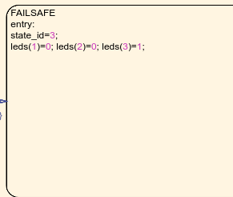

!!! note "Cách đọc hình"
    Entry ghi state_id=3 và LED logic FAILSAFE. Reason được xác lập trên transition tương ứng, không phải mọi FAILSAFE đều do heartbeat. Đường ra trên chart tổng chỉ có re-arm đủ điều kiện.

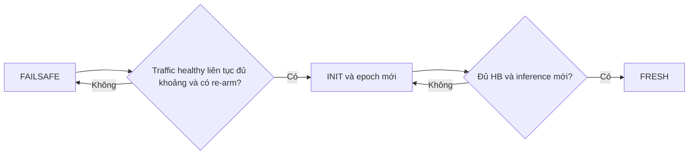

**Ba mức bằng chứng không được gộp:** portable C có `supervisor_rearm` và test source; Stateflow có input re-arm và timeline; [`main.c`](https://github.com/KaiserRichard/edge-ai-video-runtime/blob/main/os/stm32/firmware/main.c) hiện không gọi `supervisor_rearm`. Runner [`os/tools/experiments/e4_campaign.py`](https://github.com/KaiserRichard/edge-ai-video-runtime/blob/main/os/tools/experiments/e4_campaign.py) mặc định `--rearm-command` chạy [`scripts/stm32/reset.sh`](https://github.com/KaiserRichard/edge-ai-video-runtime/blob/main/os/scripts/stm32/reset.sh) (SOURCE). Reset khởi động lại firmware; không chứng minh đã kiểm tra healthy liên tục đủ khoảng trước re-arm. Không tự claim chức năng re-arm vật lý đã triển khai đầy đủ.

## B8. Telemetry — vì sao tách task status?

SOURCE: `main.c:status_task`; `supervisor.c:transition`, `supervisor_pop_transition`, `supervisor_pop_inf_rx`.

- Mỗi transition ghi old/new, reason, timestamp MCU, last HB/INF và lost counter vào vòng event.
- `status_tx` drain các event theo batch, INF_RX và echo; gửi MCU_STATUS định kỳ 100 ms (SOURCE), có thể bị trễ thực tế.
- Event được timestamp lúc đổi state, không phải lúc CSV xuất hiện trên Pi. Log UART TX có thể bị trễ; mất event phải đọc lost counter.
- Echo T3 lấy khi đường TX trước đã hoàn tất. Echo cho phép ước lượng clock, không đo one-way tuyệt đối.

## B9. Native Stateflow: phạm vi và giao diện

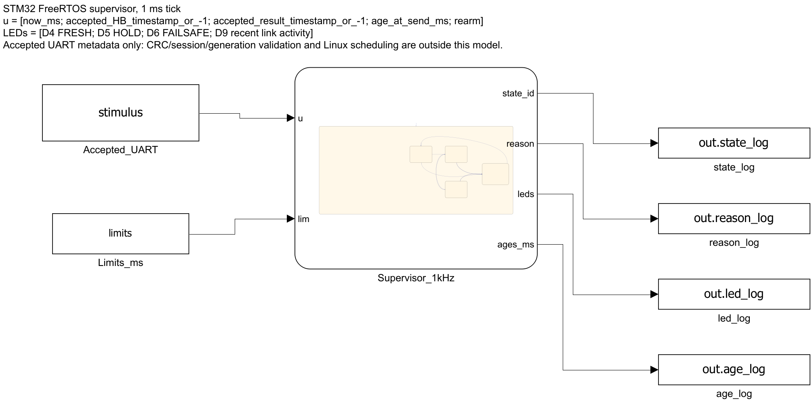

!!! note "Cách đọc hình"
    `Accepted_UART` cấp vector `u` cho `Supervisor_1kHz`; `Limits_ms` cấp vector `lim`. Bốn output ra workspace: state, reason, LEDs và ages. Chart chạy trên clock mô phỏng với bước 1 ms (SOURCE). Đây là kiểm thử chính sách sau accept, không mô phỏng CRC, DMA, Linux scheduling, sequence/generation hay UART byte-level.

| Interface | Thành phần SOURCE từ hình và inventory |
|---|---|
| `u` | now_ms, accepted HB timestamp hoặc −1, accepted result timestamp hoặc −1, age_at_send_ms, rearm |
| `lim` | `[100 200 500 1000 5 20]` ms: HB, HOLD, FAILSAFE, re-arm, allowance, duration báo activity |
| `state_id` | 0 INIT, 1 FRESH, 2 HOLD, 3 FAILSAFE |
| `reason` | Mã nguyên nhân |
| `leds` | D4 FRESH, D5 HOLD, D6 FAILSAFE, D9 activity (logic mô phỏng) |
| `ages_ms` | HB silence và source age |

[`CHART_INVENTORY.md`](https://github.com/KaiserRichard/edge-ai-video-runtime/blob/main/sim/os_supervisor/figures/CHART_INVENTORY.md) gọi phần tử cuối `u` là activity flag trong đoạn mô tả, nhưng native top-level ghi `rearm` và guard dùng `u(5)>0`; bài này theo nhãn native và guard. Chart entry của INIT xóa hasHB/hasResult; guard INIT→FRESH đòi `lastHB>epoch && lastResult>epoch` và healthy. C firmware có kiểm tra epoch/generation riêng; không tuyên bố tương đương bit-for-bit.

| Hình state gốc | Entry action quan trọng |
|---|---|
| 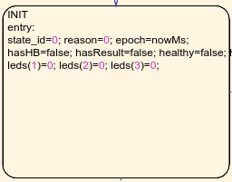 | Xóa cờ healthy; epoch mới; state 0 |
| 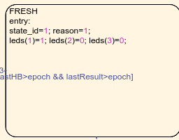 | state 1, reason 1, LED FRESH |
| 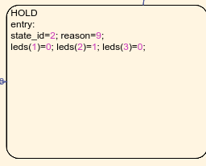 | state 2, reason 9, LED HOLD |
|  | state 3, LED FAILSAFE; reason từ transition |

## B10. Đọc tám timeline Stateflow

Tất cả hình dưới đây là **SIMULATED**, không phải trace board. Trục X chung là clock supervisor (ms); trên là state rời rạc, giữa là LED logic (các đường được xếp lệch cho dễ đọc), dưới là tuổi HB (xanh) và source (cam), cùng các ngưỡng dashed. Các mốc xấp xỉ được đọc trực quan từ hình, không phải log số mới. Tên hình là tên kịch bản gốc. Không nhầm mốc injection trên trục X với tuổi ở trục Y.

### B10.1. Healthy — điều kiện bình thường

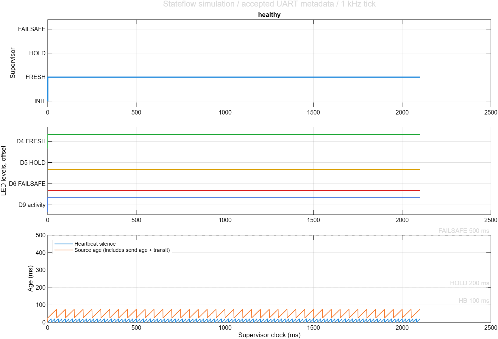

Đọc panel trên: từ INIT sang FRESH và giữ FRESH. Panel dưới: hai tuổi tạo răng cưa nhỏ, giảm mỗi lần nhận metadata mới và không chạm ngưỡng. D4 bật, D5/D6 không bật. **Kết luận:** traffic hợp lệ, đúng hạn duy trì FRESH; không chứng minh không có false trip dài hạn.

### B10.2. Single missed heartbeat — bỏ một heartbeat

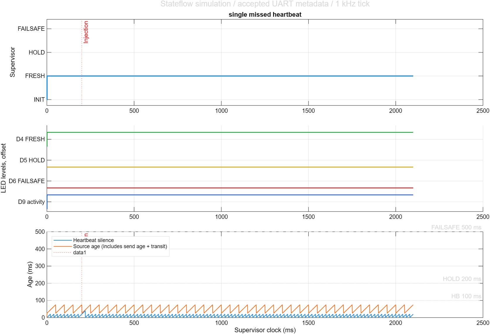

Tại vạch injection có một HB bị lỡ; HB tiếp theo vẫn đến trước timeout. D4 và state không đổi; tuổi HB có khoảng lớn hơn nhưng vẫn nhỏ hơn ngưỡng. **Kết luận:** mất một bản tin không nhất thiết là mất liveness; chính elapsed kể từ HB hợp lệ cuối quyết định.

### B10.3. Missed heartbeat recovery — mất HB kéo dài và hồi phục

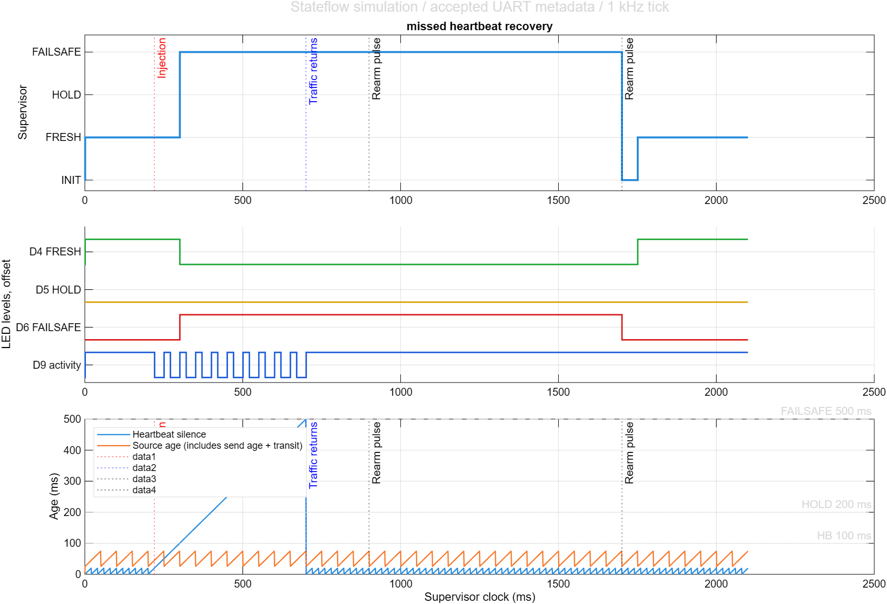

Panel state đi trực tiếp từ FRESH sang FAILSAFE. Khi traffic trở lại, đường tuổi giảm nhưng state vẫn FAILSAFE. Re-arm pulse sớm không đủ điều kiện; pulse muộn hơn đưa về INIT rồi mới FRESH. **Kết luận:** phục hồi giao tiếp và phục hồi quyền sử dụng output là hai sự kiện khác nhau.

### B10.4. Late within timeout — tới muộn nhưng còn trong hạn

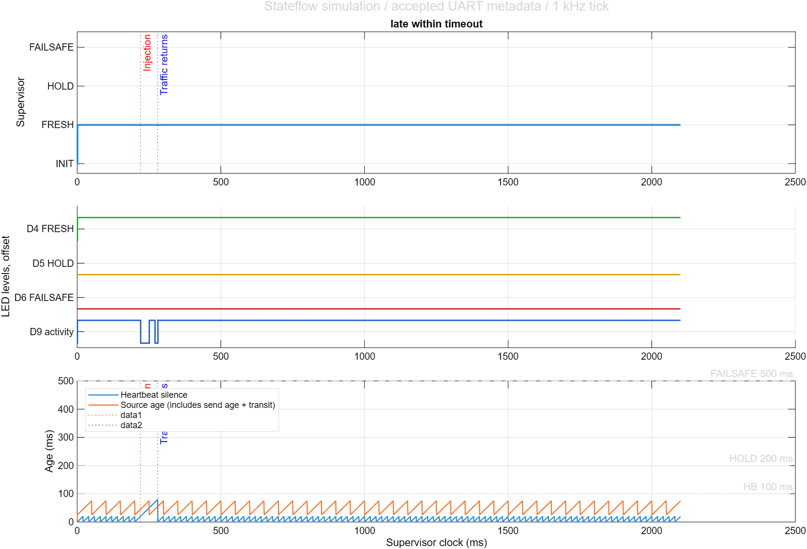

Vạch injection và traffic returns ở gần đầu timeline; đường activity có khoảng ngắt. State vẫn FRESH, tuổi HB tăng một đoạn nhưng chưa hết timeout. **Kết luận:** có jitter/trễ không đồng nghĩa vi phạm timeout; còn phụ thuộc thời điểm receipt trước đó.

### B10.5. Late heartbeat at deadline — đúng biên timeout

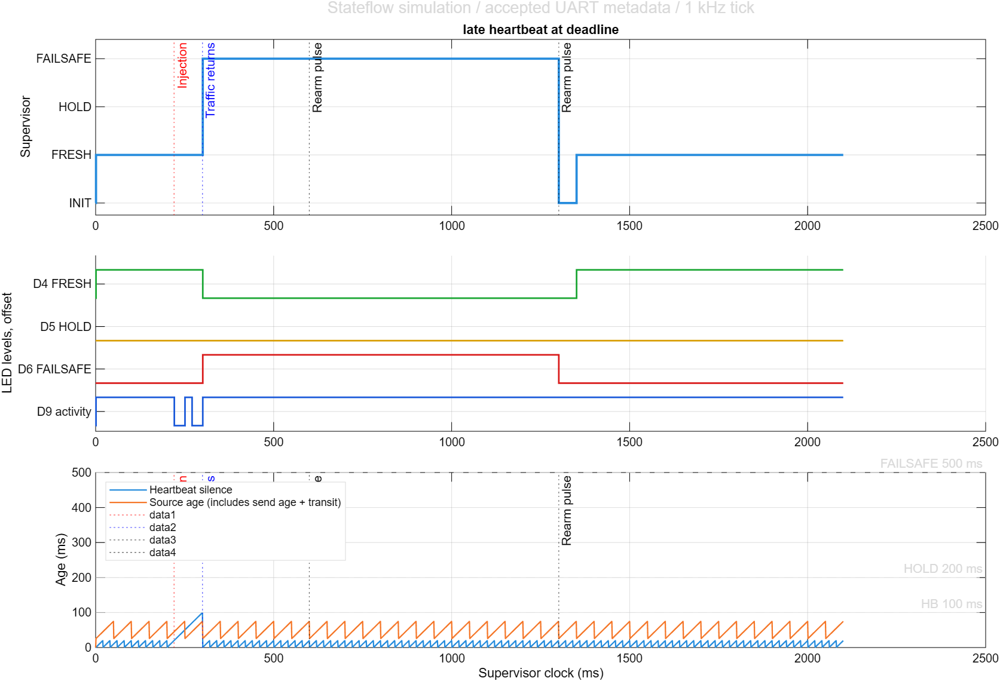

Tại thời điểm quanh 300 ms trên trục X (SIMULATED, đọc xấp xỉ), state nhảy FAILSAFE. Traffic trở lại không xóa latch; pulse re-arm sớm không làm thoát, pulse muộn đưa INIT rồi FRESH. **Kết luận:** deadline được kiểm tra trước khi sự kiện mới che timeout. Dấu bằng thuộc phía hết hạn (`>=`).

### B10.6. Heartbeat priority — hai điều kiện cùng cần xét

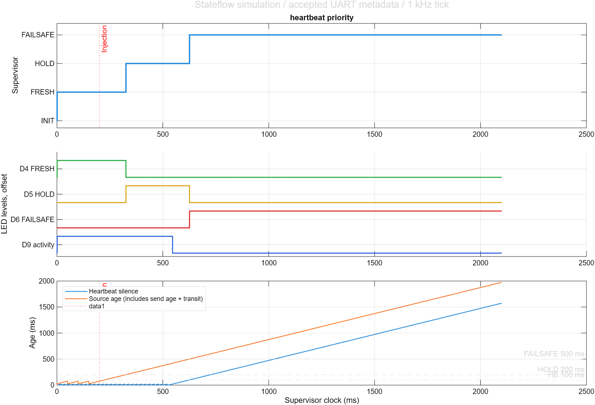

Sau injection, tuổi source tăng trước, state chuyển HOLD. Sau đó HB cũng im lặng; FAILSAFE xuất hiện khi HB timeout. Panel dưới tiếp tục tăng vì không có dữ liệu thay. Hình không có đường phục hồi ở cuối. **Kết luận:** HOLD không vô hiệu hóa kiểm tra heartbeat; nếu HB và source cùng hết hạn, chart ưu tiên guard heartbeat theo thiết kế. Chỉ nhìn state 3 chưa biết reason; cần `reason_log` để kiểm mã nguyên nhân.

### B10.7. Degrade and recover — suy giảm rồi hồi phục từ HOLD

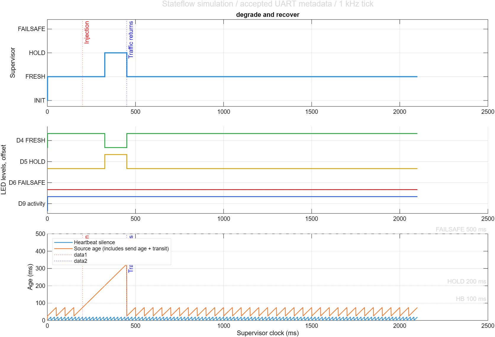

State đi FRESH→HOLD→FRESH; source age tăng tới ngưỡng HOLD rồi giảm khi traffic hồi phục, chưa vượt ngưỡng FAILSAFE. LED D5 chỉ bật trong HOLD. **Kết luận:** HOLD có thể phục hồi tự động khi healthy; latch chỉ áp dụng FAILSAFE.

### B10.8. Stale result failsafe rearm — HB còn nhưng source cũ

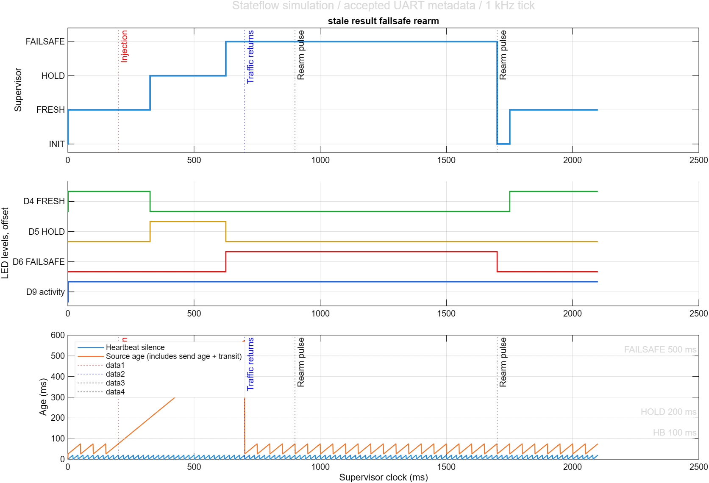

Quan sát xấp xỉ: injection ở 200 ms, HOLD khoảng 325 ms, FAILSAFE khoảng 625 ms, traffic returns 700 ms; pulse sớm khoảng 900 ms không đủ, pulse khoảng 1700 ms đưa INIT rồi FRESH khoảng 1750 ms (SIMULATED, đọc hình). Nguồn tuổi cam tăng qua ngưỡng trong khi đường HB thấp. Khi traffic quay lại, dữ liệu khỏe chưa đủ để mở latch ngay. Khoảng healthy cần đạt lim(4) và re-arm; INIT yêu cầu metadata mới sau epoch. **Kết luận:** mô hình xác nhận logic alive ≠ fresh và latching trong kịch bản này; không phải phép đo re-arm vật lý.

## B11. Trắc nghiệm

<div class="quiz" markdown>
<p class="quiz-q">Trong model top-level, Accepted_UART đã biểu diễn gì?</p>


- [ ] Dạng sóng UART từng bit
- [x] Metadata heartbeat và result đã được chấp nhận, cùng thời gian và lệnh re-arm
- [ ] Lịch chạy đầy đủ Linux và DMA
- [ ] Hình ảnh camera gốc

<div class="quiz-why" markdown>
Mô hình bắt đầu sau lớp accept. Không dùng mô hình này để kết luận CRC hoặc scheduler thực tế đạt deadline.
</div>
</div>

<div class="quiz" markdown>
<p class="quiz-q">Timeline late heartbeat at deadline vào FAILSAFE rồi traffic trở lại. Vì sao chưa FRESH ngay?</p>


- [ ] Vì CRC không bao giờ khớp nữa
- [ ] Vì clock TIM2 dừng
- [x] Vì timeout được đánh giá trước arrival, FAILSAFE bị latch đến re-arm đủ điều kiện
- [ ] Vì phải tăng baud

<div class="quiz-why" markdown>
Một sự kiện mới không xóa lịch sử timeout đã xảy ra. Latch buộc phân biệt phục hồi traffic với cho phép hoạt động lại.
</div>
</div>

<div class="quiz" markdown>
<p class="quiz-q">Trong degrade and recover, tại sao FRESH có thể trở lại mà không có re-arm?</p>


- [ ] FAILSAFE cũng không cần re-arm
- [ ] LED là bộ định thời chính
- [ ] Source age không được kiểm tra
- [x] Trạng thái mới chỉ là HOLD, và healthy trở lại trước khi FAILSAFE

<div class="quiz-why" markdown>
HOLD là grace state có thể phục hồi. FAILSAFE khác HOLD vì bị chốt.
</div>
</div>

<div class="quiz" markdown>
<p class="quiz-q">Tick 1 kHz và TIM2 1 MHz có chức năng nào?</p>

- [x] Tick lập lịch/chờ; TIM2 đo timestamp và tuổi theo microsecond
- [ ] Tick đo bit UART, TIM2 chạy model ONNX
- [ ] Cả hai chỉ dùng LED
- [ ] TIM2 cùng gốc với clock Pi nên lấy hiệu trực tiếp được

<div class="quiz-why" markdown>
Tần số tick và độ phân giải timer phục vụ mục đích khác nhau. Clock Pi và MCU vẫn cần ánh xạ nếu lấy hiệu timestamp.
</div>
</div>

<div class="quiz" markdown>
<p class="quiz-q">Frame có CRC hợp lệ, wire sequence mới nhưng input_seq lặp. Điều gì xảy ra?</p>

- [ ] Tự động làm mới last inference
- [ ] Phải reset MCU
- [x] Có thể tiến wire watermark nhưng không cập nhật freshness của result
- [ ] Đổi ngưỡng HOLD

<div class="quiz-why" markdown>
Wire sequence xác định bản tin truyền; input sequence xác định thông tin nguồn. Gửi lại kết quả cũ không làm thông tin mới hơn.
</div>
</div>

## B12. Câu thầy có thể hỏi

??? question "Tại sao nguồn đã cũ ngay khi vừa nhận inference?"
    Age-at-send đã gồm input waiting, xử lý và chờ bridge. MCU cộng thêm allowance truyền và elapsed kể từ receipt. Không xem age bằng zero tại receipt.

??? question "Ba task và hai clock để làm gì?"
    Supervisor ưu tiên cao nhất quyết định trạng thái; RX parser nhận dữ liệu, status ghi log độc lập. SysTick phục vụ lịch RTOS, TIM2 đo timestamp µs. Chưa có chứng minh WCET cứng.

??? question "Re-arm đã chạy được trên board chưa?"
    Portable C và Stateflow có điều kiện healthy và re-arm; main hiện không nối lời gọi đó vào đường firmware. Runner mặc định reset STM32. Không được đồng nhất mô phỏng re-arm với reset thực tế.

**Nguồn:** [`os/stm32/firmware/main.c`](https://github.com/KaiserRichard/edge-ai-video-runtime/blob/main/os/stm32/firmware/main.c), `Makefile`, [`FreeRTOSConfig.h`](https://github.com/KaiserRichard/edge-ai-video-runtime/blob/main/os/stm32/firmware/FreeRTOSConfig.h), [`clock_config.h`](https://github.com/KaiserRichard/edge-ai-video-runtime/blob/main/os/stm32/firmware/clock_config.h), [`uart_budget.h`](https://github.com/KaiserRichard/edge-ai-video-runtime/blob/main/os/stm32/firmware/uart_budget.h); [`os/stm32/src/supervisor.c`](https://github.com/KaiserRichard/edge-ai-video-runtime/blob/main/os/stm32/src/supervisor.c), [`supervisor_protocol.c`](https://github.com/KaiserRichard/edge-ai-video-runtime/blob/main/os/stm32/src/supervisor_protocol.c); [`os/protocol/PROTOCOL.md`](https://github.com/KaiserRichard/edge-ai-video-runtime/blob/main/os/protocol/PROTOCOL.md), [`hea_proto.c`](https://github.com/KaiserRichard/edge-ai-video-runtime/blob/main/os/protocol/src/hea_proto.c); [`os/tools/experiments/e4_campaign.py`](https://github.com/KaiserRichard/edge-ai-video-runtime/blob/main/os/tools/experiments/e4_campaign.py); [`CHART_INVENTORY.md`](https://github.com/KaiserRichard/edge-ai-video-runtime/blob/main/sim/os_supervisor/figures/CHART_INVENTORY.md) từ `OSCN_ChatGPT_pack2.zip`; toàn bộ hình Stateflow gốc. Không có model binary/scenario runner Stateflow trong source ZIP; mô tả timeline theo hình đã mở, không chạy MATLAB.
