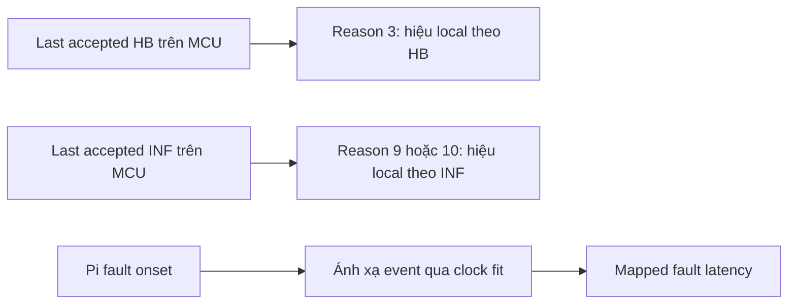
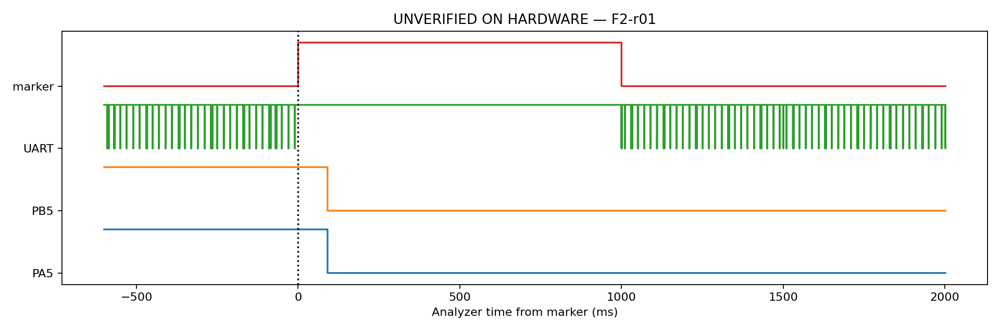
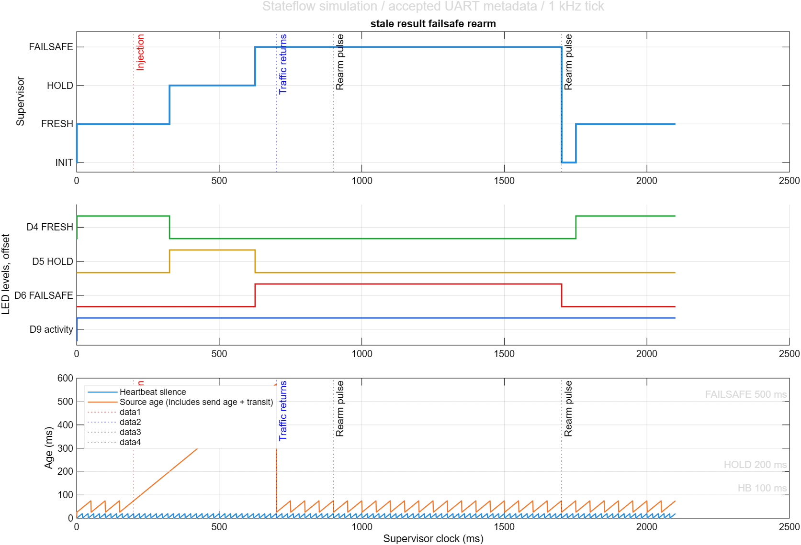
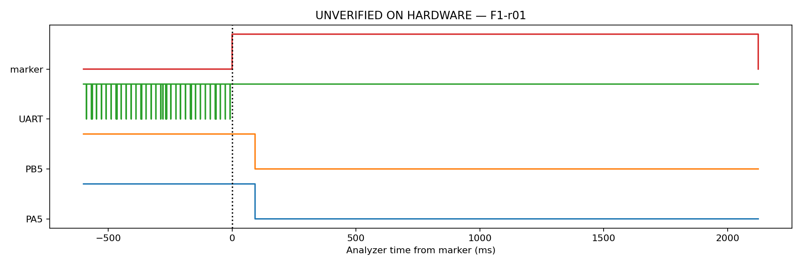
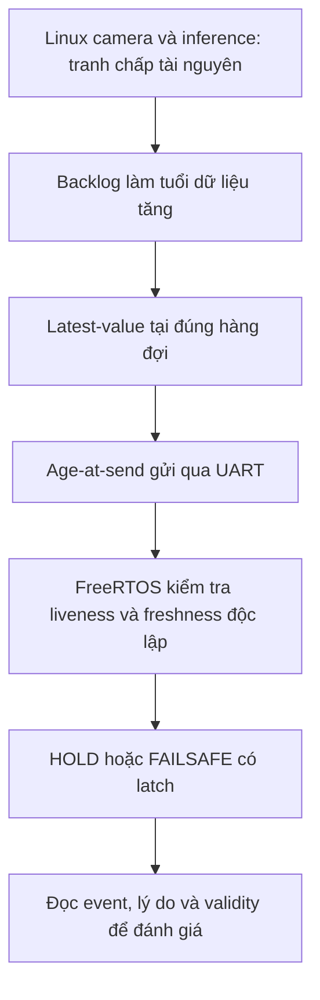

# SESSION 4 — PART C: Thí nghiệm lỗi F2/F5 và đánh giá bộ giám sát

Sau phần này, bạn giải thích được vì sao F2 và F5 đều kết thúc ở FAILSAFE nhưng do hai nguyên nhân khác nhau. Bạn cũng phân biệt được mốc phát lỗi, mốc nhận cuối, thời điểm đổi state và thời điểm chân GPIO thực sự đổi.

## C1. Fault injection (chèn lỗi có chủ đích)

Đưa hệ thống đến trạng thái khỏe, tạo lỗi đã định nghĩa, ghi phản ứng và kiểm tra điều kiện hợp lệ. So kết quả với ngưỡng chính sách. Không suy từ một lần demo rằng mọi tình huống an toàn.

SOURCE: [`os/tools/experiments/e4_campaign.py`](https://github.com/KaiserRichard/edge-ai-video-runtime/blob/main/os/tools/experiments/e4_campaign.py), [`os/linux/src/hea_bridge.c`](https://github.com/KaiserRichard/edge-ai-video-runtime/blob/main/os/linux/src/hea_bridge.c), [`os/docs/TEST_SCENARIOS.md`](https://github.com/KaiserRichard/edge-ai-video-runtime/blob/main/os/docs/TEST_SCENARIOS.md); historical evidence [`STAGE_REPORT.md`](https://github.com/KaiserRichard/edge-ai-video-runtime/blob/main/os/docs/STAGE_REPORT.md) mục Physical faults.

| Fault | Tác động SOURCE | Câu hỏi |
|---|---|---|
| F1 | Kill bridge | MCU có phát hiện mất liveness khi tiến trình chết? |
| F2 | SIGSTOP bridge rồi SIGCONT | MCU phát hiện cả khi process còn tồn tại nhưng không chạy? |
| F3 | SIGSTOP inference | Bridge còn có thể phát HB, kết quả ngừng? |
| F4 | CPU hog SCHED_FIFO priority 99 | Scheduler có thể làm bridge đói CPU? |
| F5 | SIGUSR1 suppress inference ở bridge, giữ heartbeat | Alive có đủ để dùng kết quả? |

F2/F3/F4 cấu hình lỗi khoảng 1 s; F5 riêng suppress khoảng 1 s (SOURCE/ASSUMED theo report). F1 kill khác pause vì tiến trình chết. F4 gây tranh chấp CPU có chủ đích, không kết luận mọi tải CPU đều gây cùng hiện tượng. F5 không dừng process inference trực tiếp; bridge bỏ các kết quả chưa gửi, ghi acknowledgement thời điểm suppress hiệu lực. Frame đã gửi dở còn bị budget hiện tại chi phối; không coi thời điểm signal là lúc byte cuối dừng tuyệt đối. Đây là mô tả thí nghiệm và code, không phải hướng dẫn tự chạy fault trên hệ thống đang vận hành.

## C2. Hai mốc đo — đừng nhầm threshold và fault latency

Trong log `STATE_EVENT` có MCU time, old/new state, reason, last accepted HB và last accepted INF. Đặt \(t_e\) là timestamp sự kiện MCU; \(r_H,r_I\) là receipt cuối từng loại; \(t_f\) là mốc chèn lỗi trên Pi.

\[
L_{local,H}=t_e-r_H,\qquad L_{local,I}=t_e-r_I.
\]

Khi reason 3 (heartbeat timeout), dùng \(L_{local,H}\). Khi reason 9/10 (source age), dùng \(L_{local,I}\). Mapped fault latency là \(\hat t_{e,Pi}-t_f\), cần fit clock. Không lấy hiệu trực tiếp giữa mốc Pi và MCU. Không cộng hay trừ các median khác tập như một trace.

SOURCE ngưỡng lịch sử 100/200/500 ms và allowance 5 ms. Thời gian receipt→HOLD thường nhỏ hơn 200 ms do result đã có tuổi khi nhận. Fault-onset→state có thể nhỏ hơn timeout do bản tin cuối đến trước khi fault bắt đầu.

!!! tip "Nói đơn giản"
    Một vé hết hạn tính từ lúc phát hành. Nếu bạn bắt đầu bấm đồng hồ khi phát hiện đã lâu không có vé mới, thời gian còn lại sẽ ngắn hơn thời hạn in trên vé. Hai đồng hồ đang dùng hai mốc khác nhau.

## C3. F2 — Bridge bị treo, heartbeat và inference đều ngừng

F2 gửi SIGSTOP vào bridge. Process không thực thi, không tạo heartbeat mới, không gửi kết quả mới. MCU vẫn dùng clock riêng. Khi tuổi source đạt HOLD trước, state sang HOLD; khi HB timeout thì FAILSAFE reason 3.

Không quy đổi hai mốc local lên cùng một trục thời gian nếu chưa biết chính xác chênh lệch last HB và last INF của từng run.

**MEASURED — F2, 5/5 accepted theo stage report, ms. P50/P95/max là thống kê các run:**

| Event | Reason | Local P50/P95/max | Mapped P50/P95/max từ fault onset |
|---|---|---|---|
| FRESH→HOLD | 9 (source age) | 175.206 / 175.709 / 175.709 kể từ inference | 83.151 / 83.715 / 83.715 |
| HOLD→FAILSAFE | 3 (HB timeout) | 100.577 / 100.596 / 100.596 kể từ heartbeat | 85.715 / 86.113 / 86.113 |

CALCULATED cách đọc: 100.577−100=0.577 ms là độ vượt ngưỡng danh định của **median local reason-3**, không phải GPIO delay. 175.206 ms lớn hơn 100.577 ms không có nghĩa HOLD xảy ra sau FAILSAFE, vì chúng tính từ hai receipt khác nhau. Hai mốc mapped cùng reference fault onset mới cho thứ tự gần đúng, nhưng median không phải cùng một run cụ thể.

Trước đây tuổi HB khoảng 98 ms tại HOLD bị diễn giải nhầm thành phát hiện mất heartbeat sớm. Báo cáo sửa: reason 9 là source-age HOLD; reason 3 mới là heartbeat timeout. F1/F2 heartbeat FAILSAFE trải 100.128–100.641 ms (MEASURED theo report). Không có lỗi tick được xác lập từ sự nhầm reference này.

!!! warning "Cách đọc hình — UNVERIFIED ON HARDWARE"
    X là thời gian analyzer tương đối marker (ms); các đường marker, UART, PB5, PA5 được xếp theo kênh. Hình cho thấy dạng kịch bản dự kiến: marker lên, UART im, output đổi, traffic trở lại nhưng output chưa bật. Tiêu đề gốc ghi UNVERIFIED ON HARDWARE. Không đọc khoảng cách hai cạnh như kết quả đo vật lý. Dùng bảng STATE_EVENT lịch sử bên trên để nói số đã đo.

## C4. F5 — Bridge còn sống, kết quả quá cũ

F5 dùng SIGUSR1 để đổi trạng thái suppress trong bridge. SOURCE: `hea_bridge.c:inference_toggle`, `main` xử lý `suppress_requested`, bỏ hàng chờ inference và ghi `bridge_control.csv`; heartbeat và echo vẫn thuộc đường dispatch. Runner chờ acknowledgement hiệu lực ([`e4_campaign.py`](https://github.com/KaiserRichard/edge-ai-video-runtime/blob/main/os/tools/experiments/e4_campaign.py)). Sau khi bỏ suppress, bridge loại kết quả có `t_done_ns` trước mốc `resume_after`. Kiểm tra này không bảo đảm `t_input_ns` cũng mới; tuổi nguồn vẫn phải được MCU đánh giá. Đây là kiểm tra điều kiện freshness độc lập với liveness.

!!! note "Cách đọc hình"
    Panel trái: X là các repeat, Y là thời gian từ inference hợp lệ cuối tới HOLD (cam, reason 9) hoặc FAILSAFE (xanh, reason 10). Panel phải: tuổi heartbeat lúc HOLD, đường đứt ngưỡng timeout 100 ms. Hai trục Y khác đại lượng, không trừ hai đường. Các cột HB đều thấp xa ngưỡng; HOLD xảy ra vì source age, không vì heartbeat chết.

**CALCULATED từ MEASURED F5 CSV theo stage report — ms, 5/5 short-window accepted:**

| Repeat | HOLD từ inference cuối | HB age khi HOLD | FAILSAFE từ inference cuối |
|---|---:|---:|---:|
| r1 | 175.917 | 18.462 | 475.917 |
| r2 | 175.343 | 18.510 | 475.343 |
| r3 | 174.950 | 17.459 | 474.950 |
| r4 | 175.596 | 18.336 | 475.596 |
| r5 | 175.767 | 18.494 | 475.767 |

MEASURED summary: local HOLD P50/P95/max 175.596/175.917/175.917 ms; local FAILSAFE 475.596/475.917/475.917 ms. Mapped first 83.608/85.563/85.563 ms; mapped FAILSAFE 383.603/385.558/385.558 ms. P95 bằng max ở tập nhỏ với nearest rank (CALCULATED: ceil(0.95×5)=5). Không kết luận P95 dài hạn chính xác từ năm lần.

### C4.1. Giải thích bằng công thức tuổi

\[
A(t)=A_{send}+B_{transit}+(t-r_I).
\]

Dùng r4: CALCULATED, tại HOLD ước tính tuổi khi vừa nhận ≈24.404 ms, age-at-send ≈19.404 ms nếu allowance lịch sử 5 ms và bỏ qua overshoot do tick. Từ lúc HOLD tới FAILSAFE, age tăng thêm 300 ms (475.596−175.596), khớp chênh ngưỡng 500−200 ms. Đây là phép kiểm nhất quán, không phải biết chính xác age-at-send của frame cuối. HB age 18.336 ms lúc HOLD thấp hơn 100 ms. Đó là bằng chứng liveness không đủ.

!!! note "So sánh hai hình"
    Đây là SIMULATED: state/LED/age theo clock mô hình; F5 trên là MEASURED/CALCULATED theo log MCU và lần chạy. Cả hai cùng thể hiện source age hết hạn trong khi HB còn tốt. Mốc absolute 325/625 ms xấp xỉ trên timeline mô hình không phải mốc receipt→HOLD/FAILSAFE 175/475 ms của board. Mô hình còn có re-arm; F5 short-window không xác minh qualification recovery.

## C5. Tổng hợp E4 — lý do chuyển trạng thái quan trọng hơn tên lỗi

**MEASURED từ stage report, P50 ms; local reference theo reason.**

| Fault | Accepted | First / reason | Local first P50 | FAILSAFE reason / local P50 |
|---|---|---|---:|---|
| F1 | 5/5 | HOLD / 9 | 175.317 | 3 / 100.456 |
| F2 | 5/5 | HOLD / 9 | 175.206 | 3 / 100.577 |
| F3 | 5/5 | HOLD / 9 | 175.754 | 10 / 475.754 |
| F4 | 7/14 | 6 direct FAILSAFE / 3, 1 HOLD / 9 | 100.639 (mixed) | 3 / 100.556 |
| F5 | 5/5 | HOLD / 9 | 175.596 | 10 / 475.596 |

F4 local-first gộp mốc HB và INF khác nhau nên không diễn giải là phân bố heartbeat latency. F4 là case scheduler starvation. Combined heartbeat FAILSAFE của F4 100.405–100.931 ms theo report, không phải guaranteed bound. E4 gốc 17/25 accepted (F5 trong đợt gốc chưa chạy); F5 riêng 5/5; F4 bổ sung 5/9. Report cho 27/34 accepted retained attempts, không được diễn giải như tỷ lệ tin cậy vì window và eligibility khác nhau.

## C6. Clock fit, power và độ hợp lệ của phản ứng

Trong E4, MCU-local transition interval dùng TIM2. Mapped interval từ Pi fault cần echo fit. Report đặt ngưỡng RMS phần dư 200 µs (SOURCE/ASSUMED); các run E4 gốc chấp nhận có max RMS 55.123–77.609 µs (MEASURED). RMS nhỏ không chứng minh offset tuyệt đối đúng hoặc chiều đi/về đối xứng. Power flags phải kiểm tra trên cả cửa sổ; sticky cũ không giống live flag mới. F5 năm run có không live bits/new sticky bits theo report, được chấp nhận cho transition window ngắn.

Trong các run được chấp nhận, báo cáo ghi 0 false transitions ở khoảng pre-fault đã kiểm tra (MEASURED). Không suy ra xác suất false trip bằng zero. F5 không kiểm tra đủ cửa sổ phục hồi; F4 bổ sung scope transition-only. Không gộp với E3 real UART 0/18 hợp lệ để đổi verdict.

??? info "Chi tiết nâng cao — fit và phép đo độc lập"
    Đo same-clock MCU hạn chế vấn đề offset Pi–MCU nhưng vẫn chịu sai số rate TIM2. SysTick/TIM2 self-check −8 ppm trên 1000 ms (MEASURED F5 r5) chỉ so hai clock nội bộ. T2 echo DMA lấy lúc task thấy byte CRC cuối, T3 lấy trước gửi response khi TX rảnh; điều đó không tương đương hardware edge timestamps. Nếu dùng analyzer độc lập, cần ghi marker fault, UART và chân output chung clock analyzer, kiểm tra đồng bộ, độ phân giải và dữ liệu thô trước khi tuyên bố reaction time.

## C7. Logic analyzer — cái gì vẫn chưa được xác minh?

!!! warning "Cách đọc hình — tất cả đều UNVERIFIED ON HARDWARE"
    Ba hình này và run_F2 có cùng trục X tương đối marker. Marker biểu thị khoảng chèn lỗi; UART biểu thị traffic; PB5/PA5 biểu thị output logic. F1 hình gợi ý mất traffic kéo dài, F4/F2 gợi ý traffic có thể trở lại khi lỗi dừng. Tất cả giữ nguyên watermark của nguồn. Không khẳng định đây là capture oscilloscope/analyzer vật lý đã xác nhận; không lấy số độ trễ cạnh từ hình để báo cáo. Hình check_F2 không phải một run độc lập đã đo.

| Câu hỏi | Trạng thái bằng chứng |
|---|---|
| Supervisor đổi state trong F2/F5? | MEASURED, MCU timestamp, scope run được chấp nhận |
| GPIO thực sự đổi sau bao nhiêu từ cạnh fault? | UNKNOWN chưa có capture độc lập được xác nhận |
| Healthy re-arm của portable supervisor? | SOURCE test và SIMULATED chart, không xác lập re-arm vật lý |
| Worst-case response bound? | UNKNOWN |
| Actuator an toàn trong mọi tình huống? | UNKNOWN; prototype không có actuator và không có independent MCU watchdog |
| Clean real-UART freshness comparison? | FLAGGED 0/18 trong E3 real |

## C8. Tổng kết hai session — cách kể với thầy

| Câu chuyện | Số liệu và phạm vi |
|---|---|
| P1 không giải quyết hết contention | OS-T3 memrate P99 408/422 ms P0/P1 (MEASURED theo plot) |
| Đổi đúng vị trí queue giúp thông tin mới | OS-T4 PTY mean AoI idle 192.0→92.8 ms (MEASURED, ba repeat hợp lệ theo review) |
| Liveness bị mất | F2 heartbeat FAILSAFE P50 100.577 ms từ HB cuối (MEASURED) |
| Alive không bằng fresh | F5 HB age tại HOLD 17.459–18.510 ms nhưng source hết hạn (CALCULATED từ MEASURED) |
| Chốt và re-arm | Tám timeline Stateflow kiểm logic (SIMULATED), không claim vật lý |

Kết quả OS này là bằng chứng cho một mô hình giám sát độ mới trên bàn thử, không phải chứng nhận an toàn cho một hệ thống điều khiển thật.

## C9. Trắc nghiệm

Ở F5, tại sao vào HOLD dù cột heartbeat thấp?

- [ ] Ngưỡng heartbeat được đổi thành 17 ms
- [ ] CRC chắc chắn sai
- [x] Source age đạt ngưỡng HOLD trong khi heartbeat vẫn mới
- [ ] F5 làm dừng MCU

Hai đại lượng được kiểm tra độc lập. Heartbeat thấp chỉ nói đường liveness còn hoạt động.

Hình F2 này có chứng minh thời gian đổi chân PA5/PB5 thực không?

- [x] Không, tiêu đề UNVERIFIED ON HARDWARE; chỉ dùng để giải thích kịch bản
- [ ] Có, vì có đường UART
- [ ] Có, vì hình có trục ms
- [ ] Có, vì event log MCU cũng đã tồn tại

Đồ thị chưa xác minh không thể thay capture độc lập. Event timestamp và GPIO edge là hai mốc khác nhau.

Trong timeline stale-result, traffic quay lại nhưng state vẫn FAILSAFE. Cơ chế nào giải thích?

- [ ] UART baud quá thấp là nguyên nhân duy nhất
- [x] Latch yêu cầu re-arm có điều kiện và sau đó metadata mới trong INIT
- [ ] HB không bao giờ quay lại
- [ ] INIT bị xóa khỏi chart

Traffic healthy chỉ là một điều kiện cho re-arm, không tự thoát FAILSAFE. Hình mô phỏng kiểm chính sách này, không chứng minh board thực hiện re-arm.

Vì sao F2 local HOLD 175.206 ms và FAILSAFE 100.577 ms không mâu thuẫn về thứ tự?

- [ ] Hai giá trị đo bằng clock khác nhau hoàn toàn
- [ ] FAILSAFE luôn xảy ra trước HOLD
- [ ] Phải sửa ngưỡng HOLD xuống 100 ms
- [x] Hai hiệu tính từ last inference và last heartbeat khác nhau

Reason xác định reference đúng. Chỉ so sánh các thời điểm trên cùng trục hoặc mapped từ cùng fault onset khi đánh giá thứ tự.

## C10. Câu thầy có thể hỏi

??? question "F2 và F5 khác nhau ở đâu?"
    F2 suspend bridge khiến cả HB và result dừng; FAILSAFE do heartbeat timeout reason 3. F5 suppress result nhưng HB còn; HOLD và FAILSAFE do tuổi nguồn reason 9/10. Đó là hai cơ chế độc lập.

??? question "Tại sao HOLD khoảng 175 ms chứ không phải 200 ms?"
    Ngưỡng tính theo source age, không phải chỉ elapsed từ receipt. Kết quả đã có khoảng 25 ms tuổi gồm allowance tại receipt trong các mẫu lịch sử; cần thêm khoảng 175 ms để tới 200 ms. Không đổi ngưỡng hay đổ cho tick bug.

??? question "Có thể tuyên bố hệ thống an toàn hoặc GPIO phản ứng trong 101 ms không?"
    Không. Số quan sát là state timing của MCU trong các fault đã kiểm thử, không phải worst-case bound hay actuator reaction. Analyzer còn unverified, chưa có capture độc lập xác nhận GPIO và không có actuator thật trong prototype.

**Nguồn:** [`STAGE_REPORT.md`](https://github.com/KaiserRichard/edge-ai-video-runtime/blob/main/os/docs/STAGE_REPORT.md), Physical faults và Extra F4 attempts; [`os/tools/experiments/e4_campaign.py`](https://github.com/KaiserRichard/edge-ai-video-runtime/blob/main/os/tools/experiments/e4_campaign.py), [`os/linux/src/hea_bridge.c`](https://github.com/KaiserRichard/edge-ai-video-runtime/blob/main/os/linux/src/hea_bridge.c), [`os/stm32/src/supervisor.c`](https://github.com/KaiserRichard/edge-ai-video-runtime/blob/main/os/stm32/src/supervisor.c), [`os/protocol/PROTOCOL.md`](https://github.com/KaiserRichard/edge-ai-video-runtime/blob/main/os/protocol/PROTOCOL.md); `oscn_figures.zip` plots, Stateflow và logic_analyzer. Không rerun fault, không flash MCU, không suy diễn raw log ngoài các bảng đã cung cấp.
